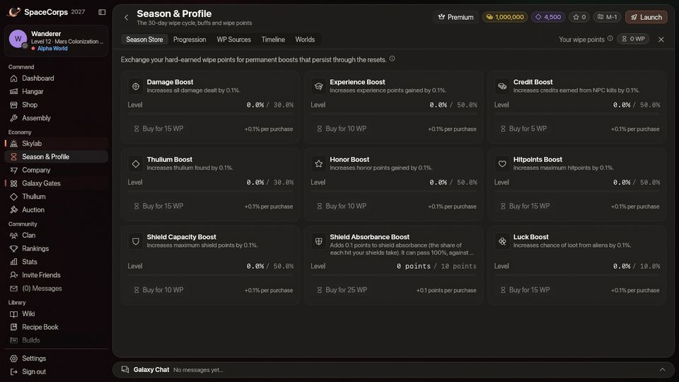

# Wipe Timeline & Seasons

The universe of SpaceCorps is governed by a recurring seasonal cycle. Every 30 days, the galaxy undergoes a cosmic reset known as the **Wipe**. A wipe takes the loose things and keeps what you built: your ships, drones, technologies, [Skylab](/wiki/03-Mechanics/Skylab.md#the-wipe) and Wipe Points stay, and so do your credits and Thulium up to a cap. Your season ends with a rank, and the rank pays rewards. This page is the whole rule in one place: what the wipe keeps, what it resets, what it takes and what it gives. The rewards by rank have a page of their own, [Seasons and Rewards](/wiki/03-Mechanics/Seasons-and-Rewards.md).

---

## 30-Day Season Schedule

Each season runs through days 1 to 30 (the Wipe starts with its 5-minute countdown as day 30 begins) and progresses through several distinct phases. You can monitor the current season day and active phase directly from the in-game HUD.

The [Daily Rewards](/wiki/03-Mechanics/Daily-Rewards.md) calendar has 29 tiles, not 30, because day 30 is the Wipe's countdown.

| Phase | Days | Protocol / Event | Description |
| :--- | :--- | :--- | :--- |
| **Peace Protocol** | Days 1–3 | No PvP Enabled | A fresh start focused entirely on PvE progression, resource farming, and ship building without the threat of player conflict. |
| **First Contact** | Days 4–10 | Event 1 | PvP opens (by your world's rule, see Worlds below), and the three [swarms](/wiki/05-Swarms/Swarms.md) begin to appear: they stay until the wipe, through the phases after this one. The phase itself gives no special rewards yet. |
| **Tech Surge** | Days 11–18 | Event 2 | The [Danger Sectors](/wiki/01-General/Danger-Sectors.md) change: a [giant excavator](/wiki/03-Mechanics/Giant-Excavator.md) beside each pulsar on `DS-1` to `DS-3`, the [Dormant Swamp](/wiki/03-Mechanics/Dormant-Swamp.md) on `DS-4`, Slumbering Voids, and a Dormant Swarm that comes back sooner and pays twice. All of it stays until the wipe. The phase gives no rewards of its own. |
| **War Games** | Days 19–25 | Event 3 | No special effects yet: PvP works as in every phase after the Peace Protocol. |
| **Final Countdown** | Days 26–30 | Event 4 | The final countdown phase. All pilots race to complete their carrying cargo before the eruption. |
| **The Reset** | Day 30 | Blackhole Eruption | The universe is destroyed and reborn, every [clan](/wiki/03-Mechanics/Clans.md#the-wipe-disbands-every-clan) is disbanded and your season is closed: your rank is written down and pays its rewards ([Seasons and Rewards](/wiki/03-Mechanics/Seasons-and-Rewards.md)). Pilots move to the world they chose as their destination for the next season. In the last 72 hours before it the [black hole](/wiki/03-Mechanics/Black-Hole.md#growing-before-the-wipe) grows to 1.8 times its size, and the Dashboard counts down to the wipe. |

Apart from the wipe itself, only five things follow the calendar: the Peace Protocol (days 1–3) changes a rule, from day 4 the [swarms](/wiki/05-Swarms/Swarms.md) appear and stay until the wipe, from day 11 the [Danger Sectors](/wiki/01-General/Danger-Sectors.md) get their giant excavators (beside the pulsars, which shine from day 1) and the Dormant Swamp, which stay until the wipe, and the [Auction](/wiki/03-Mechanics/Auction.md#the-season-and-the-wipe) charges no fees from day 28 and is closed from day 30, and in the last 72 hours before the wipe the [black hole](/wiki/03-Mechanics/Black-Hole.md#growing-before-the-wipe) grows to 1.8 times its size. The four events are named phases of the season: they show on the game's Season page and Dashboard. Event 2 changes the Danger Sectors as above; none of the others gives special rewards, spawns or bonuses of its own yet.

---

## The wipe at a glance

The wipe begins when season day 30 does. First comes a **5-minute countdown**: a red banner shows the time left, the chat says so, a warning sound plays at 5:00, at 1:00 and in the last ten seconds, and the black hole in `DS-4` burns brighter. At zero everybody is taken off the maps and the server wipes the whole universe in one go. You land at your company's home sector of the world you chose, and a **Season Report** opens at the station: your rank and place, your numbers of the wipe, what was kept, what was lost and what you were paid. If you were offline, it waits for your next sign-in.

The **Wipe preview** shows you, before it happens, what the wipe will do to *you*: the ships and gear it keeps, the items it deletes and how much of your credits and Thulium the caps would take. It is the plan the server itself runs, so what it shows is what happens. Open it from the banner during the countdown, or from the Dashboard and the Season page from season day 24, or as soon as the caps are announced.

Before the countdown ends:

* Pay the Fleet Treasury of your [clan](/wiki/03-Mechanics/Clans.md#the-wipe-disbands-every-clan) out if you lead one: it is lost with the clan.
* Put what you want to keep into the [Transport Cache](#transport-cache-travel-capsule-).
* Collect your finished crafts before the wipe: a craft that is not collected is refunded, not made. That goes for a ship, a drone, a drone formation and a P.E.T. Station too: the wipe keeps those only once you have collected them.
* Check the Wipe preview, and your credits and Thulium against [the caps](#the-caps).
* Choose your next world under Galaxy Gates ([Worlds](#worlds-alpha-beta-and-gamma)).

---

## What you keep

Everything below is yours after the wipe.

* **Every ship you own**, with a full hull and empty shields (as after a revival) and its skin. The hangar is yours for good; which ship keeps what is fitted to it is explained under [the Transport Cache](#transport-cache-travel-capsule-).
* **Your drones**, with their levels and experience, and your [drone formations](/wiki/03-Mechanics/Formations.md), wherever they are: in your inventory, on your hotbar or on a ship.
* **Your [P.E.T.s](/wiki/03-Mechanics/Pets.md)** (docked or stored), the jobs running in the Cradle, the Codex and your P.E.T. Stations.
* **All your technologies.** The Research Centre keeps everything [Research](/wiki/03-Mechanics/Research.md) holds: the science in its tank, the Dark Matter plugged into it, a research under way and the boost. So do the Extra Slots CPUs you installed, which are not items.
* **Your whole [Skylab](/wiki/03-Mechanics/Skylab.md#the-wipe)**: modules, levels and the ore banked in the Resource Storage. Banked ore is not an item and does not count against the Cache.
* **Your Wipe Points and your permanent buffs** ([the store](#the-permanent-buff-store)).
* **Experience, level and honor.**
* **Credits up to 5,000,000,000 and Thulium up to 10,000,000.** Above that is lost: see [the caps](#the-caps).
* **Your quest progress.** Missions done and in progress stay.
* **Your looks** (skins, auras and exhausts), which are not items either ([Cosmetics](/wiki/06-Items/Cosmetics.md)).
* **What is in your Transport Cache**, below.

Ammo and combat rockets are kept too, without using any Cache capacity: up to **1,000** of each combat rocket and up to **1,000,000** of each type of laser ammo ([details](#ammo-and-rockets)).

Your unopened containers, your [special items](/wiki/06-Items/Special-Items.md) and your titles are never touched by the wipe: they live in tables of their own.

---

## Chrono-Gate & Energy Materializer

The **Chrono-Gate** (also referred to as the Galaxy Gate) is a massive seasonal structure that acts as a bridge between seasons. Building and stabilizing this gate is essential to unlocking your carry-over transport privileges.

### Gate Assembly
To fully stabilize the Chrono-Gate, you must collect exactly **100 Chrono-Gate parts**.

### The Energy Materializer
You obtain parts by using the Energy Materializer interface, which spins local energy sectors to locate gate parts. It spins for **Thulium** only (a spin for Credits is closed):
* **Thulium Spin** (5 Thulium): Has a **10% chance** to produce a gate part.

*Pro-Tip: You can use multipliers (1x, 5x, 10x, 100x) to perform bulk spins and accelerate gate construction.*

---

## Transport Cache (Travel Capsule)

Once all 100 parts are collected and the Chrono-Gate is fully stabilized, the portal opens access to your personal **Transport Cache** (also known as the carry-over cart or travel capsule). This pocket dimension shields your belongings from being deleted during the wipe. Items you have listed on the [Auction](/wiki/03-Mechanics/Auction.md#the-season-and-the-wipe) come back to you at the wipe as loose items, which the wipe deletes like the rest unless you put them in the Cache; the bids you hold in lots are refunded.

### The cache ship

You can lock **one ship** in the Cache. A locked ship **keeps everything fitted to it**, in both configurations, with the amps, cells and thrusters fitted into the pieces: put your best gear on it. After the wipe it is your active ship.

* **The lock is final.** A locked ship can't be launched, fitted, unfitted, converted or plated until the wipe, and you can't unlock it yourself; only an administrator can clear a lock.
* **You need another ship to fly.** The ship must be docked, not wrecked and with no conversion queued, and you must own another ship you can launch. If you lock your active ship, the best of your other ships becomes the active one and the game tells you which.
* **Skins, drones and P.E.T.s are not locked.** A look can still be changed on a locked ship.
* The Hangar marks the locked ship with a lock, and from season day 26 every ship card says whether the ship keeps its gear at the wipe or is stripped.

### Three bays and the cargo {#bays-and-cargo}

* **Three bays of 10 slots each**: one for lasers, one for shield cores and one for engines. A loose laser, shield or engine goes into its bay while the bay has room, with the amps, cells and thrusters fitted into it. Bay items **weigh nothing**.
* **The cargo holds 100 tons (100,000 kg)** of anything else that is loose: resources, ammo, boosters, extras, and the lasers, shields and engines that do not fit their bay. It is [weighed item by item](#item-weight).
* You add items from your hangar inventory on the Transport Cache tab of the Galaxy Gates page. Equipped items can't go in, and neither can ships, drones, formations or P.E.T. Stations: those are kept without it.

### No cache ship {#without-a-cache-ship}

You don't have to lock a ship. With none locked, your **active ship keeps what is fitted to it**, in both configurations, as it always has, without the Chrono-Gate. The bays and the cargo still work once the gate is complete.

### Ammo and rockets

Ammo and combat rockets that are not in the Cache carry over by themselves, up to a limit: up to **1,000** of each combat rocket (every Lancet, Rivet, Ember and Scatter) and up to **1,000,000** of each type of laser ammo. They use no Cache capacity.

Nothing else of the kind is carried over by itself: the N.I.K.E., the N.U.K.E., the EMP Charge and everything above those limits are lost unless you put them in the Cache, where they count by weight. What is in the Cache is kept whole and does not count against the limit: with 3,000 of a rocket and 1,500 of them in the Cache you keep those 1,500 and 1,000 of the other 1,500, and lose 500. The Transport Cache tab and the Wipe preview list, for each type you have, what is kept, what is in the Cache and what would be lost.

### Item weight

Every item has one fixed weight. A stack weighs that weight times its quantity, and an item with modules fitted into it (thrusters in an engine, amps in a laser, cells in a shield core) goes in with them and weighs them too:

* *Lasers, Shield Cores, Engines, Adaptive Cores*: 2,500 kg each
* *Thrusters, Laser Amps, Shield Cells*: 1,000 kg each
* *Hull Plating, Boosters, Extras, Energetic Walls*: 500 kg each
* *EMP Charges*: 250 kg each
* *Plates* (the Velkonite and Orvium Reinforced Plates that the Skylab's Forgery makes, and the Dark Matter Plates): 5 kg each
* *Cluster Chunks*: 2 kg (Regular), 4 kg (Mythical) or 8 kg (Legendary)
* *Other resources and laser ammo* (ore, Ship Fragments, Power Cores, Reinforced Hull Plates, Dark Matter and so on): 1 kg each
* *Combat rockets* (see [Rockets](/wiki/06-Items/Rockets.md)): 1 kg each
* *N.I.K.E. and N.U.K.E.*: 250 kg each

* **Example**: with the laser bay full, 40 more lasers weigh 40 × 2,500 kg = 100,000 kg and fill the cargo exactly; a 41st is refused. With the engine bay full, one more Engine III with its three thrusters fitted weighs 2,500 + 3 × 1,000 = 5,500 kg. Resources are light: a stack of 1,000 ore weighs 1,000 kg, and 100 plates weigh 500 kg.

### Freezing the cache {#confirm-lock}

The **Freeze contents** button on the Transport Cache tab is a safety catch for the bays and the cargo: while they are frozen nothing can be added or taken out until you unfreeze them. It is not a condition: what is in the Cache goes through the wipe frozen or not. It has nothing to do with the cache ship's lock, which is final.

**WARNING**: Any item that is not kept by the rules above (fitted to the ship that keeps its gear, in the Transport Cache, a drone, a drone formation, a P.E.T. Station, or ammo and combat rockets within the limits) is **permanently destroyed** during the Blackhole Eruption.

---

## What resets

* **Your rank for the season.** It is written into your season history (Season page › Progression) with your place on your company's ladder, and your ranking points start again from zero ([fresh points](#fresh-points)).
* **The Wipe Point sources**: the alien kills and the claims of missions and Dormant Knowledge, so you can earn them again ([Earning Wipe Points](#earning-wipe-points)). Your Wipe Points and your buffs stay.
* **Alien kills.** They are counted for the wipe you are in, and your all-time numbers stay.
* **Every item that is not kept**: resources, boosters, spare gear, plates, Cluster Chunks and the rest, and the engines and lasers fitted in your Skylab's Engine and Defense Modules: take those out and put them in the Cache to keep them. Whatever the wipe returns to you first (see below) is an item like any other.
* **Clans.** Every clan is disbanded with its Fleet Treasury, posts, treaties, points and boost levels ([Clans](/wiki/03-Mechanics/Clans.md#the-wipe-disbands-every-clan)).
* **The Chrono-Gate parts**: the gate starts again, and so does your Materializer.
* **Your Skylab expedition** ends: a trip under way is over and the Trophies Bay pays out its Credits, Thulium, experience and honor and is emptied ([Skylab](/wiki/03-Mechanics/Skylab.md#the-wipe)).
* **Your crafts.** Every craft in your Production Queue in Assembly is cancelled and refunded, whatever it makes: an item, a ship, a ship conversion, a drone or a drone upgrade, a drone formation, a P.E.T. Station or an Extra Slots CPU. The credits and Thulium it cost come back to your wallet before the caps. The materials come back as loose items and go with the rest of them, unless you cancel the job yourself earlier and put them in the Cache. A craft that has finished but waits to be collected is refunded too, and what it would have made is never made: collect your finished crafts before the wipe. The jobs in the Cradle are not crafts: your P.E.T. jobs go on.

**Money comes home first.** Before anything is cut, everything you have out in the world returns to your wallet: the money held by your [Auction](/wiki/03-Mechanics/Auction.md#the-season-and-the-wipe) lot bids and buy orders, the Trophies Bay and your refunded crafts. Your listings come back as loose items. The caps are applied to the wallet after that, and your rewards are paid after the caps.

---

## What you get

The rank you hold at the instant of the wipe pays you: **Wipe Points**, **Premium days**, and a restart fund of **credits and Thulium** that grows with the rank. The pilot with the most PvE points on the whole server, the crown, gets more on top. The table is on [Seasons and Rewards](/wiki/03-Mechanics/Seasons-and-Rewards.md#the-rewards-by-rank).

The top ranks are also given a **look** ([Season looks](/wiki/03-Mechanics/Seasons-and-Rewards.md#season-looks)).

A rank also pays **loot containers** and a **season title**.

You are paid if you had a world at the wipe, at least 150 PvE points and at least 3 hours played in this wipe. The rewards come after the caps, so they are never cut; a pilot who was just under a cap can end the new season a little above it.

---

## The caps

At the wipe, **credits above 5,000,000,000 (5 billion)** and **Thulium above 10,000,000 (10 million)** are **lost**. What is below the caps is yours. The Season Report says how much was lost.

* **There is always a notice first.** The game takes nothing it has not announced 14 days before.
* **Only your wallet at the wipe is cut.** Nothing is taken during a season: you can earn past the caps while you play.
* **Everything that comes home counts.** The money returned at the wipe ([above](#what-resets)) is added before the caps, so check your Auction bids and orders when you are near a cap.
* **Rewards are paid after the caps**, so a reward is never cut.
* **You see it coming.** From the day the notice is public, the Dashboard, the Season page and the Gates page show a line about the caps. It turns red when you are over a cap and the caps are in force for the next wipe, and the [Wipe preview](#the-wipe-at-a-glance) gives the exact numbers.

---

## Fresh points

Your **ranking points** count what you earned **since the last wipe**: the levels you gained, the experience and the alien kills of this season. At the wipe they start again from zero and your old rank goes into your season history. **Honor does not set your rank**, and your all-time numbers (level, experience, honor, kills) stay as they are. See [Ranks](/wiki/03-Mechanics/Ranks.md#ranks-and-the-wipe).

The first wipe of the new rules is the first to start the count: until then the points you have are your whole career's.

---

## Worlds: Alpha, Beta and Gamma

SpaceCorps runs three **worlds**. Each one is a separate copy of the whole galaxy: every sector, with its own aliens, [company pilots](/wiki/03-Mechanics/Company-Pilots.md), cargo, chat and pilots. You fly only in your own world and meet only its pilots; your account, items and the pilot leaderboards are shared by all three. A clan belongs to one world, takes only its pilots and is disbanded at the wipe ([Clans and Worlds](/wiki/03-Mechanics/Clans.md#clans-and-worlds)).

| World | Level needed | Risk | Alien strength | Kill and quest pay | PvP |
| :--- | :--- | :--- | :--- | :--- | :--- |
| **Alpha** | 1 | Casual / Starter | 1.0x | 1.0x Credits, Thulium, XP, Honor | **High Security**: only on the border maps (`x-4`) and in the central PvP zone (`DS-x`). No PvP in the company sectors `x-1` to `x-3`. |
| **Beta** | 7 | Normal / Intermediate | 1.5x | 2.0x Credits, Thulium, XP, Honor | **Medium Security**: everywhere except the base sectors (`x-1`). |
| **Gamma** | 10 | Hardcore / Elite | 2.0x | 3.0x Credits, Thulium, XP, Honor | **Low Security**: everywhere. Maximum risk, maximum pay. |

How the worlds work:

* **Aliens**: a world's alien strength multiplies their hit points, shields, shield recharge and damage. Their speed and range are the same everywhere.
* **Pay**: a kill pays by the world it happens in. A quest pays by the world you did it in (the lowest one, should it span two), whichever world you claim it in (a Station mission has no world of its own and pays the world you fly in when you claim it), and a timed quest's limit is 1.5 times as long in Beta and twice as long in Gamma ([Quests](/wiki/03-Mechanics/Quests.md)). Loot drops and company pilots are the same in every world, so a higher world earns more per hour, but its fights cost more repairs.
* **PvP**: everyone on a map belongs to its world, so one rule holds for the whole map, company pilots included. Safe zones and the Peace Protocol (days 1–3) protect every world.
* **In flight**: the world's name sits before the sector's id at the top right ("Beta · M-2"). The badge in the title bar of the Ship window says where you stand: **Safe** in a safe zone, **No PvP** during the Peace Protocol or where your world forbids PvP, **PvP** where other pilots can attack you. Hover it for the rule. The [galaxy map](/wiki/01-General/Spacemap%20Travel.md) colours the sectors by your world's rule.

### Joining and moving

* **Joining**: a new pilot picks a world at Setup, once a season. Beta needs pilot level 7 and Gamma pilot level 10; Alpha has no limit, so a new account starts there. A world your level doesn't take yet is shown locked, with the level it needs. A world takes up to 1,000 pilots a season; a full one can't be joined.
* **Moving**: only at the Blackhole Eruption (day 30), to the **Destination** chosen under Galaxy Gates. Every change of world lands you at your company's home sector (`M-1`, `T-1` or `G-1`). With no destination chosen, you pick a world again at Setup. Destinations count against the next season's room: a world as many pilots are heading to as it takes can't be chosen. The same levels apply to the Destination; they only decide what you can choose, nobody is moved out of the world they already fly in.
* **No in-season transfers**: the **Travel Token** every pilot gets at the wipe has no use for now.

---

## Cross-Season Progression (Permanent Buffs)

Besides the rewards of your rank, your play builds permanent power that no wipe takes away. Defeating aliens and completing missions awards **Wipe Points (WP)**, which you spend on permanent buffs, and the sources of Wipe Points start again at every wipe, so you can earn them every season. Your [missions](/wiki/03-Mechanics/Quests.md) themselves, done and in progress, carry over: each can be done once per pilot, ever, except the level missions that update 0.4.10 reworked: 64 of them are offered once more ([Quests](/wiki/03-Mechanics/Quests.md#reworked-missions)).

**Clans and ranks.** The wipe disbands every clan, with its Fleet Treasury, posts, log, treaties, points and boost levels, so every season is a new race to found a clan and fill its boosts; the credits a clan has paid you stay, and so does your donation allowance ([Clans](/wiki/03-Mechanics/Clans.md#the-wipe-disbands-every-clan)). Leaders and Co-Leaders: pay the Fleet Treasury out before the countdown ends. Your rank for the season goes into your history and your ranking points start again, so every season is a new climb up your company's ladder ([Ranks](/wiki/03-Mechanics/Ranks.md#ranks-and-the-wipe)).

### The Permanent Buff Store
You can spend your accrued WP on permanent buffs that carry over across all seasons forever. These buffs stack and provide significant passive bonuses:

* **Damage Boost**: +0.1% damage dealt per level (Max 30% / 300 levels) - *Cost: 15 WP*
* **Experience Boost**: +0.1% XP gained per level (Max 50% / 500 levels) - *Cost: 10 WP*
* **Credit Boost**: +0.1% Credits earned per level (Max 50% / 500 levels) - *Cost: 5 WP*
* **Thulium Boost**: +0.1% Thulium found per level (Max 30% / 300 levels) - *Cost: 15 WP*
* **Honor Boost**: +0.1% Honor gained per level (Max 50% / 500 levels) - *Cost: 10 WP*
* **Hitpoints Boost**: +0.1% maximum HP per level (Max 50% / 500 levels) - *Cost: 15 WP*
* **Shield Capacity Boost**: +0.1% maximum Shields (shield **capacity**) per level (Max 50% / 500 levels) - *Cost: 10 WP*
* **Shield Absorbance Boost**: +0.1 points of your shield **absorbance** per level (Max +10 points / 100 levels) - *Cost: 25 WP*. Absorbance is the share of every hit your shields take (see [Shield Mechanics](/wiki/03-Mechanics/Shields.md#2-shield-absorbance-damage-split-)); the buff adds flat points to it: 100 Wipe Points buy 4 levels (+0.4 points), 300 buy 12 (+1.2), 500 buy 20 (+2.0) and all the 1,090 Wipe Points that the sources pay in one wipe buy 43 (+4.3 points). At the maximum (100 levels, 2,500 WP: a goal for several wipes, since the sources pay 1,090 at most in a wipe and your rank adds 5 to 400) 80% (the best out of the box) would become 90% and a Light Shield Core's 45% 55%. The stat is not capped at 100%: the attacker's *shield penetration* is taken off it, so what passes 100% is a margin. With a wipe's Wipe Points in this buff and a fully forged Eternal set of shields and cells a ship reaches about 94% to 96%. (Up to 0.4.5 this buff added a share of the absorbance itself, 0.1% of it a level, at the same price; the points are worth the same or more at every absorbance, so levels already bought lost nothing; up to 0.4.2 it raised the shield *recharge* rate instead; no permanent buff raises recharge now.)
* **Luck Boost**: +0.1% chance of loot from aliens per level (Max 10% / 100 levels) - *Cost: 15 WP*

### Earning Wipe Points

Wipe Points come from milestones that you claim yourself, in the game under **Season › WP Sources**. A claim takes every milestone you have reached and not claimed yet. **The sources start again at every wipe**, so each season you can earn them once more; the Wipe Points you hold and the buffs you bought stay.

**Alien kills.** Each of the five aliens pays a fixed number of Wipe Points for every block of its kills, a milestone, up to 50 milestones per alien in a wipe. Kills beyond the 50th milestone pay nothing more until the wipe, and the count starts from zero after it:

| Alien | Kills per milestone | WP per milestone | Most you can earn from it |
| :--- | :--- | :--- | :--- |
| [Seeker](/wiki/04-Aliens/Seeker.md) | 100 | 1 | 50 WP, at 5,000 kills |
| [Phantasm](/wiki/04-Aliens/Phantasm.md) | 100 | 2 | 100 WP, at 5,000 kills |
| [Bulwark](/wiki/04-Aliens/Bulwark.md) | 100 | 3 | 150 WP, at 5,000 kills |
| [Goombah](/wiki/04-Aliens/Goombah.md) | 50 | 4 | 200 WP, at 2,500 kills |
| [Crystalys](/wiki/04-Aliens/Crystalys.md) | 50 | 5 | 250 WP, at 2,500 kills |

Only kills you are paid for count (see [Combat](/wiki/03-Mechanics/Combat.md)). A milestone pays when it is whole: 99 Seekers pay nothing, the 100th pays 1 WP, and the kills after it count towards the 200th. The five aliens together pay 750 Wipe Points a wipe.

**Missions.** The first mission you complete pays 5 WP, then every 5th (the 5th, 10th, 15th and so on, up to the 85th) pays 5 WP more, 90 WP in all. Only the level missions count (88 in all: not the Station missions or the Challenge line, see [Quests](/wiki/03-Mechanics/Quests.md)), and a reworked level mission that you do again is not counted a second time. Your missions stay done through the wipe, so right after it **the 90 WP can be claimed again**.

**Dormant Knowledge.** Besides the milestones, the five Dormant Knowledge technologies of the [Research](/wiki/03-Mechanics/Research.md#pilot-technologies) pay 50 WP each, 250 in all. A level pays when its research finishes, and after every wipe a level you have researched **can be claimed again** in WP Sources. A technology that an administrator grants pays none.

**In all** the sources pay up to **1,090 Wipe Points** in a wipe: 750 for the kills, 90 for the missions and 250 for Dormant Knowledge. Your rank pays more at the wipe ([Seasons and Rewards](/wiki/03-Mechanics/Seasons-and-Rewards.md)).
