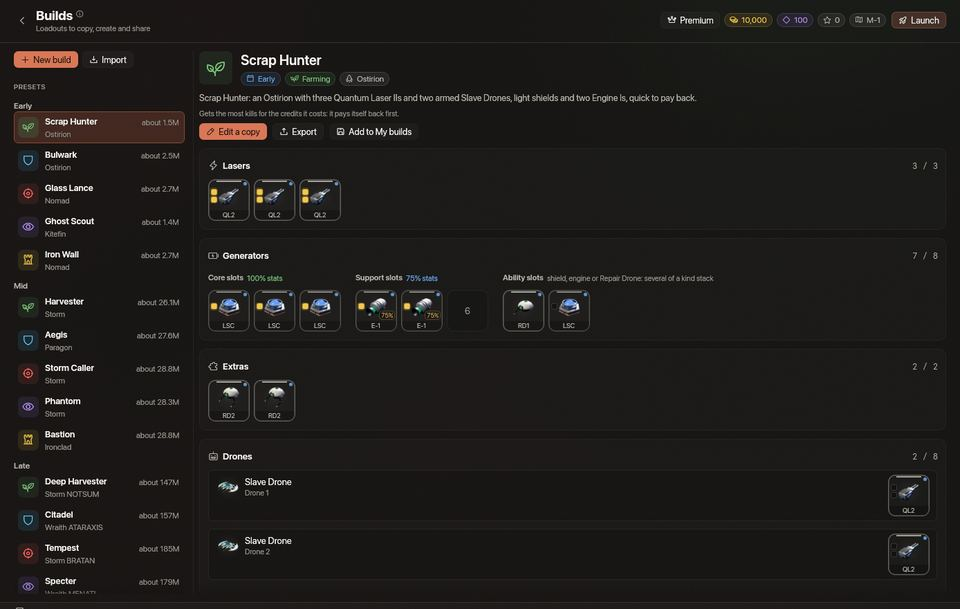
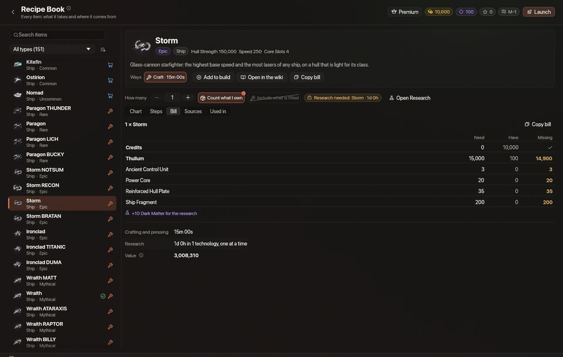
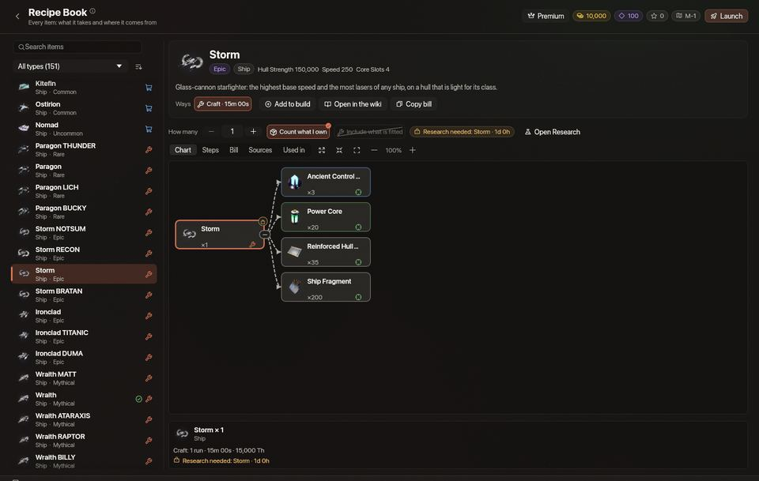

<!-- wiki-i18n source: 6ff3251582e96a39 -->
<!-- wiki-i18n title: Rezeptbuch -->
# Rezeptbuch und Builds {#recipe-book-and-builds}

<!-- wiki-search: recipe; recipes; recipe book; bill; steps; chart; craft tree; what do i need; build; builds; loadout; preset; presets; import; export; json; my builds; share a build; rezept; rezepte; kosten; schritte; diagramm; herstellen; ausrüstung; vorlage; importieren; exportieren; meine builds; build teilen -->

Das **Rezeptbuch** beantwortet für jeden Gegenstand des Spiels die Frage „Was braucht man dafür?“: ein Diagramm, woraus er besteht, die Schritte der Reihe nach, die vollständigen Kosten und woher jeder Rohstoff kommt. **Builds** tut dasselbe für ein ganzes Schiff: Importiere die Ausrüstung aus deinem Hangar oder den Build eines Freundes, starte mit einem der 15 Presets oder stelle dir selbst einen zusammen, und sieh dir seine Werte und seine vollständigen Kosten Schritt für Schritt an. Beides findest du in der **Bibliothek** der Station, unter dem Wiki.

Das Rezeptbuch führt keine eigene Preisliste: Es rechnet seine Zahlen erst aus, während du hinsiehst, aus den Rezepten, Preisen, Technologien und Beutetabellen, die auch der Shop, die [Montage](/wiki/06-Items/Overview.md#upgrading-modules) und die [Forschung](/wiki/03-Mechanics/Research.md) benutzen, und folgt dem Spiel daher, wenn sich ein Preis oder ein Rezept ändert. Darum nennt diese Seite keinen Preis und keinen Wert: Öffne den Gegenstand oder den Build.

## Öffnen {#open-it}

Öffne das Stationsmenü und wähle **Bibliothek › Rezeptbuch** oder **Bibliothek › Builds**. Das Rezeptbuch merkt sich den zuletzt angesehenen Gegenstand, seine Filter und seinen Zoom, und zwar nur auf diesem Computer; deine Builds gehören nicht dazu ([Auf deinem Konto gespeichert](#saved-on-your-account)). Ist das Spiel neuer als der Server, mit dem es spricht, sagt die Seite das und zeigt weniger: Das Rezeptbuch rechnet weiterhin alles aus, was gekauft, hergestellt oder aufgewertet wird, kann aber nicht sagen, wo die Welt einen Gegenstand liefert (es steht dann nur „Besorgen“), und Builds nennt die Teile, die den neueren Server brauchen: die Presets, Meine Builds und die Werte.

## Gegenstand finden {#find-an-item}

Die große Liste links enthält jeden Gegenstand des Spiels, nach Typ gruppiert und innerhalb eines Typs in der Reihenfolge des Spiels: die schwächste Stufe zuerst. Auch die EMP Charge, das einzige Verbrauchsgut, steht darin.

- **Suche.** Fang irgendwo auf der Seite an zu tippen, und der Text landet im Suchfeld. Die Liste wird zu einer einzigen Liste, sortiert danach, wie gut der Name passt (der ganze Name, sein Anfang, der Anfang eines Wortes, irgendein Teil davon, dann der Typ). Groß- und Kleinschreibung und Akzente spielen keine Rolle, und der alte Name eines umbenannten Gegenstands findet den Gegenstand. `Esc` löscht die Suche.
- **Typ.** Das Aufklappmenü über der Liste beschränkt sie auf einen Typ und zeigt, wie viele Gegenstände jeder Typ hat. Der Schalter daneben sortiert innerhalb jedes Typs von A bis Z.
- **Zeilen.** Eine Zeile zeigt Bild, Namen, Typ und Seltenheit des Gegenstands, ein kleines Symbol für den Weg, auf dem du ihn normalerweise bekommst (in der Montage hergestellt, im Shop erhältlich, erbeutet oder gefunden, gepresst oder im Schwarzen Loch erzeugt), und einen Haken, wenn du ihn hast.
- **Tasten.** Mit den Pfeiltasten, Bild auf, Bild ab, Pos1 und Ende läufst du durch die Liste, und `Enter` (Eingabetaste) springt zum Diagramm. `Alt+Left` und `Alt+Right` gehen in den geöffneten Gegenständen zurück und wieder vor.

## Das Diagramm {#the-chart}

Klicke einen Gegenstand an, und die rechte Seite zeigt ihn. Oben stehen sein Bild, sein Name, seine Seltenheit und sein Typ sowie ein Chip für jeden **Weg**, ihn zu bekommen: **Herstellen** (in der Montage, mit Zeit und Kosten), **Kaufen** (im Shop, mit seinem Preis), **Pressen** (aus Erz, in der Schmiede des Skylab), **Beute** (die Welt liefert ihn: Aliens, Felsen, Belohnungen) und **Erzeugen** ([Dark Matter](/wiki/03-Mechanics/Dark-Matter.md), aus N.I.K.E.s, die ins Schwarze Loch geschossen werden). Der gefüllte Chip ist der Weg, dem das Diagramm und die Kosten folgen; klicke einen anderen Chip, um stattdessen diesem zu folgen. Hast du nicht erforscht, was dich den Gegenstand herstellen lässt, sagt eine Zeile, welche Technologie nötig ist und wie lange sie dauert, mit einer Schaltfläche, die die Forschung öffnet.

Das **Diagramm** zeichnet den Gegenstand als Baum von links nach rechts: links der Gegenstand, rechts davon, woraus er besteht, bis hinunter zu den Rohstoffen.

- Jedes Kästchen zeigt den Gegenstand, wie viele davon du brauchst und ein Symbol dafür, wie man ihn bekommt (das Symbol des Chips dieses Wegs oben; fahre mit der Maus über das Kästchen, um die Wörter zu lesen, damit die Farbe nie das einzige Zeichen ist). Ein Schloss sagt, dass seine Technologie noch nicht erforscht ist, und ein grüner Haken mit einer Zahl, wie viele du davon hast.
- Ein Kästchen mit Zweigen hat einen kleinen Griff, der sie einklappt; die tiefen Zweige eines großen Baums sind anfangs eingeklappt. **Alle ausklappen**, **Alle einklappen**, **Einpassen** und die Zoom-Schaltflächen sitzen über dem Diagramm.
- Klicke ein Kästchen an, um seine Karte unter dem Diagramm zu lesen: den Gegenstand, die Wege, ihn zu bekommen (mit einem Klick auf einen anderen Chip folgst du diesem Weg), was der Weg verlangt (bei einem Herstellen die Durchgänge, die Zeit und die Kosten, bei einem Kauf den Preis im Shop), wie viele du hast und bei einem gesperrten Kästchen die Technologie, die es braucht. Ein Doppelklick oder `Enter` öffnet diesen Gegenstand im Rezeptbuch. Die Pfeiltasten wechseln von Kästchen zu Kästchen, die Leertaste (`Space`) klappt einen Zweig ein oder aus, und `0` passt das Diagramm ein. Scrolle, um dich zu bewegen; `Ctrl` (Strg) und das Mausrad zoomen.
- Ein Gegenstand, den es nur zu kaufen oder zu finden gibt, ist ein einzelnes Kästchen mit dem Satz „Nichts herzustellen: Das gibt es zu kaufen oder zu finden. Siehe Quellen.“

In einem breiten Fenster nimmt das Diagramm die linke Seite ein, und die übrigen Bereiche stehen in einer Spalte rechts davon; in einem schmalen zeigen die Reiter **Diagramm**, **Schritte**, **Kosten**, **Quellen** und **Verwendet in** jeweils einen Bereich.

## Schritte und Kosten {#steps-and-the-bill}

Unter der Kopfzeile bestimmen drei Bedienelemente, was gezählt wird: **Anzahl** der gewünschten Exemplare, **Eigenen Besitz anrechnen** (an: Was du schon hast, wird abgezogen) und **Verbautes einbeziehen** (aus: Ein auf einem Schiff verbautes Teil wird nicht gezählt, weil ein Upgrade ein Teil aufbraucht und ein verbautes seinen Slot verlassen würde).

- **Schritte** ist das Diagramm als nummerierte Liste, in der Reihenfolge, in der du es erledigst, in Gruppen: Forschung, Besorgen, Kaufen, Pressen und herstellen sowie Aus deinem Bestand. Die Forschung steht vorn, weil die Montage nichts herstellt, bevor ihre Technologie erforscht ist. Jeder Schritt sagt, was und wie viele, was er kostet und wie lange er dauert, und ein Besorgen-Schritt kann zeigen, wo man es bekommt. **Schritte kopieren** kopiert die Liste als Text.
- **Kosten** rechnet alles zusammen: deine Credits und dein Thulium im Vergleich zu dem, was du hast, jeden Rohstoff mit den Spalten **Nötig**, **Vorhanden** und **Fehlt**, das Dark Matter, das die Forschung braucht, die Zeit zum Herstellen und Pressen, die Zeit zum Erforschen (eine Technologie nach der anderen) und einen **Wert**. Der Wert ist ein Vergleich zwischen zwei Wegen, einen Gegenstand zu bekommen, wobei Thulium und alles, was du finden musst, in Credits gerechnet werden: Er ist kein Preis. **Kosten kopieren** kopiert die Kosten als Tabelle, die du in einen Chat oder eine Notiz einfügen kannst.

## Quellen und Verwendet in {#sources-and-used-in}

- **Quellen** sagt, wo die Welt den Gegenstand und jeden Rohstoff liefert, den der Plan braucht, nach Art: Aliens, Asteroiden und Felsen, Schwärme, der Dormant Swamp, Clan-Wächter, [Davidski](/wiki/03-Mechanics/Davidski.md), Skylab-Expeditionen, der Riesenbagger, Skylab-Produktion, Quests, Freunde einladen und das Startpaket. Eine Zeile nennt, wer ihn liefert und wo, die Chance und wie viele. „Außerdem bei“ führt die [Auktion](/wiki/03-Mechanics/Auction.md), Davidskis Vorrat und andere Piloten auf. Eine Chance ist eine Chance, keine Rate pro Stunde: Wie lange ein Abschuss dauert, liegt bei dir.
- **Verwendet in** listet die Gegenstände auf, die aus diesem hergestellt werden. Klicke einen an, um ihn zu öffnen.

## Zum Build hinzufügen {#add-to-build}

Ein Gegenstand, der in einem Slot sitzt oder mitgeführt wird, hat die Schaltfläche **Zum Build hinzufügen**: Schiffe, Hüllenpanzerungen, Laser, Laserverstärker, Schilde, Schildzellen, Triebwerke, Schubdüsen, Adaptive Cores, Extras, Drohnen, Formationen, Munition, Raketen und die EMP Charge. Sie legt den Gegenstand in den Build, den du in **Builds** bearbeitest, an die erste Stelle, an der er passt (gibt es keinen, wird ein neuer Build namens „Neuer Build“ angelegt), und eine Meldung sagt, wohin er kam oder warum er nicht passte („Wähle zuerst ein Schiff.“). Fügst du ein Schiff zu einem Build hinzu, der schon eines hat, musst du zum Ersetzen noch einmal klicken. Die EMP Charge wird mitgeführt, nicht verbaut: Sie kommt in die Raketen des Builds.

## Builds

Ein **Build** ist die Ausrüstung eines Schiffs, als Gegenstandsnamen geschrieben, damit sie auf jedem Server dasselbe bedeutet: das Schiff, die Laser mit ihren Verstärkern, die Schilde, Triebwerke und Adaptive Cores mit ihren Zellen und Schubdüsen, die Extras, die Teile in den Fähigkeits-Slots, die Hüllenpanzerungen, die Drohnen mit dem, was sie tragen, eine Formation sowie die Munition und die Raketen, die man mitführt. Er hat außerdem einen Namen, eine Notiz, eine Phase (Früh, Mitte oder Spät) und einen Typ.

Die Liste links enthält die **Presets** nach Phase, **Meine Builds**, **Neuer Build** und **Importieren**; in einem schmalen Fenster ist sie eine Reihe von Reitern. Wähle einen Build, und du siehst sein Board, seine Werte und seine Kosten.

### Importieren {#import}

**Importieren** öffnet ein Fenster mit drei Türen:

- **Einfügen**: Füge den Text eines Builds ein oder drücke **Aus der Zwischenablage einfügen**.
- **Aus einer Datei**: die Build-Dateien im Ordner `exports` des Datenordners des Spiels (`.spacecorps2027` in deinem Home-Ordner), dem Ordner, in den **In Datei speichern** schreibt.
- **Aus meinem Hangar**: Wähle eines deiner Schiffe und eine Konfiguration, und das Spiel liest, was verbaut ist: Laser und Verstärker, Generatoren mit ihren Zellen und Schubdüsen, Extras, Fähigkeitsteile, Hüllenpanzerungen, Drohnen mit dem, was sie tragen, und die Stufe deiner Extra Slots CPU. Es bietet auch die Formation, die Munition und die Raketen deiner Schnellleiste an; hake an, was du willst.

Du siehst, was hereinkommt, bevor etwas gespeichert wird, und das Spiel sagt dir genau, was es nicht importieren konnte: ein Gegenstand, den es in diesem Spiel nicht gibt, ein Teil, das nicht an seinen Platz gehört, mehr Teile, als das Schiff Slots hat, ein Build von einem neueren Spiel. **Ohne Änderungen importiert** heißt, alles ist hereingekommen. Dann **In Meinen Builds speichern**, **Im Editor öffnen** oder das Fenster schließen. Deine Stufen der [Schmiede](/wiki/06-Items/Forge.md), Schmiede-Boni, Drohnenstufen, Booster, dein P.E.T., das Aussehen deines Schiffs und die andere Konfiguration des [Hangars](/wiki/03-Mechanics/Hangar.md) gehören nicht zu einem Build (importiere die andere Konfiguration als zweiten Build).

### Die 15 Presets {#the-15-presets}

Fünfzehn Builds liegen bereit: drei Phasen des Spiels, **Früh**, **Mitte** und **Spät**, mit je fünf Arten. **Farmen** holt die meisten Abschüsse für das, was es kostet, **Verteidigung** hat den größten Schild und die schnellste Regeneration, **Angriff** den meisten Schaden und die meiste Durchschlagskraft, **Situativ** sucht sich seine Kämpfe mit Tarnung, Sprüngen und Tempo aus, und **Tank** hat Hülle und Schild zusammen am höchsten. Ein Preset lässt sich nicht ändern: **Kopie bearbeiten** öffnet es als deinen eigenen Entwurf, und **Zu Meinen Builds** behält es, wie es ist. Jede Zeile zeigt ihren Wert in wenigen Zeichen, errechnet aus den Rezepten, während du hinsiehst; öffne ein Preset für seine Werte und seine Kosten.

### Bearbeiten {#edit}

Ein Build ist wie ein Hangar gezeichnet: Laser, Generatoren, Extras, Fähigkeiten, Panzerungen und Drohnen, dann die Stufe der Extra Slots CPU, eine Formation und die Munition und die Raketen, die man mitführt. Klicke einen leeren Slot an, und eine Liste zeigt nur, was hineinpasst, mit seinem Preis oder dem Weg, es zu bekommen; klicke ein Teil an, um es zu **Ersetzen**, ein **Modul hinzufügen** oder es zu **Entfernen**. Eine Drohne trägt einen Laser oder einen Schildkern. Wechselst du das Schiff, bleiben die Teile, die noch passen, und der Rest wird als entfernt aufgelistet. Gib dem Build einen Namen, eine Phase, einen Typ und eine Notiz, dann **Speichern**, **Als Kopie speichern**, **Löschen** oder **Schließen** (Schließen fragt vorher nach, wenn Änderungen nicht gespeichert sind).

### Werte {#stats}

Unter dem Board steht die Werte-Karte des Hangars: Trefferpunkte, Schaden, Reichweite, Krit-Chance, Schilde und ihre Aufladung, Absorption, Tempo, Schild- und Tempobonus, Durchdringung und, bei einem Schiff mit Panzerungs-Slots, die Trefferpunkte, die seine Panzerungen hinzufügen. Für Fähigkeiten hat die Karte keine Zeilen: Die Teile in den Fähigkeits-Slots stehen auf dem Board. Der Server rechnet die Zahlen mit demselben Code wie dein Hangar aus, für einen Build, der auf keinem Schiff verbaut ist. Zwei Schalter legen die **Schmiedestufe** und die **Drohnenstufe** fest, von denen die Zahlen ausgehen. Eine Formation wirkt im Flug, deshalb steht sie als Text da und wird in den Zahlen nicht mitgezählt, ebenso wenig Booster oder deine eigenen Schmiedestufen.

### Kosten {#cost}

Die Kosten haben vier Blöcke:

- **Summen**: Credits, Thulium, Dark Matter, jeder Rohstoff mit Nötig, Vorhanden und Fehlt, die Zeiten und der Wert. **Du brauchst noch** ist das, was übrig bleibt, wenn dein Besitz abgezogen ist.
- **Wohin das Geld geht**: jedes Teil, das teuerste zuerst.
- **Schritte**: Forschung, Besorgen, Kaufen, Pressen und Herstellen, der Reihe nach, für den ganzen Build. Klicke einen Besorgen-Schritt an, um zu sehen, wo die Welt es liefert, oder öffne den Gegenstand im Rezeptbuch.
- **Bevor du anfängst**: was kein Teil ist, etwa die Stufen der Extra Slots CPU, die Forschung der Panzerungs-Slots, die Drohnen, die du noch kaufen musst, und die Skylab-Kernstufe, die die Schmiede braucht.

Drei Schalter: **Besitz abziehen** (an), **Ausgerüstetes einbeziehen** (aus) und **Munition und Raketen einbeziehen** (aus: Sie werden immer wieder verbraucht und sind deshalb nicht der Preis des Builds).

## Auf deinem Konto gespeichert {#saved-on-your-account}

**Meine Builds sind auf deinem Konto gespeichert**, auf dem Server und nicht auf diesem Computer, damit sie dir auf jeden Computer folgen. Du kannst bis zu 50 behalten; die Liste zeigt, wie viele du hast, und ist sie voll, bittet dich die Seite, einen zu löschen, um einen weiteren zu speichern. Ein Build ist gespeichert, wenn der Server es sagt: Die Seite zeigt währenddessen **Speichern ...**, und wenn der Server ablehnt oder nicht erreichbar ist, sagt sie, warum, und der Build bleibt ungespeichert, mit deinen Änderungen weiter im Editor. Ein gespeicherter Build besteht nur aus Gegenstandsnamen, ein paar Bezeichnungen und dem Namen und der Notiz, die du getippt hast, und kein anderer Pilot kann ihn sehen. Um einen an einen Freund weiterzugeben, exportiere ihn.

## Teilen und exportieren {#share-and-export}

**Exportieren** an einem Build öffnet ein Fenster mit dem Build als Text (JSON). **Kopiere** ihn, um ihn in einen Chat einzufügen, oder wähle **In Datei speichern**: Das schreibt `spacecorps-build-<name>.json` in den Ordner `exports` und überschreibt nie eine ältere Datei. Ein Freund fügt den Text unter **Importieren › Einfügen** ein oder legt die Datei in seinen eigenen Ordner `exports` und wählt sie unter **Aus einer Datei**. Der Text enthält die Gegenstandsnamen der Ausrüstung, das Schiff sowie Namen und Notiz des Builds, und nichts von deinem Konto.

## Tipps {#tips}

1. **Erst nachsehen, dann farmen.** Öffne einen Gegenstand im Rezeptbuch und lies seine Quellen und seine Schritte, bevor du einen Tag mit einer Beute verbringst, die nicht die richtige ist.
2. **Von null aus rechnen.** Schalte **Eigenen Besitz anrechnen** (in Builds: **Besitz abziehen**) aus, um zu sehen, was ein Gegenstand oder ein Build von Grund auf kostet; lass es an, um zu sehen, was du noch brauchst.
3. **Mit einem Preset anfangen.** **Kopie bearbeiten**, ein Teil tauschen, und die Werte und die Kosten ziehen mit.
4. **Auch die Bäume lesen.** Die [Gegenstandsbäume](/wiki/06-Items/Item-Trees.md) zeigen jede Art von Gegenstand nebeneinander, und das Rezeptbuch rechnet dir jeden davon vor.
