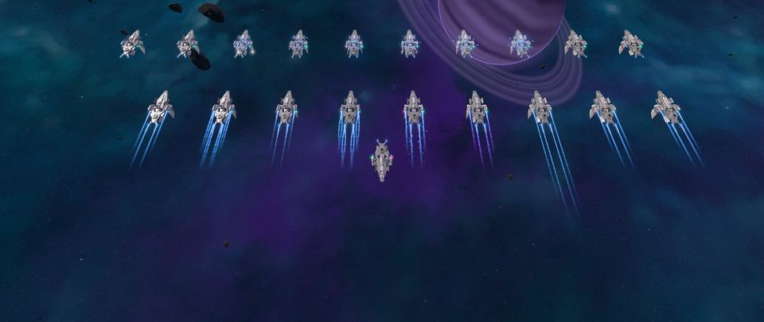
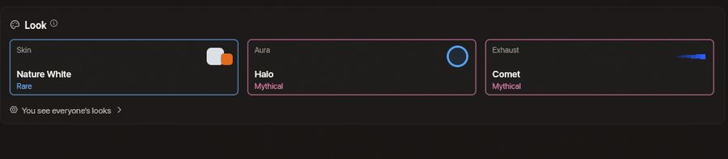
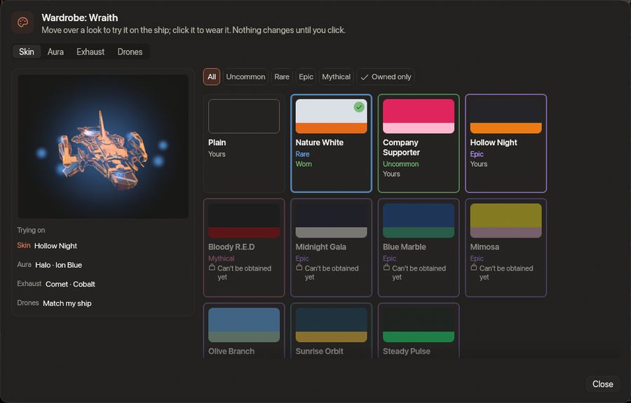

<!-- wiki-i18n source: 4ce8099d9dcbb29c -->
<!-- wiki-i18n title: Kosmetik -->
# Kosmetik {#cosmetics}

<!-- wiki-search: look; looks; skin; skins; aura; exhaust; livery; wardrobe; paint; collection; nature white; company supporter; bloody red; bloody r.e.d; holiday skins; aussehen; lackierung; garderobe; triebwerksspur -->

Ein **Look** ist das, was dein Schiff trägt. Er hat vier Teile: einen **Skin** (die Lackierung des Rumpfs), eine **Aura** (ein weiches Leuchten um das Schiff), eine **Triebwerksspur** (Farbe und Form der Spur hinter den Triebwerken) und die **Lackierung** deiner Drohnen. Ein Look ist nur zum Anschauen: Er bringt keinen Schaden, keine Hülle und keine Geschwindigkeit, belegt keinen Slot und ändert nichts, was ein Schuss treffen kann.

> [!NOTE]
> **Looks können nicht gekauft werden.** Der Wipe vergibt die Saison-Looks der obersten Ränge ([Saisons und Belohnungen](/wiki/03-Mechanics/Seasons-and-Rewards.md#season-looks)). Manche Looks findest du im [Chroma-Archiv (Chroma Archive)](/wiki/06-Items/Containers.md#chroma-archive), einem Container; die übrigen vergibt ein Admin. Wenn ein Admin dir einen Look gibt, sagt es dir ein Hinweis und ein sanfter Gong ertönt; einen Look, den du im Container gewinnst, zeigt die Ergebniskarte.

## In einer Minute {#in-one-minute}

- **Wo.** Der Abschnitt **Look** der Ansicht Raumschiff im Hangar hat drei Felder, **Skin**, **Aura** und **Triebwerksspur**, und die Ansicht Drohnen hat eines für die **Drohnenlackierung**. Ein Klick auf ein Feld öffnet die **Garderobe**.
- **Anprobieren.** In der Garderobe dreht sich das Schiff in dem Look unter deinem Zeiger. Nichts ändert sich und nichts wird gesendet, bis du klickst.
- **Wessen.** Ein Skin gilt für ein Schiffsmodell und gehört deinem Konto, also kannst du ihn auf jedem deiner Schiffe dieses Modells tragen. Eine Aura oder eine Triebwerksspur trägt jedes Schiff.
- **Wer ihn sieht.** Alle, es sei denn, sie haben Looks in den Einstellungen ausgeschaltet.

## Skins

Ein Skin ist ein Farbschema, gemacht aus dem eigenen Rumpf des Schiffs: Plattenfugen, Nummern und Streifen bleiben, nur die Farben ändern sich. Er gilt für ein **Schiffsmodell**, und denselben Skin tragen alle deine Schiffe dieses Modells und jedes [Design](/wiki/03-Mechanics/Ship-Designs.md), das daraus gemacht wurde; ein Umbau behält den Look. Die Protos hat noch keinen Skin, Kitefin, Ostirion und Nomad haben eine Kollektion, und die vier Schiffe, die du in der Montage baust, haben alle zehn.

Skins gehören zu deinem **Konto**, nicht zu einem Schiff, und sie bleiben über den [Wipe](/wiki/03-Mechanics/Wipe-Timeline.md) hinweg; deine Schiffe tragen, was sie getragen haben.

Das [Chroma-Archiv](/wiki/06-Items/Containers.md#chroma-archive) kann jede Kollektion außer Bloody R.E.D ergeben, und zwar eine ganze Kollektion auf einmal: alle ihre Skins, die du noch nicht hast.

| Kollektion | Schiffe | Seltenheit | Wie sie aussieht |
| :--- | :--- | :--- | :--- |
| **Nature White** | Paragon, Storm, Ironclad, Wraith | Selten | Ein schneeweißer Rumpf mit orangefarbenen Teilen |
| **Company Supporter** | Kitefin, Ostirion, Nomad, Paragon, Storm, Ironclad, Wraith | Ungewöhnlich | Der ganze Rumpf in der Farbe deines Konzerns: Rot für Mars, Grün für Terra, Violett für Galactic. Er folgt dir, wenn du den Konzern wechselst |
| **Bloody R.E.D** | Paragon, Storm, Ironclad, Wraith | Mythisch | Schwarz und blutrot, mit dem Logo des Clans auf einer dunklen Plakette in der Rumpfmitte |
| **Midnight Gala** | Paragon, Storm, Ironclad, Wraith | Episch | Silvester und Neujahr: ein nachtblauer Rumpf mit Silber-Champagner-Zierstreifen und einem Champagnerglas |
| **Blue Marble** | Paragon, Storm, Ironclad, Wraith | Episch | Tag der Erde: Ozeanblau mit grünem Land und einem kleinen Globus |
| **Mimosa** | Paragon, Storm, Ironclad, Wraith | Episch | Internationaler Frauentag: Zitronengelb mit violettem Zierstreifen und einer Blume |
| **Olive Branch** | Paragon, Storm, Ironclad, Wraith | Episch | Internationaler Tag des Friedens: Himmelblau mit olivfarbenem Zierstreifen und einem weißen Friedenszeichen |
| **Sunrise Orbit** | Paragon, Storm, Ironclad, Wraith | Selten | Die Tagundnachtgleichen und Sonnenwenden: ein dunkelblaugrüner Rumpf mit einer goldenen Sonne |
| **Steady Pulse** | Paragon, Storm, Ironclad, Wraith | Episch | Weltgesundheitstag und Welttag der seelischen Gesundheit: ein grünschwarzer Rumpf mit einem neongrünen Herzschlag |
| **Hollow Night** | Paragon, Storm, Ironclad, Wraith | Episch | Halloween: Anthrazit mit Orange und ein Mond mit Sternen |

## Drohnenlackierungen {#drone-liveries}

Jede Kollektion hat eine Lackierung für deine Drohnen in denselben Farben, und eine Master Drone trägt sie ein wenig heller als eine Slave Drone. In der Ansicht Drohnen des Hangars lässt dich das Feld **Drohnenlackierung** **Wie mein Schiff** wählen, was die Lackierung des Skins deines Schiffs übernimmt, oder die Lackierung einer Kollektion, von der du einen Skin hast. **Eigene Drohnen anzeigen** und **Gegnerische Drohnen anzeigen** in Einstellungen › Oberfläche entscheiden weiter, welche Drohnen du siehst.

## Aura und Triebwerksspur {#aura-and-exhaust}

Eine **Aura** und eine **Triebwerksspur** haben je eine **Farbe** und einen **Effekt**. Die Farbe ist eine von 24, dieselbe Liste für beide; der Effekt ist Form und Bewegung. Die Garderobe hat für jede einen Reiter.

### Die 24 Farben {#the-24-colours}

| Seltenheit | Farben |
| :--- | :--- |
| Gewöhnlich | Ion Blue, Cyan, Arctic, White, Silver, Amber, Lime, Rose |
| Ungewöhnlich | Cobalt, Indigo, Violet, Magenta, Crimson, Ember, Sunset, Gold, Emerald, Jade, Teal |
| Selten | Seeker Burnt, Pirate Brick |
| Episch | Dormant Void, Ancient Amethyst |
| Mythisch | Crystal Ice |

Die acht gewöhnlichen Farben gehören zum Slot: Jeder Pilot hat sie. Ion Blue ist die Farbe der Triebwerke, wie sie immer war.

### Effekte der Triebwerksspur {#exhaust-effects}

| Effekt | Seltenheit | Was er zeichnet |
| :--- | :--- | :--- |
| **Ion** | Gewöhnlich | Die Standardspur: ein Band. Gehört zum Slot |
| **Twin** | Ungewöhnlich | Zwei Bänder nebeneinander |
| **Pulse** | Selten | Ein Band, das pulsiert |
| **Helix** | Selten | Zwei Bänder, die sich umeinander winden |
| **Embers** | Episch | Ein Band, von dem Funken wegtreiben |
| **Gradient** | Episch | Ein Band, dessen Farbe sich entlang seiner Länge verschiebt |
| **Comet** | Mythisch | Eine lange, schmale Spur mit hellem Kern |
| **Prism** | Legendär | Drei Bänder in benachbarten Farbtönen |
| **Sovereign** | Ewig | Zwei pulsierende Bänder mit Funken und längerem Schweif |

### Effekte der Aura {#aura-effects}

| Effekt | Seltenheit | Was er zeichnet |
| :--- | :--- | :--- |
| **None** | Gewöhnlich | Keine Aura. Gehört zum Slot |
| **Glow** | Gewöhnlich | Ein weiches Leuchten um das Schiff |
| **Breath** | Ungewöhnlich | Ein Leuchten, das langsam atmet |
| **Motes** | Selten | Ein Leuchten mit vier kreisenden kleinen Lichtern |
| **Shimmer** | Selten | Ein Leuchten, das funkelt |
| **Sparkle** | Episch | Sechs kreisende Lichter, die funkeln |
| **Wreath** | Episch | Acht Lichter in langsamer Umlaufbahn |
| **Halo** | Mythisch | Ein atmendes Leuchten mit acht kreisenden Lichtern |
| **Laurel** | Legendär | Zehn Lichter, die langsam in einem atmenden Leuchten kreisen |
| **Crown** | Ewig | Zehn Lichter, die in einem atmenden, funkelnden Leuchten kreisen |

Eine Aura bleibt innerhalb des Rings, der eine Zielerfassung markiert, und wird unter allem anderen um ein Schiff gezeichnet.

## Die Garderobe {#the-wardrobe}

- **Reiter.** Skin, Aura, Triebwerksspur und Drohnen. Ein Seltenheits-Chip filtert einen Reiter auf eine Seltenheit, und **Nur meine** listet, was du tragen kannst.
- **Eine Kachel sagt, wie du zu dem Look stehst.** **Getragen** (das Schiff trägt ihn), **Im Besitz** (du hast ihn), **Gehört zum Slot** (jeder Pilot hat ihn) oder **Noch nicht erhältlich**, mit einem dumpfen Tick beim Klick.
- **Einen Look ablegen.** Die Kachel **Schlicht** im Reiter Skin gibt dem Schiff seine schlichte Lackierung zurück, und **Keine** nimmt die Aura ab.
- **Mehr als ein Schiff.** Der Schalter am Fuß des Blatts, **Auch auf meine anderen Schiffe dieses Modells anwenden** für einen Skin und **Auch auf meine anderen Schiffe anwenden** für eine Aura oder eine Triebwerksspur, lässt einen Klick den Look auf alle anlegen.
- **Wo du ihn ändern kannst.** Wo du deine Ausrüstung ändern kannst: angedockt oder in einer Schutzzone mit Schutz, wie in [Hangar im Flug](/wiki/03-Mechanics/Hangar.md#when-it-is-open).

<!-- containers-wardrobe:begin -->
<!-- Generated from server/Resources/Containers.json (and Cosmetics.json) by scripts/containers-wiki.sh: don't edit by hand. -->

Ein Look, den du nicht hast, zeigt **Noch nicht erhältlich**, auch wenn ein Container ihn geben kann: Der Hangar nennt den Container nicht.

<!-- containers-wardrobe:end -->

## Seltenheit {#rarity}

Jeder Look hat eine Seltenheit auf der eigenen Skala des Spiels, **Minderwertig, Gewöhnlich, Ungewöhnlich, Selten, Episch, Mythisch, Legendär und Ewig** ([Überblick](/wiki/06-Items/Overview.md)). Eine Kachel zeigt sie in der Farbe ihres Rands, und das Schiff eines anderen Piloten nennt dir die Seltenheit seines Looks im Zielfenster und beim Daraufzeigen, was es trägt.

## Was du von anderen siehst {#what-you-see-of-others}

Zwei Zeilen in Einstellungen › Oberfläche entscheiden darüber, und sie sind auch der Weg zu einem ruhigeren Bild auf einem langsamen Rechner:

- **Aussehen anderer Piloten anzeigen**: **Alle**, **Nur meine** oder **Aus**. Alle zeigt Lackierung, Drohnenfarben, Auren und Triebwerksfarben von allen. Nur meine zeigt nur dein eigenes Schiff und deine Drohnen mit ihrem Look, und jedes andere Schiff schlicht. Aus zeichnet jedes Schiff schlicht, deines auch.
- **Effekte der Piloten anzeigen**: **Alle**, **Nur meine** oder **Aus**, nur für die Auren und die Effekte der Triebwerksspur. Ein Effekt wird nur gezeichnet, wenn beide Zeilen ihn erlauben, und Aus in einer von beiden blendet auch deine aus.

Deine Einstellung **Details** (Einstellungen › Grafik: Niedrig, Mittel, Hoch, Ultra) bestimmt, wie viele Schiffe gleichzeitig mit einem Effekt gezeichnet werden können, die nächsten **4, 8, 12 oder 16**, deines zuerst, und wie viele verschiedene Skins das Spiel bereithält. Ein Look jenseits dieses Budgets erscheint als schlichtes Triebwerksleuchten oder in einem einfarbigen Ton seines Skins, bis ein Platz frei wird. Dein eigener Look wird immer gezeichnet.

## Farbe ist keine Identität {#colour-is-not-identity}

Nichts, was ein Look ändert, sagt dir, wer ein Pilot ist. Das **Namensschild** (der Buchstabe des Konzerns in seiner Farbe, das Kürzel des Clans), die **Minikarte**, das **Zielfenster**, der Zielring und die Ringe der Schutzzonen werden von einem Look nie gefärbt, und ein Company Supporter zeigt immer den Konzern seines Trägers, nie einen anderen. Manche Skins liegen nah an den Farben der Schwärme, die für die Piraten ein schlichtes Ziegelrot und für die Dormant-Schiffe ein kaltes Violett sind, also kann ein roter Rumpf ein Mars Supporter, ein Bloody R.E.D oder ein Pirat sein: Lies das Namensschild, wie du es immer getan hast.

## Klänge {#sounds}

Einen Skin, eine Aura, eine Triebwerksspur und eine Drohnenlackierung anzulegen hat je einen leisen eigenen Klang, ein Look, der als Geschenk ankommt, einen sanften Gong, und ein Look, den du noch nicht tragen kannst, antwortet auf einen Klick mit einem dumpfen Tick. Sie folgen der Lautstärke der Soundeffekte.
