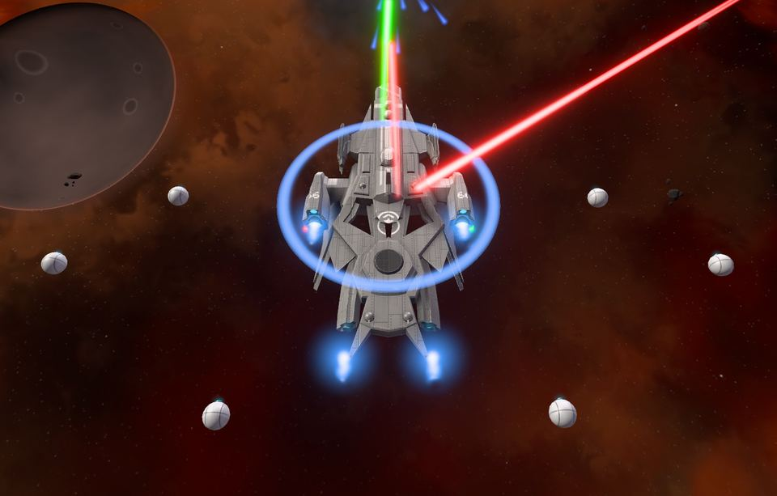
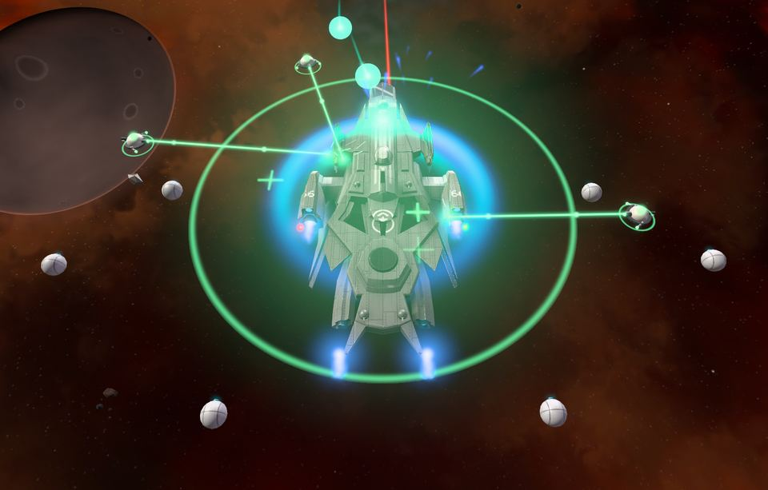
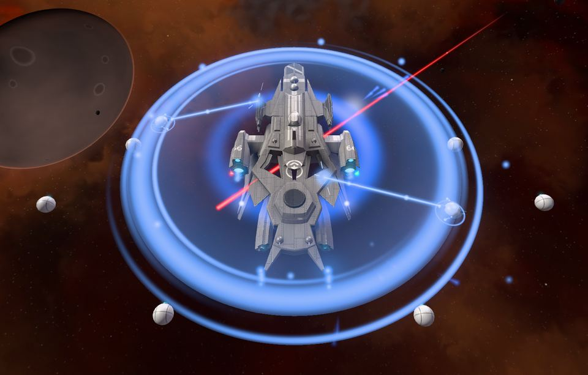

<!-- wiki-i18n source: 7a295e69dd1155fd -->
<!-- wiki-i18n title: Habilidades -->
# Habilidades activas de la nave {#active-ship-abilities}

Las habilidades son los botones que pulsas en pleno combate: un escudo que vuelve, una ráfaga de velocidad para salir de alcance, una reparación cuando casi no te queda casco. Provienen del **escudo, motor o Repair Drone** que instalas en las **ranuras de habilidad** de tu nave, y cuanto mejor es ese objeto, mejor es la habilidad. Están pensadas para el momento en que las necesitas, no para pulsarlas en cada recarga: cada una dura de diez a quince segundos y después descansa de un minuto y medio a dos minutos. Algunos [diseños de nave](/wiki/03-Mechanics/Ship-Designs.md) tienen una más, propia: mira [Habilidades de nave](#ship-abilities).

Un piloto nuevo empieza con una: el **Repair Drone I** del kit inicial ya está instalado en la ranura de habilidad de la Protos, así que el botón de Emergency Repair (`E`) está ahí desde el primer minuto. Un segundo Repair Drone I del equipo está en una ranura de extra: ese repara el casco despacio por sí solo y no es una habilidad (consulta [Extras](/wiki/06-Items/Extras.md#repair-drones)).

## Ranuras de habilidad {#ability-slots}

Cada nave tiene un número fijo de ranuras de habilidad en el hangar:

- **Protos** (inicial): 1 ranura
- **Kitefin**: 1 ranura
- **Ostirion**: 2 ranuras
- **Nomad**: 2 ranuras
- **Paragon**: 3 ranuras
- **Storm**: 3 ranuras
- **Ironclad**: 4 ranuras
- **Wraith**: 3 ranuras

Una ranura de habilidad admite un **escudo**, un **motor** o un **Repair Drone**, y cada uno da su propia habilidad. Arrastra el objeto a la ranura. La configuración 1 y la configuración 2 tienen sus propias ranuras. En el Hangar, un clic en un escudo, un motor o un Repair Drone lo coloca en su ranura habitual, y en la primera ranura de habilidad libre cuando todas sus ranuras habituales (las de generador o, en el caso de un Repair Drone, las de extras) están ocupadas.

- **Las células de escudo y los propulsores no caben en una ranura de habilidad.** Son módulos de escudos, motores y núcleos adaptativos.
- **Un objeto en una ranura de habilidad no aporta nada más.** No da capacidad de escudo, recarga, absorción ni velocidad, ni tampoco la ralentización que provoca un escudo. El mismo Heavy Shield Core o bien está en una ranura de generador, para dar su escudo en todo momento, o bien en una ranura de habilidad, para su Surge. Tú eliges.
- Un escudo o un motor que lleva células o propulsores los devuelve a tu inventario cuando lo arrastras a una ranura de habilidad.
- Un Repair Drone en una ranura de habilidad da Emergency Repair y no repara el casco por sí solo. El dron lento (**REP**) necesita un Repair Drone en una ranura de extra.

## Varios módulos del mismo tipo {#several-modules-of-one-kind}

Puedes instalar **varios escudos, motores o Repair Drones** en las ranuras de habilidad de una configuración. Siguen siendo una sola habilidad, un solo botón y una sola recarga, pero más potente:

- **El módulo de peor rango fija la base.** Su rango da la potencia y la recarga. Un Heavy Shield Core junto a un Light Shield Core se comporta como dos módulos de rango I: un segundo módulo mejor sirve para el bono, nunca para una potencia mayor ni una recarga más corta.
- **Cada uno de los demás módulos suma el 50 % de la base**, se suma, no se multiplica. Los motores hacen que el Afterburner **dure más**: 15 s, 22,5 s con dos motores y 30 s con tres y 37,5 s con cuatro (el bono de velocidad y la recarga no cambian). Los escudos hacen que el Shield Surge **restaure más** y los Repair Drones hacen que Emergency Repair **repare más**, en los mismos diez segundos: el 100 %, el 150 %, el 200 % y el 250 % del total con uno, dos, tres y cuatro módulos.
- **Los módulos adicionales cuestan ranuras.** Una nave con tres ranuras de habilidad puede tener tres de un mismo tipo, uno de cada, o dos y uno; la Ironclad, con cuatro, puede tener cuatro de un mismo tipo, o dos de un tipo y uno de cada uno de los otros dos. Una Protos o una Kitefin tiene una sola ranura y no puede acumular; una Ostirion o una Nomad puede tener dos de un mismo tipo.
- Los rangos iguales son simplemente ese rango. De dos módulos del mismo rango, el que tiene el encantamiento más débil fija la base.

## Las tres habilidades {#the-three-abilities}

### Shield Surge (escudos), tecla `Q` {#shield-surge-shields-key-q}

Durante diez segundos el escudo de tu nave se **repara**: el Surge restaura una parte de tu escudo máx. de manera uniforme, hasta el máximo y nunca por encima. No es una barrera y no cambia cómo se reparten los impactos; devuelve escudo, y lo que devolvió se queda. No se detiene cuando te impactan (la recarga normal espera 15 segundos tras un impacto; el Surge no). Una nave con el escudo lleno saca poco de él, así que púlsalo cuando el escudo se esté agotando. El total nunca es inferior al 60 % de la capacidad del propio núcleo, así que una nave con poco escudo recibe igualmente una reparación real (hasta su máximo).

- Se rechaza dentro de la protección de una zona segura y en una nave sin ningún escudo, para que un clic equivocado no lo gaste.
- Los cohetes con penetración de escudo siguen atravesando parcialmente los escudos, como siempre.

### Afterburner (motores), tecla `W` {#afterburner-engines-key-w}

Tu velocidad final se multiplica por el bono del rango mientras dura. No cambia el giro, la fijación de objetivo ni el daño recibido: convierte el tiempo en distancia. Úsalo para salir de un combate, para llegar al anillo de una estación o de un portal, o para acercarte a un objetivo que huye. Funciona en cualquier sitio, también en las zonas seguras. Más motores lo hacen durar más, no ir más rápido.

### Emergency Repair (Repair Drones), tecla `E` {#emergency-repair-repair-drones-key-e}

Repara una parte de tu **casco máx. de manera uniforme durante diez segundos**, sin pasar nunca del máximo. Los impactos no la interrumpen: es una habilidad de emergencia y funciona bajo fuego, en la radiación del agujero negro, con el camuflaje activado y dentro de una ventana de EMP. Termina cuando se acaba el tiempo o cuando tu nave es destruida. No toca tu escudo, no cuenta como un impacto y deja la reparación lenta REP como estaba. Se rechaza con el casco lleno.

## Habilidades de nave {#ship-abilities}

Diez de los catorce [diseños de nave](/wiki/03-Mechanics/Ship-Designs.md) traen una habilidad que pertenece al diseño, no a un objeto. No ocupa **ninguna ranura de habilidad** ni necesita nada equipado: está ahí mientras pilotes el diseño. Tiene un botón propio, el cuarto de la columna de la barra rápida, y su tecla es `F` (se puede cambiar en Configuración). Tiene su propia recarga, que se conserva como las demás: cambiar de configuración, saltar y desconectarte no la reinician, y una nave destruida empieza el siguiente vuelo con todas las habilidades listas.

| Habilidad | Diseño | Qué hace | Duración | Recarga |
| :--- | :--- | :--- | ---: | ---: |
| **Blink** | Storm NOTSUM, Ironclad TITANIC, Protosaur | Velocidad 2.500 hacia tu orden de movimiento | 1 s | 120 s |
| **Chameleon** | Storm RECON, Protosaur | Invisible para todos los demás pilotos, también en el minimapa | hasta que se rompe | 60 s |
| **Target** | Storm RECON | Una nave enemiga seleccionada dentro de tu alcance de láser recibe un 20 % más de daño | 5 s | 60 s |
| **Slow** | Storm RECON | Una nave enemiga seleccionada dentro de tu alcance de láser vuela un 60 % más lenta | 4 s | 60 s |
| **Focus Fire** | Ironclad DUMA | Las naves enemigas a menos de 1.000 unidades se ven obligadas a atacarte | 5 s | 60 s |
| **Venom** | Wraith RAPTOR | 125.000 de daño directo al casco de un objetivo | 30 s | 120 s |
| **Diminisher** | Wraith BILLY | Recibes un 75 % menos de daño y haces un 25 % menos | 25 s | 120 s |
| **Heal Pod** | Storm BRATAN, Wraith MENATI | Una cápsula cura a las naves aliadas a menos de 600 unidades 20.000 + 2 % de su casco máximo por segundo | 5 s | 120 s |
| **Shield Buff** | Wraith ATARAXIS | Tu capacidad de escudo se duplica y regenera un 2 % de su máximo por segundo | 10 s | 120 s |
| **Heal Pod** | Miyuki (I–V) | La misma cápsula, pero dura más; desde la Miyuki III cura 30.000 + 3 % de su casco máximo por segundo | 7,5 s | 120 s |
| **Channel Heal** | Miyuki (II–V) | Te enlaza con una nave que hayas seleccionado a menos de 1.200 unidades: ella recibe 50.000 de casco por segundo y tú 10.000 (75.000 para ella desde la Miyuki IV) | 5 s | 120 s (100 s desde la Miyuki IV) |
| **Channel Shield** | Miyuki (III-V) | Te enlaza con una nave que hayas seleccionado a menos de 1.200 unidades: ella recibe 150.000 de escudo por segundo y tú 30.000, y cada una de las dos naves recibe además el 3 % (Miyuki III), el 4 % (IV) o el 5 % (V) de su propio escudo máximo por segundo | 5 s | 120 s (80 s desde la Miyuki V) |

- **Blink.** Durante 1 segundo tu velocidad es 2.500, hacia tu orden de movimiento. Te detienes donde termina la orden, y el borde del mapa también te detiene. Después descansa 120 segundos.
- **Chameleon.** Desapareces: ningún otro piloto te ve, ni en el mapa ni en el minimapa, y nadie puede fijarte como objetivo. Tu propia corporación te sigue viendo, como un fantasma. Un EMP no puede romperlo. Termina cuando recibes cualquier daño, disparas una ráfaga de láser, lanzas un cohete, usas Target o Slow o recoges una caja, o cuando vuelves a pulsar el botón; sus 60 segundos empiezan cuando termina, termine como termine. No puedes activarlo en los 10 segundos siguientes a un disparo o un impacto, ni dentro del anillo de una zona segura, ni mientras haya un Cloaking CPU activo. Una zona segura no lo termina, ni tampoco un salto por un portal: la invisibilidad atraviesa la puerta contigo. Cuando tu propio ataque lo termina, recibes un **Ambush** durante 3 segundos: un 25 % más de daño y un 25 % más de velocidad. La destreza de piloto Sigilo acorta también su espera, como la de la Cloaking CPU.
- **Target.** Fija o selecciona una nave enemiga dentro de tu alcance de láser y pulsa: durante 5 segundos recibe un 20 % más de daño de todos, el efecto del Marking Rocket, y las naves de alrededor ven la marca. Funciona con pilotos de otras corporaciones y con alienígenas, no con tu grupo ni tu corporación, no con una nave que protege una zona segura y no donde se rechaza una fijación de láser (el Peace Protocol, un sector sin PvP); se rechaza dentro de una zona segura. Cuenta como un ataque: termina tu invisibilidad, así que un Chameleon que usa Target recibe su Ambush. Después descansa 60 segundos.
- **Slow.** Lo mismo, durante 4 segundos: la velocidad de la nave se reduce un 60 %, el efecto del Freeze Rocket, y descansa 60 segundos.
- **Focus Fire.** Durante 5 segundos, todo piloto enemigo y todo alienígena a menos de 1.000 unidades se ve obligado a atacarte: la fijación de un piloto se pone sobre ti y no se puede cambiar, y un alienígena se vuelve contra ti. Los pilotos de tu grupo y de tu corporación, las naves protegidas por una zona segura y las naves camufladas quedan fuera, y se rechaza dentro de una zona segura o sin ningún enemigo al alcance. Los obligados pueden seguir volando adonde quieran.
- **Venom.** Fija un objetivo al alcance de tus láseres y pulsa: 125.000 de daño van directos a su casco a lo largo de 30 segundos, por igual, y su escudo no se lleva ninguna parte. Funciona igual con pilotos de otras corporaciones y con alienígenas, no con tu grupo ni tu corporación, no con una nave que protege una zona segura y no donde se rechaza una fijación con láser (el Protocolo de paz, un sector sin PvP). Una nave lleva un Venom a la vez. Cada tic cuenta como un impacto, así que el objetivo no puede esconderse en una zona segura hasta que termine. La reparación, un Heal Pod y un Diminisher sobre el objetivo lo reducen, termina cuando muere el objetivo o tú, y la baja y sus puntos son tuyos.
- **Diminisher.** Durante 25 segundos, cada impacto que recibes se reduce a la cuarta parte antes de que tu escudo se lleve su parte, de modo que escudo y casco pierden un cuarto, y cada impacto que haces se reduce a tres cuartos: láseres, cohetes directos y explosiones. Una segunda pulsación no hace nada mientras está en marcha.
- **Heal Pod.** Cae una cápsula donde estás y se queda 5 segundos. Cada segundo cura a toda nave aliada a menos de 600 unidades 20.000 más el 2 % del casco máximo de esa nave: a ti, a tu grupo y a tu corporación, a nadie más, y nunca por encima del máximo. Nada puede fijar la cápsula ni dispararle, y sigue curando si mueres. La cápsula de la Miyuki dura 7,5 segundos y su último medio segundo cura medio pulso; desde la Miyuki III cura 30.000 más un 3 %.
- **Shield Buff.** Durante 10 segundos tu capacidad de escudo se duplica, con el escudo que tienes duplicado también, y el escudo regenera un 2 % del máximo duplicado cada segundo. Al terminar, la capacidad vuelve a la normal y el escudo con ella, conservando su proporción, así que nunca te cura: es espacio para aguantar golpes. Se rechaza en una nave sin escudo.
- **Channel Heal.** Selecciona una nave a menos de 1.200 unidades y pulsa (un amigo, pero también un piloto enemigo o un alienígena: el enlace cura a quien une, así que elige bien; el jefe de una mazmorra o de una puerta en solitario no se puede enlazar): un enlace te une a ella durante 5 segundos. Cada segundo cura a esa nave 50.000 de casco y a ti 10.000, en el mismo momento y nunca por encima del máximo. Desde la Miyuki IV la otra nave recibe 75.000 y la espera es de 100 segundos; tus 10.000 se quedan como están. Tu Curación hace más fuertes las dos curas, y curar a un enemigo no te da XP de curación. El enlace termina cuando se acaba su tiempo, cuando una de las dos naves es destruida o abandona el mapa, cuando estáis a más de 1.200 unidades de distancia o cuando un EMP alcanza a una de las dos; lo que se curó se queda.
- **Channel Shield.** El mismo enlace con escudo: 150.000 de escudo por segundo para la otra nave y 30.000 para ti, durante 5 segundos, y además cada segundo cada una de las dos naves recupera una parte de su propio escudo máximo: el 3 % en la Miyuki III, el 4 % en la IV y el 5 % en la V, de modo que un enlace de la Miyuki V repone en total el 25 % de cada máximo además de los puntos. Nunca por encima del escudo máximo. En la Miyuki V descansa 80 segundos en lugar de 120. Tu Curación también refuerza sus puntos y su parte del escudo máximo, y termina de las mismas maneras.

La **Miyuki** es una nave de apoyo, no un diseño, y lleva hasta tres de estas: su Heal Pod en `F`, un Channel Heal desde el nivel II en `D` y un Channel Shield desde el nivel III en `S`. Los botones de la segunda y la tercera están en una columna propia a la izquierda del primero, cada uno con su propio tiempo de recarga. Un enlace necesita la nave seleccionada cuando pulsas; el juego no elige ninguna por ti. La **Storm RECON** lleva tres: su Chameleon en `F`, y Target y Slow en una columna propia, que necesitan una nave enemiga seleccionada o fijada.

Un **EMP** que estalla cerca de ti bloquea el botón durante 5 segundos: se rechaza la pulsación y no empieza ninguna recarga. Una habilidad que ya está en marcha sigue, y un Chameleon sigue oculto. Los demás pilotos también ven estas habilidades: una estela detrás de un Blink, un anillo rojo y líneas hacia las naves que obliga un Focus Fire, un Chameleon solo como fantasma para su propia corporación. Un EMP que te alcance a ti o a la nave con la que estás enlazado también rompe un enlace.

## Rangos {#ranks}

La potencia de una habilidad es una **parte de la cifra de tu propia nave** (escudo máx., velocidad, casco máx.), así que crece con la nave. El rango viene del objeto: un modelo mejor da una habilidad mejor. Un objeto encantado suma su bono de encantamiento a la potencia, como máximo un 15 %. La tabla es para un módulo; la pila viene debajo de ella.

<!-- abilities:begin -->
<!-- Generated from server/Resources/AbilityConfig.json and the items' stats by scripts/abilities-wiki.sh: don't edit by hand. -->

| Habilidad | Rango | Objeto | Potencia (un módulo) | Duración | Recarga | Activa |
| :--- | :---: | :--- | :--- | --: | --: | --: |
| **Shield Surge** | I | Light Shield Core | restaura el 18 % de tu escudo máx. | 10 s | 120 s | 8,3 % |
| **Shield Surge** | II | Basic Shield Core | restaura el 36 % de tu escudo máx. | 10 s | 105 s | 9,5 % |
| **Shield Surge** | III | Heavy Shield Core | restaura el 60 % de tu escudo máx. | 10 s | 90 s | 11,1 % |
| **Afterburner** | I | Engine I | +20 % de velocidad | 15 s | 120 s | 12,5 % |
| **Afterburner** | II | Engine II | +30 % de velocidad | 15 s | 105 s | 14,3 % |
| **Afterburner** | III | Engine III | +40 % de velocidad | 15 s | 90 s | 16,7 % |
| **Emergency Repair** | I | Repair Drone I | repara el 12 % de tu casco máx. | 10 s | 120 s | 8,3 % |
| **Emergency Repair** | II | Repair Drone II | repara el 15 % de tu casco máx. | 10 s | 105 s | 9,5 % |
| **Emergency Repair** | III | Repair Drone III | repara el 19,2 % de tu casco máx. | 10 s | 90 s | 11,1 % |
| **Emergency Repair** | IV | Repair Drone IV | repara el 24 % de tu casco máx. | 10 s | 75 s | 13,3 % |

Varios módulos de un mismo tipo en una configuración: el de peor rango fija la potencia y la recarga de arriba, y cada uno de los demás suma el 50 % de esa base.

| Módulos de un mismo tipo | Afterburner dura | Shield Surge restaura | Emergency Repair repara |
| :---: | --: | --: | --: |
| 1 | 15 s | 100 % | 100 % |
| 2 | 22,5 s | 150 % | 150 % |
| 3 | 30 s | 200 % | 200 % |
| 4 | 37,5 s | 250 % | 250 % |

<!-- abilities:end -->

El Engine II y los escudos y motores de rango III (el Heavy Shield Core, el Engine III) no se venden: se fabrican en [Ensamblaje](/wiki/06-Items/Overview.md#upgrading-modules) a partir de un Engine I, un Basic Shield Core y un Engine II, con Thulium, lo que sueltan los alienígenas y placas (4 Velkonite Reinforced Plates para el Engine II, 4 Dark Matter Plates y una Ancient Control Unit para los demás: [Dark Matter y Dark Matter Plates](/wiki/03-Mechanics/Dark-Matter.md)). Emergency Repair tiene un cuarto rango, el Repair Drone IV.

## Recargas y límites {#cooldowns-and-limits}

- **La recarga empieza cuando pulsas** la habilidad e incluye su duración. Así, un Surge de 10 segundos con una recarga de 90 segundos está activo como máximo el 11 % del tiempo y no está disponible durante 80 segundos tras terminar. Varios módulos no la acortan (es la del módulo de peor rango); ni siquiera tres Afterburners están activos más del 33 % del tiempo.
- **Las recargas son tuyas, no del objeto.** Cambiar de configuración, cambiar el objeto, saltar a otro sector y desconectarte no las reinician. Una nave que es destruida empieza el siguiente vuelo con todas las habilidades listas.
- **Cada habilidad tiene su propia recarga.** Usar una no bloquea las demás.
- **Un efecto en marcha conserva las cifras con las que empezó.** Desequipar el objeto o cambiar de configuración no lo cambia ni lo termina. Un salto o una reconexión tampoco lo terminan; desconectarte sí, y su recarga se mantiene.
- Otros pilotos ven los temporizadores de tus habilidades en el mapa, como siempre: un Surge gastado les señala que los próximos minutos son una oportunidad.

## Destrezas de piloto {#pilot-skills}

Cuatro de tus [destrezas de piloto](/wiki/03-Mechanics/Pilot-Skills.md) cambian cómo se ejecutan las habilidades, incluida la habilidad `F` del diseño de tu nave:

- **Reflejos** hace que las recargas terminen antes, un poco más con cada nivel. Una recarga sigue empezando cuando pulsas e incluye la duración de la habilidad.
- **Táctica** hace que una habilidad dure más. Un Shield Surge o una Emergency Repair da los mismos puntos por segundo durante el tiempo más largo, así que devuelve más en total, y un Afterburner funciona más tiempo. La recarga no crece con ella, así que la espera tras acabar la habilidad se acorta.
- **Sabotaje** refuerza los venenos, como el Venom de una Wraith RAPTOR, en daño y en duración, además de la Táctica.
- **Curación** hace más fuertes las curaciones de tu propio equipo: una Emergency Repair, un Repair Drone en una ranura de extra (REP) y cada curación del Heal Pod que sueltas (un Heal Pod conserva el nivel que tenía tu Curación al soltarlo). Se multiplica con la Táctica, que hace que una Emergency Repair y un Heal Pod duren más (en los niveles altos un Heal Pod dura un segundo más y cura una vez más): con ambas al nivel 100, una Emergency Repair o un Heal Pod cura un 56 % más en total. El Support Rocket siempre cura la misma cantidad fija. Un Channel Heal o un Channel Shield que abras aporta a las dos naves más en ese factor (en el Channel Shield, también su parte del escudo máximo). Además, en el Miyuki la Curación acorta la espera del Heal Pod, del Channel Heal y del Channel Shield: un 10 % menos en el nivel 100, en línea recta desde el nivel 1. El Heal Pod de cualquier otra nave mantiene su espera completa.

Las cifras de cada nivel están en la tabla de [Destrezas de piloto](/wiki/03-Mechanics/Pilot-Skills.md#the-stats).

## Teclas y botones {#keys-and-buttons}

`Q` Shield Surge, `W` Afterburner, `E` Emergency Repair y `F` la habilidad del diseño de tu nave; una Miyuki añade `D` Channel Heal y `S` Channel Shield (todas se pueden cambiar en Configuración). Cada botón aparece junto a la barra rápida solo cuando tu configuración tiene esa habilidad (los botones `F`, `D` y `S`, cuando la nave que pilotas los tiene), así que la `E` de un piloto nuevo está ahí desde el primer minuto. El anillo alrededor de su icono indica en qué estado está la habilidad: completo y del color de la habilidad cuando está lista, vaciándose con los segundos que quedan mientras está en marcha (también Emergency Repair, ahora que repara durante diez segundos), y volviéndose a llenar mientras se recarga, con los segundos que faltan en el centro. Una pila de varios módulos lleva su marca (`x2`, `x3`) en la esquina del botón. El botón de Emergency Repair se atenúa mientras tu casco está lleno, y el de Shield Surge en una nave sin ningún escudo. Pasa el cursor por un botón para ver las cifras en tu nave, con la pila contada (por ejemplo, *Afterburner II x2: +30 % de velocidad durante 22,5 s*) y, mientras un Surge o una reparación están en marcha, cuánto da por segundo y cuánto falta por llegar.

## En el hangar {#in-the-hangar}

Arrastra un escudo, un motor o un Repair Drone a una ranura de habilidad, o haz clic derecho en él en tu inventario para ponerlo en la primera libre. Un segundo y un tercero del mismo tipo van a las siguientes ranuras libres y se acumulan. El nombre y el rango de la habilidad figuran bajo cada ranura ocupada, con la marca de la pila y las cifras de todos sus módulos juntos (*Afterburner II x2*, *x2 · 22,5 s*; para un Repair Drone II en una Wraith, *+81.000 de casco*), y al pasar el cursor por una ranura se ve lo que vale en tu nave, con la pila contada, y qué módulo de la pila fija el rango. Todos los módulos de un tipo muestran la misma habilidad, porque son una sola. Al pasar el cursor por el objeto en cualquier otro lugar se ve la habilidad con las partes de tu propia nave y una frase sobre lo que suma un módulo más.

## Lo que ve todo el mundo {#what-everyone-sees}

Un Shield Surge es una burbuja alrededor de la nave mientras dura, que parpadea en sus dos últimos segundos y se cierra cuando termina. Las barras de escudo (la tuya en la ventana Nave y la de un objetivo en la ventana Objetivo) simplemente se llenan a medida que el Surge devuelve escudo, y la barra pulsa suavemente mientras hay espacio para ello. Un Afterburner hace arder los motores con más intensidad mientras dura, 15, 22,5, 30 o 37,5 segundos, y lanza un anillo desde la nave al empezar, más ancho en una pila. Un Emergency Repair emite un pulso verde al empezar; después, durante sus diez segundos, envuelve el casco en un suave resplandor verde del que se elevan unos cuantos signos más, hace flotar sobre tu propia nave el casco que repara cada segundo y termina con un último destello. Mientras dura, unos pequeños drones de reparación rodean la nave y la arreglan: uno para un Repair Drone I, dos para un II, tres para un III o IV, y uno más por cada Repair Drone adicional de una pila (nunca más de tres). Salen del casco, apuntan suaves haces verdes a las placas de este, envían pulsos por los haces a partir del grado II y vuelven volando a atracar cuando pasan los diez segundos; un Shield Surge tiene hasta dos azules dentro de su burbuja. Todos los pilotos del mapa ven las tres habilidades, también los drones (más pequeños en la nave de otro piloto y menos en las calidades gráficas más bajas, donde Baja muestra haces y resplandores sin modelos de drones, y con un haz algo más ancho por cada rango del dron), así que un Surge gastado es una señal tanto para el enemigo como para ti. Los drones hacen tres sonidos suaves propios, muy por debajo de la campanilla de la reparación: un leve pitido al salir del casco, otro al atracar y un tono tenue bajo sus haces mientras trabajan (el de los drones de un Surge, algo más agudo); los oyes desde las naves que ves en pantalla, como mucho unos pocos a la vez, y el volumen de Efectos de sonido los baja. Con *Reducir movimiento* activado, el resplandor se mantiene estable, se omiten los signos más, el último destello es un desvanecimiento y los drones se quedan aparcados junto a la nave con un haz estable (los sonidos se mantienen). Un Repair Drone en una ranura de extra (REP) también dibuja sus drones mientras repara el casco: uno para un Repair Drone I, dos para un II, tres para un III o un IV, que rodean la nave y la alcanzan con sus rayos, y todos los pilotos del mapa los ven. Vuelven a acoplarse cuando la reparación se detiene. Al activarlo con REP suena además un suave pulso de reparación, parecido al del Emergency Repair pero algo más grave y más silencioso, y, como un Emergency Repair, hace flotar sobre tu propia nave el casco que repara cada segundo.

## Qué ha cambiado {#what-changed}

Antes de la actualización 0.4.3, las ranuras de habilidad admitían células de escudo (Regen. de escudo) y propulsores (Impulso de velocidad). Las células de escudo y los propulsores que estaban en ranuras de habilidad volvieron a tu inventario al actualizarse el juego, y te los quedas: siguen siendo módulos de escudos, motores y núcleos adaptativos. Desde entonces el Shield Surge ya no da una barrera de sobreescudo, sino que repara tu escudo durante diez segundos, Emergency Repair repara durante diez segundos en lugar de al instante, y puedes instalar varios módulos de un mismo tipo para un Afterburner más largo, un Surge mayor o una reparación mayor. Desde la actualización 0.5.0, el Afterburner da +20 %, +30 % y +40 % de velocidad durante 15 segundos (rangos I, II y III); antes daba +30 %, +45 % y +60 % durante 10 segundos: la misma distancia ganada, repartida en más tiempo. Las recargas no han cambiado, y una pila de motores dura ahora 22,5 segundos con dos y 30 con tres.
