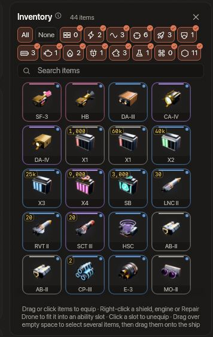
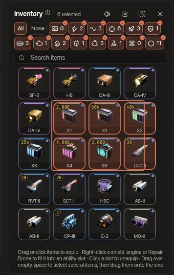

<!-- wiki-i18n source: da8af0d25d34a2c4 -->
<!-- wiki-i18n title: Inventario -->
# Inventario y equipamiento {#inventory-equipment}

El hangar te permite gestionar tus naves y tu equipo. Equipar bien los objetos es clave para sobrevivir y dominar. Puedes hacerlo en la estación y en vuelo desde dentro de una zona segura: consulta [El hangar en vuelo](/wiki/03-Mechanics/Hangar.md).

## Ranuras de equipo y eficiencia de estadísticas {#equipment-slots-stat-efficiencies}

A diferencia de los juegos espaciales tradicionales, SpaceCorps tiene ranuras de equipo escalonadas de forma dinámica que modulan la eficacia de los módulos instalados.

- **Ranuras de láser**: para las armas ofensivas (láseres). Siempre rinden al **100 % de daño y alcance**.
- **Ranuras de generadores**: ranuras compartidas para escudos, motores y núcleos adaptativos. Se dividen en tres bandas de eficiencia, y la banda decide cuánto de las estadísticas base de un objeto cuenta. En el hangar cada banda tiene una (i) junto a su nombre que la explica:
  - **Ranuras principales**: los objetos colocados aquí reciben el **100 %** de sus estadísticas base. Todas las naves las tienen: pon aquí tus escudos y motores más fuertes.
  - **Ranuras de apoyo**: los objetos colocados aquí reciben el **75 %** de sus estadísticas base (p. ej., el 75 % de la velocidad o de la capacidad de escudo). Todas las naves las tienen.
  - **Ranuras auxiliares**: los objetos colocados aquí reciben el **50 %** de sus estadísticas base. Solo algunas naves las tienen (la Nomad tiene 1, la Paragon y la Storm 2, la Ironclad 3 y la Wraith 4; la Protos, la Kitefin y la Ostirion no tienen ninguna). Son ideales para escudos y motores adicionales más débiles, mientras que los más fuertes van en las ranuras principales.
  - **Ranuras de dron**: un escudo en uno de tus drones cuenta como uno en una ranura principal, el **100 %** de sus estadísticas (consulta [Mecánicas de los drones](/wiki/03-Mechanics/Drones.md)).
  - **Ranuras sin asignar o heredadas**: los objetos colocados aquí no aportan nada a las estadísticas.
  - **La acumulación también pierde fuerza**: los escudos y los motores se ordenan del más fuerte al más débil (por lo que cuenta cada uno tras la parte de su ranura), y la parte de la banda se multiplica por la de su puesto: del 1.º al 4.º cuentan por completo, el 5.º, el 6.º y el 7.º un 85 %, un 70 % y un 55 %, y del 8.º en adelante un 50 % en los escudos y un 25 % en los motores. Consulta [Escudos](/wiki/03-Mechanics/Shields.md) y [Velocidad](/wiki/03-Mechanics/Speed.md).
- **Ranuras de extra**: para objetos de utilidad especializados, como los Repair Drones. La Protos, la Kitefin, la Ostirion y la Nomad tienen dos; la Paragon, la Ironclad, la Wraith y la Storm, que fabricas, tienen tres. Las Extra Slots CPU ([Extras](/wiki/06-Items/Extras.md#extra-slots-cpus)) suman 3, 5 o 7 más.
- **Ranuras de blindaje**: para el [blindaje de casco](/wiki/06-Items/Hull-Plating.md#hull-plate-slots), que suma casco. Solo las tienen las cuatro naves que fabricas (la Paragon 5, la Storm 7, la Ironclad 15 y la Wraith 9), cada una bloqueada hasta que la investigas en el Skylab, y son iguales en las dos configuraciones.

## Orden del inventario {#inventory-order}

El inventario enumera tus objetos en el mismo orden que la tienda, sea cual sea el orden en que los compraste, fabricaste o encontraste. Los tipos que van juntos están juntos: láseres, amplificadores láser y munición láser; escudos y células de escudo; motores y propulsores; núcleos adaptativos; extras (Repair Drones); drones y formaciones de drones; y después los recursos. Dentro de un tipo va primero lo más barato (los créditos antes que el Thulium) y luego lo que no tiene precio: el equipo solo fabricable y los botines, de la rareza más débil a la más fuerte (los láseres de una misma rareza, del menor daño al mayor). La munición láser va de x1 a x4 y después la Siphon Battery. Los cohetes se ordenan por clase (un objetivo antes que explosión en área, guiados antes que rectos) y luego por grado, así que el cohete épico, que cuesta Thulium, queda el último de su clase. Las copias de un mismo objeto se ordenan por su grado de encantamiento. Encima de la cuadrícula, un chip por tipo sigue el mismo orden, cada uno con el número de objetos que encuentra en él la búsqueda. Cada chip se activa o se desactiva por separado, así que puedes ocultar la munición y los Repair Drones mientras trabajas con láseres, escudos y motores: haz clic en un chip para mostrar u ocultar su tipo, haz clic con Shift (o doble clic) para dejar activado solo ese tipo y vuelve a hacer clic en él para recuperar los demás. **Todas** muestra todos los tipos y **Ninguna** los oculta todos, para activar solo los que quieras. Un chip tachado está desactivado y un chip con una marca de verificación está activado. La búsqueda actúa sobre los tipos que están activados, y tu elección se guarda con tu piloto. Si todo está oculto, la cuadrícula lo indica y ofrece **Mostrar todas las categorías**.

## Objetos comercializables {#marketable-items}

Los objetos que has ganado (botín, recompensas de misiones y lo que fabrican el Ensamblaje y la Forja) llevan una pequeña etiqueta **Comercializable** en su casilla, y la tarjeta del objeto dice «Comercializable» o, en una pila de la que solo se pueden vender algunas unidades, «Comercializable (3 de 5)». El chip **Solo comercializable**, junto a los chips de categoría, muestra solo esos objetos. Un **martillo** junto a la papelera de un objeto con etiqueta abre la hoja de venta de la [Subasta](/wiki/03-Mechanics/Auction.md) (en vuelo no se muestra: vender es una página de la estación). Lo que has comprado, ganado o te han regalado no lleva etiqueta y no se puede volver a vender.

## Seleccionar varios objetos {#select-several-items}

Pulsa en una parte vacía del inventario (el margen junto a las casillas, el hueco entre dos casillas o el espacio bajo la última fila) y arrastra: un rectángulo translúcido sigue al puntero, y cada casilla que toca queda seleccionada mientras arrastras. Si sueltas, la selección se queda; la fila del título la cuenta («3 seleccionados»). Mantén **Mayús**, **Ctrl** o **Cmd** mientras arrastras para añadir a la selección: las casillas que ya estaban seleccionadas y que toca el rectángulo se sueltan. Un arrastre normal empieza una selección nueva. **Esc**, un clic en un espacio vacío o el botón junto a la papelera en la fila del título la quita; **Esc** en mitad de un arrastre cancela el arrastre. En el borde superior o inferior de un inventario largo la lista se desplaza sola. Pulsar una casilla sigue siendo cosa de la casilla: clic para equipar, arrastrar a una ranura. La papelera de la fila del título elimina los objetos seleccionados tras una pregunta que los enumera (una pila de Extras idénticos se va entera); no se ofrece mientras el Hangar en vuelo está bloqueado. Un objeto montado en el Skylab no se puede seleccionar, y solo se puede lo que la búsqueda y los chips de categoría dejan en la cuadrícula. Suena un tic suave cuando el rectángulo toma una casilla más (sigue el interruptor «Sonidos de botones» de los ajustes).

**Equipar toda la selección.** Arrastra una de las casillas seleccionadas y toda la selección va con ella, como una pila de casillas con un número delante del puntero (una casilla que no está seleccionada se arrastra sola, y un clic en una casilla seleccionada sigue equipando solo ese objeto). Si sueltas sobre una ranura o una tarjeta, el objeto que está bajo el puntero va ahí si cabe, y cada uno de los demás a su mejor ranura; si sueltas sobre las partes vacías de la nave, cada objeto va a su mejor ranura; en cualquier otro sitio no pasa nada, y **Esc** suelta el arrastre. El botón de la flecha junto a la papelera en la fila del título (su información emergente dice que equipa los objetos seleccionados en sus mejores ranuras) hace lo mismo sin arrastrar; no se ofrece en la vista de P.E.T. ni mientras el Hangar en vuelo está bloqueado. La mejor ranura es la que elegiría un clic para ese objeto, calculada objeto por objeto: primero los láseres, los más fuertes antes, luego escudos, motores y núcleos adaptativos, los extras, los Repair Drones (en una ranura de habilidad libre cuando los extras están llenos), los blindajes de casco y al final los amplificadores, células y propulsores, que necesitan que sus láseres, escudos y motores ya estén montados. Lo que no se pudo colocar sigue seleccionado, y un mensaje dice cuántos entraron («Equipados 7 de 9.») y por qué los demás no. Suena un único sonido suave para toda la suelta.

## Instalar objetos en objetos (subranuras) {#item-to-item-equipping-sub-sockets-}

Algunos objetos principales pueden «equipar» objetos secundarios de apoyo (lo que se llama instalar en subranuras) para amplificar sus parámetros. Para instalar en una subranura, arrastra el objeto de apoyo directamente sobre el objeto principal en el inventario de tu hangar.

### Tabla de compatibilidad {#compatibility-table}

| Objeto principal | Objetos admitidos en subranuras | Efecto resultante |
| :--- | :--- | :--- |
| **Láser** | Amplificador láser (amp.) | Aumenta el daño base y las estadísticas de impacto crítico, o resta puntos a la absorción del objetivo (Penetration Amp) |
| **Escudo** | Célula de escudo | Aumenta la capacidad de escudo y la velocidad de recarga |
| **Motor** | Propulsor | Aumenta la velocidad del motor y sus multiplicadores |
| **Generador híbrido** | Célula de escudo O propulsor | Aumenta la capacidad de escudo, la velocidad de recarga o la velocidad |
| **Dron** | Un láser o un escudo, en cada una de sus ranuras (un Master Drone tiene dos) | Un láser suma su daño a tu andanada; un escudo cuenta como uno en una ranura principal (el 100 % de sus estadísticas) |

---

## Gestión de la munición {#ammo-management}

La munición láser es un recurso consumible.
- La munición se apila en tu inventario.
- Puedes cambiar la munición láser activa desde la barra rápida de tu HUD.
- La munición de mayor calidad aporta multiplicadores de daño (p. ej., Standard Battery x1, Advanced Plasma x2, Ultra Core x3, Experimental Fusion Core x4). La Siphon Battery inflige un daño x1 solo a los escudos y se lo da al tuyo.
