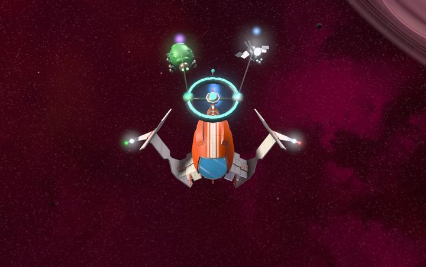
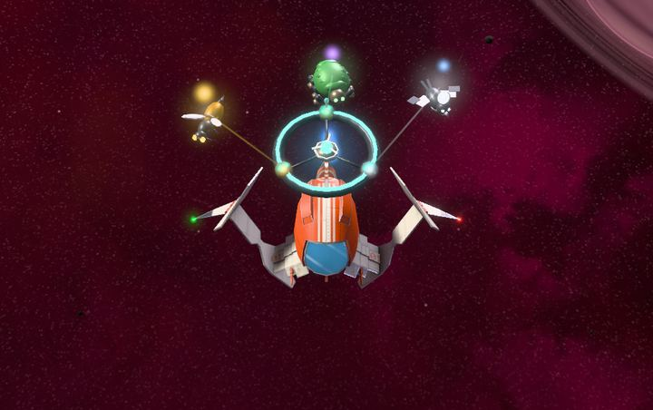
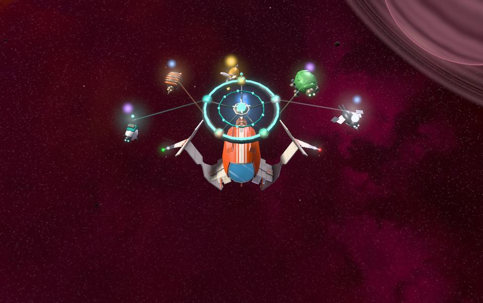
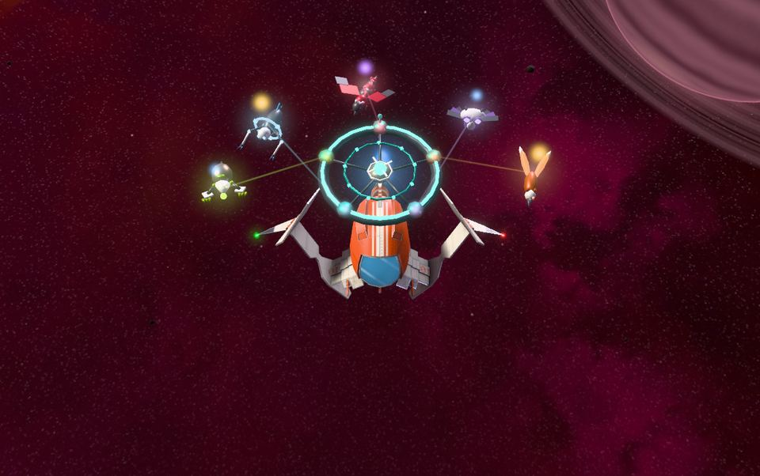
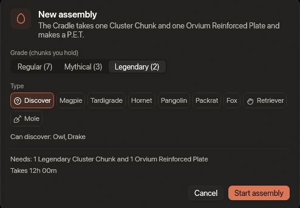
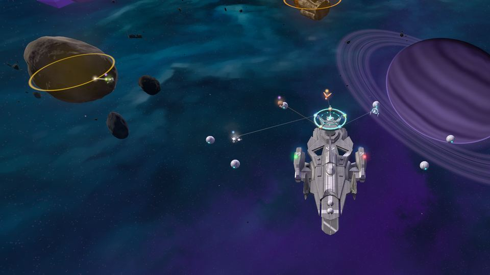
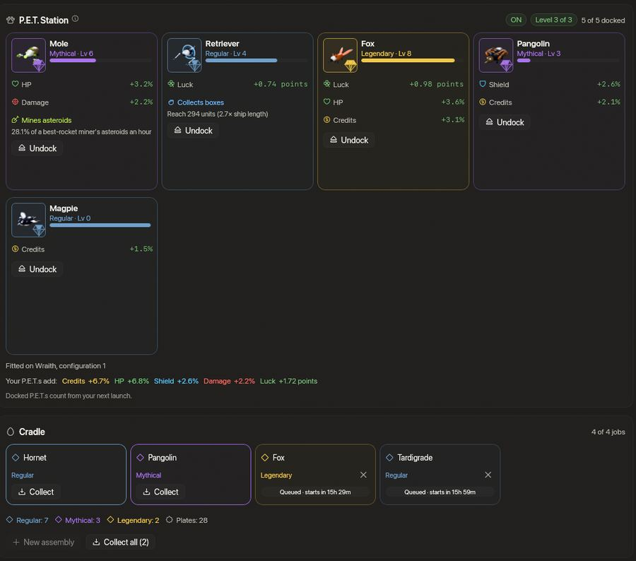

<!-- wiki-i18n source: 569e02af22e911bf -->
<!-- wiki-i18n title: P.E.T.s -->
# P.E.T.s {#pets}

<!-- wiki-search: pet; pets; p.e.t; p.e.t.; companion; cradle; codex; cluster chunk; crossbreed; crossbreeding; station; extra; on; off; switch; hotbar; pet slot; interrupteur; barre rapide; docking; personal escort technology; magpie; tardigrade; hornet; pangolin; packrat; fox; owl; drake; compagnon; berceau; codex; croiser; arrimer; retriever; mole; working pet; mining pet; collecting pet; idle; afk; reach; pulse; auto loot; auto mine; p.e.t. au travail; minage; ramasser; portée; inactif; impulsion -->

Un **P.E.T.** (Personal Escort Technology) est un petit compagnon qui vole à côté de votre vaisseau et lui apporte des boosts : plus de crédits, plus de Thulium, plus de coque ou de bouclier, plus de dégâts ou plus de chance. Deux des dix types travaillent aussi pour vous pendant que vous volez : le **Retriever** ramasse les caisses de cargaison autour de votre vaisseau et le **Mole** brise des astéroïdes. Vous trouvez des **Cluster Chunks** dans les astéroïdes brisés, vous en mettez un avec une Orvium Reinforced Plate dans le **Berceau** de votre hangar et, un moment plus tard, un P.E.T. éclot. Vous l’**arrimez** dans votre **P.E.T. Station**, un [Extra](/wiki/06-Items/Extras.md) que vous équipez dans un emplacement extra de votre vaisseau ; tant que la Station est sur **ON**, le P.E.T. arrimé apporte ses boosts, gagne de l’expérience et vole à côté de votre vaisseau comme un petit drone, et tant qu’elle est sur **OFF**, il ne fait rien de tout cela.

## En une minute {#in-one-minute}

- **Obtenir la Station.** Faites rechercher une **P.E.T. Station** au centre de recherche et fabriquez-la dans l’Assemblage. Elle a trois niveaux, avec de la place pour **2, 3 et 5** P.E.T.s. Équipez-la dans un emplacement extra du vaisseau que vous pilotez. Le Berceau fonctionne sans elle : vous pouvez faire éclore des P.E.T.s avant d’avoir une Station.
- **Trouver des chunks.** Brisez des astéroïdes à partir du deuxième palier : un **Regular**, un **Mythical** ou un **Legendary Cluster Chunk** peut rester entier dans le morceau de minerai du groupe qui a fait le plus de dégâts.
- **Faire éclore.** Dans la vue **P.E.T.** du hangar, le Berceau prend un chunk et une Orvium Reinforced Plate pour chaque P.E.T. et a quatre places dans sa file. Le grade du chunk décide du nombre de boosts du P.E.T. : **1, 2 ou 3**.
- **Arrimer et voler.** Arrimez les P.E.T.s que vous voulez pendant que votre vaisseau est posé. Avec une Station équipée et sur ON, ils apportent leurs boosts et gagnent de l’expérience pendant que vous chassez, minez et volez, jusqu’au niveau 20.
- **ON et OFF.** L’emplacement **PET** de la barre rapide commute la Station, même en vol, et le changement compte tout de suite : sur OFF, vos P.E.T.s n’apportent aucun boost, ne gagnent pas d’expérience et ne travaillent pas ; sur ON, ils sont de retour. Une Station que vous n’avez pas commutée est sur ON.
- **En mettre deux au travail.** Un **Retriever** arrimé ramasse les caisses qui traînent autour de votre vaisseau et un **Mole** arrimé brise pour vous l’astéroïde le plus proche, chaque fois que vous volez hors d’une zone sûre, inactif ou non, sans limite pour une journée de travail : [les types qui travaillent](#the-working-types). Un vaisseau inactif est une cible.
- **Ils sont à vous.** Les P.E.T.s sont liés à vous : ni échange, ni Enchères. Ils restent à travers la réinitialisation.

## La P.E.T. Station {#the-station}

La Station est un **Extra**. Trois objets, **P.E.T. Station I, II et III**, se recherchent au [centre de recherche](/wiki/03-Mechanics/Research.md) (3 heures, 10 heures et 1 jour, sans Dark Matter) et se fabriquent dans l’Assemblage l’un après l’autre. Vous en **équipez** une dans un emplacement extra, comme un [Cloaking CPU](/wiki/06-Items/Extras.md), et elle donne de la place à **2, 3 et 5** P.E.T.s arrimés. Ce que coûte chacune est dans l’[arbre des objets](/wiki/06-Items/Extras.md#item-tree) des Extras. La Station reste à travers la réinitialisation, sa recherche aussi.

- **Seulement le vaisseau qui vole avec elle.** Vos P.E.T.s comptent sur le vaisseau que vous pilotez quand une Station est équipée dans la configuration que vous pilotez. Une Station dans votre inventaire, dans l’autre configuration ou sur un autre vaisseau ne fait rien ; changez de configuration ou de vaisseau et les P.E.T.s suivent tout de suite.
- **ON et OFF.** Commutez la Station avec l’emplacement **PET** de la barre rapide (faites-l’y glisser depuis le sélecteur d’extras). **ON** : les 2, 3 ou 5 premiers de vos P.E.T.s arrimés apportent leurs boosts, gagnent de l’expérience et travaillent. **OFF** : rien de tout cela, et aucun drone n’est dessiné. L’emplacement affiche **ON** ou **OFF**. Le commutateur est à vous et reste d’un décollage et d’une connexion à l’autre ; une Station que vous n’avez jamais commutée est sur ON. Il y a une seconde entre deux appuis.
- **Ce que vous voyez.** Une Station sur ON est dessinée sur votre vaisseau : un anneau d’arrimage qui flotte au-dessus de la coque avec un poste pour chaque place, 2, 3 ou 5, chacun éclairé de la couleur du P.E.T. qui y est arrimé. Mettez-la sur ON et les P.E.T.s sortent l’un après l’autre pour planer à côté du vaisseau ; mettez-la sur OFF et ils rentrent, et l’anneau se replie, petit et sombre, sur la coque, où vous seul le voyez.
- **Plus d’arrimés que de place.** Si vous arrimez cinq P.E.T.s et équipez une Station II, les trois premiers (selon leurs places) comptent et le hangar marque les autres « Ne compte pas ». Le hangar arrime dans la meilleure Station que vous possédez, équipée ou non, donc vous pouvez ranger vos P.E.T.s avant de l’équiper.

La vue P.E.T. du hangar dit quelle Station vous possédez, où elle est équipée et si elle est sur ON, combien de places sont prises et quelle technologie et quel objet viennent ensuite, avec un bouton vers la vue Recherche et vers l’Assemblage. Quand vos P.E.T.s n’apportent rien, elle et la fenêtre **Boosters** vous disent pourquoi.

## Cluster Chunks

Les Cluster Chunks sont des amas de cristal que renferment les rochers. Ils existent en trois grades, **Normal (Regular)**, **Mythique (Mythical)** et **Légendaire (Legendary)**, et une rupture en laisse au plus un de chaque. À partir du palier 2 des [rochers](/wiki/03-Mechanics/Asteroid-Mining.md), une rupture peut laisser un Regular Cluster Chunk, à partir du palier 3 un Mythical et à partir du palier 4 un Legendary ; la Motherlode les donne le plus souvent. Les chances sont dans [Ressources](/wiki/06-Items/Resources.md#regular-cluster-chunk). Le chunk ne fait pas partie de la paie de la rupture : il va entier, dans le morceau de minerai, au groupe qui a fait le plus de dégâts, et aucune chance de butin ne change sa probabilité, pas même celle d’un P.E.T.

Un chunk est une ressource : il ne peut pas être vendu, et la réinitialisation le supprime si vous ne le portez pas dans la [Cache de transport](/wiki/03-Mechanics/Wipe-Timeline.md#transport-cache-travel-capsule-).

## Le Berceau {#the-cradle}

Le Berceau est la machine de la vue P.E.T. du hangar. Une **tâche** prend un Cluster Chunk et une Orvium Reinforced Plate, les deux d’un coup au départ, et suit l’horloge du serveur : elle continue donc quand vous êtes absent et à travers un redémarrage. Un chunk Regular prend 30 minutes, un Mythical 3 heures et un Legendary 12 heures. Quatre tâches tiennent dans la file ; chacune commence quand la précédente finit, et une tâche finie attend à sa place que vous la récupériez (**Tout récupérer** à partir de deux finies).

- **Le grade du chunk décide du grade du P.E.T.**, donc du nombre de boosts qu’il a (1, 2 ou 3) et des types qu’il peut être : 4 des 10 types pour un chunk Regular, 7 pour un Mythical et les 10 pour un Legendary. Le Retriever peut venir de n’importe quel chunk ; le Mole demande un Mythical ou un Legendary.
- **Vous choisissez le type** parmi ceux que vous avez découverts, ou vous appuyez sur **Découvrir** : le Berceau fait alors éclore un type de ce grade que vous n’avez pas encore découvert, tiré au départ de la tâche et montré seulement quand vous récupérez le P.E.T. Un type qu’une autre tâche en cours a déjà tiré est écarté, de sorte que deux découvertes en file ne font jamais éclore le même type.
- **Vous pouvez annuler une tâche** qui tourne ou qui attend : appuyez sur la petite croix de son emplacement et appuyez de nouveau dans les 3 secondes quand elle demande **Annuler ?**. Le Cluster Chunk et la Orvium Reinforced Plate vous sont rendus, les tâches derrière se resserrent, et seul le temps déjà écoulé est perdu. Une tâche terminée se récupère, elle ne s’annule pas. Une découverte que vous annulez libère son type, qui peut être tiré de nouveau.
- **Le Codex** au bas de la page montre les dix types en silhouettes tant que vous ne les avez pas fait éclore. Il appartient à votre compte et le remplir ne rapporte rien.
- **Le hangar des P.E.T.** contient au plus **24** P.E.T.s, arrimés ou en réserve, et une tâche en cours compte pour un. Vous pouvez en **relâcher** un : rien ne revient.

## Les dix types {#the-ten-types}

Un type est une liste ordonnée de trois boosts. Un P.E.T. **Normal** du type a le premier, un **Mythique** les deux premiers et un **Légendaire** les trois, donc un Magpie Légendaire existe.

| Type | Fait d’abord par | Boosts dans l’ordre | Son aspect |
| :--- | :--- | :--- | :--- |
| **Magpie** | Chunk Regular | Crédits, Chance, Thulium | Un petit drone en forme d’oiseau avec une crête brillante comme une pièce |
| **Tardigrade** | Chunk Regular | Points de vie, Bouclier, Dégâts | Un corps rond à huit pattes de plaques souples qui se recouvrent |
| **Hornet** | Chunk Regular | Dégâts, Thulium, Bouclier | Un corps fin et segmenté avec un dard et deux lames d’aile |
| **Pangolin** | Chunk Mythical | Bouclier, Crédits, Points de vie | Un corps enroulé de plaques d’écailles qui se recouvrent |
| **Packrat** | Chunk Mythical | Thulium, Chance, Bouclier | Un corps rond avec un sac à dos de petites caisses et une longue queue d’antenne |
| **Fox** | Chunk Legendary | Chance, Points de vie, Crédits | Un corps fin avec deux queues de fibres de lumière |
| **Owl** | Chunk Legendary | Dégâts, Chance, Points de vie | Une large tête avec deux yeux à lentille et des ailes de panneaux comme des plumes |
| **Drake** | Chunk Legendary | Thulium, Dégâts, Crédits | Un long corps avec des lames d’aile, des cornes et une spirale lumineuse sur le dos |
| **Retriever** | Chunk Regular | Chance, Bouclier, Crédits | Un corps élancé, avec un large cerceau de lumière douce en guise de collier et deux longs bras qui vont chercher ce qui traîne |
| **Mole** | Chunk Mythical | Points de vie, Dégâts, Thulium | Un corps trapu au nez en coin, avec deux larges griffes de creusement et une petite lampe au bout du nez |

Huit des dix ne font qu’apporter des boosts. Le Retriever et le Mole travaillent aussi : [les types qui travaillent](#the-working-types).

## Boosts et niveaux {#boosts-and-levels}

Un P.E.T. monte jusqu’au niveau **20**. Chaque niveau ajoute **0,2 point** à chacun de ses boosts (un boost de points de vie de 2 % vaut 2,2 % au niveau 1 et 6 % au niveau 20) ; la Chance monte de 0,06 point par niveau, pour que cinq P.E.T.s de Chance restent sous le plafond de la Boutique de saison. Un boost ne dépend pas du grade : un P.E.T. Légendaire a trois boosts, pas trois plus grands.

| Boost | Au niveau 0 | Au niveau 20 | Cinq P.E.T.s de niveau 20 |
| :--- | ---: | ---: | ---: |
| Crédits | 1,5 % | 5,5 % | 27,5 % |
| Thulium | 1 % | 5 % | 25 % |
| Points de vie | 2 % | 6 % | 30 % |
| Bouclier | 2 % | 6 % | 30 % |
| Dégâts | 1 % | 5 % | 25 % |
| Chance | 0,5 point | 1,7 point | 8,5 points |

- **Dégâts, points de vie et bouclier** s’ajoutent à vos boosters et aux boosts de votre clan, ils ne les multiplient pas : les chiffres du Hangar, de la fenêtre du vaisseau et de votre page de pilote les comptent, et la fenêtre **Boosters** a une carte **P.E.T.** Le bouclier est la capacité du bouclier (les points de bouclier maximum).
- **Crédits et Thulium** augmentent ce que vous paie une élimination, votre part d’un boss et de l’élimination d’un groupe, et ce que paie une mission à sa réclamation, comme les [boosts de votre clan](/wiki/03-Mechanics/Clans.md). Ils n’augmentent jamais l’argent d’un rocher, les fermes du Skylab, un code bonus ni les Enchères.
- **La Chance** augmente la probabilité de chaque ligne de butin d’un alien ou d’un vaisseau d’essaim, et des caisses privées d’un Gardien, comme le [Loot Luck Booster](/wiki/06-Items/Boosters.md). Rien d’autre.
- **Pas de Station sur ON, pas de boost.** Seuls les P.E.T.s arrimés qui comptent apportent un boost : ceux qui tiennent dans la place de la Station équipée sur votre vaisseau, et seulement tant qu’elle est sur ON. Un P.E.T. que vous avez retiré ou jamais arrimé n’apporte rien et ne gagne rien, pas plus que tous ceux d’une Station sur OFF ou non équipée.

## Expérience {#experience}

Chaque P.E.T. arrimé qui compte gagne la même expérience, en entier : elle n’est pas partagée entre eux. Un P.E.T. en réserve ne gagne rien, pas plus qu’un P.E.T. arrimé tant que la Station est sur OFF ou non équipée.

- **Une élimination.** Ce qu’un [drone](/wiki/03-Mechanics/Drones.md#levels) gagne pour la même élimination, fois la paie du monde (1, 2 ou 3).
- **Un rocher que vous brisez.** 1, 2, 4, 8 ou 16 pour un rocher de palier 1 à 5 et 64 pour la Motherlode, fois la paie du monde, pour chaque pilote que la rupture paie ; un rocher qu’a brisé votre Mole compte aussi.
- **Une minute de vol** hors d’une zone sûre, vaisseau en vie : 6, jusqu’à 360 minutes par jour (UTC). Attendre dans une zone sûre ne rapporte rien.

Le niveau 1 demande 810 d’expérience, le niveau 20 en demande 40 000 en tout. À une heure et demie de vol par jour, un P.E.T. y arrive en 23 à 51 jours, à six heures par jour en 6 à 13. Un niveau gagné en vol compte dès votre prochain décollage, et le Journal de jeu le dit.

## Les types qui travaillent {#the-working-types}

Huit des dix types ne font qu’apporter des boosts. Le **Retriever** et le **Mole** en apportent aussi, et chacun travaille en plus pour vous pendant que vous volez : le Retriever ramasse les caisses de cargaison qui traînent autour de votre vaisseau, le Mole brise l’astéroïde le plus proche de lui. Ils travaillent tant que votre vaisseau vole hors d’une zone sûre, **que vous touchiez aux touches ou non**, et **une journée de travail n’a pas de limite** : ce qui borne un Mole est ce qui vous borne, les limites quotidiennes des ceintures d’astéroïdes ([Les mondes](/wiki/03-Mechanics/Asteroid-Mining.md#the-worlds)). Un vaisseau inactif est une cible : tout pilote qui peut l’attaquer là où il se trouve peut le faire, et un P.E.T. au travail ne le protège pas.

### Quand ils travaillent {#when-they-work}

- **Arrimé, Station sur ON.** Seul un P.E.T. arrimé qui compte travaille : mettez la Station sur OFF et le faisceau du Mole et la récupération du Retriever s’arrêtent aussitôt, sur ON ils reprennent. Sa force est lue au décollage : un niveau gagné en vol compte dès votre prochain décollage.
- **Seul le meilleur de chaque sorte.** Un Mole travaille, le plus fort (à égalité, celui de la place la plus basse), et un Retriever, celui qui a la plus grande portée. Vos autres Moles et Retrievers n’apportent que des boosts, donc une Station pleine de Moles ne brise pas plus qu’un seul.
- **En vol, hors d’une zone sûre.** Ils s’arrêtent tant qu’une [zone sûre](/wiki/03-Mechanics/Combat.md#2-safe-zone-immunity) protège votre vaisseau, et tant qu’il est détruit, sous [protection de réapparition](/wiki/01-General/Getting-Started.md#dying-and-coming-back), occulté ou en saut, et reprennent quand rien de tout cela ne vaut. Un pilote déconnecté n’a pas de vaisseau dans l’espace, donc rien ne travaille pour lui.
- **Inactif ou non.** Aucune règle ne demande que vous soyez aux commandes : un Mole travaille pareil pendant que vous chassez, que vous regardez une fenêtre ou que vous êtes loin de l’écran.
- **Ce qu’ils ne font jamais.** Un Retriever ne prend aucune caisse que vous ne pourriez pas prendre vous-même, donc jamais les caisses protégées d’un autre pilote. Un Mole ne travaille jamais la Motherlode, ne commence jamais sur un astéroïde qu’une autre partie a touché et n’en travaille jamais un en zone sûre : les astéroïdes restent à au moins 1 500 unités d’un anneau de zone sûre.

### Le Retriever {#the-retriever}

Un Retriever arrimé prend la caisse de cargaison la plus proche dans sa **portée**, une caisse à la fois et chacune en une demi-seconde, le temps que prend votre propre récupération : il n’est jamais plus rapide qu’une main. Son drone vole jusqu’à la caisse, un anneau de lumière se referme autour d’elle et, là où la caisse se trouvait, un petit bip retentit.

- **Portée.** Du milieu de votre vaisseau au milieu de la caisse. Votre propre récupération porte à 200 unités ; un Retriever commence au-dessus et grandit avec son grade et son niveau, jusqu’à 880 unités (8 longueurs de vaisseau) pour un Legendary de niveau 20. Un vaisseau fait environ 110 unités de long.
- **Quelles caisses.** Seulement celles que vous pourriez prendre vous-même : les vôtres et celles de votre clan, et celles de tous une fois leur réservation terminée. Jamais une caisse encore réservée à un autre pilote ou clan, et jamais la [caisse privée](/wiki/03-Mechanics/Cargo.md#private-boxes) d’un autre pilote ; vos propres caisses privées, il les prend. Le butin d’une élimination, les fragments d’un astéroïde, les caisses de Dark Matter et celles d’une excavatrice géante sont toutes des caisses. Une caisse que vous récupérez à la main vous est laissée, et si vous et votre Retriever atteignez une caisse en même temps, un seul des deux l’obtient.
- **Ce que vous obtenez.** Ce que donnerait votre propre récupération : les objets vont dans l’inventaire de votre hangar, le [Resource Magnet Booster](/wiki/03-Mechanics/Cargo.md#boosters) ajoute sa part, et les limites quotidiennes des ceintures d’astéroïdes rognent les crédits et le Thulium d’un fragment, comme quand vous le récupérez vous-même.

### Le Mole {#the-mole}

Un Mole arrimé travaille l’astéroïde le plus proche qu’il peut travailler dans un rayon de **600 unités** autour de votre vaisseau (environ cinq longueurs de vaisseau et demie) et lui donne **une impulsion toutes les 3 secondes**, le temps que mettent vos roquettes à se recharger. Il garde l’astéroïde jusqu’à sa rupture, puis cherche le suivant. Son drone s’envole vers l’astéroïde et un fin faisceau les relie.

- **Ce qu’est une impulsion.** Une part de ce que la meilleure roquette, [Rivet III](/wiki/06-Items/Rockets.md#the-twelve-rockets), retirerait à cet astéroïde précis, de sorte que le blindage ralentit un Mole comme il ralentit une roquette (l’Ironhide, le Plateback, l’Anvil et l’Ancient Husk). Rien de ce que vous équipez ne la change : ni vos lasers, roquettes, amplificateurs, boosters, formation, ni les Dégâts de vos P.E.T.s. Un Mole n’utilise ni munitions ni roquettes.
- **Quelle force.** Selon le grade et le niveau ([les tableaux ci-dessous](#how-strong)). Un **Mole Legendary de niveau 20** brise **au moins autant d’astéroïdes à l’heure qu’un pilote qui leur tire la meilleure roquette**, tant qu’il a des astéroïdes à travailler : de 100 % à 118 % des siens sur chacun des seize secteurs qui ont des astéroïdes, dans les trois mondes. Le Mole le plus faible que vous puissiez faire éclore, un Mythical de niveau 0, en brise environ un dixième. En Alpha, un Mole au sommet brise un Pebble en 12 secondes et un Star Crystal en moins de 2 minutes ; le plus faible met 2,1 et 19,8 minutes.
- **Quel astéroïde.** Le plus proche à portée qui n’est pas couvert (un astéroïde ou une [Energetic Wall](/wiki/06-Items/Extras.md#energetic-wall) en travers lui fait prendre le suivant), qui n’est pas la Motherlode et que personne d’autre que vous et votre groupe n’a touché. Il garde son astéroïde jusqu’à la rupture, même si quelqu’un d’autre se met à le toucher, et n’en travaille qu’un à la fois.
- **Ce que paie une rupture.** La même chose que si vous l’aviez brisé vous-même : les dégâts du Mole sont à votre nom, donc [qui reçoit les fragments](/wiki/03-Mechanics/Asteroid-Mining.md#who-gets-the-chunks) se règle comme toujours, selon les dégâts. Les fragments, les trouvailles, la chance d’un Cluster Chunk, votre mission d’astéroïdes et l’expérience de vos P.E.T.s arrimés viennent avec la rupture. Le Journal de jeu vous parle de la rupture, pas de chaque impulsion. Les fragments restent là où l’astéroïde s’est brisé, et vous les récupérez comme n’importe quelle cargaison, à la main ou avec un Retriever.
- **Astéroïdes à portée.** Un astéroïde ne repousse jamais à moins de 1 200 unités d’un pilote, donc un vaisseau qui s’arrête a les astéroïdes qui se trouvaient à moins de 600 unités de lui à ce moment-là, et quand ils sont brisés il n’en a plus jusqu’à ce qu’il reparte.

### Quelle force {#how-strong}

Les deux dépendent du grade et du niveau du P.E.T. La portée du Retriever, en unités, à quelques niveaux :

| Grade | Niveau 0 | Niveau 1 | Niveau 5 | Niveau 10 | Niveau 15 | Niveau 20 |
| :--- | ---: | ---: | ---: | ---: | ---: | ---: |
| **Regular** | 255 | 264 | 304 | 353 | 402 | 451 |
| **Mythical** | 284 | 303 | 376 | 467 | 558 | 649 |
| **Legendary** | 319 | 347 | 459 | 599 | 740 | 880 |

Et ce qu’un Mole brise, en part des astéroïdes à l’heure d’un pilote qui leur tire la meilleure roquette (la moyenne des seize secteurs d’Alpha ; en Beta et en Gamma, les chiffres diffèrent de moins de 3 points). Un Mole est un P.E.T. Mythical ou Legendary :

| Grade | Niveau 0 | Niveau 1 | Niveau 5 | Niveau 10 | Niveau 15 | Niveau 20 |
| :--- | ---: | ---: | ---: | ---: | ---: | ---: |
| **Mythical** | 10,5 % | 13,5 % | 25,3 % | 39,6 % | 53,8 % | 67,4 % |
| **Legendary** | 16,1 % | 20,6 % | 38,4 % | 60,4 % | 80,5 % | 105,0 % |

Un Mole ne coûte pas de roquettes : ce qu’il brise est à vous sans le prix des roquettes que paie le minage à la main. Les cartes du hangar montrent les chiffres de chaque P.E.T., maintenant et au niveau 20.

### Une journée sans limite {#a-day-without-a-limit}

Aucun des deux n’a de limite propre pour une journée : ils travaillent chaque heure où vous volez. Les limites qui restent sont celles des ceintures d’astéroïdes, qui bornent ce que **tout** pilote reçoit en crédits et en Thulium pour des fragments sur 24 heures, y compris le pilote d’un Mole. Un Mole au sommet qui ne s’arrête jamais atteint la première des deux limites de son monde après environ 2 à 6 heures de travail, selon le secteur ; ensuite, les fragments qu’il brise ne paient que ce qu’il reste sous les limites. Le fonctionnement des limites est dans [Les règles](/wiki/03-Mechanics/Asteroid-Mining.md#the-rules) de l’Extraction d’astéroïdes.

## Croisement {#crossbreeding}

Deux P.E.T.s à vous, aucun arrimé et aucun dans une tâche, peuvent être **croisés** en un seul. Ouvrez **Croiser** sur la carte d’un P.E.T., choisissez le second, et la feuille montre le résultat avant que vous confirmiez.

- **Son grade** est le plus élevé des deux.
- **Ses boosts** sont aussi nombreux que ce grade en tient, choisis par vous parmi les boosts des deux parents réunis, jamais plus : deux parents Normaux donnent un boost, deux Mythiques deux, et une paire avec un Légendaire trois.
- **Son type**, l’aspect, le nom et le travail, est celui de l’un des parents, au choix : un petit du type Mole ou Retriever travaille, un petit de tout autre type n’apporte que des boosts, et deux parents qui travaillaient ne donnent qu’une sorte de travail, pas deux. Sa force est celle de son propre grade et de son propre niveau, jamais plus que celle d’un Legendary de niveau 20.
- **Son niveau** est celui du parent le plus expérimenté ; la progression vers son niveau suivant est perdue.
- **Le tarif** dépend du grade du résultat : **20 000 crédits** pour un Normal, **100 000 crédits et 25 Thulium** pour un Mythique et **400 000 crédits et 150 Thulium** pour un Légendaire. Les deux parents disparaissent.
- **Il ne fait jamais un P.E.T. plus fort que le meilleur parent**, et un résultat qui égalerait un parent est refusé comme « Rien à gagner ». Il sert à déplacer un boost, ou un niveau, d’un P.E.T. à un autre : un Drake Légendaire et un Fox Légendaire peuvent donner un P.E.T. qui garde les dégâts de l’un et les points de vie et les crédits de l’autre.

## Arrimer et voler {#docking-and-flying}

- **Arrimez et désarrimez seulement vaisseau posé.** En vol, la vue P.E.T. montre ce que vous avez et rien ne peut être changé (« Garez votre vaisseau pour changer vos P.E.T.s »). Un changement d’arrimage compte dès votre prochain décollage, donc rien ne change en plein combat. La Station fait exception : son emplacement PET fonctionne en vol.
- **Ils volent à côté de vous.** Chaque P.E.T. arrimé qui compte est dessiné comme un **petit drone blindé aux pièces mobiles** (des ailes qui battent, des pattes qui marchent, un cerceau qui tourne, des griffes qui creusent) à côté de son vaisseau tant que la Station est sur ON, jusqu’à cinq par vaisseau, et tout le monde les voit, eux et l’anneau. Ils ne peuvent être ni ciblés, ni cliqués, ni touchés. Chacun porte une lumière de la couleur de son type et, au-dessus, un cristal de la couleur de son grade, donc on ne les prend pas pour les drones d’une formation. **Afficher les P.E.T.s** dans Paramètres › Interface (**Tous**, **Le mien seul** ou **Désactivé**) les masque, avec la Station, sans toucher à vos drones, et votre réglage **Détails** (Paramètres › Graphismes) décide du nombre de vaisseaux dont les P.E.T.s sont dessinés à la fois, les 4, 8, 12 ou 16 plus proches.
- **Ils se mettent au travail.** Pendant qu’un Mole travaille, son drone quitte sa place pour l’astéroïde et un fin faisceau les relie ; le drone d’un Retriever vole jusqu’à sa caisse et revient. Un seul drone d’un vaisseau est parti à la fois, et avec **Réduire les animations** ils restent à leur place. Masquer les P.E.T.s masque les drones, pas le travail. **Réduire les animations** fait aussi apparaître et disparaître la Station et les P.E.T.s d’un coup au lieu de les faire voler.
- **Liés à vous.** Un P.E.T. ne peut être ni vendu, ni donné, ni échangé, et ce n’est pas un objet : il n’y a donc rien à mettre aux [Enchères](/wiki/03-Mechanics/Auction.md).

## La réinitialisation {#the-wipe}

La [réinitialisation](/wiki/03-Mechanics/Wipe-Timeline.md) garde vos P.E.T.s, arrimés et en réserve, leurs niveaux, les tâches en cours dans le Berceau, le Codex et vos P.E.T. Stations avec leur recherche. Elle supprime ce qui traîne dans votre inventaire : les Cluster Chunks et les Orvium Reinforced Plates que vous n’avez pas mis dans la Cache de transport.

## Sons {#sounds}

Lancer un assemblage, récupérer un P.E.T., en récupérer un d’un type que vous n’aviez pas, arrimer, désarrimer, croiser, en relâcher un, gagner un niveau et passer la Station sur ON ou OFF ont chacun un son discret à eux, sur le volume des effets sonores. Le travail aussi : le faisceau d’un Mole bourdonne doucement là où il travaille et la récupération d’un Retriever se termine par un petit bip là où se trouvait la caisse (à la place du son de récupération). Vous entendez aussi, plus bas, les P.E.T.s des autres pilotes proches.
