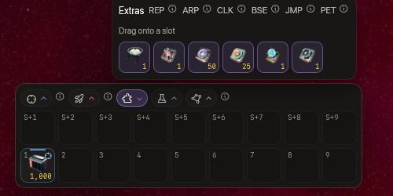
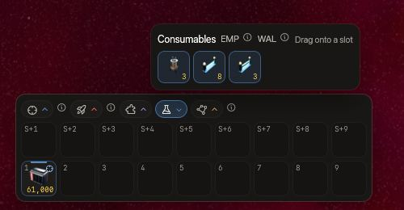
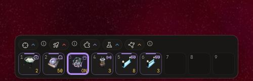
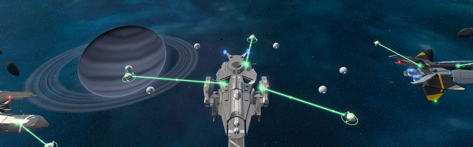
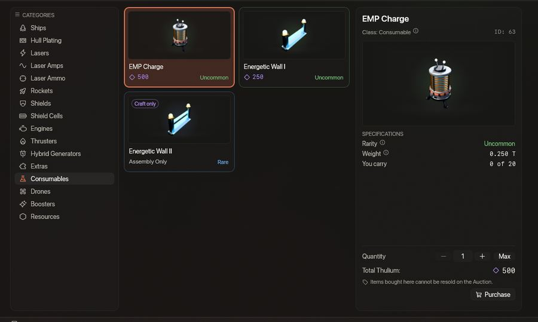

<!-- wiki-i18n source: d73343b5c426be4e -->
<!-- wiki-i18n title: Extrák -->
# Extrák {#extras}

Az extrák a hajó **extrafoglalataiban** lévő kütyük (a Protoson, a Kitefinen, az Ostirionon és a Nomadon, azaz azokon a hajókon, amelyekkel kezdesz vagy amelyeket megveszel, kettő, a Paragonon, az Ironcladen, a Wraithen és a Stormon, azaz azokon a hajókon, amelyeket gyártasz, három van, konfigurációnként, és 3, 5 vagy 7-tel több az Extra Slots CPU-kkal). A gyorssáv Extrák menüjéből vagy egy általad hozzájuk rendelt gyorssáv-helyről kapcsolhatod be őket. Csak abban a konfigurációban működnek, amellyel repülsz: ha a másik konfigurációba szerelsz fel egyet, az megvárja, amíg váltasz.

| Extra | Mit csinál | Használatok | Ár |
| :---- | :----------- | :--- | :---- |
| **Repair Drone I–IV** | Javítja a hajótestedet: másodpercenként a maximum 1,5%-át, 2,25%-át, 3,5%-át, illetve 5%-át | korlátlan | 5 000 / 15 000 / 35 000 kredit, 2 000 Thulium |
| **Cloaking CPU S** | Elrejti a hajódat | 10 | 5 000 Thulium |
| **Cloaking CPU M** | Elrejti a hajódat | 25 | 11 250 Thulium |
| **Cloaking CPU L** | Elrejti a hajódat | 50 | 20 000 Thulium |
| **P.E.T. Station I–III** | BE kapcsolva 2, 3 vagy 5 dokkolt [P.E.T.](/wiki/03-Mechanics/Pets.md#the-station) ad bónuszt a hajódnak, szerez tapasztalatot és dolgozik; KI kapcsolva ezek közül egyiket sem teszik | BE / KI | Gyártás, a kutatása után (az alábbi tárgyfa) |

A Cloaking CPU-kat csak a Boltban árulják. Nem vonhatók össze, és semmi sem adja őket ingyen. Az **EMP Charge** már nem extra: a 0.4.21 óta fogyóeszköz, amelyet a rakétákhoz hasonlóan kötegben viszel magaddal, és egyetlen foglalatba sem kerül, így egyik extrafoglalatodat sem foglalja (lásd [Rakéták](/wiki/06-Items/Rockets.md#emp-charge)). A két **Energetic Wall** sem extra már: a 0.4.22 óta ők is fogyóeszközök, kötegben viszed őket, és egyetlen foglalatba sem kerülnek (lásd [Energetic Wall](#energetic-wall)).

Az új pilóták **kezdőcsomagja** már két extrát tesz a Protos két extrafoglalatába: egy **Base CPU I**-et (10 használat, teleport a vállalatod bázisára) és egy **Repair Drone I**-et. Húzd őket a gyorssáv Extrák menüjéből egy helyre, hogy használhasd őket. A kezdőcsomagot csak az új pilóták kapják meg: aki a 0.4.10 előtt csatlakozott, annak nincs.

Hét további CPU nem kapható: a Gyártás akkor készíti el őket, ha a Skylab Kutatóközpontja már kikutatta őket (lásd: [Kutatás](/wiki/03-Mechanics/Research.md)). Ezek az Extra Slots CPU I, II és III, a Jump CPU, a Base CPU I és II, valamint az Auto-Repair CPU, és [az utolsó szakasz](#research-cpus) elmondja, mit tud mindegyik. A Cloaking CPU-hoz hasonlóan a Jump CPU és a Base CPU-k is a csendes pillanatokra valók: egyik sem indul el egy lövésed vagy egy kapott találat után 10 másodpercen belül. A két warp CPU, a Jump CPU és a Base CPU-k szintén meg vannak tagadva, amíg küldetéstárgyat viszel („Küldetéstárggyal a fedélzeten nem használhatsz warp CPU-t.”): lásd: [Küldetéstárgyak](/wiki/03-Mechanics/Quests.md#quest-items).

Minden extrának rövid címkéje van a gyorssáv-helyén: **REP** a Repair Drone-hoz, **CLK** a Cloaking CPU-hoz, **ARP**, **BSE** és **JMP** pedig az Auto-Repair, a Base és a Jump CPU-hoz. A fogyóeszközöknek megvan a sajátjuk: **EMP**, és **WAL** az Energetic Wallhoz. A három **P.E.T. Station** tárgy extra, mint a többi, **PET** címkével: szerelj fel egyet, és a foglalata BE vagy KI kapcsolja a Stationt (két lenyomás között egy másodperc), és mutatja, melyik állásban van. Amíg BE van kapcsolva, a dokkolt [P.E.T.-ek](/wiki/03-Mechanics/Pets.md) számítanak, amíg KI, nem. Mutass egy helyre, hogy elolvasd, mit tesz most egy lenyomás, vagy miért nem tehet semmit.







<!-- item-tree:begin -->
<!-- Generated from server/Data/Seeds/{items,recipes}.json and Resources/Rockets.json by scripts/trees-wiki.sh: don't edit by hand. -->

## Tárgyfa {#item-tree}

Amit a Gyártás elkészít, ahhoz előbb a technológiája kell; vidd az egeret egy tárgy fölé, hogy lásd, mennyi ideig tart a kutatása. A technológiafa, az üzemanyag és a boost: [Kutatás](/wiki/03-Mechanics/Research.md).

```tree
P.E.T. Station I | extra, common | craft 100000 Credits, 2000 Thulium, 300 s | research 10800 s, 10800 science | 25 Ship Fragment, 2 Power Core, 4 Velkonite Reinforced Plate | /wiki/06-Items/Extras.md
Cloaking CPU S | extra, common | buy 5000 Thulium | /wiki/06-Items/Extras.md#cloaking-cpu
Repair Drone I | extra, common | buy 5000 Credits | /wiki/06-Items/Extras.md#repair-drones
Repair Drone II | extra, common | buy 15000 Credits | /wiki/06-Items/Extras.md#repair-drones
Repair Drone III | extra, common | buy 35000 Credits | /wiki/06-Items/Extras.md#repair-drones
Extra Slots CPU I | extra, uncommon | craft 12000 Thulium, 300 s | research 1800 s, 1800 science | 60 Ship Fragment, 3 Power Core, 6 Velkonite Reinforced Plate | /wiki/06-Items/Extras.md#extra-slots-cpus
Base CPU I | extra, uncommon | craft 8000 Thulium, 300 s | research 10800 s, 10800 science | 40 Ship Fragment, 2 Power Core, 4 Velkonite Reinforced Plate | /wiki/06-Items/Extras.md#base-cpus
P.E.T. Station II | extra, uncommon | craft 400000 Credits, 6000 Thulium, 600 s | research 36000 s, 36000 science | 60 Ship Fragment, 6 Reinforced Hull Plate, 4 Power Core, 8 Velkonite Reinforced Plate, 2 Orvium Reinforced Plate | /wiki/06-Items/Extras.md
Cloaking CPU M | extra, uncommon | buy 11250 Thulium | /wiki/06-Items/Extras.md#cloaking-cpu
Extra Slots CPU II | extra, rare | craft 30000 Thulium, 600 s | research 36000 s, 36000 science | 120 Ship Fragment, 10 Reinforced Hull Plate, 6 Power Core, 12 Velkonite Reinforced Plate, 2 Orvium Reinforced Plate | /wiki/06-Items/Extras.md#extra-slots-cpus
Base CPU II | extra, rare | craft 20000 Thulium, 600 s | research 36000 s, 36000 science | 100 Ship Fragment, 5 Power Core, 1 Ancient Control Unit, 2 Orvium Reinforced Plate, 4 Dark Matter Plate | /wiki/06-Items/Extras.md#base-cpus
Auto-Repair CPU | extra, rare | craft 15000 Thulium, 600 s | research 21600 s, 21600 science | 80 Ship Fragment, 8 Reinforced Hull Plate, 4 Power Core, 6 Velkonite Reinforced Plate | /wiki/06-Items/Extras.md#auto-repair-cpu
P.E.T. Station III | extra, rare | craft 1500000 Credits, 18000 Thulium, 900 s | research 86400 s, 86400 science | 120 Ship Fragment, 12 Reinforced Hull Plate, 8 Power Core, 2 Ancient Control Unit, 12 Velkonite Reinforced Plate, 4 Orvium Reinforced Plate | /wiki/06-Items/Extras.md
Repair Drone IV | extra, rare | buy 2000 Thulium | /wiki/06-Items/Extras.md#repair-drones
Cloaking CPU L | extra, rare | buy 20000 Thulium | /wiki/06-Items/Extras.md#cloaking-cpu
Extra Slots CPU III | extra, epic | craft 75000 Thulium, 900 s | research 86400 s, 86400 science, 10 Dark Matter | 240 Ship Fragment, 25 Reinforced Hull Plate, 12 Power Core, 2 Ancient Control Unit, 6 Orvium Reinforced Plate, 4 Dark Matter Plate | /wiki/06-Items/Extras.md#extra-slots-cpus
Jump CPU | extra, epic | craft 40000 Thulium, 900 s | research 86400 s, 86400 science, 10 Dark Matter | 200 Ship Fragment, 20 Reinforced Hull Plate, 10 Power Core, 3 Ancient Control Unit, 15 Velkonite Reinforced Plate, 10 Orvium Reinforced Plate | /wiki/06-Items/Extras.md#jump-cpu

P.E.T. Station I -> P.E.T. Station II -> P.E.T. Station III
Cloaking CPU S -> Cloaking CPU M -> Cloaking CPU L
Repair Drone I -> Repair Drone II -> Repair Drone III -> Repair Drone IV
Extra Slots CPU I -> Extra Slots CPU II -> Extra Slots CPU III
Base CPU I -> Base CPU II
```
<!-- item-tree:end -->

## Repair Drone-ok {#repair-drones}

Kapcsolj be egy Repair Drone-t (REP), és az javítja a hajótestet, amíg tele nem lesz. Csak akkor indul el, ha 10 másodperce nem ért találat, és minden találat kikapcsolja. Ha többet is felszereltél, a legjobb működik. Egy [Auto-Repair CPU](#auto-repair-cpu) újra bekapcsolja helyetted. A javítási ütemek a [Harc](/wiki/03-Mechanics/Combat.md) oldalon vannak. Amíg javít, kis javítódrónok repülnek ki a hajóból, körbeszállják, és sugárral érik a hajótestet: egy a Repair Drone I, kettő a II, három a III vagy IV esetén, és a közelben lévő pilóták látják őket; amikor a javítás véget ér, újra dokkolnak.

## Cloaking CPU

Az álcázáshoz nyomd meg a CLK foglalatot. **Egy megnyomás egy használat**, bármelyik csomagról legyen szó, a hátralévő használatokat pedig a foglalaton és a hangárban látod. Az álcázásnak **nincs időkorlátja**: addig marad bekapcsolva, amíg ki nem kapcsolod, vagy valami meg nem szakítja.

- **Ki nem lát téged.** Más vállalatok pilótái és az idegenek egyáltalán nem látják a hajódat: nincs rajta a képernyőjükön vagy a célpontlistájukon, és senki sem veheti célba. Más vállalatok vállalati pilótái szintén figyelmen kívül hagyják.
- **A radarpont.** A térképen minden más pilóta – a saját vállalatodat kivéve – egy egyszerű **piros pontot** lát a minitérképen ott, ahol vagy, így tudják, hogy a közelben valaki álcázva van. A pontnak nincs neve, hajója, vállalata vagy azonosítója, nem lehet rákattintani, és nem vehető célba; ha fölé viszed az egeret, csak ennyit ír: „Itt valami álcázva van”. Kerek, és egy gyűrűben áll (a minitérképen a hajók négyzetek); a gyűrű lassan lélegzik, vagy mozdulatlan, ha bekapcsoltad a Kevesebb mozgás beállítást. A szerver körülbelül másodpercenként kétszer frissíti, a játékod pedig simán mozgatja közben. Azt mutatja, hogy valaki ott van, és hol, de azt nem, hogy ki: az a pilóta, aki látta, hogy álcázol, követheti a pontot, és egy rá irányított **rakétarobbanás** így is megtalál.
- **Ki láthat.** A saját hajódat halványan, körvonallal látod. A saját vállalatod pilótái sápadt szellemként látnak; a más vállalatba tartozó klántársak nem, mert a klán bárkit felvesz, aki jelentkezik. A szellemet senki sem veheti célba, a saját vállalatod sem.
- **Nem álcázhatsz** biztonságos zónában, amíg a CPU tölt, és találat vagy lövés után **10 másodpercen** belül.
- **Mi szünteti meg.** Ha újra megnyomod a foglalatot; az első sortüzed vagy rakétád (becsapódik, és meglátnak); ha biztonságos zónába lépsz; ha a CPU kikerül abból a konfigurációból, amellyel repülsz; az **EMP, amely 1 500 egységen belül sül el** tőled, bárki lőtte is ki (a saját vállalatodé is, de a csoporttársadé nem); és a rád találó rakéta területi robbanása. Az idő nem, a rakomány felvétele nem (a felvett doboz mindenki számára eltűnik, így mindenki megtudja, hogy valami elérhető közelségben járt arról a helyről, de azt nem, hogy ki), a képességek nem, a feketelyuk sugárzása pedig sebzi az álcázott hajót, de nem szünteti meg az álcázását. A kijelentkezés vagy a megsemmisülés megszünteti, mert a hajó, amelyet senki sem repül, nincs álcázva.
- **Töltődés.** Az álcázás végét követően, bárhogy ért is véget, a CPU **60 másodpercig** tölt. A töltődés a tiéd, nem a hajóé: akkor is folytatódik, ha portálon át ugrasz, kijelentkezel vagy megsemmisülsz. Minden megnyomás így is egy használatot visz el.
- Az **idegenek**, amelyek utánad jöttek, elvesztenek. A kilövési foglalásaid feloldódnak, amikor álcázol.
- **Rakéták.** Irányított rakétával senki sem foghat be téged, az egyenes, egy célpontú rakéta pedig átrepül rajtad. A **területi robbanás** viszont továbbra is megsebzi a hatókörébe eső hajót, és megszünteti az álcázását, és azok a pilóták, akik látják a hajó helyét, látni fogják a hajót, mielőtt a sebzésszám megjelenik. A rakéta kilövése lövésnek számít: a sortűzhöz hasonlóan megszünteti a saját álcázásodat (a CPU ekkor a fenti 60 másodpercig tölt), és álcázva voltál vagy sem, a kilövés után 10 másodpercig nem álcázhatsz.
- A **feketelyuk** az álcázott hajót is elnyeli, mint bármelyiket, és a térkép tudomást szerez róla.
- **Mit látsz.** A hajód átlátszóvá válik, lila szaggatott körvonallal, a drónjaid vele együtt elhalványulnak, a képernyő tetején pedig egy címke ezt írja: „Álcázva”, a hátralévő használatokkal (másodperc nélkül: nincs időzítő). A CLK foglalat a hátralévő használatokat mutatja; amíg álcázva vagy, lilán világít, és BE felirat látszik rajta, amikor pedig az álcázás véget ér, bárhogy is, elsötétül, és számolja a 60 másodpercnyi töltődést. Ha a szerver elutasít egy megnyomást (töltődés, biztonságos zóna, az elmúlt 10 másodpercben ért találat vagy leadott lövés), a foglalat pirosan felvillan, és egy üzenet megmondja, miért. A szövetséges halvány szellemként jelenik meg, a neve előtt egy „álcázva” felirattal, az a pilóta pedig, aki a közeledben álcáz, hullámzás kíséretében eltűnik. A használathoz húzd a CLK-t a gyorssáv Extrák menüjéből egy helyre, akárcsak a REP-et.
- A **használatok** a CPU-val együtt mentődnek. A kijelentkezés, a megsemmisülés vagy a játék újraindítása nem ad vissza egyet sem, és a megszakított aktiválás is elfogy. Amikor egy csomag utolsó használata is elfogy, a csomag elhasználódik, és a foglalatát a leltáradban lévő, ugyanilyen CPU egy tartaléka tölti újra, ha van ilyen.
- Egy konfigurációban **több CPU** nem adódik össze. Először a legkevesebb hátralévő használatú CPU fogy.

Az S, M és L ugyanúgy viselkedik: a nagyobb csomagok csak használatonként olcsóbbak (500, 450, illetve 400 Thulium).

## Energetic Wall

Nyomd meg a WAL helyet, és egy **plazmafal** áll fel **a kurzorodnál**, merőlegesen a hajódtól odavezető vonalra: egy 360 egység hosszú (nagyjából három és fél hajómodell) és 10 egység széles sáv. A közepe legfeljebb **450 egységre** van a hajó közepétől: a távolabbi kurzor 450 egységre teszi a vonal mentén, a 120 egységnél közelebbi 120 egységre tolja ki. Amíg a hely kész, egy halvány pontvonal és egy szellemkontúr mutatja, hol fog állni. Ha a játék nem tudja, hol a kurzorod, a hajó közepétől 220 egységre áll előtte, az irányára merőlegesen. Az Energetic Wall **fogyóeszköz**, mint az [EMP Charge](/wiki/06-Items/Rockets.md#emp-charge): köteg a leltáradban, amely **egyetlen hajón sem foglal foglalatot** (a 0.4.22-ig extra volt). A használatához húzd a gyorssáv Fogyóeszközök menüjéből egy helyre; a két szint két bejegyzés, így egy hely egy szintet tart. Mögé bújni és egy sávot lezárni való, nem arra, hogy benne állj.

- **Mit állít meg.** Minden lövés, amely átszeli, a falat találja el, bárki adta le és bármelyik oldalról: lézersorozat, rakéta, egy idegen sorozata. Ami mögötte áll, semmit sem kap, a sebzést a fal életereje viseli. Egy rakéta robbanása, amely a falnál megy el, a közeli oldalán lévő hajókat éri, a mögötte lévőket nem. A saját lövéseidet is: a saját falaidon át nem tudsz kifelé lőni. A N.I.K.E. és a Dormant Swamp lövegtornyai átrepülnek rajta, ahogy az aszteroidák felett is.
- **Mit éget.** Minden hajó, amelynek a törzse hozzáér a sávhoz, **másodpercenként 2 500 sebzést** kap, előbb a pajzsa, a tiéd is, az idegenek és a vállalati pilóták is. A biztonságos zónában vagy újraéledés védelme alatt álló hajó nem ég, és két sáv egy hajón nem adódik össze.
- **Meddig tart.** Az 1. szintű fal **30 000 életerőpontos**, a 2. szintű **90 000**. A fal magától másodpercenként a hatvanad részét veszíti, így az, amire senki sem lő, **60 másodperc** után eltűnik. A lövések ezt lerövidítik: egy Wraith tizenkét Helios Beammel és x4 lőszerrel nagyjából 3,5 másodperc alatt lebont egy 1. szintű falat.
- **Egyszerre egy, megnyomásonként egy fal.** Az új fal a régi helyére kerül. Egy megnyomás után a tárgy **90 másodpercig** tölt; a várakozás a tiéd, nem a hajóé: a halál vagy a kijelentkezés nem rövidíti. Egy megnyomás **egy, a hely szintjének megfelelő falat** használ el, és csak akkor, ha a fal áll: az a megnyomás, amelyet a játék elutasít (lásd lent), nem használ el semmit, és nem indít várakozást. Ha ebből a szintből nincs több, azt mondja: „Nincs több Energetic Wall.”, és a másik szintet soha nem használja el helyette.
- **Hol nem.** Nem, amíg biztonságos zóna vagy újraéledés véd, nem ott, ahol a sáv biztonságos zónához vagy kapuhoz érne, nem álcázva, és nem ott, ahol a sáv közepe a térképen kívülre esne. A játék megmondja, melyik eset.
- **Kilövések.** A hajó, amelyet a fal megsemmisít, sugárzásban hal meg, és a kilövés az utolsó ellenséges pilótáé, aki 15 másodpercen belül eltalálta, ha volt ilyen. Aki a falat felállította, nem kap jóváírást olyanért, amit nem ő lőtt. Az idegen, amelyet a fal megsemmisít, semmit sem fizet: se jutalom, se zsákmány.
- **Az idegenek nem kerülik meg.** Átrepülnek rajta és égnek, vagy a saját oldalukon állva lőnek a falra.
- **Mit látsz.** Egy kékesfehér fénysáv, amelyen fényes vonások futnak végig, mindkét végén egy fényoszloppal; felvillan, ahol lövés ér, és vibrál, ha majdnem kimerült. A 2. szintű fal ehelyett sárgán világít, vastagabb, fényesebb maggal és erősebb fénnyel, de a sávja ugyanúgy 10 egység széles, mint az 1. szintű falé. Mellette egy vékony életerősáv rövidül, és borostyánsárgára, majd pirosra vált; a helyed ívként mutatja a falad hátralévő életét, árnyékként a várakozást. A felállított fal felvillan, a lelőtt szikrákra hullik szét, az, amelynek lejárt az ideje, elhalványul. A helyeden egy szám a szintjének megmaradt falait is számolja.
- **Hogyan szerezhető és viszed.** Az Energetic Wall I a Boltban falanként **250 Thuliumért** kapható, és legfeljebb **20**-at viszel egy kötegben (amit az [Aukción](/wiki/03-Mechanics/Auction.md) kínálsz, az is beleszámít). Az Energetic Wall II-t a Gyártás készíti, **gyártásonként egy falat**, **600 Thuliumért**, 5 Ship Fragmentből és egy Power Core-ból, miután a Kutatóközpont kikutatta (6 óra normál sebességnél: [Kutatás](/wiki/03-Mechanics/Research.md)); ebből legfeljebb **10**-et viszel. A rakétákhoz hasonlóan a nálad lévő falak elvesznek a szezonnal, ha nem teszed őket a tranzittárolóba, a tárolóban lévők pedig nem használhatók. Az általad elkészített Energetic Wall II eladható az Aukción; az Energetic Wall I, amelyet a Bolt árul, soha.

## A Kutatóközpont CPU-i {#research-cpus}

A CPU-k közül kettő Dark Matter Plate-et kér, mint minden fejlesztési lánc utolsó szintje: az **Extra Slots CPU III** 4-et (és mellé 2 Ancient Control Unitot és 6 Orvium Reinforced Plate-et), a **Base CPU II** 4-et (és mellé egy Ancient Control Unitot és 2 Orvium Reinforced Plate-et), ezért előbb a Dark Matter Plate-et kutasd ki ([Dark Matter és Dark Matter Plate-ek](/wiki/03-Mechanics/Dark-Matter.md)).

<!-- research-cpus:begin -->
<!-- Generated from server/Resources/{Research,CpuConfig,SkylabConfig}.json and Data/Seeds/{items,recipes}.json by scripts/research-wiki.sh: don't edit by hand. -->

| CPU | Kutatási idő | Előbb kell hozzá | Thulium a gyártáshoz | Gyártási idő |
| :--- | :--- | :--- | ---: | ---: |
| [Extra Slots CPU I](/wiki/06-Items/Extras.md#extra-slots-cpus) | 30 perc | – | 12 000 | 5 perc |
| [Extra Slots CPU II](/wiki/06-Items/Extras.md#extra-slots-cpus) | 10 óra | [Extra Slots CPU I](/wiki/06-Items/Extras.md#extra-slots-cpus) | 30 000 | 10 perc |
| [Extra Slots CPU III](/wiki/06-Items/Extras.md#extra-slots-cpus) | 1 nap | [Dark Matter Plate](/wiki/06-Items/Resources.md#dark-matter-plate), [Extra Slots CPU II](/wiki/06-Items/Extras.md#extra-slots-cpus) | 75 000 | 15 perc |
| [Base CPU I](/wiki/06-Items/Extras.md#base-cpus) | 3 óra | – | 8 000 | 5 perc |
| [Base CPU II](/wiki/06-Items/Extras.md#base-cpus) | 10 óra | [Base CPU I](/wiki/06-Items/Extras.md#base-cpus), [Dark Matter Plate](/wiki/06-Items/Resources.md#dark-matter-plate) | 20 000 | 10 perc |
| [Jump CPU](/wiki/06-Items/Extras.md#jump-cpu) | 1 nap | [Base CPU II](/wiki/06-Items/Extras.md#base-cpus) | 40 000 | 15 perc |
| [Auto-Repair CPU](/wiki/06-Items/Extras.md#auto-repair-cpu) | 6 óra | – | 15 000 | 10 perc |
| [Energetic Wall II](/wiki/06-Items/Extras.md#energetic-wall) | 6 óra | – | 600 | 2 perc |

Egyik sem kapható a Boltban: kutasd ki a technológiát, majd készítsd el a CPU-t a Gyártásban. Vidd az egeret egy CPU fölé a fáján, hogy lásd, mit kér érte a Gyártás.

### Extra Slots CPUs

- **Mit tudnak.** Az Extra Slots CPU I, II és III minden hajónak 3, 5 és 7 további extrafoglalatot ad, vagyis összesen 6, 8 és 10 foglalatot egy olyan hajón, amelynek eleve 3 van, és 5, 7 és 9 foglalatot egy olyan hajón, amelynek eleve 2 van. A magasabb CPU lecseréli az előzőt: a II nem adódik hozzá az I-hez.
- **Telepítve, nem hordva.** Az Extra Slots CPU nem tárgy: ha a Gyártásban átveszed, magától települ a Skylabodba, minden hajóra mindkét konfigurációban, és nem foglal el foglalatot. A wipe után is megmarad.
- **Sorrendben.** Egymás után gyárts: a II csak akkor, ha az I telepítve van, a III csak akkor, ha a II telepítve van; addig a Gyártás megmondja, melyiket telepítsd előbb. A három együtt 117 000 Thuliumba kerül: 12 000, 30 000 és 75 000.

### Jump CPU

- **Mit tud.** A hajódat a világod bármelyik vállalati szektorába ugrasztja, a saját vállalatodéba és a többiekébe is, a bázisszektorokat is beleértve (`M`, `T` és `G`, 1–4. szektor), ugrásonként **500 Thuliumért**. A használatok száma nem korlátozott: csak a Thuliumot fizeted. Veszélyes szektorba (`DS`) és semleges szektorba (`N`) sosem visz.
- **Az ugrás.** Nyomd meg a JMP helyet, válaszd ki a szektort a Csillagrendszer térképén, és erősítsd meg: a hajó 5 másodpercig töltődik, majd megérkezik a szektor egyik kapujához, védve, mint bármelyik kapuugrás után. Érkezés után a CPU 30 másodpercig hűl.
- **Nem harcban.** Nem indítható lövés vagy találat után 10 másodpercen belül, és a töltés közbeni lövés vagy találat megszakítja az ugrást; ilyenkor nem kell fizetni. Álcázva nem ugorhatsz.
- **Semleges szektorból nem:** a semleges szektorban lévő vagy vállalat nélküli pilóta nem használhatja.
- Veszélyes szektorból elhagyható, ha nem vagy harcban.

### Base CPUs

- **Mit tudnak.** A hajódat a vállalatod bázisára teleportálják, az állomás körüli biztonságos zónába (`M-1`, `T-1` vagy `G-1`, a Mission Control szektora), Thulium nélkül. A gyorssáv BSE helyéről indítod őket.
- **Nem harcban.** 10 másodperces töltés, mindkettőnél ugyanaz. Nem indítható lövés vagy találat után 10 másodpercen belül, álcázva vagy ha már a bázisod biztonságos zónájában vagy, és a töltés közbeni lövés vagy találat megszakítja.

| CPU | Használat | Hűlési idő |
| :--- | ---: | ---: |
| [Base CPU I](/wiki/06-Items/Extras.md#base-cpus) | 10 | 10 perc |
| [Base CPU II](/wiki/06-Items/Extras.md#base-cpus) | 25 | 5 perc |

- **Elfogy, nem töltődik újra.** Minden használat elvesz egyet a CPU használataiból, és a használat nélkül maradt CPU eltűnik: készíts újat. Ha mindkettő fel van szerelve, előbb a jobbik (II) fogy.

### Auto-Repair CPU

- **Mit tud.** Magától kiküldi az extrafoglalataidban lévő Repair Dronet, valahányszor kézzel is kiküldhetted volna: a hajótested nincs tele, a drón nincs kint, és az utolsó találat óta eltelt 10 másodperc. Nincs beállítandó hajótest-szint.
- Saját extrafoglalatot foglal el, és nem csinál semmit Repair Drone nélkül ugyanannak a konfigurációnak egy extrafoglalatában. Képességfoglalatban lévő Repair Dronet sosem küld ki (az az Emergency Repair gomb).
- **Ha kézzel megállítod a drónt,** a CPU nem nyúl hozzá, amíg a hajótested újra tele nem lesz, vagy amíg te magad ki nem küldöd a drónt.


<!-- research-cpus:end -->
