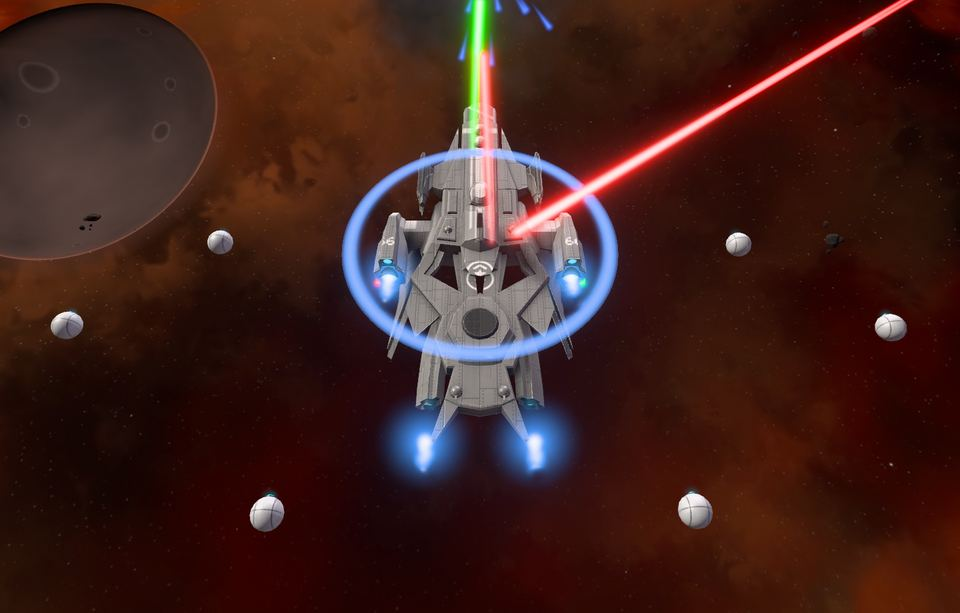
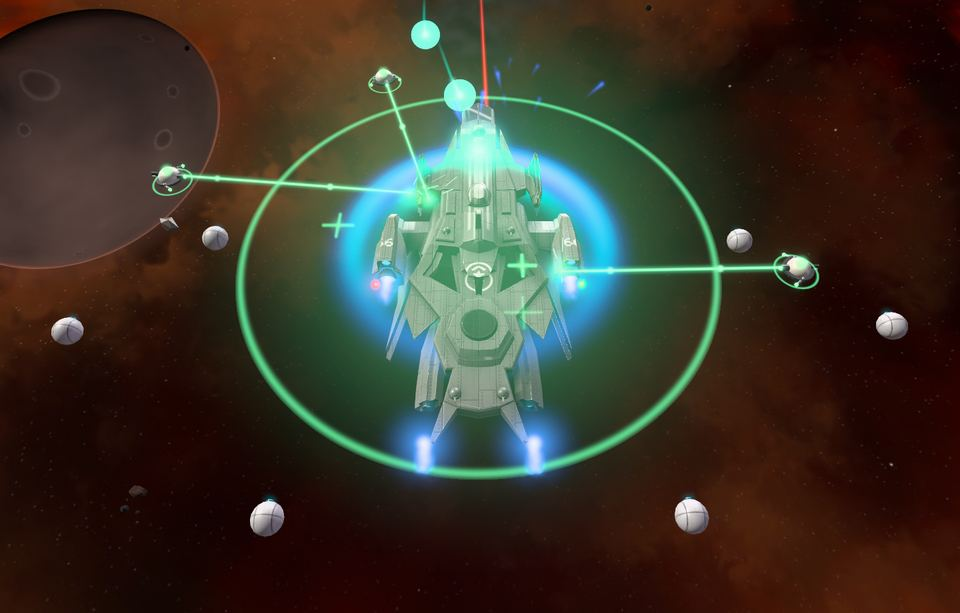
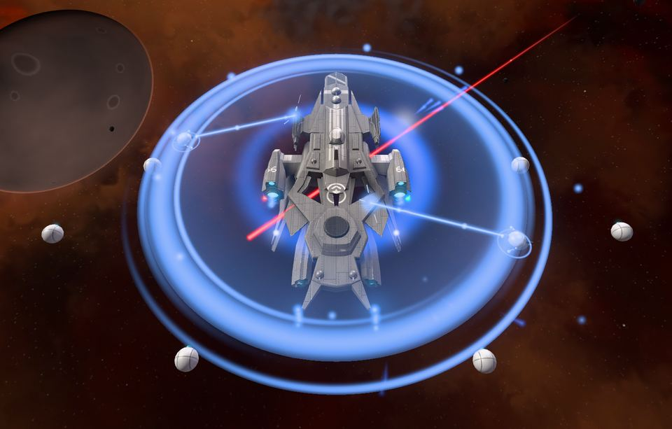

<!-- wiki-i18n source: 7acb39b1f1bc768e -->
<!-- wiki-i18n title: Abilità -->
# Abilità attive della nave {#active-ship-abilities}

Le abilità sono i pulsanti che premi nel pieno di uno scontro: uno scudo che torna, uno scatto di velocità per uscire dalla portata, una riparazione quando lo scafo è quasi a zero. Derivano dallo **scudo, dal motore o dal Repair Drone** che monti negli **Slot abilità** della tua nave, e migliore è l’oggetto, migliore è l’abilità. Sono fatte per il momento in cui ti servono, non per premerle a ogni ricarica: ciascuna dura da dieci a quindici secondi e poi riposa da un minuto e mezzo a due minuti. Alcuni [design delle navi](/wiki/03-Mechanics/Ship-Designs.md) ne hanno una in più, tutta loro: vedi [Abilità delle navi](#ship-abilities).

Un nuovo pilota ne ha già una: il **Repair Drone I** del kit iniziale è già montato nello slot abilità della Protos, quindi il pulsante di Emergency Repair (`E`) c’è fin dal primo minuto. Un secondo Repair Drone I del kit è in uno slot extra: quello ripara lo scafo lentamente da solo e non è un’abilità (vedi [Extra](/wiki/06-Items/Extras.md#repair-drones)).

## Slot abilità {#ability-slots}

Ogni nave ha un numero fisso di Slot abilità nell’Hangar:

- **Protos** (iniziale): 1 slot
- **Kitefin**: 1 slot
- **Ostirion**: 2 slot
- **Nomad**: 2 slot
- **Paragon**: 3 slot
- **Storm**: 3 slot
- **Ironclad**: 4 slot
- **Wraith**: 3 slot

Uno slot abilità accetta uno **Shield Core**, un **motore** o un **Repair Drone**, e ognuno genera la propria abilità. Trascina l’oggetto sullo slot. La configurazione 1 e la configurazione 2 hanno ciascuna i propri slot. Nell’Hangar, un clic su uno Shield Core, un motore o un Repair Drone lo mette nel suo slot abituale, e nel primo slot abilità libero quando tutti i suoi slot abituali (gli slot dei generatori, o gli extra per un Repair Drone) sono occupati.

- **Celle scudo e propulsori non entrano in uno slot abilità.** Sono moduli di scudi, motori e Nuclei adattivi.
- **Un oggetto in uno slot abilità non aggiunge nient’altro.** Non dà capacità scudo, ricarica, assorbimento o velocità, né il rallentamento di uno scudo. Lo stesso Heavy Shield Core sta o in uno slot generatore, per avere il suo scudo in ogni momento, o in uno slot abilità, per il suo Surge. Scegli tu.
- Uno scudo o un motore che contiene celle o propulsori li restituisce al tuo inventario quando lo trascini su uno slot abilità.
- Un Repair Drone in uno slot abilità genera Emergency Repair e non ripara lo scafo da solo. Il drone lento (**REP**) richiede un Repair Drone in uno slot extra.

## Più moduli dello stesso tipo {#several-modules-of-one-kind}

Puoi montare **più scudi, motori o Repair Drone** negli slot abilità di una configurazione. Restano un’unica abilità, un unico pulsante e un’unica ricarica, ma più potente:

- **Il modulo di grado più basso stabilisce la base.** Il suo grado determina la forza e la ricarica. Un Heavy Shield Core accanto a un Light Shield Core si comporta come due moduli di grado I: un secondo modulo migliore porta il bonus, mai una forza maggiore o una ricarica più breve.
- **Ogni altro modulo aggiunge il 50% della base**, sommato e non moltiplicato. I motori fanno **durare di più** l’Afterburner: 15 s, 22,5 s con due motori, 30 s con tre, 37,5 s con quattro (il bonus di velocità e la ricarica non cambiano). Gli scudi fanno **ripristinare di più** lo Shield Surge, e i Repair Drone fanno **curare di più** l’Emergency Repair, negli stessi dieci secondi: il 100%, il 150%, il 200% e il 250% del totale per uno, due, tre e quattro moduli.
- **I moduli in più costano slot.** Una nave con tre slot abilità può averne tre dello stesso tipo, oppure uno per tipo, oppure due e uno; l’Ironclad, con quattro, ne può avere quattro dello stesso tipo, oppure due dello stesso tipo e uno per ciascuno degli altri due. Una Protos o una Kitefin ha un solo slot e non può cumulare; un’Ostirion o una Nomad può averne due dello stesso tipo.
- Gradi uguali danno semplicemente quel grado. Tra due moduli dello stesso grado, la base la stabilisce quello con l’incantamento più debole.

## Le tre abilità {#the-three-abilities}

### Shield Surge (scudi), tasto `Q` {#shield-surge-shields-key-q}

Per dieci secondi lo scudo della tua nave viene **riparato**: il Surge ripristina in modo uniforme una quota del tuo scudo massimo, fino al massimo e mai oltre. Non è una barriera e non cambia come si ripartiscono i colpi; rimette scudo, e ciò che ha rimesso resta. Non si interrompe quando subisci un colpo (la ricarica normale attende 15 secondi dopo un colpo; il Surge no). Una nave con lo scudo pieno ne ricava poco, quindi premilo quando lo scudo sta cedendo. Il totale non è mai inferiore al 60% della capacità del nucleo stesso, quindi anche una nave con poco scudo ottiene una vera riparazione (fino al suo massimo).

- Viene rifiutato quando sei sotto la protezione di una zona sicura e su una nave del tutto priva di scudo, così un clic sbagliato non lo spreca.
- I razzi perforanti continuano ad aggirare in parte gli scudi, come hanno sempre fatto.

### Afterburner (motori), tasto `W` {#afterburner-engines-key-w}

Per tutta la sua durata la tua velocità finale viene moltiplicata per il bonus del grado. Non cambia la virata, il puntamento o il danno subito: trasforma il tempo in distanza. Usalo per lasciare uno scontro, per raggiungere l’anello di una stazione o di un portale, o per avvicinarti a un bersaglio che scappa. Funziona ovunque, zone sicure comprese. Più motori lo fanno durare di più, non andare più veloce.

### Emergency Repair (Repair Drone), tasto `E` {#emergency-repair-repair-drones-key-e}

Cura una quota del tuo **scafo massimo in modo uniforme nell’arco di dieci secondi**, mai oltre il massimo. I colpi non lo interrompono: è un’abilità d’emergenza, e funziona sotto il fuoco, nelle radiazioni del buco nero, con l’occultamento attivo e dentro la finestra di un EMP. Termina allo scadere del tempo o quando la tua nave viene distrutta. Non tocca il tuo scudo, non conta come un colpo e lascia la lenta riparazione REP com’era. Viene rifiutato a scafo pieno.

## Abilità delle navi {#ship-abilities}

Dieci dei quattordici [design delle navi](/wiki/03-Mechanics/Ship-Designs.md) hanno un’abilità che appartiene al design, non a un oggetto. Non occupa **nessuno slot abilità** e non richiede nulla di montato: c’è finché pilotti il design. Ha un pulsante tutto suo, il quarto nella colonna della barra rapida, e il suo tasto è `F` (modificabile nelle impostazioni). Ha la propria ricarica, che si mantiene come le altre: cambiare configurazione, saltare e disconnettersi non la azzerano, e una nave distrutta inizia il volo successivo con tutte le abilità pronte.

| Abilità | Design | Cosa fa | Durata | Ricarica |
| :--- | :--- | :--- | ---: | ---: |
| **Blink** | Storm NOTSUM, Ironclad TITANIC, Protosaur | Velocità 2.500 verso il tuo ordine di movimento | 1 s | 120 s |
| **Chameleon** | Storm RECON, Protosaur | Invisibile a ogni altro pilota, minimappa compresa | finché non si spezza | 60 s |
| **Target** | Storm RECON | Una nave nemica selezionata entro la portata del tuo laser subisce il 20 % di danni in più | 5 s | 60 s |
| **Slow** | Storm RECON | Una nave nemica selezionata entro la portata del tuo laser vola il 60 % più lentamente | 4 s | 60 s |
| **Focus Fire** | Ironclad DUMA | Le navi nemiche entro 1.000 unità sono costrette ad attaccarti | 5 s | 60 s |
| **Venom** | Wraith RAPTOR | 125.000 di danno direttamente allo scafo di un bersaglio | 30 s | 120 s |
| **Diminisher** | Wraith BILLY | Subisci il 75% di danno in meno e ne infliggi il 25% in meno | 25 s | 120 s |
| **Heal Pod** | Storm BRATAN, Wraith MENATI | Un baccello cura le navi alleate entro 600 unità di 20.000 + 2% del loro scafo massimo al secondo | 5 s | 120 s |
| **Shield Buff** | Wraith ATARAXIS | La tua capacità dello scudo raddoppia e rigenera il 2% del suo massimo al secondo | 10 s | 120 s |
| **Heal Pod** | Miyuki (I–V) | Lo stesso baccello, ma resta più a lungo; dalla Miyuki III cura 30.000 + 3% del loro scafo massimo al secondo | 7,5 s | 120 s |
| **Channel Heal** | Miyuki (II–V) | Ti collega a una nave che hai selezionato entro 1.200 unità: lei riceve 50.000 di scafo al secondo e tu 10.000 (75.000 per lei dalla Miyuki IV) | 5 s | 120 s (100 s dalla Miyuki IV) |
| **Channel Shield** | Miyuki (III-V) | Ti collega a una nave che hai selezionato entro 1.200 unità: lei riceve 150.000 di scudo al secondo e tu 30.000, e ciascuna delle due navi ottiene in più il 3% (Miyuki III), il 4% (IV) o il 5% (V) del proprio scudo massimo al secondo | 5 s | 120 s (80 s dalla Miyuki V) |
| **Revive** | Miyuki (I–V) | Rianima la nave in avaria di un amico entro 600 unità: resta a portata per 10 secondi e torna dove è stata distrutta con il 30% dello scafo e senza scudo | 10 s | 120 s |

- **Blink.** Per 1 secondo la tua velocità è 2.500, verso il tuo ordine di movimento. Ti fermi dove l’ordine finisce, e anche il bordo della mappa ti ferma. Poi riposa per 120 secondi.
- **Chameleon.** Sparisci: nessun altro pilota ti vede, né sulla mappa né sulla minimappa, e nessuno può agganciarti. La tua corporazione continua a vederti, come un fantasma. Un EMP non può spezzarla. Termina quando subisci un qualsiasi danno, spari una raffica di laser, lanci un razzo, usi Target o Slow o raccogli una cassa, oppure quando premi di nuovo il pulsante; i suoi 60 secondi partono quando termina, in qualunque modo. Non puoi avviarla entro 10 secondi da uno sparo o da un colpo subito, né nell’anello di una zona sicura, né mentre un Cloaking CPU è attivo. Una zona sicura non la interrompe, e nemmeno un salto attraverso un portale: l’invisibilità attraversa il portale con te. Quando è il tuo stesso attacco a interromperla, ricevi un **Ambush** per 3 secondi: il 25 % di danni in più e il 25 % di velocità in più. La competenza del pilota Furtività accorcia anche la sua attesa, come quella della Cloaking CPU.
- **Target.** Aggancia o seleziona una nave nemica entro la portata del tuo laser e premi: per 5 secondi subisce il 20 % di danni in più da tutti, l’effetto del Marking Rocket, e le navi intorno vedono il segno. Funziona sui piloti di altre corporazioni e sugli alieni, non sul tuo gruppo o sulla tua corporazione, non su una nave protetta da una zona sicura e non dove l’aggancio del laser è rifiutato (il Peace Protocol, un settore senza PvP); in una zona sicura è rifiutato. Conta come un attacco: interrompe la tua invisibilità, quindi un Chameleon che usa Target ottiene il suo Ambush. Poi riposa per 60 secondi.
- **Slow.** Lo stesso, per 4 secondi: la velocità della nave si riduce del 60 %, l’effetto del Freeze Rocket, e riposa per 60 secondi.
- **Focus Fire.** Per 5 secondi ogni pilota nemico e ogni alieno entro 1.000 unità è costretto ad attaccarti: l’aggancio di un pilota viene messo su di te e non si può cambiare, un alieno si rivolge contro di te. I piloti del tuo gruppo e della tua corporazione, le navi sotto la protezione di una zona sicura e le navi occultate restano escluse, e viene rifiutata in una zona sicura o senza nemici a portata. I piloti costretti possono comunque volare dove vogliono.
- **Venom.** Aggancia un bersaglio alla portata dei tuoi laser e premi: 125.000 di danno vanno direttamente al suo scafo in 30 secondi, in modo uniforme, e il suo scudo non ne prende alcuna parte. Funziona sui piloti di altre corporazioni e sugli alieni allo stesso modo, non sul tuo gruppo né sulla tua corporazione, non su una nave protetta da una zona sicura e non dove un aggancio con il laser viene rifiutato (il Protocollo di pace, un settore senza PvP). Una nave porta un solo Venom alla volta. Ogni tic conta come un colpo, quindi il bersaglio non può nascondersi in una zona sicura fino alla fine. La riparazione, un Heal Pod e un Diminisher sul bersaglio lo riducono, termina quando muore il bersaglio o muori tu, e l’eliminazione e i suoi punti sono tuoi.
- **Diminisher.** Per 25 secondi ogni colpo che subisci è ridotto a un quarto prima che il tuo scudo ne prenda la sua parte, quindi scudo e scafo perdono entrambi un quarto, e ogni colpo che infliggi è ridotto a tre quarti: laser, razzi diretti ed esplosioni. Una seconda pressione non fa nulla finché è attivo.
- **Heal Pod.** Un baccello cade dove ti trovi e resta per 5 secondi. Ogni secondo cura ogni nave alleata entro 600 unità di 20.000 più il 2% dello scafo massimo di quella nave: te, il tuo gruppo e la tua corporazione, nessun altro, e mai oltre il massimo. Nulla può agganciare il baccello né colpirlo, e continua a curare se muori. Il baccello della Miyuki resta 7,5 secondi e il suo ultimo mezzo secondo cura mezzo impulso; dalla Miyuki III cura 30.000 più il 3%.
- **Shield Buff.** Per 10 secondi la capacità del tuo scudo è raddoppiata, con lo scudo che hai raddoppiato insieme, e lo scudo rigenera il 2% del massimo raddoppiato ogni secondo. Quando finisce, la capacità torna normale e con lei lo scudo, mantenendo la sua quota, quindi non ti cura mai: è spazio per incassare colpi. Viene rifiutato su una nave senza scudo.
- **Channel Heal.** Seleziona una nave entro 1.200 unità e premi (un amico, ma anche un pilota nemico o un alieno: il collegamento cura chiunque colleghi, quindi scegli bene; il boss di un dungeon o di un gate in solitaria non può essere collegato): un collegamento ti unisce a essa per 5 secondi. Ogni secondo cura quella nave di 50.000 di scafo e te di 10.000, nello stesso momento e mai oltre il massimo. Dalla Miyuki IV l’altra nave riceve 75.000 e l’attesa è di 100 secondi; i tuoi 10.000 restano. La tua Guarigione rende più forti entrambe le cure, e curare un nemico non ti dà XP di guarigione. Il collegamento termina quando il tempo è scaduto, quando una delle due navi viene distrutta o lascia la mappa, quando siete a più di 1.200 unità di distanza o quando un EMP colpisce una delle due; ciò che è stato curato resta.
- **Channel Shield.** Lo stesso collegamento con lo scudo: 150.000 di scudo al secondo all’altra nave e 30.000 a te, per 5 secondi, e in più ogni secondo ciascuna delle due navi riottiene una parte del proprio scudo massimo: il 3% sulla Miyuki III, il 4% sulla IV e il 5% sulla V, così un collegamento della Miyuki V ripristina in tutto il 25% di ogni massimo oltre ai punti. Mai oltre lo scudo massimo. Sulla Miyuki V riposa 80 secondi invece di 120. La tua Guarigione ne rafforza anche i punti e la quota dello scudo massimo, e termina negli stessi modi.
- **Revive.** Quando un pilota del tuo gruppo o della tua corporazione viene distrutto, la sua nave resta sulla mappa come nave in avaria per 30 secondi: la vedi con il suo nome e i secondi rimasti, nessun altro la vede, e nulla può colpirla o agganciarla. Cliccala per sceglierla (se premi senza scelta, viene presa la più vicina) e premi il Revive entro 600 unità, poi resta entro quella portata per 10 secondi. Un colpo contro di te, un EMP, l’uscita dalla portata, la tua distruzione o la fine dei 30 secondi lo interrompono; un Revive interrotto si ricarica solo 3 secondi. Se si completa, il pilota torna dove è morto, con il 30% dello scafo, senza scudo e con la protezione di un respawn, e il Revive si ricarica per 120 secondi da quel momento. Non dà esperienza né onore, la tua competenza Guarigione non lo tocca, e un pilota che sceglie un respawn lo abbandona. Funziona su ogni mappa tranne un dungeon di clan, un gate in solitaria e il [Deep Void](/wiki/03-Mechanics/Deep-Void.md) (chi muore lì torna alla propria base), e solo per i piloti con il gioco aggiornato.

La **Miyuki** è una nave di supporto, non un design, e ne porta fino a quattro: il suo Heal Pod su `F`, un Channel Heal dal livello II su `D`, un Channel Shield dal livello III su `S` e, a ogni livello, il Revive, sempre il suo ultimo pulsante: sta su `D` al livello I, su `S` al livello II e dal livello III sul tasto meno `-`. I pulsanti della seconda e di quelli successivi stanno in una colonna a parte, a sinistra del primo, ciascuno con il proprio tempo di ricarica. Un collegamento richiede la nave selezionata quando premi; il gioco non ne sceglie nessuna per te. Lo **Storm RECON** ne porta tre: il suo Chameleon su `F`, e Target e Slow in una colonna a parte, che richiedono una nave nemica selezionata o agganciata.

Un **EMP** che esplode vicino a te blocca il pulsante per 5 secondi: la pressione viene rifiutata e nessuna ricarica parte. Un’abilità già in corso prosegue, e un Chameleon resta nascosto. Anche gli altri piloti vedono queste abilità: una scia dietro un Blink, un anello rosso e linee verso le navi che un Focus Fire costringe, un Chameleon solo come un fantasma per la sua stessa corporazione. Un EMP che colpisce te o la nave a cui sei collegato interrompe anche un collegamento.

## Gradi {#ranks}

La forza di un’abilità è una **quota di un valore della tua nave** (scudo massimo, velocità, scafo massimo), quindi cresce con la nave. Il grado dipende dall’oggetto: un modello migliore dà un’abilità migliore. Un oggetto incantato aggiunge alla forza il bonus del suo incantamento, al massimo il 15%. La tabella vale per un modulo; il cumulo è sotto.

<!-- abilities:begin -->
<!-- Generated from server/Resources/AbilityConfig.json and the items' stats by scripts/abilities-wiki.sh: don't edit by hand. -->

| Abilità | Grado | Oggetto | Forza (un modulo) | Durata | Ricarica | Attiva |
| :--- | :---: | :--- | :--- | --: | --: | --: |
| **Shield Surge** | I | Light Shield Core | ripristina 18% del tuo scudo massimo | 10 s | 120 s | 8,3% |
| **Shield Surge** | II | Basic Shield Core | ripristina 36% del tuo scudo massimo | 10 s | 105 s | 9,5% |
| **Shield Surge** | III | Heavy Shield Core | ripristina 60% del tuo scudo massimo | 10 s | 90 s | 11,1% |
| **Afterburner** | I | Engine I | +20% di velocità | 15 s | 120 s | 12,5% |
| **Afterburner** | II | Engine II | +30% di velocità | 15 s | 105 s | 14,3% |
| **Afterburner** | III | Engine III | +40% di velocità | 15 s | 90 s | 16,7% |
| **Emergency Repair** | I | Repair Drone I | cura 12% del tuo scafo massimo | 10 s | 120 s | 8,3% |
| **Emergency Repair** | II | Repair Drone II | cura 15% del tuo scafo massimo | 10 s | 105 s | 9,5% |
| **Emergency Repair** | III | Repair Drone III | cura 19,2% del tuo scafo massimo | 10 s | 90 s | 11,1% |
| **Emergency Repair** | IV | Repair Drone IV | cura 24% del tuo scafo massimo | 10 s | 75 s | 13,3% |

Più moduli dello stesso tipo in una configurazione: quello di grado più basso stabilisce la forza e la ricarica indicate sopra, e ogni altro ne aggiunge 50%.

| Moduli dello stesso tipo | L’Afterburner dura | Lo Shield Surge ripristina | L’Emergency Repair cura |
| :---: | --: | --: | --: |
| 1 | 15 s | 100% | 100% |
| 2 | 22,5 s | 150% | 150% |
| 3 | 30 s | 200% | 200% |
| 4 | 37,5 s | 250% | 250% |

<!-- abilities:end -->

L’Engine II e gli scudi e i motori di grado III (l’Heavy Shield Core, l’Engine III) non sono in vendita: li crei nell’[Assemblaggio](/wiki/06-Items/Overview.md#upgrading-modules) a partire da un Engine I, da un Basic Shield Core e da un Engine II, con Thulium, drop e piastre (4 Velkonite Reinforced Plate per l’Engine II, 4 Dark Matter Plate e una Ancient Control Unit per gli altri: [Dark Matter e Dark Matter Plate](/wiki/03-Mechanics/Dark-Matter.md)). L’Emergency Repair ha un quarto grado, il Repair Drone IV.

## Ricariche e limiti {#cooldowns-and-limits}

- **La ricarica parte quando premi** l’abilità e ne comprende la durata. Quindi un Surge da 10 secondi con una ricarica di 90 secondi è attivo al massimo l’11% del tempo, e non è disponibile per 80 secondi dopo la fine. Più moduli non la accorciano (è quella del modulo di grado più basso); anche tre Afterburner sono attivi al massimo il 33% del tempo.
- **Le ricariche appartengono a te, non all’oggetto.** Cambiare configurazione, cambiare oggetto, saltare in un altro settore e disconnettersi non le azzerano. Una nave distrutta inizia il volo successivo con ogni abilità pronta.
- **Ogni abilità ha la propria ricarica.** Usarne una non blocca le altre.
- **Un effetto in corso mantiene i valori con cui è partito.** Smontare l’oggetto o cambiare configurazione non lo modifica né lo termina. Nemmeno un salto o una riconnessione lo terminano; la disconnessione sì, e la sua ricarica resta.
- Gli altri piloti vedono i timer delle tue abilità sulla mappa, come hanno sempre fatto: un Surge già usato dice loro che i prossimi minuti sono scoperti.

## Competenze del pilota {#pilot-skills}

Quattro delle tue [competenze del pilota](/wiki/03-Mechanics/Pilot-Skills.md) cambiano il modo in cui girano le abilità, compresa l’abilità `F` del progetto della tua nave:

- **Riflessi** fa finire prima le ricariche, un po’ di più a ogni livello. Una ricarica parte sempre quando premi e comprende la durata dell’abilità.
- **Tattica** fa durare di più un’abilità. Uno Shield Surge o una Emergency Repair dà gli stessi punti al secondo sul tempo più lungo, quindi ne restituisce di più in tutto, e un Afterburner dura di più. La ricarica non cresce con essa, quindi l’attesa dopo la fine dell’abilità si accorcia.
- **Sabotaggio** potenzia i veleni, come il Venom di una Wraith RAPTOR, nel danno e nella durata, oltre alla Tattica.
- **Guarigione** rende più forti le cure del tuo equipaggiamento: una Emergency Repair, un Repair Drone in uno slot extra (REP) e ogni cura del Heal Pod che sganci (un Heal Pod conserva il livello che aveva la tua Guarigione quando l’hai sganciato). Si moltiplica con la Tattica, che fa durare di più una Emergency Repair e un Heal Pod (ai livelli alti un Heal Pod resta un secondo in più e cura una volta in più): con entrambe al livello 100, una Emergency Repair o un Heal Pod cura il 56% in più in tutto. Il Support Rocket cura sempre la stessa quantità fissa. Un Channel Heal o un Channel Shield che apri agisce su entrambe le navi con quel fattore (nel Channel Shield anche sulla quota dello scudo massimo). Sul Miyuki la Guarigione accorcia anche l’attesa di Heal Pod, Channel Heal e Channel Shield: il 10% in meno al livello 100, in linea retta dal livello 1. Il Heal Pod di qualsiasi altra nave mantiene l’attesa intera.

Le cifre di ogni livello sono nella tabella delle [Competenze del pilota](/wiki/03-Mechanics/Pilot-Skills.md#the-stats).

## Tasti e pulsanti {#keys-and-buttons}

`Q` Shield Surge, `W` Afterburner, `E` Emergency Repair e `F` l’abilità del design della tua nave; la Miyuki aggiunge `D` Channel Heal, `S` Channel Shield e, per ultimo, il Revive (su `D` o `S` finché ha meno pulsanti, e dal livello III sul tasto meno `-`; tutti configurabili nelle impostazioni). Ogni pulsante compare accanto alla barra rapida solo quando la tua configurazione ha quell’abilità (i pulsanti delle abilità della tua nave, quando la nave che pilotti ne ha), quindi la `E` di un nuovo pilota c’è fin dal primo minuto. L’anello attorno all’icona indica lo stato dell’abilità: pieno, nel colore dell’abilità, quando è pronta; si svuota con i secondi rimanenti mentre è attiva (anche l’Emergency Repair, ora che cura nell’arco di dieci secondi); si riempie di nuovo durante la ricarica, con i secondi rimanenti al centro. Un cumulo di più moduli porta il suo segno (`x2`, `x3`) nell’angolo del pulsante. Il pulsante di Emergency Repair è attenuato mentre lo scafo è pieno, e quello di Shield Surge su una nave del tutto priva di scudo. Passa il puntatore su un pulsante per vedere i valori sulla tua nave, cumulo compreso (per esempio *Afterburner II x2: +30% di velocità per 22,5 s*), e, mentre un Surge o una riparazione sono in corso, quanto restituisce ogni secondo e quanto deve ancora arrivare.

## Nell’Hangar {#in-the-hangar}

Trascina uno scudo, un motore o un Repair Drone su uno slot abilità, oppure fai clic destro su di esso nel tuo inventario per metterlo nel primo slot libero. Un secondo e un terzo dello stesso tipo vanno negli slot liberi successivi e si cumulano. Il nome e il grado dell’abilità compaiono sotto ogni slot occupato, con il segno del cumulo e i valori di tutti i suoi moduli insieme (*Afterburner II x2*, *x2 · 22,5 s*; per un Repair Drone II su una Wraith *+81.000 scafo*), e passando il puntatore su uno slot vedi quanto vale sulla tua nave, cumulo compreso, e quale modulo del cumulo stabilisce il grado. Ogni modulo dello stesso tipo mostra la stessa abilità, perché sono una sola. Passando il puntatore sull’oggetto in qualsiasi altro punto vedi l’abilità con le quote della tua nave e una frase su cosa aggiunge un modulo in più.

## Cosa vedono tutti {#what-everyone-sees}

Uno Shield Surge è una bolla attorno alla nave finché resta attivo, che tremola negli ultimi due secondi e si richiude quando termina. Le barre dello scudo (la tua nella finestra Nave e quella di un bersaglio nella finestra Bersaglio) si riempiono semplicemente man mano che il Surge rimette scudo, e la barra pulsa leggermente finché c’è spazio da riempire. Un Afterburner fa bruciare più intensamente i motori per tutta la sua durata, 15, 22,5, 30 o 37,5 secondi, e quando parte emette un anello dalla nave, più ampio per un cumulo. Un Emergency Repair emette un impulso verde quando parte, poi per i suoi dieci secondi avvolge lo scafo in un tenue bagliore verde da cui salgono alcuni segni più, mostra sopra la tua nave lo scafo che cura ogni secondo e termina con un ultimo lampo. Mentre è attivo, piccoli droni di riparazione girano attorno alla nave e la aggiustano: uno per un Repair Drone I, due per un II, tre per un III o IV, e uno in più per ogni ulteriore Repair Drone in un cumulo (mai più di tre). Si staccano dallo scafo, puntano tenui raggi verdi sulle sue piastre, dal grado II in su inviano impulsi lungo i raggi e tornano ad attraccare quando i dieci secondi sono finiti; uno Shield Surge ne ha fino a due blu dentro la sua bolla. Ogni pilota sulla mappa vede tutte e tre le abilità, droni compresi (più piccoli sulla nave di un altro pilota, e meno numerosi con le impostazioni grafiche più basse, dove Bassa mostra raggi e bagliori senza i modelli dei droni, e un raggio un po’ più largo per ogni grado del drone), quindi un Surge già usato è un segnale per il nemico quanto per te. I droni emettono tre suoni discreti tutti loro, molto sotto il rintocco della riparazione: un leggero blip quando si staccano dallo scafo, uno quando attraccano e un tono tenue sotto i loro raggi mentre lavorano (i droni di un Surge un po’ più acuti); li senti dalle navi sul tuo schermo, al massimo pochi alla volta, e il volume degli Effetti sonori li abbassa. Con *Riduci movimento* attivo, il bagliore resta fisso, i segni più vengono omessi, l’ultimo lampo diventa una dissolvenza e i droni restano fermi accanto alla nave con un raggio fisso (i suoni restano). Anche un Repair Drone in uno slot extra (REP) disegna i suoi droni finché ripara lo scafo: uno per un Repair Drone I, due per un II, tre per un III o un IV, che girano attorno alla nave e la colpiscono con i loro raggi, e tutti i piloti sulla mappa li vedono. Tornano ad agganciarsi quando la riparazione si ferma. Attivarlo con REP fa suonare anche un tenue impulso di riparazione, simile a quello dell’Emergency Repair ma un po’ più grave e più leggero, e, come un Emergency Repair, mostra sopra la tua nave lo scafo che cura ogni secondo.

## Cosa è cambiato {#what-changed}

Prima dell’aggiornamento 0.4.3 gli slot abilità accettavano celle scudo (Rigen. scudo) e propulsori (Scatto di velocità). Le celle scudo e i propulsori che si trovavano negli slot abilità sono tornati nel tuo inventario con l’aggiornamento del gioco, e restano tuoi: sono ancora moduli di scudi, motori e Nuclei adattivi. Da allora lo Shield Surge non dà più una barriera di sovrascudo ma ripara il tuo scudo nell’arco di dieci secondi, l’Emergency Repair cura nell’arco di dieci secondi invece che all’istante, e puoi montare più moduli dello stesso tipo per un Afterburner più lungo, un Surge più grande o una riparazione più grande. Dall’aggiornamento 0.5.0 l’Afterburner dà +20%, +30% e +40% di velocità per 15 secondi (gradi I, II e III); prima dava +30%, +45% e +60% per 10 secondi: la stessa distanza guadagnata, distribuita su più tempo. Le ricariche non sono cambiate, e un cumulo di motori ora dura 22,5 secondi con due e 30 con tre.
