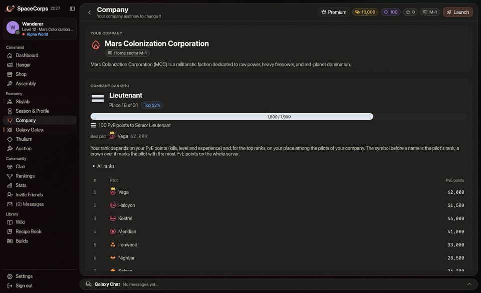
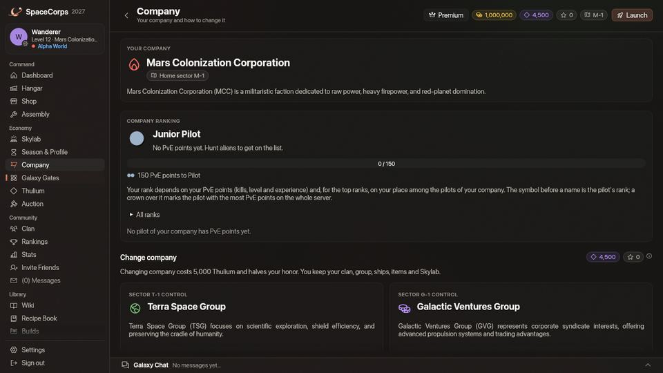

<!-- wiki-i18n source: dced9aac4fce8b87 -->
<!-- wiki-i18n title: Piloti di corporazione -->
# Piloti di corporazione {#company-pilots}

Ogni corporazione tiene una piccola squadra di piloti NPC nei suoi settori base (da `M-1` a `M-4`, da `T-1` a `T-4`, da `G-1` a `G-4`). Volano per la corporazione giorno e notte e danno una mano ai suoi piloti.

## Chi sono {#who-they-are}

- **Squadra**: 3 piloti per settore della corporazione in ogni mondo (Alpha, Beta e Gamma hanno ciascuno le proprie squadre), ognuno chiamato con la sigla della corporazione e un nominativo, ad es. **[M] Vesper**. Accanto al loro nome c’è un piccolo simbolo di robot e il colore della corporazione.
- **Nave**: un’[Ostirion](/wiki/02-Ships/Ostirion.md) con tre **Quantum Laser II**, due **Light Shield Core**, un **Engine I** e un **Repair Drone I**:
  - 48.000 punti scafo, 22.000 punti scudo, velocità 202
  - assorbimento 45%: i loro scudi prendono il 45% di ogni colpo, lo scafo il 55%
  - 195 di danno base per raffica (munizioni x1), probabilità critica dell’1%, portata 700
- **Sulla minimappa**: un rombo verde per i piloti della tua corporazione, uno ambra per quelli di un’altra.
- **Nessun grado**: il piccolo simbolo davanti al nome di un pilota in volo è il suo [grado](/wiki/03-Mechanics/Ranks.md) e appartiene ai piloti veri. I piloti di corporazione non ne hanno e non sono nella classifica della tua corporazione. La pagina Corporazione elenca i piloti veri della tua corporazione, con più punti PvE per primi, e il grado di un pilota deriva dai suoi punti PvE in quell’elenco e, per i sei gradi migliori, dai posti della corporazione.

## Cosa fanno {#what-they-do}

- **Pattugliano** un circuito che passa per la stazione del settore, i suoi portali e alcuni punti intermedi.
- **Danno la caccia** agli alieni che riescono a gestire (Seeker e Phantasm; lasciano in pace Bulwark, Goombah e Crystalys) finché ci sono piloti in volo nel settore. Un alieno che sta combattendo un pilota di un’altra corporazione resta di quel pilota: la squadra non lo tocca.
- **Aiutano**: quando un pilota della loro corporazione a meno di 1.500 unità da loro viene attaccato da un alieno, o apre il fuoco su un alieno che potrebbero gestire, si uniscono allo scontro. Restano fuori da uno scontro che un compagno ha iniziato con un alieno che non potrebbero battere (un Goombah a cui un pilota ha sparato, o un Bulwark); un alieno aggressivo che attacca un compagno viene respinto qualunque sia. Un alieno che finiscono paga il pilota che ne detiene la rivendicazione (il primo a colpirlo, vedi [Combattimento](/wiki/03-Mechanics/Combat.md)); se nessuno la detiene, conta per il pilota della loro corporazione più vicino che gli sta sparando (agganciato, a portata, con una raffica negli ultimi 2,5 secondi). In ogni caso le ricompense sono di quel pilota, e la cassa di [carico](/wiki/03-Mechanics/Cargo.md) dell’alieno gli è riservata come se avesse fatto lui l’abbattimento. I piloti di corporazione non rivendicano mai un alieno e non guadagnano né raccolgono mai nulla per sé: un alieno che combattono da soli non lascia nessuna cassa. Agganciare da lontano, o limitarsi a essere colpiti, non frutta nulla.
- **Ignorano gli [sciami](/wiki/05-Swarms/Swarms.md)**: una nave di sciame non è affar loro. Non le danno la caccia, non si uniscono a uno scontro contro di loro e non vengono mai in tuo aiuto in uno.
- **Rispondono al fuoco** quando vengono attaccati dagli alieni, e dai piloti di altre corporazioni quando il PvP è aperto e dove il loro [mondo](/wiki/03-Mechanics/Wipe-Timeline.md#worlds-alpha-beta-and-gamma) lo consente: nessun PvP in Alpha da `x-1` a `x-3`, né in Beta in `x-1`.
- **Si riparano** con il loro drone ogni volta che lo scafo è danneggiato: l’1,5% dello scafo al secondo, a partire da 10 secondi dopo l’ultimo colpo.
- **Si ritirano** al 30% dello scafo verso la zona sicura più vicina e lì si riparano fino al 90%.
- **Fanno respawn** alla stazione del settore (o al suo primo portale) 60 secondi dopo essere stati distrutti.

## Regole d’ingaggio {#rules-of-engagement}

- I loro laser non colpiscono mai i piloti o le navi della loro corporazione.
- Le zone sicure li proteggono come qualsiasi pilota, e non sparano mai dentro una zona sicura.
- **I piloti della tua stessa corporazione** si possono attaccare, ma distruggerne uno costa **100 onore** (il tuo onore può scendere sotto 0), e lo stesso vale per averne colpito uno nei 15 secondi prima che lo distrugga un alieno o chiunque altro. Il tuo fuoco non si sposta mai su uno di loro da solo: selezionarne uno mentre spari ferma il fuoco, e solo il tasto di attacco o uno slot munizioni spara su di lui. Un clic accanto a uno di loro (per volare lì) non lo seleziona.
- **I piloti di un’altra corporazione** non pagano nulla quando vengono distrutti (né crediti, né onore, né punti classifica), e non si possono attaccare durante il Protocollo di pace (i primi tre giorni della stagione). Beta e Gamma non hanno il Protocollo di pace: lì il PvP è attivo dal giorno 1.
- Attaccare un qualsiasi pilota di corporazione segue le regole PvP del tuo [mondo](/wiki/03-Mechanics/Wipe-Timeline.md#worlds-alpha-beta-and-gamma): nessun PvP in Alpha da `x-1` a `x-3`, né in Beta in `x-1`.
- **Relitti**: un pilota di corporazione distrutto non lascia nessuna cassa di [carico](/wiki/03-Mechanics/Cargo.md) né pezzi, chiunque o qualunque cosa lo distrugga: abbattere piloti di corporazione non è un modo per farmare materiali.

## Navi riparatrici alla base {#repair-ships-at-the-base}

Ogni base di corporazione (`M-1`, `T-1` e `G-1`, in ogni mondo) ha **2 navi riparatrici** della sua corporazione di guardia appena fuori dalla zona sicura della stazione, chiamate con la sigla della corporazione, ad es. **[M] Mender** e **[M] Salve**.

- **Aura curativa**: ogni nave riparatrice ripara lo scafo di ogni pilota della sua corporazione entro **2.000** unità da sé di **250 punti scafo al secondo**, anche nel mezzo di uno scontro, mai oltre lo scafo massimo della nave. Dove ti raggiungono entrambe (intorno alla stazione stessa) sono 500 al secondo. Vengono riparati anche i piloti di corporazione della tua stessa corporazione; quelli di un’altra corporazione mai.
- **Lo vedi**: un anello tenue sulla mappa mostra fin dove arriva ciascuna: verde intorno alle navi riparatrici della tua stessa corporazione, grigio intorno a quelle di un’altra. La finestra bersaglio la indica come nave riparatrice.
- **Non sparano mai.** Tengono la posizione e riparano il proprio scafo a partire da 10 secondi dopo l’ultimo colpo.
- **Si possono distruggere**: gli alieni aggressivi le attaccano, e i piloti di altre corporazioni possono abbatterle dove il tuo [mondo](/wiki/03-Mechanics/Wipe-Timeline.md#worlds-alpha-beta-and-gamma) consente il PvP alla base (solo `x-1` di Gamma), dopo il Protocollo di pace. Ognuna ha 200.000 punti scafo e 100.000 punti scudo. Distruggere una nave riparatrice della tua stessa corporazione costa **100 onore**, come per qualsiasi suo pilota di corporazione, e nessuno di loro paga nulla né lascia una cassa. Beta e Gamma non hanno il Protocollo di pace: lì il PvP è attivo dal giorno 1.
- **Di ritorno in 2 minuti**: una nave riparatrice distrutta torna al suo posto 120 secondi dopo, intera.

## Note di combattimento {#combat-notes}

Una nave che ha agganciato un bersaglio e sta sparando si volta verso di esso, in qualunque direzione stia volando: i piloti di corporazione girano intorno al bersaglio con le armi puntate su di esso, e gli alieni si voltano verso chiunque colpiscano.

Li senti come piloti: i loro laser suonano come il fuoco x1 di qualsiasi pilota, le loro navi esplodono in grande, e un pilota di un’altra corporazione che ti attacca fa partire la musica di combattimento come farebbe un alieno. I piloti della tua corporazione che combattono nelle vicinanze lasciano la musica tranquilla finché non ti unisci a loro.
