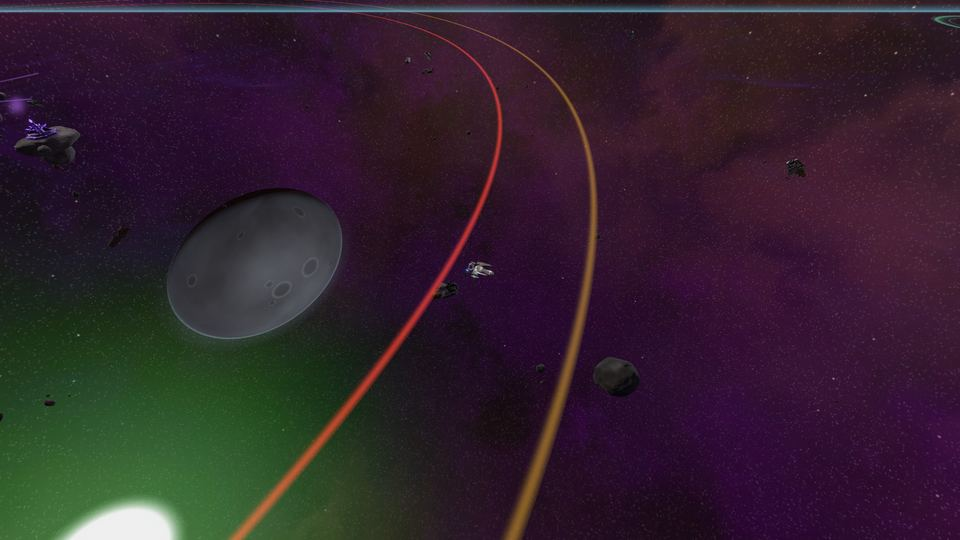

<!-- wiki-i18n source: 3c07d568f3af3aab -->
<!-- wiki-i18n title: Dormant Swamp -->
# Dormant Swamp

<!-- wiki-search: swamp; dormant swamp; base; turret; turrets; nike turret; laser turret; inert mass; unwakened; the unwakened; slumbering void; void; dormant lance; ds-4; 늪; 포탑; 포대 -->

아주 오래전, 은하 한가운데에 고도로 발달한 문명이 살았습니다. 빛나는 보라색 결을 가진 보랏빛 도는 검은 결정으로 건물을 지었고, 아무도 모르는 이유로 무너졌습니다. **Dormant Swamp**는 그 전초기지로, `DS-4`의 왼쪽 위 모서리에 있습니다. 시즌 11일차부터 이곳이 깨어납니다. 중앙의 포대는 보이는 모든 함선을 쏘고, **Inert Mass**가 지키며, 가장 한가운데에서 **Unwakened**가 잠들어 있습니다. 은폐하면 Unwakened 앞까지 날아갈 수 있습니다. [Deep Void](/wiki/03-Mechanics/Deep-Void.md)가 열린 뒤로 포대와 Unwakened는 파괴할 수 있으며, 시즌 첫 Unwakened 처치가 일어나면 그 월드의 Threshold가 열립니다. 기지 자체에는 들어갈 수도, 올라탈 수도, 거래할 수도 없습니다.

늪은 11일차부터 [Dormant 무리](/wiki/05-Swarms/Dormant-Swarm.md)가 나타나는 곳이기도 하며, **Slumbering Void**가 그 주변을 순찰합니다. 같은 Void가 웨이브로 [거대 굴착기](/wiki/03-Mechanics/Giant-Excavator.md#the-slumbering-voids)에도 옵니다. 섹터는 [위험 섹터](/wiki/01-General/Danger-Sectors.md)에 있습니다.

## 한눈에 보기 {#at-a-glance}

<!-- swamp-glance:begin -->
<!-- Generated from server/Resources/Excavator.json and DormantSwamp.json (and Rockets.json, Values/ranking-config.json) by scripts/dormant-wiki.sh: don't edit by hand. -->

- **위치**: `DS-4`의 왼쪽 위 모서리: 중심은 5,000 / 5,000
- **등장**: 시즌 11일차부터 초기화까지
- **구역**: 중심에서 4,300 유닛: 포대가 닿는 가장 먼 거리
- **통지**: 중심에서 4,800 유닛의 링을 넘은 함선에는 시스템 줄이 갑니다
- **은폐**: 어떤 포대도 은폐 중인 함선이나 EMP 효과 안에 있는 함선을 보지 못합니다
- **외계인**: Inert Mass 5기가 중심에서 2,400 유닛 이내에 머뭅니다. Unwakened는 중심에서 잠들어 있습니다. Slumbering Void 2기가 중심에서 4,600~6,500 유닛 사이를 순찰합니다.
- **Dormant 무리**: 9,417 / 6,606에 나타납니다. 중심에서 4,700 유닛 떨어진, 구역 밖입니다
- **바위**: 중심에서 4,900 유닛 이내에는 소행성이 없습니다

<!-- swamp-glance:end -->

## 포대 {#the-guns}

늪의 포탑은 사거리 안에서 **볼 수 있는 가장 가까운 함선**을 쏘며, 다른 함선은 쏘지 않습니다. 구역은 그중 가장 멀리 닿는 포탑이 닿는 원입니다. 포탑은 함선이 아니지만, Deep Void가 열린 뒤로 각 포탑에 체력이 있습니다. 포탑을 클릭하면 레이저로 쏠 수 있고, 근처에서 터진 로켓도 피해를 줍니다. 파괴된 포탑은 Unwakened가 돌아올 때까지 멈춰 있습니다. 포탄은 진짜이며, 월드는 어느 외계인의 무기든 그렇게 하듯이 포탄의 피해량을 배율로 조정합니다.

<!-- swamp-guns:begin -->
<!-- Generated from server/Resources/Excavator.json and DormantSwamp.json (and Rockets.json, Values/ranking-config.json) by scripts/dormant-wiki.sh: don't edit by hand. -->

한 발의 피해량(월드별):

| 포대 | 위치 | 발사 간격 | 사거리(유닛) | Alpha | Beta | Gamma |
| :--- | :--- | ---: | ---: | ---: | ---: | ---: |
| [N.I.K.E.](/wiki/06-Items/Rockets.md#the-craft-only-rockets) 포탑 | 5,000 / 4,400 | 2초 | 3,640 | 75,000 | 112,500 | 150,000 |
| [N.U.K.E.](/wiki/06-Items/Rockets.md#the-craft-only-rockets) 포탑 | 5,000 / 4,400 | 5초 | 1,080 | 50,000 | 75,000 | 100,000 |
| 레이저 포탑 × 2 | 3,600 / 5,200; 6,400 / 5,200 | 1초 | 2,500 | 45,000–55,000 | 67,500–82,500 | 90,000–110,000 |

- 로켓은 확실히 닿도록 조종사가 쓰는 같은 로켓의 사거리의 82% 지점에서 발사됩니다. 레이저 포탑은 초당 한 발을 쏘며, 피해량은 표시된 범위에서 무작위로 정해집니다.
- N.I.K.E.의 실드 관통은 35%이며, 실드 흡수율에서 차감됩니다.
- 포탑의 N.I.K.E.은 조종사의 것보다 25% 더 빠르고 2배 더 멀리 날아갑니다. 초당 1,250 유닛, 총 8,910 유닛을 날아가므로 도망치는 함선도 멀리까지 추격당합니다.
- N.U.K.E.은 반경 1,013 유닛으로 폭발하며 중심이 가장 강합니다.
- 포탑의 N.U.K.E.은 조종사의 것보다 25% 더 빠르고 2배 더 멀리 날아갑니다. 초당 375 유닛, 총 2,640 유닛을 날아가므로 도망치는 함선도 멀리까지 추격당합니다.

<!-- swamp-guns:end -->

- **구역 밖에서는 아무것도 발사하지 않습니다.** 안에서는 함선이 몇 초 만에 파괴됩니다. 중심에 가까워질수록 포대가 더해지고, 최고의 실드를 단 Wraith도 버티지 못합니다. 다만 이미 날아가고 있는 로켓은 계속 날아가며, 포탑의 로켓은 조종사의 것보다 빠르고 멀리 날아가므로 똑바로 도망치는 것만으로는 떨쳐 낼 수 없습니다.
- **은폐하면 들어갈 수 있습니다.** 어떤 포탑도 은폐 중인 함선이나 EMP 효과 안에 있는 함선을 어떤 거리에서도 보지 못합니다. 보이는 함선을 노린 폭발이 은폐 중인 함선 옆에서 터지면 그래도 피해를 주고 은폐를 풉니다.
- **포탑은 파일럿만 쏩니다.** 외계인, 기업 파일럿, 무리는 쏘지 않으며, 파괴에서 막 돌아온 함선의 보호도 포탑에 대해 유효합니다.
- **통지 링.** 구역 밖의 링을 넘은 함선에는 시스템 줄이 갑니다. 포탑은 보이는 모든 함선을 쏘며 중심에서 무언가가 잠들어 있다는 내용입니다. 링을 벗어났다가 다시 들어올 때만 다시 알려 줍니다.
- **빠져나오기.** 그곳에서 파괴되면 그 자리에서 부활할 수 없고(위험 섹터에서는 기지와 가장 가까운 포털만 고를 수 있습니다), 구역 안에서 로그인하면 바깥으로 옮겨집니다. 클릭한 항로는 구역을 피해 휘어지며, 클릭한 곳이 안쪽이면 토스트로 경고합니다.

## 외계인 {#the-aliens}

잃어버린 문명의 외계인 세 종이 이곳에 살며, 각자 고유한 수치를 가집니다. 무리의 보스처럼 **입힌 피해에 따라** 보상이 지급됩니다. [무리](/wiki/05-Swarms/Swarms.md#the-rules-of-every-swarm)에 나온 비율 이상을 입힌 모든 파일럿이 받으며, 상자는 가장 많은 피해를 입힌 파일럿에게 갑니다. 처치는 무리 함선의 처치처럼, 보상에 비례해 PvE 계급 포인트에 더해집니다([계급](/wiki/03-Mechanics/Ranks.md#how-you-earn-pve-points)). 각자의 실드는 유지되는 동안 모든 공격의 {{guide:vitals.absorbance@Slumbering Void;Inert Mass;The Unwakened}}를 흡수합니다([실드](/wiki/03-Mechanics/Shields.md)).

- **Slumbering Void.** 날렵한 사냥꾼으로, 게임에서 가장 빠른 외계인입니다(Afterburner III를 쓴 Storm보다 빠릅니다). 일부는 늘 늪 주변을 순찰하고, 나머지는 웨이브로 굴착기에 옵니다. 공격적이며 보이는 가장 가까운 파일럿을 사냥하고, 은폐 중인 함선은 결코 보지 못합니다.
- **Inert Mass.** 보랏빛 금이 간 죽은 거체로, 작은 정거장만 합니다. 늪 중심에서 정해진 거리 안에 머물며 지금은 그곳을 떠나지 않습니다. **Dormant Lance**를 쏩니다. 사거리가 매우 긴 유도 로켓으로, 함선이 은폐하거나, EMP 효과를 열거나, 안전 링에 들어가거나, 점프하거나, 죽을 때까지 따라갑니다. 어떤 함선보다 빠르므로 이런 끊기만이 통합니다. Dormant Lance의 진로에 있는 소행성은 그것을 막아 내며, Lance는 자신의 피해량으로 그 소행성을 손상시킵니다(그로 인해 보상을 받는 사람은 없습니다). 그래서 바위는 Inert Mass로부터 몇 발 동안만 몸을 지켜 줍니다.
- **Unwakened.** 늪의 중심에서 잠든 모놀리스로, 어느 맵에서든 가장 큰 존재입니다. 너무 느려서 함선을 따라잡는 일이 없습니다. 아무것도 쏘지 않지만 오라 안의 함선은 **은폐 여부와 관계없이** 모두 탑니다. [Deep Void](/wiki/03-Mechanics/Deep-Void.md)가 열린 뒤로 파괴할 수 있습니다. 입힌 피해에 따라 보상이 지급되고, 죽은 지 하루 뒤에 돌아오며, 각 월드에서 시즌 첫 처치가 그 월드의 Threshold를 엽니다. 파일럿의 **방사선 기술**은 이 피해를 줄여 레벨 100에서는 0.40배가 됩니다.

<!-- swamp-members:begin -->
<!-- Generated from server/Resources/Excavator.json and DormantSwamp.json (and Rockets.json, Values/ranking-config.json) by scripts/dormant-wiki.sh: don't edit by hand. -->

### Slumbering Void

Slumbering Void 2기가 늪 중심에서 4,600~6,500 유닛 사이를 순찰합니다. 격파된 개체는 {{guide:vitals.respawn@Slumbering Void}} 뒤에 돌아옵니다. 굴착기의 웨이브는 같은 외계인을 더 데려옵니다.

| | Alpha | Beta | Gamma |
| :--- | ---: | ---: | ---: |
| 선체 | {{guide:vitals.hull@Slumbering Void}} | {{guide:vitals.hull*1.5@Slumbering Void}} | {{guide:vitals.hull*2@Slumbering Void}} |
| 실드 | {{guide:vitals.shield@Slumbering Void}} | {{guide:vitals.shield*1.5@Slumbering Void}} | {{guide:vitals.shield*2@Slumbering Void}} |
| 실드 흡수율 | {{guide:vitals.absorbance@Slumbering Void}} | {{guide:vitals.absorbance@Slumbering Void}} | {{guide:vitals.absorbance@Slumbering Void}} |
| 레이저 피해량(초당 일제 사격 1회) | {{guide:vitals.dps@Slumbering Void}} | {{guide:vitals.dps*1.5@Slumbering Void}} | {{guide:vitals.dps*2@Slumbering Void}} |
| 속도 | {{guide:vitals.speed@Slumbering Void}} | {{guide:vitals.speed@Slumbering Void}} | {{guide:vitals.speed@Slumbering Void}} |
| 레이저 사거리 | 800 | 800 | 800 |
| 어그로 반경 | {{guide:vitals.aggro@Slumbering Void}} | {{guide:vitals.aggro@Slumbering Void}} | {{guide:vitals.aggro@Slumbering Void}} |
| 크레딧 | {{guide:spoils.pay.credits@Slumbering Void}} | {{guide:spoils.pay.credits*2@Slumbering Void}} | {{guide:spoils.pay.credits*3@Slumbering Void}} |
| Thulium | {{guide:spoils.pay.thulium@Slumbering Void}} | {{guide:spoils.pay.thulium*2@Slumbering Void}} | {{guide:spoils.pay.thulium*3@Slumbering Void}} |
| 경험치(XP) | {{guide:spoils.pay.experience@Slumbering Void}} | {{guide:spoils.pay.experience*2@Slumbering Void}} | {{guide:spoils.pay.experience*3@Slumbering Void}} |
| 명예 | {{guide:spoils.pay.honor@Slumbering Void}} | {{guide:spoils.pay.honor*2@Slumbering Void}} | {{guide:spoils.pay.honor*3@Slumbering Void}} |
| 처치당 PvE 포인트 | 10 | 10 | 10 |

**전리품**: 가장 많은 피해를 입힌 파일럿을 위한 상자 하나.

| 아이템 |
| :--- |
| {{guide:spoils.box@Slumbering Void}} |

### Inert Mass

Inert Mass 5기가 중심에서 2,400 유닛 이내에 서 있습니다. 격파된 개체는 {{guide:vitals.respawn@Inert Mass}} 뒤에 돌아옵니다. 6초마다 보이는 가장 가까운 함선에 유도 [Dormant Lance](/wiki/06-Items/Rockets.md#the-craft-only-rockets)를 쏩니다. 속도 750, 비행 거리 5,250 유닛, 관통 40%.

| | Alpha | Beta | Gamma |
| :--- | ---: | ---: | ---: |
| 선체 | {{guide:vitals.hull@Inert Mass}} | {{guide:vitals.hull*1.5@Inert Mass}} | {{guide:vitals.hull*2@Inert Mass}} |
| 실드 | {{guide:vitals.shield@Inert Mass}} | {{guide:vitals.shield*1.5@Inert Mass}} | {{guide:vitals.shield*2@Inert Mass}} |
| 실드 흡수율 | {{guide:vitals.absorbance@Inert Mass}} | {{guide:vitals.absorbance@Inert Mass}} | {{guide:vitals.absorbance@Inert Mass}} |
| Dormant Lance 한 발의 피해량 | {{guide:behaviour.ability:rocket.damageMin@Inert Mass}}–{{guide:behaviour.ability:rocket.damage@Inert Mass}} | {{guide:behaviour.ability:rocket.damageMin*1.5@Inert Mass}}–{{guide:behaviour.ability:rocket.damage*1.5@Inert Mass}} | {{guide:behaviour.ability:rocket.damageMin*2@Inert Mass}}–{{guide:behaviour.ability:rocket.damage*2@Inert Mass}} |
| 속도 | {{guide:vitals.speed@Inert Mass}} | {{guide:vitals.speed@Inert Mass}} | {{guide:vitals.speed@Inert Mass}} |
| 로켓 사거리 | 5,000 | 5,000 | 5,000 |
| 어그로 반경 | {{guide:vitals.aggro@Inert Mass}} | {{guide:vitals.aggro@Inert Mass}} | {{guide:vitals.aggro@Inert Mass}} |
| 크레딧 | {{guide:spoils.pay.credits@Inert Mass}} | {{guide:spoils.pay.credits*2@Inert Mass}} | {{guide:spoils.pay.credits*3@Inert Mass}} |
| Thulium | {{guide:spoils.pay.thulium@Inert Mass}} | {{guide:spoils.pay.thulium*2@Inert Mass}} | {{guide:spoils.pay.thulium*3@Inert Mass}} |
| 경험치(XP) | {{guide:spoils.pay.experience@Inert Mass}} | {{guide:spoils.pay.experience*2@Inert Mass}} | {{guide:spoils.pay.experience*3@Inert Mass}} |
| 명예 | {{guide:spoils.pay.honor@Inert Mass}} | {{guide:spoils.pay.honor*2@Inert Mass}} | {{guide:spoils.pay.honor*3@Inert Mass}} |
| 처치당 PvE 포인트 | 15 | 15 | 15 |

**전리품**: 가장 많은 피해를 입힌 파일럿을 위한 상자 하나.

| 아이템 |
| :--- |
| {{guide:spoils.box@Inert Mass}} |

### The Unwakened

늪의 중심에 하나뿐이며 다른 곳에는 없습니다. 격파되면 {{guide:vitals.respawn@The Unwakened}} 뒤에 돌아옵니다. Deep Void가 열린 뒤로 파괴할 수 있으며, 이곳의 다른 외계인처럼 입힌 피해에 따라 보상이 지급됩니다.

| | Alpha | Beta | Gamma |
| :--- | ---: | ---: | ---: |
| 선체 | {{guide:vitals.hull@The Unwakened}} | {{guide:vitals.hull*1.5@The Unwakened}} | {{guide:vitals.hull*2@The Unwakened}} |
| 실드 | {{guide:vitals.shield@The Unwakened}} | {{guide:vitals.shield*1.5@The Unwakened}} | {{guide:vitals.shield*2@The Unwakened}} |
| 실드 흡수율 | {{guide:vitals.absorbance@The Unwakened}} | {{guide:vitals.absorbance@The Unwakened}} | {{guide:vitals.absorbance@The Unwakened}} |
| 오라 초당 피해(안의 모든 함선에게) | {{guide:behaviour.ability:aura.damagePerSecond@The Unwakened}} | {{guide:behaviour.ability:aura.damagePerSecond*1.5@The Unwakened}} | {{guide:behaviour.ability:aura.damagePerSecond*2@The Unwakened}} |
| 오라 반경 | 700 | 700 | 700 |
| 속도 | {{guide:vitals.speed@The Unwakened}} | {{guide:vitals.speed@The Unwakened}} | {{guide:vitals.speed@The Unwakened}} |
| 어그로 반경 | {{guide:vitals.aggro@The Unwakened}} | {{guide:vitals.aggro@The Unwakened}} | {{guide:vitals.aggro@The Unwakened}} |
| 크레딧 | {{guide:spoils.pay.credits@The Unwakened}} | {{guide:spoils.pay.credits*2@The Unwakened}} | {{guide:spoils.pay.credits*3@The Unwakened}} |
| Thulium | {{guide:spoils.pay.thulium@The Unwakened}} | {{guide:spoils.pay.thulium*2@The Unwakened}} | {{guide:spoils.pay.thulium*3@The Unwakened}} |
| 경험치(XP) | {{guide:spoils.pay.experience@The Unwakened}} | {{guide:spoils.pay.experience*2@The Unwakened}} | {{guide:spoils.pay.experience*3@The Unwakened}} |
| 명예 | {{guide:spoils.pay.honor@The Unwakened}} | {{guide:spoils.pay.honor*2@The Unwakened}} | {{guide:spoils.pay.honor*3@The Unwakened}} |
| 처치당 PvE 포인트 | 112 | 112 | 112 |

**전리품**: 가장 많은 피해를 입힌 파일럿을 위한 상자 하나.

| 아이템 |
| :--- |
| {{guide:spoils.box@The Unwakened}} |

<!-- swamp-members:end -->

## Deep Void 이후 {#with-the-deep-void}

Deep Void로 이곳에서 바뀐 점을 요약하면 다음과 같습니다.

- **Unwakened를 파괴할 수 있습니다.** 더 이상 무적이 아닙니다. 이곳의 다른 외계인처럼 입힌 피해에 따라 보상이 지급되며, 죽은 지 하루 뒤에 돌아옵니다.
- **포대를 파괴할 수 있습니다.** 포대 3기(N.I.K.E.와 N.U.K.E.를 모두 쏘는 로켓 포탑 1기와 레이저 포탑 2기) 모두 이제 내구도가 있으며, 레이저와 로켓으로 피해를 줄 수 있습니다. 파괴된 포대는 Unwakened가 돌아올 때까지 멈춰 있습니다.
- **첫 처치가 Threshold를 엽니다.** 각 월드에서 시즌 첫 Unwakened 처치가 일어나면 `DS-4`의 반대쪽 구석에 그 월드의 Threshold가 열리고, 그곳에서 [Deep Void](/wiki/03-Mechanics/Deep-Void.md)가 시작됩니다.

## 여기서 할 수 있는 일 {#what-to-do-here}

- **첫 처치가 길을 엽니다.** 시즌 첫 Unwakened 처치는 그 월드의 Threshold를 열고, 그와 함께 [Deep Void](/wiki/03-Mechanics/Deep-Void.md)로 가는 길을 엽니다. 구역 안에서는 포대가 함선을 몇 초 만에 파괴합니다. 구역 밖에서는 구역 둘레의 링을 도는 순찰 Void가 늪의 첫 방어선이며, 그룹이 포대 없이 싸울 수 있는 곳입니다.
- **Void는 관통으로 상대하세요.** Void의 큰 실드는 공격의 {{guide:vitals.absorbance@Slumbering Void;Inert Mass;The Unwakened}}를 흡수하지만 거의 의미가 없습니다. 그 뒤의 선체가 작기 때문입니다. 레이저의 실드 관통이 높을수록 빨리 쓰러집니다([레이저와 탄약](/wiki/06-Items/Lasers.md)).
- **Lance를 피하세요.** Inert Mass는 멀리까지 보고, Lance는 따돌릴 수 없습니다. 은폐, EMP, 안전 링, 점프로 추적을 끊거나 사거리 밖으로 나가세요. Mass는 가장 강한 함선의 큰 그룹에게도 긴 싸움입니다.
- **Dormant 무리**는 이제 구역 바로 바깥에 나타나므로, 그룹은 포대 없이 기다릴 수 있습니다. [Dormant 무리](/wiki/05-Swarms/Dormant-Swarm.md)를 보세요.

## 더 읽을거리 {#where-to-read-more}

- [위험 섹터](/wiki/01-General/Danger-Sectors.md): 11일차에 무엇이 달라졌는지.
- [거대 굴착기](/wiki/03-Mechanics/Giant-Excavator.md): Slumbering Void의 웨이브와 그들이 지키는 것.
- [무리](/wiki/05-Swarms/Swarms.md)와 [Dormant 무리](/wiki/05-Swarms/Dormant-Swarm.md): 보스 처치 보상 방식.
- [로켓](/wiki/06-Items/Rockets.md#the-craft-only-rockets): 포탑이 쏘는 N.I.K.E.와 N.U.K.E..
- [블랙홀](/wiki/03-Mechanics/Black-Hole.md): `DS-4`의 또 다른 위험.
- [화물](/wiki/03-Mechanics/Cargo.md): 외계인이 떨어뜨리는 상자.
