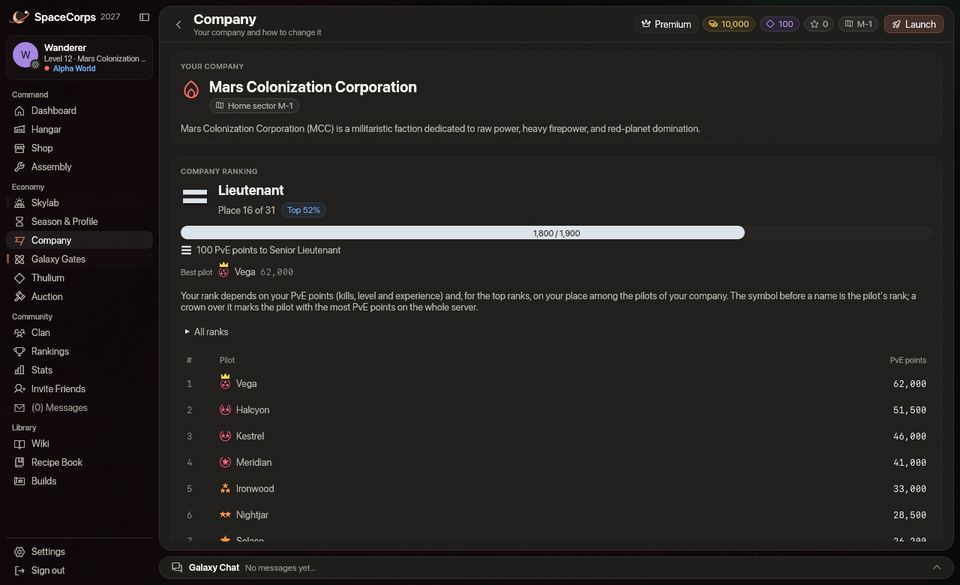
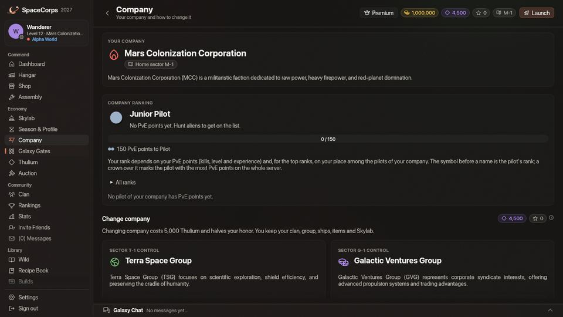

<!-- wiki-i18n source: 5b87e9167b265780 -->
<!-- wiki-i18n title: Pilotos de corporação -->
# Pilotos de corporação {#company-pilots}

Toda corporação mantém um pequeno esquadrão de pilotos NPC nos seus setores de origem (`M-1` a `M-4`, `T-1` a `T-4`, `G-1` a `G-4`). Eles voam pela corporação 24 horas por dia e dão uma mão aos pilotos dela.

## Quem são {#who-they-are}

- **Esquadrão**: 3 pilotos por setor da corporação em cada mundo (Alpha, Beta e Gamma têm esquadrões próprios), cada um com a tag da corporação e um codinome, por exemplo **[M] Vesper**. As tags de nome deles trazem uma pequena marca de robô e a cor da corporação.
- **Nave**: uma [Ostirion](/wiki/02-Ships/Ostirion.md) com três **Quantum Laser II**, dois **Light Shield Cores**, um **Engine I** e um **Repair Drone I**:
  - 64.000 pontos de vida, 22.000 pontos de escudo, velocidade 225
  - absorção de 45%: os escudos deles recebem 45% de cada impacto, e o casco, 55%
  - 195 de dano base por rajada (munição x1), 1% de chance de crítico, alcance de 700
- **No minimapa**: um losango verde para os pilotos da sua corporação, um âmbar para os de outra corporação.
- **Sem patente**: o pequeno símbolo antes do nome de um piloto em voo é a [patente](/wiki/03-Mechanics/Ranks.md) dele e pertence a pilotos de verdade. Os pilotos de corporação não têm nenhuma e não estão no ranking da sua corporação. A página Corporação lista os pilotos de verdade da sua corporação, com mais pontos PvE primeiro, e a patente de um piloto vem dos pontos PvE dele nessa lista e, nas seis melhores patentes, das vagas da corporação.

## O que eles fazem {#what-they-do}

- **Patrulham** um circuito pela estação do setor, pelos portais dele e por alguns pontos intermediários.
- **Caçam** os alienígenas que conseguem enfrentar (Seekers e Phantasms; deixam os Bulwarks, Goombahs e Crystalys em paz) enquanto há pilotos voando no setor. Um alienígena que um piloto de outra corporação está combatendo pertence a esse piloto: o esquadrão o deixa em paz.
- **Ajudam**: quando um piloto da corporação deles a até 1.500 unidades deles é atacado por um alienígena, ou abre fogo contra um alienígena que eles conseguiriam enfrentar, eles entram na luta. Ficam fora de uma luta que um colega começou contra um alienígena que não conseguiriam vencer (um Goombah em que um piloto atirou, ou um Bulwark); um alienígena agressivo que vai atrás de um colega é repelido, seja qual for. Um alienígena que eles terminam de destruir paga ao piloto que detém a reivindicação dele (o primeiro a acertá-lo, veja [Combate](/wiki/03-Mechanics/Combat.md)); se ninguém a detém, o abate conta para o piloto da corporação deles mais próximo que está atirando nele (com alvo travado, dentro do alcance, com uma rajada nos últimos 2,5 segundos). De um jeito ou de outro, as recompensas são desse piloto, e a caixa de [carga](/wiki/03-Mechanics/Cargo.md) do alienígena fica reservada para esse piloto, como se ele tivesse feito o abate. Os pilotos de corporação nunca reivindicam um alienígena e nunca ganham nem coletam nada por conta própria: um alienígena que eles combatem sozinhos não deixa caixa. Travar no alvo de longe, ou apenas levar tiros, não rende nada.
- **Ignoram os [enxames](/wiki/05-Swarms/Swarms.md)**: uma nave de enxame não é problema deles. Não a caçam, não entram numa luta contra ela e nunca vêm em seu auxílio numa.
- **Revidam** quando alienígenas atiram neles, e quando pilotos de outras corporações atiram, depois que o PvP é liberado e onde o [mundo](/wiki/03-Mechanics/Wipe-Timeline.md#worlds-alpha-beta-and-gamma) deles permite PvP: nenhum em `x-1` a `x-3` do Alpha, nem em `x-1` do Beta.
- **Reparam** com o drone sempre que o casco está danificado: 2% dele por segundo, a partir de 10 segundos depois do último impacto.
- **Recuam** com 30% de casco para a zona segura mais próxima e reparam lá até 90%.
- **Reaparecem** na estação do setor (ou no primeiro portal) 60 segundos depois de serem destruídos.

## Regras de engajamento {#rules-of-engagement}

- Os lasers deles nunca atingem pilotos nem naves da própria corporação.
- As zonas seguras os protegem como a qualquer piloto, e eles nunca atiram para dentro de uma zona segura.
- **Os pilotos da sua própria corporação** podem ser atacados, mas destruir um custa **100 de honra** (sua honra pode ficar abaixo de 0), e atingir um nos 15 segundos antes de um alienígena ou de outra pessoa destruí-lo custa o mesmo. Seu fogo nunca passa para um deles por conta própria: selecionar um enquanto você atira faz você segurar o fogo, e só a tecla de ataque ou um slot de munição atira nele. Um clique ao lado de um deles (para voar até lá) não o seleciona.
- **Os pilotos de outra corporação** não pagam nada quando destruídos (nem créditos, nem honra, nem pontos de ranking) e não podem ser atacados durante o Protocolo de Paz (os três primeiros dias da temporada). O Beta e o Gamma não têm Protocolo de Paz: lá o PvP vale desde o dia 1.
- Atacar qualquer piloto de corporação segue as regras de PvP do seu [mundo](/wiki/03-Mechanics/Wipe-Timeline.md#worlds-alpha-beta-and-gamma): nenhum em `x-1` a `x-3` do Alpha, nem em `x-1` do Beta.
- **Destroços**: um piloto de corporação destruído não deixa caixa de [carga](/wiki/03-Mechanics/Cargo.md) nem peças, seja quem for ou o que for que o destrua: abater pilotos de corporação não é um jeito de farmar materiais.

## Naves de reparo na base {#repair-ships-at-the-base}

Toda base de corporação (`M-1`, `T-1` e `G-1`, em cada mundo) tem **2 naves de reparo** da sua corporação montando guarda logo fora da zona segura da estação, com a tag da corporação no nome, por exemplo **[M] Mender** e **[M] Salve**.

- **Aura de cura**: cada nave de reparo repara o casco de todo piloto da sua corporação a até **2.000** de distância dela, em **250 pontos de vida por segundo**, também no meio de uma luta, nunca acima do casco máximo da nave. Onde as duas alcançam você (ao redor da própria estação), são 500 por segundo. Os pilotos de corporação da sua própria corporação também são reparados; os pilotos de outra corporação, nunca.
- **Você a vê**: um anel tênue no mapa mostra até onde cada uma alcança: verde ao redor das naves de reparo da sua própria corporação, cinza ao redor das de outra corporação. A janela do alvo a identifica como nave de reparo.
- **Elas nunca atiram.** Mantêm o posto e reparam o próprio casco a partir de 10 segundos depois do último impacto.
- **Podem ser destruídas**: alienígenas agressivos vão atrás delas, e pilotos de outras corporações podem abatê-las onde o seu [mundo](/wiki/03-Mechanics/Wipe-Timeline.md#worlds-alpha-beta-and-gamma) permite PvP na base (só em `x-1` do Gamma), depois do Protocolo de Paz. Cada uma tem 200.000 pontos de vida e 100.000 pontos de escudo. Destruir a nave de reparo da sua própria corporação custa **100 de honra**, como para qualquer um dos pilotos de corporação dela, e nenhum deles paga nada nem deixa caixa. O Beta e o Gamma não têm Protocolo de Paz: lá o PvP vale desde o dia 1.
- **De volta em 2 minutos**: uma nave de reparo destruída volta ao seu posto 120 segundos depois, inteira.

## Notas de combate {#combat-notes}

Uma nave com alvo travado e atirando gira para ficar de frente para o alvo, para onde quer que esteja voando: os pilotos de corporação circulam o alvo com as armas apontadas para ele, e os alienígenas se viram para quem atira neles.

Você os ouve como pilotos: os lasers deles soam como o fogo x1 de qualquer piloto, as naves deles explodem em grande, e um piloto de outra corporação que vai atrás de você traz a música de combate como um alienígena faria. Os pilotos da sua própria corporação lutando por perto deixam a música calma até você entrar na luta.
