<!-- wiki-i18n source: 16e2e757d007eead -->
<!-- wiki-i18n title: Skylab -->
# Skylab

O Skylab é a sua instalação orbital pessoal. Ele constrói e melhora módulos que produzem créditos e Thulium, extraem minério, forjam as placas que a Montagem transforma nos melhores lasers e, a partir do nível 10 do Núcleo, pesquisam as tecnologias de que a Montagem precisa. Ele trabalha para você mesmo quando você está offline.

No nível 10 do Núcleo, o Skylab ainda cresce: uma **ponte** liga o Núcleo a um segundo Núcleo com seis slots a mais para módulos, e três módulos a mais se encaixam nele: a **Impressora de munição** e a **Fábrica de foguetes**, que produzem munição e foguetes do nada, e a **Baía de minério**, que move para o Depósito de recursos o minério que você carrega (veja [A ponte e o Núcleo 2](#the-bridge-and-core-2) e [Baía de minério](#ore-bay)).

No nível 15 do Núcleo, o Skylab cresce mais uma vez e aprende a voar: uma **segunda ponte** liga o Núcleo a um terceiro Núcleo, o **Núcleo 3**, com quatro slots a mais, e os quatro módulos da **Expedição** os ocupam: o **Módulo de motores**, o **Módulo de defesa**, o **Módulo de radar** e a **Baía de troféus**. Com motores, lasers e munição da sua Impressora de munição, o Skylab atravessa um **mapa do universo** só dele, caça os alienígenas das células que alcança enquanto você está fora e traz o espólio para casa (veja [A segunda ponte e o Núcleo 3](#the-second-bridge-and-core-3) e [Expedições](#expeditions)).

> [!NOTE]
> **O que mudou na 0.4.10.** Cada módulo do Skylab agora tem a sua própria tabela de produção, preços e tempos, nível por nível. Você manteve os seus níveis: nada foi cobrado e nada foi devolvido pela diferença. O que as suas minas e os seus coletores guardavam nos armazenamentos quando a atualização chegou foi pago **uma única vez, pela taxa antiga**: os créditos e o Thulium foram para a sua conta, o minério para o seu Depósito de recursos, e os armazenamentos recomeçaram vazios.
>
> Duas regras são novas. **A Usina solar produz só 25% da sua energia enquanto é melhorada**, então na maioria das estações todas as minas e todos os coletores param até a melhoria terminar (veja [Módulo Usina solar](#solar-module) e [Planejando uma melhoria da Usina solar](#timing-a-solar-upgrade)). **O Depósito de recursos tem um limite próprio para cada minério**: um dia da produção do coletor no nível 1, quatro dias no nível 20.

> [!NOTE]
> **O que mudou na 0.4.15.** O passo do Núcleo do nível 9 para o nível 10 agora custa **2.000 Thulium** a mais, e quando termina surgem uma **ponte** e um segundo Núcleo, o **Núcleo 2**, com seis novos slots de módulo. A Usina solar se muda para o Núcleo 2. Dois módulos novos se encaixam nele: a **Impressora de munição** e a **Fábrica de foguetes**. Além disso, a Usina solar produz mais energia a partir do nível 7, para que uma estação completa continue coberta. Nada do que você construiu se perde: um Núcleo que já está no nível 10 ou mais tem a ponte na hora e não paga nada.

> [!NOTE]
> **O que mudou na 0.4.21.** O passo do Núcleo do nível 14 para o nível 15 agora custa **4.000 Thulium** a mais, e quando termina aparecem uma segunda **ponte** e o **Núcleo 3** com quatro slots novos. A Usina solar se muda para o Núcleo 3 e produz mais energia a partir do nível 15, de modo que uma estação completa continua coberta. Quatro módulos novos ocupam os slots: o **Módulo de motores**, o **Módulo de defesa**, o **Módulo de radar** e a **Baía de troféus**, e com eles o seu Skylab voa pelo **mapa do universo**, caça por conta própria e traz o espólio para casa (veja [Expedições](#expeditions)). Cada módulo agora tem um **peso**, e o peso da estação e dos seus motores decide a velocidade com que ela voa (veja [Peso e velocidade](#weight-and-speed)). A **Baía de minério** move três vezes mais minério por hora e guarda três vezes mais cota. Nada do que você construiu se perde: um Núcleo que já está no nível 15 ou mais tem o Núcleo 3 na hora e não paga nada.

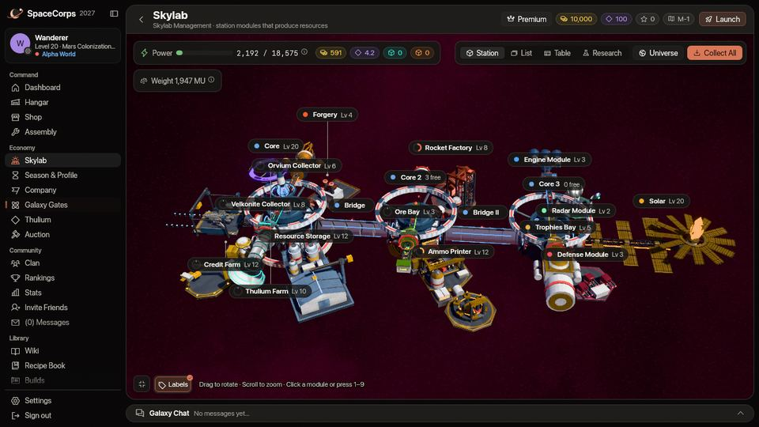
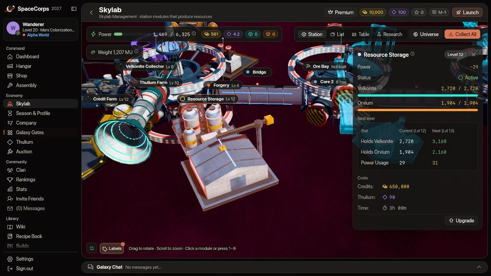
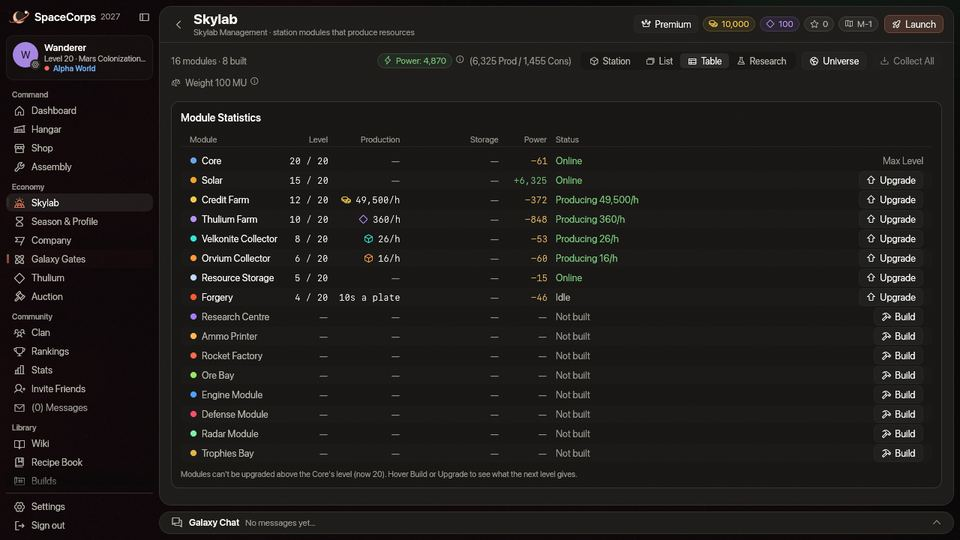

## Em um minuto {#in-one-minute}

- Construa primeiro a **Usina solar**: sem a energia dela, nada no Skylab funciona. A Mina de créditos não custa nada para construir, e a Mina de Thulium custa 5.000 créditos e 500 Thulium.
- As minas e os coletores enchem um **armazenamento** (de 72 horas) enquanto você está fora. **Coletar** o leva para a sua conta (créditos, Thulium) ou para o seu Depósito de recursos (minério).
- A **Mina de Thulium** é a sua principal fonte de Thulium: 40 por hora no nível 1, 1.280 no nível 20. A Mina de créditos produz 750 créditos por hora no nível 1 e 75.000 no nível 20.
- O **Núcleo** dita o ritmo: nenhum módulo passa dele, e a subida dele sozinha leva cerca de 16 dias e meio.
- No **nível 10 do Núcleo**, uma **ponte** constrói o **Núcleo 2**, com seis slots a mais para módulos, e a **Impressora de munição**, a **Fábrica de foguetes** e a **Baía de minério** se encaixam nele. O passo para o nível 10 custa 2.000 Thulium a mais.
- No **nível 15 do Núcleo**, uma segunda ponte constrói o **Núcleo 3**, e o **Módulo de motores**, o **Módulo de defesa**, o **Módulo de radar** e a **Baía de troféus** ocupam os slots dele: com eles o Skylab voa pelo mapa do universo e caça por conta própria. O passo para o nível 15 custa 4.000 Thulium a mais. [Veja Expedições](#expeditions).
- **A Usina solar produz só 25% da sua energia enquanto é melhorada**, então as suas minas e os seus coletores param até ela terminar. [Planeje isso](#timing-a-solar-upgrade).

## Visão geral {#overview}

O Skylab anda no seu próprio relógio, à parte da sua nave: os módulos produzem e forjam enquanto você está fora. O seu papel é construir, melhorar, manter a energia em equilíbrio e coletar. A página tem quatro visões da mesma estação: **Estação** (a estação em 3D, com uma etiqueta sobre cada módulo; clique em uma para abrir a ficha dele, ou aperte **1** a **9**), **Lista** (um cartão para cada módulo), **Tabela** (os números de todos os módulos em uma tabela) e **Pesquisa** (a tela própria do Centro de Pesquisa, veja [Pesquisa](/wiki/03-Mechanics/Research.md)). Passar o mouse sobre **Construir** ou **Melhorar** mostra o que o próximo nível muda, quanto custa e quanto tempo leva. O botão **Universo** no cabeçalho da página abre o mapa da Expedição (veja [Expedições](#expeditions)).

Dezesseis módulos formam a estação:

| Módulo | O que produz ou faz | Construído a partir de |
| :--- | :--- | :--- |
| **Núcleo** | Define o nível mais alto de todos os outros módulos | Sempre presente |
| **Usina solar** | Produz energia | Qualquer nível do Núcleo |
| **Mina de créditos** | Produz [créditos](/wiki/01-General/Getting-Started.md) | Qualquer nível do Núcleo |
| **Mina de Thulium** | Produz [Thulium](/wiki/01-General/Getting-Started.md) | Qualquer nível do Núcleo |
| **Coletor de Velkonite** | Extrai minério de Velkonite | Núcleo no nível 5 |
| **Coletor de Orvium** | Extrai minério de Orvium | Núcleo no nível 5 |
| **Depósito de recursos** | Guarda o minério | Núcleo no nível 5 |
| **Forja** | Forja o minério em placas | Núcleo no nível 5 |
| **Centro de Pesquisa** | Transforma recursos em ciência e pesquisa [tecnologias](/wiki/03-Mechanics/Research.md) | Núcleo no nível 10 |
| **Impressora de munição** | Imprime munição x2, x3 ou x4 do nada | Núcleo no nível 10, no Núcleo 2 |
| **Fábrica de foguetes** | Fabrica foguetes da loja do nada | Núcleo no nível 10, no Núcleo 2 |
| **Baía de minério** | Move para o Depósito de recursos o Velkonite e o Orvium que você carrega | Núcleo no nível 10, no Núcleo 2 |
| **Módulo de motores** | Abriga os motores que fazem o Skylab voar | Núcleo no nível 15, no Núcleo 3 |
| **Módulo de defesa** | Abriga os lasers e o carregador que combatem em uma expedição | Núcleo no nível 15, no Núcleo 3 |
| **Módulo de radar** | Escaneia a névoa do mapa do universo | Núcleo no nível 15, no Núcleo 3 |
| **Baía de troféus** | Guarda o que as expedições trazem | Núcleo no nível 15, no Núcleo 3 |

As duas **pontes**, o **Núcleo 2** e o **Núcleo 3** não são módulos: a primeira ponte e o Núcleo 2 aparecem quando o Núcleo chega ao nível 10, a segunda ponte e o Núcleo 3 no nível 15, e nenhum dos dois Núcleos tem nível próprio (veja [A ponte e o Núcleo 2](#the-bridge-and-core-2) e [A segunda ponte e o Núcleo 3](#the-second-bridge-and-core-3)).

**Missões para ele.** Dez [missões da estação](/wiki/03-Mechanics/Quests.md#station-missions) no Mission Control conduzem você pelo Skylab: construir a Usina solar, uma Mina de créditos e uma Mina de Thulium, levar o Núcleo e a Usina solar a níveis mais altos, coletar os seus primeiros 50.000 créditos e abrir a cadeia de suprimentos, e pagam um pouco por cada etapa. A primeira está aberta desde o nível 1.

## A estação em cada nível {#the-station-at-every-level}

Estas são as visões da Estação do Skylab em cada nível de 1 a 20, todas do mesmo ângulo, com todos os módulos no mesmo nível. A visão encaixa a estação inteira na imagem, então a escala não é a mesma em todas: ela dá um salto quando a forma cresce. A estação cresce por etapas: a forma muda nos **níveis 1, 5, 10, 15 e 20**, e entre eles cada nível acende **mais uma lâmpada** no colar de cada módulo (o número de lâmpadas acesas é o nível, e o anel de vinte lâmpadas do Núcleo se enche do mesmo jeito).

Estas imagens mostram o **primeiro Núcleo** e o que está pendurado nele, com a Usina solar ao lado, como a estação era antes das pontes. A estação continua além, e as imagens não mostram essa parte: a partir do nível 10, uma ponte, o Núcleo 2 e a Impressora de munição, a Fábrica de foguetes e a Baía de minério ficam além dele, e a Usina solar passa para a outra ponta (veja [A ponte e o Núcleo 2](#the-bridge-and-core-2)); a partir do nível 15, uma segunda ponte, o Núcleo 3 e os quatro módulos da Expedição ficam além disso (veja [A segunda ponte e o Núcleo 3](#the-second-bridge-and-core-3)). A visão Estação da página mostra a estação inteira.

**Níveis 1 a 4.** Os quatro primeiros módulos ao redor do Núcleo: a Usina solar, a Mina de créditos, a Mina de Thulium e a baía de atracação que abriga a sua nave. A cadeia de suprimentos ainda não pode ser construída.

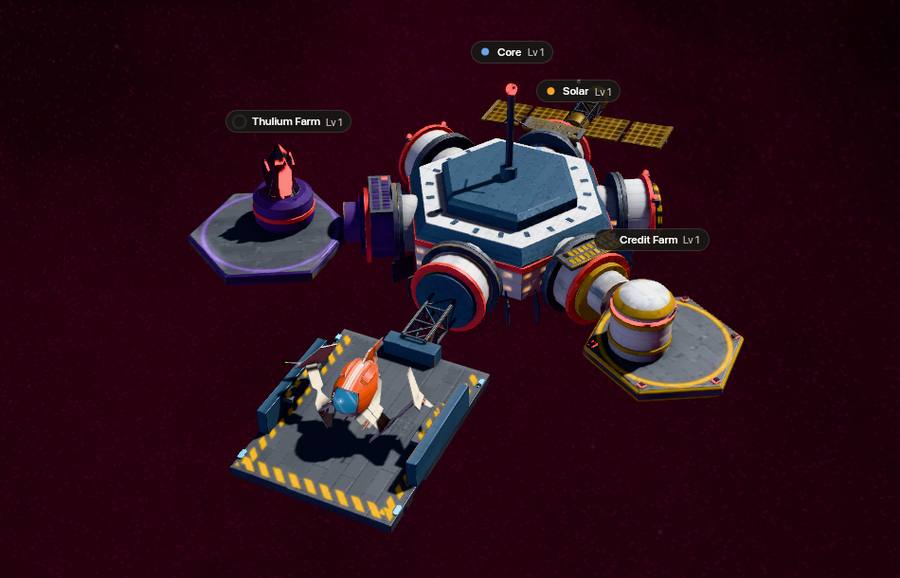

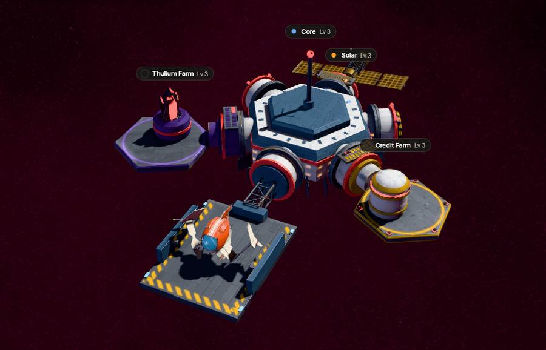
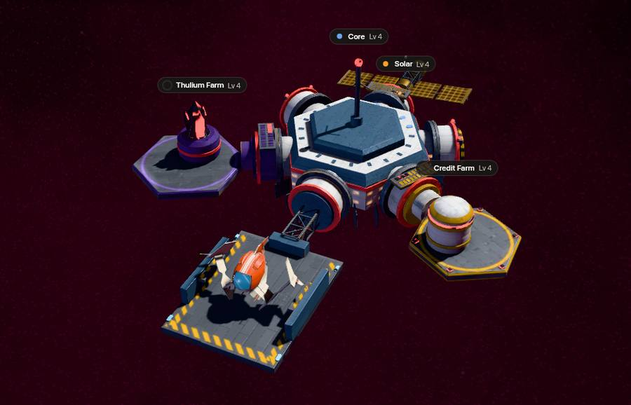

**Níveis 5 a 9.** Com o Núcleo no nível 5, a cadeia de suprimentos pode ser construída: os dois coletores em suas estruturas acima da estação, o Depósito de recursos na porta nordeste do Núcleo e a Forja na porta noroeste dele (aqui eles aparecem construídos).

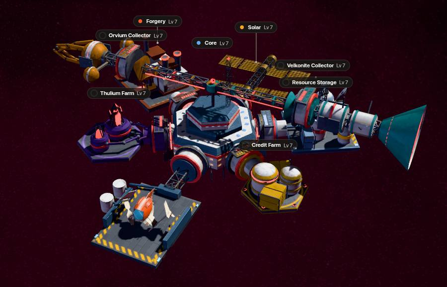

**Níveis 10 a 14.** O Núcleo ganha o seu anel, as minas e os coletores assumem a forma maior e a Mina de Thulium ganha um anel próprio.

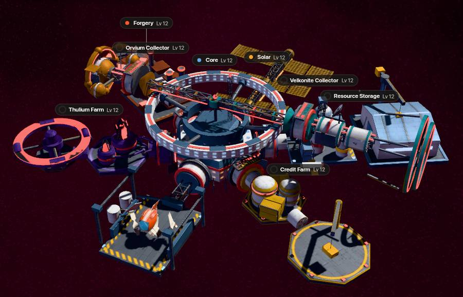

**Níveis 15 a 19.** As minas se enchem de caixas e cristais, a baía de atracação ilumina a sua aproximação e o conjunto da Usina solar ganha um topo. No nível 15 a estação também cresce além da imagem, com uma segunda ponte e o Núcleo 3.

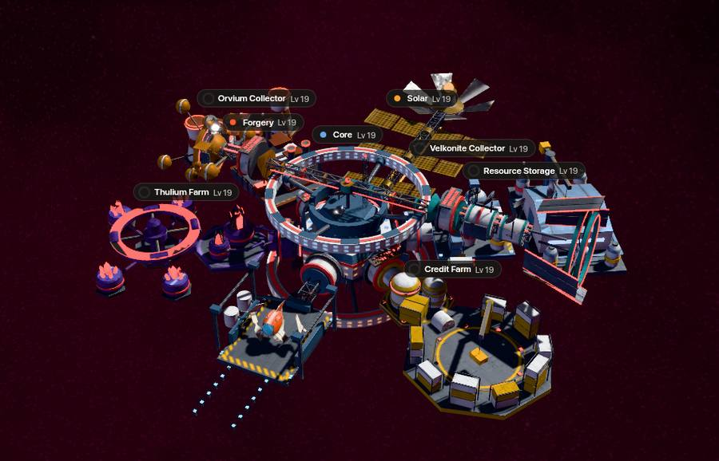

**Nível 20.** O topo da escada: a coroa no Núcleo e as torres plenamente desenvolvidas das minas e da cadeia de suprimentos.

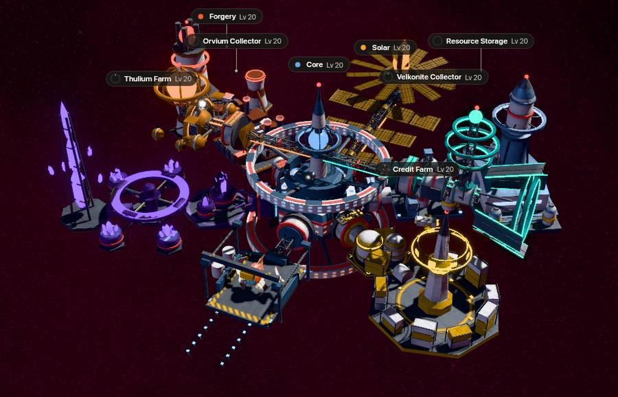

**Os cartões dos nove módulos.** A visão Lista da mesma estação no nível 20: os quatro módulos da primeira versão, o Coletor de Velkonite, o Coletor de Orvium, o Depósito de recursos e a Forja que vieram com a cadeia de suprimentos, e o Centro de Pesquisa. Cada cartão mostra o nível do módulo, a produção, a energia e o interruptor. Todos os cartões mostram o nível 20, menos o do Centro de Pesquisa: ele tem os níveis 1 a 10, então o cartão dele mostra o nível 10, o máximo. Os cartões da Impressora de munição, da Fábrica de foguetes e da Baía de minério estão na mesma visão e são descritos [mais abaixo](#the-bridge-and-core-2), assim como os quatro cartões dos módulos da Expedição, em [A segunda ponte e o Núcleo 3](#the-second-bridge-and-core-3).

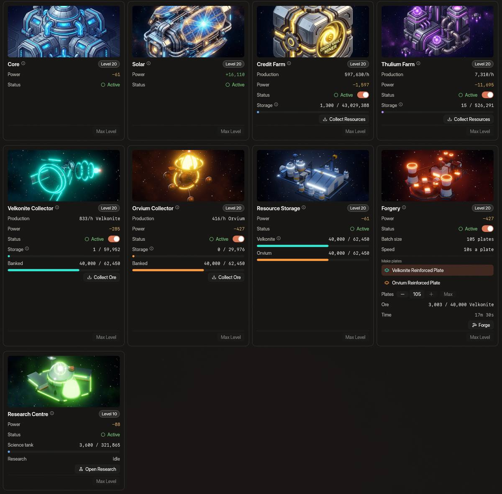

## Os quatro primeiros módulos {#the-first-four-modules}

### Módulo Núcleo {#core-module}

O coração do seu Skylab. O nível do Núcleo define o nível mais alto de todos os outros módulos: nenhum módulo pode ser melhorado acima do seu Núcleo. O Núcleo vai até o nível 20 e, a partir do **nível 5**, abre a cadeia de suprimentos abaixo. As melhorias dele custam créditos, o passo para o **nível 10** custa **2.000 Thulium** a mais e constrói a ponte e o Núcleo 2 (veja [A ponte e o Núcleo 2](#the-bridge-and-core-2)), e o passo para o **nível 15** custa **4.000 Thulium** a mais e constrói uma segunda ponte e o Núcleo 3 (veja [A segunda ponte e o Núcleo 3](#the-second-bridge-and-core-3)). No total são 112.326 créditos até o nível 10 e 6.647.504 até o nível 20, mais esses 6.000 Thulium, e cerca de 16,5 dias (veja [Tempos de melhoria](#upgrade-times)).

### Módulo Usina solar {#solar-module}

A energia é o sangue do Skylab. O módulo Usina solar produz a energia que todos os outros módulos usam.

- **Importância**: se o seu consumo de energia for maior que a energia produzida, as suas minas e os seus coletores param de produzir.
- **Energia produzida**: um módulo Usina solar no nível N produz o bastante para **todos os outros módulos no nível N**, e cerca de um décimo a mais: 255 no nível 1, 965 no nível 7, 18.575 no nível 20. Uma Usina solar de nível 7 alimenta uma estação inteira no nível 7 (veja Gerenciamento de energia para todos os níveis).
- **Preço**: construir a Usina solar custa **500 créditos e 50 Thulium**. As melhorias dela custam o mesmo e levam o mesmo tempo que as da Forja: de 8.000 créditos e 25 Thulium para o nível 2 (5 minutos) a 9.000.000 de créditos e 10.000 Thulium para o nível 20 (24 horas).
- **Melhoria**: enquanto é melhorada, a Usina solar produz só **25%** da energia do seu nível atual, e a do novo nível a partir do momento em que a melhoria termina. Uma estação que usa mais do que isso para: toda mina e todo coletor deixam de produzir, e a Forja não inicia nenhum lote novo até a melhoria terminar. Para quase toda estação é assim: ela só continua funcionando durante a melhoria se todos os outros módulos estiverem pelo menos cinco níveis abaixo da Usina solar (seis níveis a partir do nível 10 da Usina solar). Planeje a melhoria da Usina solar como um apagão das suas minas (veja Construção e melhoria).
- **Lugar**: a Usina solar fica na outra ponta da estação: no Núcleo 2 a partir do nível 10 do Núcleo e no Núcleo 3 a partir do nível 15 (veja [A ponte e o Núcleo 2](#the-bridge-and-core-2) e [A segunda ponte e o Núcleo 3](#the-second-bridge-and-core-3)).

### Mina de créditos e Mina de Thulium {#credit-farm-and-thulium-farm}

- **Mina de créditos**: produz créditos ao longo do tempo: **750 por hora no nível 1, 75.000 no nível 20** (nível 5: 3.750; nível 10: 11.250; nível 15: 25.500). Construí-la não custa nada.
- **Mina de Thulium**: produz Thulium ao longo do tempo: **40 por hora no nível 1, 1.280 no nível 20** (nível 5: 144; nível 10: 360; nível 15: 760). Construí-la custa 5.000 créditos e 500 Thulium.
- Ambas precisam de energia, e cada uma guarda 72 horas do que produz até você coletar.

## A cadeia de suprimentos {#the-supply-chain}

Quatro módulos transformam o tempo longe do teclado nas placas para os seus melhores lasers. O minério vem **só** dos coletores (todos os materiais e moedas estão na página [Recursos](/wiki/06-Items/Resources.md)): os alienígenas não o soltam e a Loja não o vende. (Uma [escavadeira gigante](/wiki/03-Mechanics/Giant-Excavator.md) também solta um pouco de Velkonite e Orvium em caixas, mas esse minério vai para a sua carga, e só a [Baía de minério](#ore-bay) o move para o Depósito de recursos, de onde a Forja e o Centro de Pesquisa o pegam.)

1. Um **coletor** extrai minério, uma quantidade por hora, para o seu próprio armazenamento (o equivalente a 72 horas).
2. **Coletar** move o minério do armazenamento para o **Depósito de recursos**, onde cada minério fica guardado à parte.
3. A **Forja** pega no depósito o minério de que precisa quando um lote começa e faz placas, 10 segundos por placa, um lote de cada vez.
4. **Coletar placas** move as placas prontas para o seu inventário (a sua nave precisa estar pousada). A [Montagem](/wiki/06-Items/Lasers.md) as transforma em um Quantum Laser III, um Starfire-III ou um Helios Beam e, uma de cada com 5 Dark Matter, em uma Dark Matter Plate, que a [Forja](/wiki/06-Items/Forge.md) e o último nível de cada cadeia de melhoria pedem.

### Coletor de Velkonite e Coletor de Orvium {#velkonite-collector-and-orvium-collector}

- **Minério**: o Coletor de Velkonite extrai **10 de Velkonite por hora** no nível 1 e o Coletor de Orvium **10 de Orvium por hora**, e cada nível tem a sua própria taxa: até 80 de Velkonite e 40 de Orvium por hora no nível 20 (nível 5: 18 e 14 por hora; nível 10: 32 e 24).
- **Armazenamento**: cada um guarda 72 horas do seu minério e para de extrair quando está cheio.
- **Coletar**: move o minério para o Depósito de recursos, até onde houver espaço. Sem depósito construído, ou com o depósito cheio daquele minério, não há onde colocá-lo e o botão diz o motivo. O resto fica no armazenamento.
- **Energia**: 20 (Velkonite) e 30 (Orvium) no nível 1, crescendo 15% por nível.

### Depósito de recursos {#resource-storage}

- **Depósito**: guarda o Velkonite e o Orvium separados, e comporta uma quantidade diferente de cada um: **240 de cada no nível 1**, até 7.680 de Velkonite e 3.840 de Orvium no nível 20 (nível 5: 720 e 560; nível 10: 1.920 e 1.440).
- **Limite**: um dia da produção do coletor dele no nível 1, até quatro dias no nível 20. O armazenamento de um coletor guarda três dias, então, a partir do nível 13, o depósito comporta pelo menos um armazenamento cheio.
- **Acima do limite**: se um depósito tem mais do que o seu limite (o pagamento da atualização 0.4.10 pode tê-lo deixado assim), nada é tirado, mas Coletar não acrescenta mais desse minério até você ter gastado um pouco.
- O minério entra coletando de um coletor ou, do seu inventário, pela [Baía de minério](#ore-bay), e só sai para a Forja e o Centro de Pesquisa. Ele nunca volta ao seu inventário.
- **O minério guardado permanece** no reset da temporada.
- **Energia**: 10 no nível 1, crescendo 10% por nível. Ele não pode ser desligado.

### Forja {#forgery}

- **Placas**: a Forja faz uma **Velkonite Reinforced Plate** a partir de Velkonite e uma **Orvium Reinforced Plate** a partir de Orvium: **40 de Velkonite** ou **80 de Orvium** por placa no nível 1, caindo a cada nível até 30 e 60 no nível 20 (nunca abaixo de 75%).
- **Lotes**: um lote de um tipo de placa por vez, **10 placas no nível 1** e mais 5 para cada nível acima. O minério sai do Depósito de recursos no instante em que o lote começa, e cada placa leva **10 segundos**. As placas são feitas uma depois da outra, também enquanto você está fora.
- **Coletar placas**: move as placas prontas para o seu inventário enquanto a sua **nave está pousada**, e o resto do lote continua. Um novo lote pode começar quando a Forja estiver vazia.
- Um lote em andamento termina mesmo que você desligue a Forja ou a melhore. Um **novo** lote precisa que a Forja esteja ligada, sem estar em melhoria, e que a energia do Skylab esteja em equilíbrio.
- **Energia**: 30 no nível 1, crescendo 15% por nível.
- **Não vendável**: as placas que a Forja faz não podem ser vendidas no [Leilão](/wiki/03-Mechanics/Auction.md#marketable-items); senão seriam a maior mercadoria do Mercado. Elas continuam servindo de material para a Montagem e a Forja.

### Construindo os módulos {#building-them}

Os dois coletores custam **10 Ship Fragments, 20.000 créditos e 500 Thulium** cada um, o Depósito de recursos **10 Ship Fragments, 5.000 créditos e 250 Thulium** e a Forja **10 Ship Fragments, 5.000 créditos e 500 Thulium**; os quatro exigem o Núcleo no nível 5.

- Os Ship Fragments são tirados do seu inventário (não do Cache de Transporte) e a sua nave precisa estar pousada. A ficha de construção mostra o que você tem em comparação com o que é preciso, e o que falta.
- Eles consomem energia. Antes de construir, a ficha mostra o seu balanço de energia agora e depois: **construir pode deixar uma estação em déficit** quando a sua Usina solar está atrás dos outros módulos, e um único déficit para todas as minas e todos os coletores. Desligue um módulo ou melhore antes a Usina solar.
- Os dois coletores ficam pendurados em estruturas acima da estação, o Depósito de recursos fica na porta nordeste do Núcleo e a Forja, na porta noroeste dele.

## O Centro de Pesquisa {#the-research-centre}

O nono módulo transforma recursos em ciência e pesquisa as tecnologias de que a Montagem precisa antes de fazer qualquer coisa nova. Ele é construído a partir do nível 10 do Núcleo, tem os níveis 1 a 10, consome energia e não pode ser desligado. Os números dele, o que ele queima como combustível, o impulso e toda a árvore de tecnologias estão na página [Pesquisa](/wiki/03-Mechanics/Research.md). As tecnologias mais altas também exigem Dark Matter, que você adiciona ao Centro: [Dark Matter e Dark Matter Plates](/wiki/03-Mechanics/Dark-Matter.md) diz como consegui-lo. Os níveis do Módulo de motores, do Módulo de defesa e do Módulo de radar também são tecnologias, pesquisadas aqui (veja [Pesquisa](/wiki/03-Mechanics/Research.md#module-technologies)).

## A ponte e o Núcleo 2 {#the-bridge-and-core-2}

A melhoria do Núcleo para o **nível 10** constrói uma **ponte** e um segundo Núcleo. A ponte se encaixa na porta norte do Núcleo, onde ficava a Usina solar, e o liga, na outra ponta, ao **Núcleo 2**.

- **Custo**: o passo do nível 9 para o nível 10 custa **2.000 Thulium** além dos seus 38.443 créditos, e leva o mesmo tempo de antes, 1 h 20 min. A ponte e o Núcleo 2 não custam mais nada e não levam tempo próprio. Uma melhoria que já estava em andamento mantém o preço com que começou, e um Núcleo no nível 10 ou mais não paga nada.
- **O Núcleo 2 não tem nível**: não há nada para melhorar nem para pagar. Ele dá à sua estação **seis slots a mais para módulos**, e o cartão do Núcleo mostra quantos estão livres.
- **A Usina solar se muda**: a Usina solar deixa a porta norte do Núcleo, que agora a ponte ocupa, e passa para a porta norte do Núcleo 2, na outra ponta da estação. O nível dela, a energia dela e uma melhoria em andamento ficam intactos.
- **Uma regra, não uma obra**: onde cada módulo fica depende só do nível do Núcleo. A ponte surge no momento em que a melhoria do Núcleo para o nível 10 termina (um som discreto e uma mensagem avisam você), e um Skylab cujo Núcleo já está no nível 10 ou mais a tem na próxima vez que você olhar. Nenhum módulo se perde ou é apagado, e só a Usina solar muda de lugar.
- **Slots**: a **Impressora de munição** ocupa o slot nordeste do Núcleo 2, a **Fábrica de foguetes** o noroeste e a **Baía de minério** a estrutura leste; os outros três ficam livres para módulos futuros. Os três só podem ser construídos quando o Núcleo 2 existe: antes disso, o botão de construir diz “Requer Núcleo 2”.
- **Níveis**: um módulo no Núcleo 2 segue o nível do Núcleo como qualquer outro módulo: nenhum passa do Núcleo, então o Núcleo 2 acrescenta slots, não níveis.

### Impressora de munição {#ammo-printer}

A Impressora de munição imprime munição de laser do nada, de um tipo por vez: sem minério e sem créditos, só energia. Ela tem os níveis 1 a 20.

- **Produção**: **x2** (Advanced Plasma) **100 por hora no nível 1, 2.000 no nível 20** (100 a mais a cada nível); **x3** (Ultra Core) metade disso, de 50 a 1.000; **x4** (Experimental Fusion Core) um quarto, de 25 a 500.
- **Modo**: você escolhe x2, x3 ou x4 no cartão ou na ficha dela. Uma troca mantém as horas já armazenadas e passa a contá-las na taxa do novo modo.
- **Armazenamento**: um dia, 24 horas de produção no nível e no tipo em uso (2.400 de x2 no nível 1, 48.000 no nível 20). O tempo offline conta, e um armazenamento cheio simplesmente para.
- **Coletar**: move as unidades inteiras para o seu inventário enquanto a sua **nave está pousada**. A munição não tem limite de carga, e a fração de uma unidade fica e continua contando.
- **Energia**: 40 no nível 1, crescendo 20% por nível. Num déficit de energia ela para como as minas e os coletores, e o que ela guarda fica e pode ser coletado.
- **Construção**: 20.000 créditos, 500 Thulium e 10 Ship Fragments (do seu inventário, com a nave pousada), só no Núcleo 2. As melhorias dela custam de 21.000 créditos e 140 Thulium a 5.600.000 créditos e 11.000 Thulium e levam o mesmo tempo que as da Forja, de 5 minutos a 24 horas e 5 d 13 h no total (veja as tabelas mais abaixo).
- **Não vendável**: o que ela imprime não pode ser vendido no [Leilão](/wiki/03-Mechanics/Auction.md#marketable-items).

### Fábrica de foguetes {#rocket-factory}

A Fábrica de foguetes fabrica foguetes da loja do nada, de um tipo por vez. Ela tem os níveis 1 a 20.

- **O que ela faz**: um só dos doze foguetes da loja, o que você escolher: Lancet, Rivet, Scatter ou Ember, raridades I, II e III. O N.U.K.E. e o N.I.K.E. nunca são fabricados.
- **Produção**: a raridade III faz **0,5 por hora no nível 1 e 10 no nível 20** (0,5 a mais a cada nível), a raridade II faz 1,25 vezes isso e a raridade I o dobro. Só contam foguetes inteiros: a fração de um fica e continua contando.
- **Armazenamento**: um dia, 24 horas de produção no nível e com o foguete em uso (240 de raridade III no nível 20). O tempo offline conta, um armazenamento cheio simplesmente para, e uma troca de foguete mantém as horas já armazenadas.
- **Coletar**: move os foguetes para o seu inventário enquanto a sua **nave está pousada**, quantos você puder carregar: no máximo 5.000 de raridade I, 2.000 de raridade II e 500 de raridade III, o limite da própria loja. O que não couber fica na fábrica.
- **Energia**: 24 no nível 1, crescendo 15% por nível. Num déficit de energia ela para como a impressora.
- **Construção**: 20.000 créditos, 500 Thulium e 15 Ship Fragments (do seu inventário, com a nave pousada), só no Núcleo 2. As melhorias dela custam um quarto das da impressora, de 5.300 créditos e 35 Thulium a 1.400.000 créditos e 2.800 Thulium, e levam o mesmo tempo: 5 d 13 h no total.
- **Não vendável**: o que ela fabrica não pode ser vendido no [Leilão](/wiki/03-Mechanics/Auction.md#marketable-items).

### Baía de minério {#ore-bay}

A Baía de minério move para o Depósito de recursos o minério que você carrega. Uma [escavadeira gigante](/wiki/03-Mechanics/Giant-Excavator.md) solta Velkonite e Orvium em caixas que vão para a sua carga, onde nenhum módulo os usa; a Baía de minério é o caminho dali até o banco, de onde a Forja e o Centro de Pesquisa o pegam. Ela tem os níveis 1 a 20.

- **O que ela move**: **Velkonite e Orvium**, os dois minérios que o Depósito de recursos guarda. Cataclysite e Quorvium são combustível que o Centro de Pesquisa e a [Forja](/wiki/06-Items/Forge.md) pegam direto do seu inventário, e o Thulium vai para a sua conta quando você o pega.
- **Em um só sentido**: do seu inventário para o Depósito de recursos, nunca de volta. Só o minério solto no seu inventário é movido, nunca o do Cache de Transporte.
- **Como**: a sua **nave precisa estar pousada**. A transferência é instantânea: na folha da Baía de minério escolha o minério, digite uma quantidade ou aperte Máx. e aperte **Mover**. A folha mostra o que você carrega e o que o banco guarda frente à sua capacidade.
- **Cota**: o nível define quanto minério ela move por hora, **30 no nível 1, 960 no nível 20**, e ela guarda até um dia disso (720 no nível 1, 23.040 no nível 20). Uma Baía nova começa com um dia cheio, e uma melhoria mantém o que estava guardado. Uma transferência é cortada no minério que você carrega, no espaço que sobra no Depósito de recursos e na cota, e a folha diz qual. Um dia de cota equivale a cerca de três vezes o que o Depósito de recursos comporta de um minério no mesmo nível; por isso, na maioria das vezes é o espaço que interrompe uma transferência, e a cota só importa se você passar minério pelo depósito várias vezes no mesmo dia.
- **Energia**: 15 no nível 1, crescendo 10% por nível (92 no nível 20). Pode ser desligada. Num déficit de energia, enquanto está desligada e enquanto é melhorada, ela não move nada.
- **Construção**: 5.000 créditos, 250 Thulium e 10 Ship Fragments (do seu inventário, com a nave pousada), só no Núcleo 2. As melhorias custam o que as do Depósito de recursos custam e levam o mesmo tempo (veja as tabelas abaixo).
- **Não é um caminho para mais minério**: ela move minério que você já tem. Uma rodada da escavadeira é limitada na origem, e a capacidade do Depósito de recursos limita o banco.

## A segunda ponte e o Núcleo 3 {#the-second-bridge-and-core-3}

A melhoria do Núcleo para o **nível 15** constrói uma **segunda ponte** e um terceiro Núcleo, e os quatro módulos da Expedição ocupam ali os seus slots. A ponte II se encaixa na porta norte do Núcleo 2, onde ficava a Usina solar, e o liga, na outra ponta da estação, ao **Núcleo 3**: o padrão do nível 10, mais uma vez.

- **Custo**: o passo do nível 14 para o nível 15 custa **4.000 Thulium** além dos créditos dele, e leva o mesmo tempo de antes, 14 h. A ponte II e o Núcleo 3 não custam mais nada e não levam tempo próprio. Uma melhoria que já estava em andamento mantém o preço com que começou, e um Núcleo no nível 15 ou mais não paga nada.
- **O Núcleo 3 não tem nível**: não há nada para melhorar nem para pagar. Ele dá à sua estação **quatro slots a mais para módulos**, e o cartão do Núcleo mostra quantos estão livres.
- **A Usina solar se muda de novo**: a Usina solar deixa a porta norte do Núcleo 2, que agora a ponte II ocupa, e passa para a porta norte do Núcleo 3, na outra ponta da estação. O nível dela, a energia dela e uma melhoria em andamento ficam intactos.
- **Uma regra, não uma obra**: onde cada módulo fica depende só do nível do Núcleo. O Núcleo 3 surge no momento em que a melhoria do Núcleo para o nível 15 termina, e um Skylab cujo Núcleo já está no nível 15 ou mais o tem na próxima vez que você olhar. Nenhum módulo se perde, e só a Usina solar muda de lugar.
- **Slots**: o **Módulo de defesa** ocupa o slot nordeste do Núcleo 3, o **Módulo de radar** o noroeste, a **Baía de troféus** a estrutura leste e o **Módulo de motores** a estrutura oeste. As duas portas do sul ficam de frente para os módulos do Núcleo 2 e permanecem vazias. Os quatro só podem ser construídos quando o Núcleo 3 existe: antes disso, o botão de construir fica bloqueado e diz que requer o Núcleo no nível 15.
- **Níveis**: um módulo no Núcleo 3 segue o nível do Núcleo como qualquer outro: nenhum passa do Núcleo. Os módulos de motores e de defesa vão até o nível 5, o de radar até o nível 3 e a Baía de troféus até o nível 20.
- **O que uma construção exige**: além de créditos e Thulium, **Ship Fragments** e, para os módulos de motores, de defesa e de radar, **Dark Matter Plates** do seu inventário (não do Cache de Transporte), tiradas com a nave pousada, e a **tecnologia** do nível, pesquisada no Centro de Pesquisa. Um passo que exige placas as exige do mesmo jeito.

**As tecnologias.** Cada nível dos módulos de motores, de defesa e de radar é uma tecnologia da família Skylab na visão Pesquisa, pesquisada em sequência e necessária antes de o nível poder ser construído ou de se melhorar até ele. Os três módulos compartilham os tempos (o módulo de radar vai até o nível 3):

| Nível | Tempo de pesquisa | Dark Matter |
| :--- | ---: | ---: |
| 1 | 3 h | 0 |
| 2 | 10 h | 5 |
| 3 | 1 d | 10 |
| 4 | 2 d | 15 |
| 5 | 3 d | 20 |

As tecnologias dos três módulos exigem 115 Dark Matter e 14 d 15 h de pesquisa na velocidade normal (veja [Pesquisa](/wiki/03-Mechanics/Research.md#module-technologies)).

### Módulo de motores {#engine-module}

O Módulo de motores abriga os motores que fazem o seu Skylab voar. Ele tem os níveis 1 a 5, e cada nível comporta um motor a mais. Os motores que você monta e o peso da estação inteira decidem a velocidade com que ele voa (veja [Peso e velocidade](#weight-and-speed)).

- **O que se monta**: itens [Engine](/wiki/06-Items/Propulsion.md) com os propulsores dentro, do seu inventário: um Engine I, II ou III. Um Adaptive Core não serve: o bônus de velocidade dele é coisa de nave. Um motor mantém os propulsores e os bônus da Forja quando você o retira de novo.
- **Como**: a sua **nave precisa estar pousada** e o Skylab não pode estar em viagem. O cartão de motores da janela Universo lista os seus motores soltos: arraste um para um slot livre ou clique nele, e clique em um motor montado para retirá-lo. O cartão também mostra o empuxo, o peso, a velocidade e quanto dura um salto.
- **Uma viagem exige**: o módulo construído, ligado, fora de melhoria e com pelo menos um motor dentro.
- **Pesquisa**: cada nível exige a própria tecnologia, Módulo de motores I a V (veja a tabela acima).
- **Energia**: 60 no nível 1, crescendo 25% por nível. Pode ser desligado, mas não enquanto o Skylab está em viagem.
- **Construção**: 375.000 créditos, 1.500 Thulium, 20 Ship Fragments e 1 Dark Matter Plate, só no Núcleo 3.
- **Melhoria**: o módulo fica offline enquanto é melhorado. A melhoria do Módulo de motores espera o fim de uma viagem, porque a velocidade de uma viagem é fixada na saída.

| Nível | Motores | Créditos | Thulium | Placas | Tempo |
| :--- | ---: | ---: | ---: | ---: | ---: |
| 1 (a construção) | 1 | 375.000 | 1.500 | 1 | – |
| 2 | 2 | 825.000 | 3.300 | 2 | 2 h |
| 3 | 3 | 1.825.000 | 7.300 | 3 | 6 h |
| 4 | 4 | 4.000.000 | 16.000 | 5 | 1 d |
| 5 | 5 | 8.750.000 | 35.000 | 8 | 2 d |

As placas são Dark Matter Plates, e o tempo é o da melhoria até o nível. No total, os cinco níveis custam 15.775.000 créditos, 63.100 Thulium, 19 placas e 3 d 8 h de melhoria.

### Módulo de defesa {#defense-module}

O Módulo de defesa luta pelo seu Skylab. Ele abriga os lasers que atiram nos alienígenas das células para onde o seu Skylab voa e o carregador de onde eles disparam. Tem os níveis 1 a 5, e o nível dele decide quantos lasers comporta, quantos tiros, quanto pode ganhar por hora e quão perigosa pode ser a célula em que entra.

- **O que se monta**: itens [Laser](/wiki/06-Items/Lasers.md) com os amplificadores dentro, do seu inventário: um Quantum Laser I, II ou III, um Starfire-III ou um Helios Beam. Todos os lasers disparam juntos, um tiro cada por segundo. Os amplificadores contam como em uma nave (dano, chance de crítico e dano crítico); um Penetration Amp não acrescenta nada aqui.
- **O carregador** guarda tiros dos tipos da Impressora de munição e é enchido **só pela Impressora de munição**, nunca pelo seu inventário (veja [Montagem e munição](#fits-and-ammunition)).
- **O portão**: uma célula de dificuldade 3, por exemplo, só pode ser acessada por um Skylab cujo Módulo de defesa esteja no nível 3 ou mais. Um Skylab sem Módulo de defesa só pode atravessar o espaço vazio e o seu porto.
- **O orçamento de abates** é o máximo que o Skylab pode ganhar por hora: 108 pontos de recompensa no nível 1 e 630 no nível 5 (veja [O que uma viagem paga](#what-a-trip-pays)).
- **O casco** cresce com o nível (veja [O casco, a destruição e o reparo](#the-hull-and-repair)).
- **Pesquisa**: cada nível exige a própria tecnologia, Módulo de defesa I a V (veja a tabela acima).
- **Energia**: 80 no nível 1, crescendo 25% por nível. Pode ser desligado, mas não enquanto o Skylab está em viagem. Um módulo desligado, em melhoria ou sem energia fica apagado: o Skylab não combate nada e passa pelas células sem lutar.
- **Construção**: 500.000 créditos, 2.000 Thulium, 25 Ship Fragments e 1 Dark Matter Plate, só no Núcleo 3.

| Nível | Lasers | Carregador (tiros) | Orçamento de abates (pontos por hora) | Dificuldade máxima |
| :--- | ---: | ---: | ---: | ---: |
| 1 | 1 | 1.300 | 108 | 1 |
| 2 | 2 | 3.600 | 293 | 2 |
| 3 | 3 | 14.000 | 476 | 3 |
| 4 | 4 | 23.000 | 548 | 4 |
| 5 | 5 | 35.000 | 630 | 5 |

| Nível | Créditos | Thulium | Placas | Tempo |
| :--- | ---: | ---: | ---: | ---: |
| 1 (a construção) | 500.000 | 2.000 | 1 | – |
| 2 | 1.150.000 | 4.600 | 2 | 3 h |
| 3 | 2.750.000 | 11.000 | 4 | 9 h |
| 4 | 6.000.000 | 24.000 | 7 | 1 d 12 h |
| 5 | 14.000.000 | 56.000 | 12 | 3 d |

No total, os cinco níveis custam 24.400.000 créditos, 97.600 Thulium, 26 placas e 5 d de melhoria.

### Módulo de radar {#radar-module}

O Módulo de radar dissipa a névoa do mapa do universo (veja [Névoa e escaneamento](#fog-and-scanning)). Tem os níveis 1 a 3, e um nível mais alto escaneia uma célula mais rápido.

- **O que faz**: escaneia **uma célula por vez**, entre as células ao lado de uma que você conhece, e mantém uma **fila de três**: a primeira está sendo escaneada e as outras esperam. Quando um escaneamento termina, você conhece a célula, e o seu Skylab pode voar até lá.
- **Tempo**: 90 minutos por célula no nível 1, 40 no nível 2 e 15 no nível 3. Um escaneamento corre no relógio do servidor, também enquanto você está fora e enquanto o Skylab voa. Ele para, e o tempo não é recuperado, enquanto o módulo está desligado, em melhoria ou sem energia e enquanto o Skylab está destruído. Um escaneamento custa tempo e mais nada.
- **Mapear tudo**: mapear as 131 células que você não conhece no início, uma depois da outra, leva 8 d 4 h no nível 1, 3 d 15 h no nível 2 e 1 d 9 h no nível 3.
- **Pesquisa**: cada nível exige a própria tecnologia, Módulo de radar I a III (veja a tabela acima).
- **Energia**: 40 no nível 1, crescendo 30% por nível. Pode ser desligado, mas não enquanto o Skylab está em viagem.
- **Construção**: 250.000 créditos, 1.000 Thulium e 15 Ship Fragments, só no Núcleo 3.

| Nível | Tempo de escaneamento | Créditos | Thulium | Placas | Tempo |
| :--- | ---: | ---: | ---: | ---: | ---: |
| 1 (a construção) | 90 min | 250.000 | 1.000 | 0 | – |
| 2 | 40 min | 750.000 | 3.000 | 1 | 4 h |
| 3 | 15 min | 2.250.000 | 9.000 | 3 | 1 d |

No total, os três níveis custam 3.250.000 créditos, 13.000 Thulium, 4 placas e 1 d 4 h de melhoria.

### Baía de troféus {#trophies-bay}

A Baía de troféus guarda o que os abates do seu Skylab rendem até você coletar. Tem os níveis 1 a 20 e não exige tecnologia.

- **O que guarda**: créditos, Thulium, experiência, honra e o espólio dos abates.
- **A capacidade** é contada em **pontos de recompensa**: um abate soma a recompensa do alienígena, créditos divididos por 200 mais Thulium, seja o que for que ele solte (os valores de Alpha em todos os mundos). Ela guarda 650 pontos no nível 1 e 45.000 no nível 20.
- **Cheia**: uma baía cheia faz o Skylab **parar de atirar**: nada é abatido, pago nem contado e nenhuma munição é gasta até você coletar (o casco continua se regenerando). Uma mensagem e a dica da linha do Skylab na barra lateral avisam.
- **Coletar** na janela Universo, com a nave pousada: créditos e Thulium vão para a sua conta, experiência e honra para o seu piloto e o espólio para o seu inventário. Duas coletas ao mesmo tempo pagam uma vez só.
- **O espólio** é sorteado a cada abate a partir do que o alienígena solta, nunca Dark Matter, Ancient Control Units, N.I.K.E.s ou N.U.K.E.s. Ele é **não vendável**: não pode ser vendido no [Leilão](/wiki/03-Mechanics/Auction.md#marketable-items).
- **Energia**: 20 no nível 1, crescendo 10% por nível. Pode ser desligada, mas não enquanto o Skylab está em viagem.
- **Construção**: 100.000 créditos, 400 Thulium e 10 Ship Fragments, só no Núcleo 3. As melhorias dela custam de 117.500 créditos e 470 Thulium (15 minutos) a 2.325.000 créditos e 9.300 Thulium (1 d 13 h): 14.722.500 créditos e 58.890 Thulium no total, e 6 d 8 h.

| Nível | Capacidade (pontos) | Créditos | Thulium | Tempo |
| :--- | ---: | ---: | ---: | ---: |
| 1 (a construção) | 650 | 100.000 | 400 | – |
| 2 | 810 | 117.500 | 470 | 15 min |
| 5 | 1.600 | 195.000 | 780 | 34 min |
| 10 | 4.800 | 450.000 | 1.800 | 2 h 18 min |
| 15 | 15.000 | 1.025.000 | 4.100 | 9 h 14 min |
| 20 | 45.000 | 2.325.000 | 9.300 | 1 d 13 h |

Quanto tempo uma baía leva para encher quando o Skylab ganha todo o orçamento de abates do seu nível de defesa (uma baía menor enche mais rápido, um orçamento menor mais devagar):

| Nível de defesa | Baía nível 1 | Baía nível 5 | Baía nível 10 | Baía nível 15 | Baía nível 20 |
| :--- | ---: | ---: | ---: | ---: | ---: |
| 1 | 6 h 1 min | 14 h 49 min | 1 d 20 h | 5 d 19 h | 17 d 9 h |
| 2 | 2 h 13 min | 5 h 28 min | 16 h 23 min | 2 d 3 h | 6 d 10 h |
| 3 | 1 h 22 min | 3 h 22 min | 10 h 5 min | 1 d 8 h | 3 d 22 h |
| 4 | 1 h 11 min | 2 h 55 min | 8 h 46 min | 1 d 3 h | 3 d 10 h |
| 5 | 1 h 2 min | 2 h 32 min | 7 h 37 min | 23 h 49 min | 2 d 23 h |

## Peso e velocidade {#weight-and-speed}

Todo módulo pesa alguma coisa, em **unidades de massa (MU)**, e uma estação mais pesada voa mais devagar. Um módulo pesa mais a cada nível, um que não foi construído não pesa nada e um em melhoria pesa o nível que tem. Os motores e lasers que você monta não contam: o peso do módulo já os inclui.

| Módulo | Nível 1 | Nível 5 | Nível 10 | Nível 15 | Nível máximo |
| :--- | ---: | ---: | ---: | ---: | ---: |
| Núcleo | 100 | 148 | 208 | 268 | 328 |
| Usina solar | 60 | 84 | 114 | 144 | 174 |
| Mina de créditos | 60 | 84 | 114 | 144 | 174 |
| Mina de Thulium | 80 | 118 | 166 | 214 | 262 |
| Coletor de Velkonite | 70 | 92 | 120 | 148 | 176 |
| Coletor de Orvium | 70 | 92 | 120 | 148 | 176 |
| Depósito de recursos | 70 | 92 | 120 | 148 | 176 |
| Forja | 80 | 112 | 152 | 192 | 232 |
| Centro de Pesquisa | 60 | 89 | 125 | – | 125 |
| Impressora de munição | 60 | 84 | 114 | 144 | 174 |
| Fábrica de foguetes | 60 | 84 | 114 | 144 | 174 |
| Baía de minério | 40 | 53 | 69 | 85 | 101 |
| Módulo de motores | 80 | 144 | – | – | 144 |
| Módulo de defesa | 100 | 180 | – | – | 180 |
| Módulo de radar | 30 | – | – | – | 39 |
| Baía de troféus | 50 | 60 | 73 | 85 | 98 |
| **A estação inteira: todo módulo que existe naquele nível do Núcleo, naquele nível** | 300 | 824 | 1.537 | 2.353 | 2.734 |

O nível máximo é 20, exceto para o Centro de Pesquisa (10), os módulos de motores e de defesa (5) e o módulo de radar (3). A estação inteira pesa 2.353 MU no nível 15 do Núcleo e 2.734 MU no nível 20.

- **O empuxo** é a aritmética de motores das naves, sem velocidade base: um motor soma a velocidade base dele mais a velocidade fixa dos propulsores, vezes os multiplicadores deles; os motores são ordenados do melhor ao pior, os quatro primeiros contam 100% e o quinto 85% (o módulo comporta cinco, no máximo); e os quatro melhores bônus de velocidade são somados por cima. Uma estação sem motor não tem empuxo.
- **A velocidade** é 60 vezes o empuxo dividido pelo peso da estação, em unidades por segundo, e um salto entre duas células vizinhas é de 15.000 unidades. Abaixo da energia, a página do Skylab mostra a linha “Peso 2.353 MU, velocidade 7,8 unidades/s, um salto 32 min”.
- **Fixada na saída**: a velocidade de uma viagem é calculada na saída, a partir do peso e do empuxo daquele momento. Uma melhoria que termina no caminho, ou um motor que você troca enquanto o Skylab está estacionado, vale para a próxima viagem.

O que os motores fazem por uma estação com todos os módulos no nível 15 (o Módulo de motores no nível que comporta os motores):

| Motores montados | Peso (MU) | Empuxo | Velocidade (unidades por segundo) | Um salto | Atravessar o mapa (14 saltos) |
| :--- | ---: | ---: | ---: | ---: | ---: |
| 1 Engine I (Módulo de motores nível 1) | 2.289 | 2,0 | 0,05 | 3 d 6 h | 45 d 11 h |
| 3 Engine II, cada um com 2 Impulse Thruster II (nível 3) | 2.321 | 73,6 | 1,90 | 2 h 11 min | 1 d 7 h |
| 5 Engine III, cada um com 3 Impulse Thruster IV (nível 5) | 2.353 | 305,5 | 7,79 | 32 min | 7 h 29 min |

No nível 20 do Núcleo a estação pesa 16% a mais, e os melhores motores levam 37 minutos por salto e 8 h 42 min para atravessar o mapa.

## Expedições {#expeditions}

Uma **expedição** é uma viagem do seu Skylab pelo **mapa do universo**. Ele voa até uma célula, caça ali os alienígenas com os lasers do seu Módulo de defesa e enche a Baía de troféus com o que os abates rendem. Tudo corre no relógio do servidor, então continua enquanto você está desconectado, e nenhum jogador pode atacar o Skylab: só o perigo da célula o machuca (veja [O casco, a destruição e o reparo](#the-hull-and-repair)). Você planeja uma viagem na janela **Universo**, que o botão Universo no cabeçalho da página do Skylab abre.

O que é preciso: um Núcleo no nível 15, uma corporação (o porto dela é o porto de origem do seu Skylab) e um mundo; para uma viagem, um Módulo de motores com um motor montado; para ganhar alguma coisa, um Módulo de defesa com um laser e munição da sua Impressora de munição, e uma Baía de troféus para guardar o ganho. Todo o resto continua enquanto o Skylab está fora: as minas, os coletores, a Forja, a Impressora, a Fábrica, a Baía de minério e o Centro de Pesquisa funcionam nos próprios relógios, e a sua nave pode ser pilotada como sempre.

### O mapa do universo {#the-universe-map}

O mapa é a **camada própria** do Skylab, não os setores do jogo nem uma visão deles: as células dele não são mapas do jogo, os portões não estão nele, nada nele é pilotado em tempo real e os alienígenas dele são só uma quantidade e um perigo. Ele toca o resto do jogo pelo que paga: créditos, Thulium, experiência, honra, espólio e abates para missões.

- **O campo**: 15 colunas e 10 linhas de células hexagonais, **150 no total**. Uma célula tem um código, a letra da coluna e o número da linha (A1 a O10), e, quando você a conhece, um nome e um tipo.
- **Portos**: cada corporação tem um **porto**, uma célula de dificuldade 0: o de Mars é H3, o de Terra é D8 e o de Galactic é L8. O seu Skylab começa no porto da sua corporação e volta para lá depois de um reset. Nada é caçado em um porto e nada ataca o Skylab ali.
- **A dificuldade** vai de 1 a 5 e cresce com a distância até o porto mais próximo: as seis células ao lado de um porto são sempre de dificuldade 1, e cada salto mais longe soma um, até 5. Cerca de um quinto das células é um grau mais fácil do que a distância diz e um quarto um grau mais difícil, e algumas são **espaço vazio**, dificuldade 0.
- **Tipos**: um **ninho** guarda todos os alienígenas da sua dificuldade e uma **deriva**, a maioria das células, três quintos deles. O espaço vazio não guarda nada nem ninguém, e um Skylab pode atravessá-lo sem Módulo de defesa nenhum.
- **Um mapa por mundo**: todos os pilotos de um mundo veem o mesmo mapa, cada mundo tem o seu, e cada temporada (o reset) faz um novo.

Os alienígenas de um ninho, por dificuldade (uma deriva guarda três quintos deles, arredondados):

| Dificuldade | Alienígenas |
| :--- | :--- |
| 1 | 30 [Seekers](/wiki/04-Aliens/Seeker.md) |
| 2 | 20 Seekers e 10 [Phantasms](/wiki/04-Aliens/Phantasm.md) |
| 3 | 20 Phantasms, 10 [Bulwarks](/wiki/04-Aliens/Bulwark.md) e 5 [Goombahs](/wiki/04-Aliens/Goombah.md) |
| 4 | 20 Bulwarks, 10 Goombahs e 5 [Crystalys](/wiki/04-Aliens/Crystalys.md) |
| 5 | 6 [Slumbering Voids](/wiki/03-Mechanics/Dormant-Swamp.md), 3 [Dormant Pulses](/wiki/05-Swarms/Dormant-Swarm.md) e 1 Dormant Force |

### Névoa e escaneamento {#fog-and-scanning}

Você só vê as células que conhece.

- **No início de uma temporada** você conhece o seu porto e os dois anéis de células em volta dele: **19 células**, as mesmas para toda corporação.
- **Uma célula passa a ser conhecida** quando o seu Skylab voa por ela ou para nela, e quando o radar termina de escaneá-la.
- **Uma célula que você não conhece** não mostra nada de si: nem o tipo, nem a dificuldade, nem o nome, nem os alienígenas. Uma célula ao lado de uma conhecida é marcada com um **?** e pode ser escaneada; qualquer outra célula desconhecida fica escura.
- **Uma célula conhecida** mostra no painel o código, o tipo, a dificuldade, o nome e os alienígenas.
- **Voa-se** só para células conhecidas.
- **Escanear**: escolha uma célula **?** e aperte **Escanear esta célula**. O radar escaneia uma célula por vez e mantém uma fila de três; uma célula pode ser tirada da fila de novo, e **Cancelar tudo** a esvazia. O tempo de um escaneamento está no [Módulo de radar](#radar-module).

### A viagem {#the-trip}

Clique em uma célula conhecida do mapa: o painel da célula mostra a **prévia** da viagem, que o servidor planeja com o seu Skylab como ele está agora, e **Partir** envia o Skylab para lá. Ele voa um salto de cada vez na velocidade dos motores, chega à célula e **caça ali até você dar outra ordem**. **Chamar de volta** o envia ao porto dele pelo caminho conhecido mais curto.

- **A rota** tem o menor número de saltos por células que você conhece e cuja dificuldade o nível do seu Módulo de defesa permite. Entre rotas do mesmo tamanho uma é escolhida, sempre a mesma.
- **O relógio** é o do servidor: a chegada é fixada quando o Skylab sai, e uma viagem continua enquanto você está desconectado. Uma ordem nova dada no caminho vale a partir da célula seguinte: o salto em curso é terminado.
- **O que barra uma ordem**: nenhum Módulo de motores, ou um desligado ou em melhoria; nenhum motor montado; energia insuficiente; um Skylab destruído; a célula em que ele já está; uma célula que você não conhece; uma célula difícil demais para o seu Módulo de defesa; nenhuma rota conhecida.
- **Em viagem**, os quatro módulos da Expedição não podem ser ligados nem desligados, o Módulo de motores não pode ser melhorado e nada pode ser montado ou retirado. No caminho ele encontra os alienígenas das células por onde passa na metade do ritmo que teria se ficasse lá.
- **Avisos**: uma mensagem diz quando o Skylab chega, quando é destruído ou reparado e quando a baía dele enche, e as três primeiras vêm com um som discreto só delas.

O que a prévia diz, na ordem das linhas (cada número é o do servidor, para o equipamento que o seu Skylab tem agora):

| Linha | O que diz |
| :--- | :--- |
| **Percurso** | os saltos e o tempo da viagem |
| **Chegada** | o momento em que chegaria, pelo seu relógio |
| **No caminho** | quantos alienígenas, aproximadamente, ele encontra nas células por onde passa |
| **Abates por hora** | quantos abates a estadia faz por hora e qual limite pesa: os alienígenas que passam, o orçamento de abates, o dano dos seus lasers ou a sua munição |
| **Recompensas por hora** | quanto valem esses abates, em pontos de recompensa |
| **Seu dano** | quanto os seus lasers causam por segundo com a melhor munição do carregador |
| **A célula exige** | o dano com o qual a regeneração do casco sustenta a célula no ritmo que ela paga: com menos, o casco cai |
| **Casco** | Aguenta, ou Destruído após um tempo |
| **Munição** | quanto tempo o carregador dura, ou que ela basta para toda a estadia |
| **Baía de troféus** | depois de quanto tempo ela enche, ou que não enche nesse ritmo |

Acima das linhas, um **aviso** diz quando a viagem não renderia nada: nada para combater na célula, nenhum laser montado, um carregador vazio que nada alimenta, nenhuma Baía de troféus ou um Módulo de defesa apagado.

### O que uma viagem paga {#what-a-trip-pays}

Um abate paga o que o alienígena dele paga no seu mundo: os créditos, o Thulium, a experiência e a honra dele vezes o pagamento do mundo (1, 2 e 3 em Alpha, Beta e Gamma), e o espólio dele. Nada é acrescentado: nenhum booster, nenhum premium, nenhum bônus de formação, nenhum reforço de clã e nenhuma experiência para os seus drones.

Os abates por hora são o menor de três limites: os alienígenas que passam, o **orçamento de abates** do nível do seu Módulo de defesa, e o que os seus lasers e a sua munição conseguem. O orçamento é o que mantém um Skylab sem supervisão como um complemento das minas e não como um segundo emprego: 108, 293, 476, 548 e 630 pontos de recompensa por hora nos níveis de defesa 1 a 5, em que um ponto é 1 Thulium ou 200 créditos. **Uma célula paga pelo seu escalão**: um Skylab recebe o menor entre o orçamento do seu nível de defesa e o orçamento da dificuldade da célula, então um Skylab de Defesa 5 em uma célula de dificuldade 1 faz ali o que um de Defesa 1 faz.

O que um dia em uma célula paga no máximo (Alpha; Beta e Gamma pagam 1,6 e 2 vezes mais):

| Dificuldade | Pontos de recompensa por hora | Abates por dia | Thulium por dia | Créditos por dia |
| :--- | ---: | ---: | ---: | ---: |
| 1 | 108 | 288 | 1.152 | 288.000 |
| 2 | 293 | 469 | 3.124 | 780.911 |
| 3 | 476 | 224 | 5.524 | 1.181.375 |
| 4 | 548 | 86 | 5.503 | 1.528.510 |
| 5 | 630 | 32 | 5.255 | 1.972.329 |

Um dia em uma célula vale cerca de duas horas de caça manual nessa célula (3,4 horas na dificuldade 4). A partir da dificuldade 3, é cerca de 30% do que uma Mina de Thulium no nível 15 do Núcleo faz em Thulium (18.240 por dia) e de 1,9 a 3,2 vezes o que uma Mina de créditos desse nível faz em créditos (612.000 por dia). Uma deriva de dificuldade 2 guarda menos alienígenas do que o orçamento paga e rende um pouco menos.

O **espólio** de um abate é sorteado a partir do que o alienígena solta: Ship Fragments, minérios, Reinforced Hull Plates e Power Cores, e, a partir da dificuldade 5, munição Ultra Core e Experimental Fusion Core.

### O casco, a destruição e o reparo {#the-hull-and-repair}

O Skylab tem um **casco**, uma reserva de pontos de vida, que **se regenera 5% de si mesmo por hora**, também sob fogo. Os alienígenas que ele combate o machucam, na proporção de quantos combate, quão fortes são e quanto dura a luta: a prévia diz se o casco aguenta e, se não, depois de quanto tempo o Skylab é destruído. Ele é de 4.000.000 no nível 15 do Núcleo com o Módulo de defesa no nível 1, 12% a mais a cada nível do Núcleo acima de 15 e mais com um nível de defesa mais alto. Um Skylab sem Módulo de defesa tem o casco do nível 1 e não combate nada.

| Nível de defesa | Núcleo nível 15 | Núcleo nível 20 |
| :--- | ---: | ---: |
| 1 | 4.000.000 | 7.049.367 |
| 2 | 4.800.000 | 8.459.240 |
| 3 | 6.000.000 | 10.574.050 |
| 4 | 8.800.000 | 15.508.607 |
| 5 | 11.200.000 | 19.738.227 |

- **Destruído**: quando o casco acaba, o Skylab é destruído onde estava, naquele momento, e a viagem termina. O que a Baía de troféus guardava fica nela. Todo produtor da estação para a partir desse momento: as minas, os coletores, a Impressora, a Fábrica e a Baía de minério não produzem nada, a Forja não começa nenhum lote novo e o Centro de Pesquisa nenhuma pesquisa nova (um lote ou uma pesquisa que já está em andamento continua), e os escaneamentos do radar ficam parados.
- **Reparo**: aperte **Reparar** na janela Universo. É de graça e leva **60 segundos**; depois disso o casco está inteiro e o Skylab volta para a célula em que a viagem dele começou. A produção recomeça a partir do fim do reparo. Nada se perde além do tempo.
- **Avisos**: a página do Skylab mostra um aviso e uma etiqueta na barra da estação enquanto o Skylab está destruído ou em reparo, e a dica da linha do Skylab na barra lateral também avisa.

### Montagem e munição {#fits-and-ammunition}

**Montagem.** Os motores vão para o Módulo de motores e os lasers para o Módulo de defesa, um por slot, tirados dos itens soltos do seu inventário: não de uma nave, não do Cache de Transporte. Montar e retirar exigem a sua **nave pousada** e o Skylab **fora de viagem**; um Skylab estacionado pode ser reequipado, e as novas taxas valem a partir daquele momento. Um item montado mantém os bônus da Forja e o que está dentro dele (propulsores, amplificadores) e fica **reservado**: não pode ser posto em uma nave, apagado, anunciado no Leilão, guardado no Cache de Transporte nem usado pela Forja e pela Montagem até você retirá-lo, e o Hangar, a ficha de venda do Leilão e a Montagem o mostram esmaecido.

**Munição.** O carregador guarda tiros dos tipos que a Impressora de munição faz e dispara primeiro o **maior multiplicador**, um tiro por laser por segundo. Ele é enchido **só pela Impressora de munição**, nunca pelo seu inventário:

- **Alimentar pela Impressora de munição** ligado: o que a Impressora faz vai primeiro para o carregador, até onde houver espaço; só o resto espera no funil da Impressora para você coletar.
- **Alimentação** desligada: o que a Impressora faz espera no funil dela, e **Carregar** passa para o carregador o que o funil guarda, com a nave pousada, até onde houver espaço.
- Não há descarga: os tiros são disparados ou ficam.

Um Skylab sem lasers, sem munição ou sem Baía de troféus não combate nada, e nada o machuca também.

### Abates e missões {#expedition-kills}

Os abates de uma expedição só fazem avançar um **passo de abate das suas missões** quando o passo **não indica nenhum setor**, até **250 abates por dia** (UTC) e apenas os abates do alienígena que o passo indica. Uma célula não é um setor, então um passo que indica um (`x-1` a `x-4`, `DS-x` ou `x-4` de outra corporação) nunca os conta, nem mesmo em uma célula da mesma dificuldade. Na prática, são as grandes caçadas da linha de Desafios cujos alienígenas vivem em uma célula, e nenhuma das missões dos níveis 1 a 8. Uma missão com limite de tempo, ou um passo com limite de casco, também não os conta. Só contam passos de abate: itens, visitas e permanências precisam de você. O cartão do Skylab na janela Universo diz “Abates de expedição hoje: N de 250”.

Os abates não pagam pontos de reset e não contam para nenhuma linha de clã, nenhuma estatística de abates nem pontos de ranking (veja [Missões](/wiki/03-Mechanics/Quests.md#where-it-counts)).

### O seu clã vê {#clan-skylabs}

Os pilotos do seu clã veem onde estão os Skylabs uns dos outros: a coluna **Skylab** da lista de membros dá a célula (“Atracado em H3”, “H3, rumo a K7 em 3 h 12 min”, “Estacionado em K7”, “Destruído em H3”), e a janela Universo os desenha como pequenos losangos dourados, com o nome do piloto quando você aponta para um. Só o clã vê, uma camuflagem não esconde um Skylab e não há botão para escondê-lo. Uma destruição só aparece para o clã depois que o piloto olhou o Skylab de novo ou deu uma ordem (veja [Clãs](/wiki/03-Mechanics/Clans.md#where-your-clan-mates-are)).

## Mecânicas {#mechanics}

### Construção e melhoria {#building-and-upgrading}

- **Construção**: cada módulo é construído por conta própria. Um módulo está no nível 1 no instante em que é construído, e melhorá-lo aumenta a produção dele (ou a energia que ele produz) e o armazenamento, e também o que ele custa em energia.
- **Tempo e custo**: as melhorias custam créditos e Thulium e levam tempo, e cada módulo tem o próprio preço e o próprio tempo para cada nível (passe o mouse sobre **Melhorar** para ver o próximo; os totais estão abaixo). O preço é pago quando você inicia a melhoria. O custo não depende do tempo. Os módulos de motores, de defesa e de radar também exigem Dark Matter Plates e a tecnologia do nível (veja [A segunda ponte e o Núcleo 3](#the-second-bridge-and-core-3)).
- **Temporizadores**: uma melhoria corre no relógio do servidor, então termina enquanto você está fora, dias depois se for preciso. Comece-a, desconecte, volte: o módulo está no novo nível quando você abre a página do Skylab.
- **Tempos de melhoria**: os primeiros níveis são rápidos e os últimos levam até 37 horas, os do Núcleo até 6 dias (veja as tabelas abaixo). Cada módulo tem o seu próprio timer, então você pode melhorar vários ao mesmo tempo.
- **Pausa na produção**: enquanto um módulo está sendo melhorado, ele fica offline: não produz nada e não usa energia. A Usina solar é a exceção: ela continua produzindo um quarto da sua energia (veja abaixo).
- **A Usina solar produz só 25% da sua energia enquanto é melhorada**: a Usina solar produz toda a energia do Skylab e, enquanto é melhorada (24 horas no último nível), produz um quarto da energia do nível **atual**; a do novo nível assume no momento em que a melhoria termina. Uma estação completa usa cerca de 90% do que a Usina solar produz no próprio nível, então um quarto disso sustenta uma estação só de cinco a seis níveis abaixo da Usina solar. Caso contrário, toda mina e todo coletor param durante toda a melhoria, o que você guardou continua lá e pode ser coletado, e a Forja não inicia nenhum lote novo. Um módulo em melhoria ou desligado não usa energia, então melhorar as minas junto com a Usina solar não custa nada a mais, e desligar módulos abre espaço para os outros; a Mina de Thulium é, de longe, a que mais consome.

### Quanto custa {#what-it-costs}

O preço da subida inteira, a construção mais cada melhoria, até o nível 10 e até o nível 20. O Núcleo está sempre lá e os passos dele custam créditos, com 2.000 Thulium a mais no passo para o nível 10 e 4.000 a mais no passo para o nível 15; o Centro de Pesquisa tem os níveis 1 a 10 e os números dele estão na página [Pesquisa](/wiki/03-Mechanics/Research.md). A Impressora de munição, a Fábrica de foguetes e a Baía de minério são construídas no Núcleo 2, então só quando o Núcleo está no nível 10, e o nível 1 delas é a construção. Os quatro módulos da Expedição são construídos no Núcleo 3, então só quando o Núcleo está no nível 15, e os módulos de motores, de defesa e de radar vão até os níveis 5, 5 e 3: os dois números deles são a subida inteira.

| Módulo | Créditos até o nível 10 | Thulium até o nível 10 | Créditos até o nível 20 | Thulium até o nível 20 |
| :--- | ---: | ---: | ---: | ---: |
| Núcleo | 112.326 | 2.000 | 6.647.504 | 6.000 |
| Usina solar | 1.219.500 | 1.600 | 35.039.500 | 36.850 |
| Mina de créditos | 840.000 | 109 | 26.240.000 | 2.399 |
| Mina de Thulium | 1.154.000 | 4.190 | 32.254.000 | 67.890 |
| Coletor de Velkonite | 696.000 | 6.950 | 20.996.000 | 78.950 |
| Coletor de Orvium | 696.000 | 6.950 | 20.996.000 | 78.950 |
| Depósito de recursos | 619.500 | 359 | 18.169.500 | 2.649 |
| Forja | 1.224.000 | 2.050 | 35.044.000 | 37.300 |
| Impressora de munição | 1.411.000 | 5.140 | 22.031.000 | 47.940 |
| Fábrica de foguetes | 377.300 | 1.674 | 5.547.300 | 12.494 |
| Baía de minério | 619.500 | 359 | 18.169.500 | 2.649 |
| Módulo de motores | 15.775.000 | 63.100 | 15.775.000 | 63.100 |
| Módulo de defesa | 24.400.000 | 97.600 | 24.400.000 | 97.600 |
| Módulo de radar | 3.250.000 | 13.000 | 3.250.000 | 13.000 |
| Baía de troféus | 2.372.500 | 9.490 | 14.722.500 | 58.890 |

Os primeiros passos são baratos e os últimos caros: o passo da Mina de créditos do nível 1 ao 2 custa 5.000 créditos e 1 Thulium, e o do 19 ao 20 custa 7.000.000 de créditos e 550 Thulium. Os da Mina de Thulium custam 7.000 créditos e 45 Thulium, depois 8.500.000 créditos e 16.000 Thulium. As melhorias da Usina solar custam em cada nível o mesmo que as da Forja, e os dois coletores custam o mesmo entre si.

Os quatro módulos da Expedição pedem mais que créditos e Thulium: Ship Fragments para construir, Dark Matter Plates e uma tecnologia para cada nível dos três primeiros:

| Módulo | Ship Fragments para construir | Placas no total | Pesquisa: Dark Matter | Pesquisa: tempo |
| :--- | ---: | ---: | ---: | ---: |
| Módulo de motores | 20 | 19 | 50 | 6 d 13 h |
| Módulo de defesa | 25 | 26 | 50 | 6 d 13 h |
| Módulo de radar | 15 | 4 | 15 | 1 d 13 h |
| Baía de troféus | 10 | 0 | 0 | – |

Os quatro juntos: 232.590 Thulium, 58.147.500 créditos, 49 placas, 115 Dark Matter e 14 d 15 h de pesquisa. As placas são Dark Matter Plates, e quanto custa uma placa está em [Dark Matter e Dark Matter Plates](/wiki/03-Mechanics/Dark-Matter.md#how-to-get-a-plate).

### Tempos de melhoria {#upgrade-times}

<!-- upgrade-times:start -->
<!-- Generated from server/Resources/SkylabConfig.json by the test skylab::duration_tests::the_wiki_page_is_the_config (run it with SKYLAB_WIKI_WRITE=1 to rewrite this part). -->

**Tempos de melhoria**, por módulo (a melhoria a partir do nível da primeira coluna):

| Nível | Núcleo | Usina solar | Mina de créditos | Mina de Thulium | Depósito de recursos | Coletor de Velkonite | Coletor de Orvium | Forja | Centro de Pesquisa |
| :--- | ---: | ---: | ---: | ---: | ---: | ---: | ---: | ---: | ---: |
| 1 a 2 | 72 s | 5 min | 5 min | 5 min | 5 min | 5 min | 5 min | 5 min | 78 s |
| 2 a 3 | 86 s | 15 min | 10 min | 15 min | 10 min | 15 min | 15 min | 15 min | 101 s |
| 3 a 4 | 104 s | 30 min | 15 min | 30 min | 15 min | 20 min | 20 min | 30 min | 132 s |
| 4 a 5 | 124 s | 45 min | 20 min | 45 min | 20 min | 30 min | 30 min | 45 min | 171 s |
| 5 a 6 | 149 s | 1 h | 30 min | 1 h | 30 min | 45 min | 45 min | 1 h | 223 s |
| 6 a 7 | 20 min | 1 h 15 min | 45 min | 1 h 30 min | 45 min | 50 min | 50 min | 1 h 15 min | 20 min |
| 7 a 8 | 30 min | 1 h 30 min | 1 h | 2 h | 1 h | 1 h | 1 h | 1 h 30 min | 30 min |
| 8 a 9 | 50 min | 2 h | 1 h 20 min | 3 h | 1 h 20 min | 1 h 15 min | 1 h 15 min | 2 h | 50 min |
| 9 a 10 | 1 h 20 min | 3 h | 1 h 40 min | 4 h | 1 h 40 min | 1 h 30 min | 1 h 30 min | 3 h | 1 h 20 min |
| 10 a 11 | 2 h 15 min | 4 h | 2 h | 5 h | 2 h | 2 h | 2 h | 4 h | – |
| 11 a 12 | 3 h 30 min | 5 h | 2 h 30 min | 6 h | 2 h 30 min | 3 h | 3 h | 5 h | – |
| 12 a 13 | 5 h 30 min | 6 h | 3 h | 8 h | 3 h | 4 h | 4 h | 6 h | – |
| 13 a 14 | 9 h | 8 h | 3 h 30 min | 10 h | 3 h 30 min | 6 h | 6 h | 8 h | – |
| 14 a 15 | 14 h | 10 h | 4 h | 11 h | 4 h | 8 h | 8 h | 10 h | – |
| 15 a 16 | 1 d | 12 h | 5 h | 12 h | 5 h | 10 h | 10 h | 12 h | – |
| 16 a 17 | 1 d 12 h | 16 h | 6 h | 14 h | 6 h | 12 h | 12 h | 16 h | – |
| 17 a 18 | 2 d 12 h | 18 h | 8 h | 18 h | 8 h | 16 h | 18 h | 18 h | – |
| 18 a 19 | 4 d | 20 h | 10 h | 1 d | 10 h | 20 h | 1 d | 20 h | – |
| 19 a 20 | 6 d | 1 d | 12 h | 1 d 12 h | 12 h | 1 d | 1 d 12 h | 1 d | – |
| **Total** | 16 d 13 h | 5 d 13 h | 2 d 14 h | 6 d 13 h | 2 d 14 h | 4 d 16 h | 5 d 10 h | 5 d 13 h | 3 h 12 min |
<!-- upgrade-times:end -->

<!-- upgrade-times-expedition:start -->
<!-- Generated from server/Resources/SkylabConfig.json by the test skylab::duration_tests::the_wiki_page_is_the_config (run it with SKYLAB_WIKI_WRITE=1 to rewrite this part). -->

**Tempos de melhoria** dos quatro módulos da Expedição (a melhoria a partir do nível da primeira coluna; um traço fica além do nível máximo do módulo):

| Nível | Módulo de motores | Módulo de defesa | Módulo de radar | Baía de troféus |
| :--- | ---: | ---: | ---: | ---: |
| 1 a 2 | 2 h | 3 h | 4 h | 15 min |
| 2 a 3 | 6 h | 9 h | 1 d | 19 min |
| 3 a 4 | 1 d | 1 d 12 h | – | 26 min |
| 4 a 5 | 2 d | 3 d | – | 34 min |
| 5 a 6 | – | – | – | 45 min |
| 6 a 7 | – | – | – | 1 h |
| 7 a 8 | – | – | – | 1 h 19 min |
| 8 a 9 | – | – | – | 1 h 44 min |
| 9 a 10 | – | – | – | 2 h 18 min |
| 10 a 11 | – | – | – | 3 h 2 min |
| 11 a 12 | – | – | – | 4 h |
| 12 a 13 | – | – | – | 5 h 17 min |
| 13 a 14 | – | – | – | 6 h 59 min |
| 14 a 15 | – | – | – | 9 h 14 min |
| 15 a 16 | – | – | – | 12 h 11 min |
| 16 a 17 | – | – | – | 16 h 5 min |
| 17 a 18 | – | – | – | 21 h 14 min |
| 18 a 19 | – | – | – | 1 d 4 h |
| 19 a 20 | – | – | – | 1 d 13 h |
| **Total** | 3 d 8 h | 5 d | 1 d 4 h | 6 d 8 h |
<!-- upgrade-times-expedition:end -->

Uma melhoria que já está em andamento quando os tempos mudam mantém o horário de término que recebeu. Só o Núcleo leva cerca de **16,5 dias** de melhoria seguidos para ir do nível 1 ao nível 20. Nenhum módulo passa do nível do Núcleo, então o último passo de qualquer outro módulo (12 a 37 horas) só pode começar quando o Núcleo está no nível 20: com todos os timers ocupados e os créditos e o Thulium prontos, a estação inteira leva cerca de **18 dias**.

### Gerenciamento de energia {#power-management}

O seu Skylab tem um orçamento de energia limitado.

- **Balanço**: mantenha a produção da Usina solar acima da energia que todos os outros módulos usam. A página do Skylab mostra o balanço e avisa antes que uma construção o empurre para abaixo de zero.
- **A Usina solar acompanha**: uma Usina solar de nível N produz a energia de **todos os outros módulos no nível N** (o Núcleo, as duas minas, o Depósito de recursos, os dois coletores e a Forja, e a partir do nível 10 o Centro de Pesquisa e a Baía de minério) e cerca de um décimo a mais, então uma estação cujos módulos estão todos no nível 7 precisa de Usina solar 7 e está coberta. Uma Usina solar um nível abaixo não basta para uma estação completa (a última coluna), então a Usina solar precisa continuar subindo com o resto. O Núcleo consome pouco, então pode ir na frente: Usina solar 5 ou mais cobre uma estação completa no nível dela com o Núcleo em qualquer nível. A tabela abaixo também conta a Impressora de munição a partir do nível 7, a Fábrica de foguetes e a Baía de minério a partir do nível 10, e os módulos de motores, de defesa e de radar e a Baía de troféus a partir do nível 15, cada um no máximo no seu próprio nível máximo.
- **Estado ativo**: você pode ligar e desligar as minas, os coletores e a Forja para gerenciar a energia. O Núcleo, a Usina solar, o Depósito de recursos e o Centro de Pesquisa sempre funcionam. A Impressora de munição, a Fábrica de foguetes e a Baía de minério também podem ser ligadas e desligadas, e os quatro módulos da Expedição também (não enquanto uma viagem está em andamento).
- **Déficit de energia**: se o consumo de energia superar a produção, todas as minas e coletores param de produzir até o equilíbrio voltar. O que já guardam fica, e você ainda pode coletar. A Forja não começa nenhum lote novo e o Centro de Pesquisa nenhuma pesquisa nova (uma pesquisa já em andamento continua). A Impressora de munição, a Fábrica de foguetes e a Baía de minério param como as minas e os coletores. O Módulo de defesa não combate nada, os escaneamentos do radar ficam parados e nenhuma viagem pode começar (uma viagem em andamento continua).
- **Melhoria da Usina solar**: enquanto é melhorada, a Usina solar produz só um quarto da sua energia, então, se os seus outros módulos não estiverem bem abaixo, a estação entra em déficit e as minas e os coletores param até a melhoria terminar (veja [Módulo Usina solar](#solar-module)).

A energia da Usina solar em cada nível, em relação ao que os outros módulos consomem no mesmo nível (todos os módulos naquele nível, o Núcleo incluído, e o Centro de Pesquisa e a Baía de minério a partir do nível 10, e os quatro módulos da Expedição a partir do nível 15):

<!-- skylab-power:start -->
<!-- Generated from server/Resources/SkylabConfig.json by docs/design/skylab-power-model.py --doc (--check fails while this part is behind). -->

| Nível | A Usina solar produz | Os outros módulos consomem | Sobra | Com a Usina solar um nível abaixo |
| :--- | ---: | ---: | ---: | :--- |
| 1 | 255 | 230 | 25 | – |
| 2 | 310 | 278 | 32 | 255: faltam 23 |
| 3 | 375 | 337 | 38 | 310: faltam 27 |
| 4 | 455 | 410 | 45 | 375: faltam 35 |
| 5 | 555 | 501 | 54 | 455: faltam 46 |
| 6 | 680 | 615 | 65 | 555: faltam 60 |
| 7 | 965 | 875 | 90 | 680: faltam 195 |
| 8 | 1.185 | 1.076 | 109 | 965: faltam 111 |
| 9 | 1.460 | 1.327 | 133 | 1.185: faltam 142 |
| 10 | 2.035 | 1.849 | 186 | 1.460: faltam 389 |
| 11 | 2.490 | 2.260 | 230 | 2.035: faltam 225 |
| 12 | 3.055 | 2.774 | 281 | 2.490: faltam 284 |
| 13 | 3.765 | 3.421 | 344 | 3.055: faltam 366 |
| 14 | 4.660 | 4.235 | 425 | 3.765: faltam 470 |
| 15 | 6.325 | 5.748 | 577 | 4.660: faltam 1.088 |
| 16 | 7.765 | 7.055 | 710 | 6.325: faltam 730 |
| 17 | 9.585 | 8.711 | 874 | 7.765: faltam 946 |
| 18 | 11.895 | 10.812 | 1.083 | 9.585: faltam 1.227 |
| 19 | 14.835 | 13.483 | 1.352 | 11.895: faltam 1.588 |
| 20 | 18.575 | 16.885 | 1.690 | 14.835: faltam 2.050 |
<!-- skylab-power:end -->

A tabela conta todos os módulos no mesmo nível. A Mina de Thulium consome no topo mais de dois terços dela (11.695 no nível 20, contra 16.885 para os quinze), então uma estação com essa mina muito à frente do resto precisa de mais Usina solar do que o Núcleo sugere.

### Coleta {#collecting}

Cada mina e cada coletor tem um armazenamento para cerca de 72 horas do que produz. Você coleta manualmente.

- **Capacidade**: quando um armazenamento está cheio, ele para de produzir até você coletar.
- **Minas**: os créditos e o Thulium coletados vão direto para a sua conta.
- **Coletores**: o minério vai para o Depósito de recursos, até onde houver espaço.
- **Forja**: as placas vão para o seu inventário, quando a sua nave está pousada.
- **Impressora de munição e Fábrica de foguetes**: a munição e os foguetes vão para o seu inventário, quando a sua nave está pousada. Cada uma guarda só 24 horas de produção (veja [Impressora de munição](#ammo-printer) e [Fábrica de foguetes](#rocket-factory)).
- **Baía de minério**: nada a coletar. Ela move o minério do seu inventário para o Depósito de recursos quando você aperta **Mover**, com a nave pousada, até a sua cota (veja [Baía de minério](#ore-bay)).
- **Baía de troféus**: coletada na janela Universo, com a nave pousada: créditos e Thulium vão para a sua conta, experiência e honra para o seu piloto e o espólio para o seu inventário. Ela guarda o que contém até você coletar, mas uma baía cheia faz o Skylab parar de atirar (veja [Baía de troféus](#trophies-bay)).
- **Coletar tudo** leva tudo de uma vez, também de módulos desligados ou em melhoria, mas não a Baía de troféus, que você coleta na janela Universo.
- Um selo **(!)** aponta um armazenamento cheio que você pode esvaziar, e as placas que esperam na Forja, na página do Skylab e na linha do Skylab da barra lateral.

### O reset {#the-wipe}

O Skylab nunca sofre reset: os módulos mantêm os níveis, o Depósito de recursos mantém o minério e o Centro de Pesquisa mantém as tecnologias, o tanque de ciência, o Dark Matter que contém e uma pesquisa em andamento. As placas do seu inventário são itens como quaisquer outros, então seguem as [regras do reset](/wiki/03-Mechanics/Wipe-Timeline.md). A Impressora de munição e a Fábrica de foguetes mantêm os níveis, o que estão configuradas para produzir e o que guardam, e a Baía de minério mantém o nível e a cota. Os quatro módulos da Expedição mantêm os níveis também, com as tecnologias, e o mesmo vale para o carregador e a chave da alimentação. O minério do seu inventário sofre reset como qualquer item: mova-o antes para o Depósito de recursos.

Uma **expedição** é acertada até o reset: uma viagem em andamento termina, a Baía de troféus paga os créditos, o Thulium, a experiência e a honra e é esvaziada (o espólio dela é apagado como qualquer item solto), e o Skylab começa a nova temporada em casa, no porto da sua corporação, com um novo mapa do universo, as 19 células iniciais conhecidas e a fila do radar vazia. Os motores e lasers montados nos módulos de motores e de defesa são itens soltos como os outros: retire-os e guarde-os no Cache de Transporte para mantê-los.

## Planejando o seu Skylab {#planning-your-skylab}

O Skylab leva semanas para crescer, então um pouco de planejamento compensa. Os números são os das tabelas acima.

### O que melhorar primeiro {#what-to-upgrade-first}

1. **A Usina solar, depois a Mina de créditos.** A Usina solar custa 500 créditos e 50 Thulium e sem ela nada funciona; a Mina de créditos não custa nada. As dez [missões da estação](/wiki/03-Mechanics/Quests.md#station-missions) guiam você nesses primeiros passos e pagam 52.000 créditos e 610 Thulium por eles, na base: o seu mundo, os seus boosters e os bônus do seu clã a multiplicam.
2. **Depois a Mina de Thulium: é a sua principal fonte de Thulium.** No nível 10 ela produz 360 Thulium por hora, 8.640 por dia, aproximadamente tanto quanto pagam 43 abates de um [Crystalys](/wiki/04-Aliens/Crystalys.md) em Alpha (200 cada). A subida até o nível 10 custa 1.154.000 créditos e 4.190 Thulium, com a construção incluída. No nível 15 a mina produz 18.240 por dia e no nível 20, 30.720. O armazenamento dela guarda 72 horas, então volte pelo menos a cada três dias. O que o Thulium compra está na página [Recursos](/wiki/06-Items/Resources.md#thulium).
3. **A Mina de créditos é a renda constante de apoio.** No nível 10 ela produz 11.250 créditos por hora, 270.000 por dia, por 840.000 créditos e 109 Thulium. Os níveis mais altos se pagam devagar: o passo do nível 9 ao 10 custa 300.000 créditos por 1.500 a mais por hora, ou seja, 200 horas. Melhore-a quando sobrarem créditos.
4. **Mantenha o Núcleo ocupado.** Nada passa do Núcleo, e o Núcleo sozinho leva cerca de 16 dias e meio para chegar ao nível 20. Não há fila, então inicie o próximo passo dele toda vez que voltar.
5. **Construa a cadeia de suprimentos como um conjunto.** Os coletores, o Depósito de recursos e a Forja abrem no nível 5 do Núcleo. Um coletor só pode depositar minério em um Depósito de recursos, e o depósito comporta um dia da produção do coletor dele no nível 1 e quatro dias no nível 20, então melhore o Depósito junto com os coletores, senão o minério fica esperando nos armazenamentos deles.
6. **Deixe 2.000 Thulium prontos para o nível 10 do Núcleo.** O passo do Núcleo do nível 9 para o nível 10 pede isso, e ele constrói a ponte e o Núcleo 2, onde são construídas a [Impressora de munição](#ammo-printer), a [Fábrica de foguetes](#rocket-factory) e a [Baía de minério](#ore-bay).
7. **Deixe 4.000 Thulium prontos para o nível 15 do Núcleo.** O passo do Núcleo do nível 14 para o nível 15 os exige, e ele constrói a segunda ponte e o Núcleo 3, onde os quatro módulos da Expedição são construídos. Os módulos em si exigem muito mais, 232.590 Thulium e 49 Dark Matter Plates no total (veja [Quanto custa](#what-it-costs)): comece pelo Módulo de motores e pelo Módulo de defesa no nível 1.
8. **Construa a Expedição nesta ordem.** Um motor no Módulo de motores, um laser no Módulo de defesa com uma Impressora de munição para alimentá-lo, e a Baía de troféus para guardar o que os abates rendem: uma viagem não rende nada até os três estarem lá. O Módulo de radar pode esperar: com Defesa 1 o seu Skylab alcança pelo menos as seis células ao lado do porto, e as 19 células que você conhece no início incluem células até a dificuldade 3.

### Planejando uma melhoria da Usina solar {#timing-a-solar-upgrade}

Enquanto a Usina solar é melhorada, ela produz um quarto da própria energia, e uma estação quase sempre consome mais que isso. As minas e os coletores então param durante toda a melhoria: o que guardam fica, mas o que teriam produzido se perde. A tabela dá, para cada passo da Usina solar, o tempo dele, a maior estação que ainda passa por ele (todos os módulos no mesmo nível, o Núcleo e a cadeia de suprimentos incluídos; uma estação menor aguenta um pouco mais) e o que uma Mina de créditos e uma Mina de Thulium desse nível teriam produzido nesse tempo. Por exemplo, a Usina solar do nível 10 ao 11 leva 4 horas, e minas de nível 10 teriam produzido nelas 45.000 créditos e 1.440 Thulium. A tabela também conta a Impressora de munição a partir do nível 7, a Fábrica de foguetes e a Baía de minério a partir do nível 10 e os quatro módulos da Expedição a partir do nível 15.

| Melhoria da Usina solar | Tempo | Estação que continua funcionando, até o nível | A Mina de créditos produz nesse tempo | A Mina de Thulium produz nesse tempo |
| :--- | ---: | ---: | ---: | ---: |
| 1 a 2 | 5 min | nenhuma | 63 | 3 |
| 2 a 3 | 15 min | nenhuma | 375 | 16 |
| 3 a 4 | 30 min | nenhuma | 1.125 | 44 |
| 4 a 5 | 45 min | nenhuma | 2.250 | 84 |
| 5 a 6 | 1 h | nenhuma | 3.750 | 144 |
| 6 a 7 | 1 h 15 min | nenhuma | 6.563 | 230 |
| 7 a 8 | 1 h 30 min | 1 | 10.125 | 336 |
| 8 a 9 | 2 h | 2 | 16.500 | 528 |
| 9 a 10 | 3 h | 3 | 29.250 | 912 |
| 10 a 11 | 4 h | 5 | 45.000 | 1.440 |
| 11 a 12 | 5 h | 6 | 67.500 | 2.200 |
| 12 a 13 | 6 h | 6 | 99.000 | 3.120 |
| 13 a 14 | 8 h | 7 | 156.000 | 4.800 |
| 14 a 15 | 10 h | 8 | 225.000 | 6.800 |
| 15 a 16 | 12 h | 9 | 306.000 | 9.120 |
| 16 a 17 | 16 h | 10 | 480.000 | 14.080 |
| 17 a 18 | 18 h | 11 | 648.000 | 18.000 |
| 18 a 19 | 20 h | 12 | 870.000 | 22.400 |
| 19 a 20 | 1 d | 13 | 1.260.000 | 28.800 |

- **Melhore as minas junto com a Usina solar.** Um módulo em melhoria não produz nada e não usa energia de qualquer jeito, então o tempo que uma mina passa em melhoria durante a pausa não custa nada a mais.
- **Mantenha os outros módulos baixos se você não pode pagar uma pausa.** Uma estação só continua funcionando durante a melhoria da Usina solar se todos os outros módulos dela estiverem pelo menos cinco níveis abaixo da Usina solar (seis a partir do nível 10 da Usina solar), e uma estação completa precisa de um pouco mais, como a tabela mostra.
- **Desligue o que você puder dispensar.** Um módulo desligado não usa energia, então desligar a Mina de Thulium, a que mais consome (80 no nível 1, e 30% a mais a cada nível), abre espaço para os outros.
