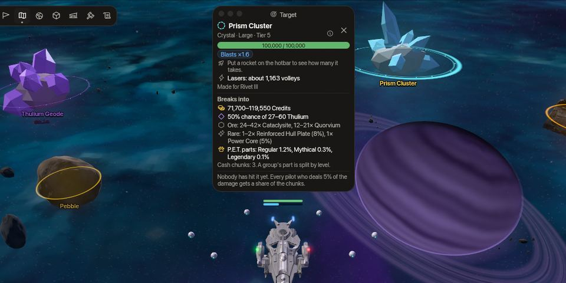

<!-- wiki-i18n source: de09111940e08811 -->
<!-- wiki-i18n title: Добыча на астероидах -->
# Добыча на астероидах {#asteroid-mining}

**Астероиды** — это огромные камни, которые лежат в плоскости полёта корпоративных секторов и Опасных секторов. Они никогда не двигаются и никогда не стреляют. Разбейте астероид **ракетами** или **лазерами**, и он рассыплется на мелкие **обломки** с кредитами, Thulium и рудой; их подбирают так же, как [груз](/wiki/03-Mechanics/Cargo.md). Для этой работы нужны ракеты: лазеры тоже повреждают астероид, но лишь на 5% от того, что они наносят кораблю, а дроны ему ничего не делают. Ещё одна вещь разбивает астероиды за вас: пристыкованный P.E.T. **Mole** ([ниже](#the-mole-pet)).

Добыча — не то же самое, что охота, и не замена ей: она не даёт ни опыта, ни чести, ни очков рейтинга, а выпущенные ракеты стоят кредитов или Thulium. Взамен вы получаете кредиты и Thulium, руду для [Кузницы](/wiki/06-Items/Forge.md) и для крафта без боя и работу, которую может разделить [группа](/wiki/03-Mechanics/Groups.md). Платит она хорошо: по собственной модели игры час добычи на подходящих астероидах подходящей ракетой приносит примерно в 2,6–6,8 раза больше, чем лучший охотничий час вашего уровня, когда ракеты уже оплачены. Дневные пределы ([Миры](#the-worlds)) ограничивают её, и достигаются они быстро: в Alpha пилот, который добывает без перерывов на хорошем секторе, достигает предела по Thulium менее чем за 2 часа, а предела по кредитам — примерно за 2,7 часа.

## Что такое астероид {#what-an-asteroid-is}

- **На уровне кораблей.** Астероид лежит в плоскости полёта, позади каждого корабля, ракеты и обломка, пролетающих над ним, и остаётся на месте. Он твёрдый: ваш корабль не может в него влететь, выстрелы сквозь него не проходят, а пришельцы облетают его (см. следующий пункт и [Укрытие](#cover)). Каждый астероид рисуется в своих настоящих пропорциях, поэтому Motherlode и Prism Cluster высятся, а не лежат плоскими. Тусклые камни далеко позади карты — декорации: попасть в них нельзя, и внутри у них ничего нет.
- **Твёрдый.** Астероиды твёрдые: разбейте их или облетите. Ваш корабль не может влететь ни в один. Если приказать ему лететь в точку за астероидом, он облетит его со своей скоростью, с той стороны, где лежит ваш приказ; если в точку внутри астероида — он полетит туда и остановится у края, с вашей стороны. Середина корабля останавливается на расстоянии радиуса корабля и ещё 4 единиц от края астероида, поэтому корпус, каким он нарисован, астероида никогда не касается, а в промежуток между двумя астероидами пролетит только тот корабль, который в него помещается. Корабль, на который поставили астероид, вылетает из него кратчайшим путём и не получает за это урона. Контейнеры и обломки — не корабли: они покачиваются на месте.
- **Вид и семейство.** Каждый астероид относится к одному из видов из раздела [Виды](#the-kinds), а каждый вид — к семейству, которое говорит, каков он. По свечению астероида видно, что у него внутри. **Одинарное кольцо** на земле отмечает обычный астероид, **двойное** — бронированный, а **пунктирное** — хрупкий.
- **На миникарте.** Каждый астероид сектора — маленький шестиугольник цвета своего вида: пустой, пока по нему не попали, и закрашенный после; обломки — маленькие круглые точки.
- **Окно цели.** Нажмите на астероид, чтобы выбрать его. Круг на выбранном астероиде остаётся на нём, пока вы летаете вокруг: щелчок по пустому месту или рядом с астероидом лишь отправляет туда ваш корабль, а Esc или крестик в окне цели отпускает астероид. В окне видны его название, семейство и размер, корпус, значки **Броня** и **Взрывы**, примерно сколько ракет того вида, что у вас в руке, ему нужно и примерно сколько залпов ваших лазеров, что он оставит в вашем мире и кто нанёс какую часть урона. Выбор астероида не меняет цель вашего корабля или пришельца, так что лазеры сохраняют захват.

## Как разбить астероид {#breaking-one}

1. **Прицельтесь.** Нажмите на астероид, чтобы выбрать его: самонаводящаяся ракета (Lancet, Ember) полетит к нему. Если астероид не выбран, самонаводящаяся ракета летит к астероиду под курсором, только если у вас не выбран ни корабль, ни пришелец, так что охотник, который сражается рядом с астероидом, продолжает стрелять по пришельцу (считается и место чуть за краем астероида, и его шестиугольник на миникарте). Прямая ракета (Rivet, Scatter) игнорирует выбранный астероид: она летит к курсору, как к любой цели, а если курсор на астероиде (на его изображении или на его кольце на земле, без запаса), — к центру астероида. Ракета, у которой нет астероида, к которому лететь, — обычная ракета, но астероид на её пути всё равно её остановит ([Укрытие](#cover)).
2. **Стреляйте.** Подойдёт любая из двенадцати [ракет](/wiki/06-Items/Rockets.md#the-twelve-rockets) магазина, а также N.U.K.E. Самонаводящейся ракете нужен астероид в пределах её дальности захвата, которая меряется до центра астероида; она летит к центру. Прямой ракете проверять дальность до астероида не нужно: она летит к точке под курсором и, как к любой цели, не долетает, если эта точка дальше её полёта. Если курсор на астероиде, она летит к центру, так что неважно, в какой точке астероида курсор; если курсор рядом с астероидом, она летит туда и разбивает астероид, только если тот стоит у неё на пути. [N.I.K.E.](/wiki/06-Items/Rockets.md#the-craft-only-rockets) не может повредить астероид.
3. **Продолжайте стрелять.** Все ракеты делят один таймер перезарядки, и каждая ракета стоит столько, сколько стоит: ракета — цена работы.

- **Самонаводящаяся ракета, нацеленная на астероид, летит к нему.** Она пролетает мимо всех кораблей на пути, а первый другой астероид на её пути принимает её на себя ([Укрытие](#cover)). Прямая ракета — обычная ракета: корабль на её линии получает удар первым, а астероид на её линии её останавливает. Взрыв ракеты по площади по-прежнему ранит любой корабль в радиусе, как везде; остальные астероиды в нём ничего не получают.
- **Лазеры бьют слабо, дроны не делают ничего.** Выберите астероид и дважды щёлкните по нему, нажмите клавишу атаки или слот боеприпасов: ваши лазеры стреляют по нему раз в секунду, пока его центр в радиусе действия лазеров, и тратят боеприпасы, как при стрельбе по кораблю. Двойной щелчок всегда стреляет по астероиду; клавиша атаки и слоты боеприпасов — когда не выбраны ни корабль, ни пришелец. Боеприпасы Siphon только высасывают щиты, поэтому повредить астероид они не могут, и такой приказ отклоняется.
- **Ваш корабль поворачивается к нему.** Пока ваши лазеры стреляют по астероиду в пределах их дальности, корабль поворачивается к нему, в какую бы сторону ни летел, как к пришельцу, которого вы атакуете.
- **Урон.** Ракета снимает с корпуса астероида собственный бросок, а ракетный бонус вашего [построения дронов](/wiki/03-Mechanics/Formations.md) учитывается так же, как против корабля (и +55% у Ballista тоже); ваши лазеры, усилители, бустеры и боеприпасы бросок ракеты не меняют. Залп лазеров снимает 5% того, что он нанёс бы кораблю без щита, с учётом ваших усилителей, бустеров, боеприпасов, критических попаданий и построения. Сначала идёт бонус: **бронированный** астероид снимает очки брони с каждого попадания уже после него, а взрыв по площади сильнее бьёт **хрупкий** кристаллический астероид (числа — в разделах «Правила» и «Виды»). У астероида нет щита, и он никогда не восстанавливается: камень, который вы подбили, остаётся подбитым, пока кто-нибудь его не разобьёт.
- **Сколько.** Каждый вид рассчитан на одну ракету, а в разделе «Виды» сказано, примерно сколько таких ракет нужно, чтобы его разбить; окно цели и карточка при наведении показывают это для ракеты в вашей руке и, рядом, примерно сколько залпов лазеров нужно. Более сильный мир — это больший корпус («Миры»). Ваша ракета, которая в полёте, когда кто-то другой разбивает астероид, летит дальше как обычная ракета и пропадает.

## Укрытие {#cover}

Астероид — это укрытие. **Первый астероид на пути выстрела принимает выстрел на себя.** Залп лазеров, ракета или взрыв ракеты по площади, выпущенные по пилоту, пришельцу или другому астероиду, останавливает первый астероид на прямой линии от стрелка до цели: цель ничего не получает, а удар принимает астероид. Так что за астероидом можно спрятаться — и от пилотов, и от пришельцев. Захват — не выстрел, и его ничто не останавливает: можно захватить пилота за астероидом, но ваши лазеры попадут в астероид. [Energetic Wall](/wiki/06-Items/Extras.md#energetic-wall) останавливает выстрелы так же, с любой стороны.

- **Изнутри.** Корабли не влетают в астероиды: это относится только к кораблю, на который поставили астероид, пока он вылетает. Его середина находится внутри астероида, и он попадает в этот астероид каждым выстрелом, куда бы ни целился.
- **Что останавливается.** Каждый залп лазеров и каждая ракета пилота, пришельца (кораблей роя, Clan Warden, Slumbering Void) и пилота корпорации, включая N.U.K.E. Над астероидами пролетают две вещи: [N.I.K.E.](/wiki/06-Items/Rockets.md#the-craft-only-rockets) и орудия Dormant Swamp. Способности вроде Venom и чёрная дыра — не выстрелы.
- **Что получает астероид.** Ракета снимает столько, сколько снимает ракета; залп лазеров — столько, сколько лазеры снимают с астероида: 5% того, что он нанёс бы кораблю, за вычетом брони астероида. Это считается уроном астероиду, как любой другой, поэтому пилот, чьи выстрелы разбивают астероид, получает плату за них ([Кому достаются обломки](#who-gets-the-chunks)). Пришелец никогда не стреляет по астероиду, а ракета пришельца, которую остановил астероид, ничего с него не снимает: платить некому. Единственное исключение — Inert Mass из [Dormant Swamp](/wiki/03-Mechanics/Dormant-Swamp.md): её Dormant Lance повреждает астероид, в который попадает, своим уроном, и за это никому не платят.
- **Линия.** Астероид — это круг, который ровно охватывает его таким, каким он нарисован, а ракета касается его за несколько единиц до края, как касается корабля. Цель за астероидом или с серединой внутри него прикрыта; цель точно на его краю — нет. Астероид сбоку от линии, за целью или за стрелком не мешает.
- **Расход как обычно.** Выстрел, остановленный астероидом, стоит своих боеприпасов, своей ракеты и своего таймера, как любой выстрел.
- **Пришельцы облетают.** Пришелец никогда не влетает в астероид: он облетает его, что бы он ни делал, а пришелец, на которого поставили астероид, вылетает из него. Если вы прячетесь за астероидом, преследующий вас пришелец не стоит и не стреляет по астероиду: он облетает его до места, откуда его линия до вас свободна, и стреляет оттуда. Держите астероид между собой и ним, и он продолжит кружить. Пилот компании делает то же самое. Ваш собственный корабль облетает астероид так же, как пришелец (см. выше).

## Что остаётся после разрушения {#what-a-break-leaves}

В момент разрушения астероида ничего не выплачивается. Он рассыпается в крошку и разбрасывает несколько **обломков**: мелкие золотые самородки — для кредитов, лавандовые кристаллы — для Thulium и грубый камень — для руды. Они выплывают из обломков и покачиваются, как любой [контейнер](/wiki/03-Mechanics/Cargo.md): нажмите на один, ваш корабль подлетит к нему, и подбор займёт свой короткий канал, как у любого контейнера ([подбор](/wiki/03-Mechanics/Cargo.md#collecting)). Руда попадает в инвентарь ангара, кредиты и Thulium — на счёт, а уведомление сообщает, что вы получили.

Астероид побольше оставляет больше частей (столбец «Денежные части» в разделе «Виды»: кредиты и Thulium приходят столькими частями, а руда — ещё одной). После подбора ваш корабль сам переходит к следующей части ближнего астероида, которую вы можете взять; любой ваш приказ двигаться останавливает это.

Начиная со ступени 2 камней, при разрушении может остаться целый **Cluster Chunk** — в куске руды группы, нанёсшей больше всего урона: **Regular Cluster Chunk** со ступени 2, **Mythical Cluster Chunk** со ступени 3 и **Legendary Cluster Chunk** со ступени 4; чаще всего их даёт Motherlode. Шансы указаны на странице [Ресурсы](/wiki/06-Items/Resources.md#regular-cluster-chunk). Удача их не меняет, в том числе удача P.E.T. С Orvium Reinforced Plate чанк в Колыбели ангара превращается в [P.E.T.](/wiki/03-Mechanics/Pets.md).

## Кому достаются обломки {#who-gets-the-chunks}

Астероид — общая работа: бить его ракетами, лазерами или импульсами Mole может любое число пилотов, а обломки делятся по нанесённому урону, а не по тому, кто выстрелил первым или последним. Строка урона в окне цели показывает, кто сколько нанёс и сколько было нанесено до вашего прихода. Кредиты и Thulium за разрушение разыгрываются один раз и делятся по урону; руду делят пилоты, нанёсшие больше всего урона; редкие находки достаются тому, кто нанёс больше всех. Пилот, нанёсший меньше доли из раздела «Правила», ничего не получает, и журнал игры сообщает об этом. Обломки раскладываются для каждого оплачиваемого пилота и какое-то время закреплены за ним и его кланом, а потом открыты для всех.

## P.E.T. Mole {#the-mole-pet}

Пристыкованный **Mole** (один из типов [P.E.T.](/wiki/03-Mechanics/Pets.md#the-mole)) работает на вас, пока вы летите: каждые 3 секунды он наносит импульс ближайшему астероиду в радиусе около пяти с половиной длин корабля от вашего корабля, пока тот не разобьётся, потом берёт следующий. Его импульсы записываются в урон астероиду на ваше имя, поэтому разрушение платит вам так же, как если бы вы разбили его ракетой: обломки, находки, шанс Cluster Chunk и ваша миссия про астероиды.

- **Сколько он разбивает.** Mole на вершине (Legendary 20-го уровня) разбивает не меньше астероидов в час, чем пилот, стреляющий по ним лучшей ракетой, Rivet III, а более низкие ранги и уровни — меньше ([таблица](/wiki/03-Mechanics/Pets.md#how-strong)). Он не тратит ни боеприпасов, ни ракет. Ваши лазеры, ракеты, усилители, бустеры, построение и Урон ваших P.E.T. не меняют импульс, а броня замедляет импульс так же, как ракету.
- **Какие астероиды.** Ближайший в радиусе, которого никто, кроме вас и вашей группы, не задел и который не закрывает другой астероид или Energetic Wall. Он никогда не работает с Motherlode и не работает в безопасной зоне, под маскировкой, пока вы прыгаете и пока ваш корабль уничтожен.
- **Своего предела нет.** Mole работает каждый час, пока вы летите, касаетесь вы клавиш или нет (бездействующий корабль — мишень), и никакой суточный предел его не останавливает. Остаётся то, что останавливает всех: пределы Thulium и кредитов в [Мирах](#the-worlds), которых Mole на вершине, никогда не останавливающийся, достигает примерно за 2–6 часов работы. После этого его обломки платят только то, что осталось под пределами.
- **Работает только один.** Из Mole в вашей Station работает лишь самый сильный; остальные только дают бонусы.

## Правила {#the-rules}

<!-- asteroids-rules:begin -->
<!-- Generated from server/Resources/Asteroids.json (and Rockets.json, Pets.json) by scripts/asteroids-wiki.sh: don't edit by hand. -->

- Пилот, нанёсший астероиду не меньше 5% урона, получает долю его обломков пропорционально нанесённому урону. Если никто не набрал 5%, всё получает пилот, нанёсший больше всех.
- [Группа](/wiki/03-Mechanics/Groups.md#sharing-kills) считается одним пилотом, а её доля делится по уровню между товарищами по группе, которые рядом и стреляют.
- Обломки разрушения закреплены на 30 с за пилотом, для которого их разложили, и за его кланом. После этого их может взять любой на карте. Обломок, который никто не взял, исчезает через 3 мин.
- Предел обломков на одной карте — 36; он входит в общий предел контейнеров карты, 64: обломки никогда не вытесняют контейнеры пришельцев, а те никогда не вытесняют обломок. Когда на карте нет места для обломка, пилоту, для которого он предназначался, платят сразу.
- Кредиты и Thulium выплачиваются, когда обломок подобран, а не когда астероид разбит. За любой период в 24 ч пилоту выплачивают не больше предела из раздела [Миры](#the-worlds): обломок сверх предела расходуется и платит только то, что осталось под пределом, и журнал игры сообщает об этом.
- Награда у всех одинакова: ни бонус Premium, ни бонус магазина сезона, ни бонус клана, ни Loot Luck, ни бустер не меняют кредиты, Thulium и находки. [Resource Magnet Booster](/wiki/06-Items/Boosters.md) при подборе увеличивает ресурсы рудного обломка, как у любого контейнера.
- Броня снимает свои очки с каждого попадания, но не меньше 20% попадания проходит всегда.
- Взрыв по площади наносит хрупкому астероиду больше урона, чем любому другому (×1,6).
- Астероид никогда не стоит ближе 1 500 единиц к краю безопасного кольца, ближе 5 000 единиц к центру чёрной дыры и ближе 600 единиц к краю карты и никогда не появляется ближе 1 200 единиц к пилоту.
- После разрушения астероид того же вида вырастает снова в другом месте карты через время из строки сектора, плюс-минус 25%.
- Motherlode возвращается через 1 ч в любом секторе.

<!-- asteroids-rules:end -->

## Миры {#the-worlds}

В каждом мире, Alpha, Beta и Gamma, свои астероиды на тех же местах ([Миры](/wiki/03-Mechanics/Wipe-Timeline.md#worlds-alpha-beta-and-gamma)), так что астероид, который вы разбили в своём мире, в другом не разбит. Больший мир — это больший корпус и большая награда.

<!-- asteroids-worlds:begin -->
<!-- Generated from server/Resources/Asteroids.json (and Rockets.json, Pets.json) by scripts/asteroids-wiki.sh: don't edit by hand. -->

| Мир | Корпус | Награда | Предел Thulium | Предел кредитов |
| :--- | ---: | ---: | ---: | ---: |
| **Alpha** | ×1 | ×1 | 3 000 | 13 000 000 |
| **Beta** | ×1,5 | ×2 | 4 500 | 18 000 000 |
| **Gamma** | ×2 | ×3 | 6 000 | 21 000 000 |

В таблицах ниже — числа астероида Alpha. **Корпус** — множитель мира для корпуса каждого астероида, **Награда** — его множитель для кредитов и Thulium за разрушение; руда и редкие находки одинаковы во всех мирах. Два предела — это максимум, который пилот получает за обломки за любой период в 24 ч.

<!-- asteroids-worlds:end -->

## Где они {#where-they-are}

Во всех домашних секторах трёх корпораций и во всех Опасных секторах есть астероиды, и набор у каждого сектора свой: в основном виды его кольца, с одним-двумя гостями из соседнего кольца сверху или снизу. В нейтральных секторах, куда не ведёт ни один портал, их нет. Астероиды Опасных секторов появляются с дня сезона из таблицы — дня, когда открывается PvP ([Первый контакт](/wiki/03-Mechanics/Wipe-Timeline.md)), остальные — с первого дня. После разрушения новый астероид того же вида вырастает снова через время из строки сектора. Рядом с пульсаром, который сияет с первого дня сезона, астероидов нет; с 11-го дня их нет и рядом с гигантским экскаватором и серединой Dormant Swamp ([Опасные секторы](/wiki/01-General/Danger-Sectors.md#where-everything-is)), а скала, стоявшая там к началу события 2, исчезает.

<!-- asteroids-maps:begin -->
<!-- Generated from server/Resources/Asteroids.json (and Rockets.json, Pets.json) by scripts/asteroids-wiki.sh: don't edit by hand. -->

| Сектор | Астероиды | С дня | Возвращается | Виды |
| :--- | ---: | ---: | ---: | :--- |
| `M-1` | 12 | 1 | 2 мин | 3 × Pebble, 3 × Cobble, 2 × Glimmer, 2 × Cache Pod, 2 × Ironhide |
| `T-1` | 12 | 1 | 2 мин | 3 × Rime, 3 × Cache Pod, 2 × Cobble, 2 × Pebble, 2 × Dark Chondrite |
| `G-1` | 12 | 1 | 2 мин | 4 × Glimmer, 2 × Pebble, 2 × Rime, 2 × Cobble, 2 × Nyx Geode |
| `M-2` | 14 | 1 | 3 мин | 4 × Ironhide, 3 × Dark Chondrite, 3 × Scrap Hulk, 2 × Vein Rock, 1 × Cobble, 1 × Pebble |
| `T-2` | 14 | 1 | 3 мин | 4 × Scrap Hulk, 3 × Dark Chondrite, 3 × Vein Rock, 2 × Nyx Geode, 2 × Rime |
| `G-2` | 14 | 1 | 3 мин | 4 × Nyx Geode, 3 × Vein Rock, 3 × Dark Chondrite, 2 × Ironhide, 2 × Glimmer |
| `M-3` | 16 | 1 | 5 мин | 3 × Plateback, 3 × Slag Block, 3 × Lode Rock, 3 × Cataclast, 2 × Derelict Hulk, 2 × Cataclysite Mass |
| `T-3` | 16 | 1 | 5 мин | 3 × Derelict Hulk, 3 × Slag Block, 3 × Cataclast, 3 × Lode Rock, 2 × Thulium Geode, 2 × Derelict Cruiser |
| `G-3` | 16 | 1 | 5 мин | 4 × Cataclast, 3 × Slag Block, 3 × Thulium Geode, 2 × Plateback, 2 × Lode Rock, 2 × Quorvium Boulder |
| `M-4` | 18 | 1 | 5 мин | 4 × Anvil, 4 × Cataclysite Mass, 4 × Quorvium Boulder, 2 × Derelict Cruiser, 2 × Vault Rock, 2 × Plateback |
| `T-4` | 18 | 1 | 5 мин | 4 × Derelict Cruiser, 4 × Quorvium Boulder, 4 × Cataclysite Mass, 2 × Thulium Cluster, 2 × Vault Rock, 2 × Thulium Geode |
| `G-4` | 18 | 1 | 5 мин | 5 × Quorvium Boulder, 3 × Cataclysite Mass, 3 × Anvil, 3 × Lode Rock, 2 × Thulium Cluster, 2 × Vault Rock |
| `DS-1` | 24 | 4 | 5 мин | 8 × Rich Lode, 6 × Prism Cluster, 4 × Ancient Husk, 3 × Star Crystal, 2 × Vault Rock, 1 × Motherlode |
| `DS-2` | 24 | 4 | 5 мин | 7 × Rich Lode, 7 × Ancient Husk, 3 × Star Crystal, 3 × Anvil, 3 × Derelict Cruiser, 1 × Motherlode |
| `DS-3` | 24 | 4 | 5 мин | 9 × Prism Cluster, 5 × Rich Lode, 4 × Star Crystal, 3 × Quorvium Boulder, 2 × Cataclysite Mass, 1 × Motherlode |
| `DS-4` | 24 | 4 | 5 мин | 9 × Rich Lode, 5 × Prism Cluster, 4 × Ancient Husk, 3 × Cataclysite Mass, 2 × Derelict Cruiser, 1 × Motherlode |

<!-- asteroids-maps:end -->

## Виды {#the-kinds}

<!-- asteroids-kinds:begin -->
<!-- Generated from server/Resources/Asteroids.json (and Rockets.json, Pets.json) by scripts/asteroids-wiki.sh: don't edit by hand. -->

### Ступени и части P.E.T. {#tiers-and-pet-parts}

**Ступень** астероида — это кольцо секторов, к которому относится его вид: ступени от 1 до 4 — это секторы от x-1 до x-4 трёх корпораций, ступень 5 — Опасные секторы. Ступень растёт с размером: чем крупнее астероид, тем выше его ступень. Но это не одно и то же: в большинстве ступеней есть два размера, их показывает таблица. Окно цели и карточка при наведении показывают семейство, размер и ступень астероида.

Ступень решает и ещё одну находку: **часть P.E.T.** — Cluster Chunk, который принимает Колыбель [P.E.T.](/wiki/03-Mechanics/Pets.md). Таблица показывает шанс того, что разбитый астероид оставит каждый ранг (прочерк — никогда). Астероиды ступени 1 не оставляют ничего. Каждый ранг разыгрывается один раз за каждый разбитый астероид, пилот, нанёсший больше всего урона, получает чанк целиком, а Удача шансы не меняет. У Motherlode шансы свои. Выберите астероид, и окно цели перечислит части P.E.T. его вида.

| Ступень | Секторы | Размер | Виды | [Regular Cluster Chunk](/wiki/06-Items/Resources.md#regular-cluster-chunk) | [Mythical Cluster Chunk](/wiki/06-Items/Resources.md#mythical-cluster-chunk) | [Legendary Cluster Chunk](/wiki/06-Items/Resources.md#legendary-cluster-chunk) |
| :--- | :--- | :--- | :--- | ---: | ---: | ---: |
| 1 | `x-1` | Крошечный, Малый | Pebble, Cobble, Glimmer, Rime, Cache Pod | – | – | – |
| 2 | `x-2` | Малый, Средний | Dark Chondrite, Ironhide, Vein Rock, Nyx Geode, Scrap Hulk | 0,4% | – | – |
| 3 | `x-3` | Средний | Slag Block, Plateback, Cataclast, Lode Rock, Derelict Hulk, Thulium Geode | 0,8% | 0,15% | – |
| 4 | `x-4` | Средний, Большой | Quorvium Boulder, Cataclysite Mass, Anvil, Derelict Cruiser, Thulium Cluster, Vault Rock | 1% | 0,25% | 0,03% |
| 5 | Опасные секторы | Большой | Rich Lode, Prism Cluster, Ancient Husk, Star Crystal | 1,2% | 0,3% | 0,1% |
| 5 | Опасные секторы | Огромный | Motherlode | 25% | 8% | 3% |

Всего 27 видов астероидов в 8 семействах. **Рассчитан на** называет ракету, под которую сбалансирован вид, и примерно сколько таких ракет нужно, чтобы разбить его в Alpha. **Находки** — руда и редкие находки, которые разыгрываются при разрушении и которые делят между собой его обломки: процент — шанс этой строки, остальные строки находят всегда. Кредиты и Thulium — суммы Alpha за разрушение.

### Камень {#stone}

Обычный камень: ни брони, ни слабого места.

| Вид | Корпус | Размер | Ступень | Особенность | Денежные части | Рассчитан на | Кредиты | Thulium | Находки | Где встречается |
| :--- | ---: | :--- | ---: | :--- | ---: | :--- | ---: | ---: | :--- | :--- |
| **Pebble** | 8 500 | Крошечный | 1 | – | 1 | Примерно 4× [Rivet I](/wiki/06-Items/Rockets.md#the-twelve-rockets) | 6 600–11 100 | 22%: 3 | [Daraxium](/wiki/06-Items/Resources.md#daraxium) 3 (49%) | `M-1`, `T-1`, `G-1`, `M-2` |
| **Cobble** | 10 000 | Малый | 1 | – | 1 | Примерно 5× [Rivet I](/wiki/06-Items/Rockets.md#the-twelve-rockets) | 6 300–10 500 | 25%: 3 | [Daraxium](/wiki/06-Items/Resources.md#daraxium) 3–9 (89%) | `M-1`, `T-1`, `G-1`, `M-2` |
| **Dark Chondrite** | 12 000 | Малый | 2 | – | 1 | Примерно 3× [Rivet II](/wiki/06-Items/Rockets.md#the-twelve-rockets) | 7 050–11 850 | 65%: 3 | [Daraxium](/wiki/06-Items/Resources.md#daraxium) 3–12 (91%), [Nyxite](/wiki/06-Items/Resources.md#nyxite) 3 (93%); [Reinforced Hull Plate](/wiki/06-Items/Resources.md#reinforced-hull-plate) 1 (2%) | `T-1`, `M-2`, `T-2`, `G-2` |
| **Vein Rock** | 18 000 | Малый | 2 | – | 1 | Примерно 4× [Rivet II](/wiki/06-Items/Rockets.md#the-twelve-rockets) | 13 350–22 200 | 50%: 3–9 | [Daraxium](/wiki/06-Items/Resources.md#daraxium) 3–6 (73%), [Nyxite](/wiki/06-Items/Resources.md#nyxite) 3 (45%); [Reinforced Hull Plate](/wiki/06-Items/Resources.md#reinforced-hull-plate) 1 (2%) | `M-2`, `T-2`, `G-2` |
| **Slag Block** | 24 000 | Средний | 3 | – | 2 | Примерно 5× [Rivet II](/wiki/06-Items/Rockets.md#the-twelve-rockets) | 18 600–31 050 | 50%: 3–9 | [Nyxite](/wiki/06-Items/Resources.md#nyxite) 3 (95%), [Cataclysite](/wiki/06-Items/Resources.md#cataclysite) 3–6 (84%); [Reinforced Hull Plate](/wiki/06-Items/Resources.md#reinforced-hull-plate) 1 (4%), [Power Core](/wiki/06-Items/Resources.md#power-core) 1 (1,5%) | `M-3`, `T-3`, `G-3` |
| **Cataclast** | 36 000 | Средний | 3 | – | 2 | Примерно 8× [Rivet II](/wiki/06-Items/Rockets.md#the-twelve-rockets) | 22 350–37 200 | 50%: 6–15 | [Nyxite](/wiki/06-Items/Resources.md#nyxite) 9–18, [Cataclysite](/wiki/06-Items/Resources.md#cataclysite) 12–24; [Reinforced Hull Plate](/wiki/06-Items/Resources.md#reinforced-hull-plate) 1 (4%), [Power Core](/wiki/06-Items/Resources.md#power-core) 1 (1,5%) | `M-3`, `T-3`, `G-3` |
| **Lode Rock** | 52 000 | Средний | 3 | – | 2 | Примерно 11× [Rivet II](/wiki/06-Items/Rockets.md#the-twelve-rockets) | 34 950–58 200 | 50%: 18–39 | [Nyxite](/wiki/06-Items/Resources.md#nyxite) 9–18, [Cataclysite](/wiki/06-Items/Resources.md#cataclysite) 12–24; [Reinforced Hull Plate](/wiki/06-Items/Resources.md#reinforced-hull-plate) 1 (4%), [Power Core](/wiki/06-Items/Resources.md#power-core) 1 (1,5%) | `M-3`, `T-3`, `G-3`, `G-4` |
| **Cataclysite Mass** | 72 000 | Большой | 4 | – | 2 | Примерно 10× [Rivet III](/wiki/06-Items/Rockets.md#the-twelve-rockets) | 44 700–74 550 | 50%: 21–45 | [Cataclysite](/wiki/06-Items/Resources.md#cataclysite) 15–30, [Quorvium](/wiki/06-Items/Resources.md#quorvium) 9–15; [Reinforced Hull Plate](/wiki/06-Items/Resources.md#reinforced-hull-plate) 1–2 (6%), [Power Core](/wiki/06-Items/Resources.md#power-core) 1 (3%) | `M-3`, `M-4`, `T-4`, `G-4`, `DS-3`, `DS-4` |
| **Rich Lode** | 80 000 | Большой | 5 | – | 3 | Примерно 11× [Rivet III](/wiki/06-Items/Rockets.md#the-twelve-rockets) | 61 800–103 050 | 50%: 39–90 | [Cataclysite](/wiki/06-Items/Resources.md#cataclysite) 12–24, [Quorvium](/wiki/06-Items/Resources.md#quorvium) 6–12; [Reinforced Hull Plate](/wiki/06-Items/Resources.md#reinforced-hull-plate) 1–2 (8%), [Power Core](/wiki/06-Items/Resources.md#power-core) 1 (5%) | `DS-1`, `DS-2`, `DS-3`, `DS-4` |

### Лёд {#ice}

Замёрзший камень: ни брони, ни слабого места.

| Вид | Корпус | Размер | Ступень | Особенность | Денежные части | Рассчитан на | Кредиты | Thulium | Находки | Где встречается |
| :--- | ---: | :--- | ---: | :--- | ---: | :--- | ---: | ---: | :--- | :--- |
| **Rime** | 12 000 | Малый | 1 | – | 1 | Примерно 5× [Rivet I](/wiki/06-Items/Rockets.md#the-twelve-rockets) | 8 250–13 800 | 55%: 3 | [Daraxium](/wiki/06-Items/Resources.md#daraxium) 3–9 (77%) | `T-1`, `G-1`, `T-2` |

### Кристалл {#crystal}

Хрупкий: взрыв по площади наносит кристаллическому астероиду больше урона, чем прямое попадание.

| Вид | Корпус | Размер | Ступень | Особенность | Денежные части | Рассчитан на | Кредиты | Thulium | Находки | Где встречается |
| :--- | ---: | :--- | ---: | :--- | ---: | :--- | ---: | ---: | :--- | :--- |
| **Glimmer** | 9 000 | Крошечный | 1 | Взрывы ×1,6 | 1 | Примерно 4× [Rivet I](/wiki/06-Items/Rockets.md#the-twelve-rockets) | 6 150–10 350 | 41%: 3 | [Daraxium](/wiki/06-Items/Resources.md#daraxium) 3–6 (77%) | `M-1`, `G-1`, `G-2` |
| **Nyx Geode** | 26 000 | Средний | 2 | Взрывы ×1,6 | 2 | Примерно 6× [Rivet II](/wiki/06-Items/Rockets.md#the-twelve-rockets) | 16 650–27 750 | 50%: 9–21 | [Daraxium](/wiki/06-Items/Resources.md#daraxium) 6–15, [Nyxite](/wiki/06-Items/Resources.md#nyxite) 3–6 (96%); [Reinforced Hull Plate](/wiki/06-Items/Resources.md#reinforced-hull-plate) 1 (2%) | `G-1`, `T-2`, `G-2` |
| **Quorvium Boulder** | 48 000 | Средний | 4 | Взрывы ×1,6 | 2 | Примерно 7× [Rivet III](/wiki/06-Items/Rockets.md#the-twelve-rockets) | 29 850–49 650 | 50%: 12–30 | [Cataclysite](/wiki/06-Items/Resources.md#cataclysite) 12–21, [Quorvium](/wiki/06-Items/Resources.md#quorvium) 3–15 (86%); [Reinforced Hull Plate](/wiki/06-Items/Resources.md#reinforced-hull-plate) 1–2 (6%), [Power Core](/wiki/06-Items/Resources.md#power-core) 1 (3%) | `G-3`, `M-4`, `T-4`, `G-4`, `DS-3` |
| **Prism Cluster** | 100 000 | Большой | 5 | Взрывы ×1,6 | 3 | Примерно 14× [Rivet III](/wiki/06-Items/Rockets.md#the-twelve-rockets) | 71 700–119 550 | 50%: 27–60 | [Cataclysite](/wiki/06-Items/Resources.md#cataclysite) 24–42, [Quorvium](/wiki/06-Items/Resources.md#quorvium) 12–21; [Reinforced Hull Plate](/wiki/06-Items/Resources.md#reinforced-hull-plate) 1–2 (8%), [Power Core](/wiki/06-Items/Resources.md#power-core) 1 (5%) | `DS-1`, `DS-3`, `DS-4` |

### Обломки {#salvage}

Обломки кораблей и капсулы: в них есть Ship Fragment.

| Вид | Корпус | Размер | Ступень | Особенность | Денежные части | Рассчитан на | Кредиты | Thulium | Находки | Где встречается |
| :--- | ---: | :--- | ---: | :--- | ---: | :--- | ---: | ---: | :--- | :--- |
| **Cache Pod** | 14 000 | Крошечный | 1 | – | 1 | Примерно 6× [Rivet I](/wiki/06-Items/Rockets.md#the-twelve-rockets) | 9 000–15 000 | 29%: 3 | [Daraxium](/wiki/06-Items/Resources.md#daraxium) 3–6 (83%), [Ship Fragment](/wiki/06-Items/Resources.md#ship-fragment) 3–9 (78%) | `M-1`, `T-1` |
| **Scrap Hulk** | 20 000 | Малый | 2 | – | 1 | Примерно 5× [Rivet II](/wiki/06-Items/Rockets.md#the-twelve-rockets) | 12 150–20 250 | 92%: 3 | [Daraxium](/wiki/06-Items/Resources.md#daraxium) 3–9 (95%), [Nyxite](/wiki/06-Items/Resources.md#nyxite) 3 (77%), [Ship Fragment](/wiki/06-Items/Resources.md#ship-fragment) 6–12; [Reinforced Hull Plate](/wiki/06-Items/Resources.md#reinforced-hull-plate) 1 (2%) | `M-2`, `T-2` |
| **Derelict Hulk** | 52 000 | Средний | 3 | – | 2 | Примерно 11× [Rivet II](/wiki/06-Items/Rockets.md#the-twelve-rockets) | 33 150–55 200 | 50%: 9–18 | [Nyxite](/wiki/06-Items/Resources.md#nyxite) 6–12, [Cataclysite](/wiki/06-Items/Resources.md#cataclysite) 9–18, [Ship Fragment](/wiki/06-Items/Resources.md#ship-fragment) 30–54; [Reinforced Hull Plate](/wiki/06-Items/Resources.md#reinforced-hull-plate) 1 (4%), [Power Core](/wiki/06-Items/Resources.md#power-core) 1 (1,5%) | `M-3`, `T-3` |
| **Derelict Cruiser** | 72 000 | Большой | 4 | – | 2 | Примерно 10× [Rivet III](/wiki/06-Items/Rockets.md#the-twelve-rockets) | 46 200–76 950 | 50%: 18–39 | [Cataclysite](/wiki/06-Items/Resources.md#cataclysite) 9–15, [Quorvium](/wiki/06-Items/Resources.md#quorvium) 3–9 (97%), [Ship Fragment](/wiki/06-Items/Resources.md#ship-fragment) 21–36; [Reinforced Hull Plate](/wiki/06-Items/Resources.md#reinforced-hull-plate) 1–2 (6%), [Power Core](/wiki/06-Items/Resources.md#power-core) 1 (3%) | `T-3`, `M-4`, `T-4`, `DS-2`, `DS-4` |

### Железо {#iron}

Бронированный: каждое попадание теряет очки на броню, поэтому нужны ракеты сильнее, чем подсказывает корпус.

| Вид | Корпус | Размер | Ступень | Особенность | Денежные части | Рассчитан на | Кредиты | Thulium | Находки | Где встречается |
| :--- | ---: | :--- | ---: | :--- | ---: | :--- | ---: | ---: | :--- | :--- |
| **Ironhide** | 14 000 | Малый | 2 | Броня 500 | 1 | Примерно 4× [Rivet II](/wiki/06-Items/Rockets.md#the-twelve-rockets) | 13 650–22 650 | 50%: 3–9 | [Daraxium](/wiki/06-Items/Resources.md#daraxium) 3–6 (74%), [Nyxite](/wiki/06-Items/Resources.md#nyxite) 3 (46%); [Reinforced Hull Plate](/wiki/06-Items/Resources.md#reinforced-hull-plate) 1 (2%) | `M-1`, `M-2`, `G-2` |
| **Plateback** | 36 000 | Средний | 3 | Броня 1 500 | 2 | Примерно 11× [Rivet II](/wiki/06-Items/Rockets.md#the-twelve-rockets) | 31 650–52 800 | 50%: 9–18 | [Nyxite](/wiki/06-Items/Resources.md#nyxite) 6–12, [Cataclysite](/wiki/06-Items/Resources.md#cataclysite) 9–15, [Ship Fragment](/wiki/06-Items/Resources.md#ship-fragment) 27–51; [Reinforced Hull Plate](/wiki/06-Items/Resources.md#reinforced-hull-plate) 1 (4%), [Power Core](/wiki/06-Items/Resources.md#power-core) 1 (1,5%) | `M-3`, `G-3`, `M-4` |
| **Anvil** | 80 000 | Большой | 4 | Броня 3 000 | 2 | Примерно 18× [Rivet III](/wiki/06-Items/Rockets.md#the-twelve-rockets) | 84 900–141 450 | 50%: 30–72 | [Cataclysite](/wiki/06-Items/Resources.md#cataclysite) 15–27, [Quorvium](/wiki/06-Items/Resources.md#quorvium) 6–15, [Ship Fragment](/wiki/06-Items/Resources.md#ship-fragment) 36–69; [Reinforced Hull Plate](/wiki/06-Items/Resources.md#reinforced-hull-plate) 1–2 (6%), [Power Core](/wiki/06-Items/Resources.md#power-core) 1 (3%) | `M-4`, `G-4`, `DS-2` |

### Сокровище {#treasure}

Лучшие плательщики: каждый платит больше кредитов и Thulium, чем средний астероид его кольца.

| Вид | Корпус | Размер | Ступень | Особенность | Денежные части | Рассчитан на | Кредиты | Thulium | Находки | Где встречается |
| :--- | ---: | :--- | ---: | :--- | ---: | :--- | ---: | ---: | :--- | :--- |
| **Thulium Geode** | 66 000 | Средний | 3 | Взрывы ×1,6 | 2 | Примерно 14× [Rivet II](/wiki/06-Items/Rockets.md#the-twelve-rockets) | 42 450–70 800 | 18–42 | [Nyxite](/wiki/06-Items/Resources.md#nyxite) 9–15, [Cataclysite](/wiki/06-Items/Resources.md#cataclysite) 12–21; [Reinforced Hull Plate](/wiki/06-Items/Resources.md#reinforced-hull-plate) 1 (4%), [Power Core](/wiki/06-Items/Resources.md#power-core) 1 (1,5%) | `T-3`, `G-3`, `T-4` |
| **Thulium Cluster** | 100 000 | Большой | 4 | – | 2 | Примерно 14× [Rivet III](/wiki/06-Items/Rockets.md#the-twelve-rockets) | 62 100–103 500 | 42–99 | [Cataclysite](/wiki/06-Items/Resources.md#cataclysite) 12–21, [Quorvium](/wiki/06-Items/Resources.md#quorvium) 3–15 (90%); [Reinforced Hull Plate](/wiki/06-Items/Resources.md#reinforced-hull-plate) 1–2 (6%), [Power Core](/wiki/06-Items/Resources.md#power-core) 1 (3%) | `T-4`, `G-4` |
| **Vault Rock** | 130 000 | Большой | 4 | – | 3 | Примерно 18× [Rivet III](/wiki/06-Items/Rockets.md#the-twelve-rockets) | 101 400–169 050 | 50%: 36–87 | [Cataclysite](/wiki/06-Items/Resources.md#cataclysite) 9–18, [Quorvium](/wiki/06-Items/Resources.md#quorvium) 3–12 (90%); [Reinforced Hull Plate](/wiki/06-Items/Resources.md#reinforced-hull-plate) 1–2 (6%), [Power Core](/wiki/06-Items/Resources.md#power-core) 1 (3%) | `M-4`, `T-4`, `G-4`, `DS-1` |
| **Star Crystal** | 150 000 | Большой | 5 | Взрывы ×1,6 | 3 | Примерно 21× [Rivet III](/wiki/06-Items/Rockets.md#the-twelve-rockets) | 109 650–182 700 | 60–141 | [Cataclysite](/wiki/06-Items/Resources.md#cataclysite) 18–33, [Quorvium](/wiki/06-Items/Resources.md#quorvium) 9–15; [Reinforced Hull Plate](/wiki/06-Items/Resources.md#reinforced-hull-plate) 1–2 (8%), [Power Core](/wiki/06-Items/Resources.md#power-core) 1 (5%) | `DS-1`, `DS-2`, `DS-3` |

### Реликвия {#relic}

Оболочка погибшего корабля роя: бронированная и богатая редкими находками.

| Вид | Корпус | Размер | Ступень | Особенность | Денежные части | Рассчитан на | Кредиты | Thulium | Находки | Где встречается |
| :--- | ---: | :--- | ---: | :--- | ---: | :--- | ---: | ---: | :--- | :--- |
| **Ancient Husk** | 120 000 | Большой | 5 | Броня 2 000 | 3 | Примерно 22× [Rivet III](/wiki/06-Items/Rockets.md#the-twelve-rockets) | 114 300–190 350 | 50%: 57–129 | [Cataclysite](/wiki/06-Items/Resources.md#cataclysite) 24–45, [Quorvium](/wiki/06-Items/Resources.md#quorvium) 12–24; [Reinforced Hull Plate](/wiki/06-Items/Resources.md#reinforced-hull-plate) 1–2 (16%), [Power Core](/wiki/06-Items/Resources.md#power-core) 1 (10%) | `DS-1`, `DS-2`, `DS-4` |

### Титан {#titan}

Самый большой из всех, камень для группы.

| Вид | Корпус | Размер | Ступень | Особенность | Денежные части | Рассчитан на | Кредиты | Thulium | Находки | Где встречается |
| :--- | ---: | :--- | ---: | :--- | ---: | :--- | ---: | ---: | :--- | :--- |
| **Motherlode** | 450 000 | Огромный | 5 | – | 3 | Примерно 61× [Rivet III](/wiki/06-Items/Rockets.md#the-twelve-rockets) | 348 900–581 400 | 165–381 | [Cataclysite](/wiki/06-Items/Resources.md#cataclysite) 69–126, [Quorvium](/wiki/06-Items/Resources.md#quorvium) 36–66; [Reinforced Hull Plate](/wiki/06-Items/Resources.md#reinforced-hull-plate) 1–2 (8%), [Power Core](/wiki/06-Items/Resources.md#power-core) 1 (5%) | `DS-1`, `DS-2`, `DS-3`, `DS-4` |

<!-- asteroids-kinds:end -->

## Чего он не даёт {#what-it-does-not-give}

Астероид — не убийство. Его разрушение не даёт ни опыта, ни чести, ни счёта убийств, ни очков PvE и PvP, ни рейтинга, ни [очков вайпа](/wiki/03-Mechanics/Wipe-Timeline.md#earning-wipe-points), ни опыта дронов, ни прогресса в [миссии](/wiki/03-Mechanics/Quests.md), кроме [миссии про астероиды каждого уровня](/wiki/03-Mechanics/Quests.md#levels). Бонусы магазина сезона на него тоже не действуют. Он даёт то, что в таблицах: кредиты, Thulium и руду, которые страница [Ресурсы](/wiki/06-Items/Resources.md) перечисляет вместе с добычей с пришельцев.

## Советы {#tips}

- **Начните с ракеты, на которую рассчитан вид.** Более слабая ракета тоже разобьёт астероид, но ракет понадобится больше и таймера уйдёт больше. Более сильная быстрее, но урон попадания сверх оставшегося корпуса пропадает, а ракета стоит одинаково, во что бы она ни попала.
- **Берите взрывы против кристалла и силу против железа.** Scatter или Ember — ракета для хрупкого астероида, а бронированный требует более сильной ракеты, чем подсказывает его корпус, потому что броня снимает свои очки с каждого попадания.
- **Пусть лазеры работают между ракетами.** Они стреляют раз в секунду и тратят боеприпасы, а не ракеты, но залп наносит лишь 5% того, что он наносит кораблю: лазеры дополняют ракеты, а не заменяют их.
- **Следите за дневным пределом.** Обломки перестают платить, когда за день вы подобрали предел своего мира, а добыча платит так хорошо, что предел достигается за несколько часов; предел указан в разделе «Миры».
- **Большие разбивайте вместе.** Астероид Motherlode — камень для группы: группа считается одним пилотом, а её доля делится по уровню между товарищами по группе, которые рядом и стреляют.
- **Следите за сектором.** Астероиды не отвечают огнём, но в секторах вокруг них по-прежнему есть пришельцы, а в Опасных секторах — и другие пилоты.
- **Пользуйтесь ими, но будьте осторожны.** Астероид между вами и соперником или пришельцем не даёт вашим лазерам и их лазерам достать друг друга. Соперник, который стреляет по вам через астероид, который вы добываете, наносит ему урон и получает плату за нанесённый урон, как любой другой пилот.
