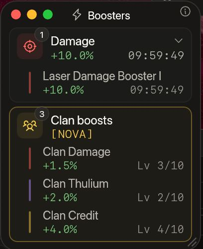
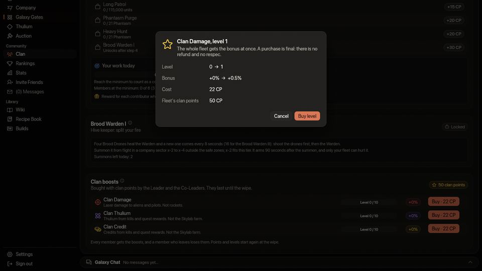
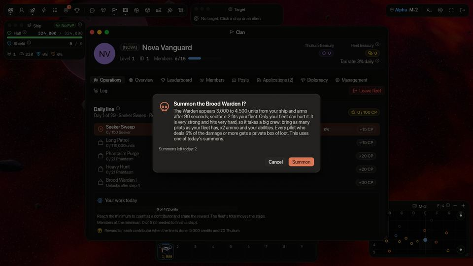
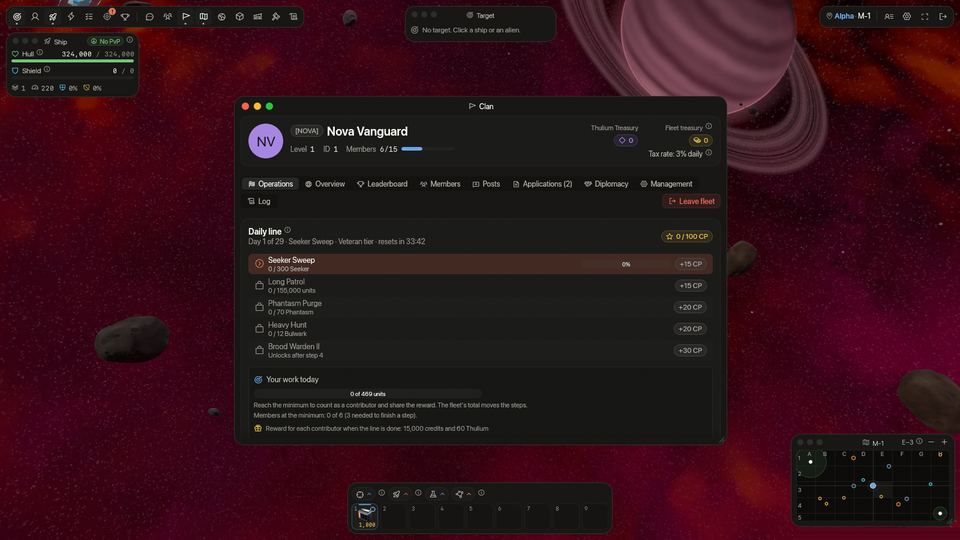

<!-- wiki-i18n source: 871bca2da0d6e0d7 -->
<!-- wiki-i18n title: Klaner -->
# Klaner {#clans}

Att grunda en klan eller gå med i en låter dig samla resurser, uppgradera den gemensamma banken, ställa in skattesatser, samordna dig med medlemmar i din fraktion och sköta diplomati. En klan har också arbete att göra tillsammans: varje dag får den en **dagslinje** av uppdrag som slutar med en boss som bara klanen kan skada, och poängen den tjänar köper **permanenta bonusar** åt varje medlem. (På spelets Klan-sida kallas en klan en *flotta*, och dess poäng och bonusar heter där flottpoäng och flottbonusar.) **En klan hör till en värld och försvinner med wipen:** du kan bara gå med i klaner i din egen värld, och vid varje wipe upplöses alla klaner ([Klaner och världar](#clans-and-worlds)).

**På en minut**

- Varje klan har en **klansida** som varje pilot i dess värld kan öppna: nivå, piloter, ledare, beskrivning, Discord-länk, krav, sammanlagda poäng och bonusar ([Klansidan](#the-clan-page)). Ledaren och vice ledarna ställer in den under **Hantering** ([Hantering](#management)).
- En klan har en **värld** (grundarens), tar bara emot piloter från den världen, och **wipen upplöser den tillsammans med dess kassa**: betala ut Flottans kassa innan nedräkningen tar slut ([wipen](#the-wipe-disbands-every-clan)).
- Ledaren och vice ledarna skriver [inlägg](#clan-posts) till hela klanen, varje medlem ser [på vilken karta](#where-your-clan-mates-are) de andra flyger, fönstret [Vem är online](#who-is-online) (tangent **H**) bjuder in vilken pilot som helst i din värld till din grupp, ledaren kan betala en [dagsbonus](#4-daily-bonus) ur Flottans kassa, och fliken [Logg](#fleet-log) berättar för klanen vad som hänt i den.
- Under flygning öppnar knappen **Klan** (en vimpel) i verktygsfältet uppe till vänster **klanfönstret**: stationens klansida i ett fönster över spelet, med samma flikar, svar och knappar; fönstrets plats och storlek kommer ihåg (spelversion 0.4.21 eller senare; [Kalla fram en väktare](#calling-a-warden) säger vad som är annorlunda under flygning).
- Ett krig tar bara slut om den andra klanen går med på det, och en allians eller en pakt tar slut direkt när någon av de två klanerna säger upp den ([Diplomati](#diplomacy)).
- Varje dag får din klan en [dagslinje](#daily-line): fyra uppdrag som görs i ordning (skjuta ned utomjordingar, flyga en sträcka, vissa dagar fälla svärmbossar), sedan en [klanväktare](#clan-wardens), en boss som du kallar fram och som bara din klan kan skada.
- Varje klart steg betalar klanpoäng direkt: 15, 15, 20, 20 och 30, alltså **100 poäng** för en hel linje.
- Ledaren och vice ledarna lägger poängen på tre [bonusar](#clan-points-and-boosts) med tio nivåer vardera: **Skada** (upp till +5 %), **Thulium** (upp till +10 %) och **Krediter** (upp till +10 %).
- En klan som klarar varje linje har köpt alla nivåer på **dag 12**. Poäng, nivåer och själva klanen tar slut med wipen.
- Du behöver minst **tre medlemmar** som gjort sin del och **en stor besättning** för striden mot väktaren: sedan 0.4.13 har en väktare fem gånger så mycket skrov, sköld och laserskada som tidigare, så besättningarna som förut vann, ungefär sju piloter, förlorar nu ([hur stor besättning som behövs](#how-big-a-crew)). En för liten besättning förlorar striden: klanen behåller då de **70 poängen** från de fyra uppdragen, men linjen blir inte klar och betalar ingen [belöning till dig](#the-reward-for-you).
- En väktare betalar en stor pott, delad efter skada, och **varje pilot som gjort 5 % av skadan eller mer får en privat låda** med sin del av bytet, som bara hen ser och bara hen kan ta ([betalning och byte](#warden-pay-and-loot)). Sedan 0.4.16 är betalningen tre gånger så stor, och så länge en väktare står **kommer en våg av Phantasm, Bulwark och (från Warden II och uppåt) Goombah varje minut** (var 40:e sekund för Wrath Warden III), riktad mot de piloter som träffade väktaren, med en **Crystalys** i varje våg när väktaren har mindre än halva skrovet kvar ([vågor](#waves-of-aliens)).
- Ditt skepp visar de bonusar det har i fönstret **Boosters**, som rader i de kategorier de höjer ([var du ser dem](#the-three-boosts)).
- Linjen och bonusarna kräver ett spel av version 0.4.10 eller senare, kortet i fönstret Boosters version 0.4.12 eller senare, klansidan, inläggen, onlinefönstret, dagsbonusen, fredsbegärandena, loggen och klaner per värld version 0.4.16 eller senare.

## Klaner och världar {#clans-and-worlds}

### En klan, en värld {#one-clan-one-world}

En klan hör till en **värld**, Alpha, Beta eller Gamma ([Världar](/wiki/03-Mechanics/Wipe-Timeline.md#worlds-alpha-beta-and-gamma)): grundarens värld. Att grunda en kostar ingenting, men du måste ha valt din värld först.

- **Du kan bara gå med i en klan i din egen värld.** Du kan inte ansöka till, gå med i, bli inbjuden av eller alliera dig med en klan i en annan värld, och spelet säger varför när du försöker. En pilot från en annan värld kan inte heller bjudas in eller tas emot.
- **Du ser bara klanerna i din värld.** Flottregistret och båda topplistorna (PvE och PvP) visar bara dem, och sidan för en klan i en annan värld går inte att öppna. Klannamn och taggar är unika över alla tre världar: ett namn som är taget i Gamma är inte ledigt i Alpha före wipen.
- **Allianser, pakter och krig finns bara mellan klaner i samma värld.** De som slöts mellan världar före 0.4.16 gäller tills de sägs upp, och ett sådant krig kan fortfarande avslutas i samförstånd ([Diplomati](#diplomacy)).
- **Klaner som redan fanns** tog sin ledares värld. En medlem från en annan värld som redan var med blir kvar till wipen eller tills hen går; hen kan inte tas emot igen.

### Wipen upplöser varje klan {#the-wipe-disbands-every-clan}

Vid [wipen](/wiki/03-Mechanics/Wipe-Timeline.md) upplöses varje klan, i alla tre världar. Med den försvinner: medlemmarna, **Flottans kassa**, ansökningar och inbjudningar, allianser, pakter och krig, inläggen, loggen, kraven, beskrivningen och Discord-länken, dagsbonusen, klanpoängen och bonusnivåerna samt dagens linje. Klanens namn och tagg blir lediga igen, och en ny klan börjar på nivå 1.

- **Du behåller** alla krediter som klanen redan betalat ut till dig (utbetalningar, dagsbonusar, linjens belöningar) och din donationsgräns, som wipen inte nollställer ([Donationer](#2-donations)).
- **Du förlorar** klanen och **allt som ligger kvar i dess Flottans kassa**, om inte ledaren eller en vice ledare har betalat ut det till piloterna före wipen ([Utbetalningar från banken](#3-bank-payouts)).
- **Nedräkningen varnar klanerna.** Med sin första varning, 5 minuter före wipen, får varje pilot som är med i en klan en rad och ett meddelande: wipen upplöser varje klan, dess kassa går förlorad, och ledare och vice ledare ska betala ut Flottans kassa till sina piloter nu. Kortet Flottans kassa under Hantering säger detsamma.

---

## Klansidan {#the-clan-page}

Varje klan har en sida som **varje pilot i dess värld kan öppna**, vare sig piloten är med i en klan eller inte. Klicka på klanens namn i **flottregistret** (Community › Klan, så länge du inte är med i någon klan), i någon av de två **topplistorna** eller på en **pilots profil**; knappen **Förhandsgranska klansidan** under Hantering visar din egen klan så som en pilot utanför ser den. Sidan visar:

- **Klanen**: namn och tagg, nivå, piloterna just nu och hur många nivån rymmer (»Nivå 2 · 14/25 piloter«), ledaren (klicka på namnet för profilen), dess värld, hur piloter går med (Öppen, Ansökningar eller Bara inbjudna), **beskrivningen** (högst 200 tecken, skriven av ledaren eller en vice ledare) och **Discord-länken** med en knapp **Öppna Discord**. Bara länkar med `discord.gg` och `discord.com/invite` godtas, och spelet öppnar inget annat.
- **Sammanlagda poäng**: erfarenhets-, heders-, PvE- och PvP-rankingpoängen för alla piloter som är med i klanen just nu, sammanräknade.
- **Krav** ([nedan](#requirements)), med en bock eller ett kryss för det du uppfyller.
- **Klanboosters**: de bonusar klanen har köpt och hur många dagar de gäller, till wipen.
- **Ansök** eller **Gå med nu**, som i flottregistret. Knappen är grå, med orsaken, när klanen är full eller du saknar ett krav.

Sidan visar aldrig medlemslistan, kassorna, ansökningarna eller klanpoängen: de är till för klanens egna medlemmar.

### Krav {#requirements}

Ledaren och vice ledarna kan kräva två saker av en pilot som vill in:

- **En lägsta nivå**, från 1 (inget krav) till 21.
- **En lägsta grad**: en gradnivå i koncernens grader, från **Pilot** (inget krav) till **Amiral**: Pilot, Sergeant, Löjtnant, Kapten, Major, Överste, General, Amiral ([Grader](/wiki/03-Mechanics/Ranks.md)). En nivå räknas från sin lägsta grad: en klan som kräver Kapten tar emot en Junior kapten och varje pilot över hen. Det är graden du har just nu på din koncerns lista, inte världen du flyger i.

De kontrolleras när en pilot **ansöker eller går med**. En officers **inbjudan** hoppar över dem, och det gör också en ansökan som en officer godkänner. Flottregistret visar dem som små kapslar under klanens namn, röd för den du inte uppfyller; en klan som inte har ställt in något kräver inget.

**En ansökan i taget.** En ansökan som väntar visas som **Ansökt** i **flottregistret** och på klanens sida, även efter att du stängt menyn och öppnat den igen, och dess knapp förblir grå. En andra ansökan till samma klan får svaret ”En ansökan väntar redan” och skickar ingenting. Om en av klanens officerare avslår din kan du ansöka till den klanen igen efter **60 sekunder**, och du kan skicka högst **5 ansökningar** under vilka 10 minuter som helst, till alla klaner tillsammans.

---

## Klanens utveckling {#clan-progression}

Klaner börjar på nivå 1 och kan uppgraderas till nivå 5. För att uppgradera klanen måste krediter betalas från **klanbanken** (i spelet heter den **Flottans kassa**). Uppgraderingar ökar medlemskapaciteten och de dagliga utbetalningsgränserna; klanbonusarna köps med klanpoäng, inte med nivåer.

| Klannivå | Medlemsgräns | Daglig utbetalningsgräns (per medlem) | Uppgraderingskostnad (krediter) |
| :---: | :---: | :---: | :--- |
| **Nivå 1** | 15 | 2 000 000 KRD | — |
| **Nivå 2** | 25 | 4 000 000 KRD | 10 000 000 KRD |
| **Nivå 3** | 50 | 6 000 000 KRD | 100 000 000 KRD |
| **Nivå 4** | 75 | 8 000 000 KRD | 1 000 000 000 KRD |
| **Nivå 5** | 100 | 10 000 000 KRD | 10 000 000 000 KRD |

---

## Hantering {#management}

Fliken **Hantering** i klanfönstret (till 0.4.16 hette den Admin) är till för ledaren och vice ledarna; de andra medlemmarna ser ett lås. Dess kort, uppifrån:

- **Värvningsprotokoll**: hur piloter går med. **Öppen** tar emot varje pilot som uppfyller kraven direkt, **Ansökningar** låter en officer avgöra varje ansökan, **Bara inbjudna** tar inte emot någon som inte bjudits in.
- **Skatteinställningar**: den dagliga skattesatsen, 0 % till 5 % ([Daglig skatt](#1-daily-taxation)).
- **Ansökningskrav**: lägsta nivå och lägsta grad ([Krav](#requirements)).
- **Klansida**: beskrivningen (200 tecken) och Discord-länken som piloter utanför klanen läser, och knappen **Förhandsgranska klansidan** ([Klansidan](#the-clan-page)). Klanens egna medlemmar läser länken i Översikten.
- **Flottans kassa**: krediterna från donationer och den dagliga skatten, med påminnelsen att wipen upplöser klanen och kassan går förlorad.
- **Thulium-kassa**: en andra kassa, som visas bredvid Flottans kassa i klanfönstrets sidhuvud. Den är tom, och ingenting betalas in i den eller ut ur den: den är reserverad för en framtida uppdatering.
- **Flottans utveckling** och **Uppgraderingar**: de fem nivåerna med hur många piloter var och en rymmer, det mesta en medlem kan få utbetalat på en dag och priset, samt ledarens uppgraderingsknapp. Bara ledaren uppgraderar.
- **Dagsbonus**: ledarens belopp för varje grad ([Dagsbonus](#4-daily-bonus)).

---

## Klanekonomi och beskattning {#clan-economy-taxation}

Klaner drivs av ett skattebaserat ekonomiskt system:

### 1. Daglig skatt {#1-daily-taxation}

- **Skattesats**: Ledaren eller vice ledarna kan ställa in en daglig skattesats mellan **0 % och 5 %**.
- **Automatisk indrivning**: En gång per dag (UTC) tar servern automatiskt ut skatt från alla klanmedlemmar.
- **Formel**: Skatten beräknas som `ClanTaxRate` av varje medlems aktuella kreditsaldo.
  - *Exempel*: Om du har 10 000 000 krediter och klanskatten är 2 % dras 200 000 krediter från ditt konto och sätts in i Klanbanken.
  - Frivilliga kreditdonationer kan också göras, upp till gränsen i nästa avsnitt.

### 2. Donationer {#2-donations}

- **Donera**: alla medlemmar kan skicka krediter till Klanbanken från sidan Klan. Dialogrutan visar vad du fortfarande kan skicka.
- **Donationsgräns**: en pilot kan skicka högst **2 000 000 krediter till klaner under valfria 24 timmar**, räknat över alla klaner piloten har varit med i. Att lämna en klan och gå med i en annan ger ingen ny gräns.
- **Ingen daglig nollställning**: de 24 timmarna glider. Varje donation slutar räknas exakt 24 timmar efter att den gjordes, och dialogrutan visar när den äldsta gör det och hur mycket som kommer tillbaka. En donation över det som är kvar avvisas helt.
- Den dagliga skatten är ingen donation och förbrukar inte din gräns.

### 3. Utbetalningar från banken {#3-bank-payouts}

- **Utbetalningsgränser**: Klanens ledare och officerare kan fördela krediter från Klanbanken till enskilda medlemmar.
- **Daglig gräns**: En medlem kan inte ta emot mer än `2,000,000 * ClanLevel` krediter i utbetalningar under en enda kalenderdag (UTC).

### 4. Dagsbonus {#4-daily-bonus}

Ledaren kan betala varje medlem en fast bonus ur Flottans kassa, en gång om dagen.

- **Ställa in den.** På kortet **Dagsbonus** under Hantering anger ledaren ett belopp för varje roll: Pilot, Äldste, Vice ledare och Ledare. **0 stänger av en roll**; varje annat belopp är **1 000 till 2 000 000 krediter**. Vice ledarna ser kortet men kan inte ändra det. Att spara tar ingenting ur kassan. Kortet visar vad en hel dag skulle kosta om alla piloter spelade och hur många dagar kassan skulle räcka.
- **Utbetalning.** En medlem får betalt **en gång per dag**, vid sin första kontroll den dagen: när hen ansluter, när dagen byts medan hen är online och när ledaren sparar nya belopp. Dagen är klanlinjens dag, som byts vid **00:00:00 UTC** ([Dagen](#the-day)). Piloten får en Systemrad och en rad i Spelloggen, och Översikten visar »Dagsbonus: X krediter« och om den betalats i dag.
- **Vem.** En pilot som varit med i klanen i **minst 24 timmar**, och **en bonus per pilot och dag över alla klaner**: den som byter klan för att hämta mer får betalt en gång.
- **En knapp kassa.** Kassan betalar bara det den har och går aldrig under noll. När den inte kan betala en medlems belopp hoppas medlemmen över den dagen, även om kassan fylls på senare samma dag, och [Flottans logg](#fleet-log) noterar det en gång. Piloterna får betalt i den ordning de ansluter tills kassan är tom.
- **Ingen utbetalning ur banken.** Bonusen använder inte en medlems dagliga utbetalningsgräns.

---

## Hierarki och roller {#hierarchy-roles}

Klaner använder en rollbaserad gradstruktur för att hantera behörigheter:

- **Ledare (roll 3)**: Har full administrativ åtkomst, inklusive uppgradering, att ställa in skatter, krav, klansida och dagsbonus, diplomati, inlägg, befordringar, att avskeda medlemmar och att upplösa klanen.
- **Vice ledare (roll 2)**: Kan ställa in skattesatser, krav och klansida, betala ut krediter, hantera diplomati, skriva inlägg och befordra eller degradera lägre grader.
- **Äldste (roll 1)**: Betrodd medlem som kan godkänna nya ansökningar till klanen.
- **Medlem (roll 0)**: Vanlig spelare utan administrativa behörigheter.

### Behörighetstabell {#permissions-table}

| Åtgärd | Ledare | Vice ledare | Äldste | Medlem |
| :--- | :---: | :---: | :---: | :---: |
| **Upplösa klanen** | ✅ | ❌ | ❌ | ❌ |
| **Uppgradera klanen** | ✅ | ❌ | ❌ | ❌ |
| **Ställa in skattesats** | ✅ | ✅ | ❌ | ❌ |
| **Ställa in krav och klansida** | ✅ | ✅ | ❌ | ❌ |
| **Ställa in dagsbonus** | ✅ | ❌ | ❌ | ❌ |
| **Skriva klaninlägg** | ✅ | ✅ | ❌ | ❌ |
| **Betala ut krediter** | ✅ | ✅ | ❌ | ❌ |
| **Hantera diplomati** | ✅ | ✅ | ❌ | ❌ |
| **Köpa klanbonusar** | ✅ | ✅ | ❌ | ❌ |
| **Kalla fram klanväktaren** | ✅ | ✅ | ❌ | ❌ |
| **Befordra / avskeda** | ✅ | ✅* | ❌ | ❌ |
| **Godkänna ansökningar** | ✅ | ✅ | ✅ | ❌ |

*\*Vice ledare kan bara befordra, degradera eller avskeda medlemmar med lägre grad än sin egen.*

### När ledaren lämnar {#when-the-leader-leaves}

En ledare kan inte lämna en klan som fortfarande har andra medlemmar: befordra först en vice ledare till ledare (ledaren går då ner till vice ledare), eller lämna sist, vilket upplöser klanen. Om ledaren raderar sitt konto (Inställningar › Konto) går ledarskapet till den medlem som har högst grad, vid lika den som varit med längst; en ledare som är ensam i klanen upplöser den, banken inräknad.

---

## Klaninlägg {#clan-posts}

Ett **inlägg** är en kort lapp till hela klanen, en anslagstavla för officerarnas nyheter. Det finns på fliken **Inlägg** i klanfönstret.

- **Vem skriver.** Ledaren och vice ledarna. Alla medlemmar läser. Ledaren och vice ledarna tar bort vilket inlägg som helst, och en författare tar bort sitt eget, även efter att ha degraderats.
- **Texten.** Högst **200 tecken** på en rad, med en räknare under rutan; Enter skickar. **Inga länkar**: ett inlägg med en länk avvisas.
- **Gränser.** Ett inlägg per författare var **10:e sekund**, och klanen behåller **20** åt gången: det 21:a tränger ut det äldsta.
- **Hur länge.** Ett inlägg varar till wipen.
- **Meddelande.** De medlemmar som är online får ett meddelande (»Nova har skrivit ett inlägg till flottan.«) och ett svagt ljud, högst en gång per en och en halv sekund oavsett hur många inlägg som kommer. Listan visar det nyaste först, med författaren och hur länge sedan det skrevs.

## Var dina klankamrater finns {#where-your-clan-mates-are}

Kolumnen **Karta** i medlemslistan visar sektorn där varje pilot i din klan flyger (»T-2«), med världen framför när det inte är din egen (»Beta · T-2«). Den läses om var 10:e sekund medan listan är öppen. Bara **kartan** visas, aldrig koordinater, och ingenting sparas. En pilot som är **dockad eller utloggad** står som **Offline**, och det gör också en pilot vars kamouflerade skepp du inte skulle kunna se på en karta ([Cloaking CPU](/wiki/06-Items/Extras.md#cloaking-cpu)): en klan häver inte ett kamouflage.

Kolumnen **Senast sedd** bredvid säger hur många dagar sedan varje pilot i din klan spelade: **Idag**, **För 1 dag sedan**, **För 12 dagar sedan**, i serverns dagar (UTC), bärnstensfärgad från 14 dagar och röd från 30. Det är ett helt antal dagar och aldrig ett datum eller en tid; en pilot som flyger just nu står som Idag, och en pilot som servern saknar uppgift om står med ett streck. Bara klanens medlemmar ser den, och bara om sin egen klan; ingenting sparas för den (servern läser de dagar den redan för sin användningsstatistik och för företagsrankingen, som tar bort en pilot som inte setts på 30 dagar). Så ser en Ledare eller Äldste vem i klanen som fortfarande är aktiv.

Kolumnen **Skylab** bredvid visar var varje pilots [Skylab](/wiki/03-Mechanics/Skylab.md#clan-skylabs) är på universumkartan, med cellens kod: ”Dockat vid H3” i en koncerns hamn, ”H3, till K7 om 3 h 12 min” på en resa (den cell det senast passerade, dit det är på väg och tiden som är kvar), ”Stationerat vid K7” medan det jagar och ”Förstört vid H3” när skrovet tog slut. Den läses tillsammans med kolumnen Karta, och en pilot som ännu inte har någon universumkarta (en kärna under nivå 15) visar ett streck. Kolumnen dyker upp så snart någon pilot i din klan har en. Bara din egen klan ser den, och en kamouflage döljer inte ett Skylab. En förstörelse visas först när dess pilot har tittat på Skylab igen eller gett det en order.

## Vem är online {#who-is-online}

Knappen **Vem är online** i systemverktygsfältet (uppe till höger) eller tangenten **H** (kan bindas om under Inställningar › Kontroller) öppnar fönstret **Piloter online**.

- **Vem som visas.** Piloterna som flyger just nu i **din värld**, utom du själv: Alpha, Beta och Gamma möts inte. En pilot vars kamouflerade skepp du inte kan se visas inte och räknas inte. Fönstret visar högst **100** rader, först dina klankamrater, sedan de högre nivåerna, sedan efter namn, och överst det verkliga antalet piloter som är online.
- **Vad en rad visar.** Pilotens namn, nivå, koncern, klantagg och gradsymbol: det chatten och topplistorna redan visar. Aldrig en position, en karta eller skeppets tillstånd. Ett **guldnamn** betyder att piloten någon gång har stött spelet med Premium, som i chatten; en **guldkrona** efter namnet betyder att hans Premium är aktivt just nu.
- **Sök.** Skriv en del av ett namn eller av en klantagg; fönstret frågar servern igen när listan var avkortad.
- **Bjud in.** Radens knapp **Bjud in** är gruppfönstrets egen inbjudan ([Grupper](/wiki/03-Mechanics/Groups.md)), med samma svar och avslag (piloten är med i en grupp, gruppen är full, Stör ej är på). Knappen är grå, med orsaken när du håller muspekaren över den, när spelet redan vet att inbjudan skulle avvisas.
- Listan läses om var 10:e sekund medan fönstret är öppet.

---

## Klanchatt {#clan-chat}

Fliken **Klan** i chatten ([Chattkanaler](/wiki/03-Mechanics/Groups.md#chat-channels), kommandot `/c`) är bara för medlemmarna i din klan. Servern sparar de senaste **200 raderna**, ingen äldre än **14 dagar**, så att en medlem som inte var online hittar dem vid inloggningen eller vid inträdet: äldsta först, under en rad som säger hur länge chatten sparas, med datumet på raderna från tidigare dagar. Den som lämnar klanen eller blir utkastad får inget mer av den. När klanen upplöses, av sin ledare eller av [wipen](#the-wipe-disbands-every-clan), raderas dess rader med den. Chatten fungerar på alla servrar: en rad du skriver medan du flyger på en regional server når din klan var medlemmarna än är, och de sparade raderna skickas till dig där också.

---

## Dagslinje {#daily-line}

Varje klan får en **dagslinje** per dag: fem steg som hela klanen gör tillsammans, **i ordning**. De fyra första är uppdrag: skjuta ned så många utomjordingar, flyga så långt eller, vissa dagar, fälla svärmbossar. Det femte är en **klanväktare**, en boss som du kallar fram och förgör. Öppna **Gemenskap › Klan** och fliken **Operationer** för att se dagens linje, det öppna steget med sin stapel, din egen andel och tiden som är kvar.

### De fem stegen {#the-five-steps}

| Steg | Vad | Klanpoäng |
| :---: | :--- | ---: |
| 1 | Första uppdraget | 15 |
| 2 | Andra uppdraget | 15 |
| 3 | Tredje uppdraget | 20 |
| 4 | Fjärde uppdraget | 20 |
| 5 | Dagens klanväktare | 30 |
| | **En klar linje** | **100** |

- Bara det **öppna steget räknas**. En nedskjutning som sker medan steg 1 är öppet räknas för steg 1 och inget annat. När steg 1 är klart öppnas steg 2 från noll. Det du skjuter ned utöver ett stegs mål sparas inte till nästa.
- Ett steg betalar sina poäng **i samma stund som det är klart**. En klan som klarar de fyra uppdragen och sedan inte får ihop en besättning till väktaren, eller förlorar striden, behåller ändå **70 poäng**; [belöningen till dig](#the-reward-for-you) kommer först när linjen är klar.
- Allas arbete går in i **en gemensam räknare**: nedskjutningarna av det öppna stegets utomjording och sträckan som alla dina medlemmar flyger läggs ihop, så ingen behöver göra ett steg ensam.

### Dagen {#the-day}

- En klans dag är en **UTC-dag**: den byts vid **00:00:00 UTC**, för alla klaner i samma ögonblick, precis som klanens dagliga skatt. Fliken Operationer räknar ned till det. »Dag *n* av 29« räknar säsongens UTC-dagar, och den första är det som återstår av dagen då säsongen började. En klan som grundas klockan 15:00 får den dagens linje för resten av dagen, med samma antal, minimikrav och belöningar. (Säsongens egen dag, som PvP, svärmarna och [wipen](/wiki/03-Mechanics/Wipe-Timeline.md#30-day-season-schedule) räknar, byts fortfarande vid det klockslag då säsongen började.)
- En linje som inte blir klar **förfaller** när dagen tar slut. De steg som redan är klara behåller sina poäng, det öppna stegets framsteg försvinner och man kan inte ta igen det. Linjerna går på dag 1 till 29 av säsongen; den 29:e linjen varar tills wipe-nedräkningen börjar.
- Klanens piloter som är online får en Systemrad när den nya linjen börjar, när ett steg blir klart och **en timme före bytet** om linjen inte är klar.

### Svårighetsnivåer {#difficulty-tiers}

Varje dag tar spelet **medelnivån för de fem piloterna med högst nivå** i klanen (alla, om den har färre än fem) och sätter dagens nivå utifrån den:

| Nivå | Medelnivå | Väktare |
| :--- | :--- | :---: |
| Rekryt | under 4 | I |
| Veteran | 4 till under 7 | II |
| Elit | 7 eller mer | III |

Nivån avgör hur många utomjordingar uppdragen kräver, vilken utomjording det »tunga« steget kräver och hur stark väktaren är. **Poängen är desamma på varje nivå.** Nya piloter med låg nivå drar inte ned nivån: bara de fem bästa räknas.

### Vem som räknas {#who-counts}

- **Klanens totalsumma räknas.** Staplarna på fliken Operationer är hela klanens.
- **Ditt minimum.** För att få del av dagens belöning måste du göra **5 % av dagens arbete**, ungefär åtta minuters riktig jakt. Fliken visar det som »Ditt arbete i dag: 312 av 469 enheter«. En arbetsenhet är en sekund av spelande: en nedskjutning räknas som den tid det tar att hitta och förgöra den utomjordingen, och en flygsträcka som den tid det tar att flyga den. För en Veteran-klan är en Seeker värd ungefär 12 enheter, en Phantasm 22, en Bulwark 123 och 1 000 flugna enheter ungefär 5; minimum är 454 till 486 enheter, oavsett dag och nivå.
- **Minst tre medlemmar** måste ha nått sitt minimum innan ett steg kan bli klart. Är ett steg fullt och färre har nått det **väntar** det (»Steg 3 är fullt, men bara 2 medlemmar har nått sitt minimum«), och nedskjutningar av det stegets utomjording läggs fortfarande till arbetet för de medlemmar som gjorde dem tills den tredje kommer upp. En klan med färre än tre piloter kan inte göra klart något steg.
- **Vem som får en nedskjutning.** Piloten som får betalt för nedskjutningen och hens gruppkamrater inom 8 000 enheter som sköt de senaste 15 sekunderna ([Grupper](/wiki/03-Mechanics/Groups.md#sharing-kills)). En klan räknar en nedskjutning **en gång**, hur många av dess piloter som än var med i gruppen, och nedskjutningens arbete delas lika mellan dem. Två klaner i en grupp räknar den en gång var.
- **Vilka nedskjutningar.** Bara det öppna stegets utomjording: den vanliga Seeker, Phantasm, Bulwark eller Goombah. Svärmskepp, andra piloter och en väktares hjälpare räknas inte som dessa utomjordingar. En nedskjutning räknas för den värld där den sker, och mer i en starkare värld: **1 i Alpha, 1,5 i Beta, 2 i Gamma** ([Världar](/wiki/03-Mechanics/Wipe-Timeline.md#worlds-alpha-beta-and-gamma)). Ett bossteg räknar [svärmarnas](/wiki/05-Swarms/Swarms.md) bossar, en för varje klan som har en pilot som gjorde minst 5 % av skadan.
- **Flygning.** Ett patrullsteg räknar sträckan varje pilot flyger utanför skyddszonerna; fem piloter som flyger tillsammans lägger till fem gånger sträckan.
- **Gå med och lämna.** Det du gjorde förblir räknat om du lämnar. En pilot som går med räknas från det ögonblicket.

### De sju linjerna {#the-seven-lines}

Linjerna går i en cykel om sju: linjen för dag *d* har nummer 1 + ((*d* − 1) mod 7), så varje linje kommer tillbaka var sjunde dag. Siffrorna gäller en **Rekryt- / Veteran- / Elit-**klan. De två **Swarm Break**-linjerna kräver svärmbossar och kommer först från dag 4, när [svärmarna](/wiki/05-Swarms/Swarms.md) dyker upp. Alla siffror är gjorda för ungefär **2,6 timmars spelande totalt**, en halvtimme var för fem piloter (en uppskattning, inte en mätning).

| Linje | Dagar | Steg 1 | Steg 2 | Steg 3 | Steg 4 |
| :--- | :--- | :--- | :--- | :--- | :--- |
| Seeker Sweep | 1, 8, 15, 22, 29 | 150 / 300 / 425 Seeker | 115 000 / 155 000 / 185 000 enheter | 21 / 70 / 130 Phantasm | 21 Phantasm / 12 Bulwark / 14 Goombah |
| Phantasm Purge | 2, 9, 16, 23 | 40 / 140 / 270 Phantasm | 60 / 120 / 170 Seeker | 175 000 / 230 000 / 275 000 enheter | 26 Phantasm / 15 Bulwark / 17 Goombah |
| Long Haul | 3, 10, 17, 24 | 290 000 / 385 000 / 460 000 enheter | 90 / 180 / 260 Seeker | 26 / 85 / 170 Phantasm | 21 Phantasm / 12 Bulwark / 14 Goombah |
| Swarm Break I | 4, 11, 18, 25 | 75 / 150 / 220 Seeker | 3 Boss Seeker / 3 Boss Seeker / 2 Pirate Boss | 26 / 85 / 170 Phantasm | 30 Phantasm / 18 Bulwark / 21 Goombah |
| Heavy Iron | 5, 12, 19, 26 | 40 Phantasm / 24 Bulwark / 28 Goombah | 21 / 70 / 130 Phantasm | 175 000 / 230 000 / 275 000 enheter | 75 / 150 / 220 Seeker |
| Swarm Break II | 6, 13, 20, 27 | 75 / 150 / 220 Seeker | 21 / 70 / 130 Phantasm | 4 Boss Seeker / 2 Pirate Boss / 3 Pirate Boss | 350 000 / 460 000 / 550 000 enheter |
| Grand Round | 7, 14, 21, 28 | 100 / 210 / 300 Seeker | 26 / 85 / 170 Phantasm | 21 Phantasm / 12 Bulwark / 14 Goombah | 230 000 / 305 000 / 365 000 enheter |

### Din belöning {#the-reward-for-you}

När linjen är klar, alltså när väktaren är förgjord, får varje medlem som nått minimum och fortfarande är i klanen en utbetalning, även om hen är offline. En linje som slutar utan väktaren betalar ingen belöning, vad de fyra uppdragen än gjort. Utbetalningen är fast: bonusar, boosters och världen ändrar den inte.

| Nivå | Krediter | Thulium |
| :--- | ---: | ---: |
| Rekryt | 5 000 | 20 |
| Veteran | 15 000 | 60 |
| Elit | 22 000 | 90 |

---

## Klanväktare {#clan-wardens}

En **klanväktare** är bossen i slutet av dagslinjen. Den är ingen av de publika [svärmarna](/wiki/05-Swarms/Swarms.md) som ströftar omkring i en sektor: din klan **kallar fram den** och **bara din klan kan skada den**. Tre väktare turas om, en per dag: dag 1 **Brood**, dag 2 **Siege**, dag 3 **Wrath**, dag 4 Brood igen, och så vidare (dag 15 är en Wrath-dag). Var och en finns i tre styrkor, **I, II och III**, som klanens nivå bestämmer. En väktare är en utomjording av en egen sort, som svärmarnas skepp: den räknas inte som Seeker, Phantasm eller någon annan utomjording. En väktare är mycket stark: den har fem gånger så mycket skrov, sköld och laserskada som före 0.4.13, så den är en strid för den största besättning som din klan kan få ihop ([hur stor besättning som behövs](#how-big-a-crew)). Sedan 0.4.16 har Brood Warden III **hälften** så mycket skrov och sköld, dess drönare läker hälften så mycket och kommer hälften så ofta, och varje väktare tar med sig [vågor av utomjordingar](#waves-of-aliens) så länge den står. Sedan 0.5.7 rättar sig en väktare efter den besättning som är på plats när den blir stridsberedd: en mindre besättning möter samma skrov och samma sköld, men en väktare som gör mindre skada, läker mindre och kallar på färre utomjordingar ([hur besättningen förändrar väktaren](#strength-by-the-crew)).
Under halva skrovet har en väktares vågor också [en Crystalys](#crystalys-waves).
Sedan 0.4.20 **går en Wrath Warden på den pilot som träffade den** i stället för att stå där den kallades fram, Wrath Warden III tar med fler utomjordingar oftare och en Crystalys när den har mindre än halva skrovet kvar, och allt en väktare tar med sig kommer riktat mot de piloter som träffade den.
Sedan 0.4.22 **går varje väktare på den pilot som träffade den**, som Wrath Warden har gjort sedan 0.4.20, i stället för att stå där den kallades fram eller ströva omkring.

| Väktare | Dagar | Roll | Hur den strider |
| :--- | :--- | :--- | :--- |
| **Brood Warden** | 1, 4, 7, 10 … | Kupans väktare: dela upp din eld | Den flyger på den första pilot som träffade den. Fyra små **Brood Drones** läker dess skrov, och en ny kommer var 8:e sekund så länge färre än fyra lever (var 16:e sekund för Brood Warden III). Skjut drönarna först, sedan väktaren. |
| **Siege Warden** | 2, 5, 8, 11 … | Belägringsbrytare: fortsätt röra dig | Den flyger på den första pilot som träffade den, avfyrar en rak [Rivet-raket](/wiki/06-Items/Rockets.md#the-twelve-rockets) mot honom och lagar sig själv. Två **Siege Escorts** lägger till laserelden. Fortsätt röra dig och turas om att vara måltavla. |
| **Wrath Warden** | 3, 6, 9, 12 … | Krigsherre: slå ned raseriet | Den flyger på den första pilot som träffade den, stannar inom sina lasrars räckvidd och lagar sig själv. Under två tredjedelars skrovstyrka träffar dess lasrar **en fjärdedel hårdare**, och under en tredjedel **en och en halv gång så hårt**. Två **Wrath Guards** stannar hos den och lägger till laserbeskjutning. Ta ned den snabbt och håll sköldarna uppe. |

### Kalla fram en väktare {#calling-a-warden}

- **När.** Efter att steg 4 är klart. En klan har **två frammaningar per dag**, bara en väktare ute åt gången, och dagen måste ha **minst 30 minuter** kvar.
- **Vem.** Ledaren eller en vice ledare.
- **Hur.** Under flygning: knappen **Kalla fram här** dyker upp på flygskärmen så fort steg 4 är klart och ber dig bekräfta. Var utanför skyddszonerna, i en koncerns sektor **x-2, x-3 eller x-4** (vilken koncern som helst) i din värld. Fliken Operationer (på klansidan på stationen eller i klanfönstret under flygning) visar dagens väktare, frammaningarna som är kvar och varför knappen är nedtonad. På stationen är den alltid nedtonad, eftersom en väktare kallas fram från skeppet; i klanfönstret är den själva knappen, nedtonad inne i en säker zon och utanför en koncerns sektorer x-2 till x-4, med serverns orsak.
- **Var den dyker upp.** 3 000 till 4 500 enheter från ditt skepp, i din värld: bara piloter i den världen kan nå den. Fliken rekommenderar **x-2 för en Rekryt-klan, x-3 för Veteran och x-4 för Elit**. De vanliga [PvP-reglerna](/wiki/03-Mechanics/Wipe-Timeline.md#worlds-alpha-beta-and-gamma) för sektorn du väljer gäller fortfarande.
- **Uppvärmning.** Den står **90 sekunder** skärmad och passiv (»startar upp«), och varje klanpilot som är online får veta var. Flyg dit medan den startar upp: när de 90 sekunderna är över är den aktiv. En kapsel under skyddszonsmärket på flygskärmen följer den: dess namn, ”startar upp” med tiden som är kvar, sedan ”aktiv” med dess sektor och tiden tills den drar sig tillbaka, och ”rasande” när en Wrath Warden har under en tredjedel av skrovet.
- **Bara din klan.** Skott från andra klaners piloter ignoreras och får den inte att slå tillbaka.
- **Hur det tar slut.** När den förgörs. Den **drar sig tillbaka** 40 minuter efter att den aktiverades, när dagen tar slut, när ingen pilot i din klan har varit ute i flygning på dess karta på 2 minuter, eller när servern startar om (den frammaningen ges tillbaka). En väktare som drar sig tillbaka kostar en frammaning, och nästa anrop för tillbaka den för den besättning som är på plats då ([hur besättningen förändrar väktaren](#strength-by-the-crew)).

### Strida mot en väktare {#fighting-a-warden}

- **En väktare strider mot den pilot som träffade den först**, som varje boss: låt besättningens kraftigaste skepp börja och använd [Shield Surge och Emergency Repair](/wiki/03-Mechanics/Abilities.md).
- **Ta med den största besättning du kan, med x2-ammunition** ([Lasrar](/wiki/06-Items/Lasers.md#laser-ammunition)). Besättningarna som vann före 0.4.13, ungefär sju piloter, förlorar nu. Tabellen nedan är en beräkning och bästa fallet: även i den förlorar tio piloter mot varje väktare, och den minsta besättning som kan vinna har 15 till 25 piloter med x2-ammunition och 24 till 37 med x1-ammunition. Vågorna nedan ingår inte i den beräkningen. Tabellen nedan gäller en väktare med full styrka: en mindre besättning möter samma skrov och samma sköld, men en väktare som gör mindre skada, läker mindre och kallar på färre utomjordingar ([hur besättningen förändrar väktaren](#strength-by-the-crew)).
- **Brood:** drönarna läker dess skrov, och en besättning som struntar i dem behöver ungefär en tredjedel fler piloter. Skjut dem först och fortsätt skjuta dem: en ny kommer efter 8 sekunder (efter 16 för Brood Warden III). Sedan 0.4.22 flyger Brood Warden på den pilot som träffade den, och dess drönare följer med och fortsätter läka den.
- **Siege:** dess raketer är raka och ostyrda, så ett skepp som fortsätter röra sig väjer för de flesta. Fortsätt röra dig och turas om att vara måltavla. Sedan 0.4.22 ströftar den inte längre omkring: den flyger på den första pilot som träffade den och avfyrar sin Rivet mot honom från upp till 1 000 enheter.
- **Wrath:** när dess skrov är under två tredjedelar träffar varje salva en fjärdedel hårdare, och under en tredjedel en och en halv gång så hårt, så stridens sista tredjedel är den farliga. Ta ned de första två tredjedelarna snabbt, håll sköldarna uppe och spara Emergency Repair till raseriet. Sedan 0.4.20 står den inte stilla: den flyger på den första pilot som träffade den, 90 enheter i sekunden, tills den är inom sina lasrars räckvidd (700, 800 eller 900 enheter efter styrka) och skjuter därifrån, så ett vapen med längre räckvidd skjuter inte längre på den utan svar.
- **Alla nio flyger på den pilot som träffade dem (0.4.22).** Brood och Siege Warden gör vad Wrath Warden har gjort sedan 0.4.20, var och en med sin egen fart (90 enheter i sekunden för Brood och Wrath Warden, 110 för Siege Warden), tills de är inom sina lasrars räckvidd (600, 700 eller 800 enheter för Brood och Siege Warden efter styrka, 700, 800 eller 900 för Wrath Warden), så ett vapen med längre räckvidd skjuter inte längre på dem utan svar. När ingen har träffat en på 10 sekunder släpper den piloten och blir stående där den är: den flyger inte tillbaka dit den kallades fram. En pilot som är skyddad, i en säker zon eller av en återuppståndelses skydd, släpps genast.
- **Det en väktare tar med sig går på den pilot som träffade den.** Sedan 0.4.20 går varje utomjording i en våg, och varje drönare, eskort eller vakt som kommer medan väktaren bekämpas, på de piloter som träffade väktaren, den första av dem först, i samma ögonblick den kommer, utan att själv ha blivit träffad.

### De tre stegen {#the-three-steps}

<!-- mob-ladder:begin -->
<!-- Generated from server/Resources/MobAbilities.json (and the client's locales/<language>/mobs.toml) by scripts/mob-abilities-wiki.sh: don't edit by hand. -->

En Warden har också tre steg ([hur de fungerar](/wiki/03-Mechanics/Special-Abilities.md#the-bosses-three-steps)), desamma vid varje styrka.

| Warden | I början | Under två tredjedelar | Under en tredjedel |
| :--- | :--- | :--- | :--- |
| **Brood Warden** (I, II, III) | Alla 4 drönare kommer till dess sida på en gång. | Dess drönare läker den ×1,5 så fort i 15 s. | 2 fler drönare kommer, utöver det vanliga antalet, i 30 s. De betalar ingenting. |
| **Siege Warden** (I, II, III) | – | Avfyrar sin raket ×2 så ofta i 20 s. | Läker 15 % av skrovet och skölden (en skadestöt bryter det). |
| **Wrath Warden** (I, II, III) | – | Dess lasrar slår ×1,25 så hårt. | Dess lasrar slår ×1,5 så hårt sammanlagt, inte ovanpå steget före. |

<!-- mob-ladder:end -->

### Vågor av utomjordingar {#waves-of-aliens}

Sedan 0.4.16 står en väktare inte ensam. Från det ögonblick den är **beväpnad** (de 90 sekundernas uppvärmning har inga vågor, så besättningen hinner samlas) kommer **var 60:e sekund** en **våg** av vanliga utomjordingar, så länge väktaren står. Sedan 0.5.0 är en våg en **blandning**: ungefär hälften [Phantasm](/wiki/04-Aliens/Phantasm.md), en fjärdedel [Bulwark](/wiki/04-Aliens/Bulwark.md) och en fjärdedel [Goombah](/wiki/04-Aliens/Goombah.md), på varje karta, utom att en Warden I inte kallar på någon Goombah (den första punkten nedan); en våg var förut av en enda sort utomjordingar: Phantasm på x-2 och x-3 och Bulwark på x-4. En våg har lika många utomjordingar som förut. Tabellen visar vågorna för väktarna II och III utom Wrath Warden III, vars [vågor](#wrath-iii-waves) är tyngre. Under halva skrovet har en väktares vågor också [en Crystalys](#crystalys-waves).

| Karta | En våg | Högst levande samtidigt |
| :--- | :--- | ---: |
| x-2 | 3 Phantasm, 1 Bulwark och 1 Goombah | 15, och upp till 3 Crystalys |
| x-3 | 5 Phantasm, 3 Bulwark och 2 Goombah | 30, och upp till 3 Crystalys |
| x-4 | 5 Phantasm, 3 Bulwark och 2 Goombah | 30, och upp till 3 Crystalys |

- **En Warden I kallar inte på någon Goombah.** Väktaren hos en klan på nivån Rekryt (medelnivå under 4) skickar bara Phantasm och Bulwark, tre Phantasm på en Bulwark, i vågor av samma storlek: **4 Phantasm och 1 Bulwark på x-2, 8 Phantasm och 2 Bulwark på x-3 och x-4**. Det mesta som lever på en gång är tabellens.
- **Högst tre vågor lever.** En våg lever så länge en av dess utomjordingar gör det. En våg som ska komma när tre lever hoppas över och sparas inte till senare; nästa kommer en minut senare.
- **Det är vanliga utomjordingar**, gjorda så som kartan gör dem: en starkare värld ger dem mer skrov, sköld och skada ([Världar](/wiki/03-Mechanics/Wipe-Timeline.md#worlds-alpha-beta-and-gamma)), vilken styrka väktaren själv än har. Bulwark och Goombah kommer till varje karta, också till en x-2-sektor där ingen av dem annars lever. De kommer 500 till 1 200 enheter från väktaren, utspridda runt den.
- **De ingår inte i striden om väktaren.** De läker ingenting, och att skjuta på dem ger ingenting till din andel av skadan på väktaren. Vilken pilot på kartan som helst kan döda dem. Var och en betalar sin utomjordings vanliga betalning i din värld och ger PvE-poäng: en hel våg betalar under 2 % av vad den egna väktaren betalar.
- **De upphör med väktaren.** När den förstörs eller drar sig tillbaka kommer inga fler, och utomjordingarna som redan är ute **lämnar kartan 20 sekunder senare**, av vilken sort de än är och vare sig de strider eller inte: gör dig av med dem på den tiden eller led bort dem. (Fram till 0.5.6 blev de kvar i fem minuter eller mer, och en pilot som kom senare mötte dem.) De går tyst, utan nedskjutning och utan betalning. En omstart av servern avslutar dem tillsammans med väktaren.
- **Klanen får veta.** Varje våg annonseras på chattens flik System och i Spelloggen, med en rad för varje sort utomjording i den: »Brood Warden II kallar på förstärkning i M-3: 5 Phantasm.«, »Brood Warden II kallar på förstärkning i M-3: 3 Bulwark.« och »Brood Warden II kallar på förstärkning i M-3: 2 Goombah.« (en Warden I berättar med två rader, eftersom den inte har någon Goombah)
- **De kommer riktade (0.4.20).** Utomjordingarna i en våg kommer med vetskap om vem väktaren strider mot: de går på de piloter som träffade den, den första först, från det ögonblick de dyker upp, och håller sig efter dem så länge väktaren träffas. En väktare som ingen strider mot skickar utomjordingar som ströftar omkring: Phantasm och Bulwark drar till sig den som kommer nära, som förut, och en Goombah, som aldrig börjar en strid, ströftar omkring tills någon skjuter på den.

#### Varje väktares Crystalys {#crystalys-waves}

Sedan 0.4.22 gör **varje väktare** det Wrath Warden III gjorde från 0.4.20: under halva skrovet **har varje våg den skickar också en Crystalys**, utöver vågens storlek. Det gäller för Brood, Siege och Wrath Warden, i alla tre styrkor. Över halva skrovet kommer vågen utan den, och en väktare som lagats över hälften skickar nästa våg utan den igen.

- **Crystalys** är spelets tyngsta vanliga utomjording: {{guide:vitals.hull@Crystalys#1}} skrov, {{guide:vitals.shield@Crystalys#1}} sköld, {{guide:vitals.dps@Crystalys#1}} skada per salva från 900 enheter, hastighet {{guide:vitals.speed@Crystalys#1;Crystalys#2;Crystalys#3;Crystalys#4}} (i en starkare värld mer skrov, sköld och skada). Den betalar vad varje Crystalys betalar: **{{guide:spoils.pay.credits@Crystalys#1}} krediter, {{guide:spoils.pay.thulium@Crystalys#1}} Thulium, {{guide:spoils.pay.experience@Crystalys#1}} XP och {{guide:spoils.pay.honor@Crystalys#1}} heder i Alpha** (dubbelt i Beta, tre gånger så mycket i Gamma), och tappar sitt vanliga byte. Den hör till sin våg: en våg lever så länge dess Crystalys lever, så en Crystalys som står kvar håller en av vågorna vid liv (högst tre, för Wrath Warden III fyra), och en våg som är förfallen när det högsta antalet lever hoppas över.
- **Den annonseras på en egen rad**, efter raderna för blandningen: »Wrath Warden III kallar på förstärkning i M-3: 7 Phantasm.«, »…: 4 Bulwark.«, »…: 4 Goombah.« och »Wrath Warden III kallar på förstärkning i M-3: 1 Crystalys.«
- **Vad de betalar.** En hel våg av 10 utomjordingar med sin Crystalys betalar omkring 4 % av vad en Warden I betalar och under 4 % av vad en Warden II betalar, mindre för en Warden III.
- **Vad de kräver av besättningen.** Beräkningen i [hur stor besättning som behövs](#how-big-a-crew), med vågorna och deras Crystalys, ger de här minsta besättningarna med x2-ammunition, i utrustningen för väktarens egen nivå, i Alpha. En klan på nivå 3 rymmer 50 medlemmar, en på nivå 4 rymmer 75 och en på nivå 5 rymmer 100. Sedan 0.5.0 gör Bulwark och Goombah i blandningen vågorna tuffare, och även om en Warden I inte kallar på någon Goombah kräver Brood Warden I (57 piloter) och Siege Warden I (52) på x-3 och x-4 fler än en klan på nivå 3 rymmer: varje annan väktare ryms i en klan på nivå 3 på varje karta, och en klan på nivå 4 rymmer tillräckligt många piloter för alla. Liksom tabellen där är de beräknade och inte mätta, och det bästa fallet; i Gamma, där vågornas utomjordingar är dubbelt så starka, är de ännu större, och på varje karta saknar en klan på nivå 3 piloter för vissa väktare.

| Väktare | x-2 | x-3 | x-4 |
| :--- | ---: | ---: | ---: |
| Brood Warden I | 41 | 57 | 57 |
| Siege Warden I | 46 | 52 | 52 |
| Wrath Warden I | 42 | 44 | 44 |
| Brood Warden II | 38 | 43 | 43 |
| Siege Warden II | 33 | 40 | 40 |
| Wrath Warden II | 35 | 39 | 39 |
| Brood Warden III | 21 | 23 | 23 |
| Siege Warden III | 26 | 28 | 28 |
| Wrath Warden III | 34 | 38 | 38 |

#### Wrath Warden III:s vågor {#wrath-iii-waves}

Sedan 0.4.20 tar **Wrath Warden III** med mer, och oftare: en våg var **40:e sekund**, med 8 till 15 utomjordingar i samma blandning av Phantasm, Bulwark och Goombah, och upp till **fyra vågor** levande. Liksom varje väktare lägger den [en Crystalys](#crystalys-waves) till en våg under halva skrovet.

| Karta | En våg | Högst levande samtidigt |
| :--- | :--- | ---: |
| x-2 | 4 Phantasm, 2 Bulwark och 2 Goombah | 32, och upp till 4 Crystalys |
| x-3 | 7 Phantasm, 4 Bulwark och 4 Goombah | 60, och upp till 4 Crystalys |
| x-4 | 7 Phantasm, 4 Bulwark och 4 Goombah | 60, och upp till 4 Crystalys |

- **Högst fyra vågor är levande.** En våg som är förfallen när fyra lever hoppas över, som hos de andra väktarna.
- **Vad de betalar.** En hel våg av 15 utomjordingar med sin Crystalys betalar ungefär 2 % av vad väktaren själv betalar.
- **Vad de kräver av besättningen.** Beräkningen i [hur stor besättning som behövs](#how-big-a-crew), med de här vågorna och Crystalys, ger **34 piloter på x-2, 38 på x-3 och 38 på x-4** med x2-ammunition (25 utan vågor), och 44, 50 och 50 i Gamma, där vågornas utomjordingar är dubbelt så starka. En klan på nivå 3 rymmer 50 medlemmar, vilket räcker på varje karta, i Gamma också, men bara precis på x-3 och x-4; en klan på nivå 5 rymmer 100. Liksom tabellen där är det beräknat och inte mätt, och det bästa fallet.

### Hur besättningen förändrar väktaren {#strength-by-the-crew}

Sedan 0.5.7 **rättar sig en väktare efter den besättning som är på plats när den blir stridsberedd**. När dess uppvärmning på 90 sekunder är slut räknar spelet de piloter i din klan som **flyger utanför säkerhetszonerna på väktarens karta**: piloter från andra klaner, piloter i en säkerhetszon och piloter på andra kartor räknas inte. Väktaren strider sedan **hela striden** med den del av sin styrka som dess tabell ger för det antalet: den som kommer senare ändrar ingenting, så samlas under uppvärmningen. **Dess skrov och sköld skalas aldrig** (sedan 0.5.10): vilken besättning som än är på plats har väktaren och dess hjälpare fullt skrov och full sköld enligt tabellerna nedan, och tre piloter möter samma som en full klan. Resten skalas ihop: laserskadan hos väktaren och dess hjälpare, deras sköldåterladdning, deras läkning, Siege Wardens raket och hur många utomjordingar som kommer i varje [våg](#waves-of-aliens), Crystalys inräknad, som bara kommer från halva styrkan och uppåt. Belöning, byte och alla tider förblir som de är.

Tabellernas faktorer räknades fram i 0.5.7 med samma strider som [hur stor besättning som behövs](#how-big-a-crew), för en besättning av väktarens egen nivå och för skrov och sköld som också skalades: en klan med 5 piloter på plats mötte den väktare som en femtedel färre piloter besegrar i beräkningen, eftersom beräkningen är bästa fallet och en riktig strid är hårdare. Med helt skrov och hel sköld har en liten besättning mer att ta sig igenom än den beräkningen räknade med, så ta med så många piloter du kan. En klan med **5 piloter** möter en väktare vars skada, läkning och vågor ligger på **12 till 23 %** av de fulla, en klan med **8 piloter** en på **17 till 29 %**, och de fulla värdena kommer med **29 till 72 piloter**, beroende på väktare; däremellan stiger de längs en rak linje från ett steg i tabellen till nästa, och färre än 3 piloter möter det som 3 möter. När väktaren blir stridsberedd läser din klan en rad i chatten: ”Besättning på plats: 5. Brood Warden II har fullt skrov och full sköld. Dess skada, läkning och förstärkning ligger på 16 %.” Sedan 0.5.12 räknas faktorerna om, med väktarnas nya drag vid två tredjedelar och vid en tredjedel av skrovet i striderna, så de ändrades något, mest för Siege Warden.

### Hur stor besättning som behövs {#how-big-a-crew}

> [!NOTE]
> Sedan 0.4.13 har varje väktare och varje hjälpare **fem gånger** så mycket skrov, sköld, laserskada, självreparation och läkning som i 0.4.12 (fart, räckvidd och antalet hjälpare är desamma); sedan 0.4.16 har Brood Warden III bara hälften av det skrovet och den skölden, och dess drönare hälften av den läkningen. Den tar fem gånger så lång tid att fälla och slår fem gånger så hårt hela tiden, så besättningarna som förut vann förlorar nu. **Vi har ännu inte slagits mot de nya väktarna i spelet: tiderna nedan är beräknade, inte uppmätta.** De visar besättningens **bästa fall**: besättningen sitter i de skepp och den utrustning som nivån är gjord för, varje pilot använder Shield Surge och Emergency Repair så snart de är redo, besättningen skjuter först på väktarens hjälpare när det är bättre, väktaren och dess hjälpare skjuter alla på piloten som träffade först, och ingen väjer. I 0.4.12 var samma beräkning mer hoppfull än striderna vi körde i själva spelet med skriptade piloter, så en riktig strid kan vara tuffare än tabellen, och en bra besättning kan klara sig bättre: ta den som en vägledning, inte ett löfte. **Vågorna av utomjordingar ingår inte i beräkningen**, så en riktig strid är tuffare än tabellen.

Tabellen visar bästa fallet; i spelet, ta med så många du kan. Sedan 0.5.12 räknar beräkningen med väktarnas nya drag vid två tredjedelar och vid en tredjedel av skrovet.

| Besättning | Med x2-ammunition | Med x1-ammunition |
| :--- | :--- | :--- |
| 5 piloter | förlorar mot varje väktare | förlorar |
| 10 piloter | förlorar mot varje väktare | förlorar |
| 20 piloter | vinner bara mot Siege Warden I och II, på 7,1 till 7,4 minuter, och förlorar 4 till 6 skepp, mot Brood Warden III, på 3,5 minuter, och förlorar 8 skepp, samt mot Wrath Warden II, på 10,1 minuter, och förlorar 14 skepp | förlorar |
| 30 piloter | vinner mot alla väktare på 2,0 till 4,7 minuter och förlorar 2 till 10 skepp | vinner bara mot Siege Warden I och II, på 10,1 till 10,6 minuter, och förlorar 6 till 9 skepp, samt mot Brood Warden III, på 4,8 minuter, och förlorar 11 skepp |

I beräkningen har den minsta besättning som vinner med x2-ammunition **15 till 25 piloter** (som minst mot Siege Warden II) och förlorar **10 till 16** skepp på köpet; med x1-ammunition har den **24 till 37** piloter och förlorar 12 till 24. En väktares lasrar slår med hundratals per salva i styrka I och tusentals i styrka III, och dess hjälpare läggs till: skeppet den slåss mot faller på 18 till 70 sekunder, och sedan vänder den sig mot nästa, så även en besättning som vinner förlorar många skepp.

Tabellen gäller en besättning med utrustning för väktarens egen nivå. Svagare skepp klarar sig sämre. **Din** klans väktare matchar alltid **din** nivå, som klanens fem bästa piloter bestämmer, så ta med dem.

**En klan som är för liten för sin väktare** är inte utestängd. De fyra uppdragen betalar sina **70 poäng** vad som än händer med väktaren, poängen köper bonusar, och klanen kan kalla fram väktaren igen om den har en frammaning kvar (det finns två per dag): faller besättningen och håller sig borta drar sig väktaren tillbaka, vilket kostar en frammaning, och nästa anrop för tillbaka den för den besättning som är på plats då. Men linjen blir inte klar, så ingen får [belöningen till dig](#the-reward-for-you), och en klan som aldrig dödar sin väktare har alla 30 bonusnivåer tidigast på dag 18, inte på dag 12 ([hur lång tid det tar](#how-long-it-takes)).

### Väktarnas siffror {#warden-numbers}

Väktarna har samma siffror i varje värld (Alpha-siffrorna), och det har deras betalning också. Varje drönare, eskort eller vakt har siffrorna i den andra tabellen, och de står vid väktaren: en Brood Drone läker väktarens skrov, en Siege Escort eller en Wrath Guard avfyrar lasrar. En salva är skotten från alla lasrar på ett skepp under en sekund, slumpade mellan 80 och 100 % av siffran som visas; en Wrath Warden slår en fjärdedel hårdare under två tredjedelar av skrovet och en och en halv gång så hårt under en tredjedel. Väktaren och dess hjälpare skjuter alla på piloten som väktaren slåss mot, så deras salvor läggs ihop. [Rivet-raketen](/wiki/06-Items/Rockets.md#the-twelve-rockets) från Siege Warden slumpas inte: den slår med högst **{{guide:behaviour.ability:rocket.damage@Siege Warden I}}** i styrka I, **{{guide:behaviour.ability:rocket.damage@Siege Warden II}}** i styrka II och **{{guide:behaviour.ability:rocket.damage@Siege Warden III}}** i styrka III, medan en pilots Rivet slumpas mellan ett lägsta och ett högsta tal. Den flyger rakt, så ett skepp som fortsätter röra sig missas.

| Väktare | Skrov | Sköld | Laserskada (en salva per sekund) | Hastighet | Laserräckvidd | Lagar sig själv (skrov per sekund) | Raket och sekunder mellan skotten |
| :--- | ---: | ---: | ---: | ---: | ---: | ---: | :--- |
| Brood Warden I | {{guide:vitals.hull@Brood Warden I}} | {{guide:vitals.shield@Brood Warden I}} | {{guide:vitals.dps@Brood Warden I}} | {{guide:vitals.speed@Brood Warden I}} | 600 | – | – |
| Brood Warden II | {{guide:vitals.hull@Brood Warden II}} | {{guide:vitals.shield@Brood Warden II}} | {{guide:vitals.dps@Brood Warden II}} | {{guide:vitals.speed@Brood Warden II}} | 700 | – | – |
| Brood Warden III | {{guide:vitals.hull@Brood Warden III}} | {{guide:vitals.shield@Brood Warden III}} | {{guide:vitals.dps@Brood Warden III}} | {{guide:vitals.speed@Brood Warden III}} | 800 | – | – |
| Siege Warden I | {{guide:vitals.hull@Siege Warden I}} | {{guide:vitals.shield@Siege Warden I}} | {{guide:vitals.dps@Siege Warden I}} | {{guide:vitals.speed@Siege Warden I}} | 600 | 1 075 | Warden Rivet I: 24 |
| Siege Warden II | {{guide:vitals.hull@Siege Warden II}} | {{guide:vitals.shield@Siege Warden II}} | {{guide:vitals.dps@Siege Warden II}} | {{guide:vitals.speed@Siege Warden II}} | 700 | 1 875 | Warden Rivet II: 12 |
| Siege Warden III | {{guide:vitals.hull@Siege Warden III}} | {{guide:vitals.shield@Siege Warden III}} | {{guide:vitals.dps@Siege Warden III}} | {{guide:vitals.speed@Siege Warden III}} | 800 | 6 925 | Warden Rivet III: 8 |
| Wrath Warden I | {{guide:vitals.hull@Wrath Warden I}} | {{guide:vitals.shield@Wrath Warden I}} | {{guide:vitals.dps@Wrath Warden I}} | {{guide:vitals.speed@Wrath Warden I}} | 700 | 1 075 | – |
| Wrath Warden II | {{guide:vitals.hull@Wrath Warden II}} | {{guide:vitals.shield@Wrath Warden II}} | {{guide:vitals.dps@Wrath Warden II}} | {{guide:vitals.speed@Wrath Warden II}} | 800 | 1 875 | – |
| Wrath Warden III | {{guide:vitals.hull@Wrath Warden III}} | {{guide:vitals.shield@Wrath Warden III}} | {{guide:vitals.dps@Wrath Warden III}} | {{guide:vitals.speed@Wrath Warden III}} | 900 | 6 925 | – |

| Hjälpare | Hur många | Skrov | Sköld | Laserskada (en salva per sekund) | Hastighet | Läker väktaren (skrov per sekund) |
| :--- | ---: | ---: | ---: | ---: | ---: | ---: |
| Brood Drone I | 4 | {{guide:vitals.hull@Brood Drone I}} | {{guide:vitals.shield@Brood Drone I}} | {{guide:vitals.dps@Brood Drone I}} | {{guide:vitals.speed@Brood Drone I}} | 600 |
| Brood Drone II | 4 | {{guide:vitals.hull@Brood Drone II}} | {{guide:vitals.shield@Brood Drone II}} | {{guide:vitals.dps@Brood Drone II}} | {{guide:vitals.speed@Brood Drone II}} | 1 050 |
| Brood Drone III | 4 | {{guide:vitals.hull@Brood Drone III}} | {{guide:vitals.shield@Brood Drone III}} | {{guide:vitals.dps@Brood Drone III}} | {{guide:vitals.speed@Brood Drone III}} | 1 925 |
| Siege Escort I | 2 | {{guide:vitals.hull@Siege Escort I}} | {{guide:vitals.shield@Siege Escort I}} | {{guide:vitals.dps@Siege Escort I}} | {{guide:vitals.speed@Siege Escort I}} | – |
| Siege Escort II | 2 | {{guide:vitals.hull@Siege Escort II}} | {{guide:vitals.shield@Siege Escort II}} | {{guide:vitals.dps@Siege Escort II}} | {{guide:vitals.speed@Siege Escort II}} | – |
| Siege Escort III | 2 | {{guide:vitals.hull@Siege Escort III}} | {{guide:vitals.shield@Siege Escort III}} | {{guide:vitals.dps@Siege Escort III}} | {{guide:vitals.speed@Siege Escort III}} | – |
| Wrath Guard I | 2 | {{guide:vitals.hull@Wrath Guard I}} | {{guide:vitals.shield@Wrath Guard I}} | {{guide:vitals.dps@Wrath Guard I}} | {{guide:vitals.speed@Wrath Guard I}} | – |
| Wrath Guard II | 2 | {{guide:vitals.hull@Wrath Guard II}} | {{guide:vitals.shield@Wrath Guard II}} | {{guide:vitals.dps@Wrath Guard II}} | {{guide:vitals.speed@Wrath Guard II}} | – |
| Wrath Guard III | 2 | {{guide:vitals.hull@Wrath Guard III}} | {{guide:vitals.shield@Wrath Guard III}} | {{guide:vitals.dps@Wrath Guard III}} | {{guide:vitals.speed@Wrath Guard III}} | – |

### Betalning och byte {#warden-pay-and-loot}

En väktare betalar så mycket som en hög av nivåns tunga utomjording skulle betala: **900 Phantasm** för en väktare I, **720 Bulwark** för en II och **480 Goombah** för en III, tre gånger så mycket som före 0.4.16. Det är en enda pott, delad efter skada mellan de piloter som gjort minst 5 % av skadan, på samma sätt som för ledaren i en [svärm](/wiki/05-Swarms/Swarms.md#how-a-boss-kill-pays). Dina [klanbonusar](#what-the-boosts-apply-to) gäller din andel. Potten växer inte med skadan du tar, ammunitionen du bränner eller skeppen du förlorar.

| Väktarens styrka | Krediter | Thulium | Erfarenhet (XP) | Heder |
| :--- | ---: | ---: | ---: | ---: |
| I | {{guide:spoils.pay.credits@Brood Warden I;Siege Warden I;Wrath Warden I}} | {{guide:spoils.pay.thulium@Brood Warden I;Siege Warden I;Wrath Warden I}} | {{guide:spoils.pay.experience@Brood Warden I;Siege Warden I;Wrath Warden I}} | {{guide:spoils.pay.honor@Brood Warden I;Siege Warden I;Wrath Warden I}} |
| II | {{guide:spoils.pay.credits@Brood Warden II;Siege Warden II;Wrath Warden II}} | {{guide:spoils.pay.thulium@Brood Warden II;Siege Warden II;Wrath Warden II}} | {{guide:spoils.pay.experience@Brood Warden II;Siege Warden II;Wrath Warden II}} | {{guide:spoils.pay.honor@Brood Warden II;Siege Warden II;Wrath Warden II}} |
| III | {{guide:spoils.pay.credits@Brood Warden III;Siege Warden III;Wrath Warden III}} | {{guide:spoils.pay.thulium@Brood Warden III;Siege Warden III;Wrath Warden III}} | {{guide:spoils.pay.experience@Brood Warden III;Siege Warden III;Wrath Warden III}} | {{guide:spoils.pay.honor@Brood Warden III;Siege Warden III;Wrath Warden III}} |

**Varje pilot som får betalt får en egen låda** vid vraket, med sin del av bytet. Tabellen listar vad hela nedskjutningen slumpar fram, och en pilot som gjort 20 % av skadan slumpar för ungefär en femtedel av varje mängd: en del avrundas slumpmässigt, så medelvärdet är exakt och en liten del får ändå ibland en sällsynt rad. **Bara du ser din låda och bara du kan ta den**, inte din klan och inte din grupp, och den ligger kvar i **10 minuter**, utan väntan på 30 sekunder ([privata lådor](/wiki/03-Mechanics/Cargo.md#private-boxes)). I en [grupp](/wiki/03-Mechanics/Groups.md#sharing-kills) räknas medlemmarna som en enda pilot för de 5 %, och dess del delas som varje nedskjutning delas i en grupp (kamraterna som är nära och skjuter, efter nivå): varje kamrat som får en del får en privat låda med den delen. Spelloggen berättar din del. En pilot som gjort mindre än 5 % får inget betalt och ingen låda läggs ut åt hen; Spelloggen säger det. En chans inom parentes gäller för vart och ett av de angivna kasten: (5 × 50 %) är fem kast med 50 % chans vardera. Nedskjutningens byte slumpas fram en gång och delas mellan de piloter som får betalt, så inget föremål ligger någonsin i två lådor: ett föremål som inte går att dela lika (en sällsynt del) går till en enda pilot, lottad på slump i proportion till andelarna.

| Väktare | Föremål | I | II | III |
| :--- | :--- | :---: | :---: | :---: |
| Brood Warden | – | {{guide:spoils.box@Brood Warden I}} | {{guide:spoils.box@Brood Warden II}} | {{guide:spoils.box@Brood Warden III}} |
| Siege Warden | – | {{guide:spoils.box@Siege Warden I}} | {{guide:spoils.box@Siege Warden II}} | {{guide:spoils.box@Siege Warden III}} |
| Wrath Warden | – | {{guide:spoils.box@Wrath Warden I}} | {{guide:spoils.box@Wrath Warden II}} | {{guide:spoils.box@Wrath Warden III}} |

Sedan 0.4.16 är lasrarnas ammunitionsrader (Advanced Plasma, Ultra Core och Siphon Battery) tre gånger så stora som förut; de övriga raderna är oförändrade.

En väktare räknas under sitt eget namn i din nedskjutningsstatistik och ger PvE-poäng till din [grad](/wiki/03-Mechanics/Ranks.md#how-you-earn-pve-points): **13 till 35** för ledaren, efter väktare och styrka (en väktare III är värd mest), och **1 till 6** för varje hjälpare, mer för en starkare besättning.

---

## Klanpoäng och bonusar {#clan-points-and-boosts}

Klanpoängen tillhör klanen. Varje steg som klanen gör klart ökar dess saldo. **Ledaren och vice ledarna** lägger ut det på kortet **Flottbonusar** på fliken Operationer: tre bonusar med tio nivåer vardera, och varje medlem har dem direkt. Ett köp är slutgiltigt: ingen återbetalning och ingen omfördelning.

### De tre bonusarna {#the-three-boosts}

| Bonus | Nivåer | Per nivå | Högsta nivå | Gäller för |
| :--- | :---: | :---: | :---: | :--- |
| **Flottskada** | 10 | +0,5 % | +5 % | Laserskada mot utomjordingar och piloter |
| **Flott-Thulium** | 10 | +1 % | +10 % | Thulium från nedskjutningar och uppdragsbelöningar |
| **Flottkrediter** | 10 | +1 % | +10 % | Krediter från nedskjutningar och uppdragsbelöningar |

**Var du ser dem.** Under flygning räknar fönstret **Boosters** de bonusar ditt skepp har tillsammans med boostersen: **Flottskada** är en rad i kategorin **Skada**, **Flott-Thulium** en i **Thulium**, **Flottkrediter** en i **Krediter**, och var och en ingår i kategorins summa, så summan är vad ditt skepp får. Öppna en kategori för att se raden: dess värde och, där en booster visar sin timer, dess nivå (Nivå 3/10), eftersom en klanbonus saknar timer och gäller så länge du är med i klanen. För musen över raden för att se vad den verkar på. En klan som inte köpt något än visar ett kort **Flottbonusar** med ”Din flotta har inga bonusar än”, och en pilot utan klan ser inget kort. **Översiktens** Boosters-kort visar samma summor under de pågående boostersen, och en pilots profil listar dem också. Siffrorna är vad ditt skepp tillämpar, så som servern säger det till spelet, så en nivå som officerarna just köpt syns direkt. Ett spel äldre än 0.4.12 tillämpar bonusarna men visar inget av detta; före 0.4.27 satt bonusarna på ett eget kort och räknades inte med i summorna.

### Priser {#boost-prices}

Priset för en nivå är **22 klanpoäng plus 4 för varje nivå före den**, och det är detsamma för de tre bonusarna: 400 poäng för en bonus, **1 200 för alla tre**, vilket är tolv klara linjer.

| Nivå | Pris | Summa för den här bonusen | Flottskada | Flott-Thulium | Flottkrediter |
| :---: | ---: | ---: | ---: | ---: | ---: |
| 1 | 22 | 22 | +0,5 % | +1 % | +1 % |
| 2 | 26 | 48 | +1 % | +2 % | +2 % |
| 3 | 30 | 78 | +1,5 % | +3 % | +3 % |
| 4 | 34 | 112 | +2 % | +4 % | +4 % |
| 5 | 38 | 150 | +2,5 % | +5 % | +5 % |
| 6 | 42 | 192 | +3 % | +6 % | +6 % |
| 7 | 46 | 238 | +3,5 % | +7 % | +7 % |
| 8 | 50 | 288 | +4 % | +8 % | +8 % |
| 9 | 54 | 342 | +4,5 % | +9 % | +9 % |
| 10 | 58 | 400 | +5 % | +10 % | +10 % |

### Vad bonusarna gäller för {#what-the-boosts-apply-to}

- **Flottskada** läggs till all laserskada ditt skepp gör: mot utomjordingar, svärmskepp, väktare och andra piloter. Den **påverkar inte raketer**, av något slag.
- **Flott-Thulium och Flottkrediter** läggs till betalningen för nedskjutningar av utomjordingar (dina egna, din andel av en boss och din andel av en gruppnedskjutning) och till belöningen för varje uppdrag du hämtar ut, nivå-, Station- eller Utmaningsuppdrag ([Uppdrag](/wiki/03-Mechanics/Quests.md#rewards)). De **påverkar inte** [Skylab](/wiki/03-Mechanics/Skylab.md#credit-farm-and-thulium-farm)-farmarna, bankutbetalningar, bonuskoder eller belöningen för dagslinjen.
- **De läggs ihop med dina andra bonusar** (boosters som Laser Damage Booster, buffarna i [butiken för permanenta buffar](/wiki/03-Mechanics/Wipe-Timeline.md#the-permanent-buff-store)): procenten läggs ihop. Laserförstärkare (Amps) hör inte dit: de ger fast skada, och procenten gäller summan. Fem poäng Flottskada bredvid 50 från andra källor blir 55, vilket är 3,3 % mer skada än förut.
- **En bråkdel går inte förlorad.** En bonus lägger ofta till mindre än en enhet på en nedskjutning: 10 % av en Seekers 4 Thulium är 0,4. Spelet sparar bråkdelen och betalar ut den med enheterna från dina nästa nedskjutningar, så att tio Seekers betalar de 4 du har rätt till. Bråkdelen du håller i försvinner när du loggar ut.
- **Gå med och lämna.** En pilot har bonusarna från det att hen går med i klanen och förlorar dem i samma stund som hen lämnar, avskedas eller klanen upplöses. Klanen behåller sina nivåer.

### Hur lång tid det tar {#how-long-it-takes}

En klan som klarar varje linje tjänar 100 poäng om dagen. Om officerarna köper jämnt över de tre bonusarna har den **4 nivåer efter första linjen, 10 efter tredje, 16 efter femte och alla 30 på dag 12**. Fjorton linjer är över när dag 15 börjar, så en sådan klan har två linjer att gå på. En dag som inte blir klar betalar ändå för de steg som gjorts: en klan som klarar de fyra uppdragen men aldrig dödar sin väktare tjänar 70 poäng om dagen och har alla 30 nivåer tidigast på dag 18. Efter sista nivån fortsätter linjen och betalar fortfarande din belöning; poängen fortsätter läggas till det klanen tjänat den här säsongen, vilket verktygstipset för klanpoängen på kortet Flottbonusar visar.

### Poäng och wipe {#clan-points-and-the-wipe}

Wipen upplöser varje klan ([Wipen upplöser varje klan](#the-wipe-disbands-every-clan)), så **en klans poäng, bonusnivåer och linjer tar slut med den**, och en klan som grundas efter wipen börjar från noll: varje säsong är ett nytt lopp mot fulla bonusar.

---

## Diplomati {#diplomacy}

Ledaren och vice ledarna kan upprätta formella diplomatiska förbindelser med en annan klan i sin **värld** genom att ange dess tagg ([Klaner och världar](#clans-and-worlds)):

- **Allians**: Formellt allierade klaner. Vänlig status visas på kartan.
- **Icke-angreppspakt (NAP)**: Man kommer överens om att inte inleda fientligheter.
- **Krig**: Formell krigsförklaring. Krigsmål kan angripas var som helst utan straff.

### Ändra och avsluta ett avtal {#changing-and-ending-a-treaty}

En allians, en pakt och ett krig börjar alla direkt, utan den andra klanens samtycke. Hur de slutar är olika:

| Nu | Du kan | Vad som händer |
| :--- | :--- | :--- |
| **Allians** | Byta till pakt, säga upp, förklara krig | En pakt ersätter den direkt; en uppsägning avslutar den direkt för båda klanerna; ett krig ersätter den. |
| **Pakt** | Byta till allians, säga upp, förklara krig | En allians ersätter den direkt; en uppsägning avslutar den direkt för båda klanerna; ett krig ersätter den. |
| **Krig** | Be om fred | Det slutar **bara när den andra klanen går med på det**. En allians eller en pakt kan inte ersätta det, och ingen kan säga upp det på egen hand. |

- **Säga upp och byta** är ett tryck av en ledare eller vice ledare i någon av de två klanerna, med en bekräftelse vid uppsägning. Det finns ingen uppsägningstid.
- **Be om fred.** En ledare eller vice ledare i en klan i krig trycker på **Be om fred**. Begäran gäller i **24 timmar**. Den andra klanens ledare eller vice ledare **godtar** den (kriget är över för båda) eller **avslår** den (kriget fortsätter, och du kan be igen **1 timme** efter avslaget). Du kan **dra tillbaka begäran** när som helst. Om båda klanerna ber sluts fred direkt.
- **Begäranden om fred** listas på ett kort på fliken Diplomati, med Godta och Avslå för officerarna.
- **Alla får veta.** Varje ändring hamnar i båda klanernas [Flottans logg](#fleet-log), och den andra klanens ledare och vice ledare som är online får en Systemrad, ett meddelande och ett ljud. En pilot utanför de två klanerna får inte veta något.
- **Gamla avtal.** En allians, en pakt eller ett krig som slöts mellan klaner i olika världar före 0.4.16 kan fortfarande sägas upp eller avslutas i samförstånd, och inga nya kan sluta.

---

## Flottans logg {#fleet-log}

Fliken **Logg**, den sista i klanfönstret, är klanens egen historia. **Bara klanens piloter kan läsa den.** Den behåller de senaste **200 raderna** till wipen, visar 50 per sida, den nyaste först, och läses om var 10:e sekund medan den är öppen. Den berättar:

- **Klanens uppdrag.** Varje klart steg i dagslinjen, med de piloter vars arbete räknades för steget, även när det var en enda pilot: Flottuppdraget ”Seeker Sweep” är slutfört. Piloter som deltog: ”Nova”, ”Vega”. Väktaren är steg 5 och loggas med sin sort och styrka; den klara linjen har en rad för sig. En pilot vars arbete drogs tillbaka, eller vars andel av väktaren är under 5 %, nämns inte.
- **Flottans kassa.** Donationer, den dagliga skatten (en rad per dag), utbetalningar, uppgraderingar, varje betald dagsbonus, en dag då den inte kunde betala (en rad per dag för hela klanen) och varje gång ledaren ändrar beloppen.
- **Besättningen.** Klanens grundande, piloter som går med (öppen klan, godkänd ansökan eller inbjudan), lämnar eller avskedas, gradändringar och en ny ledare.
- **Diplomati.** Varje allians, pakt, krig, uppsägning och begäran om fred, formulerad från din klans sida (»Vår flotta slöt en allians med [TAG] Name.«).

---

## Ta med en vän {#bringing-a-friend}

En vän som är ny i spelet kan gå med med din personliga inbjudningskod och får ett startpaket; se [Bjud in vänner](/wiki/03-Mechanics/Invite-Friends.md). Väl i spelet kan vännen ansöka till din klan som vilken pilot som helst i samma värld.