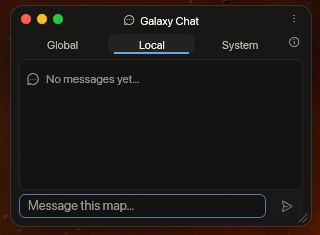
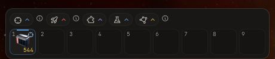
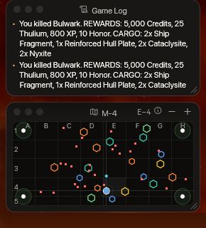
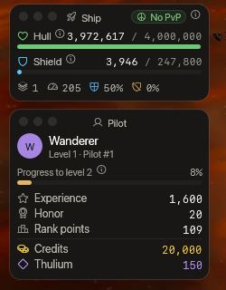
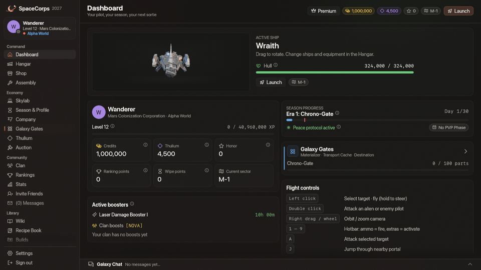
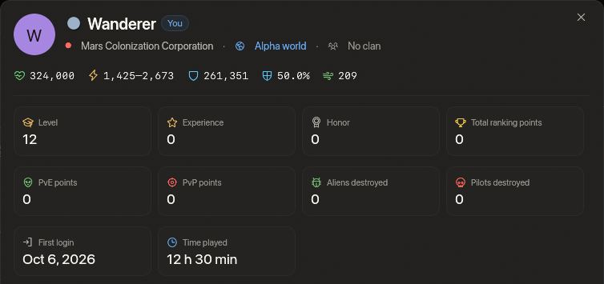
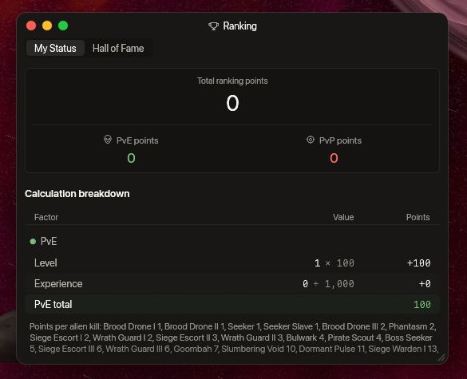
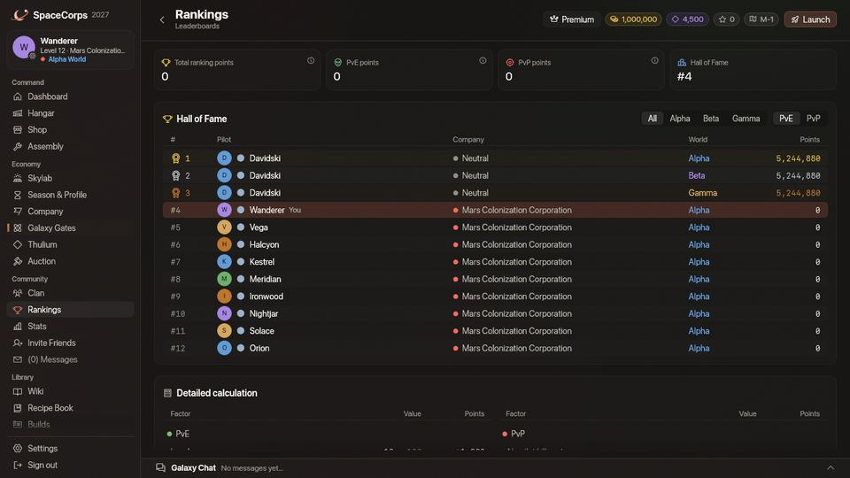

<!-- wiki-i18n source: e4b98fe2831813c3 -->
<!-- wiki-i18n title: Başlarken -->
# SpaceCorps’a başlarken {#getting-started-in-spacecorps}

En üst düzey uzay savaşı deneyimine hoş geldin. SpaceCorps’ta bir pilot olarak seçtiğin şirketi temsil edecek, galaktik hâkimiyet için savaşacak, değerli kaynaklar toplayacak ve evrendeki itibarını inşa edeceksin.

## Temel kaynaklar {#core-resources}

Hayatta kalmak ve gelişmek için iki para birimini yönetmeli ve onuruna göz kulak olmalısın. Üretimde kullandığın malzemeler, her birinin nereden edinileceği ve ne işe yaradığıyla birlikte [Kaynaklar](/wiki/06-Items/Resources.md) sayfasındadır:
- **Kredi**: Ana standart para birimi; yendiğin her uzaylı ve tamamlanan görevler öder, [Skylab’ının](/wiki/03-Mechanics/Skylab.md) Kredi Çiftliği üretir. Temel donanım, gemi ve standart ekipman satın almak için kullanılır.
- **Thulium**: Nadir, radyoaktif cevher ve yüksek değerli para birimi; yendiğin her uzaylı ve tamamlanan görevler öder, Skylab’ının Thulium Çiftliği üretir. Elit silahlar, motorlar, hibrit kalkanlar ve güçlü booster paketleri satın almak, Montaj’da modülleri yükseltmek, şirket değiştirmek (5.000), Araştırma Merkezi’ni hızlandırmak (5.000) ve bir Jump CPU ile yapılan her sıçrama için (500) kullanılır.
- **Onur**: Para değil, bir puan: sadakatinin ve itibarının ölçüsü. Onur [rütbeni](/wiki/03-Mechanics/Ranks.md) belirlemez; rütben PvE puanından ve en iyi altı rütbe için şirketinin kontenjanlarından gelir. Kendi şirketinden dost pilotlara saldırmak onur puanını ağır biçimde düşürür: kendi şirketinden bir pilotu (bir oyuncunun gemisini ya da [Şirket pilotlarından](/wiki/03-Mechanics/Company-Pilots.md) birini) yok etmek 100 onura mal olur. Başka bir şey onu yok etmeden önceki 15 saniyede ona vurmak da aynı bedeli taşır: bir şirket arkadaşını bir uzaylı bitirsin diye yıpratmak, öldürmenin kendisi kadar pahalıya mal olur. Bir şirket arkadaşını öldürmek PvP öldürmesi sayılmaz ve PvP puanı kazandırmaz. Şirket değiştirmek onurunun yarısını alır, aşağı yuvarlanır; 0 ya da daha düşük bir onur olduğu gibi kalır ([Şirket değiştirme](#changing-your-company)).

İstasyonda kredin, Thulium’un ve onurun her sayfanın sağ üst köşesinde, sektörünün ve **Uçuşa çık** düğmesinin yanında durur. Pencere uzun bir miktar için fazla dar olduğunda miktar kısaltılır (987,7Mn); tamamını okumak için üzerine gel.

## Pilot profilleri {#pilot-profiles}

Şeref Salonu’nda (**Topluluk › Sıralamalar**), **İstatistikler** sayfasında ya da bir klanın üye listesinde bir pilotun adına tıkla, pilotun **profili** açılır: şirket, dünya ve klan, seviye, deneyim, onur ve sıralama puanı, pilotun yok ettiği uzaylılar ve pilotlar ve uçtuğu gemi ile değerleri. İki karo pilotun ne zamandır ortalarda olduğunu söyler:

- **İlk giriş.** Pilotun ilk giriş yaptığı gün, senin saat diliminde bir tarih olarak. 0.4.12’den önce oynamış bir pilot, o güncellemeden sonra ilk giriş yaptığı günü gösterir; o güncellemeden beri giriş yapmamış bir pilot için bir tire görünür.
- **Oynama süresi.** Pilotun oyununun sunucuya ne kadar süredir bağlı olduğu, saat ve dakika olarak (“128 sa 15 dk”, “45 dk”), uçuşta ya da istasyonda. Hareketsiz geçirilen süre de sayılır. Sayım 0.4.12 ile başladı; bu yüzden ondan önce oynamış bir pilot için süre, o güncellemeden bu yana geçen süredir.

İkisi de seviye ve rütbe gibi herkese açıktır: giriş yapmış her pilot bunları bir profilde okuyabilir. Sezonun sıfırlaması bunlara dokunmaz.

## Şirket değiştirme {#changing-your-company}

Şirketini ilk oynadığında seçersin ve bu ücretsizdir. Daha sonra istasyonda değiştirebilirsin: **Ekonomi › Şirket**, diğer iki şirketi, her birinde bir **Şirket değiştir** düğmesiyle gösterir. Bir değişiklik **5.000 Thulium** ve onurunun yarısına mal olur (aşağı yuvarlanır; 0 ya da daha düşük bir onur olduğu gibi kalır). Geminin tamamı onarılır ve yeni şirketinin ana sektörüne (`M-1`, `T-1` ya da `G-1`) taşınırsın. Klanın, grubun, gemilerin, eşyaların ve Skylab’ın olduğu gibi kalır ve görevlerin devam eder: onların subayları artık yeni şirketinin subaylarıdır ve bir `rival x-4` görevi diğer iki şirketin sınır sektörleri anlamına gelir (bkz. [Görevler](/wiki/03-Mechanics/Quests.md#where-it-counts)). PvE puanların seninle gelir ve [rütben](/wiki/03-Mechanics/Ranks.md#who-is-on-the-ladder), yeni şirketinin pilotları arasında, şirketin kontenjanlarıyla birlikte yeniden hesaplanır. Gemin uçuştayken şirket değiştiremezsin: önce kenetlen.

## Arkadaşlarla oynamak {#playing-with-friends}

Bir [klana](/wiki/03-Mechanics/Clans.md) katıl ya da en fazla on pilotluk bir [grupla](/wiki/03-Mechanics/Groups.md) uç ve kişisel kodunla yeni arkadaşlarını da getir: **Topluluk › Arkadaşları Davet Et**, onlara bir başlangıç paketi, sana ise 5. seviyeye ulaştıklarında bir Thulium ödülü verir. Bkz. [Arkadaşları Davet Et](/wiki/03-Mechanics/Invite-Friends.md).

## Görevler {#missions}

Görevler seviye atlamanın en hızlı yoludur. **Mission Control** penceresini araç çubuğundan (bir istasyonun güvenli bölgesinin içinde) ya da istasyonun üzerinde süzülen **Mission Control** baloncuğuna tıklayarak aç: 88 görev seni 1. seviyeden 8. seviyeye taşır; her seviyede istediğin sırayla yapabileceğin on görev ve o on görev bitince açılan bir **Özel** görev vardır. Çoğu kısa zincirlerdir: birkaç uzaylıyı yok et, bir noktaya uç, bir sektörde birkaç dakika kal ya da yalnızca sana düşen bir görev eşyası bul, onu eve getirip Mission Control penceresine teslim et; bazen “3.000’den fazla gövde kaybetme” ya da “ölme” gibi bir kuralla. Her seviyenin görevleri seni bir sektör daha dışarı, üssünden sınıra ve PvP merkezine doğru götürür. 3. seviyeden itibaren, beş kademeye bölünmüş elli çok zor görevden oluşan ayrı bir **Meydan okuma** hattı emeğe göre büyük ödüller öder: her öldürme her kademede daha çok değer taşır, bir seferde en çok 100.000 Thulium’luk bir tavana kadar. Yazılı sayılar temeldir ve dünyan, boosterların ve klan güçlendirmelerin her görevde olduğu gibi onları çarpar. Nasıl çalıştıklarını ve her görevin ne ödediğini görmek için [Görevler](/wiki/03-Mechanics/Quests.md) sayfasına bak.

## Seyahat {#travelling}

Haritalar arasında **portallar** üzerinden seyahat edersin: birinin 500 birim yakınına uç ve `J` tuşuna bas; üç saniye sonra bir sonraki haritanın karşılık gelen geçidinde belirirsin ([Uzay haritasında seyahat](/wiki/01-General/Spacemap%20Travel.md)). Üssün `x-1` sektörünün tek bir geçidi vardır, `x-2` sektörüne; oradan haritalar `x-3` sektörüne ve PvP merkezi olan kendi Tehlike Sektörü’ne açılan `x-4` sınır sektörüne devam eder. Her `x-4` sektörünün ayrıca sonraki şirketin `x-3` sektörüne giden bir geçidi vardır ve her `x-3` sektörünün geri dönen geçidi vardır: Mars `M-4` ile Terra `T-3`, Terra `T-4` ile Galactic `G-3`, Galactic `G-4` ile Mars `M-3`. Bu üç bağlantının oluşturduğu şeye **halka** denir: şirketlerin haritaları arasında PvP merkezini geçmeyen bir yol.

## Ölmek ve geri dönmek {#dying-and-coming-back}

Gövden 0’a ulaştığında gemi yok edilir ve ölüm ekranı nerede geri dönmek istediğini sorar. Üç yer her zaman listelenir ve bir tıklamayla ya da `1`, `2` ve `3` tuşlarıyla seçersin (seçim patlamadan üç saniye sonra açılır, bu yüzden savaşta basılı tuttuğun bir tuş hiçbir şey seçmez):

| Seçenek | Tuş | Nerede belirirsin | Kullanımdan sonra kilit |
| :--- | :---: | :--- | :--- |
| **Üssünde** | `1` | Dünyandaki şirketinin üssü (`M-1`, `T-1` ya da `G-1`), nerede yok edilmiş olursan ol istasyonun güvenli bölgesinin içinde. | Asla |
| **En yakın portalda** | `2` | O sektörün, yok edildiğin yere düz çizgide en yakın portalının yanında, ondan 150 ile 300 birim uzakta. Tek portalı olan bir sektör onu kullanır. Portalı olmayan bir sektörde (tarafsız sektörler) bu seçenek soluk görünür. | 3 dakika |
| **Öldüğün yerde** | `3` | Yok edildiğin yer, aynı sektörde. | 5 dakika |

- **Kilit, o seçenekle yeniden doğduğunda başlar**, öldüğünde değil, ve yalnızca o seçeneğe aittir: portalı kullanmak “öldüğün yer” seçeneğini kilitlemez. Kilitli bir seçenek ölüm ekranında bir geri sayımla (dakika ve saniye) soluk görünür ve süre dolunca kendiliğinden açılır. Kilitleri sunucu tutar: çıkış yapıp tekrar girmek onları sıfırlamaz. Yeni bir sezon (sıfırlama) sıfırlar.
- **Sunucunun reddettiği bir seçenek hiçbir şeye mal olmaz.** Bir seçenek kullanılamıyorsa (hâlâ kilitli, sektörde portal yok, öldüğünden beri dünya değiştirdin) kilit harcanmaz ve gemin taşınmaz; yeniden seçersin.
- **Doğma koruması.** Hangi yeri seçersen seç, gemin geri geldikten sonraki **3 saniye** boyunca hasar alamaz ve kimse ona kilitlenemez; uzaylılar onunla ilgilenmeyi bırakır, böylece seni yok eden seni hemen yeniden yok edemez. Aynı 3 saniyede **saldıramazsın**: bir lazer ya da roket bir bildirimle reddedilir ve koruma erken bitmez. HUD kalan saniyeleri gösterir. Saniyeler dolunca biter.
- **Kara delik.** [Kara deliğin](/wiki/03-Mechanics/Black-Hole.md) radyasyon halkasının (Tehlike Sektörü 4’ün merkezinden 4.200 birim) içindeki bir yer asla geri dönülecek bir yer değildir: orada yok edildiysen “öldüğün yerde” seçeneği seni halkanın dışındaki en yakın noktaya, merkezden senin yerinden geçen doğru üzerine koyar ve sana bunu söyler.
- **Tehlike Sektörleri.** Orada da üç seçenek çalışır. “Öldüğün yerde”, kara deliğin halkasından olduğu gibi, aşırı ısınmış bir [dev ekskavatörün](/wiki/03-Mechanics/Giant-Excavator.md#heat-and-radiation) radyasyonundan ve [Dormant Swamp](/wiki/03-Mechanics/Dormant-Swamp.md) bölgesinden dışarı taşınır: bunların birinin içinde giriş yapan bir pilot da dışına konur.
- **Gövden sınırlı geri gelir.** Hangi yeri seçersen seç, geminle **en fazla 10.000** gövde ve boş bir kalkanla geri dönersin. Bir Protos (8.000 gövde) dolu geri gelir; daha büyük gemiler (Kitefin gemisinin 24.000 gövdesinden Ironclad gemisinin 600.000 gövdesine kadar) 10.000 ile geri gelir, bu yüzden bir sonraki savaştan önce bir Repair Drone ya da Emergency Repair ile onar (bkz. [Savaş](/wiki/03-Mechanics/Combat.md) ve [Yetenekler](/wiki/03-Mechanics/Abilities.md)). Kalkan her zamanki gibi dolar. Ölüm ekranı bunu söyler.
- **Bunun dışında yok edilmenin bedeli:** hiçbir eşya kaybetmezsin ve seçim yalnızca nerede belirdiğini belirler. Yeteneklerin hazırdır ve gizlenmemiş hâlde, herhangi bir EMP etkisi dışında geri gelirsin. [Grubunda](/wiki/03-Mechanics/Groups.md) kalırsın.
- **Kenetlenme.** Ölüm ekranındaki “Üsse dön” seni her zamanki gibi, aynı gövdeyle üste geri getirir. Seçmeden önce oyun kapanırsa gemiyi [hangarda](/wiki/03-Mechanics/Hangar.md) ücretsiz canlandır; üssündesin, aynı gövdeyle ve kalkansız.

## Klavye kontrolleri ve tuş atamaları {#keyboard-controls-keybindings}

SpaceCorps, özelleştirilebilir klavye düzeni kontrollerini destekler (oyun içindeki Ayarlar panelinden erişilir). Aşağıda varsayılan tuş atamaları var:

| Eylem | Kontrol / Tuş | Açıklama |
| :--- | :--- | :--- |
| **Gemiyi hareket ettir** | Uzay haritasında `Left Click` | Geminin, tıkladığın hedef koordinatlara uçmasını sağlar. |
| **Kamerayı döndür ve yakınlaştır** | `Right Drag`, `Mouse Wheel` | Sağ sürükleme görünümü geminin etrafında döndürür; tekerlek (ya da orta tuşla sürükleme) 30 birim uzaklıktan 1.500 birime kadar yakınlaştırır ve uzaklaştırır; 1.500 birimde yaklaşık 4.400 x 2.650 birimlik uzay görünür (1.000 birimlik bir görünümün 2,25 katı alan). Döndürmen ve yakınlaştırman, bıraktıktan iki saniye sonra varsayılan görünüme geri döner; Ayarlar › Genel altındaki **Kamera bıraktığım yerde kalsın** seçeneğini açmadıkça: o zaman görünüm verdiğin açıyı ve mesafeyi korur (o anahtarın yanındaki **Görünümü sıfırla** düğmesi onu bir kez varsayılan görünüme geri koyar, anahtarı kapatmak da öyle). Ayarlar › Genel altındaki **Kamera yakınlaştırma**, varsayılan mesafeyi %50 ile %338 arasında belirler (varsayılan %150’dir); anahtar açıkken onu oynatmak kamerayı yeni mesafeye götürür. |
| **Hedef seç** | Varlık üzerinde `Left Click` | Bir uzaylıyı, düşman pilotu ya da portalı aktif hedefin olarak seçer. Hedef penceresi (aşağıya bak) adını, mesafesini, gövdesini ve kalkanını gösterir. Bir [asteroite](/wiki/03-Mechanics/Asteroid-Mining.md) tıklamak, hedefini değiştirmeden onu seçer; roketler onu kırar, lazerlerin ona biraz zarar verir. |
| **Seçili hedefe saldır** | `Key A` (ya da `Ctrl + Click`) | Seçili hedefe lazerlerinle ve roketlerinle ateş etmeye başlar. Hiçbir gemi ya da uzaylı seçili değilse lazerlerinle seçili [asteroite](/wiki/03-Mechanics/Asteroid-Mining.md#breaking-one) ateş eder. |
| **Roket fırlat** | `Key R` | En son fırlattığın roketi (ya da kısayol çubuğundaki ilkini) fırlatır: güdümlü bir roket seçili hedefine, düz bir roket imlecinin yönüne gider. Düz bir roketi fareyle nişanlamak için kısayol çubuğundaki yuvasına tıklayarak hazırla, sonra uzayda tıkla. Tüm roketler 3 saniyelik ortak bir bekleme süresini paylaşır (bir dron formasyonu bunu değiştirebilir). |
| **Portaldan sıçra** | `Key J` | Bir portalın 500 birim yakınındayken (güvenli bölgesinin içinde) bir sıçrama başlatır. Sıçrama 3 saniye sürer (kısayol çubuğunun üstündeki bir çubuk bunu gösterir) ve bitene kadar menzil içinde kalmalısın. Tehlike Sektörleri’nde saldırı altındayken bir sıçrama başlatamazsın. |
| **Konfigürasyonu değiştir** | `Key C` | Konfig. 1 ile Konfig. 2 arasında geçiş yapar (aktif lazer/kalkan/hız düzenini değiştirir). |
| **Birincil kısayol çubuğu** | `Digits 1 - 9` | Birincil HUD kısayol çubuğu yuvandaki eşyaları/eylemleri etkinleştirir (örneğin cephane, onarım botları). |
| **İkincil kısayol çubuğu** | `Shift + Digits 1 - 9` | İkincil kısayol çubuğu yuvalarındaki eşyaları/eylemleri etkinleştirir. Satır, bir şey içerdiğinde birincilin üstünde görünür; oraya bir eşya koymak için Cephane, Roketler ya da Ekstralar seçicisini aç (ya da bir yuvayı sürükle). |
| **Dron formasyonu** | kısayol çubuğu yuvasının tuşu | O yuvadaki formasyonu kuşanır. Onu kısayol çubuğunun Formasyonlar listesinden oraya sürükle; listede ayrıca formasyon olmayan Standart seçeneği de var. Her 2 saniyede bir değiştirebilirsin, savaşta da güvenli bölgede de; yuvalar kalan saniyeleri gösterir. Bkz. [Dron formasyonları](/wiki/03-Mechanics/Formations.md). |
| **Tam ekran** | `F11` ya da `Alt + Enter` (Windows) | Kenarlıksız tam ekranı açar veya kapatır; uçuş ekranının sağ üstündeki düğme Windows ve macOS sürümlerinde aynısını yapar. Bu iki tuş sabittir ve değiştirebileceğin atamalar arasında görünmez. `Alt + Enter`, sohbette yazarken bekler. |
| **Nerede yeniden doğacağını seç** | `Keys 1 - 3` | Ölüm ekranında: `1` üste, `2` en yakın portala, `3` öldüğün yere. Yukarıdaki *Ölmek ve geri dönmek* bölümüne bak. |
| **Hedef penceresi** | `Key V` | Hedef penceresini gösterir veya gizler. Sol üstteki araç çubuğunun ilk düğmesi aynısını yapar. |
| **Grup penceresi** | `Key B` | Grup penceresini gösterir veya gizler: grubunun gemileri, gövdesi ve kalkanı. Bir grup daveti beklerken `Y` kabul eder, `Escape` reddeder. Bkz. [Gruplar](/wiki/03-Mechanics/Groups.md). |

## Hedef penceresi {#the-target-window}

Bir uzaylıya ya da pilota tıkla, **Hedef penceresi** seçtiğini gösterir: adı, mesafesi, gövde ve kalkan çubukları ve ona ateş edip etmediğin. **Nişangâh** düğmesi saldırıyı başlatır ve durdurur (`A` ile aynı), **X** düğmesi hedefi bırakır (`Esc` ile aynı). Hiçbir şey seçili değilse bunu tek satırda söyler. Bir [asteroite](/wiki/03-Mechanics/Asteroid-Mining.md#what-an-asteroid-is) tıkla, pencere onun gövdesini, neye dönüştüğünü ve roketinden kaç tane ya da lazerlerinin kaç salvosunun gerektiğini gösterir.

Diğerleri gibi bir penceredir. Her yere koymak için başlık çubuğundan sürükle, köşesindeki kırmızı ışıkla ya da **sol üstteki araç çubuğunun ilk düğmesiyle** (ya da `V` ile) kapat ve aynı şekilde yeniden aç. Bıraktığın yer ve açık olup olmadığı hesabın için hatırlanır. Ekranın üstünde, iki araç çubuğunun arasında başlar. Kapatmak yalnızca göstergeyi gizler: hedefin seçili kalır ve saldırın devam eder.

## Oyun takıldığında {#when-the-game-lags}

**Ayarlar › Arayüz › Ağ bilgisini göster** seçeneğini aç, sağ üstte küçük bir kart belirir (pencerelerin yolundan çekilir ve sen açana kadar kapalıdır). Hangi tarafın yavaş olduğunu söyler:

| Değer | Ne olduğu | İyi, yavaş |
| :--- | :--- | :--- |
| **Ping** | Oyun sunucusuna gidiş dönüş süresi (yanındaki simgede iyiyse üç, yavaşsa iki, kötüyse bir çubuk olur; diğer her değerde yavaşsa bir üçgen, kötüyse bir sekizgen görünür). | 80 ms altı iyi, 150 ms üstü kötüdür. |
| **Jitter**, **Anlık görüntü yaşı** | Sunucunun güncellemelerinin (saniyede 20) ne kadar düzenli ve ne kadar taze geldiği. | 25 ms altı jitter ve 100 ms altı yaş iyidir. |
| **En uzun boşluk** | Son on saniyede sunucudan güncelleme gelmeyen en uzun süre. | Bir saniyenin üstü bir takılmadır. |
| **Sunucu** | Sunucunun kendi adımının (50 ms) ne kadar sürdüğü (99. yüzdelik). Sunucu bunu bildiremeyecek kadar eskiyse *yok* yazar. | 20 ms altı iyi, 35 ms üstü kötüdür. |
| **İstemci** | Bilgisayarının kare süresi (95. yüzdelik). | 25 ms altı iyi, 33 ms üstü kötüdür. |

Bir şey kötü olduğunda, sayıların altındaki bir satır suçun kimde olduğunu söyler: *Ağ yavaş*, *Ağ gecikmeli* ya da *Bağlantı takıldı* senin bağlantın ya da sunucuya giden yoldur, *Sunucu meşgul* sunucudur (meşgul bir sunucu pingi de yükseltir ve güncellemeleri geride tutabilir), *İstemci yavaş* bilgisayarındır (grafik ayrıntısını düşür) ve *İstemci dondu* oyunun kendisinin bir an çizmeyi bıraktığı anlamına gelir (bir alt-tab, küçültülmüş bir pencere). Aynı sayılar dakikada bir ve bir takılma olduğunda hemen oyunun günlük dosyasına yazılır; böylece “saat 21:10’da takıldı” gibi bir bildirim günlükten yanıtlanabilir.

## Yeni başlayanlar için hızlı ipuçları {#quick-pro-tips-for-beginners}

1. **Konfigürasyonlar**: Her zaman iki ayrı düzen hazırla. Örneğin hızlı kaçış ya da seyahat için jeneratör yuvalarında tüm motorların/iticilerin olduğu **Konfig. 1**, savaş için kalkanların ve lazerlerin olduğu **Konfig. 2** olsun.
2. **Güvenli bölgeler**: Portalların ve üslerin çevresinde **güvenli bölgeler** bulunur. Bu alanlarda diğer pilotlar sana saldıramaz; kalkanlarını toparlayabilir ya da savaş bekleme sürelerini güvenle bekleyebilirsin.
3. **İlk yeteneğin**: başlangıç paketinde Protos gemisinin yetenek yuvasına zaten bir Repair Drone I takılıdır; bu yüzden Emergency Repair düğmesi (`E`, kısayol çubuğunun yanında) gövden hasarlı olduğunda onu on saniyede onarır. Bkz. [Yetenekler](/wiki/03-Mechanics/Abilities.md). Paket ayrıca Protos gemisinin iki ekstra yuvasına bir **Base CPU I** (10 kullanım, üssüne ışınlanma) ve ikinci bir **Repair Drone I** takar: kullanmak için onları kısayol çubuğunun Ekstralar seçicisinden bir yuvaya sürükle (bkz. [Ekstralar](/wiki/06-Items/Extras.md)). Yalnızca yeni pilotlar için: 0.4.10’dan önce kaydolmuş bir pilot, o zaman verilen paketi bu ikisi olmadan korur.
4. **Günlük klan vergisi**: Bir klanın üyesiysen, klan hazinesinin UTC gece yarısı günlük kredi bakiyenden bir vergi yüzdesi (%0 ile %5) kestiğini bil. Klanını akıllıca seçtiğinden emin ol!
5. **Bu Wiki’den kopyala**: bir makaledeki herhangi bir metni seçmek için üzerinden sürükle ve kopyalamak için `Ctrl+C` (Mac’te `Cmd+C`) tuşlarına bas; bir bağlantıya tıklamak yine sayfayı açar. Bir makalenin en üstündeki **Sayfayı kopyala**, tüm sayfayı Markdown olarak kopyalar; bir sohbete ya da nota yapıştırabilirsin.
6. **Üretmeden önce araştır**: Montaj yalnızca [Skylab’ının](/wiki/03-Mechanics/Skylab.md) Araştırma Merkezi’nin araştırdığını üretir. Araştırma Merkezi, Çekirdek 10. seviyeden itibaren açılır ve [Araştırma](/wiki/03-Mechanics/Research.md) sayfasında teknolojiler, süreleri ve yakıt yer alır.
7. **Dron formasyonları**: bir dronun olup bir formasyonu araştırıp ürettikten sonra, onu Formasyonlar listesinden kısayol çubuğuna sürükle ve yuvasının tuşuyla kuşan: daha zayıf toplar karşılığında daha büyük bir kalkan, daha ince bir gövde karşılığında daha sert roketler. Her biri ayrıca dronlarına uçacakları bir biçim verir. Bkz. [Dron formasyonları](/wiki/03-Mechanics/Formations.md).
8. **Kütüphane ile plan yap**: **Kütüphane › Tarif Kitabı** herhangi bir eşya için neye ihtiyacı olduğunu gösteren bir şemayı, sırayla adımları ve sahip olduklarının düşüldüğü tam maliyeti gösterir; **Kütüphane › Build’ler** aynısını bütün bir gemi için yapar ve başlamak için 15 ön ayar sunar. Bkz. [Tarif Kitabı ve Build’ler](/wiki/01-General/Recipe-Book.md).
