<!-- wiki-i18n source: 129abc8d9ddf80be -->
<!-- wiki-i18n title: Uzay haritasında seyahat -->
# Uzay haritasında seyahat {#spacemap-travel}

Uzay haritası, SpaceCorps evreninde gezinmek için kullandığın seyrüsefer arayüzüdür. Her şirket, hem güvenli keşfi hem de tehlikeli PvP karşılaşmalarını mümkün kılan belirli bir topolojide düzenlenmiş bir uzay sektörünü kontrol eder.

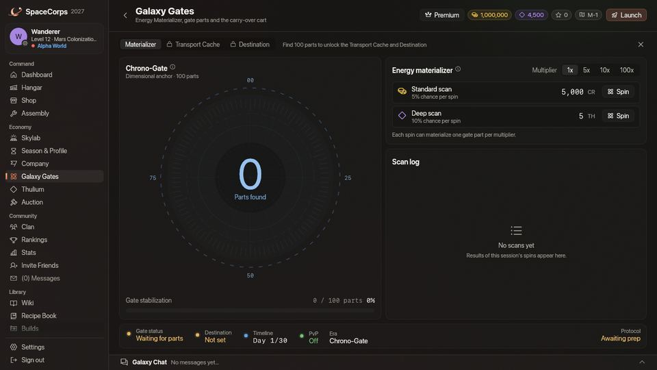
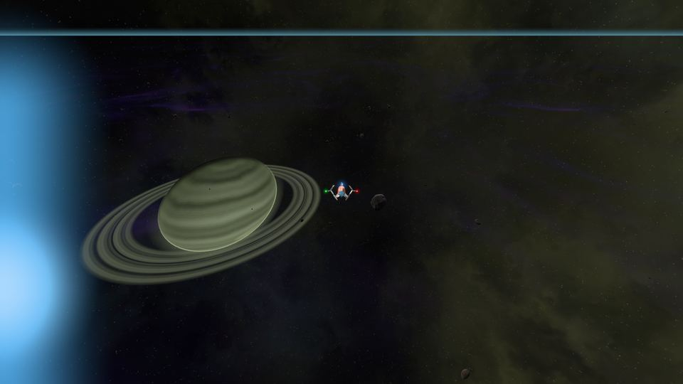
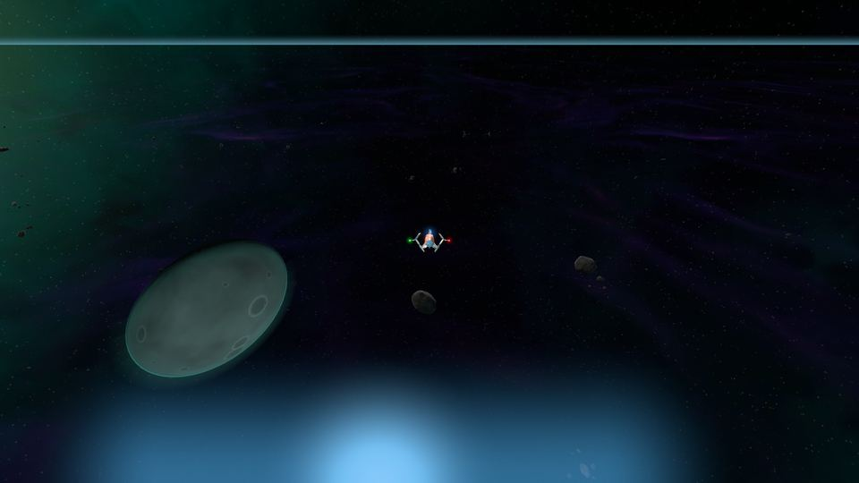
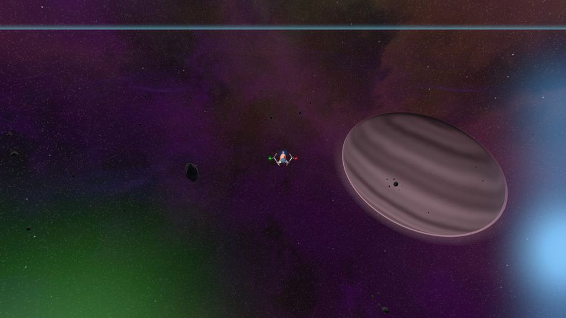
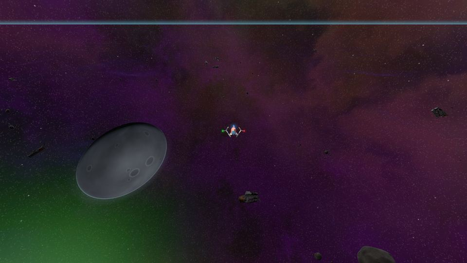
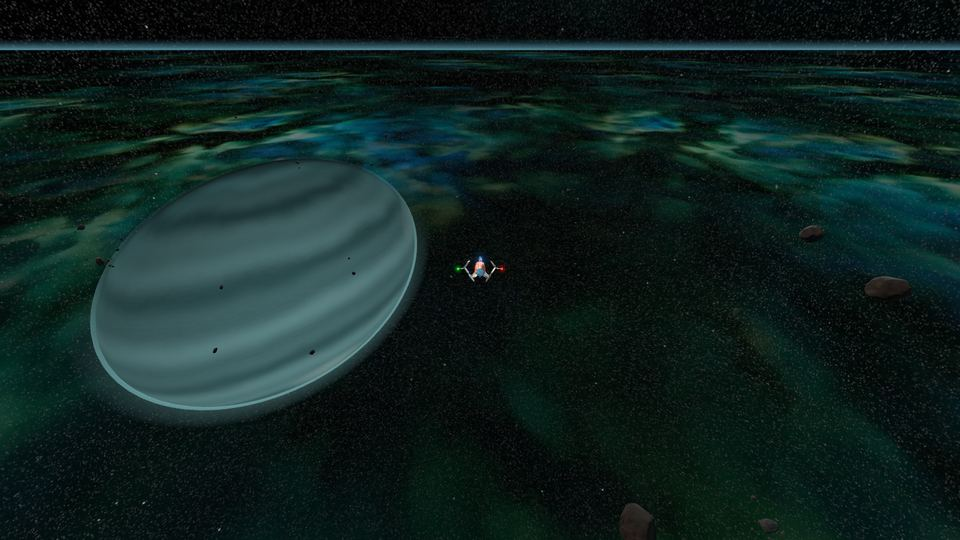
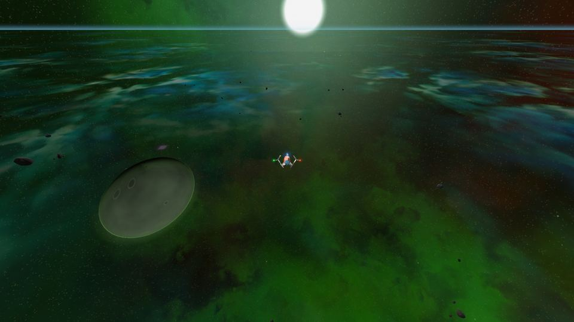
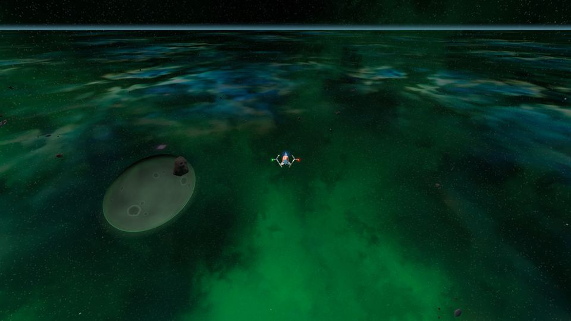
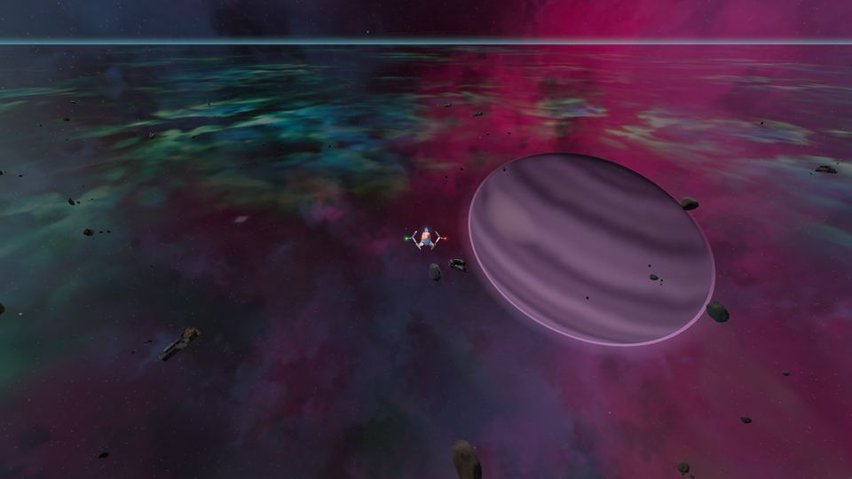
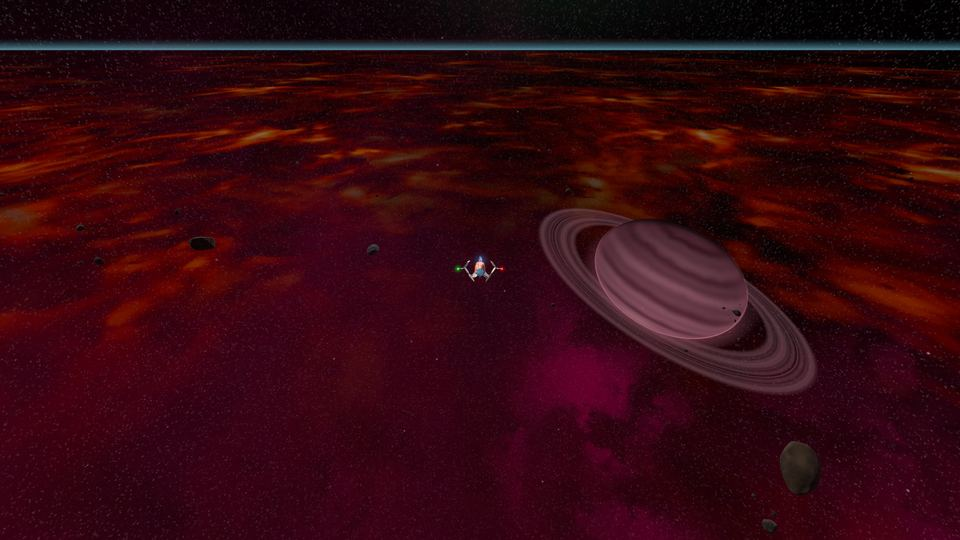
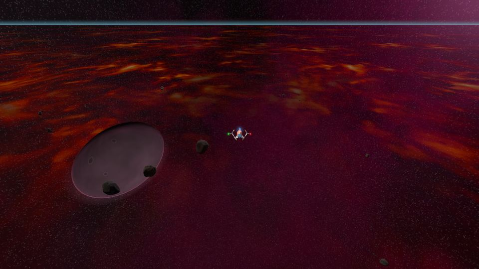
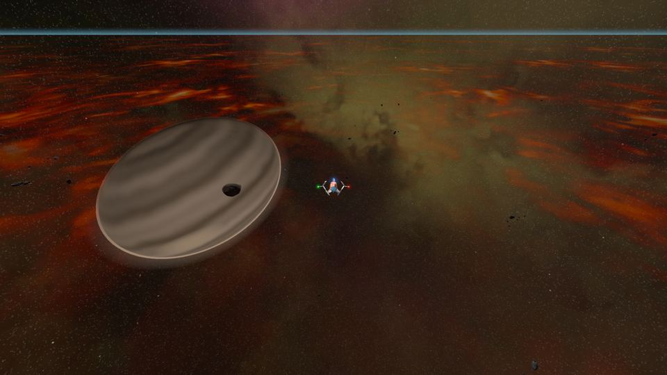
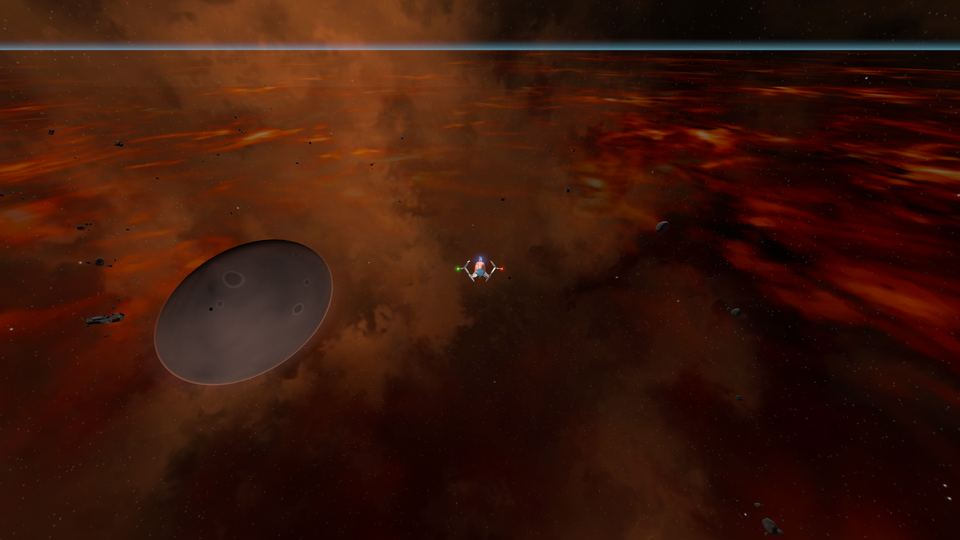
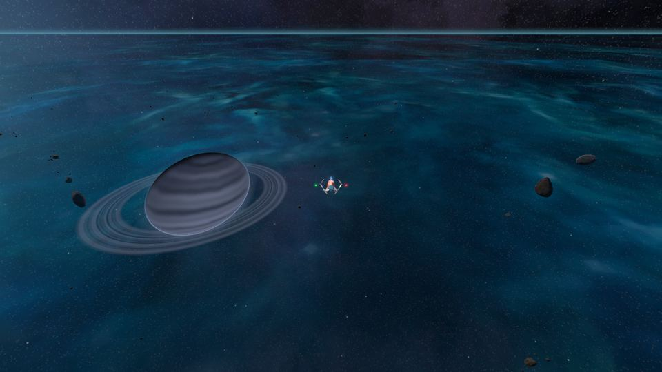
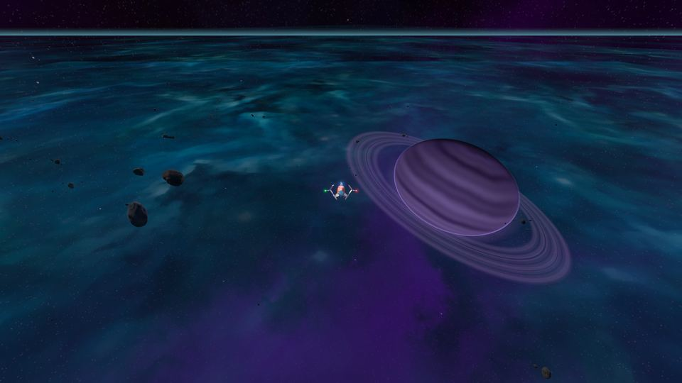
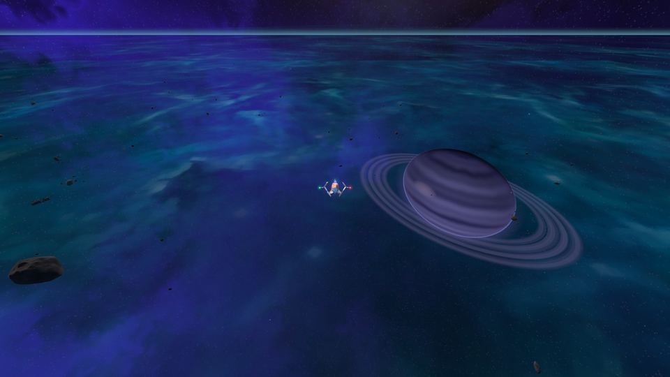
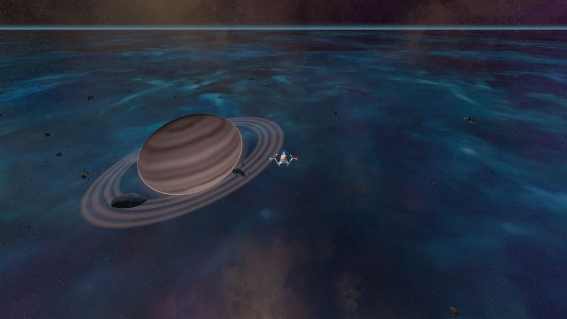
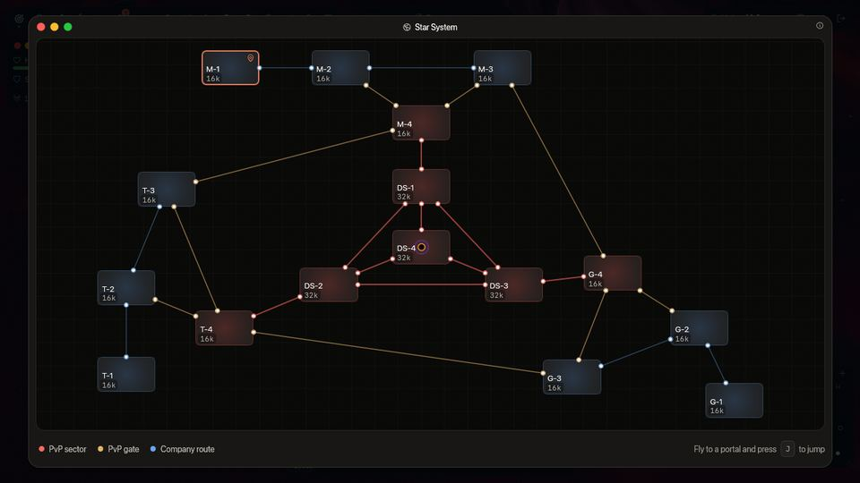

## Evrenin yapısı {#the-universe-structure}

Evren, üç ana şirket sektöründen (Mars, Terra, Galactic) ve merkezî bir PvP bölgesinden oluşur.

- **x-1 (Ana üs)**: Her şirketin başlangıç haritası (M-1, T-1, G-1). En güvenli bölge.
- **x-2 -> x-3**: Giderek daha sert uzaylıların bulunduğu genişleme bölgeleri.
- **x-4 (Sınır)**: PvP sektörünün ve başka bir şirketin `x-3` sektörünün kapısı (aşağıdaki halka).
- **DS-x (Tehlike Sektörleri)**: Tüm şirketleri birbirine bağlayan merkezî PvP bölgesi: DS-1 ile DS-4. DS-1 ile DS-3 sektörlerinin her birinde sezonun ilk gününden itibaren bir pulsar bulunur ve sezonun 11. gününden itibaren her birinin yanında bir dev ekskavatör ve ayrıca Dormant Swamp bulunur ([Tehlike Sektörleri](/wiki/01-General/Danger-Sectors.md)).

İstasyon yalnızca ana üslerde bulunur. **Mission Control** orada açılır ve güvenli bölgesi çevresinde 1.600 birim uzanır. Tehlike Sektörleri’nde, `DS-1` dahil, istasyon yoktur: oradaki tek güvenli bölgeler sıçrama geçitlerinin çevresindeki 660 birimlik halkalardır ve orada Mission Control açılamaz; görevlerin için üssüne geri uç.

Her [dünya](/wiki/03-Mechanics/Wipe-Timeline.md#worlds-alpha-beta-and-gamma) (Alpha, Beta, Gamma) bu haritanın tamamının kendi kopyasına sahiptir ve pilotların birbiriyle nerede savaşabileceği buna bağlıdır: Alpha dünyasında yalnızca `x-4` ve `DS-x` sektörlerinde, Beta dünyasında `x-1` dışında her yerde, Gamma dünyasında her yerde. Galaksi haritası sektörleri dünyanın kuralına göre renklendirir.

## Görselleştirme {#visualization}

Aşağıdaki Galaksi Haritası, bilinen evrenin gerçek zamanlı düzenini gösterir. Oyunda aynı şema **Yıldız Sistemi** penceresidir.

```spacemap

```

Bir [Jump CPU](/wiki/06-Items/Extras.md#jump-cpu) takılıysa şema hedefini de seçer: CPU yuvasına (**JMP**) bas, Yıldız Sistemi penceresi seçim kipinde açılır. Bu CPU ile gidebileceğin sektörler aydınlıktır; kendi sektörün ve Tehlike Sektörleri değildir. Fiyatı okumak için aydınlık bir sektörün üzerine gel, tıkla ve şema sorduğunda sıçramayı onayla (500 Thulium).

## Nasıl seyahat edilir {#how-to-travel}

Uzay haritasında seyahat **sıçrama geçitleri** (portallar) üzerinden yapılır. Bir [Jump CPU](/wiki/06-Items/Extras.md#jump-cpu) diğer yoldur: geçide ihtiyaç duymaz (bu sayfanın sonuna bak).

1. **Bir portal bul**: portallar genellikle bir haritanın köşelerinde ya da kenarlarında bulunur.
2. **Seyrüsefer**: geminle portal yapısına yaklaş.
3. **Etkinleştirme**: sıçramayı başlatmak için portalın 500 birim yakınındayken **J** tuşuna bas.
4. **Bekle**: sıçrama **3 saniye sürer**. Bu sırada kısayol çubuğunun üstündeki bir çubuk (“Sıçranıyor…”) dolar ve portal şarj oldukça daha parlak parlar; sen sıçradığında diğer pilotlar portalda aynı şarjı görür. Gemin uçmaya devam eder ama süre dolana kadar portalın 500 birim yakınında kalmalısın: menzilden çıkarsan sıçrama iptal edilir (“Portal sıçrama için çok uzakta.” ve çubuk kırmızıya döner). Sıçrarken tekrar **J** tuşuna basmak, bunu söylemekten başka bir şey yapmaz.
5. **Varış**: hedef haritadaki karşılık gelen portalda belirirsin.

### Ateş altında sıçrama {#jumping-under-fire}

- **Tehlike Sektörleri dışında**, uzaylılar ya da diğer pilotlar tarafından saldırıya uğramak sıçramanı **kesmez**: tamamlanır.
- **Tehlike Sektörleri’nde (`DS-1` ile `DS-4`)** saldırı altındayken sıçrayıp çıkamazsın. Bir pilot ya da uzaylı son **10 saniye** içinde geminin kalkanına ya da gövdesine vurduysa sıçrama başlamaz (“Saldırı altındasın: bir Tehlike Sektörü’nden sıçrayarak çıkamazsın.”) ve sıçrarken alınan bir vuruş sıçramayı iptal eder (çubuk kırmızıya döner ve oyun nedenini söyler). Kara deliğin radyasyonundan aldığın hasar bir saldırı sayılmaz, bir güvenli bölgenin durdurduğu atış da. Sıçradığın haritada aldığın bir vuruş portaldan seninle geçmez: temiz bir sicille varırsın.
- Bir seferde tek şey yaparsın: sıçrarken bir [kargo kutusu](/wiki/03-Mechanics/Cargo.md) toplayamazsın ve bir sıçramayı başlatmak, başlamış olduğun bir toplamayı bırakır.
- Sıçramanın ortasında oyunu kapatmak ya da üsse dönmek onu iptal eder: varmazsın.
- **Bir CPU ile yapılan warp, portal sıçraması gibi şarj olur.** Jump CPU için şarj 5 saniye, Base CPU için 10 saniye sürer; kısayol çubuğunun üstünde bir çubuk görünür. Herhangi bir sektörde attığın bir atış ya da aldığın bir vuruş warp işlemini iptal eder (hiçbir şey ödenmez ya da harcanmaz) ve ikisi de bir atıştan ya da vuruştan sonraki 10 saniye içinde başlamaz. Kendin iptal etmek için CPU yuvasına tekrar bas.

### Sıçrama bağlantıları {#jump-links}

- **Şirket döngüsü**: Mars, Terra ve Galactic aynı düzene sahiptir. Bağlantılar `1 <-> 2 <-> 3`, `2 <-> 4` ve `3 <-> 4` olarak akar. Bu, ikincil haritalar (`x-2` ve `x-3`) ile sınır haritası (`x-4`) arasında bir döngü oluşturur; `x-1` yalnızca `x-2` sektörüne bağlı güvenli bir giriş noktası kuyruğu işlevi görür: başlangıç haritanın yalnızca bir portalı vardır.
- **Tehlike Sektörü erişim geçitleri**: her şirketin sınır haritası (`x-4`) doğrudan kendi Tehlike Sektörü’ne bağlanır:
  - `M-4`, `DS-1` ile bağlanır
  - `T-4`, `DS-2` ile bağlanır
  - `G-4`, `DS-3` ile bağlanır
- **Halka**: her şirketin sınır haritasının (`x-4`) **sonraki şirketin** `x-3` sektörüne giden bir geçidi daha vardır ve her `x-3` sektörünün geri dönen geçidi vardır. Bu üç bağlantı Tehlike Sektörleri’nin çevresinde bir halka oluşturur; böylece her şirketin bir çıkış yolu ve bir giriş yolu olur:
  - `M-4`, Terra şirketinin `T-3` sektörüne bağlanır
  - `T-4`, Galactic şirketinin `G-3` sektörüne bağlanır
  - `G-4`, Mars şirketinin `M-3` sektörüne bağlanır

  Halka, hangi şirket için uçarsa uçsun her pilota açıktır: şirketlerin haritaları arasında PvP bölgesini geçmeyen ikinci bir seyahat yoludur. Bir halka geçidi, haritasının diğer geçitlerinden uzakta, kendi köşesinde durur; çevresinde olağan 660 birimlik güvenli bölge vardır ve sıçrama her geçitte olduğu gibi çalışır. Karşı tarafta nerede saldırıya uğrayabileceğin, her yerde olduğu gibi dünyana bağlıdır: Alpha dünyasında `T-3` bir PvP sektörü değildir ama `T-4` öyledir, Beta dünyasında ikisi de öyledir, Gamma dünyasında her sektör öyledir.
- **İstila yolları (şirketler arası seyahat)**: geçitler üzerinden başka bir şirketin topraklarına girmenin iki yolu vardır. Kısa olanı halkadır: bir Mars pilotu `M-4` sektöründen halka geçidinden Terra şirketinin `T-3` sektörüne uçar (Mars üssünden üç sıçrama, `M-1` → `M-2` → `M-4` → `T-3`) ve oradan `T-4` ya da `T-2` sektörüne geçer; Galactic şirketinin `G-4` sektörü Mars şirketinin `M-3` sektörüne, Terra şirketinin `T-4` sektörü Galactic şirketinin `G-3` sektörüne aynı şekilde çıkar. Uzun olanı PvP bölgesini geçer: `M-4` sektöründen `DS-1` Tehlike Sektörü’ne, sıçrama geçidinden `DS-2` sektörüne ve `T-4` üzerinden Terra uzayına; Galactic uzayına ulaşmak için `DS-3` sektörüne giden sıçrama geçidini geç ve `G-4` üzerinden gir.
- **Tehlike Sektörü üçgeni**: `DS-1`, `DS-2` ve `DS-3` birbirine bağlıdır. Her birinde bir şirketin geçidi vardır (`DS-1` sektöründe Mars, `DS-2` sektöründe Terra, `DS-3` sektöründe Galactic); `DS-4` sektöründe hiçbiri yoktur.
- **Çekirdek merkezi**: üç dış Tehlike Sektörü’nün (`DS-1`, `DS-2` ve `DS-3`) hepsi doğrudan merkez harita **`DS-4`** sektörüne bağlanır; evrendeki en tehlikeli ve en çok kazandıran PvP bölgesi. Tam ortasında bir **kara delik** asılı durur: portallar ve aralarındaki hatlar ondan epey uzak kalır, ama oraya uçan bir gemi önce radyasyonunu, sonra çekimini hisseder ve olay ufkunda yok edilir. Bkz. [Kara Delik](/wiki/03-Mechanics/Black-Hole.md). Sezonun 11. gününden itibaren `DS-4` sektörünün sol üst köşesinde, gördüğü her gemiye ateş eden toplara sahip [Dormant Swamp](/wiki/03-Mechanics/Dormant-Swamp.md) bulunur.

### Jump CPU {#the-jump-cpu}

[Jump CPU](/wiki/06-Items/Extras.md#jump-cpu), gemini dünyandaki herhangi bir şirket sektörüne geçit olmadan, sıçrama başına 500 Thulium karşılığında götürür; düşman ana sektörleri dahil. Hiçbir zaman bir Tehlike Sektörü’ne gitmez, bir çatışmada başlamaz ve önce Skylab’ın Araştırma Merkezi’nde araştırılır ([Araştırma](/wiki/03-Mechanics/Research.md)). [Base CPU](/wiki/06-Items/Extras.md#base-cpus) eşyaları seni aynı şekilde eve götürür. Bir warp CPU (Jump CPU ya da Base CPU), bir görev eşyası taşırken reddedilir (“Görev eşyası taşırken warp CPU kullanamazsın.”): eve geçitlerden uç ([Görev eşyaları](/wiki/03-Mechanics/Quests.md#quest-items)).
