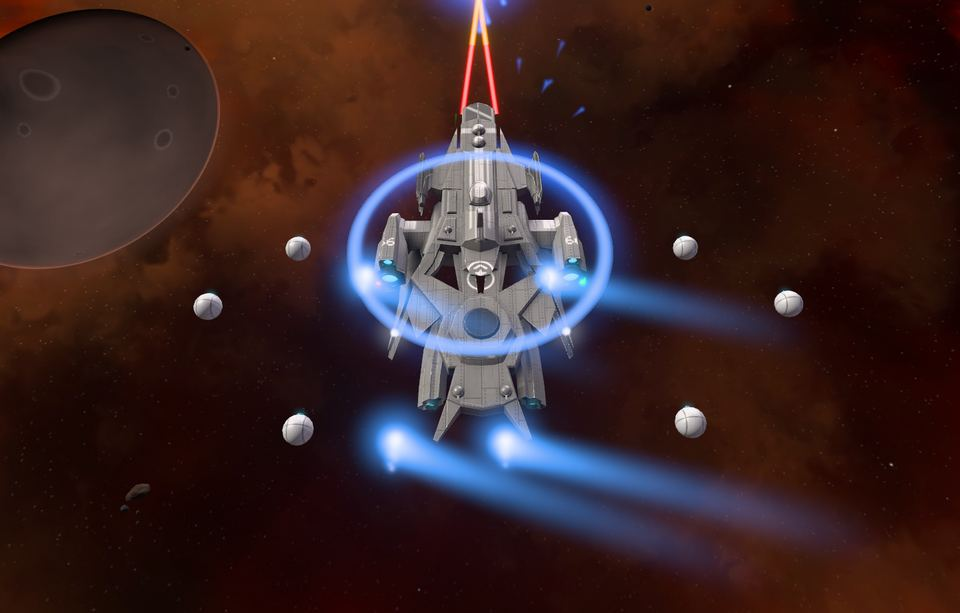
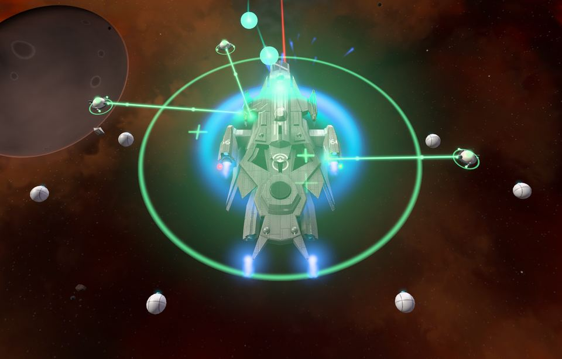
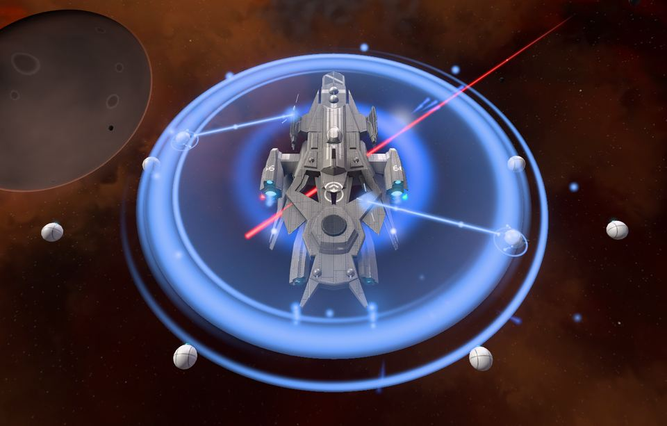

<!-- wiki-i18n source: c3dd26d1b3524b81 -->
<!-- wiki-i18n title: Yetenekler -->
# Aktif gemi yetenekleri {#active-ship-abilities}

Yetenekler, çatışmanın kızıştığı anda bastığın düğmelerdir: geri gelen bir kalkan, menzilden çıkmak için bir hız patlaması, gövden neredeyse bittiğinde bir onarım. Geminin **yetenek yuvalarına** taktığın **kalkan, motor veya Repair Drone** eşyasından gelirler; eşya ne kadar iyiyse yetenek de o kadar iyidir. İhtiyaç duyduğun an için yapılmışlardır, bekleme süresi biter bitmez basmak için değil: her biri yaklaşık on saniye sürer, ardından bir buçuk ile iki dakika arası dinlenir. Bazı [gemi tasarımlarının](/wiki/03-Mechanics/Ship-Designs.md) kendilerine ait bir yetenekleri daha vardır: bkz. [Gemi yetenekleri](#ship-abilities).

Yeni bir pilot bir yetenekle başlar: başlangıç paketindeki **Repair Drone I** zaten Protos gemisinin yetenek yuvasına takılıdır, bu yüzden Emergency Repair düğmesi (`E`) ilk dakikadan itibaren oradadır. Paketteki ikinci Repair Drone I ekstra bir yuvada durur: o gövdeyi yavaş yavaş kendi başına onarır ve bir yetenek değildir (bkz. [Ekstralar](/wiki/06-Items/Extras.md#repair-drones)).

## Yetenek yuvaları {#ability-slots}

Her geminin hangarda sabit sayıda yetenek yuvası vardır:

- **Protos** (başlangıç gemisi): 1 yuva
- **Kitefin**: 1 yuva
- **Ostirion**: 2 yuva
- **Nomad**: 2 yuva
- **Paragon**: 3 yuva
- **Storm**: 3 yuva
- **Ironclad**: 3 yuva
- **Wraith**: 3 yuva

Bir yetenek yuvası bir **kalkan çekirdeği**, bir **motor** veya bir **Repair Drone** alır ve her biri kendi yeteneğini verir. Eşyayı yuvanın üzerine sürükle. 1. konfigürasyonun ve 2. konfigürasyonun kendi yuvaları vardır.

- **Kalkan hücreleri ve iticiler yetenek yuvasına takılmaz.** Onlar kalkanların, motorların ve Uyarlanabilir Çekirdeklerin modülleridir.
- **Yetenek yuvasındaki bir eşya başka hiçbir şey eklemez.** Kalkan kapasitesi, dolum, soğurma veya hız vermez; bir kalkanın yavaşlatma etkisi de olmaz. Aynı Heavy Shield Core eşyası ya bir jeneratör yuvasında her an kalkanını verir ya da bir yetenek yuvasında Shield Surge yeteneğini verir. Seçim senin.
- Hücre veya itici taşıyan bir kalkanı ya da motoru yetenek yuvasına sürüklersen, taktığı hücreler ve iticiler envanterine geri döner.
- Yetenek yuvasındaki bir Repair Drone, Emergency Repair yeteneğini verir ve gövdeyi kendi başına onarmaz. Yavaş dron (**REP**) için ekstra yuvada bir Repair Drone gerekir.

## Aynı türden birden fazla modül {#several-modules-of-one-kind}

Bir konfigürasyonun yetenek yuvalarına **birden fazla kalkan, motor veya Repair Drone** takabilirsin. Yine tek yetenek, tek düğme ve tek bekleme süresidir, ama daha güçlüdür:

- **En düşük kademeli modül temeli belirler.** Gücü ve bekleme süresini onun kademesi verir. Bir Heavy Shield Core ile bir Light Shield Core birlikteyse iki I. kademe modül gibi davranır: daha iyi bir ikinci modül bonus getirir, ama hiçbir zaman daha yüksek bir güç ya da daha kısa bir bekleme süresi getirmez.
- **Diğer her modül temelin %50 kadarını ekler**; toplanır, çarpılmaz. Motorlar Afterburner yeteneğinin süresini **uzatır**: 10 sn, iki motorla 15 sn, üç motorla 20 sn (hız bonusu ve bekleme süresi değişmez). Kalkanlar Shield Surge yeteneğinin **daha fazla yenilemesini**, ek Repair Drone eşyaları da Emergency Repair yeteneğinin **daha fazla onarmasını** sağlar; süre yine on saniyedir. Toplam, bir modülde %100, iki modülde %150, üç modülde %200 olur.
- **Ek modüller yuva harcar.** Üç yetenek yuvalı bir gemide aynı türden üç modül, her türden birer modül ya da iki artı bir modül olabilir. Protos veya Kitefin gemisinin tek yuvası vardır ve modüller üst üste konamaz; Ostirion veya Nomad gemisi aynı türden iki modül taşıyabilir.
- Kademeler eşitse sonuç doğrudan o kademedir. Aynı kademeli iki modülden büyülemesi daha zayıf olan temeli belirler.

## Üç yetenek {#the-three-abilities}

### Shield Surge (kalkanlar), `Q` tuşu {#shield-surge-shields-key-q}

On saniye boyunca geminin kalkanı **onarılır**: Surge, maksimum kalkanının bir payını on saniyeye eşit olarak yayarak yeniler; en çok maksimuma kadar, asla üstüne çıkmaz. Bir bariyer değildir ve vuruşların nasıl bölüştürüldüğünü değiştirmez; kalkanı geri koyar ve geri koyduğu kalır. Vurulduğunda durmaz (olağan dolum vuruştan sonra 15 saniye bekler; Surge beklemez). Kalkanı dolu bir gemi ondan az fayda görür, bu yüzden kalkan erirken bas. Toplam hiçbir zaman çekirdeğin kendi kapasitesinin %60 kadarından az olmaz, bu yüzden kalkanı az olan bir gemi bile gerçek bir onarım alır (en çok maksimumuna kadar).

- Güvenli bölgenin korumasındayken ve hiç kalkanı olmayan bir gemide reddedilir; böylece yanlış bir tıklama yeteneği boşa harcamaz.
- Delici roketler kalkanları hâlâ kısmen aşar, her zaman olduğu gibi.

### Afterburner (motorlar), `W` tuşu {#afterburner-engines-key-w}

Süresi boyunca nihai hızın, kademenin bonusuyla çarpılır. Dönüşü, hedeflemeyi veya alınan hasarı değiştirmez: zamanı mesafeye çevirir. Çatışmadan çıkmak, bir istasyonun ya da portalın halkasına ulaşmak veya kaçan bir hedefe yaklaşmak için kullan. Her yerde çalışır, güvenli bölgeler dahil. Daha fazla motor onu daha hızlı değil, daha uzun süreli yapar.

### Emergency Repair (Repair Drone), `E` tuşu {#emergency-repair-repair-drones-key-e}

Maksimum gövdenin bir payını **on saniyeye eşit olarak yayarak** iyileştirir, asla maksimumun üstüne çıkmaz. Vuruşlar onu kesmez: bu bir acil durum yeteneğidir ve ateş altında, kara deliğin radyasyonunda, gizlenmişken ve bir EMP süresinin içindeyken de çalışır. Süre dolunca ya da geminin yok edilince biter. Kalkanına dokunmaz, vuruş sayılmaz ve yavaş REP onarımını olduğu gibi bırakır. Gövde doluyken reddedilir.

## Gemi yetenekleri {#ship-abilities}

On üç [gemi tasarımının](/wiki/03-Mechanics/Ship-Designs.md) sekizi, bir eşyaya değil tasarıma ait bir yetenekle gelir. **Yetenek yuvası kullanmaz** ve takılı hiçbir şey gerektirmez: tasarımı uçtuğun sürece oradadır. Kendine ait bir düğmesi vardır, kısayol çubuğunun sütunundaki dördüncü düğme; tuşu `F` (ayarlardan değiştirebilirsin). Kendi bekleme süresi vardır ve diğerleri gibi tutulur: konfigürasyon değiştirmek, sıçramak ve oyundan çıkmak onu sıfırlamaz; yok edilen bir gemi sonraki uçuşa her yetenek hazır başlar.

| Yetenek | Tasarım | Ne yapar | Süre | Bekleme süresi |
| :--- | :--- | :--- | ---: | ---: |
| **Blink** | Storm NOTSUM, Ironclad TITANIC | Hareket emrine doğru hız 2.500 (TITANIC: 1.500) | 1 sn | 120 sn |
| **Chameleon** | Storm RECON | Diğer tüm pilotlara görünmezsin, mini harita dahil | bozulana kadar | 60 sn |
| **Focus Fire** | Ironclad DUMA | 1.000 birim içindeki düşman gemiler sana saldırmaya zorlanır | 5 sn | 60 sn |
| **Venom** | Wraith RAPTOR | Hedefin gövdesine doğrudan 100.000 hasar | 30 sn | 120 sn |
| **Diminisher** | Wraith BILLY | %75 daha az hasar alırsın ve %25 daha az hasar verirsin | 10 sn | 120 sn |
| **Heal Pod** | Wraith MENATI | Bir kapsül, 600 birim içindeki dost gemileri her saniye 10.000 + maksimum gövdelerinin %1’i kadar iyileştirir | 5 sn | 120 sn |
| **Shield Buff** | Wraith ATARAXIS | Kalkan kapasiten iki katına çıkar ve her saniye maksimumunun %2’si kadar yenilenir | 10 sn | 120 sn |

- **Blink.** 1 saniye boyunca hızın hareket emrine doğru 2.500 olur (TITANIC için üst sınır 1.500). Emrin bittiği yerde durursun, haritanın kenarı da seni durdurur. Sonra 120 saniye dinlenir.
- **Chameleon.** Ortadan kaybolursun: hiçbir pilot seni ne haritada ne mini haritada görür, kimse sana kilitlenemez. Kendi şirketin seni yine görür, bir hayalet olarak. EMP onu bozamaz. Herhangi bir hasar aldığında, lazer salvosu ateşlediğinde, roket fırlattığında, kutu topladığında veya güvenli bölgeye girdiğinde ya da düğmeye yeniden bastığında biter; 60 saniyelik bekleme süresi, nasıl biterse bitsin, bittiği anda başlar. Bir atıştan veya vuruştan sonraki 10 saniye içinde, bir güvenli bölgenin halkası içindeyken ve bir Cloaking CPU açıkken başlatamazsın.
- **Focus Fire.** 5 saniye boyunca 1.000 birim içindeki her düşman pilot ve uzaylı sana saldırmaya zorlanır: pilotun kilidi sana atanır ve değiştirilemez, uzaylı sana döner. Grubundaki ve şirketindeki pilotlar, güvenli bölge korumasındaki gemiler ve gizlenmiş gemiler etkilenmez; güvenli bölgenin içinde veya menzilde hiç düşman yokken yetenek reddedilir. Zorlananlar yine de diledikleri yere uçabilir.
- **Venom.** Lazer menzilindeki bir hedefe kilitlen ve bas: 100.000 hasar, 30 saniyeye eşit olarak yayılarak doğrudan hedefin gövdesine gider; kalkanı bundan pay almaz. Başka şirketlerin pilotlarında ve uzaylılarda aynı şekilde çalışır; grubunda veya şirketinde, güvenli bölgenin koruduğu bir gemide ve lazer kilidinin reddedildiği yerlerde (Barış Protokolü, PvP’nin olmadığı bir sektör) çalışmaz. Bir gemi aynı anda tek Venom taşır. Her tick bir vuruş sayılır, bu yüzden hedef bitene kadar güvenli bölgeye sığınamaz. Hedefteki onarım, bir Heal Pod ve bir Diminisher hasarı azaltır; hedef ya da sen ölünce biter, öldürme ve puanları senindir.
- **Diminisher.** 10 saniye boyunca aldığın her vuruş, kalkanın payını almadan önce dörtte birine indirilir; yani hem kalkan hem gövde normalin dörtte birini kaybeder. Verdiğin her vuruş da dörtte üçüne iner: lazerler, doğrudan roketler ve patlamalar. Yetenek çalışırken ikinci bir basış bir şey yapmaz.
- **Heal Pod.** Bulunduğun yere bir kapsül düşer ve 5 saniye kalır. Her saniye 600 birim içindeki her dost gemiyi 10.000 artı o geminin maksimum gövdesinin %1’i kadar iyileştirir: seni, grubunu ve şirketini, başkasını değil, ve asla maksimumun üstüne çıkarmaz. Hiçbir şey kapsüle kilitlenemez ya da onu vuramaz; sen ölsen de iyileştirmeye devam eder.
- **Shield Buff.** 10 saniye boyunca kalkan kapasiten iki katına çıkar, elindeki kalkan da iki katına çıkar; kalkan her saniye ikiye katlanmış maksimumun %2’si kadar yenilenir. Bitince kapasite eski haline döner ve kalkan da payını koruyarak onunla birlikte iner; yani bu yetenek seni hiçbir zaman iyileştirmez: vurulmak için ek alandır. Hiç kalkanı olmayan bir gemide reddedilir.

Yakınında patlayan bir **EMP** düğmeyi 5 saniye boyunca kilitler: basış reddedilir ve bekleme süresi başlamaz. Zaten çalışan bir yetenek sürer ve Chameleon gizli kalır. Diğer pilotlar da bu yetenekleri görür: Blink yeteneğinin arkasında bir iz, Focus Fire yeteneğinin zorladığı gemilere giden kırmızı bir halka ve çizgiler, Chameleon ise yalnızca kendi şirketine bir hayalet olarak.

## Kademeler {#ranks}

Bir yeteneğin gücü, **kendi geminin bir değerinin payıdır** (maksimum kalkan, hız, maksimum gövde); yani gemiyle birlikte büyür. Kademe eşyadan gelir: daha iyi bir model daha iyi bir yetenek verir. Büyülenmiş bir eşya, büyüleme bonusunu güce ekler, en çok %15. Tablo tek bir modül içindir; birden fazla modülün durumu tablonun altındadır.

<!-- abilities:begin -->
<!-- Generated from server/Resources/AbilityConfig.json and the items' stats by scripts/abilities-wiki.sh: don't edit by hand. -->

| Yetenek | Kademe | Eşya | Güç (tek modül) | Süre | Bekleme süresi | Etkin oran |
| :--- | :---: | :--- | :--- | --: | --: | --: |
| **Shield Surge** | I | Light Shield Core | maksimum kalkanının %18 kadarını yeniler | 10 sn | 120 sn | %8,3 |
| **Shield Surge** | II | Basic Shield Core | maksimum kalkanının %36 kadarını yeniler | 10 sn | 105 sn | %9,5 |
| **Shield Surge** | III | Heavy Shield Core | maksimum kalkanının %60 kadarını yeniler | 10 sn | 90 sn | %11,1 |
| **Afterburner** | I | Engine I | +%30 hız | 10 sn | 120 sn | %8,3 |
| **Afterburner** | II | Engine II | +%45 hız | 10 sn | 105 sn | %9,5 |
| **Afterburner** | III | Engine III | +%60 hız | 10 sn | 90 sn | %11,1 |
| **Emergency Repair** | I | Repair Drone I | maksimum gövde puanının %12 kadarını onarır | 10 sn | 120 sn | %8,3 |
| **Emergency Repair** | II | Repair Drone II | maksimum gövde puanının %15 kadarını onarır | 10 sn | 105 sn | %9,5 |
| **Emergency Repair** | III | Repair Drone III | maksimum gövde puanının %19,2 kadarını onarır | 10 sn | 90 sn | %11,1 |
| **Emergency Repair** | IV | Repair Drone IV | maksimum gövde puanının %24 kadarını onarır | 10 sn | 75 sn | %13,3 |

Bir konfigürasyondaki aynı türden birden fazla modül: en düşük kademeli olan yukarıdaki gücü ve bekleme süresini belirler, diğer her biri bunun %50 kadarını ekler.

| Aynı türden modüller | Afterburner süresi | Shield Surge yenilemesi | Emergency Repair onarımı |
| :---: | --: | --: | --: |
| 1 | 10 sn | %100 | %100 |
| 2 | 15 sn | %150 | %150 |
| 3 | 20 sn | %200 | %200 |

<!-- abilities:end -->

Engine II ile III. kademe kalkan ve motorlar (Heavy Shield Core, Engine III) satılmaz: bunları [Montaj](/wiki/06-Items/Overview.md#upgrading-modules) ekranında, bir Engine I, bir Basic Shield Core ve bir Engine II eşyasından, Thulium, ganimet ve plakalarla üretirsin (Engine II için 4 Velkonite Reinforced Plate, diğerleri için 4 Dark Matter Plate ve bir Ancient Control Unit: [Dark Matter ve Dark Matter plakaları](/wiki/03-Mechanics/Dark-Matter.md)). Emergency Repair yeteneğinin dördüncü bir kademesi vardır: Repair Drone IV.

## Bekleme süreleri ve sınırlar {#cooldowns-and-limits}

- **Bekleme süresi, yeteneğe bastığın anda başlar** ve yeteneğin süresini de içerir. Yani 90 saniyelik bekleme süresi olan 10 saniyelik bir Surge en çok zamanın %11’inde etkindir ve bittikten sonra 80 saniye kullanılamaz. Birden fazla modül bunu kısaltmaz (en düşük kademeli modülünki geçerlidir); üç motorla Afterburner bile zamanın en çok %22’sinde etkindir.
- **Bekleme süreleri eşyaya değil sana aittir.** Konfigürasyon değiştirmek, eşyayı değiştirmek, başka bir sektöre sıçramak ve oyundan çıkmak bunları sıfırlamaz. Yok edilen bir gemi sonraki uçuşa her yetenek hazır başlar.
- **Her yeteneğin kendi bekleme süresi vardır.** Birini kullanmak diğerlerini kilitlemez.
- **Çalışan bir etki, başladığı değerleri korur.** Eşyayı çıkarmak veya konfigürasyon değiştirmek onu değiştirmez ya da bitirmez. Sıçrama veya yeniden bağlanma da bitirmez; oyundan çıkmak bitirir ve bekleme süresi kalır.
- Diğer pilotlar yeteneklerinin sayaçlarını haritada görür, hep olduğu gibi: harcanmış bir Surge onlara sonraki dakikaların açık olduğunu söyler.

## Tuşlar ve düğmeler {#keys-and-buttons}

`Q` Shield Surge, `W` Afterburner, `E` Emergency Repair ve `F` geminin tasarımının yeteneği (hepsi ayarlardan değiştirilebilir). Her düğme, kısayol çubuğunun yanında yalnızca konfigürasyonunda o yetenek varsa görünür (`F` düğmesi de yalnızca uçtuğun gemide varsa), bu yüzden yeni bir pilotun `E` düğmesi daha ilk dakikadan oradadır. Simgesinin çevresindeki halka yeteneğin durumunu söyler: hazırken yeteneğin renginde tam, çalışırken kalan saniyelerle boşalan (artık on saniyeye yayılarak iyileştirdiği için Emergency Repair de öyle), dolarken de ortada kalan saniyelerle yeniden dolan bir halka. Birden fazla modülden oluşan bir yığın, işaretini (`x2`, `x3`) düğmenin köşesinde taşır. Gövden doluyken Emergency Repair düğmesi, hiç kalkanı olmayan bir gemide de Shield Surge düğmesi soluk görünür. Düğmenin üzerine gelirsen geminin değerlerini, yığın hesaba katılarak görürsün (örneğin *Afterburner II x2: 15sn boyunca +%45 hız*); bir Surge ya da onarım çalışırken saniyede ne kadar verdiğini ve daha ne kadarının geleceğini de.

## Hangarda {#in-the-hangar}

Bir kalkanı, motoru veya Repair Drone eşyasını bir yetenek yuvasına sürükle ya da envanterinde ona sağ tıklayıp ilk boş yuvaya yerleştir. Aynı türden ikinci ve üçüncü modül sıradaki boş yuvalara girer ve üst üste biner. Yeteneğin adı ve kademesi her dolu yuvanın altında durur; yanında yığının işareti ve tüm modüllerinin birlikte değerleri yazar (*Afterburner II x2*, *x2 · 15sn*; bir Wraith üzerinde tek bir Repair Drone II için *+81.000 gövde*). Bir yuvanın üzerine gelirsen geminde ne kadar değer ettiğini, yığın hesaba katılarak ve yığındaki hangi modülün kademeyi belirlediğini görürsün. Aynı türden her modül aynı yeteneği gösterir, çünkü hepsi tek bir yetenektir. Eşyanın üzerine başka bir yerde gelirsen yetenek, geminin payları ve bir modülün daha ne eklediğini söyleyen bir cümleyle görünür.

## Herkesin gördükleri {#what-everyone-sees}

Shield Surge, çalıştığı sürece geminin çevresinde bir kalkan kabarcığıdır; son iki saniyesinde titrer ve bittiğinde kapanır. Kalkan çubukları (seninkisi Gemi penceresinde, bir hedefinki Hedef penceresinde) Surge kalkanı geri koydukça dolar ve yeri olduğu sürece çubuk hafifçe nabız gibi atar. Afterburner, çalıştığı 10, 15 ya da 20 saniye boyunca motorları daha sıcak yakar ve başladığında gemiden bir halka yayar; yığında bu halka daha geniştir. Emergency Repair, başlarken yeşil bir darbe yayar; sonra on saniye boyunca gövdeyi, üzerinden birkaç artı işareti yükselen yumuşak yeşil bir parıltıyla sarar, her saniye iyileştirdiği gövde puanını kendi geminin üzerinde yükselen bir sayı olarak gösterir ve son bir parlamayla biter. Çalışırken küçük onarım dronları geminin çevresinde döner ve onu onarır: Repair Drone I için bir, II için iki, III veya IV için üç, bir yığındaki her ek Repair Drone için de bir tane daha (en fazla üç). Gövdeden ayrılır, plakalarına yumuşak yeşil ışınlar yöneltir, II. kademeden itibaren ışınlar boyunca darbeler gönderir ve on saniye dolunca yerlerine geri döner; bir Shield Surge yeteneğinin kabarcığının içinde en fazla iki mavi dron olur. Haritadaki her pilot üç yeteneği de görür, dronları da (başka bir pilotun gemisinde daha küçük, düşük grafik ayarlarında da daha az: Düşük ayarda ışınlar ve parıltılar dron modelleri olmadan gösterilir; ışın, dronun her kademesi için biraz daha geniştir), bu yüzden harcanmış bir Surge senin kadar düşmana da bir işarettir. Dronların, onarım çanının çok altında kalan, kendilerine ait üç sessiz sesi vardır: gövdeden ayrılırken yumuşak bir bip, yerlerine dönerken bir tane ve çalışırken ışınlarının altında hafif bir ton (Shield Surge dronları biraz daha tiz); bunları ekranındaki gemilerden duyarsın, aynı anda en fazla birkaç tanesini, ve Ses efektleri ayarı onları kısar. *Hareketi azalt* açıkken parıltı sabit kalır, artı işaretleri çıkarılır, son parlama bir solmaya dönüşür ve dronlar sabit bir ışınla geminin yanında park halinde durur (sesler kalır). Ekstra yuvadaki bir Repair Drone (REP) de gövdeyi onardığı sürece kendi dronlarını çizer: Repair Drone I için bir, II için iki, III veya IV için üç; geminin çevresinde dönüp ona ışın tutarlar ve haritadaki her pilot onları görür. Onarım durunca yerlerine geri uçarlar.

## Ne değişti {#what-changed}

0.4.3 güncellemesinden önce yetenek yuvaları kalkan hücrelerini (Kalkan yenileme) ve iticileri (Hız artışı) alıyordu. Yetenek yuvalarında duran kalkan hücreleri ve iticiler oyun güncellenirken envanterine geri döndü ve sende kalıyor: hâlâ kalkanların, motorların ve Uyarlanabilir Çekirdeklerin modülleridir. O günden beri Shield Surge artık aşırı kalkan bariyeri vermiyor, kalkanını on saniyeye yayarak onarıyor; Emergency Repair da bir anda değil on saniyede iyileştiriyor; ayrıca aynı türden birden fazla modül takarak daha uzun bir Afterburner, daha büyük bir Surge veya daha büyük bir onarım elde edebilirsin.
