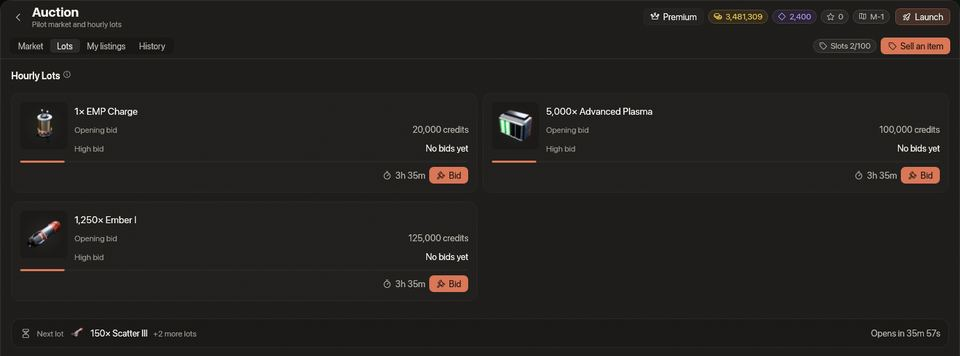
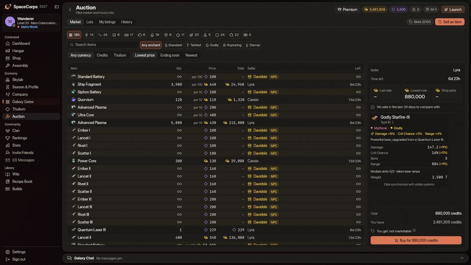
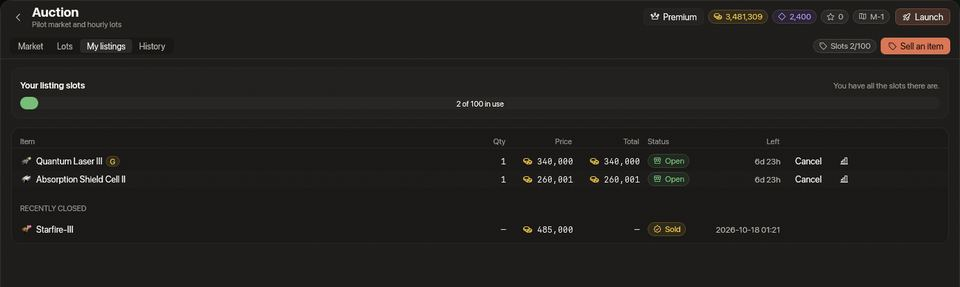
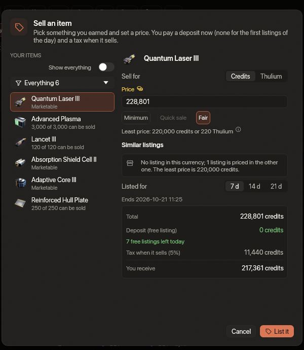
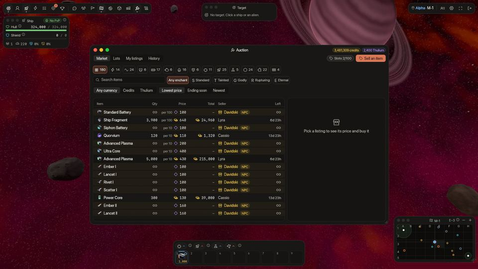

<!-- wiki-i18n source: a0d1cdf6c80cfe4b -->
<!-- wiki-i18n title: Açık Artırma -->
# Açık Artırma {#auction}

Açık Artırma, istasyon menüsünün tek bir sayfasında hem pilotların pazarı hem oyunun kendi saatlik lotlarıdır. Uçuşta bir pencerede açılır: sol üstteki araç çubuğundaki **Açık Artırma** düğmesi (bir tokmak) aynı sayfayı oyunun üzerinde gösterir ve pencerenin yeri ile boyutu hatırlanır. İstasyondaki gibi çalışır; yalnızca cephane, roket ve EMP Charge uçuşta sayıldığı için bunları istasyondan ilana koyarsın (satış paneli bunları kilitli gösterir ve nedenini yazar); satın almayı ve teklif vermeyi her yerden yapabilirsin. Dört bölümü vardır. **Pilot pazarı**, diğer pilotların satışa çıkardıklarıdır ve ilanlarının arasında uçan tüccarın stoğu da yer alır: Açık Artırma’nın listelediği her tür, Mağaza fiyatının kat kat fazlasına, adı altın rengiyle yazılı, **NPC** rozetli ve sonsuzluk işaretli satırlar olarak; Mağaza’nın satmadığı eşyalar o kadar pahalıdır ki ondan almak son çaredir, üretimlerde kullanılan nadir kaynaklar ise bunun bin katı daha pahalıdır ([Davidski](/wiki/03-Mechanics/Davidski.md)). **Lotlar** oyunun kendi teklifleridir, her saat üç tane. **İlanlarım** kendi satışa çıkardıklarındır. **Geçmiş**, satışların, alımların, kazandığın lotların ve ticaretinin nasıl gittiğidir.

<!-- market-glance:begin -->
<!-- Generated from server/Resources/Market.json and Auction.json (and the item seeds, Rockets.json) by scripts/market-wiki.sh: don't edit by hand. -->

- Pazarı kullanmak (ilan vermek, satın almak ve teklif vermek) için **5. seviye** gerekir.
- Bir ilan lot başına fiyatlanır, tam sayı kredi ya da tam sayı Thulium cinsinden (ikisi birden değil) ve asla türün en düşük fiyatının altında olamaz. **En yüksek fiyat yoktur**.
- Thulium cinsinden bir fiyat, kredi cinsinden en düşük fiyatın 1.000 değerine bölünüp yukarı yuvarlanmış hâlinden az olamaz; bu yalnızca en düşük fiyatı 1 Thulium ya da daha fazla eden türler için geçerlidir. Oranın yaptığı tek şey budur: **1 Thulium = 1.000 kredi, en düşük fiyat için bir kuraldır, döviz kuru değildir.** Hiçbir şey takas edilmez, hiçbir değer gösterilmez ve kredi ile Thulium asla toplanmaz.
- 84 tür ilana konabilir ve bunlardan 83 tanesi Thulium cinsinden de fiyatlanabilir.
- Bir ilan, seçtiğin gibi 168 / 336 / 504 saat sürer: seçenekler her seviyede aynıdır.
- **İlan ücreti**, ilanın sürdüğü her 24 saat için fiyatın %0,25 kadarıdır, en az 50 kredi ya da 1 Thulium. Bunu ilan verirken ödersin; asla iade edilmez, iptal etsen bile.
- Seviye 10 ve üzerinde ilan ücreti %0,4 olur.
- Her UTC gününün ilk 10 ilanı, süresi ve fiyatı ne olursa olsun hiç ilan ücreti ödemez. İptal ettiğin bir ilan yine de verilmiş sayılır. Satış vergisi her ilanda aynıdır.
- **Vergi**, fiyatın %5 kadarıdır. İlan satıldığında satıcının alacağından düşülür.
- İlan ücreti ve vergi yakılır: kimseye gitmez.
- Sezonun 28. gününden sıfırlamaya kadar ilan ücreti ve vergi yoktur.
- Sezonun 30. gününden itibaren pazar, yeni sezon başlayana kadar kapalıdır: hiçbir şey ilana konamaz, satın alınamaz ya da teklif verilemez. İlanlarını yine de iptal edebilirsin.
- Her para biriminin, 24 saat içinde satabileceğin ve satın alabileceğin tutar için kendi sınırı vardır (aşağıdaki seviye tablosu). Lot kazanımları sayılmaz.
- İki pilot arasında, biri diğerinden alırken, 24 saatte en fazla 8.000.000 kredi ya da 40.000 Thulium geçebilir.

<!-- market-glance:end -->

## Satılabilir eşyalar {#marketable-items}

Yalnızca **kazandığın** eşyalar satılabilir. Kazandığın her şey küçük bir etiket taşır, **Satılabilir**; [Hangar](/wiki/03-Mechanics/Inventory.md#marketable-items) içinde görürsün: uzayda topladıkların (uzaylı, sürü, Warden ve kara delik ganimetleri: [Kargo Kutuları](/wiki/03-Mechanics/Cargo.md)), bir görevin ödediği ([Görevler](/wiki/03-Mechanics/Quests.md#rewards)) ve Montaj ile Demirhane’nin ürettiği her şey. Mağaza’dan **satın aldığın**, bir lotta kazandığın, pazardan satın aldığın, [Davidski](/wiki/03-Mechanics/Davidski.md)’den aldığın, bir bonus kodundan, bir davet paketinden ya da başlangıç kitinden gelen ya da iade olarak geri aldığın şey satılabilir değildir ve bir daha asla satılamaz; böylece hiçbir şey yalnızca yeniden satmak için alınmaz. Skylab Dökümhanesi’nin ürettiği plakalar da satılabilir değildir; bir görevin ödediği Reinforced Plate eşyaları ise satılabilirdir. Skylab’daki Cephane Yazıcısı ile Roket Fabrikası’nın ürettiği cephane ve roketler de satılabilir değildir.

Etiket bir anahtar değil, bir birim sayısıdır: bir cephane yığını satın alınmış ve kazanılmış mermiler içerebilir ve kart “Satılabilir (5 adetten 3 tanesi)” der. Bir yığının bir kısmını kullandığında (ateş etmek, üretmek) etiketsiz birimler önce gider, böylece satılabilir olanlar en uzun kalır. İki parçayı [Demirhane](/wiki/06-Items/Forge.md#merge)’de birleştirmek etiketi yalnızca iki parça da taşıyorsa korur ve birleştirme önizlemesi bunu söyler; başarısız olan bir Demirhane adımı malzemelerini etiketsiz birimler olarak geri verir.

Hangarın **Yalnız satılabilir** düğmesi yalnızca satabileceklerini gösterir ve etiketli bir eşyanın çöp kutusunun yanındaki **tokmak** o eşya için Açık Artırma’nın satış panelini açar. Montaj’da sonucu satılabilir olan bir tarif bunu söyler ve eksik kaldığın bir malzemenin, adı arama kutusuna yazılı olarak Açık Artırma’yı açan bir bağlantısı vardır.

Açık Artırma geldiğinde (0.4.12), Mağaza’nın satmadığı ve elinde zaten bulunan teçhizat ile kaynaklar bir kez etiketlendi. Şunlar etiketlenmedi, çünkü Mağaza bir zamanlar onları satıyordu ya da elinde tuttuğun şey satın alınmış ve kazanılmış parçaların karışımı: Quantum Laser III, Absorption Shield Cell II ve III, Engine II, Adaptive Core II, Impulse Thruster II ve III, iki Reinforced Plate ve her pilotun en eski Base CPU I (başlangıç kitinden gelen). Bunlardan kazandığın ya da ürettiğin yeni olanlar etiketlenir.

## Neler satılabilir {#what-can-be-sold}

<!-- market-kinds:begin -->
<!-- Generated from server/Resources/Market.json and Auction.json (and the item seeds, Rockets.json) by scripts/market-wiki.sh: don't edit by hand. -->

| Tür | Satabileceğin türler | Sayı |
| :--- | :--- | ---: |
| **Lazerler** | Quantum Laser I, Quantum Laser II, Quantum Laser III, Starfire-III, Helios Beam | 5 |
| **Lazer Amfileri** | Damage Amp I, Crit Amp I, Penetration Amp I, Damage Amp II, Crit Amp II, Penetration Amp II, Damage Amp III, Crit Amp III, Penetration Amp III, Damage Amp IV, Crit Amp IV, Penetration Amp IV | 12 |
| **Kalkan Çekirdekleri** | Light Shield Core, Basic Shield Core, Heavy Shield Core | 3 |
| **Motorlar** | Engine I, Engine II, Engine III | 3 |
| **Uyarlanabilir Çekirdekler** | Adaptive Core I, Adaptive Core II, Adaptive Core III | 3 |
| **Kalkan Hücreleri** | Absorption Shield Cell I, Capacity Shield Cell I, Absorption Shield Cell II, Capacity Shield Cell II, Absorption Shield Cell III, Capacity Shield Cell III, Absorption Shield Cell IV, Capacity Shield Cell IV | 8 |
| **İticiler** | Impulse Thruster I, Momentum Thruster I, Impulse Thruster II, Momentum Thruster II, Impulse Thruster III, Momentum Thruster III, Impulse Thruster IV, Momentum Thruster IV | 8 |
| **Lazer Cephanesi** | Standard Battery (lot başına 100 adet), Siphon Battery (lot başına 10 adet), Advanced Plasma (lot başına 10 adet), Ultra Core (lot başına 10 adet), Experimental Fusion Core | 5 |
| **Roketler** | Ember I, Lancet I, Rivet I, Scatter I, Ember II, Lancet II, Rivet II, Scatter II, Ember III, Lancet III, Rivet III, Scatter III | 12 |
| **Sarf Malzemeleri** | EMP Charge, Energetic Wall II | 2 |
| **Ekstralar** | Repair Drone I, Repair Drone II, Repair Drone III, Repair Drone IV, Cloaking CPU S, Base CPU I, Cloaking CPU M, Auto-Repair CPU, Cloaking CPU L, Auto-Rocket CPU, Base CPU II | 11 |
| **Gövde Kaplaması** | Hull Plating II, Hull Plating III | 2 |
| **Kaynaklar** | Cataclysite (lot başına 100 adet), Ship Fragment (lot başına 100 adet), Daraxium (lot başına 100 adet), Nyxite (lot başına 100 adet), Quorvium (lot başına 10 adet), Reinforced Hull Plate (lot başına 10 adet), Power Core, Velkonite Reinforced Plate, Dark Matter, Orvium Reinforced Plate | 10 |

<!-- market-kinds:end -->

Gemiler, dronlar, dron formasyonları, boosterlar, abonelikler ve [P.E.T.](/wiki/03-Mechanics/Pets.md)’ler asla satılamaz; Ancient Control Unit, Velkonite ve Orvium cevherleri, Dark Matter Plate, Jump CPU, Extra Slots CPU eşyaları, P.E.T. Station I ila III, üç Cluster Chunk, Energetic Wall I, N.U.K.E. ve N.I.K.E. de satılamaz. Dark Matter Plate Açık Artırma’da hiç yer almaz: ne mal olarak ne de fiyat olarak. Takılı olan, başka bir eşyaya takılı olan, Skylab’ındaki Motor Modülü’ne ya da Savunma Modülü’ne takılı olan, modül taşıyan ya da [Nakliye Deposu](/wiki/03-Mechanics/Wipe-Timeline.md#transport-cache-travel-capsule-)’nda duran bir eşya ilana konamaz; kullanılmış bir Cloaking CPU, EMP Charge ya da Base CPU da ilana konamaz. Cephane ve roketler istasyondan satılır: önce gemini istasyona kenetle.

## Satmak {#selling}

**Eşya sat** düğmesine bas (ya da hangardaki tokmağa), kazandığın şeyi seç (bir kategori açılır menüsü listeyi daraltır, pazarla aynı kategorilerle), kredi ya da Thulium seç, bir lotun fiyatını ve ilanın ne kadar süreceğini belirle: 7, 14 ya da 21 gün (panel 7’de başlar). Panel en düşük fiyatı, bir fiyatı dolduran üç düğmeyi (**Asgari**; şu anki en düşük ilanın bir altı olan **Hızlı satış**; ve son satışın fiyatı olan **Adil**) ve ilan vermeden önce ilan ücretini, vergiyi ve eline geçeni gösterir. Fiyatın altında **Benzer ilanlar**, diğer pilotların aynı eşya ve büyüleme için seçtiğin para biriminde ne istediğini grafikle gösterir: senin fiyatın grafikte bir çizgidir ve diğerlerinin en ucuzu ile medyanı, en düşük fiyat, son satış ve Mağaza’nın fiyatı işaretlenir; bir satır, fiyatının nerede duracağını sözle söyler ve en ucuz üç ilan gösterilir (üçten az başka ilan varsa grafik yerini onların düz bir listesine bırakır). İlanlarım’daki açık bir ilanın **grafik düğmesi** o ilan için aynı grafiği açar. Bir parça bir lottur; cephane ve bazı kaynaklar 10’luk ya da 100’lük lotlar hâlinde satılır ve tam sayıda lot satarsın. İlan verdiğin şey envanterinden çıkar ve satılana, sen iptal edene ya da süresi dolana kadar sunucu tarafından tutulur; sonra etiketiyle birlikte geri gelir. İstediğin zaman, bir sezonun son günlerinde bile iptal edebilirsin. Bir ilan bir anlık görüntüdür: fiyatı değiştirmek için ilanı iptal et ve yeniden ver (ilan ücreti tekrar ödenir).

Her türün bir **en düşük fiyatı** vardır ve **en yüksek fiyat yoktur**: istediğin fiyatı iste. Tablo birkaç türün en düşük fiyatını gösterir.

<!-- market-bands:begin -->
<!-- Generated from server/Resources/Market.json and Auction.json (and the item seeds, Rockets.json) by scripts/market-wiki.sh: don't edit by hand. -->

| Tür | Lot başına adet | En düşük fiyat, kredi | En düşük fiyat, Thulium |
| :--- | ---: | ---: | ---: |
| Quantum Laser II | 1 | 32.000 | 32 |
| Quantum Laser III | 1 | 220.000 | 220 |
| Helios Beam | 1 | 1.800.000 | 1.800 |
| Absorption Shield Cell IV | 1 | 1.700.000 | 1.700 |
| Heavy Shield Core | 1 | 1.300.000 | 1.300 |
| Impulse Thruster IV | 1 | 1.600.000 | 1.600 |
| EMP Charge | 1 | 40.000 | 40 |
| Cloaking CPU S | 1 | 400.000 | 400 |
| Ultra Core | 10 | 800 | 1 |
| Lancet I | 1 | 200 | 1 |
| Ship Fragment | 100 | 600 | 1 |
| Dark Matter | 1 | 33.000 | 33 |

<!-- market-bands:end -->

Thulium cinsinden bir fiyat tek bir kurala uyar: kredi cinsinden en düşük fiyatın orana bölünüp yukarı yuvarlanmış hâli. Oran, oyunun Thulium’a biçtiği bir değer değildir. Yalnızca en düşük Thulium fiyatının nasıl hesaplandığıdır ve bu yüzden Thulium’u olan bir pilot için Thulium cinsinden bir ilan ucuz olabilir. Satıcıların çoğu kredi isteyecektir. **Quorvium** dışındaki her tür Thulium cinsinden de fiyatlanabilir, ucuz olanlar da (cephane, roketler, sıradan kaynaklar): o zaman en düşük fiyatları en küçük adım olan 1 Thulium’dur. Quorvium tek istisnadır ve yalnızca kredi ile fiyatlanır, çünkü 1 Thulium, bir lot Quorvium için fazla yüksek bir fiyat olurdu.

**Açık ilanların** ile bir yöneticinin beklemeye aldığı ilanların her biri bir yuva harcar. Seviye atladıkça daha fazla yuvan olur, bir tavana kadar, ve günde daha çok satıp alabilirsin. Bir ilanın ne kadar sürebileceği her seviyede aynıdır.

<!-- market-limits:begin -->
<!-- Generated from server/Resources/Market.json and Auction.json (and the item seeds, Rockets.json) by scripts/market-wiki.sh: don't edit by hand. -->

| Seviye | Açık ilanlar | En uzun ilan | Günlük, kredi | Günlük, Thulium | 24 saat başına ilan ücreti |
| :--- | ---: | ---: | ---: | ---: | ---: |
| 5 | 20 | 504 sa | 4.500.000 | 22.500 | %0,25 |
| 6 | 40 | 504 sa | 6.000.000 | 30.000 | %0,25 |
| 7 | 70 | 504 sa | 7.500.000 | 37.500 | %0,25 |
| 8 | 100 | 504 sa | 8.500.000 | 42.500 | %0,25 |
| 9 | 100 | 504 sa | 10.000.000 | 50.000 | %0,25 |
| 10 | 100 | 504 sa | 15.000.000 | 75.000 | %0,4 |
| 11 | 100 | 504 sa | 15.000.000 | 75.000 | %0,4 |
| 12 | 100 | 504 sa | 15.000.000 | 75.000 | %0,4 |
| 13 | 100 | 504 sa | 20.000.000 | 100.000 | %0,4 |
| 14 | 100 | 504 sa | 20.000.000 | 100.000 | %0,4 |
| 15 | 100 | 504 sa | 20.000.000 | 100.000 | %0,4 |
| 16 | 100 | 504 sa | 20.000.000 | 100.000 | %0,4 |
| 17 | 100 | 504 sa | 20.000.000 | 100.000 | %0,4 |
| 18 | 100 | 504 sa | 20.000.000 | 100.000 | %0,4 |
| 19 | 100 | 504 sa | 20.000.000 | 100.000 | %0,4 |
| 20 ve üzeri | 100 | 504 sa | 20.000.000 | 100.000 | %0,4 |

<!-- market-limits:end -->

## Ücretler {#fees}

Bir ilanın bedeli, ilan verirken ödenen ve asla iade edilmeyen bir **ilan ücretidir**; bir satışın bedeli ise satıcının alacağından alınan bir **vergidir**. İkisi de ilanın para biriminde ödenir ve **yakılır**: kimseye gitmez, bu yüzden kendisiyle ticaret yaparak kimse kazanç sağlayamaz. **Her UTC gününün ilk on ilanı**, süresi ve fiyatı ne olursa olsun hiç ilan ücreti ödemez; iptal ettiğin bir ilan yine de verilmiş sayılır ve satış vergisi her ilanda aynıdır. Sezonun bitişinin kısalttığı bir ilan, seçtiğin süreye değil, sürdüğü günlere ait ilan ücretini öder. Bir sezonun son iki gününde ilan ücreti ve vergi yoktur.

<!-- market-fees:begin -->
<!-- Generated from server/Resources/Market.json and Auction.json (and the item seeds, Rockets.json) by scripts/market-wiki.sh: don't edit by hand. -->

| İlan | Fiyat | İlan ücreti | Vergi | Satıcının aldığı |
| :--- | ---: | ---: | ---: | ---: |
| Quantum Laser III: 6. seviye, 168 sa | 220.000 kredi | 3.850 kredi | 11.000 kredi | 209.000 kredi |
| Quantum Laser III: 10. seviye, 336 sa | 220 Thulium | 13 Thulium | 11 Thulium | 209 Thulium |
| Helios Beam: 12. seviye, 504 sa | 2.500.000 kredi | 210.000 kredi | 125.000 kredi | 2.375.000 kredi |
| Helios Beam: 12. seviye, 504 sa, bir sezonun son günlerinde | 2.500.000 kredi | 0 kredi | 0 kredi | 2.500.000 kredi |

<!-- market-fees:end -->

## Satın almak {#buying}

**Pilot pazarı** diğer pilotların sattıklarını listeler. Listeyi **kategori düğmeleriyle** (her eşya türü için bir tane, içindeki ilan sayısıyla) daralt, ada göre ara, büyülemeye ve para birimine göre süz, fiyata, en yakında bitene ya da en yeniye göre sırala. Bir ilan seçince ne olduğunu, kimin sattığını, ne kadar süreceğini ve fiyatının son satışla, şu anki en düşük fiyatla ve Mağaza’nın fiyatıyla nasıl kıyaslandığını görürsün. Bir yığın tam lotlar hâlinde satın alınır. Büyük bir alım bir kez daha onay ister. Satıcıya hemen, vergi düşülerek ödeme yapılır; ilan ücreti ve vergi ödemezsin. Satın aldığın şey **satılabilir değildir**: sayfa **Satın al** düğmesinin yanında “Alacağın eşya satılamaz” der, çünkü yalnızca kazandığın şey satılabilir. Kendi ilanını satın alamazsın. Bakarken satılan bir ilan “O ilan artık yok.” der.

**Davidski’nin satırları** pilotların ilanlarının arasında durur. Sattığı her türün kredi cinsinden bir satırı ve Thulium cinsinden bir satırı vardır; adı altın rengiyle yazılıdır, bir **NPC** rozeti taşır ve miktar ile kalan süre için bir sonsuzluk işareti gösterir: stoğu hiç tükenmez ve hiç kapanmaz. Arama, kategori düğmeleri ve büyüleme ile para birimi süzgeçleri onun satırlarını da her ilan gibi daraltır (eşyalarının hepsi Standart büyülemedir, bu yüzden başka bir büyüleme onları göstermez); fiyata göre, sayılarının söylediği yerde, pilotların fiyatlarının yanında dururlar; **Yakında bitenler** ve **En yeniler** altında ise pilotların ilanlarından sonra gelirler. Birini seç, **Satın al** bir pilota değil ona gider ([Davidski](/wiki/03-Mechanics/Davidski.md#buying-from-him)): fiyatları Mağaza fiyatının kat kat üstündedir, günlük alım sınırı onu saymaz, ödenecek bir satıcı yoktur ve aldığın şey satılabilir değildir. O, pilotların kendi fiyat ipuçlarının, geçmişin ve istatistiklerin hiçbirinde yer almaz.

## Sınırlar {#limits}

Her para biriminin, son 24 saat boyunca sayılan, satabileceğin ve satın alabileceğin tutar için kendi günlük sınırı ve iki pilot arasında geçebilecek tutar için bir sınırı vardır; bu yüzden ikinci bir hesap bir serveti taşımanın kolay yolu değildir. Kredi ve Thulium asla toplanmaz: Thulium karşılığında satan bir pilot yalnızca Thulium sınırını kullanır. Bir satış günlük satış sınırını aşacaksa satış paneli seni uyarır; bir alım günlük alım sınırını aşacaksa pazar bunu söyler ve **Satın al** düğmesini devre dışı bırakır. Sınırlar seviyeyle büyür ve Premium hiçbirini değiştirmez. Lot kazanımları sayılmaz.

Bir ilandaki, önde olduğun bir lottaki ve elinde tuttuğun roketlerin hepsi, taşıyabileceğin en fazla roket sayısına dahildir: bir ilan, Mağaza’nın yığın sınırından fazlasını taşımak için kullanılamaz.

## İlanlarım ve Geçmiş {#my-listings-and-history}

**İlanlarım** yuvalarını gösterir: her ilan durumuyla (açık, satıldı, iptal, sona erdi, iade ya da beklemede), bir **İptal et** düğmesiyle, fiyatını diğer pilotların o eşya için istediğiyle karşılaştıran bir **grafik düğmesiyle**, kapanmış bir ilan için **Tekrar ilan ver** düğmesiyle ve aynı eşyanın başka bir ilanı daha azını istediğinde bir **Daha ucuz** rozetiyle. Süresi dolan bir ilan envanterine kendiliğinden geri döner. **Geçmiş** son 30 günlük ticaretinle açılır: satışların ve alımların, ne kazandığın ve harcadığın, ödediğin ücretler ve vergiler, net sonucun, en iyi satışın, ortalama satışın ve en çok işlem yaptığın eşya, ve iki çizgi grafik: günlük kazancın ve şimdiye kadarki sonucun (kredi ya da Thulium için, birer birer). Altlarında satış, alım ve kazanım listesi var, vergisiyle birlikte. Oyun, Açık Artırma’nın defterini 90 gün tutar.

Bir şey satıldığında haberin olur: bir bildirim, Açık Artırma’nın sesi ve yeni bakiye; sayfa kapalıyken de Açık Artırma girişinde bir rozet. Peş peşe gelen satışlar tek bir bildirimde toplanır. Açık Artırma’nın orada yaptığın ya da başına gelen her şey için ayrı, kısık sesleri vardır (ilan vermek, bitmek, satış, teklif, aşılmak, kazanmak) ve bunlar Arayüz ses düzeyini izler.

## Saatlik Lotlar {#the-hourly-lots}

Lotlar oyunun kendi teklifleridir: cephane, roket ve EMP Charge; her saat üç lot (aynı anda on iki lot açıktır), teklif için. Mağaza’nın istediğinden daha ucuza cephane almanın bir yoludur ve aynı zamanda ekonomiden para çeker: kazanan teklif yakılır. Yalnızca aşağıdaki gün tablosunda yazılı lotlar açılır (asla x1 ya da x4 cephane, asla Siphon Battery, asla özel bir roket). **Her lota kredi ile teklif verilir**, Mağaza mallarını ne cinsinden satarsa satsın: Mağaza’nın Thulium karşılığı sattığı bir mal lotu (örneğin x2 ve x3 cephane ile EMP Charge), o Thulium fiyatının kredi karşılığı olan değerle, Thulium başına 200 kredi hesabıyla açılır; böylece hiç Thulium’un olmadan her lota teklif verebilirsin. Elinde ne taşıdığına bakmadan herhangi bir lota teklif verebilirsin: kazandığın lot bütünüyle senindir, Mağaza’nın satın almana izin verdiği yığını aşsan bile.

<!-- market-lots:begin -->
<!-- Generated from server/Resources/Market.json and Auction.json (and the item seeds, Rockets.json) by scripts/market-wiki.sh: don't edit by hand. -->

- Her UTC saatinin başında 3 yeni lot açılır, her biri farklı mallardan oluşur ve her biri 4 saat açık kalır; böylece aynı anda 12 lot açıktır.
- Açılış teklifi, malların Mağaza fiyatının %20 kadarıdır. Bundan sonraki bir teklif, en yüksek tekliften en az %5 ve en az 100 kredi daha fazla olmalıdır.
- Teklifin hemen ödenir ve tutulur. Biri teklifini aşarsa hemen sana geri döner.
- Bir lotun son 2 dk içinde verilen teklif, lotun bitişini tekliften 2 dk sonrasına taşır, en fazla 5 kez.
- Kazandığın şey uçmak içindir, ticaret için değil: asla satılabilir olmaz. Kazanan teklif yakılır. Kimsenin teklif vermediği bir lot satılmaz ve kimseye bir maliyet getirmez.
- Bir lotun büyüklüğü, son 3 günde pazara bakan 5. seviye ve üzeri pilot sayısına göre değişir: hiç yoksa tablodaki büyüklüğün %10 kadarı, 30 ya da daha fazlası varsa tam büyüklük; adım büyüklüğü cephane için 500, roketler için 50, EMP Charge için 1.
- Bir sezonun son 6 saatinde hiç lot oluşturulmaz. Sıfırlama hâlâ açık olan lotları iptal eder ve her teklif iade edilir.

<!-- market-lots:end -->

<!-- market-day:begin -->
<!-- Generated from server/Resources/Market.json and Auction.json (and the item seeds, Rockets.json) by scripts/market-wiki.sh: don't edit by hand. -->

| UTC saati | Lot | Tam büyüklük | Tam büyüklükte açılış teklifi |
| :--- | :--- | ---: | ---: |
| 00:00 | Scatter III | 1.250 | 250.000 kredi |
| 00:00 | Advanced Plasma | 50.000 | 1.000.000 kredi |
| 00:00 | Ultra Core | 10.000 | 400.000 kredi |
| 01:00 | Advanced Plasma | 25.000 | 500.000 kredi |
| 01:00 | Ultra Core | 50.000 | 2.000.000 kredi |
| 01:00 | Lancet III | 1.250 | 250.000 kredi |
| 02:00 | Lancet I | 12.500 | 1.250.000 kredi |
| 02:00 | Advanced Plasma | 25.000 | 500.000 kredi |
| 02:00 | EMP Charge | 5 | 100.000 kredi |
| 03:00 | EMP Charge | 5 | 100.000 kredi |
| 03:00 | Advanced Plasma | 50.000 | 1.000.000 kredi |
| 03:00 | Lancet I | 12.500 | 1.250.000 kredi |
| 04:00 | Ultra Core | 25.000 | 1.000.000 kredi |
| 04:00 | Advanced Plasma | 25.000 | 500.000 kredi |
| 04:00 | Rivet I | 12.500 | 1.250.000 kredi |
| 05:00 | Rivet II | 5.000 | 800.000 kredi |
| 05:00 | Advanced Plasma | 25.000 | 500.000 kredi |
| 05:00 | EMP Charge | 5 | 100.000 kredi |
| 06:00 | Advanced Plasma | 10.000 | 200.000 kredi |
| 06:00 | Ultra Core | 50.000 | 2.000.000 kredi |
| 06:00 | Ember II | 5.000 | 800.000 kredi |
| 07:00 | Advanced Plasma | 50.000 | 1.000.000 kredi |
| 07:00 | Ultra Core | 25.000 | 1.000.000 kredi |
| 07:00 | Rivet II | 5.000 | 800.000 kredi |
| 08:00 | Ember I | 12.500 | 1.250.000 kredi |
| 08:00 | Advanced Plasma | 10.000 | 200.000 kredi |
| 08:00 | EMP Charge | 5 | 100.000 kredi |
| 09:00 | Ultra Core | 50.000 | 2.000.000 kredi |
| 09:00 | Advanced Plasma | 10.000 | 200.000 kredi |
| 09:00 | Ember II | 5.000 | 800.000 kredi |
| 10:00 | Scatter II | 5.000 | 800.000 kredi |
| 10:00 | Advanced Plasma | 25.000 | 500.000 kredi |
| 10:00 | EMP Charge | 5 | 100.000 kredi |
| 11:00 | EMP Charge | 5 | 100.000 kredi |
| 11:00 | Advanced Plasma | 50.000 | 1.000.000 kredi |
| 11:00 | Lancet I | 12.500 | 1.250.000 kredi |
| 12:00 | Advanced Plasma | 50.000 | 1.000.000 kredi |
| 12:00 | Ultra Core | 25.000 | 1.000.000 kredi |
| 12:00 | Scatter II | 5.000 | 800.000 kredi |
| 13:00 | Lancet III | 1.250 | 250.000 kredi |
| 13:00 | Advanced Plasma | 50.000 | 1.000.000 kredi |
| 13:00 | Ultra Core | 10.000 | 400.000 kredi |
| 14:00 | Ultra Core | 10.000 | 400.000 kredi |
| 14:00 | Advanced Plasma | 50.000 | 1.000.000 kredi |
| 14:00 | Ember I | 12.500 | 1.250.000 kredi |
| 15:00 | Advanced Plasma | 25.000 | 500.000 kredi |
| 15:00 | Ultra Core | 50.000 | 2.000.000 kredi |
| 15:00 | Lancet III | 1.250 | 250.000 kredi |
| 16:00 | Ultra Core | 50.000 | 2.000.000 kredi |
| 16:00 | Advanced Plasma | 10.000 | 200.000 kredi |
| 16:00 | Scatter III | 1.250 | 250.000 kredi |
| 17:00 | Rivet I | 12.500 | 1.250.000 kredi |
| 17:00 | Advanced Plasma | 10.000 | 200.000 kredi |
| 17:00 | EMP Charge | 5 | 100.000 kredi |
| 18:00 | Advanced Plasma | 50.000 | 1.000.000 kredi |
| 18:00 | Ultra Core | 25.000 | 1.000.000 kredi |
| 18:00 | Scatter II | 5.000 | 800.000 kredi |
| 19:00 | Ember II | 5.000 | 800.000 kredi |
| 19:00 | Advanced Plasma | 25.000 | 500.000 kredi |
| 19:00 | EMP Charge | 5 | 100.000 kredi |
| 20:00 | Ultra Core | 25.000 | 1.000.000 kredi |
| 20:00 | Advanced Plasma | 25.000 | 500.000 kredi |
| 20:00 | Rivet I | 12.500 | 1.250.000 kredi |
| 21:00 | Advanced Plasma | 25.000 | 500.000 kredi |
| 21:00 | Ultra Core | 25.000 | 1.000.000 kredi |
| 21:00 | Rivet II | 5.000 | 800.000 kredi |
| 22:00 | Advanced Plasma | 10.000 | 200.000 kredi |
| 22:00 | Ultra Core | 50.000 | 2.000.000 kredi |
| 22:00 | Scatter III | 1.250 | 250.000 kredi |
| 23:00 | EMP Charge | 5 | 100.000 kredi |
| 23:00 | Advanced Plasma | 50.000 | 1.000.000 kredi |
| 23:00 | Ember I | 12.500 | 1.250.000 kredi |

<!-- market-day:end -->

Açık Artırma’yı az pilot kullandığında lotlar küçüktür; böylece bir avuç pilota her saat binlerce mermi sunulmaz. Daha fazla pilot baktıkça lotlar büyür.

**Üst sınırla teklif vermek.** Teklif panelinde *Üst sınıra kadar otomatik teklif ver* seçeneğini aç ve ödemeye razı olduğun en yüksek tutarı yaz. Açık Artırma o zaman senin adına teklif verir: lotun kabul ettiği en düşük teklifi verir ve biri seni her aştığında, en yüksek teklifin bir asgari artış üstüne, üst sınırına kadar ve ondan öteye geçmeden yeniden teklif verir. Önde olduğun teklif, bir sonraki en iyi üst sınırı geçen en düşük tekliftir, üst sınırın değil: 100 kredi ile açılan bir lotta 500 ve 800 kredilik üst sınırlarla, yüksek olan 800’de değil 600’de öndedir. İki üst sınır eşitse önce belirlenen kazanır. Üst sınırının tamamı, belirlediğin anda cüzdanından bloke edilir; bu yüzden hiçbir otomatik teklif para yetmediği için başarısız olamaz; lot bittiğinde yalnızca kazanan teklifi ödersin ve kalanı geri gelir; biri üst sınırını aşarsa tamamı hemen geri gelir ve sana söylenir. Önde olduğun bir lotta **Üst sınır** düğmesi, üst sınırını istediğin zaman yükseltir ya da mevcut teklifine kadar düşürür. Üst sınır belirlemek bir teklif değildir, ama her teklif uzatma kuralı için sayılır, Açık Artırma’nın kendi teklifleri de. Üst sınır belirlemenin kendine ait kısık bir sesi vardır, Ses efektleri ses düzeyinde.

## Sezon ve sıfırlama {#the-season-and-the-wipe}

Açık Artırma sezonu izler ([Sıfırlama zaman çizelgesi](/wiki/03-Mechanics/Wipe-Timeline.md) sayfasına bak). Son iki günde ücret yoktur. 30. günden itibaren, sıfırlamanın beş dakikalık geri sayımı başladığında, kapalıdır: hiçbir şey ilana konmaz, satın alınmaz ya da teklif verilmez, o sırada süresi dolacak bir lot iptal edilir ve teklifi iade edilir; kendi ilanlarını yine de iptal edebilirsin. Bir ilan asla sezonun sonunu aşmaz.

Sıfırlamada **her açık ilan satıcısına geri döner**, boşta duran eşyalar olarak; sıfırlama da boşta duran eşyaları her zamanki gibi siler (yalnızca [Nakliye Deposu](/wiki/03-Mechanics/Wipe-Timeline.md#transport-cache-travel-capsule-)’na koyduğun kalır): bu yüzden sat ya da iptal edip saklamak istediğini depoya koy. Hâlâ açık olan lotlar iptal edilir ve teklifler iade edilir. Kredi ve Thulium silinmez.

## Açık Artırma’nın sana vermedikleri {#what-the-auction-does-not-give-you}

Açık Artırma kazandığın şeylerle ticaret yapmak içindir ve sınırları konusunda dürüsttür.

- **Ganimet satmak bir grind değildir.** Ham uzaylı ganimetleri yalnızca kaynaktır ve aynı 5. seviye avcılık saatinin öldürmelerde ödediğinin %0,4 ila %0,9’u değerindedir. Pilot pazarının yeni bir pilota verdiği şeyler şunlardır: görevlerinin ödediği ve ihtiyaç duymadığı teçhizat (bir kez), meydan okuma görevlerinin kaynakları, sürü patronlarının kutuları ve kendi ürettikleridir.
- **Alıcı tüccar yok.** Bir pilotun ne almak istediğini ve ne kadara almak istediğini söylediği alım emirleri bu sürümde yok. Onlar gelene kadar tek tüccarlar, malzeme alıp Montaj’da teçhizat üreten ve satan üretici ile sıfırlamadan geçecek stoğu Nakliye Deposu’nda tutan depo pilotudur.
- **Mağaza teçhizatı yeniden satış için değildir.** Mağaza’dan satın aldığın teçhizat bir daha satılamaz: buna Quantum Laser I ve II, Light ve Basic Shield Core, Engine I ve II, hücre ve iticilerin ilk kademesi, Mağaza’nın sattığı amfiler ve satın alınmış cephane dahildir. Bir pilotun sahip olduğu tek satılabilir Quantum Laser II, bir görevin bir kez ödediğidir.
- **Plakalar görevlerden gelir.** Pilot pazarındaki Velkonite Reinforced Plate ve Orvium Reinforced Plate eşyaları, meydan okuma görevlerinin ödediği olanlardır. Dökümhane’nin plakaları dışarıda kalır; yoksa pazarın en büyük malı onlar olurdu.

Bir ilan sana yanlış görünüyorsa her zamanki yolla bildir: oyunun yöneticileri bir ilanı beklemeye alabilir, iade edebilir, Açık Artırma’yı duraklatabilir ya da bir pilotu ondan yasaklayabilir ve böyle her eylem kaydedilir.
