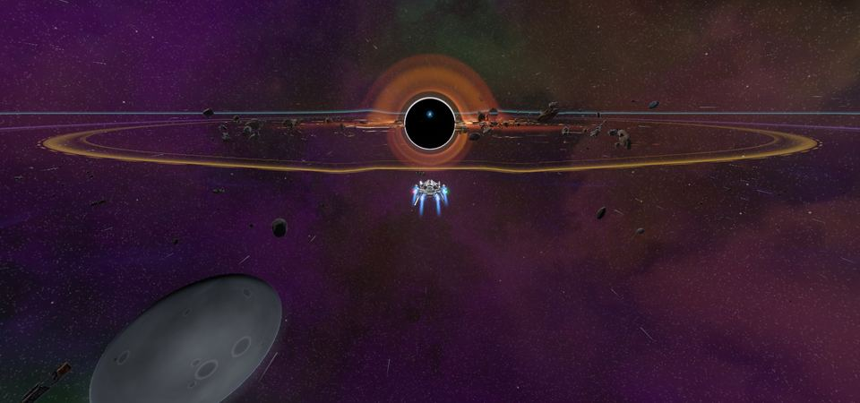
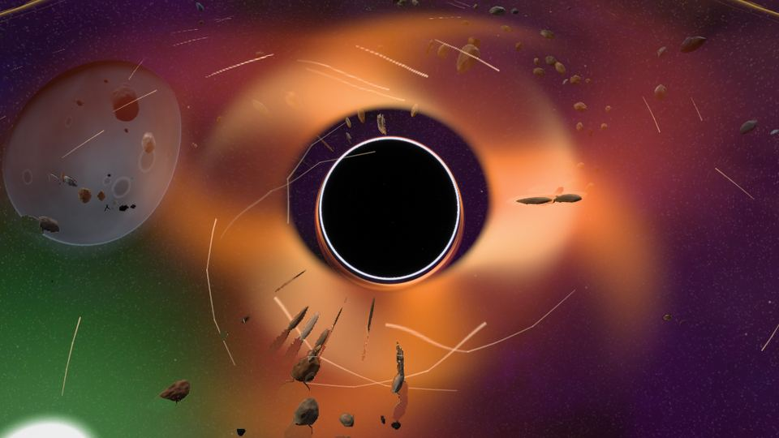

<!-- wiki-i18n source: 4098dc3490a3a550 -->
<!-- wiki-i18n title: Kara delik -->
# Kara delik {#the-black-hole}

<!-- wiki-search: black hole; karadelik -->

Tehlike Sektörü 4’ün (`DS-4`, PvP bölgesinin merkezi) tam ortasında, karanlıkta bir kara delik asılı durur. Her dünyada (Alpha, Beta ve Gamma) ve sezonun her gününde, Barış Protokolü dahil, aynıdır. Fazla yaklaşan her şeyi yutar ve yalnızca tek bir şey geri verir: içine ateşlenen bir N.I.K.E. roketi karşılığında [Dark Matter](#dark-matter). Araştırmadan plakaya kadar tüm yol için bkz. [Dark Matter ve Dark Matter plakaları](/wiki/03-Mechanics/Dark-Matter.md).

## Halkalar {#the-rings}

Mesafeler sektörün merkezinden, harita birimi cinsinden ölçülür. Sektör 32.000 × 18.000 birimdir.

| Halka | Mesafe | Ne olur |
| :--- | ---: | :--- |
| **Radyasyon** | 4.000 | Geminin her saniye hasar alır; hasar, toplam azami gövde puanının bir payıdır. Ne kadar yakınsan o kadar çok. |
| **Çekim** | 3.000 | Kara delik geminin merkeze doğru çeker, ne kadar yakınsan o kadar sert. Uçmayan bir gemi sürüklenir. |
| **Dönüşü olmayan nokta** | yaklaşık 1.000 ile 2.600 arası | Çekimin geminin hızına eşit olduğu yer. Bunun içinde, tam güçte bile, içeri çekilirsin. Hızına bağlıdır. |
| **Olay ufku** | 300 | Ona ulaşan her gemi, gövdesi ve kalkanı ne olursa olsun, anında yok edilir. |

Tehlike Sektörü 4’ün portalları ve aralarındaki yollar radyasyonun çok dışından geçer, bu yüzden yolda giderken ona yanlışlıkla denk gelmezsin. Sezonun 11. gününden itibaren aynı sektörde, sol üst köşede, delikten uzakta [Dormant Swamp](/wiki/03-Mechanics/Dormant-Swamp.md) de bulunur; oradaki uzaylılar deliğin halkalarına asla girmez.

## Radyasyon {#radiation}

Hasar, her saniye **geminin toplam azami gövde puanının yüzdesidir** (gövde artı kalkan); bu yüzden belli bir mesafede her gemi sınıfı tam olarak aynı süre dayanır: 2.000 birimde bir Protos ile bir Wraith dolu bir gemiyi 50 saniyede eritir.

| Mesafe | Saniyede hasar | Dolu bir gemi dayanır |
| ---: | ---: | ---: |
| 4.000 | %0,3 | 333 sn |
| 3.500 | %0,55 | 182 sn |
| 3.000 | %0,8 | 125 sn |
| 2.000 | %2 | 50 sn |
| 1.200 | %5 | 20 sn |
| 700 | %11 | 9 sn |
| 300 | %24 | 4 sn |

İki satır arasında hasar doğrusal olarak artar. Standart donanımlar için saniyede gövde puanı olarak:

| Gemi | Toplam azami puan | 3.500’de | 3.000’de | 2.000’de | 1.200’de | 700’de |
| :--- | ---: | ---: | ---: | ---: | ---: | ---: |
| Protos | 30.000 | 165 | 240 | 600 | 1.500 | 3.300 |
| Kitefin | 46.000 | 253 | 368 | 920 | 2.300 | 5.060 |
| Ostirion | 82.500 | 454 | 660 | 1.650 | 4.125 | 9.075 |
| Nomad | 130.500 | 718 | 1.044 | 2.610 | 6.525 | 14.355 |
| Paragon | 162.500 | 894 | 1.300 | 3.250 | 8.125 | 17.875 |
| Storm | 198.000 | 1.089 | 1.584 | 3.960 | 9.900 | 21.780 |
| Wraith | 372.000 | 2.046 | 2.976 | 7.440 | 18.600 | 40.920 |
| Ironclad | 673.200 | 3.703 | 5.386 | 13.464 | 33.660 | 74.052 |

- **Önce kalkan alır**, sonra gövde. Bu bir vuruş değildir: kalkanın soğurması işe karışmaz ve ondan kaçınılamaz.
- Radyasyon **alınan hasar** sayılır: kalkanın dolmaz, bir Repair Drone durur (“Onarım kesintiye uğradı: radyasyon.”) ve başlatılamaz; güvenli bölge de son dozdan 5 saniye geçene kadar seni korumaz.
- Boosterlar ve yükseltmeler toplamının ne kadar büyük olduğunu değiştirir, ne kadar dayandığını değil: hasar onun bir payıdır.
- Hiçbir şey bir gemiyi bağışık yapmaz. Radyasyon bir vuruş değildir, bu yüzden onu hiçbir şey emmez; ama yetenekler içinde de çalışır: Shield Surge kalkanını geri yüklemeye, Emergency Repair da gövdeni iyileştirmeye on saniyelik süreleri boyunca devam eder (dozun durdurduğu doğal onarımlardan değildirler). Gizlenme gemiyi ondan saklamaz.

## Çekim {#the-pull}

3.000 birimin içinde kara delik her gemiyi merkeze doğru çeker ve çekim yalnızca yaklaştıkça güçlenir. Kenarda yumuşak başlar ve daha 200 birim içeride hissedilir:

| Mesafe | Çekim (saniyede birim) | Uçmayan bir gemi sürüklenir |
| ---: | ---: | :--- |
| 3.000 | 0 | henüz hiçbir şey |
| 2.800 | 25 | saniyede 25 birim |
| 2.300 | 60 | saniyede 60 birim |
| 1.800 | 120 | saniyede 120 birim |
| 1.300 | 220 | saniyede 220 birim |
| 1.000 | 262 | saniyede 262 birim ve artıyor |
| 900 | 289 | saniyede 289 birim ve hızla artıyor |
| 700 | 496 | yaklaşık bir saniyede ufka |
| 300 | 2.829 | olay ufku |

3.000’den 925 birime kadar çekim, iki satır arasında doğrusal olarak artar; 925’in içinde daha dik bir eğriyi izler (son üç satır onun üzerindedir). Bir akıntıdır: geminin yerini değiştirir ve motorların ona karşı savaşır.

- **Uçmayan bir gemi duramaz.** Durursan (tıkladığın yere varırsan ya da hiç emir vermediysen) kara delik gemini merkeze doğru sürükler ve emrin de onunla gider; yani motorların ne kadar hızlı uçabilirse uçabilsin gemin düşmeye devam eder. Bir yerde durmak için oraya uçmaya devam etmen gerekir: fareyi o noktada basılı tut, gemin hızının çekimin üstünde olduğu yerde durur, iki emir arasında biraz geri kayar. Çekimin içinde karşılıklı ateş etmek için duran iki gemi birlikte içeri çekilir.
- **Uçan bir gemi karşı rüzgâr hisseder.** Merkezden dosdoğru uzaklaşırken geminin hızı bulunduğun yerdeki çekim kadar azalır: 155 hızla 2.800 birim uzaklıkta saniyede 130 birim, 2.300’de 95, 1.800’de 35 ilerlersin; 1.500’de (çekim 180) hiç yol alamazsın.

**Dönüşü olmayan noktan**, çekimin hızına eşit olduğu mesafedir. 150 hızındaki bir gemide bu nokta 1.650 birimdedir; ne kadar hızlıysan o kadar derinde yer alır:

| Gemi (standart donanım) | Hız | Dönüşü olmayan nokta |
| :--- | ---: | ---: |
| Ironclad | 99 | 1.974 |
| Protos | 165 | 1.577 |
| Kitefin | 184 | 1.480 |
| Ostirion | 208 | 1.362 |
| Nomad | 211 | 1.347 |
| Paragon | 222 | 1.287 |
| Wraith | 233 | 1.208 |
| Storm | 263 | 995 |

Bir gemi tasarımı geminin hızını, onunla birlikte dönüşü olmayan noktasını da değiştirir: DUMA tasarımı Ironclad gemisinden yavaştır, NOTSUM tasarımı Storm gemisinden hızlıdır.

Saniyede 272 birimden hızlı bir geminin (koşucu bir donanım ya da çalışan bir Afterburner yeteneği olan standart bir Wraith) dönüşü olmayan noktası her zamanki yerindedir: 300 hızda 885, 432 hızda 747.

Hız için donanım kurarsan daha derinden çıkabilirsin; ağır kalkanlar yüklersen çıkamazsın (en yavaş gemi olan Ironclad, 14 yuvasının hepsinde birer Heavy Shield Core taşırsa 39,1 hızla uçar ve dönüşü olmayan noktası yaklaşık 2.600’dedir). Dönüşü olmayan noktanın hemen içindeki bir gemiyi yalnızca ani bir hız patlaması geri döndürür: çalışan bir [Afterburner](/wiki/03-Mechanics/Abilities.md) sayılır ve çalıştığı sürece dönüşü olmayan noktayı daha derine iter (bir motorla on, iki motorla on beş, üç motorla yirmi saniye; Afterburner III, standart bir Protos gemisinde noktayı 1.577’den 989’a, standart bir Wraith gemisinde 1.208’den 801’e çeker). Hız için kurulmuş, her hız değeri sonuna kadar büyülenmiş ve en güçlü hız patlaması çalışan bir gemi bile yaklaşık 390 birimin içinden çıkamaz (üst sınıra kadar büyülenmiş bir Afterburner III, x1,69); büyülenmemiş, hız için kurulmuş bir gemi (her birinde üç Impulse Thruster IV bulunan Engine III ve Adaptive Core III eşyalarıyla) bir Afterburner III ile en iyi durumda 430’un dışından çıkar.

Dönüşü olmayan noktadan düşüş yavaş başlar: noktanın birkaç birim içindeki bir gemi, tam güçte, yirmi saniye ya da daha uzun sürede içeri çekilir, sonra gitgide hızlanır. Çekim uçmak değildir: uçulan mesafeye hiçbir şey katmaz.

## Olay ufku {#the-event-horizon}

Merkeze 300 birim kalan bir gemi yok edilir. Yolda radyasyon altında gövdesi biten gemi ise bunun yerine radyasyonla yok edilir. Hangisi olursa olsun:

- Bu sıradan bir yok oluştur: nereye döneceğini sen seçersin (bkz. [Ölmek ve geri dönmek](/wiki/01-General/Getting-Started.md)), en fazla 10.000 gövde ve boş bir kalkanla (o sayfaya bak), ve her yok oluşun maliyeti ne ise onu öder. “Öldüğün yerde” seçeneği seni asla halkanın içine geri koymaz: seni halkanın dışındaki en yakın noktaya (merkezden 4.500 birim) taşır ve bunu sana söyler.
- **Enkaz yok, kutu yok, ganimet yok**; onur da kaybedilmez.
- Yok oluşun, bir PvP öldürmesi gibi, **gemin yok olmadan önceki 15 saniye içinde ona son vuran düşman pilota** yazılır: başka bir şirketin pilotu (PvP’nin izin verildiği yer ve zamanda), vuruş ne kadar küçük olursa olsun. Bu, onun istatistiklerinde bir öldürme ve geminin türüne göre PvP sıralama puanıdır, başka bir şey değil. Tek bir atış yeter; o 15 saniyede başka bir şirketten kimse sana vurmadıysa kimse bir şey almaz.
- O 15 saniyede gemine vuran kendi şirketinden pilotlar, gemini ne yok etmiş olursa olsun, dost ateşi yüzünden yine onur kaybeder.
- Uzaylılar ve şirket pilotları ona hiç yaklaşmaz. Biri yine de içeri düşerse ganimet, ödül veya sahiplenme olmadan yok olur.

## Ne görür, ne duyarsın {#what-you-see-and-hear}

Görüş alanı küçüktür (varsayılan yakınlaştırmada ekranda yaklaşık 1.900 × 1.150 birim, sonuna kadar uzaklaştırılmışken 4.400 × 2.650 birim), bu yüzden kara deliğin kendi görüntüsü yalnızca yaklaşık üç bin birim yakınında görünür (sonuna kadar uzaklaştırılmışken 3.600). Daha uzaktan ekranda onu gösteren hiçbir şey yoktur (aşağıdaki mini haritaya ya da Yıldız Sistemi haritasına bak); arayüzdeki uyarı yakınındayken devreye girer:

- **Uzaktan.** Kamerayı düzleme yandan bakacak şekilde aşağı çevirirsen kara delik, sektörün herhangi bir yerinden, kadraja girdiği sürece ekranda bulunduğu yerde çizilir: toplanma diskinin ışığının parıltısı içinde halkalı siyah bir disk; kolay görülecek şekilde ölçeklenir (yaklaşık 18.000 birim uzaktaki uzak köşeden bakıldığında görüş yüksekliğinin yaklaşık %2’si) ve yaklaştıkça kendi görüntüsüne dönüşür. İçindeki hiçbir şey kendi kendine hareket etmez. Kara delik görüş alanının dışındayken ekranda onu gösteren bir işaret yoktur.
- **Uçuş düzlemindeki halkalar.** Radyasyonun kenarında (4.000 birim) mor bir bant parlayarak net bir kenara ulaşır; daha ince, kehribar renginde bir bant çekimin kenarını (3.000) gösterir. Çekimin içinde bir **kırmızı çizgi** *senin kendi* dönüşü olmayan noktanı gösterir. Hızını izler; gemin hızlandıkça ya da yavaşladıkça yer değiştirir.
- **Gösterge**, kısayol çubuğunun üstünde, kenarın bin birim yakınında belirir ve yanarken kalır. Radyasyonun saniyede geminin toplam gövde puanının yüzde kaçı olduğunu, yalnızca radyasyonun geriye kalanı eritmesinin ne kadar süreceğini (“31 sn içinde ölümcül”, on saniyenin altında kırmızı), o gövde puanının bir çubuğunu, bulunduğun yerdeki çekimi hızınla karşılaştırmasını ve dönüşü olmayan noktana kadar uçman gereken mesafeyi ya da noktayı geçtikten sonra yanıp sönen bir uyarıyı gösterir. Bir satırın üzerine gelirsen ne anlama geldiğini görürsün; (i) bir kart açar.
- **Ekranın kenarları** mor parlar, doz arttıkça kırmızıya döner ve saniyede bir atar.
- **Mini harita** kara deliği halkalarıyla birlikte elips olarak çizer (harita penceresiyle birlikte gerilir) ve ipucu yarıçapları söyler. Yıldız Sistemi haritası sektörü küçük bir kara delikle işaretler.
- **Bir radyasyon sayacı**, doz arttıkça çatışma gürültüsünün üzerinde daha sık tıkırdar. Kenarı geçerken ve dönüşü olmayan noktanda iki tonlu bir uyarı çalar; yaklaşık 6.500 birimden itibaren alçak bir gümbürtü duyulur, yaklaştıkça daha da alçalır.
- **Görüntü:** **Orta grafik kalitesinden itibaren** (son işleme açıkken) delik, etrafındaki ışığı ışın ışın izleyerek çizilir: etrafında ince beyaz bir foton halkası olan siyah bir gölge ve ışığın sana ulaşacağı biçimde toplanma diski. Kamera yüksekteyken karanlığın çevresinde parlak bir halka görürsün; kamerayı alçaltırsan diskin uzak yüzü deliğin üstünden, alt yüzü altından bükülür, yakın yüzü ise önünden geçer. Deliğin arkasındaki gökyüzü de orta derecede bükülür: yıldızlar, bulutsu, gezegenler ve asteroitler gölgenin çevresinde dışa doğru itilir ve çizgileri onun etrafında yay çizer. Gemiler deliğin üzerine çizilir ve artık onun tarafından karartılmaz: seninle delik arasındaki bir gövde onun önünde kalır. Orta ayar ışığı daha az dönüş boyunca izler, diskin daha az görüntüsünü çizer ve sana dönük tarafın parlamasını atlar; Yüksek ve Ultra bunu da ekler. **Düşük grafik** ve son işlemesiz bir kare eski görüntüyü korur: parlak halkalı siyah bir disk ve ters yönde dönen üç katmanlı bir toplanma diski, gökyüzü bükülmesi olmadan. Yeni görüntüyü kuramayan bir ekran kartı da, eskiden sahip olduğu hafif yıldız bükülmesiyle eski görüntüye döner. Her kalitede, çekim boyunca düşen madde çizgileri görünür (çekimin kendi hızıyla düşerler; bu yüzden uçmayan bir gemi onlarla aynı hızda içeri taşınır, çekime karşı uçan biri de onların akıp geçtiğini görür). Çekimin taşıdığı bir gemi motor alevi yakmaz ve iz bırakmaz; ona karşı uçan bir gemi akıntıda tam hızı için yanar ve izi deliğe doğru akar. Kameranın titremesi çekimle birlikte, geminin hızının payları cinsinden artar; dönüşü olmayan noktanda ayarlanmış düzeyindedir ve ufka kadar yükselmeye devam eder. Deliğin yaktığı bir gemi mor kıvılcımlar saçar; yuttuğu ise merkeze doğru çekilir ve incecik uzatılır. Sektörün gökyüzü, `DS-3` sektörünün koyu mor ve yeşil gökyüzüdür.
- **Enkaz parçaları:** kayalar ve yok olmuş gövde parçaları kara deliğin çevresinde döner ve çekimin kenarından ufka kadar spiraller çizerek içeri düşer: önce yavaş, sonra gitgide hızlanarak; yaklaştıkça etrafında daha hızlı süpürür ve daha hızlı takla atar. Diskin ışığında turuncu parlarlar, parçalanırken iğnelere uzatılırlar ve ufka ulaşmadan yok olurlar. Aralarında birkaç büyük kaya vardır ve bazıları uçuş düzleminin üstünde süzülür, gemiler altlarından geçer. Yalnızca dekordurlar: hiçbir şey onlara çarpmaz, onlar da hiçbir şeye çarpmaz; kara deliğin yaklaşık dört bin birim yakınında görünür ve 6.500’e doğru solarak kaybolurlar. Diskin ışığı, yakındayken geminin üzerine de düşer.
- **Öldüğünde** ekrandaki yazı nedenini söyler: “Kara delik seni yuttu” ya da “Radyasyonda yanıp kül oldun”; Oyun Günlüğü’nde de satırı bulunur.

Delik ağır geldiğinde ya da gözleri yorduğunda ayarlar yardım eder: **Hareketi azalt** diski ve çizgileri durdurur, enkazı sabit tutar ve ekran kenarlarının atmasını durdurur; **Ekran sarsıntısını azalt** deliğin yakınındaki kamera titremesini durdurur; **Düşük grafik** eski görüntüyü korur, ışın izlemeli mercek olmadan, daha az çizgi (Orta ayarda 100, daha yüksek ayarlarda 200 iken 40) ve daha az enkaz parçası (Orta ayarda 80, daha yüksek ayarlarda 160 iken 30) çizer, bunu telafi etmek için halkayı daha parlak yakar ve uzak görünümü bir parıltı eksik çizer. Daha düşük bir **parçacık kalitesi**, enkazı arka plandaki kayaları seyrelttiği gibi seyreltir.

## Uzak durmak {#staying-out}

- Sunucu seni yönlendirir: geminin radyasyon halkasını (merkezden 4.200 birim, radyasyonun kendisinden biraz geniş) kesecek bir hareket emri, bunun yerine halkanın **çevresinden**, kenarı boyunca uçulur. Halkanın içinde biten emirler verildiği gibi uçulur; içeri girmek senin seçimindir. Sektörü kat eden rotalar en fazla beşte bir uzar, portallar arasındaki yollar hiç uzamaz.
- Sohbetin **Sistem** sekmesi, radyasyonun kenarını, çekimin kenarını ve kendi dönüşü olmayan noktanı geçerken seni uyarır, kurtulduğunda da yine uyarır. Bu satırlar **Genel** veya **Yerel** sekmesinde yer almaz.
- Oyundan radyasyonun içinde, çekimin dışında çıkarsan halkanın dış kenarında, yerinde durarak, sahip olduğun gövdeyle geri dönersin. **Çekimin içinde** (3.000 birim) çıkarsan tam bıraktığın yere, sahip olduğun gövdeyle geri dönersin ve düşüş devam eder: oyundan çıkmak kara delikten kurtulmanın yolu değildir.
- Oyunun eski bir sürümü kara deliği göstermez. Uyarıları ve yönlendirmeyi yine alır ve emir vererek halkanın içine yine uçabilir.

Dronlar gemileriyle birlikte uçar. Kargo asla halkanın içine bırakılmaz: oraya düşecek bir kutu kenarına konur. Tek istisna Dark Matter kutularıdır.

## Dark Matter elde etme {#dark-matter}

Dark Matter konusunda yeni misin? [Dark Matter ve Dark Matter plakaları](/wiki/03-Mechanics/Dark-Matter.md) araştırmadan plakaya kadar tüm yolu anlatır. Bu bölüm işin kara delik tarafıdır.

Delik, ona ulaşan bir **N.I.K.E.** roketi karşılığında **Dark Matter** verir. N.I.K.E., zarar verebileceği ilk gemiye 67.500 ile 75.000 arasında hasar veren ve o gemide harcanan bir rokettir; yolda hiçbir şey yoksa deliğe uçar ve olay ufkunu geçtiğinde tükenir. [Montaj](/wiki/06-Items/Rockets.md), teknolojisi araştırıldığında ([Araştırma](/wiki/03-Mechanics/Research.md)) N.I.K.E. üretir, her üretimde beş tane (100.000 kredi, 1.500 Thulium, 20 Ship Fragment, 4 Reinforced Hull Plate, 40 Cataclysite).

- **Ateş etmek.** Bir N.I.K.E., nişan aldığın yere doğrudan 4,5 saniyede 4.050 birim uçar (saniyede 900): hedef seçili değilken imleci kara deliğin üzerine koy (ya da gemini ona çevir). Ufka, radyasyon kenarı (4.000 birim) ile merkezden 4.380 birim arasındaki herhangi bir yerden ulaşır. Daha uzaktan kısa kalır ve boşa gider. Her roket gibi ortak zamanlayıcıyı kullanır ve ardından sonraki roket için 4,6 saniye beklersin (lazer takmana gerek yok); ateşlemek güvenli bölge korumanı ve gizlenmeni bitirir. **Hattaki bir gemi onu senin yerine alır**: kenarda bekleyen bir rakip ya da yolda kutu toplayan başka bir şirketin pilotu 67.500 ile 75.000 arasında hasar alır ve delik hiçbir şey vermez. Uzaylılar ve şirket pilotları halkanın içine hiç girmez, yani açık bir hat senin elindedir; roket kendi şirketinin ve senden güvenli olan gemilerin içinden geçer. Atıştan sonra haritadan ayrılırsan roket kimseye zarar vermeden uçmaya devam eder ve yine de Dark Matter üretir. Bir dron formasyonu vuruşun hasarını değiştirebilir, ama N.I.K.E. sonrasındaki bekleme süresini değiştirmez (bkz. [Dron formasyonları ve roketler](/wiki/06-Items/Rockets.md#drone-formations-and-rockets)).
- **Ne geri gelir.** Ufka ulaşan her N.I.K.E. **1, 2 veya 3 Dark Matter** verir (ortalama 2; yani yaklaşık beş atış on eder), deliğin bölgesinin kenarında, atışının geldiği hattın yakınında, **merkezden 3.050 ile 3.950 birim** uzakta beliren bir ya da iki küçük kutuda. Çekim 3.000’de biter, bu yüzden kutular ve onları alan gemiler çekilmez; oradaki radyasyon saniyede geminin gövde puanının %0,3 ile %0,8 arasında bir payı kadardır: bandın ortasında bir dakika geminin üçte birine mal olur. Dolu bir gemi orada üç dakika dayanır.
- **Kimin.** Kutular, atıştan sonraki **60 saniye** boyunca senin ve klanındır. Ondan sonra haritadaki herkes alabilir ve **4 dakika** sonra sürüklenip giderler. Tehlike Sektörü bir PvP sektörüdür, yani yanında başkalarının da olmasını bekle. Ateş ettikten sonra oyundan çıkan bir pilotun kutuları yine de ona aittir.
- **Kaç tane.** Bir harita en fazla 32 Dark Matter kutusu taşır; yeni bir kutu bunların en eskisini iter, başka türden bir kutuyu asla. [Resource Magnet Booster](/wiki/03-Mechanics/Cargo.md) Dark Matter miktarına hiçbir şey eklemez.
- **Ne görürsün.** Bir N.I.K.E. ufku geçtiğinde deliğin içine doğru gerilir, uzay girdiği yerden dalgalanarak yayılır; disk ve foton halkası yaklaşık bir buçuk saniye parlar (**Hareketi azalt** açıkken bunun üçte biri, yarı ışıkta). Bir an sonra kutular delikten çıkar ve kenardaki yerlerine süzülür: her biri parlak kenarlı ve kıvılcımlı mor-siyah bir küredir, uzaktan kolay görülür ve üzerine gelince **Dark Matter** yazar. Seninkilerin üzerinde kalan saniyeler yazar ve mini haritada küçük bir mor işaret olarak belirir, klanın için de öyle; diğer pilotların kutuları mini haritada yalnızca dakikaları dolduktan sonra görünür.
- **Ne duyarsın.** Delik Dark Matter ürettiğinde yumuşak, alçak bir ses çıkarır: içe çekilen bir nefes, ardından ilk kutu çıkarken iki soğuk çan notası. Kendi N.I.K.E. atışların için haritanın neresinde olursan ol duyarsın; başka bir pilotunki için kutuları geminin 3.200 birim yakınında çıkıyorsa duyarsın, uzaklaştıkça daha hafif. Kaç N.I.K.E. uçarsa uçsun üç saniyede en fazla bir kez çalar ve **Ses efektleri** ses düzeyini izler.
- **Ne işe yarar.** Montaj’da 5 Dark Matter, bir Velkonite Reinforced Plate ve bir Orvium Reinforced Plate birleştirilip bir **Dark Matter Plate** üretilir; [Demirhane](/wiki/06-Items/Forge.md) bir eşyayı İlahi kademeden Patlayan kademeye, sonra Patlayan kademeden Ebedi kademeye yükseltmek için bunlardan ikisini ister: adım başına on Dark Matter. Her yükseltme zincirinin son kademesi, tanesi 20 Dark Matter olan 4 plaka ve en az bir Ancient Control Unit ister: IV. kademe amfiler, kalkan hücreleri ve iticiler, Heavy Shield Core, Engine III, Adaptive Core III, Helios Beam, Extra Slots CPU III ve Base CPU II. Skylab’ın [Araştırma Merkezi](/wiki/03-Mechanics/Research.md#dark-matter) de Dark Matter ister: ağacının tepesindeki 16 teknolojinin her biri için 10, toplam 160; araştırma başlamadan önce Araştırma Merkezi’ne eklenir. Dron formasyonları da ister: gücüne göre her biri 5, 13 veya 20; 189 daha, toplam 349. İki Gövde Kaplaması araştırması 65 daha, gemi tasarımları ve gövde plakası yuvaları 490 ister ([Araştırma](/wiki/03-Mechanics/Research.md#ship-technologies)). Skylab’ın Motor Modülü, Savunma Modülü ve Radar Modülü seviyeleri 115 daha ister ([Araştırma](/wiki/03-Mechanics/Research.md#module-technologies)). Üç IV. kademe amfisi olan bir Helios Beam 80 Dark Matter taşır, yalnızca son kademe parçalar taşıyan bir Wraith ise 1.200 ([Dark Matter ve Dark Matter plakaları](/wiki/03-Mechanics/Dark-Matter.md#what-the-last-tier-asks-for)).
