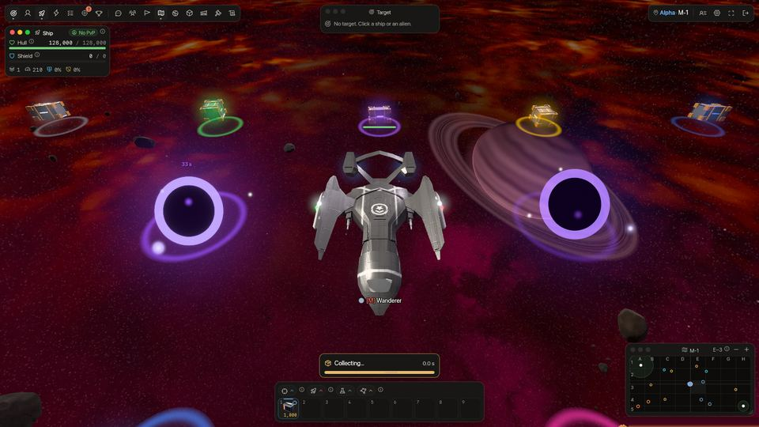

<!-- wiki-i18n source: 0cb22a8f44e00c81 -->
<!-- wiki-i18n title: Kargo -->
# Kargo kutuları {#cargo-boxes}

Yok edilen uzaylılar ganimetlerini uzayda parlayan kargo kutuları olarak bırakır. Yanlarına uç ve başkası kapmadan önce topla.

## Neler düşer {#what-drops}

- **Uzaylılar** ganimetlerini patladıkları yerde tek bir kutu olarak bırakır: her uzaylının *Ganimet* bölümünde sayılan kaynaklar ve parçalar (bkz. [Uzaylılar](/wiki/04-Aliens/Phantasm.md) sayfaları). Kredi, Thulium, XP ve onur ise öldürmeyi yaptığın anda ödenir. Ganimeti boş çıkan bir uzaylı (beş seferin dördünde bir Seeker) kutu bırakmaz.
- **Şirket pilotları** yok edildiklerinde, onları kim ya da ne yok ederse etsin, kutu bırakmaz. Bkz. [Şirket pilotları](/wiki/03-Mechanics/Company-Pilots.md).
- **Oyuncu gemileri** yok edildiklerinde, onları kim ya da ne yok ederse etsin, ne enkaz ne de kutu bırakır; pilotun envanterinden de hiçbir şey alınmaz.
- **Kara delik**, içine ateşlenen her N.I.K.E. roketi için bölgesinin kenarına **Dark Matter** kutuları bırakır (bkz. [Kara delik](/wiki/03-Mechanics/Black-Hole.md)). Deliğin halkasının içinde duran tek kutu türü bunlardır.
- **[Sürü](/wiki/05-Swarms/Swarms.md) liderleri ve Dormant Pulse gemileri** kendilerine ait bir kutu bırakır; içinde cephane, roket ve kaynak olur. Kutu, gemiye en çok hasar veren pilota (ve o pilotun klanına) ayrılır, ona ilk vurana değil.
- **[Clan Warden](/wiki/03-Mechanics/Clans.md#warden-pay-and-loot)** böyle bir kutu bırakmaz: hasarın %5’ini veya fazlasını veren her pilot, ganimetten payını içeren kendine ait bir [özel kutu](#private-boxes) alır.
- **[Asteroitler](/wiki/03-Mechanics/Asteroid-Mining.md)** tek bir kutu yerine **parça** bırakır: kredi ve Thulium taşıyan küçük külçeler ve kristaller, bir de cevher taşıyan bir taş. Kredi ve Thulium, asteroit kırıldığında değil, bir parçayı topladığında ödenir. Parça bir kutu gibi toplanır; önce onu kazanan pilotlara ayrılır, sonra bir kutuda olduğu gibi herkese açılır.

Bir şirket pilotunun bitirdiği uzaylı, ganimetini öldürmenin sayıldığı pilot için bırakır (sahiplenmeyi elinde tutan pilot, yoksa ona karşı savaşan, şirketinden olan pilot); bir şirket pilotunun tek başına savaştığı uzaylı ise hiçbir şey bırakmaz, çünkü şirket pilotları asla toplamaz.

Kutunun ışıkları, içindeki en nadir eşyanın rengini alır: sıradan ganimet için turkuaz, ardından seyrek ile ebedi arasında sırasıyla yeşil, mavi, mor, pembe, altın ve turuncu-kırmızı.

## Toplama {#collecting}

- Bir kutuya **sol tıkla**: gemin ona uçar ve menzile (200 birim) girer girmez alır. Bir kutuya tıklamak asla hareket emri sayılmaz; başka her hareket emri (uzayda bir tıklama, Mini Harita) toplamayı iptal eder. İmlecin hemen altında bir gemi ya da uzaylı da varsa tıklama imlece daha yakın olana gider; böylece bir kutunun üzerinden geçen bir savaş hedeflerini korur.
- **Toplama yarım saniye sürer.** Gemin menzile girip kutuyu almasına izin verildiğinde toplama başlar: kısayol çubuğunun üstündeki bir çubuk (“Toplanıyor…”) dolar ve bir ışın kutuyu tarar. Gemin uçmaya devam eder ve çubuk dolduğunda kutu senindir. Menzilden çıkarsan ya da kutuyu başka bir pilota kaptırırsan toplama iptal olur. Saldırıya uğramak, nerede olursa olsun, toplamayı kesmez.
- Aynı anda tek iş yaparsın: [sıçrarken](/wiki/01-General/Spacemap%20Travel.md) toplayamazsın ve sıçramayı başlatmak toplamayı bırakır. Zaten topladığın bir kutuyu yeniden istemek hiçbir şeyi değiştirmez.
- İçinde ne olduğunu, kimin için ayrıldığını ve son dakikasında ne kadar süresi kaldığını görmek için bir kutunun üzerine gel.
- Bir kutu alındığında, durduğu yerde kısa bir toplama sesi çalar; yakındaki diğer pilotların toplamalarını da daha kısık duyarsın.
- Topladığın şey doğrudan hangar envanterine, o eşyanın boştaki yığınına gider (ekipmana ya da Nakliye Deposu’ndaki hiçbir şeye asla gitmez). Bir bildirim ne aldığını söyler; art arda toplanan kutular aynı bildirimde birleşir.
- Topladığın her şey **satılabilir** etiketini taşır: onu [pazarda](/wiki/03-Mechanics/Auction.md#marketable-items) satabilirsin.
- Bir [asteroit](/wiki/03-Mechanics/Asteroid-Mining.md) parçası senin olduktan sonra gemin, alabileceğin ve menzilindeki bir sonraki parçaya kendi kendine devam eder; herhangi bir hareket emrin onu durdurur.
- **Bir Retriever senin yerine toplar.** Yanaştırılmış bir [Retriever](/wiki/03-Mechanics/Pets.md#the-retriever) birimi, tıklamaya gerek kalmadan, kendi menzili içindeki kutuları alır (en zayıfında 255 birim, 20. seviye bir Efsanevi P.E.T.’te 880 birim; kendi toplamanın 200 birimine karşılık), önce en yakınından başlar ve **tek tek, her biri yarım saniyede** alır: elle toplamaktan asla daha hızlı değildir. Yalnızca senin de alabileceğin şeyi alır: başka bir pilota ayrılmış bir kutu, süresi bitene kadar bekler; başka bir pilotun [özel kutusuna](#private-boxes) ise hiç dokunmaz. Güvenli bölgenin dışında uçarken, boşta olsan da olmasan da çalışır; ama gizliyken ya da sıçrarken çalışmaz, bu yüzden gizlenmeyi asla bozmaz. Çubuğu dolan bir toplama değildir: hiçbir çubuk dolmaz, senin kendi toplamalarını ya da sıçramalarını asla engellemez ve elinle topladığın kutu sana bırakılır. Elin ile Retriever birimi aynı kutuya birlikte uzandığında kutuyu tam olarak biri alır. Bir Retriever toplayınca toplama sesi yerine kendine ait küçük bir bip sesi çalar.

## Kutuyu kim alır {#who-gets-it}

- Kutuyu **30 saniye** boyunca yalnızca öldürmenin ödemesini alan pilot ve o pilotun **klanının** üyeleri alabilir. Bir uzaylıda bu, onu bitiren kim olursa olsun sahiplenmeyi elinde tutan, yani ona ilk vuran pilottur (bkz. [Savaş](/wiki/03-Mechanics/Combat.md)). Diğer pilotlar kutuyu karartılmış görür ve henüz alamaz; ona gönderilen bir gemi süre dolana kadar yakında bekler.
- Bundan sonra haritadaki **herkes** onu alabilir.
- Kutuyu yalnızca kutunun bulunduğu haritadaki bir gemi alabilir: yolda (ya da toplamanın aldığı yarım saniye içinde) yok edilirsen, sıçrarsan ya da oyundan çıkarsan kutu başkaları için kalır.
- İki pilot aynı kutuyu aynı anda toplarsa toplaması önce biten alır, tam bir kez; diğerine kutunun gittiği söylenir.
- Kimsenin almadığı bir kutu **3 dakika** sonra sürüklenip gider (son 10 saniyesinde yanıp söner). Bir harita en fazla 64 kutu tutar; yenisi bu sayıyı aşacak olursa en eskisi gider. Bir [dev ekskavatörün](/wiki/03-Mechanics/Giant-Excavator.md) kutuları yere düştükleri andan itibaren herkese açıktır, bir kutudan daha uzun durur ve kendilerine ait bir havuzu vardır; bu yüzden başka bir kutuyu asla dışarı itmezler. Asteroit parçalarının 64’ün içinde kendilerine ait bir havuzu vardır: başka bir kutuyu asla dışarı itmezler ve başka hiçbir kutu bir parçayı dışarı itmez ([kurallar](/wiki/03-Mechanics/Asteroid-Mining.md#the-rules)). Dark Matter kutuları 4 dakika durur ve ilk dakika yalnızca senindir.

## Özel kutular {#private-boxes}

[Clan Warden](/wiki/03-Mechanics/Clans.md#warden-pay-and-loot) ganimeti tek bir pilot için tek bir kutu değildir: **hasarın en az %5’ini veren her pilot kendine ait bir kutu alır**; kutu, o pilotun payı için ayrıca belirlenir (hasarın %20’si için her miktarın yaklaşık beşte biri; [ayrıntılar](/wiki/03-Mechanics/Clans.md#warden-pay-and-loot)).

- **Onu yalnızca sen görürsün ve yalnızca sen alabilirsin.** Klanın ve grubun onu görmez ve alamaz; başkaları için kutu yok gibidir. Senin ekranında altında ince bir halkayla görünür.
- **Öldürmeden sonra 10 dakika durur** ve bu sürenin tamamında senindir: 30 saniyelik bir bekleme yoktur. Sonra her kutu gibi sürüklenip gider. Warden yok edildiğinde Oyun Günlüğü sana ganimetten payını gösterir.
- **Başka kutuları dışarı itmez.** Özel kutuların, bir haritanın 64’ünün yanında kendilerine ait bir havuzu vardır (en fazla 32); bu yüzden bir Warden öldürmek başka hiçbir kutunun yerini almaz ve dolu bir harita sana kendi kutunu asla kaybettirmez.
- Toplama her kutuda olduğu gibidir ([yukarıda](#collecting)): gemin ona uçar ve toplama yarım saniye sürer. Retriever birimi senin özel kutularını da alır, başkasınınkine hiç dokunmaz.

## Boosterlar {#boosters}

- **Loot Luck Booster** (ayrıca kalıcı Luck Boost güçlendirmesi ve yanaştırdığın [P.E.T.’lerin](/wiki/03-Mechanics/Pets.md) şansı), öldürmeyi yaptığında her ganimet kaleminin düşme şansını artırır.
- **Resource Magnet Booster**, öldürmeyi kim yapmış olursa olsun, elinle ya da Retriever birimiyle topladığın her kutudaki kaynaklara **%25** ekler. Dark Matter bunun dışındadır: ona hiçbir şey eklenmez, bu yüzden beş N.I.K.E. herkes için on Dark Matter eder.
