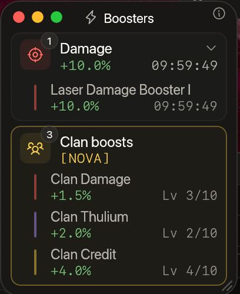
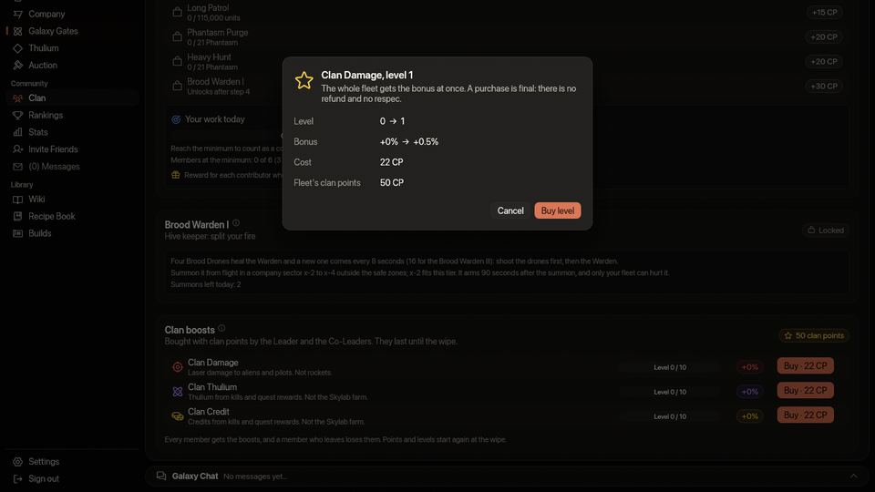
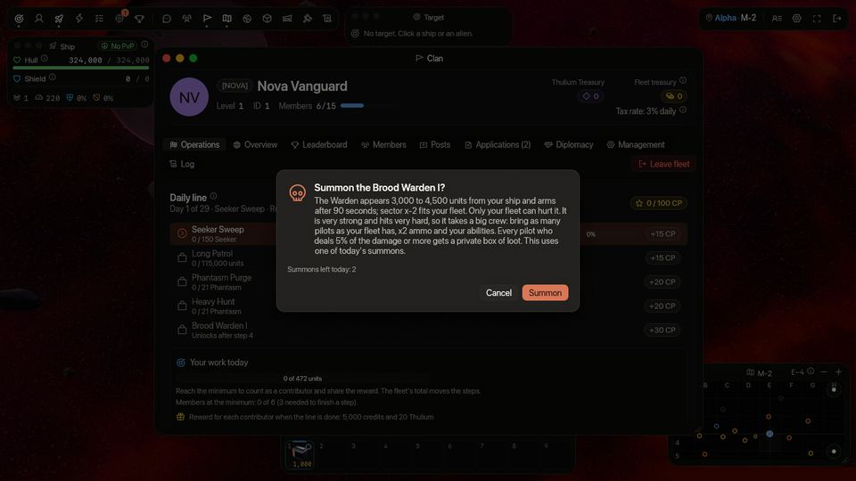
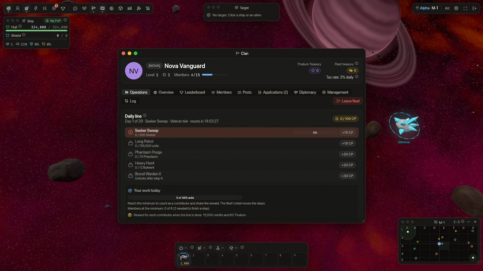

<!-- wiki-i18n source: 024a0cd8847450c1 -->
<!-- wiki-i18n title: Klanlar -->
# Klanlar {#clans}

Bir klan kurmak ya da bir klana katılmak; kaynakları birleştirmene, ortak bankayı yükseltmene, vergi oranlarını belirlemene, şirket üyeleriyle koordinasyon sağlamana ve diplomasiyi yönetmene olanak tanır. Bir klanın birlikte yapacağı işler de vardır: her gün, görevlerden oluşan bir **günlük hat** alır; hat, yalnızca klanın zarar verebileceği bir patronla biter ve klanın kazandığı puanlar her üye için **kalıcı güçlendirmeler** satın alır. (Oyunun Klan sayfasında klana *filo* denir.) **Bir klan tek bir dünyaya aittir ve sıfırlamayla birlikte gider:** yalnızca kendi dünyandaki klanlara katılabilirsin ve her sıfırlamada her klan dağıtılır ([Klanlar ve dünyalar](#clans-and-worlds)).

**Bir dakikada**

- Her klanın, dünyasındaki her pilotun açabildiği bir **Klan sayfası** vardır: seviyesi, pilotları, Lideri, açıklaması, Discord bağlantısı, gereksinimleri, toplam puanları ve güçlendirmeleri ([Klan sayfası](#the-clan-page)). Lider ve Yardımcı liderler onu **Yönetim** sekmesinde düzenler ([Yönetim](#management)).
- Bir klanın bir **dünyası** vardır (kurucunun dünyası), yalnızca o dünyanın pilotlarını alır ve **sıfırlama onu hazinesiyle birlikte dağıtır**: geri sayım bitmeden Filo hazinesindekini pilotlara öde ([sıfırlama](#the-wipe-disbands-every-clan)).
- Lider ve Yardımcı liderler tüm klan için [gönderiler](#clan-posts) yazar, her üye diğerlerinin [hangi haritada](#where-your-clan-mates-are) uçtuğunu görür, [Kim çevrimiçi](#who-is-online) penceresi (**H** tuşu) dünyandaki her pilotu grubuna davet etmeni sağlar, Lider Filo hazinesinden bir [günlük bonus](#4-daily-bonus) ödeyebilir ve [Günlük](#fleet-log) sekmesi klana kendi içinde neler olduğunu anlatır.
- Uçuşta, sol üstteki araç çubuğunda bulunan **Klan** düğmesi (bir flama) **Klan penceresini** açar: istasyondaki Klan sayfası, oyunun üstünde bir pencere olarak; aynı sekmeler, yanıtlar ve düğmelerle, yeri ve boyutu hatırlanır (0.4.21 veya üstü oyun sürümü; uçuşta nelerin farklı olduğunu [Warden çağırma](#calling-a-warden) anlatır).
- Bir savaş yalnızca karşı klan kabul edince biter; bir ittifak ya da pakt ise klanlardan biri feshettiğinde hemen sona erer ([Diplomasi](#diplomacy)).
- Klanın her gün bir [günlük hat](#daily-line) alır: sırayla yapılacak dört görev (uzaylı öldür, belli bir mesafe uç, bazı günler sürü patronlarını indir), ardından bir [Clan Warden](#clan-wardens): çağırdığın ve yalnızca klanının zarar verebildiği bir patron.
- Biten her adım klan puanını hemen öder: 15, 15, 20, 20 ve 30; yani tam bir hat **100 puan** eder.
- Lider ve Yardımcı liderler puanları, her biri on seviyeli üç [güçlendirmeye](#clan-points-and-boosts) harcar: **Hasar** (en çok +%5), **Thulium** (en çok +%10) ve **Kredi** (en çok +%10).
- Her hattı bitiren bir klan her seviyeyi **12. günde** satın almış olur. Puanlar, seviyeler ve klanın kendisi sıfırlamada sona erer.
- Payına düşeni yapmış en az **üç üye** ve Warden savaşı için **büyük bir ekip** gerekir: 0.4.13’ten beri bir Warden, eskisinin beş katı gövde, kalkan ve lazer hasarına sahip; bu yüzden eskiden kazanan ekipler, yaklaşık yedi pilot, artık kaybediyor ([ekip ne kadar büyük olmalı](#how-big-a-crew)). Çok küçük bir ekip savaşı kaybeder: klan dört görevin **70 puanını** yine de tutar, ama hat bitmez ve [sana düşen ödül](#the-reward-for-you) ödenmez.
- Bir Warden, hasara göre bölüşülen büyük bir havuz öder ve **hasarın %5’ini veya fazlasını veren her pilot**, yalnızca kendisinin görüp alabileceği, ganimetten payını içeren **özel bir kutu** alır ([ödeme ve ganimet](#warden-pay-and-loot)). 0.4.16’dan beri ödeme eskisinin üç katıdır ve bir Warden ayaktayken **haritanın uzaylılarından oluşan bir dalga her dakika gelir** (Wrath Warden III için her 40 saniyede). Warden gövdesinin yarısının altına düşünce her dalgada bir **Crystalys** bulunur ve dalgalar, Warden ile savaşan pilotları hedef alır ([dalgalar](#waves-of-aliens)).
- Gemin sahip olduğu güçlendirmeleri **Boosterlar penceresinde**, kendi kartında gösterir ([nerede görürsün](#the-three-boosts)).
- Hat ve güçlendirmeler 0.4.10 veya üstü bir oyun sürümü gerektirir; Boosterlar penceresindeki kart 0.4.12 veya üstü; Klan sayfası, gönderiler, Çevrimiçi penceresi, günlük bonus, barış talepleri, filo günlüğü ve dünya başına klanlar 0.4.16 veya üstü.

## Klanlar ve dünyalar {#clans-and-worlds}

### Bir klan, bir dünya {#one-clan-one-world}

Bir klan tek bir **dünyaya** aittir: Alpha, Beta veya Gamma ([Dünyalar](/wiki/03-Mechanics/Wipe-Timeline.md#worlds-alpha-beta-and-gamma)). Bu, onu kuran pilotun dünyasıdır. Kurmak hiçbir şeye mal olmaz, ama önce dünyanı seçmiş olmalısın.

- **Yalnızca kendi dünyandaki bir klana katılabilirsin.** Başka bir dünyanın klanına katılamaz, başvuramaz, ondan davet alamaz ya da onunla ittifak kuramazsın; denediğinde oyun nedenini söyler. Başka bir dünyanın pilotu da davet edilemez ya da kabul edilemez.
- **Yalnızca kendi dünyandaki klanları görürsün.** Filo bul listesi ve iki sıralama (PvE ve PvP) yalnızca onları listeler; başka bir dünyanın klanının sayfası açılmaz. Klan adları ve etiketleri üç dünya genelinde benzersizdir, yani Gamma’da alınmış bir ad sıfırlamaya kadar Alpha’da da boş değildir.
- **İttifaklar, paktlar ve savaşlar tek bir dünyanın klanları arasındadır.** 0.4.16’dan önce dünyalar arasında kurulmuş olanlar feshedilene kadar sürer ve bu türden bir savaş yine karşılıklı onayla bitirilebilir ([Diplomasi](#diplomacy)).
- **Daha önce var olan klanlar** Liderlerinin dünyasını aldı. İçeride olan başka bir dünyanın üyesi sıfırlamaya kadar, ya da kendisi ayrılana kadar kalır; yeniden eklenemez.

### Sıfırlama her klanı dağıtır {#the-wipe-disbands-every-clan}

[Sıfırlamada](/wiki/03-Mechanics/Wipe-Timeline.md) her klan, üç dünyanın hepsinde dağıtılır. Onunla birlikte gidenler: üyeler, **Filo hazinesi**, başvurular ve davetler, ittifaklar, paktlar ve savaşlar, gönderiler, filo günlüğü, gereksinimler, açıklama ve Discord bağlantısı, günlük bonus, klan puanları ve güçlendirme seviyeleri, bir de günün hattı. Klanın adı ve etiketi yeniden boşa çıkar ve yeni bir klan 1. seviyeden başlar.

- **Korursun:** klanın sana zaten ödediği her krediyi (ödemeler, günlük bonuslar, hat ödülleri) ve sıfırlamadan etkilenmeyen bağış limitini ([Bağışlar](#2-donations)).
- **Kaybedersin:** klanı ve **Filo hazinesinde hâlâ kalan her şeyi**; Lider veya bir Yardımcı lider onu sıfırlamadan önce pilotlara ödemediyse ([Banka ödemeleri](#3-bank-payouts)).
- **Geri sayım klanlara haber verir.** İlk uyarıyla, sıfırlamadan 5 dakika önce, bir klanda olan her pilot bir satır ve bir ekran bildirimi alır: sıfırlama her klanı dağıtır ve hazinesi kaybolur; Liderler ve Yardımcı liderler Filo hazinesini şimdi pilotlara ödemeli. Yönetim sekmesindeki Filo hazinesi kartı da aynısını söyler.

---

## Klan sayfası {#the-clan-page}

Her klanın, bir klanda olsa da olmasa da **dünyasındaki her pilotun açabildiği** bir sayfası vardır. Klanın adına **Filo bul listesinde** (Topluluk › Klan, hiçbir klanda değilken), iki **sıralamadan** birinde ya da bir **pilotun profilinde** tıkla; Yönetim sekmesindeki **Klan sayfasını önizle** düğmesi kendi klanına, klan dışındaki bir pilotun gördüğü gibi gösterir. Sayfada şunlar görünür:

- **Klan**: adı ve etiketi, seviyesi, şu anki pilot sayısı ve seviyesinin alabileceği en çok pilot (“2. seviye · 14/25 pilot”), Lider (profili için adına tıkla), dünyası, pilotların nasıl katıldığı (Açık, Başvuru veya Yalnızca davetle), **açıklama** (en fazla 200 karakter, Lider veya bir Yardımcı lider yazar) ve **Discord bağlantısı**, yanında bir **Discord bağlantısını aç** düğmesiyle. Yalnızca `discord.gg` ve `discord.com/invite` bağlantıları kabul edilir ve oyun başka hiçbir şeyi açmaz.
- **Toplam puanlar**: klandaki tüm pilotların şu anki Deneyim, Onur, PvE ve PvP sıralama puanları, toplanmış olarak.
- **Gereksinimler** ([aşağıda](#requirements)); karşıladığın her gereksinimin yanında bir onay işareti, karşılamadığının yanında bir çarpı.
- **Klan güçlendirmeleri**: klanın satın aldığı güçlendirmeler ve sıfırlamaya kadar kaç gün süreceği.
- **Başvur** veya **Hemen katıl**, Filo bul listesindeki gibi. Klan doluyken ya da bir gereksinimi karşılamıyorsan, nedeniyle birlikte gri olur.

Sayfa kadroyu, hazineleri, başvuruları ve klan puanlarını asla göstermez: onlar yalnızca klanın kendi üyeleri içindir.

### Gereksinimler {#requirements}

Lider ve Yardımcı liderler, katılmak isteyen bir pilottan iki şey isteyebilir:

- **En düşük seviye**, 1’den (gereksinim yok) 21’e kadar.
- **En düşük rütbe**: bir şirket rütbe kademesi; **Pilot** (gereksinim yok) ile **Amiral** arası: Pilot, Çavuş, Teğmen, Yüzbaşı, Binbaşı, Albay, General, Amiral ([Rütbeler](/wiki/03-Mechanics/Ranks.md)). Bir kademe en alt derecesinden itibaren sayılır: Yüzbaşı isteyen bir klan, Genç Yüzbaşı rütbesindeki pilotu ve onun üstündeki her pilotu alır. Bu, şirketinin sıralamasında şu an sahip olduğun rütbedir, uçtuğun dünya değil.

Bunlar, bir pilot **başvurduğunda veya katıldığında** kontrol edilir. Bir yetkilinin **daveti** bunları atlar, bir yetkilinin kabul ettiği başvuru da. Filo bul listesi bunları klanın adının altında küçük kapsüller olarak gösterir; karşılamadığın kırmızıdır. Hiçbir şey belirlememiş bir klan hiçbir şey istemez.

---

## Klan gelişimi {#clan-progression}

Klanlar 1. seviyeden başlar ve 5. seviyeye kadar yükseltilebilir. Klanı yükseltmek için **Klan bankasından** kredi ödemek gerekir (oyun ona **Filo hazinesi** der). Yükseltmeler üye kapasitesini ve günlük ödeme limitlerini artırır; klan güçlendirmeleri seviyelerle değil, klan puanlarıyla satın alınır.

| Klan seviyesi | Üye sınırı | Günlük ödeme limiti (üye başına) | Yükseltme maliyeti (kredi) |
| :---: | :---: | :---: | :--- |
| **1. seviye** | 15 | 1.000.000 Cr | — |
| **2. seviye** | 25 | 2.000.000 Cr | 10.000.000 Cr |
| **3. seviye** | 50 | 3.000.000 Cr | 100.000.000 Cr |
| **4. seviye** | 75 | 4.000.000 Cr | 1.000.000.000 Cr |
| **5. seviye** | 100 | 5.000.000 Cr | 10.000.000.000 Cr |

---

## Yönetim {#management}

Klan penceresinin **Yönetim** sekmesi (0.4.16’ya kadar Admin adını taşırdı) Lider ve Yardımcı liderler içindir; diğer üyeler bir kilit görür. Kartları, yukarıdan aşağıya:

- **Katılım protokolü**: pilotların nasıl katılacağı. **Açık**, gereksinimleri karşılayan her pilotu hemen alır; **Başvuru**, her başvuruya bir yetkilinin karar vermesini sağlar; **Yalnızca davetle**, davet edilmemiş kimseyi almaz.
- **Mali ayarlar**: günlük vergi oranı, %0 ile %5 ([Günlük vergi](#1-daily-taxation)).
- **Başvuru gereksinimleri**: en düşük seviye ve en düşük rütbe ([Gereksinimler](#requirements)).
- **Klan sayfası**: klan dışındaki pilotların okuduğu açıklama (200 karakter) ve Discord bağlantısı ile **Klan sayfasını önizle** düğmesi ([Klan sayfası](#the-clan-page)). Klanın kendi üyeleri bağlantıyı Genel bakış sekmesinde okur.
- **Filo hazinesi**: bağışlardan ve günlük vergiden gelen krediler; sıfırlamanın klanı dağıttığını ve hazinenin kaybolduğunu hatırlatan not.
- **Thulium hazinesi**: klan penceresinin başlığında Filo hazinesinin yanında gösterilen ikinci bir kese. İçinde hiçbir şey yoktur ve ona hiçbir şey girip çıkmaz: gelecek bir güncelleme için ayrılmıştır.
- **Filo gelişimi** ve **Yükseltmeler**: beş seviye, her birinin aldığı pilot sayısı, bir üyeye günde en çok ne kadar ödenebileceği ve fiyatı; bir de Liderin yükseltme düğmesi. Yalnızca Lider yükseltir.
- **Günlük bonus**: Liderin her rütbe için belirlediği tutar ([Günlük bonus](#4-daily-bonus)).

---

## Klan ekonomisi ve vergilendirme {#clan-economy-taxation}

Klanlar vergiye dayalı bir mali sistemle işler:

### 1. Günlük vergi {#1-daily-taxation}

- **Vergi oranı**: Lider veya Yardımcı liderler **%0 ile %5** arasında günlük bir vergi oranı belirleyebilir.
- **Otomatik kesinti**: günde bir kez (UTC) sunucu, vergiyi klanın tüm üyelerinden otomatik olarak keser.
- **Formül**: vergi, her üyenin mevcut kredi bakiyesinin `ClanTaxRate` kadarı olarak hesaplanır.
  - *Örnek*: 10.000.000 kredin varsa ve klan vergisi %2 ise, hesabından 200.000 kredi düşülür ve Klan bankasına yatırılır.
  - Gönüllü kredi bağışları da yapılabilir, bir sonraki bölümdeki sınıra kadar.

### 2. Bağışlar {#2-donations}

- **Bağış yapmak**: her üye Klan sayfasından Klan bankasına kredi gönderebilir. Bağış penceresi daha ne kadar gönderebileceğini gösterir.
- **Bağış sınırı**: bir pilot, üye olduğu tüm klanlar birlikte sayılarak, herhangi bir 24 saatte klanlara en çok **1.000.000 kredi** gönderebilir. Bir klandan ayrılıp başkasına katılmak yeni bir hak vermez.
- **Günlük sıfırlama yok**: 24 saat kayar. Her bağış, yapıldıktan tam 24 saat sonra sayılmaz olur; pencere en eski bağışın ne zaman düşeceğini ve ne kadarının geri geleceğini söyler. Kalan hakkı aşan bir bağış bütünüyle reddedilir.
- Günlük vergi bir bağış değildir ve bağış hakkından düşmez.

### 3. Banka ödemeleri {#3-bank-payouts}

- **Ödeme sınırları**: klan liderleri ve yetkilileri Klan bankasından tek tek üyelere kredi dağıtabilir.
- **Günlük sınır**: bir üye, tek bir takvim gününde (UTC) ödemelerde `1,000,000 * ClanLevel` krediden fazla alamaz.

### 4. Günlük bonus {#4-daily-bonus}

Lider, Filo hazinesinden her üyeye günde bir kez sabit bir bonus ödeyebilir.

- **Belirleme.** Yönetim sekmesinin **Günlük bonus** kartında Lider her rütbe için tek bir tutar girer: Pilot, Kıdemli, Yardımcı lider ve Lider. **0, bir rütbeyi kapatır**; diğer her tutar **1.000 ile 1.000.000 kredi** arasındadır. Yardımcı liderler kartı görür ama değiştiremez. Kaydetmek hazineden hiçbir şey almaz. Kart, her pilot oynarsa tam bir günün neye mal olacağını ve hazinenin kaç gün yeteceğini gösterir.
- **Ödeme.** Bir üyeye **günde bir kez**, o günkü ilk kontrolünde ödeme yapılır: bağlandığında, çevrimiçiyken gün döndüğünde ve Lider yeni tutarları kaydettiğinde. Gün, klan hattının günüdür ve **00:00:00 UTC**’de değişir ([Gün](#the-day)). Pilot bir Sistem satırı ve bir Oyun Günlüğü satırı alır; Genel bakış sekmesi “Günlük bonus: X kredi” yazar ve bugün ödenip ödenmediğini gösterir.
- **Kimler.** Klanda **en az 24 saat** bulunmuş bir pilot ve **tüm klanlar boyunca pilot başına günde bir bonus**: daha fazla toplamak için klanlara girip çıkmak yalnızca bir kez öder.
- **Yetersiz hazine.** Hazine yalnızca elindekini öder ve asla sıfırın altına inmez. Hazine bir üyenin tutarını ödeyemediğinde o üye o gün için atlanır, hazine gün içinde sonradan dolsa bile; [Filo günlüğü](#fleet-log) bunu bir kez not eder. Pilotlara, hazine tükenene kadar bağlandıkları sırayla ödenir.
- **Banka ödemesi değildir.** Bonus, üyenin günlük ödeme limitinden düşmez.

---

## Hiyerarşi ve roller {#hierarchy-roles}

Klanlar yetkileri yönetmek için role dayalı bir rütbe yapısı kullanır:

- **Lider (Rol 3)**: Tam yönetim erişimine sahiptir: yükseltme, vergi belirleme, gereksinimler, Klan sayfası, günlük bonus, diplomasi, gönderiler, terfi, çıkarma ve klanı dağıtma.
- **Yardımcı lider (Rol 2)**: Vergi oranlarını, gereksinimleri ve Klan sayfasını belirleyebilir, kredi ödemesi yapabilir, diplomasiyi yönetebilir, gönderi yazabilir ve daha düşük rütbeleri terfi ettirip düşürebilir.
- **Kıdemli (Rol 1)**: Klana yeni başvuruları kabul edebilen güvenilir üye.
- **Üye (Rol 0)**: Yönetim yetkisi olmayan standart oyuncu.

### Yetki tablosu {#permissions-table}

| İşlem | Lider | Yardımcı lider | Kıdemli | Üye |
| :--- | :---: | :---: | :---: | :---: |
| **Klanı dağıt** | ✅ | ❌ | ❌ | ❌ |
| **Klanı yükselt** | ✅ | ❌ | ❌ | ❌ |
| **Vergi oranını belirle** | ✅ | ✅ | ❌ | ❌ |
| **Gereksinimleri ve Klan sayfasını belirle** | ✅ | ✅ | ❌ | ❌ |
| **Günlük bonusu belirle** | ✅ | ❌ | ❌ | ❌ |
| **Klan gönderisi yaz** | ✅ | ✅ | ❌ | ❌ |
| **Kredi öde** | ✅ | ✅ | ❌ | ❌ |
| **Diplomasiyi yönet** | ✅ | ✅ | ❌ | ❌ |
| **Klan güçlendirmesi satın al** | ✅ | ✅ | ❌ | ❌ |
| **Clan Warden çağır** | ✅ | ✅ | ❌ | ❌ |
| **Terfi ettir / Çıkar** | ✅ | ✅* | ❌ | ❌ |
| **Başvuruları kabul et** | ✅ | ✅ | ✅ | ❌ |

*\*Yardımcı liderler yalnızca kendilerinden daha düşük rütbedeki üyeleri terfi ettirebilir, rütbelerini düşürebilir veya çıkarabilir.*

### Lider ayrıldığında {#when-the-leader-leaves}

Bir Lider, başka üyeleri hâlâ olan bir klandan ayrılamaz: önce liderliği bir Yardımcı lidere devret (Lider, Yardımcı lider olur) ya da en son ayrıl; bu klanı dağıtır. Lider hesabını silerse (Ayarlar › Hesap), liderlik en yüksek rütbeli üyeye geçer, eşitlikte en uzun süredir klanda olana; klanda tek başına olan bir Lider klanı bankasıyla birlikte dağıtır.

---

## Klan gönderileri {#clan-posts}

Bir **gönderi**, tüm klan için kısa bir nottur; yetkililerin haberleri için bir duyuru panosu. Klan penceresinin **Gönderiler** sekmesindedir.

- **Kim yazar.** Lider ve Yardımcı liderler. Her üye okur. Lider ve Yardımcı liderler her gönderiyi siler; bir yazar, rütbesi düşürülmüş olsa bile kendi gönderisini siler.
- **Metin.** Tek satırda en çok **200 karakter**, kutunun altında bir sayaçla; Enter gönderir. **Bağlantı yok**: bağlantı içeren bir gönderi reddedilir.
- **Sınırlar.** Yazar başına her **10 saniyede** bir gönderi ve klan aynı anda **20** gönderi tutar: 21. gönderi en eskiyi dışarı iter.
- **Ne kadar kalır.** Bir gönderi sıfırlamaya kadar kalır.
- **Haber verme.** Çevrimiçi üyeler bir ekran bildirimi (“Nova klanla bir gönderi paylaştı.”) ve hafif bir ses alır; kaç gönderi gelirse gelsin bir buçuk saniyede en fazla bir kez. Liste en yenisini üstte, yazarı ve ne kadar önce yazıldığıyla gösterir.

## Klan arkadaşların nerede {#where-your-clan-mates-are}

Üyeler listesinin **Harita** sütunu, klanındaki her pilotun uçtuğu sektörü gösterir (“T-2”); kendi dünyan değilse önünde dünyası yazar (“Beta · T-2”). Liste açıkken her 10 saniyede bir yeniden okunur. Yalnızca **harita** gösterilir, asla koordinat değil, ve hiçbir şey saklanmaz. **İstasyonda olan ya da oturumu kapatmış** bir pilot **Çevrimdışı** görünür; gizlenmiş gemisini bir haritada göremediğin bir pilot da öyle ([Cloaking CPU](/wiki/06-Items/Extras.md#cloaking-cpu)): bir klan gizlenmeyi kaldırmaz.

Yanındaki **Skylab** sütunu, her pilotun [Skylab’ının](/wiki/03-Mechanics/Skylab.md#clan-skylabs) evren haritasında nerede olduğunu hücre koduyla gösterir: bir şirketin limanında “H3 hücresinde kenetli”, bir seferde “H3 → K7, 3sa 12dk sonra” (en son geçtiği hücre, gittiği yer ve kalan süre), avlanırken “K7 hücresinde konuşlu” ve gövdesi tükenince “H3 hücresinde yok edildi”. Harita sütunuyla birlikte okunur ve henüz evren haritası olmayan bir pilot (15. seviyenin altında bir Çekirdek) tire gösterir. Sütun, klanındaki herhangi bir pilotun evren haritası olunca görünür. Yalnızca kendi klanın görür ve gizlenme bir Skylab’ı saklamaz. Bir yok oluş, ancak pilot Skylab’a yeniden baktığında ya da ona bir emir verdiğinde görünür.

## Kim çevrimiçi {#who-is-online}

Sistem araç çubuğundaki (sağ üst) **Kim çevrimiçi** düğmesi ya da **H** tuşu (Ayarlar › Kontroller bölümünden değiştirebilirsin) **Çevrimiçi pilotlar** penceresini açar.

- **Kimler listelenir.** Şu an **dünyanda** uçan pilotlar, sen hariç: Alpha, Beta ve Gamma birbiriyle karşılaşmaz. Gizlenmiş gemisini göremediğin bir pilot ne listelenir ne de sayılır. Pencere en çok **100** satır gösterir: önce klan arkadaşların, sonra yüksek seviyeliler, sonra ada göre; en üstte çevrimiçi pilotların gerçek sayısı yazar.
- **Bir satır ne gösterir.** Pilotun adı, seviyesi, şirketi, klan etiketi ve rütbe simgesi: sohbetin ve sıralamaların zaten gösterdiği şeyler. Asla bir konum, bir harita ya da geminin durumu değil.
- **Arama.** Bir adın ya da klan etiketinin bir kısmını yaz; liste kesilmişse pencere sunucuya yeniden sorar.
- **Davet.** Bir satırın **Davet et** düğmesi, Grup penceresinin kendi davetidir ([Gruplar](/wiki/03-Mechanics/Groups.md)); aynı yanıtlar ve ret nedenleri geçerlidir (pilot bir grupta, grup dolu, Rahatsız etme açık). Oyun reddedileceğini zaten biliyorsa düğme gri olur ve nedeni üzerine gelince yazar.
- Liste, pencere açıkken her 10 saniyede bir yeniden okunur.

---

## Günlük hat {#daily-line}

Her klan günde bir **günlük hat** alır: tüm klanın birlikte, **sırayla** yaptığı beş adım. İlk dördü görevdir: şu kadar uzaylı öldür, şu kadar uç ya da bazı günler sürü patronlarını indir. Beşincisi bir **Clan Warden**: çağırıp yok ettiğin bir patron. Bugünün hattını, açık adımı çubuğuyla, kendi payını ve kalan süreyi görmek için **Topluluk › Klan** ve **Operasyonlar** sekmesini aç.

### Beş adım {#the-five-steps}

| Adım | Ne | Klan puanı |
| :---: | :--- | ---: |
| 1 | Birinci görev | 15 |
| 2 | İkinci görev | 15 |
| 3 | Üçüncü görev | 20 |
| 4 | Dördüncü görev | 20 |
| 5 | Günün Clan Warden patronu | 30 |
| | **Bitmiş bir hat** | **100** |

- Yalnızca **açık adım sayılır**. 1. adım açıkken yapılan bir öldürme 1. adıma sayılır, başka hiçbir şeye değil. 1. adım bitince 2. adım sıfırdan açılır. Bir adımın hedefinin üstünde öldürdüklerin bir sonrakine saklanmaz.
- Bir adım puanını **bittiği anda** öder. Dört görevi bitirip sonra Warden için bir ekip toplayamayan ya da savaşı kaybeden bir klan yine de **70 puanı** tutar; [sana düşen ödül](#the-reward-for-you) yalnızca bitmiş hatla gelir.
- Herkesin işi **ortak bir sayıya** gider: açık adımın uzaylısı için yapılan öldürmeler ve tüm üyelerinin uçtuğu mesafe toplanır, yani kimsenin bir adımı tek başına yapması gerekmez.

### Gün {#the-day}

- Bir klanın günü bir **UTC günüdür**: klanın günlük vergisi gibi, her klan için aynı anda, **00:00:00 UTC**’de değişir. Operasyonlar sekmesi buna geri sayar. “Gün *n*/29”, sezonun UTC günlerini sayar; ilki, sezonun başladığı günden kalan kısımdır. Saat 15:00’te kurulan bir klan, o günün kalanı için aynı sayılar, asgari katkılar ve ödüllerle o günün hattını alır. (PvP’nin, sürülerin ve [sıfırlamanın](/wiki/03-Mechanics/Wipe-Timeline.md#30-day-season-schedule) saydığı sezonun kendi günü hâlâ sezonun başladığı saatte değişir.)
- Bitmemiş bir hat gün sona erdiğinde **sona erer**. Önceden bitmiş adımlar puanlarını tutar, açık adımın ilerlemesi atılır ve telafi yoktur. Hatlar sezonun 1. ile 29. günleri arasında çalışır; 29. hat sıfırlama geri sayımı başlayana kadar sürer.
- Klanın çevrimiçi pilotları, yeni hat başladığında, bir adım bittiğinde ve hat bitmemişse **sıfırlamadan bir saat önce** bir Sistem satırı alır.

### Zorluk kademeleri {#difficulty-tiers}

Oyun her gün klanın **en yüksek seviyeli beş pilotunun ortalama seviyesini** alır (beşten azsa hepsininkini) ve günün kademesini belirler:

| Kademe | Ortalama seviye | Warden |
| :--- | :--- | :---: |
| Acemi | 4’ten az | I |
| Tecrübeli | 4 veya daha fazla, 7’den az | II |
| Elit | 7 veya daha fazla | III |

Kademe; görevlerin kaç uzaylı istediğini, “ağır” adımın hangi uzaylıyı istediğini ve karşına hangi güçte bir Warden çıkacağını belirler. **Puanlar her kademede aynıdır.** Düşük seviyeli yeni pilotlar kademeyi aşağı çekmez: yalnızca en iyi beşi sayılır.

### Kimler sayılır {#who-counts}

- **Klanın toplamı sayılır.** Operasyonlar sekmesindeki çubuklar tüm klanındır.
- **Asgari katkın.** Günün ödülünü paylaşmak için **günün işinin %5’ini** yapmalısın, yaklaşık sekiz dakikalık gerçek av. Sekme bunu “Bugünkü katkın: 312 / 469 birim” olarak gösterir. Bir iş birimi bir saniyelik oyundur: bir öldürme, o uzaylıyı bulup yok etmenin süresi kadar, bir uçuş etabı da sürdüğü süre kadar sayılır. Tecrübeli bir klan için bir Seeker yaklaşık 12 birim, bir Phantasm 22, bir Bulwark 123 eder; uçulan 1.000 birim de yaklaşık 5 eder. Asgari katkı, gün ve kademe ne olursa olsun 446 ile 480 birim arasındadır.
- **En az üç üye** asgari katkısına ulaşmış olmalı ki bir adım bitebilsin. Bir adım doluysa ve ulaşan üye daha azsa **bekler** (“3. adım dolu ama yalnızca 2 üye asgari katkısını yaptı”); üçüncüsü gelene kadar o adımın uzaylısı için yapılan öldürmeler, onları yapan üyelerin işine yine eklenir. Üç pilottan az bir klan bir adımı bitiremez.
- **Bir öldürmeyi kim alır.** Öldürme için ödeme alan pilot ve son 15 saniyede ateş etmiş, 4.000 birim içindeki grup arkadaşları ([Gruplar](/wiki/03-Mechanics/Groups.md#sharing-kills)). Bir klan, grupta kaç pilotu olursa olsun bir öldürmeyi **bir kez** sayar ve öldürmenin işi aralarında eşit bölüşülür. Bir grupta iki klan varsa ikisi de bir kez sayar.
- **Hangi öldürmeler.** Yalnızca açık adımın uzaylısı: sıradan Seeker, Phantasm, Bulwark veya Goombah. Sürü gemileri, diğer pilotlar ve Warden yardımcıları bu uzaylılar olarak sayılmaz. Bir öldürme yapıldığı dünya için sayılır ve daha güçlü bir dünyada daha çok: **Alpha’da 1, Beta’da 1,5, Gamma’da 2** ([Dünyalar](/wiki/03-Mechanics/Wipe-Timeline.md#worlds-alpha-beta-and-gamma)). Bir patron adımı [sürülerin](/wiki/05-Swarms/Swarms.md) patronlarını sayar; hasarın en az %5’ini vermiş bir pilotu olan her klan için bir.
- **Uçuş.** Bir devriye adımı, her pilotun güvenli bölgelerin dışında uçtuğu mesafeyi sayar; birlikte uçan beş pilot mesafenin beş katını ekler.
- **Katılma ve ayrılma.** Ayrılırsan yaptıkların sayılmaya devam eder. Katılan bir pilot o andan itibaren sayılır.

### Yedi hat {#the-seven-lines}

Hatlar yedili bir döngüde gelir: *d*. günün hattı 1 + ((*d* − 1) mod 7) numaralıdır, yani her biri yedi günde bir döner. Sayılar bir **Acemi / Tecrübeli / Elit** klan içindir. İki **Swarm Break** hattı sürü patronlarını ister ve yalnızca 4. günden itibaren, [sürüler](/wiki/05-Swarms/Swarms.md) göründüğünde gelir. Tüm sayılar toplam yaklaşık **2,6 saatlik oyun** için yapılmıştır; beş pilot için kişi başı yarım saat (bir ölçüm değil, bir tahmin).

| Hat | Günler | 1. adım | 2. adım | 3. adım | 4. adım |
| :--- | :--- | :--- | :--- | :--- | :--- |
| Seeker Sweep | 1, 8, 15, 22, 29 | 150 / 300 / 425 Seeker | 115.000 / 155.000 / 185.000 birim | 21 / 70 / 130 Phantasm | 21 Phantasm / 12 Bulwark / 14 Goombah |
| Phantasm Purge | 2, 9, 16, 23 | 40 / 140 / 270 Phantasm | 60 / 120 / 170 Seeker | 175.000 / 230.000 / 275.000 birim | 26 Phantasm / 15 Bulwark / 17 Goombah |
| Long Haul | 3, 10, 17, 24 | 290.000 / 385.000 / 460.000 birim | 90 / 180 / 260 Seeker | 26 / 85 / 170 Phantasm | 21 Phantasm / 12 Bulwark / 14 Goombah |
| Swarm Break I | 4, 11, 18, 25 | 75 / 150 / 220 Seeker | 3 Boss Seeker / 3 Boss Seeker / 2 Pirate Boss | 26 / 85 / 170 Phantasm | 30 Phantasm / 18 Bulwark / 21 Goombah |
| Heavy Iron | 5, 12, 19, 26 | 40 Phantasm / 24 Bulwark / 28 Goombah | 21 / 70 / 130 Phantasm | 175.000 / 230.000 / 275.000 birim | 75 / 150 / 220 Seeker |
| Swarm Break II | 6, 13, 20, 27 | 75 / 150 / 220 Seeker | 21 / 70 / 130 Phantasm | 4 Boss Seeker / 1 Pirate Boss / 3 Pirate Boss | 350.000 / 460.000 / 550.000 birim |
| Grand Round | 7, 14, 21, 28 | 100 / 210 / 300 Seeker | 26 / 85 / 170 Phantasm | 21 Phantasm / 12 Bulwark / 14 Goombah | 230.000 / 305.000 / 365.000 birim |

### Sana düşen ödül {#the-reward-for-you}

Hat bittiğinde, yani Warden yok edildiğinde, asgari katkıya ulaşmış ve hâlâ klanda olan her üye, çevrimdışı olsa bile, ödeme alır. Warden olmadan biten bir hat, dört görev ne yaparsa yapsın ödül vermez. Ödeme sabittir: güçlendirmeler, boosterlar ya da dünya onu değiştirmez.

| Kademe | Kredi | Thulium |
| :--- | ---: | ---: |
| Acemi | 5.000 | 20 |
| Tecrübeli | 15.000 | 60 |
| Elit | 22.000 | 90 |

---

## Clan Warden {#clan-wardens}

Bir **Clan Warden**, günlük hattın sonundaki patrondur. Bir sektörde dolaşan, herkese açık [sürülerden](/wiki/05-Swarms/Swarms.md) biri değildir: klanın onu **çağırır** ve **ona yalnızca klanın zarar verebilir**. Üç Warden sırayla çıkar, günde bir tane: 1. gün **Brood**, 2. gün **Siege**, 3. gün **Wrath**, 4. gün yine Brood ve böyle devam eder (15. gün bir Wrath günüdür). Her biri klanın kademesine göre belirlenen üç güçte gelir: **I, II ve III**. Bir Warden kendi türünden bir uzaylıdır, bir sürünün gemileri gibi: Seeker, Phantasm ya da başka bir uzaylı olarak sayılmaz. Bir Warden çok güçlüdür: 0.4.13’ten önceki gövdesinin, kalkanının ve lazer hasarının beş katına sahiptir, yani klanının getirebileceği en büyük ekip için bir savaştır ([ekip ne kadar büyük olmalı](#how-big-a-crew)). 0.4.16’dan beri Brood Warden III, o gövdenin ve kalkanın **yarısına** sahiptir, dronları yarı kadar onarır ve yarı sıklıkta gelir; ayakta olduğu sürece her Warden [uzaylı dalgaları](#waves-of-aliens) getirir.
Bir Warden gövdesinin yarısının altına düşünce dalgalarında [bir Crystalys](#crystalys-waves) de bulunur.
0.4.20’den beri bir Wrath Warden, çağrıldığı yerde durmak yerine **kendisine vuran pilotun peşine düşer**; Wrath Warden III daha çok uzaylıyı daha sık getirir ve gövdesi yarının altına düşünce bir Crystalys de getirir; bir Warden ile gelen her şey, Warden ile savaşan pilotları hedef alarak gelir.
0.4.22’den beri **her Warden kendisine vuran pilotun peşine düşer**; Wrath Warden 0.4.20’den beri böyle davranıyordu, artık hiçbiri çağrıldığı yerde durmaz ya da dolaşmaz.

| Warden | Günler | Rol | Nasıl savaşır |
| :--- | :--- | :--- | :--- |
| **Brood Warden** | 1, 4, 7, 10… | Kovan bekçisi: ateşini böl | Kendisine ilk vuran pilota doğru uçar. Dört küçük **Brood Drone** gövdesini iyileştirir ve dörtten az dron ayaktayken her 8 saniyede bir yenisi gelir (Brood Warden III için her 16 saniyede). Önce dronları vur, sonra Warden ile uğraş. |
| **Siege Warden** | 2, 5, 8, 11… | Kuşatma kıran: hareket etmeye devam et | Kendisine ilk vuran pilota doğru uçar, ona düz giden bir [Rivet roketi](/wiki/06-Items/Rockets.md#the-twelve-rockets) fırlatır ve kendini onarır. İki **Siege Escort** lazer ateşi ekler. Hareket etmeye devam et ve hedef olma sırasını arkadaşlarınla paylaş. |
| **Wrath Warden** | 3, 6, 9, 12… | Savaş ağası: öfkesini alt et | Kendisine ilk vuran pilota doğru uçar, lazer menzilinde durur ve kendini onarır. Gövdesi yarının altına düşünce lazerleri **bir buçuk kat daha sert** vurur. İki **Wrath Guard** onunla kalır ve lazer ateşi ekler. Onu çabuk indir ve kalkanlarını dolu tut. |

### Warden çağırma {#calling-a-warden}

- **Ne zaman.** 4. adım bittikten sonra. Bir klanın günde **iki çağrı hakkı** vardır, aynı anda tek bir Warden sahada olabilir ve günün bitmesine **en az 30 dakika** kalmış olmalıdır.
- **Kim.** Lider veya bir Yardımcı lider.
- **Nasıl.** Uçuştan: 4. adım bittiğinde uçuş ekranında **Buraya çağır** düğmesi belirir ve onay ister. Güvenli bölgelerin dışında, dünyandaki bir şirketin (herhangi birinin) **x-2, x-3 veya x-4** sektöründe ol. Operasyonlar sekmesi (istasyondaki Klan sayfasında ya da uçuştaki Klan penceresinde) günün Warden türünü, kalan çağrı hakkını ve düğmenin neden gri olduğunu gösterir. İstasyonda düğme her zaman gridir, çünkü bir Warden gemiden çağrılır; Klan penceresinde düğmenin kendisidir ve bir güvenli bölgenin içinde ya da bir şirketin x-2 ile x-4 sektörlerinin dışında, sunucunun verdiği nedenle birlikte gri olur.
- **Nerede belirir.** Geminden 3.000 ile 4.500 birim uzakta, dünyanda: yalnızca o dünyanın pilotları ona ulaşabilir. Sekme **Acemi klan için x-2, Tecrübeli için x-3 ve Elit için x-4** önerir. Seçtiğin sektörün olağan [PvP kuralları](/wiki/03-Mechanics/Wipe-Timeline.md#worlds-alpha-beta-and-gamma) yine geçerlidir.
- **Güç toplama.** **90 saniye** boyunca kalkanlı ve pasif durur (“güç topluyor”) ve çevrimiçi her klan pilotuna nerede olduğu bildirilir. O güç toplarken yanına uç: 90 saniye dolunca savaşa hazır olur. Uçuş ekranında güvenli bölge rozetinin altındaki bir kapsül onu izler: adı, “güç topluyor” ve kalan süre; sonra sektörüyle birlikte “savaşa hazır” ve çekilmesine kalan süre; bir Wrath Warden gövdesinin yarısının altına düşünce de “öfkeli”.
- **Yalnızca klanın.** Başka herhangi bir klanın pilotlarının atışları yok sayılır ve onu karşılık vermeye itmez.
- **Nasıl biter.** Yok edildiğinde. Savaşa hazır olduktan 40 dakika sonra, gün bittiğinde, klanının hiçbir pilotu 2 dakika boyunca haritasında uçuşta olmadığında ya da sunucu yeniden başladığında **çekilir** (o çağrı geri verilir). Çekilen bir Warden bir çağrı hakkına mal olur ve bir sonraki çağrıda aynı Warden tam güçle gelir.

### Warden ile savaşma {#fighting-a-warden}

- **Bir Warden, kendisine ilk vuran pilotla savaşır**, her patron gibi: ekibin en sağlam gemisi başlasın ve [Shield Surge ile Emergency Repair](/wiki/03-Mechanics/Abilities.md) yeteneklerini kullan.
- **Getirebildiğin en büyük ekibi, x2 cephaneyle getir** ([Lazerler ve cephane](/wiki/06-Items/Lasers.md#laser-ammunition)). 0.4.13’ten önce kazanan ekipler, yaklaşık yedi pilot, artık kaybediyor. Aşağıdaki tablo bir hesaptır ve en iyi durumdur: onda bile on pilot her Warden karşısında kaybeder ve kazanabilecek en küçük ekip x2 cephaneyle 17 ile 26, x1 cephaneyle 27 ile 39 pilottur. Aşağıdaki dalgalar bu hesapta yoktur.
- **Brood:** dronlar gövdesini iyileştirir ve onları görmezden gelen bir ekip, büyük olsa bile, kaybeder. Önce onları vur ve vurmaya devam et: 8 saniye sonra yenisi gelir (Brood Warden III için 16). 0.4.22’den beri Brood Warden kendisine vuran pilota doğru uçar; dronları onunla gider ve onu iyileştirmeye devam eder.
- **Siege:** roketleri güdümsüzdür ve düz gider; bu yüzden hareket etmeye devam eden bir gemi çoğundan sıyrılır. Hareket etmeye devam et ve hedef olma sırasını arkadaşlarınla paylaş. 0.4.22’den beri artık dolaşmaz: kendisine ilk vuran pilota doğru uçar ve Rivet roketini ona en çok 1.000 birim uzaklıktan fırlatır.
- **Wrath:** gövdesi yarının altına düştüğünde her salvo bir buçuk kat daha çok acıtır, bu yüzden savaşın ikinci yarısı tehlikeli olandır. İlk yarıyı çabuk indir, kalkanları dolu tut ve Emergency Repair yeteneğini öfke için sakla. 0.4.20’den beri olduğu yerde durmaz: kendisine ilk vuran pilota doğru saniyede 90 birim hızla, lazer menziline (güce göre 700, 800 veya 900 birim) girene kadar uçar ve oradan ateş eder; bu yüzden daha uzağa erişen bir silah artık ona bedavaya ateş edemez.
- **Dokuzu da kendisine vuran pilota doğru uçar (0.4.22).** Brood ve Siege Warden, Wrath Warden 0.4.20’den beri nasıl davranıyorsa öyle davranır: her biri kendi hızıyla (Brood ve Wrath Warden için saniyede 90 birim, Siege Warden için 110), lazer menzilinin içine girene kadar (Brood ve Siege Warden için güce göre 600, 700 veya 800 birim, Wrath Warden için 700, 800 veya 900) uçar; bu yüzden daha uzağa erişen bir silah artık onlara bedavaya ateş edemez. Kimse 10 saniyedir ona vurmadıysa bırakır ve olduğu yerde durur: çağrıldığı yere geri uçmaz. Korunan bir pilot, güvenli bölgede ya da doğma korumasıyla, hemen bırakılır.
- **Warden ile gelen her şey, ona vuran pilotun peşine düşer.** 0.4.20’den beri bir dalganın her uzaylısı ve Warden ile savaşılırken gelen her dron, refakatçi ya da muhafız, geldiği anda, kendisine vurulmadan, Warden ile savaşan pilotların, ilkinin başta olmak üzere, peşine düşer.

### Uzaylı dalgaları {#waves-of-aliens}

0.4.16’dan beri bir Warden yalnız durmaz. **Savaşa hazır** olduğu andan itibaren (90 saniyelik güç toplamada dalga yoktur, böylece ekip toplanabilir), bulunduğu haritanın sıradan uzaylılarından oluşan bir **dalga**, Warden ayakta kaldıkça **her 60 saniyede** gelir. Tablo, dokuz Warden içinden sekizinin dalgalarıdır; [Wrath Warden III dalgaları](#wrath-iii-waves) daha ağırdır. Bir Warden gövdesinin yarısının altına düşünce dalgalarında [bir Crystalys](#crystalys-waves) de bulunur.

| Harita | Bir dalga | Aynı anda en çok |
| :--- | :--- | ---: |
| x-2 | 5 Phantasm | 15, ve en çok 3 Crystalys |
| x-3 | 10 Phantasm | 30, ve en çok 3 Crystalys |
| x-4 | 10 Bulwark | 30, ve en çok 3 Crystalys |

- **En çok üç dalga etkindir.** Bir dalga, uzaylılarından biri ayaktayken etkindir. Üç dalga etkinken sırası gelen bir dalga atlanır, sonraya saklanmaz; bir sonrakinin sırası bir dakika sonra gelir.
- **Haritanın kendi uzaylılarıdır**: pilotlara saldıran türden, harita onları nasıl üretiyorsa öyle üretilmiş uzaylılar; daha güçlü bir dünya onlara daha çok gövde, kalkan ve hasar verir ([Dünyalar](/wiki/03-Mechanics/Wipe-Timeline.md#worlds-alpha-beta-and-gamma)). Warden çevresine yayılmış hâlde, ondan 500 ile 1.200 birim uzakta gelirler.
- **Warden ile olan savaşın parçası değildir.** Hiçbir şeyi iyileştirmezler ve onlara ateş etmek Warden hasarındaki payına bir şey eklemez. Haritadaki her pilot onları öldürebilir. Her biri, uzaylı türünün dünyandaki olağan ödemesini öder ve PvE puanı ekler: 5 Phantasm içeren bir dalganın tamamı Alpha’da 15.000 kredi, 10 Bulwark içeren bir dalga 50.000 öder; bu, en zayıf Warden ödemesinin %2’sinden azdır.
- **Warden ile birlikte sona ererler.** Warden yok edildiğinde ya da çekildiğinde artık yenisi gelmez; zaten çıkmış olanlar kalır ve haritanın sıradan uzaylıları olur. Sunucunun yeniden başlaması onları Warden ile birlikte sona erdirir.
- **Klana haber verilir.** Her dalga sohbetin Sistem sekmesinde ve Oyun Günlüğü’nde duyurulur: “Brood Warden I, M-3 sektöründe takviye çağırıyor: 10 Phantasm.”
- **Hedefe yönelik gelirler (0.4.20).** Bir dalganın uzaylıları, Warden ile kimin savaştığını bilerek gelir: göründükleri andan itibaren ona vuran pilotların, ilkinin başta olmak üzere, peşine düşer ve savaş sürdükçe onları takip eder. Kimsenin savaşmadığı bir Warden, eskisi gibi dolaşan ve yaklaşan herkesi çeken uzaylılar gönderir.

#### Her Warden için Crystalys {#crystalys-waves}

0.4.22’den beri **her Warden**, Wrath Warden III 0.4.20’den beri ne yapıyorsa onu yapar: gövdesi yarının altına düşünce (Wrath Warden için öfkelenme eşiği) **gönderdiği her dalgada, dalganın boyuna ek olarak bir Crystalys de bulunur**. Bu, Brood, Siege ve Wrath Warden için, üç güçte de aynıdır. Gövdesi yarının üstündeyken dalga onsuz gelir; gövdesi yeniden yarının üstüne onarılan bir Warden bir sonraki dalgayı yine onsuz gönderir.

- **Crystalys**, oyunun en ağır sıradan uzaylısıdır: 256.000 gövde, 160.000 kalkan, 900 birim mesafeden salvo başına 10.000 hasar, hız 230 (daha güçlü bir dünyada daha çok gövde, kalkan ve hasar). Bir Crystalys ne ödüyorsa onu öder: **Alpha’da 75.000 kredi, 200 Thulium, 12.000 XP ve 52 onur** (Beta’da iki katı, Gamma’da üç katı) ve olağan ganimetini düşürür. Dalgasının bir parçasıdır: bir dalga, içindeki Crystalys ayaktayken etkindir; yani ayakta bırakılan bir Crystalys dalgalardan birini (en çok üç, Wrath Warden III için dört) etkin tutar ve en çok sayıda dalga etkinken sırası gelen dalga atlanır.
- **Haber iki satır olarak verilir**: “Wrath Warden III, M-3 sektöründe takviye çağırıyor: 15 Phantasm.” ve “Wrath Warden III, M-3 sektöründe takviye çağırıyor: 1 Crystalys.”
- **Ne öderler.** 10 Bulwark içeren bir dalganın tamamı Alpha’da 50.000 kredi öder, Crystalys ile birlikte 125.000: en zayıf Warden ödemesi olan 2.700.000’in %5’inden azdır.
- **Ekipten ne isterler.** [Ekip ne kadar büyük olmalı](#how-big-a-crew) hesabı, dalgalar ve içlerindeki Crystalys hesaba katılınca, x2 cephaneyle, Warden kademesinin kendi donanımıyla, Alpha’da en küçük ekipleri şöyle verir. 3. seviye bir klan 50, 5. seviye bir klan 100 üye alır. Oradaki tablo gibi bunlar da ölçülmemiş, hesaplanmıştır ve en iyi durumdur; dalgaların uzaylılarının iki kat güçlü olduğu Gamma’da daha da büyüktürler.

| Warden | x-2 | x-3 | x-4 |
| :--- | ---: | ---: | ---: |
| Brood Warden I | 43 | 45 | 69 |
| Siege Warden I | 39 | 40 | 56 |
| Wrath Warden I | 44 | 46 | 62 |
| Brood Warden II | 39 | 40 | 48 |
| Siege Warden II | 27 | 33 | 39 |
| Wrath Warden II | 33 | 39 | 44 |
| Brood Warden III | 21 | 21 | 23 |
| Siege Warden III | 26 | 25 | 28 |
| Wrath Warden III | 32 | 32 | 39 |

#### Wrath Warden III dalgaları {#wrath-iii-waves}

0.4.20’den beri **Wrath Warden III** daha çok ve daha sık uzaylı getirir: her **40 saniyede** bir dalga, haritanın taşıdığı o uzaylı sayısının dörtte üçü kadar ve en çok **dört dalga** etkin. Her Warden gibi o da gövdesi yarının altına düşünce bir dalgaya [bir Crystalys](#crystalys-waves) ekler.

| Harita | Bir dalga | Aynı anda en çok |
| :--- | :--- | ---: |
| x-2 | 8 Phantasm | 32, ve en çok 4 Crystalys |
| x-3 | 15 Phantasm | 60, ve en çok 4 Crystalys |
| x-4 | 15 Bulwark | 60, ve en çok 4 Crystalys |

- **En çok dört dalga etkindir.** Dört dalga etkinken sırası gelen bir dalga, öteki sekiz Warden için olduğu gibi atlanır.
- **Ne öderler.** 15 Bulwark içeren bir dalganın tamamı Alpha’da 75.000 kredi öder, Crystalys ile birlikte 150.000: Warden ödemesi olan 7.200.000’in yaklaşık %2’si.
- **Ekipten ne isterler.** [Ekip ne kadar büyük olmalı](#how-big-a-crew) hesabı, bu dalgalar ve içlerindeki Crystalys dahil, x2 cephaneyle x-2’de **32, x-3’te 32 ve x-4’te 39 pilot** verir (dalgasız 26); dalgaların uzaylılarının iki kat güçlü olduğu Gamma’da 39, 41 ve 51. 3. seviye bir klan 50 üye alır, yani Gamma’da x-4 için 51, gönderebileceğinden bir fazladır. Oradaki tablo gibi bu da ölçülmemiş, hesaplanmıştır ve en iyi durumdur.

### Ekip ne kadar büyük olmalı {#how-big-a-crew}

> [!NOTE]
> 0.4.13’ten beri her Warden ve her yardımcının gövdesi, kalkanı, lazer hasarı, onarımı ve iyileştirmesi 0.4.12’dekinin **beş katıdır** (hız, menzil ve yardımcı sayısı aynı); 0.4.16’dan beri Brood Warden III o gövdenin ve kalkanın yarısına, dronları da o onarımın yarısına sahiptir. İndirilmesi beş kat uzun sürer ve bu sürenin tamamında beş kat sert vurur, bu yüzden eskiden kazanan ekipler artık kaybeder. **Yeni Warden savaşlarını oyunda henüz denemedik: aşağıdaki süreler hesaplanmıştır, ölçülmemiştir.** Bunlar ekibin **en iyi durumudur**: ekip kademenin tasarlandığı gemilerde ve donanımdadır, her pilot Shield Surge ve Emergency Repair yeteneklerini hazır olur olmaz kullanır, ekip, daha iyi sonuç veriyorsa önce Warden yardımcılarını vurur, Warden ve yardımcılarının hepsi ilk vuran pilota ateş eder ve kimse atışlardan sıyrılmaz. 0.4.12’de aynı hesap, oyunun kendisinde betikle yönetilen pilotlarla yapılan savaşlardan daha umut vericiydi; bu yüzden gerçek bir savaş tablodan daha zor olabilir, iyi bir ekip de daha iyisini yapabilir: onu bir söz değil, bir rehber olarak al. **Uzaylı dalgaları hesapta yoktur**, bu yüzden gerçek bir savaş tablodan daha zordur.

Tablo en iyi durumdur; oyunda getirebildiğin herkesi getir.

| Ekip | x2 cephaneyle | x1 cephaneyle |
| :--- | :--- | :--- |
| 5 pilot | her Warden karşısında kaybeder; Warden gövdesinin ve kalkanının %88 ile %96’sı kalır | kaybeder |
| 10 pilot | her Warden karşısında kaybeder; Warden gövdesinin ve kalkanının %55 ile %86’sı kalır | kaybeder |
| 20 pilot | yalnızca Siege Warden I ve II karşısında 7,3 dakikada 6 gemi kaybederek, Brood Warden III karşısında ise 3,9 dakikada 9 gemi kaybederek kazanır | kaybeder |
| 30 pilot | her Warden karşısında 2,0 ile 5,2 dakikada, 3 ile 11 gemi kaybederek kazanır | yalnızca Siege Warden I ve II karşısında 10,5 ile 10,6 dakikada 9 gemi kaybederek, Brood Warden III karşısında ise 5,3 dakikada 13 gemi kaybederek kazanır |

Hesapta x2 cephaneyle kazanan en küçük ekip **17 ile 26 pilottur** (en azı Siege Warden I ve II karşısında) ve bunu yaparken **10 ile 19** gemi kaybeder; x1 cephaneyle **27 ile 39** pilottur ve 13 ile 27 gemi kaybeder. Warden lazerleri I. güçte salvo başına yüzlerce (240 ile 645), III. güçte binlerce (9.225 ile 15.450) vurur ve yardımcıları buna ekler: savaştığı gemi 18 ile 55 saniyede düşer, sonra bir sonrakine döner; bu yüzden kazanan bir ekip bile çok gemi kaybeder.

Tablo, Warden kademesinin kendi donanımındaki bir ekip içindir. Daha zayıf gemiler daha kötü sonuç verir. **Senin** klanının çağırdığı Warden her zaman **senin** kademene uyar; kademeyi klanın en iyi beş pilotu belirler, o yüzden onları getir.

**Warden için fazla küçük bir klan** dışarıda bırakılmaz. Dört görev, Warden ile ne olursa olsun **70 puanını** öder, puanlar güçlendirme satın alır ve çağrı hakkı kaldıysa klan yeniden çağırabilir (günde iki tane var): ekip düşüp uzak kalırsa Warden çekilir, bu bir çağrı hakkına mal olur ve bir sonraki çağrı onu tam güçte geri getirir. Ama hat bitmez, bu yüzden kimse [sana düşen ödülü](#the-reward-for-you) almaz ve hiç Warden öldürmeyen bir klan 30 güçlendirme seviyesinin hepsine en erken 12. günde değil, 18. günde ulaşır ([ne kadar sürer](#how-long-it-takes)).

### Warden sayıları {#warden-numbers}

Warden sayıları her dünyada aynıdır (Alpha sayıları); ödemeleri de öyle. Her dron, refakatçi ya da muhafızın sayıları ikinci tablodadır ve Warden ile birlikte dururlar: bir Brood Drone Warden gövdesini iyileştirir, bir Siege Escort ya da Wrath Guard lazer ateşi eder. Bir salvo, bir geminin tüm lazerlerinin bir saniyedeki atışlarıdır; gösterilen sayının %80 ile %100’ü arasında rastgele belirlenir; gövdesi yarının altındaki bir Wrath Warden bir buçuk kat daha sert vurur. Warden ve yardımcılarının hepsi, Warden ile savaşan pilota ateş eder, bu yüzden salvoları toplanır: dört dronuyla birlikte bir Brood Warden III tek bir gemiye saniyede en çok 21.750 hasar bindirir. Siege Warden [Rivet roketi](/wiki/06-Items/Rockets.md#the-twelve-rockets) rastgele belirlenmez: I. güçte en çok **2.500**, II. güçte **5.000**, III. güçte **7.500** vurur; bir pilotun Rivet roketi ise en düşük ile en yüksek bir sayı arasında rastgele belirlenir. Düz gider, bu yüzden hareket eden bir gemiyi ıskalar.

| Warden | Gövde | Kalkan | Lazer hasarı (saniyede bir salvo) | Hız | Lazer menzili | Kendini onarır (saniyede gövde) | Roket ve atışlar arası saniye |
| :--- | ---: | ---: | ---: | ---: | ---: | ---: | :--- |
| Brood Warden I | 830.000 | 680.000 | 645 | 90 | 600 | – | – |
| Brood Warden II | 1.440.000 | 1.180.000 | 3.885 | 90 | 700 | – | – |
| Brood Warden III | 2.650.000 | 2.175.000 | 15.450 | 90 | 800 | – | – |
| Siege Warden I | 715.000 | 585.000 | 240 | 110 | 600 | 1.075 | Rivet I: 24 |
| Siege Warden II | 1.240.000 | 1.015.000 | 1.455 | 110 | 700 | 1.875 | Rivet II: 12 |
| Siege Warden III | 4.575.000 | 3.725.000 | 9.225 | 110 | 800 | 6.925 | Rivet III: 8 |
| Wrath Warden I | 815.000 | 665.000 | 480 | 90 | 700 | 1.075 | – |
| Wrath Warden II | 1.410.000 | 1.155.000 | 2.910 | 90 | 800 | 1.875 | – |
| Wrath Warden III | 5.200.000 | 4.250.000 | 12.300 | 90 | 900 | 6.925 | – |

| Yardımcı | Kaç tane | Gövde | Kalkan | Lazer hasarı (saniyede bir salvo) | Hız | Warden gövdesini iyileştirir (saniyede) |
| :--- | ---: | ---: | ---: | ---: | ---: | ---: |
| Brood Drone I | 4 | 3.500 | 2.500 | 60 | 170 | 600 |
| Brood Drone II | 4 | 6.000 | 4.500 | 390 | 170 | 1.050 |
| Brood Drone III | 4 | 20.000 | 17.500 | 1.575 | 170 | 1.925 |
| Siege Escort I | 2 | 21.500 | 17.500 | 30 | 175 | – |
| Siege Escort II | 2 | 37.000 | 30.500 | 225 | 175 | – |
| Siege Escort III | 2 | 137.500 | 112.500 | 1.425 | 175 | – |
| Wrath Guard I | 2 | 24.500 | 20.000 | 90 | 180 | – |
| Wrath Guard II | 2 | 42.500 | 34.500 | 585 | 180 | – |
| Wrath Guard III | 2 | 155.000 | 127.500 | 2.475 | 180 | – |

### Ödeme ve ganimet {#warden-pay-and-loot}

Bir Warden, kademenin ağır uzaylısından bir yığının ödeyeceğini öder: **900 Phantasm** (I. güç için), **720 Bulwark** (II. güç için) ve **480 Goombah** (III. güç için), 0.4.16’dan önceki ödemenin üç katı. Bu tek bir havuzdur ve hasarın en az %5’ini vermiş pilotlar arasında, bir [sürünün](/wiki/05-Swarms/Swarms.md#how-a-boss-kill-pays) liderinin ödemesi gibi, hasara göre bölüşülür. [Klan güçlendirmelerin](#what-the-boosts-apply-to) payına uygulanır. Havuz, aldığın hasarla, harcadığın cephaneyle ya da kaybettiğin gemilerle büyümez.

| Warden gücü | Kredi | Thulium | Deneyim (XP) | Onur |
| :--- | ---: | ---: | ---: | ---: |
| I | 2.700.000 | 10.800 | 270.000 | 5.400 |
| II | 3.600.000 | 18.000 | 576.000 | 7.200 |
| III | 7.200.000 | 36.000 | 1.440.000 | 11.520 |

**Ödeme alan her pilot, enkazın başında kendine ait bir kutu alır**, ganimetten payıyla. Tablo, bütün öldürmenin düşürdüklerini listeler; hasarın %20’sini veren bir pilot her miktarın yaklaşık beşte birini alır: pay rastgele yuvarlanır, bu yüzden ortalama tamdır ve küçük bir pay bile arada bir nadir bir satır alır. **Kutunu yalnızca sen görürsün ve yalnızca sen alabilirsin**, klanın da grubun da değil; **10 dakika** boyunca durur ve 30 saniyelik bir bekleme yoktur ([özel kutular](/wiki/03-Mechanics/Cargo.md#private-boxes)). Bir [grupta](/wiki/03-Mechanics/Groups.md#sharing-kills) üyeler %5 için tek pilot sayılır ve payı, bir grupta her öldürmenin paylaşıldığı gibi paylaşılır (yakındaki ve ateş eden arkadaşlar, seviyeye göre): bir pay alan her arkadaş o payın özel kutusunu alır. Oyun Günlüğü sana payını söyler. %5’ten azını vermiş bir pilota ödeme yapılmaz ve ona kutu bırakılmaz; Oyun Günlüğü bunu söyler. Parantez içindeki bir şans, o kadar çekilişin her biri içindir: (5 × %50), her biri %50 şansla beş çekiliştir.

| Warden | Eşya | I | II | III |
| :--- | :--- | :---: | :---: | :---: |
| Brood Warden | Ship Fragment | 30–50 | 80–120 | 150–250 |
| Brood Warden | Advanced Plasma | 6.000–12.000 | 18.000–36.000 | – |
| Brood Warden | Daraxium | 10–20 (5 × %50) | – | – |
| Brood Warden | Nyxite | – | 20–40 (5 × %50) | – |
| Brood Warden | Ultra Core | – | – | 18.000–30.000 |
| Brood Warden | Quorvium | – | – | 50–100 (%60) |
| Siege Warden | Ship Fragment | 20–40 | 60–100 | 120–200 |
| Siege Warden | Siphon Battery | 6.000–12.000 | 18.000–30.000 | 48.000–72.000 |
| Siege Warden | Kredi ile satın alınan roket (rastgele bir tür) | 20–30 | 50–80 | 80–120 |
| Siege Warden | Reinforced Hull Plate | – | 10 (%30) | – |
| Siege Warden | Destansı roket (rastgele bir tür) | – | – | 10–20 (%50) |
| Wrath Warden | Ship Fragment | 40–60 | 80–120 | – |
| Wrath Warden | Cataclysite | 30–50 | 50–100 | – |
| Wrath Warden | Reinforced Hull Plate | 10 (%25) | 10 (%50) | 10–20 (%70) |
| Wrath Warden | Power Core | – | 10 (%15) | 10 (%35) |
| Wrath Warden | Quorvium | – | – | 50–100 (%70) |
| Wrath Warden | Ancient Control Unit | – | – | 10 (%8) |

0.4.16’dan beri lazer cephanesi satırları (Advanced Plasma, Ultra Core ve Siphon Battery) eskisinin üç katıdır; diğer satırlar eskisi gibidir.

Bir Warden, öldürme istatistiklerinde kendi adıyla sayılır ve [rütbene](/wiki/03-Mechanics/Ranks.md#how-you-earn-pve-points) PvE puanı ekler: lider için Warden türüne ve güce göre **13 ile 35** (III. güçteki bir Warden en çok eder) ve her yardımcı için **1 ile 6**, daha güçlü ekip için daha çok.

---

## Klan puanları ve güçlendirmeler {#clan-points-and-boosts}

Klan puanları klana aittir. Klanın bitirdiği her adım bakiyesine eklenir. **Lider ve Yardımcı liderler** onu Operasyonlar sekmesindeki **Klan güçlendirmeleri** kartında harcar: her biri on seviyeli üç güçlendirme, ve her üye onlara hemen sahip olur. Satın alma kesindir: iade de yeniden dağıtım da yoktur.

### Üç güçlendirme {#the-three-boosts}

| Güçlendirme | Seviye | Her seviye | En yüksek seviye | Neye etki eder |
| :--- | :---: | :---: | :---: | :--- |
| **Klan hasarı** | 10 | +%0,5 | +%5 | Uzaylılara ve pilotlara verilen lazer hasarı |
| **Klan Thulium** | 10 | +%1 | +%10 | Öldürmelerden ve görev ödüllerinden gelen Thulium |
| **Klan kredisi** | 10 | +%1 | +%10 | Öldürmelerden ve görev ödüllerinden gelen kredi |

**Nerede görürsün.** Uçuşta **Boosterlar penceresi**, geminin sahip olduğu güçlendirmeleri süreli boosterların altında, kendi **Klan güçlendirmeleri** kartında listeler: klanının etiketi, sonra her güçlendirme için bonusu ve seviyesiyle bir satır (Sev. 3/10). Sayaçları yoktur, çünkü bir klan güçlendirmesi sen klandayken sürer. Neye etki ettiğini görmek için bir satırın üzerine gel. Henüz hiçbir şey satın almamış bir klan “Klanında henüz güçlendirme yok” gösterir ve klansız bir pilot kart görmez. **Gösterge Paneli**’ndeki Boosterlar kartı ve bir pilotun profili de bunları listeler. Kart, sunucunun oyuna bildirdiği gibi geminin uyguladıklarını gösterir; yetkililerin az önce aldığı bir seviye hemen görünür. 0.4.12’den eski bir oyun güçlendirmeleri uygular ama kart göstermez.

### Fiyatlar {#boost-prices}

Bir seviyenin fiyatı **22 klan puanı artı kendinden önceki her seviye için 4**’tür ve üç güçlendirme için aynıdır: bir güçlendirme için 400 puan, **üçü için 1.200**; bu da on iki hat bitirmek demektir.

| Seviye | Fiyat | Bu güçlendirme için toplam | Klan hasarı | Klan Thulium | Klan kredisi |
| :---: | ---: | ---: | ---: | ---: | ---: |
| 1 | 22 | 22 | +%0,5 | +%1 | +%1 |
| 2 | 26 | 48 | +%1 | +%2 | +%2 |
| 3 | 30 | 78 | +%1,5 | +%3 | +%3 |
| 4 | 34 | 112 | +%2 | +%4 | +%4 |
| 5 | 38 | 150 | +%2,5 | +%5 | +%5 |
| 6 | 42 | 192 | +%3 | +%6 | +%6 |
| 7 | 46 | 238 | +%3,5 | +%7 | +%7 |
| 8 | 50 | 288 | +%4 | +%8 | +%8 |
| 9 | 54 | 342 | +%4,5 | +%9 | +%9 |
| 10 | 58 | 400 | +%5 | +%10 | +%10 |

### Güçlendirmeler neye etki eder {#what-the-boosts-apply-to}

- **Klan hasarı**, geminin verdiği tüm lazer hasarına eklenir; hedef uzaylı, sürü gemisi, Warden ya da başka bir pilot olsun. **Roketlere hiç dokunmaz**, hangi türden olursa olsun.
- **Klan Thulium ve Klan kredisi**, uzaylı öldürmelerinin ödemesine (kendi öldürmelerin, bir patrondaki payın ve bir grup öldürmesindeki payın) ve ödülünü aldığın her görevin ödülüne (seviye, istasyon ve meydan okuma görevleri) eklenir ([Görevler](/wiki/03-Mechanics/Quests.md#rewards)). [Skylab](/wiki/03-Mechanics/Skylab.md#credit-farm-and-thulium-farm) çiftliklerine, banka ödemelerine, bonus kodlarına ya da günlük hattın ödülüne **dokunmaz**.
- **Diğer bonuslarınla toplanırlar** (Laser Damage Booster gibi boosterlar, [Sezon Mağazası](/wiki/03-Mechanics/Wipe-Timeline.md#the-permanent-buff-store) güçlendirmeleri): yüzdeler toplanır. Lazer amfileri (Amp) bunların arasında değildir: sabit hasar ekler ve yüzdeler toplam üzerine uygulanır. Diğer kaynaklardan gelen 50 puanın yanında beş puan Klan hasarı 55 eder; bu, öncekinden %3,3 daha fazla hasardır.
- **Kesir kaybolmaz.** Bir güçlendirme çoğu zaman bir öldürmeye bir birimden azını ekler: bir Seeker öldürmesi 4 Thulium öder, bunun %10’u 0,4’tür. Oyun kesri tutar ve sonraki öldürmelerinin birimleriyle öder; böylece on Seeker öldürmesi sana borçlu olunan 4’ü öder. Elindeki kesir, oturumu kapattığında atılır.
- **Katılma ve ayrılma.** Bir pilot güçlendirmelere klana katıldığı andan itibaren sahip olur ve klandan ayrıldığı, çıkarıldığı ya da klan dağıtıldığı anda kaybeder. Klan seviyelerini korur.

### Ne kadar sürer {#how-long-it-takes}

Her hattı bitiren bir klan günde 100 puan kazanır. Yetkililer üç güçlendirmeye eşit dağıtarak satın alırsa **ilk hattan sonra 4 seviye, üçüncüden sonra 10, beşinciden sonra 16 ve 12. günde 30’unun hepsine** sahip olur. 15. gün başladığında on dört hat geçmiş olur, yani böyle bir klanın artan iki hattı vardır. Hattın bitmediği bir gün yine de bitmiş adımlar için öder: dört görevi geçen ama hiç Warden öldürmeyen bir klan günde 70 puan kazanır ve 30 seviyenin hepsine en erken 18. günde ulaşır. Son seviyeden sonra hat çalışmaya ve sana düşen ödülü ödemeye devam eder; puanlar klanın bu sezon kazandığına eklenmeye devam eder, bunu Klan güçlendirmeleri kartındaki klan puanlarının üzerine gelince çıkan ipucu gösterir.

### Puanlar ve sıfırlama {#clan-points-and-the-wipe}

Sıfırlama her klanı dağıtır ([Sıfırlama her klanı dağıtır](#the-wipe-disbands-every-clan)), bu yüzden bir klanın **puanları, güçlendirme seviyeleri ve hatları onunla birlikte sona erer** ve sıfırlamadan sonra kurulan bir klan sıfırdan başlar: her sezon, tam güçlendirmeye yeni bir yarıştır.

---

## Diplomasi {#diplomacy}

Lider ve Yardımcı liderler, etiketini girerek **dünyalarındaki** başka bir klanla resmî diplomatik ilişkiler kurabilir ([Klanlar ve dünyalar](#clans-and-worlds)):

- **İttifak**: Resmî olarak müttefik klanlar. Dost statüsü haritada gösterilir.
- **Saldırmazlık paktı (NAP)**: Düşmanlıklara girişmemeyi kabul etmek.
- **Savaş**: Resmî savaş ilanı. Savaştaki klanın pilotlarına her yerde, ceza almadan saldırılabilir.

### Antlaşmayı değiştirme ve sona erdirme {#changing-and-ending-a-treaty}

Bir ittifak, bir pakt ve bir savaş, karşı klanın onayı olmadan hemen başlar. Nasıl bittikleri farklıdır:

| Şimdi | Yapabilirsin | Ne olur |
| :--- | :--- | :--- |
| **İttifak** | Pakta dönüştür, feshet, savaş ilan et | Bir pakt onun yerini hemen alır; fesih iki klan için de onu hemen sona erdirir; bir savaş onun yerini alır. |
| **Pakt** | İttifaka dönüştür, feshet, savaş ilan et | Bir ittifak onun yerini hemen alır; fesih iki klan için de onu hemen sona erdirir; bir savaş onun yerini alır. |
| **Savaş** | Barış iste | **Yalnızca karşı klan kabul ederse** biter. Bir ittifak ya da pakt onun yerini alamaz ve kimse onu tek başına feshedemez. |

- **Feshetme ve dönüştürme**, iki klandan birinin Lideri veya Yardımcı liderinin tek bir düğmeye basmasıyla yapılır; fesihte bir onay istenir. Bildirim süresi yoktur.
- **Barış isteme.** Savaştaki bir klanın Lideri veya Yardımcı lideri **Barış iste** düğmesine basar. Talep **24 saat** geçerlidir. Karşı klanın Lideri veya Yardımcı lideri onu **kabul eder** (savaş iki taraf için de biter) ya da **reddeder** (savaş sürer ve reddedildikten **1 saat** sonra tekrar isteyebilirsin). Talebi istediğin zaman **geri çekebilirsin**. İki klan da isterse barış hemen yapılır.
- **Savaşı bitirme talepleri**, Diplomasi sekmesindeki bir kartta, yetkililer için Kabul et ve Reddet ile listelenir.
- **Herkese haber verilir.** Her değişiklik iki klanın da [Filo günlüğüne](#fleet-log) girer ve diğer klanın çevrimiçi Lider ve Yardımcı liderleri bir Sistem satırı, bir ekran bildirimi ve bir ses alır. İki klanın dışındaki bir pilota hiçbir şey söylenmez.
- **Eski antlaşmalar.** 0.4.16’dan önce farklı dünyalardaki klanlar arasında yapılmış bir ittifak, pakt ya da savaş hâlâ feshedilebilir ya da karşılıklı onayla bitirilebilir; yenisi yapılamaz.

---

## Filo günlüğü {#fleet-log}

Klan penceresinin son sekmesi olan **Günlük** sekmesi, klanın kendi tarihidir. **Yalnızca klanın pilotları okuyabilir.** Sıfırlamaya kadar son **200 satırı** tutar, sayfada 50 satır gösterir, en yenisi başta; açıkken her 10 saniyede bir yeniden okunur. Şunları anlatır:

- **Klan görevleri.** Günlük hattın bitmiş her adımı, o adımda işi sayılan pilotlarla, tek bir pilot olsa bile: “Seeker Temizliği” Klan Görevi tamamlandı. Katılan pilotlar: “Nova”, “Vega”. Warden 5. adımdır ve türü ve gücüyle günlüğe geçer; biten hat kendi satırıdır. İşi geri alınmış ya da Warden payı %5’in altında olan bir pilotun adı geçmez.
- **Filo hazinesi.** Bağışlar, günlük vergi (günde bir satır), ödemeler, yükseltmeler, ödenen her günlük bonus, ödenemeyen bir gün (tüm klan için günde bir satır) ve Liderin tutarları her değiştirişi.
- **Kadro.** Klanın kuruluşu, katılan (açık katılım, kabul edilen başvuru ya da davet), ayrılan ya da çıkarılan pilotlar, rütbe değişiklikleri ve yeni bir Lider.
- **Diplomasi.** Her ittifak, pakt, savaş, fesih ve savaşı bitirme talebi, klanının bakış açısıyla yazılmıştır (“Filomuz [ETK] Ad ile ittifak kurdu”).

---

## Bir arkadaşını getir {#bringing-a-friend}

Oyuna yeni gelen bir arkadaşın kişisel davet kodunla katılabilir ve bir başlangıç paketi alır; bkz. [Arkadaşları Davet Et](/wiki/03-Mechanics/Invite-Friends.md). Oyuna girdikten sonra, aynı dünyadaki her pilot gibi klanına başvurabilir.
