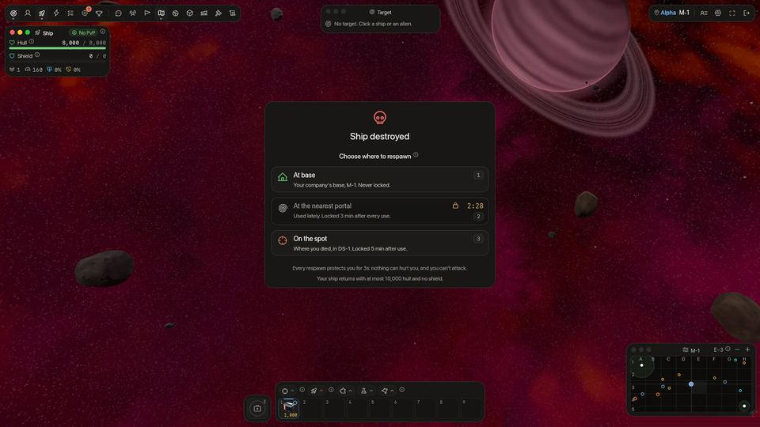
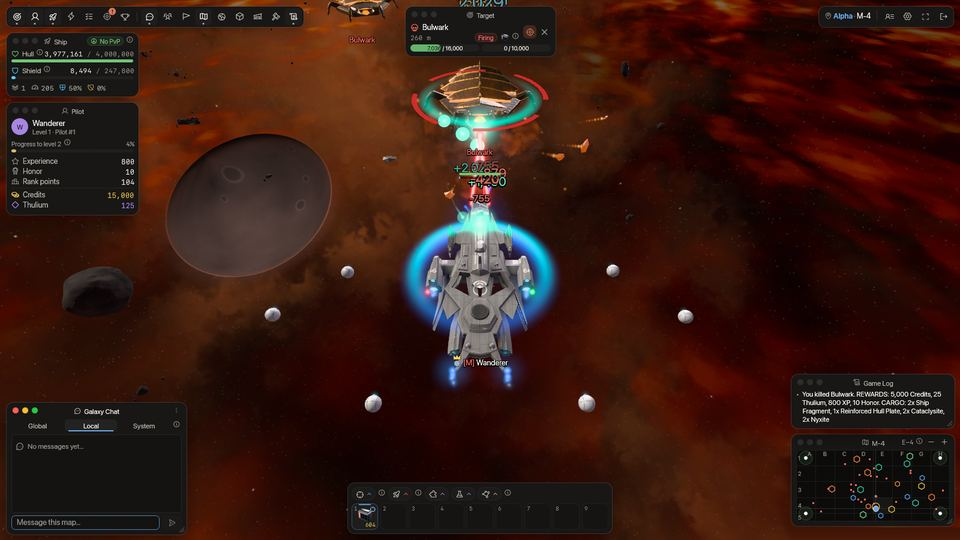
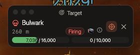

<!-- wiki-i18n source: 46b7d7139e8ed531 -->
<!-- wiki-i18n title: Savaş -->
# Savaş mekaniği {#combat-mechanics}

Bu bölüm, SpaceCorps’taki çatışmalarda hasarın nasıl hesaplandığını, uygulandığını ve onarıldığını ayrıntılı olarak anlatır.

## Hasar hesaplama {#damage-calculation}

Bir gemi lazerlerini ateşlediğinde sunucu, hasar çıktısını şu sırayla hesaplar:

### 1. Temel hasar ve rastgele sapma {#1-base-damage-random-variance}

Takılı tüm lazerlerin (dronlardaki lazerler dahil) ve onlara takılı lazer amfilerinin temel hasarı toplanır.
- **Rastgele zar**: Bir salvonun gerçek hasarı, toplam temel hasarın **%80 ile %100** arasında rastgele belirlenir.
  - Formül: `Roll = (0.8 + (Random * 0.2)) * BaseDamage`

### 2. Kritik vuruşlar {#2-critical-hits}

Her salvonun kritik vuruş olma şansı vardır.
- **Kritik şans**: Takılı lazerlerin ortalama kritik şansı artı takılı tüm lazer amfilerinin kritik şanslarının toplamı.
- **Kritik çarpan**: Bir atış kritikse hasar zarı **x1,5** ile çarpılır. Kritik bir salvonun hasar sayısı buz mavisi, daha büyük ve “!” ile gösterilir (bkz. [Hasar ve iyileştirme sayıları](#damage-and-heal-numbers)).
- Quantum Laser I ve II eşyalarının kendi kritik şansı yoktur: onu amfileri verir.
- **Sabit kritik hasar**: Lazer amfilerinden gelen düz kritik hasar, çarpandan sonra eklenir.
  - Formül: `CritDamage = (Roll * 1.5) + FixedCritDamage`

### 3. Genel çarpanlar {#3-global-multipliers}

Son olarak, nihai hasar çıktısını elde etmek için genel çarpanlar (aktif boosterlar, örneğin Laser Damage Booster etkisi olan +%10, ya da x2, x3, x4 gibi lazer cephanesi çarpanları) uygulanır:
- Formül: `FinalDamage = Damage * AmmoMultiplier * (1.0 + BoosterDamagePercent)`
- Kuşanılmış bir [dron formasyonu](/wiki/03-Mechanics/Formations.md) nihai hasarı bir kez daha çarpabilir: örneğin Auger +%21 lazer hasarı, Gyre −%11 ve uzaylılara karşı Culler +%12 (ayrı bir çarpandır, booster yüzdesinin parçası değildir).
- **Siphon Battery** cephanesinin çarpanı x1, ama hedefi farklı: hasarı yalnızca hedefin kalkanından düşer (soğurma ne olursa olsun asla gövdeden değil) ve senin kendi kalkanına, en fazla maksimumuna kadar geçer. Bkz. [Lazerler ve cephane](/wiki/06-Items/Lasers.md).

### 3b. Roketler {#3b-rockets}

Bir [roketin](/wiki/06-Items/Rockets.md) kendi hasarı vardır (bir Lancet I 1.700 ile 2.100, bir Lancet III 5.200 ile 6.200, bir N.U.K.E. 45.000 ile 50.000 hasar verir); ateşlediğinde bir kez belirlenir ve her gemi için aynıdır: lazerlerin, amfilerin, boosterların ve cephanen onu değiştirmez ve kritik vuruş yoktur. Tüm roketler tek bir **3 saniyelik** zamanlayıcıyı paylaşır. Tek hedefli bir roketin **kalkan delmesi** vardır: hedefinin soğurmasından düşer (aşağıdaki Hasar alma bölümüne bak); bir patlama, yarıçapı içindeki her gemiye zarar verir; merkezde tam değeri, kenarda yarısını. Bir roketin bir pilotun gemisinden aldığı miktarı hiçbir şey sınırlamaz: önce kalkan, sonra gövde. Roketler kendi şirketine ya da kendi [grubuna](/wiki/03-Mechanics/Groups.md), içindeki şirketler hangileri olursa olsun, asla zarar vermez. Kuşanılmış bir [dron formasyonu](/wiki/03-Mechanics/Formations.md) hem hasarı hem zamanlayıcıyı değiştiren tek şeydir: bir roket formasyonu her roketin hasarını artırır (en fazla +%55) ve birkaçı zamanlayıcıyı uzatır ya da kısaltır. [Asteroitler](/wiki/03-Mechanics/Asteroid-Mining.md) roketlerden hasar alır, lazerlerden de bir salvonun bir gemiye verdiği hasarın %5 kadarıyla (amfilerin, boosterların, cephanen ve kritik vuruşlar sayılır, asteroitin zırhı sonra düşer); dronlar onlara bir şey yapmaz ve bir atışın yoluna giren bir asteroit, arkasındaki gemi yerine vuruşu alır ([Siper](/wiki/03-Mechanics/Asteroid-Mining.md#cover)), bir [Energetic Wall](/wiki/06-Items/Extras.md#energetic-wall) da öyle.

### 4. Hedefe dönmek {#4-facing-the-target}

Kilitlenip ateş eden bir gemi ya da uzaylı, hangi yöne uçarsa uçsun (daire çizerek, geri çekilerek ya da yerinde durarak) hedefine döner ve ateş etmeyi bıraktığında rotasına geri döner.

### 5. Menzil {#5-range}

Bir gemi, hedefi **menzilinin** içindeyken saniyede bir salvo ateşler; hedef daha uzaktaysa ateşi keser: hedef yeniden yeterince yaklaşana kadar ateş cephane harcamaz ve Hedef penceresi “Menzil dışı” der. Menzil, **tüm lazerlerinin menzillerinin ortalamasıdır** (dronlarındaki lazerler de dahil), en yakın birime yuvarlanır ve tüm gemi için tek bir sayıdır: içindeyken her lazer ateş eder, dışındayken hiçbiri etmez. Bu yüzden kısa menzilli lazerlerin yanındaki uzun menzilli bir lazer erişimini uzatmaz: bir Starfire-III (850) ile iki Quantum Laser II (700) 750 eder. Bir Demirhane menzil bonusu, ortalamadan önce kendi lazerinde sayılır. Hiç lazeri olmayan bir gemi lazerlerini ateşleyemez ve Hangar ona menzil göstermez (bir tire); roketleri yine ateşlenir, her biri kendi menziliyle (bkz. [Roketler](/wiki/06-Items/Rockets.md)). Her lazerin kendi menzili için bkz. [Lazerler ve cephane](/wiki/06-Items/Lasers.md).

## Hasar ve iyileştirme sayıları {#damage-and-heal-numbers}

Bir vuruş, isabet ettiği geminin üzerinde süzülen bir sayı olarak görünür. **Kendi sayıların** her zaman görünür: verdiğin hasar, aldığın hasar ve kendi onarımların. **Kilitlenme çemberinin altındaki gemi** daha fazlasını gösterir: aldığı her vuruşu ve her iyileştirmeyi, **kaynağı ne olursa olsun**. Yani diğer pilotların lazerleri, roketleri ve dronları, uzaylılar, Clan Warden saldırıları ve geminin kendi onarımları ile kalkan yenilenmesi. Başkası senin hedefine ateş ediyorsa onun hasarını da görürsün.

- **Renkler.** Altın: bir uzaylıya ya da düşman pilota verilen hasar. Eksi işaretli kırmızı: korumakta olduğun bir gemiye (kendi şirketinden ya da grubundan bir pilot) verilen hasar ve senin aldığın hasar. Artı işaretli yeşil: bir iyileştirme; örneğin Emergency Repair, bir Repair Drone ya da geri gelen bir kalkan. Soluk gümüş “Iska”: bir formasyonun kaçınmasının savuşturduğu doğrudan vuruş. Kritik bir salvo daha büyüktür ve “!” ile biter (bir uzaylıya ya da düşmana isabet ederse buz mavisi).
- **Seninkiler daha parlak kalır.** Başkalarının senin hedefindeki sayıları biraz daha küçük ve soluktur ve geminin sağında bir sütunda dizilir; bu yüzden seninkilerin üstünü asla kapatmaz.
- **Kalabalık için tek sayı.** Birlikte isabet eden vuruşlar tek bir sayıda toplanır, sonuna da bir sayaç (`×35`) eklenir. Bir gemiye ateş eden kırk pilot saniyede yaklaşık iki sayı üretir, yediden fazlasını asla. İyileştirmeler saniyede bir kez gösterilir.
- **Yalnızca çemberin altındaki gemi.** Diğer her gemi yalnızca senin vuruşlarını ve sana gelen vuruşları gösterir. Kara deliğin radyasyonu ve bir formasyonun kalkan kaybı için sayı yoktur: çubuklarda görünürler.
- **Ayar.** Ayarlar › Arayüz › **Hedefime başkalarının verdiği hasarı göster**, varsayılan olarak açık. Kapatırsan yalnızca kendi sayılarını görürsün. **Hareketi azalt** her sayıyı durağan tutar: hiçbiri fırlamaz ya da yükselmez.

---

## Öldürme ödülleri: ilk vuruş sahiplenir {#kill-rewards-first-hit-claims}

Bir uzaylının ödülleri, son vuruşu kim yaparsa ona değil, ona ilk ateş eden pilota gider.

- **Sahiplenme**: atışı bir uzaylıya hasar veren ilk pilot onu sahiplenir. Her vuruşun sahiplenmeni yeniler.
- **Kaybetmek**: uzaylıya **10 saniye** boyunca vurmazsan sahiplenmen düşer ve ona vuran sonraki pilot onu sahiplenir. Gemin yok edilirse ya da haritadan ayrılırsan (bir portaldan veya oyundan çıkarak) sahiplenmen yine biter ve 10 saniye içinde geri dönmek onu geri getirmez.
- **Öldürme**: uzaylı yok edildiğinde sahiplenmeyi elinde tutan pilot her şeyi alır: kredi, Thulium, XP, onur, görevler ve sıfırlama puanları için öldürme ve [kargo](/wiki/03-Mechanics/Cargo.md) kutusu. Başkasının sahiplendiği bir uzaylıyı bitiren pilot hiçbir şey alamaz ve Oyun Günlüğü bunu söyler. Sahiplenmen ödüyor ama son vuruşu başka bir pilot yapmışsa Oyun Günlüğü o pilotun adını verir ve ödemeyi sahiplenmenin sana yaptığını söyler.
- **Sıralama puanları**: öldürme ayrıca sahiplenenin sıralamasına PvE puanı ekler, daha zorlu uzaylı için daha fazla: Seeker için 1, Phantasm için 2, Bulwark için 4, Goombah için 7 ve Crystalys için 16 (her uzaylının kendi sayfası kendi değerini listeler). Bunlar yalnızca öldürenindir: bir grubun ödül payı onları içermez.
- **Görmek**: başka bir pilotun sahiplendiği bir uzaylıyı seçtiğinde Hedef penceresi *Sahiplenen:* satırında o pilotu ve *Ödül yok* yazısını gösterir.
- [Şirket pilotları](/wiki/03-Mechanics/Company-Pilots.md) asla bir uzaylıyı sahiplenmez ve onların bitirdiği bir uzaylı yine sahiplenmeyi elinde tutan pilota öder.
- Bir [grup](/wiki/03-Mechanics/Groups.md) içindeki pilot, sahiplenmesinin ödediğini yakında olup ateş eden grup arkadaşlarıyla paylaşır; sahiplenmenin kendisi yalnızca pilotundur.
- **İstisna: [sürülerin](/wiki/05-Swarms/Swarms.md) liderleri, Dormant Pulse ve [Clan Warden](/wiki/03-Mechanics/Clans.md#warden-pay-and-loot)**: bir sürü patronu, bir Dormant Pulse ya da bir Clan Warden ilk vuruşa göre değil, her pilotun ona verdiği hasara göre ödeme yapar ve kargo kutusu en çok hasar veren pilota gider ([bir patron öldürmesi nasıl öder](/wiki/05-Swarms/Swarms.md#how-a-boss-kill-pays)). Diğer takipçiler, yani Pirate Scout ve Seeker Slave, her uzaylı gibi sahiplenmeye göre öder. Bir sürü gemisinin PvE puanları Sürüler sayfasındadır.

---

## Yalnızca karşılık veren uzaylılar {#aliens-that-only-fight-back}

Seeker ve Goombah asla kavga başlatmaz. Her biri, ona vuran pilota döner (hasar veren bir vuruş; başka bir uzaylının ateşi onu asla kışkırtmaz), [Bir uzaylı kimle savaşır](#who-an-alien-fights) bölümünde anlatılan pilotla savaşır ve ona en son biri vurduktan **10 saniye** sonra bırakır. **30 saniye** boyunca yalnız bırakılırsa gövdesi saniyede maksimumunun %2’si kadar onarılır. Diğer uzaylılar (Phantasm, Bulwark, Crystalys) aggro yarıçaplarına (700, 700 ve 900 birim) giren her korumasız pilotun peşine düşer ve gövdelerini asla onarmaz; her uzaylının kalkanı son vuruşundan 15 saniye sonra yeniden dolmaya başlar.

---

## Bir uzaylı kimle savaşır {#who-an-alien-fights}

Bir uzaylı, **ona ilk ateş eden pilotla** savaşmaya, o pilotu hâlâ kovalayabildiği sürece devam eder: pilot haritadadır, güvenli bölgede değildir, gizlenmemiştir ve EMP süresinin içinde de değildir, hayattadır ve son **10 saniye** içinde ona vurmuştur (her vuruş 10 saniyeyi yeniden başlatır: bir lazer salvosu, bir roket ya da bir patlamanın kenarı fark etmez). Bu durum sürdüğü sürece diğer pilotların atışları, ne kadar yakın olurlarsa olsunlar ya da ne kadar sık vurursa vursunlar, onu asla çevirmez; yani bir pilot bir uzaylıyı tutarken diğerleri ona ateş edebilir.

İlk pilot düştüğünde (haritadan ayrılır, güvenli bölgeye ulaşır, gizlenir, yok edilir ya da uzaylıya 10 saniye vurmayı bırakır) uzaylı, ona en son vuranı değil, kavgaya katılan **sıradaki** pilota, ona ilk ateş ettikleri sıraya göre döner. Düşüp ona yeniden ateş eden pilot sıranın sonuna katılır. Bir uzaylı ona ilk ateş eden **32** pilotun kaydını tutar; 33. atıcı, bunlardan biri düşene kadar sıraya katılmaz ve ne büyüklükte bir kalabalık olursa olsun uzaylı ilk pilotta kalır.

[Şirket pilotları](/wiki/03-Mechanics/Company-Pilots.md) her oyuncudan sonra sayılır: bir uzaylı, kovalayabileceği hiçbir oyuncu ona ateş etmediği sürece bir şirket pilotuyla savaşır; bir şirket pilotunun savaştığı uzaylıya ateş eden oyuncu onu devralır ve bir şirket pilotu bir uzaylıyı asla bir oyuncudan uzaklaştıramaz. Bunların hiçbiri uzaylının ödüllerini kimin alacağını değiştirmez: o, sahiplenmenindir ([Öldürme ödülleri](#kill-rewards-first-hit-claims)).

---

## Uzaylılar ilgisini kaybeder {#aliens-lose-interest}

Hiçbir uzaylı seni haritanın bir ucundan diğerine takip etmez. Ama **vurduğun** bir uzaylı ilgisini kaybetmiyor, seninle savaşıyor: son vuruşundan sonraki **10 saniye** boyunca (her vuruş 10 saniyeyi yeniden başlatır; bir lazer salvosu, bir roket ya da bir patlamanın kenarı fark etmez) saldırı menzilinin ötesinde olduğun her an kendi hızıyla sana doğru uçar (Seeker 600, Phantasm ve Bulwark 700, Goombah 800, Crystalys 900) ve menzile girene kadar yaklaşıp ateş etmeyi sürdürür. Ona vurmaya devam ettiğin sürece ne kadar uzağa takip edeceğinin bir sınırı yoktur. Uzaylının silahından daha uzağa erişen bir lazer (Starfire-III 850 birime, Helios Beam 900 birime erişir) onun karşılık veremeyeceği yerden ona vurmanı sağlamaz ve daha hızlı bir gemi onu yalnızca sen ateş etmeyi sürdürdüğün sürece arkanda tutar. Bir güvenli bölgeye ulaşırsan, gizlenirsen ya da haritadan ayrılırsan seni yine hemen bırakır.

Birkaç pilot aynı uzaylıya vurduğunda, o ona ilk ateş edende kalır (bkz. [Bir uzaylı kimle savaşır](#who-an-alien-fights)): o pilota yaklaşır ve ateş eder; bu yüzden menzilinin hemen dışında etrafında duran bir grup, onu hiç karşılık vermeden birinden diğerine koşturamaz.

Seni hedef almış ve ona 10 saniyedir vurmadığın bir uzaylı (yaklaştığın bir Phantasm, Bulwark ya da Crystalys, ya da ateş ettiğin herhangi bir uzaylı), şunlardan biri doğru olur olmaz seni bırakır:

- **Ona hiç ateş etmediysen:** ondan **1.200 birimden** fazla uzaktaysan ya da takibin başladığı yerden **2.000 birim** uçmuşsa.
- **Ona son bir dakikada ateş ettiysen:** ondan **2.500 birimden** fazla uzaktaysan ya da takibin başladığı yerden **3.000 birim** uçmuşsa. Başlattığın bir savaş adil kalır.

Bırakan bir uzaylı bulunduğu yerden dolaşmaya başlar, seni son gördüğü yere asla gitmez (sen gizlensen ya da EMP ateşlesen bile) ve ona ateş etmedikçe **8 saniye** boyunca seni yeniden hedef seçmez. Her uzaylı kendi kararını verir, bu yüzden karışık bir sürü sen uzaklaştıkça seyrelir. Uzaylılar seni asla bir güvenli bölgenin içine ya da bir geçitten geçerek takip etmez; seni birinin yakınında kaybedenler ondan, her biri kendi yönünde uzaklaşır; böylece yığın halinde beklemezler. Bir uzaylının ilgisi hiçbir zaman saldırı menzilinden ve aggro yarıçapından, artı 100 birimden daha az uzağa uzanmaz.

Uzaylılar birbirini itip ayırmaz: bir pilotun peşindeki bir sürü, gemileri arasında hiç boşluk bırakmadan yaklaşır ve pilotunu kaybeden bir sürü ancak her uzaylı kendi yolunu seçtikçe dağılır. Ama bir **gemiden** uzak durur: bir pilotun gövdesinin içine asla girmez ve üzerine park eden bir pilot onu yanında sürükler.

Daha hızlı uçmak yalnızca bir yere kadar işe yarar: bir Protos (160), avlanan hiçbir uzaylıdan daha hızlı değildir (Phantasm 160, Bulwark 175, Crystalys 230); bu yüzden takibi senin hızın değil takip sınırı bitirir.

---

## Hasar alma ve güvenli bölgeler {#taking-damage-safe-zones}

Geminin bir düşman ya da NPC tarafından vurulduğunda hasar şu şekilde işlenir:

### 1. Kalkan soğurması {#1-shield-absorption}

Gelen hasar, kalkanlar ile gövde puanları arasında geminin **ortalama soğurması** ile bölüşülür: kalkanlarının soğurmasının ortalaması, her biri kendi kalkan hücrelerininkiyle birlikte, artı Sezon Mağazası’ndaki Shield Absorbance Boost (bkz. [Kalkan mekaniği](/wiki/03-Mechanics/Shields.md)). **%100 ile sınırlı değildir**: kalkanların bir vuruştan aldığı pay, soğurman **eksi saldırganın kalkan delmesidir**, %0 ile %100 arasında.
- **Soğurma** (örneğin en iyi kalkan ve en iyi hücrelerle %80, iki Absorption Shield Cell I taşıyan bir Basic Shield Core ile %56) her vuruşun bir kısmını kalkanlara aktarır, vuruşun delmesi düşüldükten sonra: Lancet III roketinin %35 delmesi, %80 soğurmalı bir geminin kalkanlarında %45 bırakır ve geri kalanı (orada %55) doğrudan gövde puanına vurur.
- **Kalkan delme** doğrudan roketlerden (%10 ile %35) ve x3 ile x4 lazer cephanesinden (%5 ve %10) gelir; uzaylılarda yoktur. Soğurması %100’ü aşan bir gemi (diyelim %112), farka (orada %12) kadar delmeye karşı bir vuruşun tamamını tutar. Atıcının lazerlerine takılı Penetration Amp eşyaları (yuva başına +%3 ile +%12) ve bir dron formasyonu buna eklenir ve toplamı hiçbir şey sınırlamaz.
- Payı için fazla düşük kalan bir kalkan farkı gövde puanına aktarır; kalkanlar tamamen bittiyse kalan tüm hasar (**%100**) gövde puanına vurur.
- Uzaylıların soğurma özelliği yoktur: kalkanları her vuruşun %80 kadarını alır (vuruşun delmesi düşülür), gövdeleri geri kalanını.
- **Dron formasyonları.** Rampart soğurmanı %17 artırır (Shrike %6 azaltır), Asterism, sana gelen her doğrudan vuruşun %7 şansla hiç hasar vermemesini sağlar (süzülen bir “Iska” görünür) ve isabet eden vuruşlar her zamanki gibi kalkan ile gövde arasında bölüşülür. Gemini ve Stiletto formasyonları (+9 ve +16 puan) kendi cephanene ve doğrudan roketlerine kalkan delme ekler, sınır yoktur ([Dron formasyonları](/wiki/03-Mechanics/Formations.md)). Bir lazer için amfileri de sayılır.

### 2. Güvenli bölge bağışıklığı {#2-safe-zone-immunity}

Her şirketin ana üssü (X-1 haritaları) güvenli bölgeler içerir.
- Bir güvenli bölgeye girmek geminin hasara karşı tamamen bağışık olmasını sağlar.
- **Koruma kaybı**: Bir düşmana saldırmak, fiziksel olarak bir güvenli bölgenin içinde olsan bile güvenli bölge bağışıklığını hemen kaldırır.
- Her istasyonun ve portalın çevresindeki bir halka, vurulmandan 5, ateş etmenden 15 saniye geçtikten sonra seni korur. Seni korurken ve çatışmadan çıkmışken Hangar penceresi, oyundan çıkmadan gemini değiştirmene izin verir: bkz. [Uçuşta Hangar](/wiki/03-Mechanics/Hangar.md).
- İstasyonlar yalnızca ana üslerde (`x-1`) bulunur. Tehlike Sektörleri’nde (`DS-1` ile `DS-4`) hiç yoktur: orada sıçrama geçitlerinin çevresindeki halkalar tek güvenli bölgelerdir.

### 3. Bir Tehlike Sektörü’nde saldırı altında {#3-under-attack-in-a-danger-sector}

Bir portaldan sıçrama 3 saniye sürer (bkz. [Uzay haritası yolculuğu](/wiki/01-General/Spacemap%20Travel.md)). Tehlike Sektörleri’nde (`DS-1` ile `DS-4`), gemisi son **10 saniye** içinde başka bir pilot ya da bir uzaylı tarafından vurulmuş bir pilot sıçrama başlatamaz ve bir vuruş devam eden bir sıçramayı iptal eder. Başka her yerde saldırılar bir sıçramayı asla kesmez ve bir [kargo](/wiki/03-Mechanics/Cargo.md) kutusunun toplanmasını hiçbir şey kesmez.

---

## İyileşme ve onarım {#recovery-repair}

Çatışmadan toparlanmak için pilotlar pasif yenilenmeye ve aktif yardımcı botlara güvenebilir:

### 1. Kalkanın pasif yenilenmesi {#1-shield-passive-regeneration}

- **İşleyiş**: Her saniye kalkanının dolum hızına eşit kalkan puanı geri yükler.
- **Gecikme**: Çatışmayla kesilir; pasif yenilenme ancak **15 saniye** hasar almadıktan sonra yeniden başlar.
- **Dron formasyonları**: Adamant ve Redoubt her saniye kalkan geri verir, çatışmada da (bkz. [Dron formasyonları](/wiki/03-Mechanics/Formations.md)).

### 1b. Siphon Battery

[Siphon Battery](/wiki/06-Items/Lasers.md) cephanesi, hedeften emdiği kalkanı hemen seninkine ekler, en fazla maksimumuna kadar. Kalkan kazanmak alınan hasar sayılmaz, bu yüzden pasif yenilenmeni geciktirmez.

### 2. Repair Drone (gövde onarımı) {#2-repair-drones-hull-repair-}

- **İşleyiş**: Bir Repair Drone takarsan (hangardaki Ekstralar altında) onu kısayol çubuğundan açarsın (Ekstralar bölümünden bir yuvaya sürükle) ve gövdeni (HP) onarır. Herhangi bir vuruş onu kapatır ve gövde dolunca durur. Takılı bir [Auto-Repair CPU](/wiki/06-Items/Extras.md#auto-repair-cpu) ile onu yeniden açmana gerek kalmaz: aşağıdaki gecikme geçer geçmez dronu kendisi gönderir, onu elle durdurmadıysan.
- **Onarım hızı**: Her saniye maksimum gövde puanının bir yüzdesini geri yükler (yalnızca takılı en iyi dron sayılır, toplanmazlar):
  - **Repair Drone I**: %1,5 maks. HP / sn
  - **Repair Drone II**: %2,25 maks. HP / sn
  - **Repair Drone III**: %3,5 maks. HP / sn
  - **Repair Drone IV**: %5 maks. HP / sn
- **Gecikme**: Onarım dronları gövdeyi ancak **10 saniye** hasar almadıktan sonra onarmaya başlar.
- **Yetenek yuvasında** bir Repair Drone kendi başına onarmaz: sana **Emergency Repair** verir; ateş altında bile maksimum gövde puanının bir payını on saniyede iyileştiren bir düğme (bkz. [Yetenekler](/wiki/03-Mechanics/Abilities.md)).

---

## Gizlenme ve EMP {#cloaking-and-the-emp}

Bir atış için kilit gerekir. Cloaking CPU (bir [ekstra](/wiki/06-Items/Extras.md)) ve EMP Charge (bir roket gibi taşınan bir [sarf malzemesi](/wiki/06-Items/Rockets.md#emp-charge)) sana kilitlenmeyi ortadan kaldırır:

- **Cloaking CPU**: gizlenmişken (zaman sınırı yoktur) diğer şirketlerin pilotları, uzaylılar ve şirket pilotları gemini göremez ve ona kilitlenemez; mini haritada bulunduğun yerde düz bir kırmızı nokta görürler. İlk salvon gizlenmeni bitirir ve bir dakika boyunca, ayrıca bir vuruş ya da atıştan sonraki 10 saniye içinde yeniden gizlenemezsin.
- **EMP Charge**: 3 saniye boyunca kimse sana kilitlenemez ve üzerindeki her kilit hemen kopar. Ateşleyen pilotun 1.500 birim içindeki her gizlenmeyi, pilotun kendi grubununkiler hariç, bitirir. Seni saklamaz ve bağışıklık da vermez: kilit gerektiren şeyi durdurur.

Bir roket de bir atıştır: kendi gizlenmeni bitirir ve başkasının roketinin alan patlaması gizlenmiş bir gemiye yine zarar verir ve gizlenmesini bitirir, çünkü bir patlama kilit gerektirmez (bkz. [Roketler](/wiki/06-Items/Rockets.md)). EMP, kilitli lazerleri ve güdümlü roketleri durdurur, patlamayı değil.

İkisi de bir öldürme sahiplenmesini değiştirmez: sahiplenme, bir uzaylıya kimin vurduğunun kaydıdır, bir kilit değildir; gizlenmek seninkini serbest bırakır.
