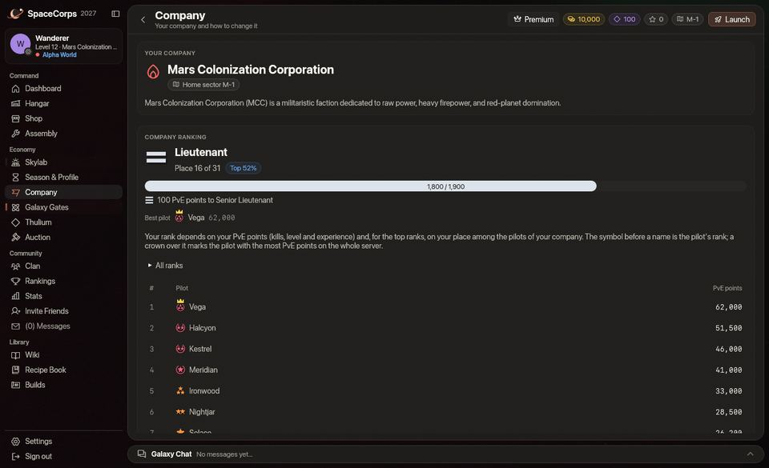
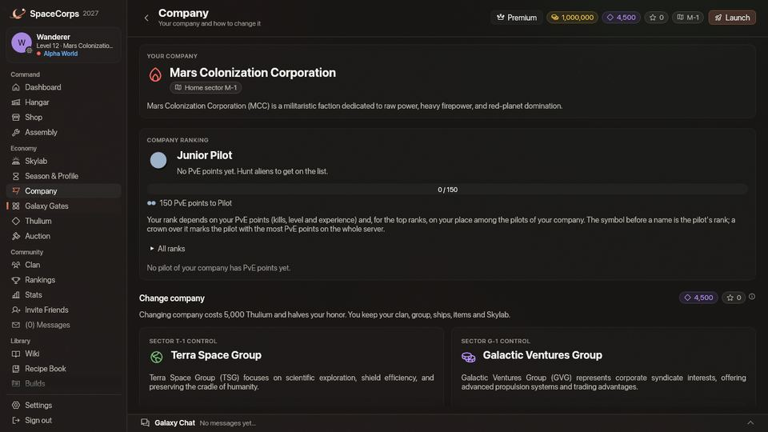

<!-- wiki-i18n source: 1d8922d7c6c95d17 -->
<!-- wiki-i18n title: Şirket pilotları -->
# Şirket pilotları {#company-pilots}

Her şirket, ana sektörlerinde (`M-1` ile `M-4`, `T-1` ile `T-4`, `G-1` ile `G-4`) küçük bir NPC pilot ekibi bulundurur. Şirket adına günün her saati uçarlar ve şirketin pilotlarına yardım ederler.

## Onlar kimdir {#who-they-are}

- **Ekip**: her dünyada şirketin her sektöründe 3 pilot (Alpha, Beta ve Gamma dünyalarının kendi ekipleri vardır); her biri şirketin etiketi ve bir çağrı adıyla anılır, örneğin **[M] Vesper**. Ad etiketlerinde küçük bir robot işareti ve şirketin rengi bulunur.
- **Gemi**: üç **Quantum Laser II**, iki **Light Shield Core**, bir **Engine I** ve bir **Repair Drone I** taşıyan bir [Ostirion](/wiki/02-Ships/Ostirion.md):
  - 48.000 gövde puanı, 22.000 kalkan puanı, hız 202
  - soğurma %45: kalkanları her vuruşun %45’ini, gövdeleri %55’ini alır
  - salvo başına 195 temel hasar (x1 cephane), %1 kritik şans, 700 menzil
- **Mini haritada**: kendi şirketinin pilotları için yeşil bir elmas, başka bir şirketinkiler için kehribar rengi bir elmas.
- **Rütbe yok**: uçuşta bir pilotun adından önceki küçük simge, pilotun [rütbesi](/wiki/03-Mechanics/Ranks.md) olup gerçek pilotlara aittir. Şirket pilotlarının rütbesi yoktur ve şirketinin rütbe sıralamasında yer almazlar. Şirket sayfası şirketinin gerçek pilotlarını en çok PvE puanı olandan başlayarak listeler; bir pilotun rütbesi, o listedeki PvE puanından ve en iyi altı rütbe için şirketin kontenjanlarından gelir.

## Ne yaparlar {#what-they-do}

- **Devriye gezerler**: sektörün istasyonundan, portallarından ve aradaki birkaç noktadan geçen bir döngüde.
- **Avlarlar**: sektörde pilotlar uçarken başa çıkabilecekleri uzaylıları (Seeker ve Phantasm; Bulwark, Goombah ve Crystalys ile uğraşmazlar). Başka bir şirketin pilotunun savaştığı uzaylı o pilota aittir: ekip ona dokunmaz.
- **Yardım ederler**: şirketlerinden bir pilot, kendilerine 1.500 birim mesafedeyken bir uzaylı tarafından saldırıya uğradığında ya da başa çıkabilecekleri bir uzaylıya ateş açtığında o savaşa katılırlar. Bir şirket arkadaşının, kazanamayacakları bir uzaylıyla (bir pilotun ateş ettiği bir Goombah ya da bir Bulwark) başlattığı savaşın dışında kalırlar; bir şirket arkadaşının peşine düşen saldırgan bir uzaylı ise ne olursa olsun püskürtülür. Bitirdikleri bir uzaylının ödemesi, onun sahiplenmesini elinde tutan pilota gider (ona ilk vuran; bkz. [Savaş](/wiki/03-Mechanics/Combat.md)); kimse sahiplenmeyi tutmuyorsa, ona ateş eden (kilitlenmiş, menzil içinde, son 2,5 saniyede bir salvo atmış) şirketlerinin en yakın pilotuna sayılır. Her iki durumda da ödüller o pilotundur ve [kargo](/wiki/03-Mechanics/Cargo.md) kutusu, öldürmeyi o yapmış gibi ona ayrılır. Şirket pilotları hiçbir zaman bir uzaylıyı sahiplenmez ve kendileri hiçbir şey kazanmaz ya da toplamaz: tek başlarına savaştıkları bir uzaylı kutu bırakmaz. Uzaktan kilitlenmek ya da yalnızca ateş yemek hiçbir şey kazandırmaz.
- **[Sürüleri](/wiki/05-Swarms/Swarms.md) yok sayarlar**: bir sürü gemisi onların işi değildir. Onu ne avlarlar ne de ona karşı bir savaşa katılırlar; böyle bir savaşta sana yardıma da gelmezler.
- **Karşılık verirler**: uzaylılar tarafından vurulduklarında, ayrıca PvP açıldığında ve [dünyaları](/wiki/03-Mechanics/Wipe-Timeline.md#worlds-alpha-beta-and-gamma) PvP’ye izin veriyorsa başka şirketlerin pilotları tarafından vurulduklarında: Alpha dünyasında `x-1` ile `x-3` sektörlerinde ve Beta dünyasında `x-1` sektöründe PvP yoktur.
- **Onarım yaparlar**: gövdeleri hasarlı olduğunda dronlarıyla, saniyede gövdelerinin %1,5’i kadar, son vuruştan 10 saniye sonra başlayarak.
- **Geri çekilirler**: gövdeleri %30’a düşünce en yakın güvenli bölgeye çekilir ve orada %90’a kadar onarım yaparlar.
- **Yeniden doğarlar**: yok edildikten 60 saniye sonra sektörün istasyonunda (ya da ilk portalında).

## Angajman kuralları {#rules-of-engagement}

- Lazerleri kendi şirketlerinin pilotlarına ya da gemilerine asla isabet etmez.
- Güvenli bölgeler onları her pilot gibi korur ve güvenli bölgeye asla ateş etmezler.
- **Kendi şirketinin pilotlarına** saldırılabilir, ama birini yok etmek **100 onura** mal olur (onurun 0’ın altına düşebilir); bir uzaylı ya da başkası onu yok etmeden önceki 15 saniyede ona vurmak da aynı bedeli taşır. Ateşin kendi kendine hiçbir zaman birinin üzerine geçmez: ateş ederken birini seçmek ateşini tutar ve ona yalnızca saldırı tuşu ya da bir cephane yuvası ateş eder. Birinin yanına yapılan bir tıklama (oraya uçmak için) onu seçmez.
- **Başka bir şirketin pilotları** yok edildiğinde hiçbir şey ödemez (kredi, onur ya da sıralama puanı yok) ve Barış Protokolü sırasında (sezonun ilk üç günü) saldırılamaz.
- Herhangi bir şirket pilotuna saldırmak [dünyanın](/wiki/03-Mechanics/Wipe-Timeline.md#worlds-alpha-beta-and-gamma) PvP kurallarına tabidir: Alpha dünyasında `x-1` ile `x-3` sektörlerinde ve Beta dünyasında `x-1` sektöründe PvP yoktur.
- **Enkaz**: yok edilen bir şirket pilotu, onu kim ya da ne yok ederse etsin, ne [kargo](/wiki/03-Mechanics/Cargo.md) kutusu ne de parça bırakır: şirket pilotlarını düşürmek malzeme farm etmenin yolu değildir.

## Savaş notları {#combat-notes}

Kilitlenip ateş eden bir gemi, hangi yöne uçarsa uçsun hedefine dönük kalır: şirket pilotları silahları hedeflerine çevrili halde etrafında döner ve uzaylılar ateş ettikleri kişiye doğru döner.

Onları pilot olarak duyarsın: lazerleri herhangi bir pilotun x1 ateşi gibi ses çıkarır, gemileri büyük patlar ve peşine düşen başka bir şirketin pilotu bir uzaylı gibi savaş müziğini devreye sokar. Kendi şirketinin yakında savaşan pilotları, sen katılana kadar müziği sakin bırakır.
