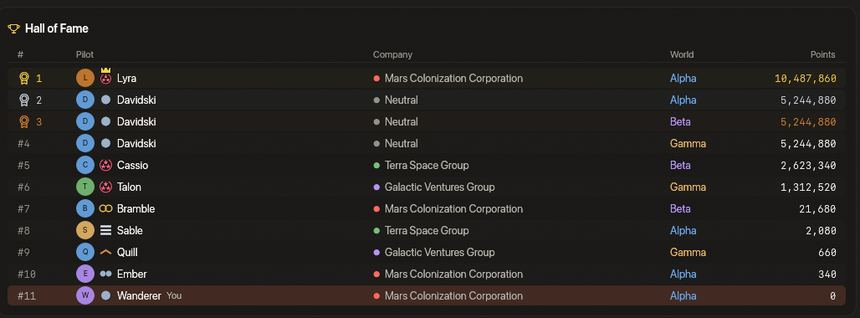

<!-- wiki-i18n source: 94b65a41bd556504 -->
<!-- wiki-i18n title: Davidski -->
# Davidski

Davidski, uçan bir tüccardır. Günde bir kez, kimsenin duyurmadığı bir saatte ortaya çıkan ve bir [Tehlike Sektörü’nde](/wiki/01-General/Danger-Sectors.md) devriye gezen barışçıl bir NPC gemisidir; oyundaki en iyi donanıma sahiptir ve [pazarın](/wiki/03-Mechanics/Auction.md) listelediği her eşyayı, stoğu hiç bitmeden, Mağaza fiyatının kat kat fazlasına satar. Hiçbir şirkete ait değildir, Şeref Salonu’nda bir pilot gibi yer alır ve ilk ateşi açmaz. Ondan pazarda alışveriş yaparsın; ona uzayda savaş da açabilirsin.

## Nerede olduğu {#where-he-is}

- **Günde bir kez, duyurulmadan**: her [dünyada](/wiki/03-Mechanics/Wipe-Timeline.md#worlds-alpha-beta-and-gamma) UTC gününde bir kez, 00:00 ile 20:00 UTC arasında, her dünyada ve her gün farklı olan bir anda ortaya çıkar. Kimseye haber verilmez: ne sohbette, ne Oyun Günlüğü’nde, ne de bir bildirimle. Yok edilene ya da gün bitene kadar uçar.
- **Günde bir Tehlike Sektörü**: `DS-1`, `DS-2` ve `DS-3` üzerinde sırayla, günde bir tanesinde uçar ve her dünyada gemisi aynı sektörde olur.
- **Onu nasıl bulursun**: bakarak. Onu yalnızca uçtuğu sektördeki pilotlar görebilir: adı, önünde küçük bir dükkân simgesiyle altın renktedir ve Mini Harita onu bir halka içinde altın bir nokta olarak çizer. Galaksi Haritası onu göstermez. Pazardaki satırlarından birinin ayrıntıları yalnızca bugün çıkıp çıkmadığını söyler: **Bugün uçuşta**, **Bugün çıkmadı** veya **Bugün öldürüldü**. Nerede ya da ne zaman olduğunu asla söylemez.
- **Günün sonunda**, bir dakika boyunca kimse ona vurmadığında ayrılır. Bir savaş gece yarısı asla kesilmez: 15 dakika sonra, o sırada ne olursa olsun, çekilir. Ertesi günün Davidski’si ertesi günün anında, sıradaki sektörde ortaya çıkar.
- **Sıfırlamadan sonra** gemisi yeniden yapılır, ama günü hatırlanır: çıkmış ve yok edilmemişse hemen geri gelir, yok edilmişse ertesi güne kadar gelmez.

## Gemisi {#his-ship}

Altın renge boyanmış bir **Ironclad TITANIC**; TITANIC boyutunda, her parça türünün en iyisini taşıyor ve her biri Ebedi kademeye dövülmüş:

| Ne | Eşya |
|---|---|
| Lazerler | 8 Helios Beam; her biri bir Damage Amp IV, bir Crit Amp IV ve bir Penetration Amp IV ile donatılmıştır |
| Kalkanlar ve motorlar | 11 Heavy Shield Core ve 4 Adaptive Core; her biri Capacity Shield Cell IV ve Absorption Shield Cell IV ya da Impulse Thruster IV ve Momentum Thruster IV ile donatılmıştır |
| Ekstralar | bir Repair Drone IV, bir Auto-Repair CPU ve bir Base CPU II |
| Gövde | 15 Hull Plating III |

Alpha gücünde **858.750 gövde**, **1.309.534 kalkan** (15 saniye vuruş almazsa saniyede 67.614 yenilenir), %80,5 soğurma, 96 hız, 945 menzil ve saniyede **2.052** değerinde bir salvosu vardır. Beta bu sayıların 1,5 katını, Gamma 2 katını taşır; her uzaylı gibi. Alpha’da eritmen gereken yaklaşık 2,2 milyon puan var: aynı lazerlere sahip tek bir Wraith kendi başına yaklaşık on iki dakika kesintisiz ateş ister; on Wraith ise yaklaşık bir dakika on saniye.

## Ona karşı savaşmak {#fighting-him}

- **Barışçıldır.** Rotasında uçar ve kimseye saldırmaz. Güvenli halkadaki ya da gizlenmiş bir pilot onun için hedef değildir.
- **Karşılık verir.** Ona zarar veren herkes hedefi olur: ulaşabildiği ilk saldırganına uçar, salvosunu atar ve ona en son kimse vurduktan on saniye sonra bırakır. Bir buçuk dakika yalnız bırakılırsa yeniden bütündür (kalkanı 15 saniye sonra dolar, gövdesi son vuruştan 30 saniye sonra başlayarak saniyede %2 iyileşir).
- **Ona bilerek ateş et.** Çift tık, bir şirket pilotunun gemisinde olduğu gibi, ona ateş açmaz: onu seç, sonra saldırı tuşunu ya da bir cephane yuvasını kullan.
- **Şirket pilotları işe karışmaz**: her sürü gemisi gibi o da onların işi değildir.

### Yok edildiğinde {#destroyed}

Bir patron gibi öder, her pilotun verdiği hasara göre (hasarın %5’inin altındaki pay hiçbir şey kazandırmaz, her sürü patronunda olduğu gibi) ve en çok hasar veren pilot için bir [kargo](/wiki/03-Mechanics/Cargo.md) kutusu bırakır:

| | Alpha | Beta | Gamma |
|---|---:|---:|---:|
| Kredi | 1.060.000 | 2.120.000 | 3.180.000 |
| Thulium | 2.850 | 5.700 | 8.550 |
| Deneyim | 170.000 | 340.000 | 510.000 |
| Onur | 740 | 1.480 | 2.220 |

Kutuda 40 ile 60 Ship Fragment, 10 ile 20 Power Core ve 3.000 ile 6.000 Advanced Plasma bulunur; bazen de Ancient Control Unit ya da Dark Matter çıkar. Bir öldürme, PvE sıralaman için **37 puan** sayılır ve öldürme istatistiklerinde Davidski adıyla görünür.

- **Günde en fazla bir kez yok edilir.** Öldükten sonra bir sonraki UTC gününe kadar gelmez; o gün, kendi anında, tam gövdeyle yeniden çıkar. Kimseye düştüğü söylenmez; onunla savaşan pilotlar yalnızca kendi ödemelerinden haberdar olur.
- **Bir pilota günde iki öldürme için, bir dünyaya ise sekiz için öder** (UTC). Bir dünyada günde bir Davidski olduğu için bu sınırlar nadiren önem taşır; bunları aşarsan sana söylenir ve öldürme için ödeme almazsın, puan da kazanmazsın.

## Ondan satın almak {#buying-from-him}

Stoğu, pazarın **Pilot pazarı** listesinde, pilotların ilanlarının arasındadır: pazarın listelediği 84 türün her biri için bir satır, kredi ve Thulium olarak (168 satır), bir lot için fiyatlandırılmış, adı altın renkte, bir **NPC** rozeti ile adet ve kalan süre yerine bir sonsuzluk işaretiyle. Pilot pazarının arama kutusu, kategorileri ve büyüleme ile para birimi filtreleri onun satırlarını her ilan gibi daraltır (eşyaları Standart’tır) ve sıralamaları onları sayısının söylediği yere koyar: fiyata göre pilotların fiyatlarının yanına, **Yakında bitenler** ve **En yeniler** altında ise pilotların ilanlarından sonraya. Ayrıntıları görmek için birini seç ve **Satın al**; satın alma ona gider, bir pilota değil. Fiyatlar:

- **Mağaza fiyatının kredi cinsinden 100 katı ve Thulium cinsinden 40 katı**, Mağaza’nın sattığı eşyalar için; bir para birimindeki Mağaza fiyatı, diğerinde 200 kredi bir Thulium sayılarak hesaplanır. Bir Repair Drone I (Mağaza’da 5.000 kredi) 500.000 kredi ya da 1.000 Thulium, bir Quantum Laser I 800.000 kredi ya da 1.600 Thulium, roketler tanesi 50.000 ile 100.000 kredidir. İki fiyatın değeri aynı değildir: 200 kredi bir Thulium hesabıyla 1.000 Thulium yalnızca 200.000 kredi eder.
- **Mağaza’nın satmadığı ekipman onun son çaresidir: eşyanın referans değerinin kredi cinsinden 200 katı ve Thulium cinsinden 80 katı**, ayrıca onu edinmenin en ucuz diğer yolunun (kendin üretmek ya da başka bir pilotun fiyatı) maliyetinin en az 50 katı. Bir Quantum Laser III 84.966.000 kredi ya da 169.932 Thulium, bir Helios Beam 682.192.400 kredi ya da 1.364.388 Thulium ve bir Hull Plating III 1.271.074.400 kredi ya da 2.542.152 Thulium eder. Bu satırlar küçük bir **Son çare** rozeti taşır; aşağıdaki nadir kaynaklar da öyle.
- **Nadir üretim kaynakları bir de 1.000 kat daha pahalıdır**, her iki para biriminde de: tariflerin bileşen olarak aldığı kaynaklar (Ship Fragment, Cataclysite, Power Core, Quorvium, Daraxium, Nyxite, Reinforced Hull Plate, Velkonite Reinforced Plate, Orvium Reinforced Plate ve Dark Matter) ile Experimental Fusion Core. Bir Power Core 20.000.000 kredi ya da 40.000 Thulium, on adet Quorvium içeren bir lot 16.000.000 kredi ya da 32.000 Thulium, bir Experimental Fusion Core 44.000.000 kredi ya da 88.000 Thulium, bir Velkonite Reinforced Plate 1.491.000.000 kredi ya da 2.982.000 Thulium ve bir Orvium Reinforced Plate 4.558.200.000 kredi ya da 9.118.000 Thulium eder. Mağaza’nın sattığı geri kalan her şey ilk maddenin fiyatlarını korur (diğer cephaneler, roketler, ilk kademe ekipman). Bir nadir kaynağın fiyatının üzerine gelirsen bir not bunu söyler.
- **Stoğu hiç bitmez.** Bir satın alma en fazla 1.000 lot alır (yığın olmayan bir eşyadan 25 adet) ve bir roket her yerde olduğu gibi yığın sınırına kadar taşınır.
- **Günlük sınır yok.** Pazarın günlük alım sınırı ve iki pilot arasındaki sınır, pilotların pilotlardan alışverişi içindir; o kimse değildir ve hiçbir şey hiç kimseye geçmez. Vergi ya da ilan ücreti yoktur: ödediğin şey oyundan çıkar.
- **Aldığın şey sıradan bir eşyadır**: [satılabilir](/wiki/03-Mechanics/Auction.md#marketable-items) değildir, bu yüzden başka bir pilot için ilana konamaz.
- **Pazarın kuralları geçerlidir**: 5. seviye, pazarın duraklatılması, bir yasak ve pazarın kapanış günleri. Satırları, uçuşta olsun olmasın aynıdır ve iptal edilecek ya da teklif verilecek bir şey yoktur.

## Sıralamalar {#rankings}

Sıralamalar sayfasındaki **Şeref Salonu**’nda bir pilot gibi, her dünyanın iki tablosunda da (PvE ve PvP) yer alır: bir sıra numarası, baş harfini taşıyan bir avatar, adı, şirketi yok (sütunda “Neutral” yazar), dünyası ve puanları olan bir satır. Altındaki pilotlar bir sıra aşağı kayar. **Hepsi** görünümünde her dünya için bir tane olmak üzere üç satırı vardır.

- **Puanları 20. seviye bir pilotunkidir.** Bir pilotun PvE puanlarıyla aynı formülle hesaplanır ([Rütbeler](/wiki/03-Mechanics/Ranks.md)): her biri 100 puandan 20 seviye, artı bir pilotun 20. seviyeye ulaştığında sahip olduğu 5.242.880.000 deneyimin 1.000’e bölünmüşü ve hiç öldürme yok: PvE tablosunda **5.244.880**, PvP tablosunda **0**. Tam olarak aynı puana sahip bir pilot onun altında durur.
- **Her gün listelenir**, çıkmış olsun olmasın. Satırı bir profil açmaz: hesabı yoktur.
- **Sıralamalarda sahip olduğu tek şey bu satırdır.** Hiçbir şirkette değildir; bu yüzden [rütbelerin](/wiki/03-Mechanics/Ranks.md) şirket merdivenlerinin hiçbirinde yer almaz ve tacı takamaz. Senin puanların, rütben ve aldığın ödemeler onsuz olduğu gibidir; yalnızca Şeref Salonu’nu sayan sayılar (bir adın önündeki ve bir profildeki sıra) onu da sayar.
