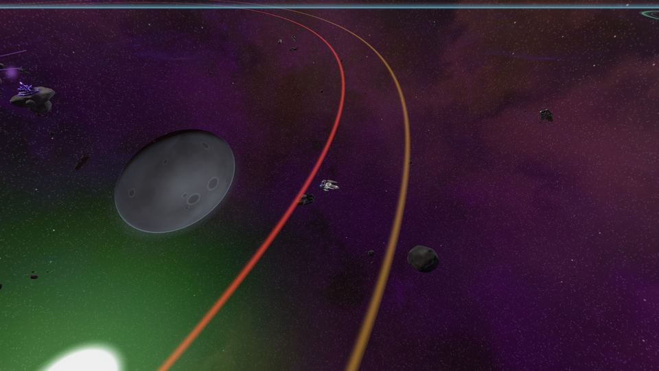

<!-- wiki-i18n source: b60c2a588a3c3f1b -->
<!-- wiki-i18n title: Dormant Swamp -->
# Dormant Swamp

<!-- wiki-search: swamp; dormant swamp; base; turret; turrets; nike turret; laser turret; inert mass; unwakened; the unwakened; slumbering void; void; dormant lance; ds-4; bataklık; taret; taretler; top; toplar -->

Çok eski zamanlarda galaksinin ortasında gelişmiş bir uygarlık yaşadı. Mor-siyah kristalden, parlayan menekşe damarlarla inşa ediyordu ve kimsenin bilmediği bir nedenle çöktü. **Dormant Swamp** onun ileri karakoludur; `DS-4` sektörünün sol üst köşesindedir. Sezonun 11. gününden itibaren kıpırdanır: ortadaki toplar gördükleri her gemiye ateş eder, **Inert Mass** uzaylıları onu korur ve tam ortada **The Unwakened** uyur. Pilotların henüz **ziyaret etmesi beklenmeyen** bir yerdir. Gizlenerek ortada uyuyan The Unwakened uzaylısının yanına kadar uçabilirsin ve şimdilik orada başka bir şey yapılamaz: üs ve toplarına zarar verilemez, içine girilemez, üzerine çıkılamaz ve onlarla ticaret yapılamaz.

Bataklıkta 11. günden itibaren [Dormant sürüsü](/wiki/05-Swarms/Dormant-Swarm.md) da belirir ve çevresinde **Slumbering Void** uzaylıları devriye gezer. Aynı Void uzaylıları [dev ekskavatörlere](/wiki/03-Mechanics/Giant-Excavator.md#the-slumbering-voids) dalgalar hâlinde gelir. Sektörler [Tehlike Sektörleri](/wiki/01-General/Danger-Sectors.md) sayfasındadır.

## Bir bakışta {#at-a-glance}

<!-- swamp-glance:begin -->
<!-- Generated from server/Resources/Excavator.json and DormantSwamp.json (and Rockets.json, Values/ranking-config.json) by scripts/dormant-wiki.sh: don't edit by hand. -->

- **Yer**: `DS-4` haritasının sol üst köşesi; merkez 5.000 / 5.000 konumunda
- **Belirme**: Sezonun 11. gününden sıfırlamaya kadar
- **Bölge**: Merkezin çevresinde 4.300 birim: topların ulaşabildiği en uzak nokta ve henüz kimsenin gitmemesi gereken yer
- **Bildirim**: Merkezden 4.800 birim uzaklıktaki halkayı geçen bir gemiye bir Sistem satırıyla haber verilir
- **Gizlenme**: Hiçbir top gizlenmiş bir gemiyi ya da EMP etkisi altındaki bir gemiyi görmez
- **Uzaylılar**: 5 Inert Mass merkezin 2.400 birim yakınında kalır. The Unwakened merkezde uyur. 2 Slumbering Void merkezden 4.600 ile 6.500 birim arasında devriye gezer.
- **Dormant sürüsü**: 9.417 / 6.606 noktasında, merkezden 4.700 birim uzakta ve bölgenin dışında belirir
- **Kayalar**: Merkezin 4.900 birim yakınında hiçbir asteroit bulunmaz

<!-- swamp-glance:end -->

## Toplar {#the-guns}

Bataklığın taretleri, menzillerinin içinde **gördükleri en yakın gemiye** ateş eder, başka hiçbirine etmez: bölge, en uzağa erişen taretin menzilinin çizdiği dairedir. Bunlar hiçbir türden varlık değildir: gövde puanları yoktur, hedef alınamazlar ve onlara attığın hiçbir şey bir işe yaramaz. Atışları gerçektir ve dünya, her uzaylının silahını ölçeklediği gibi onların hasarını da ölçekler.

<!-- swamp-guns:begin -->
<!-- Generated from server/Resources/Excavator.json and DormantSwamp.json (and Rockets.json, Values/ranking-config.json) by scripts/dormant-wiki.sh: don't edit by hand. -->

Bir atışın hasarı, her dünyada:

| Top | Konum | Ateş aralığı | Menzil (birim) | Alpha | Beta | Gamma |
| :--- | :--- | ---: | ---: | ---: | ---: | ---: |
| [N.I.K.E.](/wiki/06-Items/Rockets.md#the-craft-only-rockets) tareti | 5.000 / 4.400 | 2 sn | 3.640 | 75.000 | 112.500 | 150.000 |
| [N.U.K.E.](/wiki/06-Items/Rockets.md#the-craft-only-rockets) tareti | 5.000 / 4.400 | 5 sn | 1.080 | 50.000 | 75.000 | 100.000 |
| Lazer tareti × 2 | 3.600 / 5.200; 6.400 / 5.200 | 1 sn | 2.500 | 45.000–55.000 | 67.500–82.500 | 90.000–110.000 |

- Bir roket, aynı roketin bir pilotun elindeki menzilinin %90 kadarından ateşlenir ki hedefe ulaşsın; bir lazer tareti saniyede bir ateş eder ve hasarı gösterilen aralıkta belirlenir.
- Bir N.I.K.E., kalkan soğurmasından düşülen %35 kalkan delme oranına sahiptir.
- Taretin N.I.K.E. roketi seninkinden %25 daha hızlı ve 2× daha uzağa uçar: saniyede 1.125 birim, toplam 8.100 birim; bu yüzden ondan kaçan bir gemi uzun bir mesafe boyunca takip edilir.
- Bir N.U.K.E., 1.350 birimlik bir yarıçapta patlar; en şiddetlisi ortada.
- Taretin N.U.K.E. roketi seninkinden %25 daha hızlı ve 2× daha uzağa uçar: saniyede 375 birim, toplam 2.400 birim; bu yüzden ondan kaçan bir gemi uzun bir mesafe boyunca takip edilir.

<!-- swamp-guns:end -->

- **Bölgenin dışındaki gemiye hiçbir şey ateş etmez**, içinde ise bir gemi saniyeler içinde yok edilir: ortaya yaklaştıkça daha çok top devreye girer ve en iyi kalkanlı Wraith bile dayanamaz. Havada olan bir roket ise uçmaya devam eder ve taretin roketleri seninkilerden daha hızlı ve daha uzağa uçar: ondan düz kaçmak onu atlatmaz.
- **Gizlenme seni içeri sokar.** Hiçbir taret gizlenmiş bir gemiyi, ya da bir EMP etkisi altındaki gemiyi, hiçbir mesafeden görmez. Görünür bir gemiye yönelmiş ve gizlenmiş bir geminin yanında patlayan bir patlama, onu yine de yaralar ve gizlenmesini bitirir.
- **Yalnızca pilotlara ateş ederler**, uzaylılara, şirket pilotlarına ya da sürüye asla; yeni yeniden doğmuş bir geminin doğma koruması onlara karşı da geçerlidir.
- **Bildirim halkası.** Bölgenin dışındaki halkayı geçen bir gemiye bir Sistem satırı haber verir: taretler gördükleri her gemiye ateş eder ve ortada bir şey uyuyor. Gemi halkadan çıkıp geri gelmedikçe tekrar uyarılmaz.
- **Dışarı çıkmak.** Orada yok edilirsen ve olduğun yerde geri dönersen ya da bölgenin içinde giriş yaparsan, bölgenin dışına çıkarılırsın. Tıkladığın rota bölgenin çevresinden dolandırılır ve tıkladığın yer bölgenin içindeyse bir bildirim seni uyarır.

## Uzaylılar {#the-aliens}

Kayıp uygarlığın üç uzaylısı burada yaşar, her birinin kendi sayıları vardır. Bir sürünün patronu gibi ödenirler: **verilen hasara göre**, [Sürüler](/wiki/05-Swarms/Swarms.md#the-rules-of-every-swarm) sayfasında verilen payı en az dolduran her pilota; kutu ise en çok hasar veren pilota gider. Öldürmeleri, ödemeleriyle orantılı olarak, bir sürü gemisininki gibi PvE sıralama puanına eklenir ([Rütbeler](/wiki/03-Mechanics/Ranks.md#how-you-earn-pve-points)). Her birinin kalkanı, dayandığı sürece her vuruşun %80’ini alır ([Kalkanlar](/wiki/03-Mechanics/Shields.md)).

- **Slumbering Void.** Zarif avcı, oyundaki en hızlı uzaylı (Afterburner III açıkken bir Storm kadar hızlı). Bazıları bataklığın çevresinde her zaman devriye gezer, diğerleri ekskavatörlere dalgalar hâlinde gelir. Saldırgandır, görebildiği en yakın pilotu avlar ve gizlenmiş bir gemiyi asla görmez.
- **Inert Mass.** Mor çatlaklı, küçük bir istasyon boyutunda ölü bir gövde. Bataklığın ortasından belirli bir mesafenin içinde kalır ve şimdilik ondan ayrılmaz. **Dormant Lance** ateşler: çok uzun menzilli güdümlü roketler; bir gemi gizlenene, EMP kullanana, güvenli halkaya girene, sıçrayana ya da ölene kadar onu takip ederler. Lance her gemiden hızlıdır, bu yüzden yalnızca bu kesintiler işe yarar. Bir Lance roketinin yoluna giren bir asteroit onu durdurur ve Lance o asteroite kendi hasarı kadar zarar verir (bunun için kimseye ödeme yapılmaz); yani bir kaya, bir Inert Mass uzaylısına karşı yalnızca birkaç vuruşluk bir barınaktır.
- **The Unwakened.** Bataklığın ortasında uyuyan bir monolit; herhangi bir haritadaki en büyük şey ve o kadar yavaş ki hiçbir gemiyi yakalayamaz. Hiçbir şey ateşlemez ama aurasının içindeki her gemi yanar, **gizlenmiş olsun ya da olmasın**. **Bağışıktır**: atışlar ve roketler isabet eder ve hiçbir şey yapmaz, hedef penceresi dolu çubukları ve Bağışık yazısını gösterir. Daha sonraki bir etkinlik ona karşı savaşmaya izin verecek; ödülleri aşağıda yazılıdır ve henüz kazanılamaz.

<!-- swamp-members:begin -->
<!-- Generated from server/Resources/Excavator.json and DormantSwamp.json (and Rockets.json, Values/ranking-config.json) by scripts/dormant-wiki.sh: don't edit by hand. -->

### Slumbering Void

2 Slumbering Void bataklığın merkezinden 4.600 ile 6.500 birim arasında devriye gezer; yok edilen biri 1 sa sonra geri gelir. Bir ekskavatörün dalgaları aynı uzaylıdan daha fazlasını getirir.

| | Alpha | Beta | Gamma |
| :--- | ---: | ---: | ---: |
| Gövde | 25.000 | 37.500 | 50.000 |
| Kalkan | 150.000 | 225.000 | 300.000 |
| Kalkan soğurması | %80 | %80 | %80 |
| Lazer hasarı (saniyede bir salvo) | 3.000 | 4.500 | 6.000 |
| Hız | 400 | 400 | 400 |
| Lazer menzili | 800 | 800 | 800 |
| Aggro yarıçapı | 2.500 | 2.500 | 2.500 |
| Kredi | 23.000 | 46.000 | 69.000 |
| Thulium | 60 | 120 | 180 |
| Deneyim (XP) | 3.600 | 7.200 | 10.800 |
| Onur | 16 | 32 | 48 |
| Öldürme başına PvE puanı | 10 | 10 | 10 |

**Ganimet**: tek bir kutu, en çok hasar veren pilota ait.

| Eşya | Şans | Miktar |
| :--- | ---: | ---: |
| Ultra Core ve Experimental Fusion Core arasından rastgele biri | %60 | 30–60 |
| 4 Destansı [roket](/wiki/06-Items/Rockets.md) arasından rastgele biri | %40 | 1–3 |

### Inert Mass

5 Inert Mass merkezin 2.400 birim yakınında durur; yok edilen biri 1 sa sonra geri gelir. Görebildiği en yakın gemiye 6 sn aralıkla güdümlü bir [Dormant Lance](/wiki/06-Items/Rockets.md#the-craft-only-rockets) ateşler: hız 750, 5.250 birimlik uçuş, %40 delme.

| | Alpha | Beta | Gamma |
| :--- | ---: | ---: | ---: |
| Gövde | 250.000 | 375.000 | 500.000 |
| Kalkan | 100.000 | 150.000 | 200.000 |
| Kalkan soğurması | %80 | %80 | %80 |
| Dormant Lance hasarı, her biri | 5.000–8.000 | 7.500–12.000 | 10.000–16.000 |
| Hız | 60 | 60 | 60 |
| Roket menzili | 5.000 | 5.000 | 5.000 |
| Aggro yarıçapı | 5.000 | 5.000 | 5.000 |
| Kredi | 125.000 | 250.000 | 375.000 |
| Thulium | 335 | 670 | 1.005 |
| Deneyim (XP) | 20.200 | 40.400 | 60.600 |
| Onur | 88 | 176 | 264 |
| Öldürme başına PvE puanı | 15 | 15 | 15 |

**Ganimet**: tek bir kutu, en çok hasar veren pilota ait.

| Eşya | Şans | Miktar |
| :--- | ---: | ---: |
| Ultra Core ve Experimental Fusion Core, eşit paylaşılır | %100 | toplam 400–800 |
| 4 Destansı [roket](/wiki/06-Items/Rockets.md) arasından rastgele biri | %100 | 20–40 |
| N.I.K.E. | %5 | 1–2 |
| Dark Matter | %5 | 1–3 |
| Ancient Control Unit | %10 | 1 |
| Power Core | %25 | 1–2 |

### The Unwakened

Tek bir tane vardır, bataklığın ortasında ve başka hiçbir yerde değil; yok edildikten 24 sa sonra geri gelir. Daha sonraki bir görev bayrağı kapatana kadar **bağışıktır**: atışlar ve roketler ona isabet eder ama hiçbir şey yapmaz. Ödülleri yazılıdır ancak henüz kazanılamaz.

| | Alpha | Beta | Gamma |
| :--- | ---: | ---: | ---: |
| Gövde | 10.000.000 | 15.000.000 | 20.000.000 |
| Kalkan | 10.000.000 | 15.000.000 | 20.000.000 |
| Kalkan soğurması | %80 | %80 | %80 |
| İçerideki her gemiye saniyede aura hasarı | 75.000 | 112.500 | 150.000 |
| Aura yarıçapı | 700 | 700 | 700 |
| Hız | 10 | 10 | 10 |
| Aggro yarıçapı | 3.000 | 3.000 | 3.000 |
| Kredi | 7.500.000 | 15.000.000 | 22.500.000 |
| Thulium | 20.000 | 40.000 | 60.000 |
| Deneyim (XP) | 1.200.000 | 2.400.000 | 3.600.000 |
| Onur | 5.200 | 10.400 | 15.600 |
| Öldürme başına PvE puanı | 112 | 112 | 112 |

**Ganimet**: tek bir kutu, en çok hasar veren pilota ait.

| Eşya | Şans | Miktar |
| :--- | ---: | ---: |
| Ultra Core ve Experimental Fusion Core, eşit paylaşılır | %100 | toplam 10.000–15.000 |
| 4 Destansı [roket](/wiki/06-Items/Rockets.md) arasından rastgele biri | %100 | 500–800 |
| N.I.K.E. | %100 | 20–30 |
| N.U.K.E. | %100 | 5–10 |
| Dark Matter | %100 | 40–60 |
| Ancient Control Unit | %100 | 10–20 |
| Power Core | %100 | 100–200 |

<!-- swamp-members:end -->

## Burada ne yapmalı {#what-to-do-here}

- **Bak, dokunma.** Bataklık daha sonrası için. Gizlenmeden ulaşabileceğin tek içerik bölgenin dışındadır: bölgenin çevresinde bir halka hâlinde devriye gezen Void uzaylıları bataklığın ilk savunma hattıdır ve bir grubun toplar olmadan savaşabileceği yerdir.
- **Slumbering Void uzaylılarını kalkan delmeyle avla.** Bir Void uzaylısının büyük kalkanı vuruşun %80’ini alır ve neredeyse önemsizdir: arkasındaki gövde küçüktür. Lazerlerinin kalkan delmesi ne kadar yüksekse o kadar çabuk düşer ([Lazerler ve Cephane](/wiki/06-Items/Lasers.md)).
- **Lance roketlerinden uzak dur.** Bir Inert Mass uzaylısı çok uzağı görür ve bir Lance roketini geride bırakamazsın: tutuşunu bir gizlenme, bir EMP, bir güvenli halka ya da bir sıçrama ile kır ya da menzilinden çık. Bir Inert Mass, en güçlü gemilerden oluşan büyük bir grup için bile uzun bir savaştır.
- **Dormant sürüsü** artık bölgenin hemen dışında belirir; bu yüzden bir grup toplar olmadan onu bekleyebilir. [Dormant sürüsü](/wiki/05-Swarms/Dormant-Swarm.md) sayfasına bak.

## Daha fazla okumak için {#where-to-read-more}

- [Tehlike Sektörleri](/wiki/01-General/Danger-Sectors.md): 11. günde ne değişti.
- [Dev ekskavatör](/wiki/03-Mechanics/Giant-Excavator.md): Slumbering Void dalgaları ve neyi korudukları.
- [Sürüler](/wiki/05-Swarms/Swarms.md) ve [Dormant sürüsü](/wiki/05-Swarms/Dormant-Swarm.md): bir patron öldürmenin nasıl ödediği.
- [Roketler](/wiki/06-Items/Rockets.md#the-craft-only-rockets): taretin ateşlediği N.I.K.E. ve N.U.K.E.
- [Kara delik](/wiki/03-Mechanics/Black-Hole.md): `DS-4` sektörünün öteki tehlikesi.
- [Kargo](/wiki/03-Mechanics/Cargo.md): uzaylıların düşürdüğü kutular.
