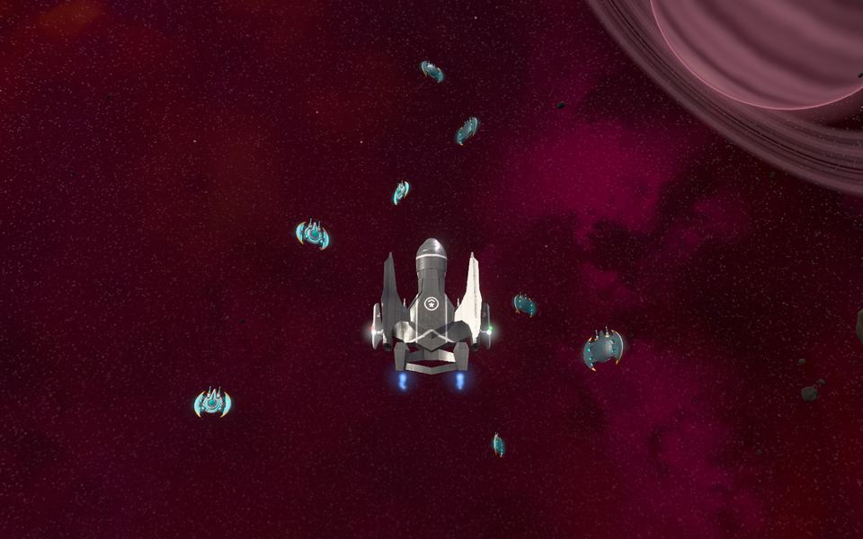
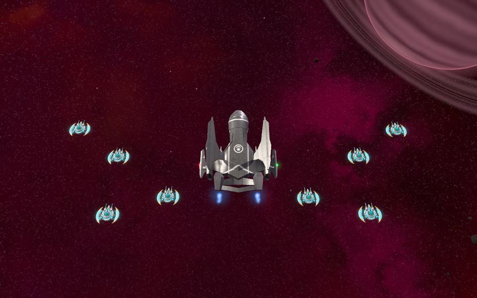
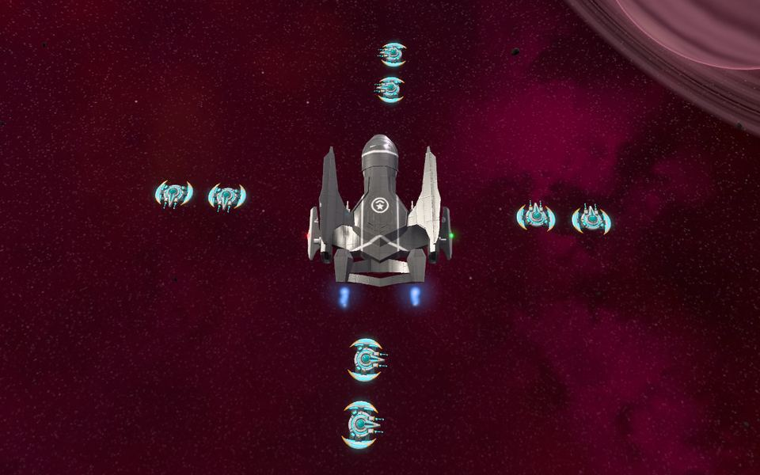
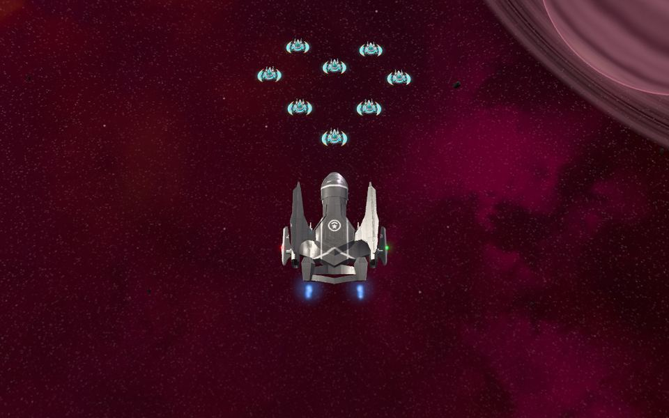
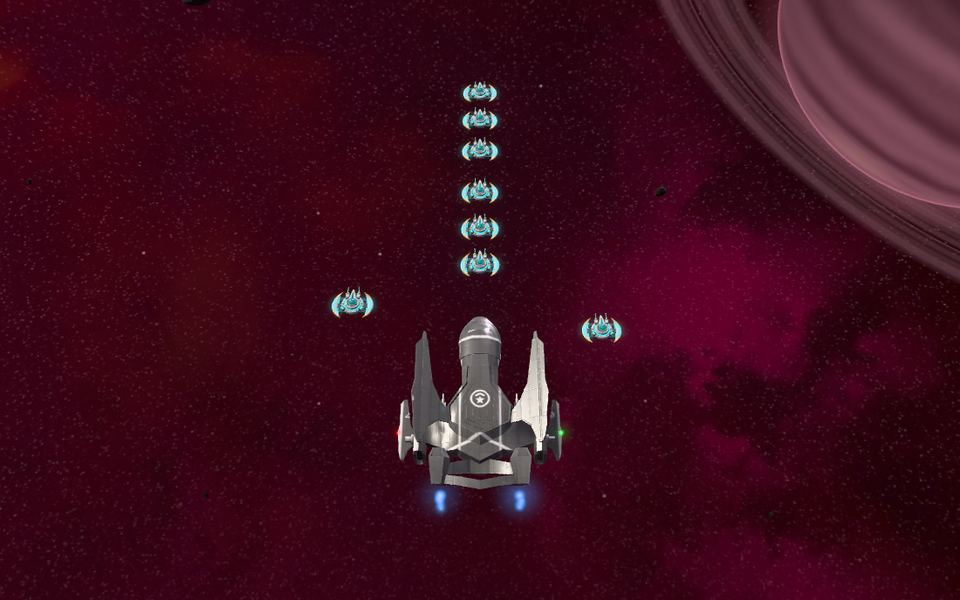
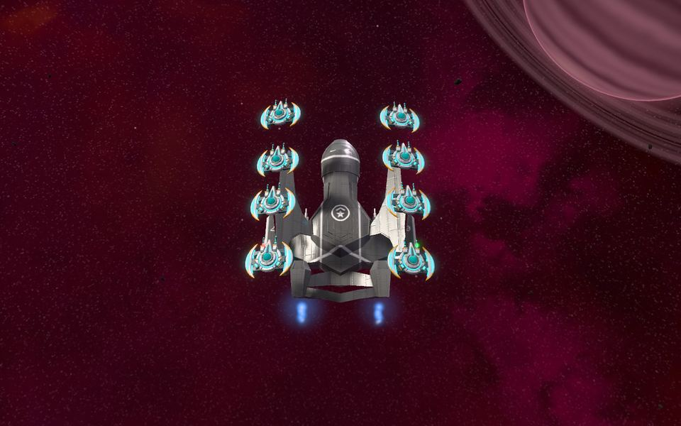
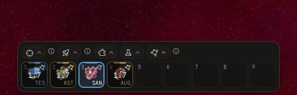
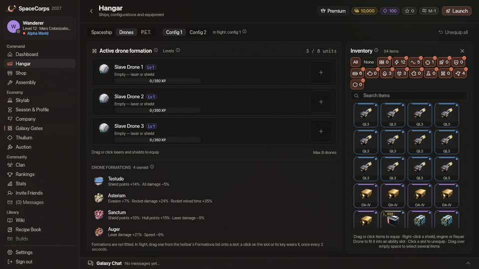

<!-- wiki-i18n source: 2774e74ca4dec786 -->
<!-- wiki-i18n title: Dron formasyonları -->
# Dron formasyonları {#drone-formations}

Bir **dron formasyonu**, dronlarının geminin çevresinde aldığı bir düzendir ve geminin nasıl savaştığını değiştirir. Her formasyon bazı bonuslar verir ve bazı bedeller ister: daha zayıf silahlar karşılığında daha büyük bir kalkan, daha ince bir gövde karşılığında daha sert roketler, daha yavaş bir gemi karşılığında daha hızlı uzaylı öldürme. Toplam **16** tanedir. Birini [Skylab](/wiki/03-Mechanics/Skylab.md)’ında araştırır, Montaj’da üretir ve sahip olduklarından **birini** aynı anda kuşanırsın. Onu her **2 saniyede** bir değiştirebilirsin; savaşta da güvenli bölgede de.

## Bir dakikada {#in-one-minute}

- **Birini elde et.** Teknolojisini Araştırma Merkezi’nde araştır (iki ağaç: *Savunma* ve *Saldırı ve Hareketlilik*), sonra Montaj’da Thulium karşılığı üret. En ucuzu 14.000 Thulium ve 5 Dark Matter, en pahalısı 92.000 Thulium ve 20 Dark Matter tutar. Mağaza hiçbirini satmaz.
- **Sahip ol.** Bir formasyon hiçbir yere takılmaz: envanterindeki bir kopya yeter. En az bir dron gerekir: bir Slave Drone ya da bir Master Drone. Yoksa hiçbir formasyon çalışmaz.
- **Kuşan.** Kısayol çubuğunun Formasyonlar listesinden herhangi bir yuvaya sürükle. Formasyonu kuşanmak için yuvaya tıkla ya da tuşuna bas. Listede ayrıca formasyon olmayan **Standart** de vardır: yeniden hiçbirini kuşanmamak için onu bir yuvaya sürükle ve ona bas. Her 2 saniyede bir değiştirebilirsin, güvenli bölgede de, ve savaş kilidi yoktur.
- **Gör.** Her formasyonun kendi şekli vardır ve dronların geminin çevresinde o şekilde uçar: bir çatı, bir kalp, kanatlar, bir kılıç, bir matkap. Diğer pilotlar da görür. Bkz. [Nasıl uçarlar](#how-they-fly).
- **Bir sonraki dakikaya göre seç.** Her formasyon bonuslarının bedelini öder, bu yüzden hiçbiri her yerde en iyisi değildir. Yapmak üzere olduğun şeye uyanı kuşan: av, düello, roket ateşleme ya da kaçış.

> [!NOTE]
> Bir dron formasyonu iki şeydir: bir dizi bonus ve bedel, bir de dronlarının uçtuğu **şekil** ([Nasıl uçarlar](#how-they-fly)). Hiçbiri kuşanılmadığında dronlar düz “Wingman” düzeninde uçar ([Dron mekaniği](/wiki/03-Mechanics/Drones.md#formation-movement)).

## Formasyon edinmek {#getting-a-formation}

1. **Araştır.** Skylab’ındaki Araştırma Merkezi’nde formasyonlar için iki ağaç vardır. **Savunma** (6 formasyon), gemiyi hayatta tutanları barındırır: kalkan, gövde ve yenilenen kalkan. **Saldırı ve Hareketlilik** (10), savaşı kazanmaya ya da ondan çıkmaya yarayanları barındırır: roketler, lazerler, delme, uzaylı avı ve hız. Bir araştırma **10 saat, 1 gün veya 2 gün** sürer ve başlamadan önce Araştırma Merkezi’ne eklediğin **5, 13 veya 20 Dark Matter** ister: formasyon ne kadar güçlüyse o kadar uzun ve pahalıdır. Bazıları önce başka bir formasyonun araştırılmasını gerektirir (aşağıdaki tablo hangisi olduğunu söyler). On altısı birlikte, art arda, 16 g 2 sa araştırma ve 189 Dark Matter eder. Yakıt, hızlandırma ve Dark Matter [Araştırma](/wiki/03-Mechanics/Research.md) sayfasındadır.
2. **Üret.** Montaj formasyonu Dronlar kategorisinde, Thulium ve malzeme karşılığında, kredi istemeden yapar. 5, 10 veya 15 dakika sürer. Bir formasyon dövülemez ya da büyülenemez.
3. **Sakla.** Hiçbir şey takılmaz: envanterindeki bir kopya yeterlidir. Hangarın Dronlar görünümü, istasyonda ya da uçuşta güvenli bölgedeyken ([Uçuşta Hangar](/wiki/03-Mechanics/Hangar.md)), sahip olduğun formasyonları dronlarının altında listeler. Birkaç kopyaya sahip olabilirsin; biri hepsi kadar iyidir.

## Formasyon kuşanmak {#wearing-a-formation}

- **Kısayol çubuğunda.** Kısayol çubuğunun üstündeki **Formasyonlar** düğmesi sahip olduğun formasyonların listesini açar. Birini, cephanede ya da roketteki gibi, iki sıranın herhangi birindeki bir yuvaya sürükle. Yuva formasyonun resmini ve üç harfini gösterir ve o yuvanın tuşunu korur.
- **Kuşanmak.** Yuvaya tıkla ya da tuşuna bas. Yanan yuvaya yeniden basmak bir şey yapmaz: hiçbirini kuşanmamak için listedeki **Standart** girdisini bir yuvaya koy ve ona bas. Kuşandığın formasyonun yuvası yanar. Gemi penceresinin başlık çubuğu, kuşandığın formasyonun adını söyler.
- **Tuşlar.** Bir formasyonun tuşu, koyduğun yuvanın tuşudur (başlangıçta 1’den 9’a ve Shift+1’den Shift+9’a). Yuvaları Ayarlar › Kontroller bölümünde yeniden atayabilirsin.
- **Her 2 saniyede bir, her yerde.** Savaş kilidi ve yerleşme süresi yoktur: yeni değerler hemen, bir sonraki salvodan itibaren geçerli olur ve 2 saniye yalnızca bir sonraki değişikliği geciktirir. Bir değişiklikten sonra bir sonrakini 2 saniye beklersin; savaşta, açık uzayda ve güvenli bölgede aynı şekilde. Kalkıştan ya da yeniden doğmadan sonraki ilk değişiklik hemen gider ve 2 saniyeyi başlatır.
- **Beklemeyi görürsün.** Bir değişiklikten sonraki 2 saniye boyunca diğer her formasyon yuvası, kalan saniyeyle birlikte süpürülüp giden koyu bir kamayla karartılır (1,8, 1,5, 0,4…); Formasyonlar listesinin her girdisi de öyle. Bir yuvaya çok erken basarsan hiçbir şey gönderilmez: yuva kırmızı yanıp söner, yumuşak bir ret sesi çalar ve bir not “Formasyon 1,2sn sonra hazır” der. Tuşu basılı tutarsan saniyeler aynı notta değişir. **Hareketi azalt** açıkken yuvalar yalnızca sönük kalır, tam saniyelerle ve süpürme olmadan. Bir istek yine de, yavaş bir bağlantıda, çok erken ulaşırsa sohbet “Formasyon 1,4sn sonra tekrar değiştirilebilir.” der.
- **Seni izler.** Oyun en son kuşandığın formasyonu hatırlar ve kalkışta ya da yeniden doğduğunda onu yeniden ister. Bu, ilk değişikliğin sayılır: hemen gider ve 2 saniyeyi başlatır; bu yüzden kalkıştan hemen sonra elle yapılan bir değişiklik onları beklemek zorundadır. Konfigürasyon değiştirmek (`C` tuşu) onu açık bırakır, beklemeden.
- **Bir dron ister.** Elinde hiç Slave Drone ya da Master Drone yoksa formasyon hiçbir şey yapmaz. Bir tane yeter: dron sayısı, seviyeleri ve taşıdıkları fark etmez.
- **Başkaları da görebilir.** Gemini gören her pilot, dronlarının formasyonunun şeklinde uçtuğunu görür. Bir pilotu seçersen Hedef penceresi “Formasyon:” ve adını söyler. Grubunla hiçbir şey paylaşılmaz.

## Nasıl uçarlar {#how-they-fly}

Her formasyon dronlarına **kendine ait bir şekil** verir. Birini kuşan, dronlar düz Wingman düzenini bırakır ve **0,8 saniyede** geminin çevresindeki şekle süzülür; gövdenin etrafından döner, asla içinden geçmez. Bu uzayda bir şekildir: Testudo çatısı kanatların üstünde süzülür, Auger bir konidir ve şeklin tamamı geminle birlikte döner, bu yüzden önü her zaman burnunun gösterdiği yerdedir. Altısı bu sayfanın başındaki resimlerdedir; her biri, kamera biraz eğik, yukarıdan görülen 8. seviye sekiz dronlu bir Paragon: Auger, Culler, Gyre, Sanctum, Stiletto ve Testudo.

- **Formasyon yoksa şekil yok.** Hiçbiri kuşanılmadığında (Formasyonlar listesinde **Standart**) dronlar [Dron mekaniği](/wiki/03-Mechanics/Drones.md#formation-movement) sayfasındaki düz “Wingman” düzeninde uçar.
- **Sahip olduğun dronlara göre yapılır.** Bir şekil tam olarak sahip olduğun dronlara göre kurulur, 1 ile 8 arası: bir ya da iki dronla yalnızca başlangıcını görürsün, **8** dronla resimlerdeki gibi şeklin tamamını. Seviyeleri ve taşıdıkları hiçbir şeyi değiştirmez.
- **Gemine uydurulur.** Uzun bir geminin şekli, küçük bir geminin şeklinden daha uzundur ve dronlar gövdeden uzak durur.
- **Herkes görür.** Diğer pilotlar senin şeklini, sen onlarınkini görürsün. Kameranın **3.500 birimden** uzağındaki bir gemi dron göstermez ve kalabalıkta yalnızca en yakın **64** gemi gösterir.
- **Kapat.** Ayarlar › Arayüz bölümünde **Dronlarımı göster** ve **Düşman dronlarını göster** (diğer pilotların dronları) vardır. Yalnızca gördüklerini değiştirirler: formasyonunun bonusları eskisi gibi çalışır. Bir dronun kaplaması **Diğer pilotların görünümlerini göster** ayarını izler ([Kozmetikler](/wiki/06-Items/Cosmetics.md#drone-liveries)). **Hareketi azalt** (Ayarlar › Grafik) hareket eden şekilleri, yani Cordon, Asterism, Culler, Gyre ve Auger şekillerini durağan tutar ve süzülmeyi **0,2 saniyeye** indirir.
- **Yüksekliği gör.** Çatı, kase ve matkabın yüksekliği vardır; tam yukarıdan bakış bunu pek göstermez. Onları yandan görmek için kamerayı sağ sürüklemeyle döndür ([Başlarken](/wiki/01-General/Getting-Started.md#keyboard-controls-keybindings)).

| Formasyon | Şekil | Ne hareket eder |
| :--- | :--- | :--- |
| **Testudo** | Bir çatı: kanatların üstünde iki dron sütunu, aralarında geminin sırtı açık bırakılmış | Hiçbir şey |
| **Adamant** | Geminin çevresinde bir elmas: önde bir köşe, arkada bir köşe ve her yanda bir köşe | Hiçbir şey |
| **Sanctum** | Burnun önünde bir kalp, sivri ucu geminin yönünde | Hiçbir şey |
| **Redoubt** | Bir kase: gövdenin çevresinde bir halka, kanatların üstünde bir çift ve tepede bir dron | Hiçbir şey |
| **Cordon** | Geminin çevresinde geniş bir halka | 24 saniyede bir tur döner |
| **Rampart** | Burnun önünde bir duvar, uçları pençe gibi öne bükülmüş | Hiçbir şey |
| **Asterism** | Işıklardan dört köşeli bir yıldız: köşeler önde, arkada ve her yanda | Her dron 1,5 saniyede bir şişer ve küçülür |
| **Bodkin** | Başı geminin kendisi olan bir ok: burnun önünde bir uç, yanlar boyunca çengeller ve arkada iz süren bir gövde | Hiçbir şey |
| **Ballista** | Geminin önünde bir V, kolları yanlar boyunca geriye süpürülen | Hiçbir şey |
| **Centurion** | Bir blok: geminin çevresinde dikdörtgen biçiminde nöbetçiler | Hiçbir şey |
| **Shrike** | Burnun önünde bir üç dişli mızrak, sapı geminin kendisi: üçlü bir sıra ve üç diş, ortadaki en uzunu | Hiçbir şey |
| **Culler** | Kanatlar: her yanda uzun ve kısa dronlardan bir yelpaze ve dron sayısı tek olduğunda burnun önünde bir baş | Kanat uçları 2,4 saniyede bir yükselip alçalır |
| **Gemini** | İkiz mızraklar: her yan boyunca bir dron sütunu, uçları burnun önünde | Hiçbir şey |
| **Stiletto** | Kabzası geminin kendisi olan bir kılıç: burnun önünde en çok altı dronluk bir bıçak ve burunda siperlik olarak bir çift | Hiçbir şey |
| **Gyre** | Bir tekerlek: bir jant ve bir göbek, ikisini teller birleştirir | 6 saniyede bir tur döner |
| **Auger** | Bir matkap: geminin çevresinde bir koni, ucu burnun önünde, geniş ucu arkanda; dronlar baktığın yönü gösterir | Dronlar geminin uçuş çizgisi etrafında 3 saniyede bir spiral çizer |

## On altı formasyon {#the-sixteen-formations}

Tablolar, oyundaki eşya kartının yaptığı gibi, her birinin ne verdiğini ve sana neye mal olduğunu listeler. Bir yüzde, geminin nihai sayısındaki bir değişikliktir. Delme, cephanede olduğu gibi hedefin kalkan soğurmasının puanı cinsindendir ([Kalkan mekaniği](/wiki/03-Mechanics/Shields.md#shield-penetration)).

### Savunma {#defence}

| Formasyon | Bonuslar | Bedeller |
| :--- | :--- | :--- |
| **Testudo** | Kalkan puanı +%14 | Tüm hasar −%5 |
| **Sanctum** | Kalkan puanı +%10, Gövde puanı +%15 | Lazer hasarı −%9 |
| **Rampart** | Kalkan soğurması +%17 | Hız −%17 |
| **Adamant** | Saniyede kalkan yenilenmesi +%1,2 (saniyede en fazla 5.750 kalkan puanı) | Gövde puanı −%15 |
| **Redoubt** | Kalkan puanı +%38, Saniyede kalkan yenilenmesi +%0,7 (saniyede en fazla 4.500 kalkan puanı), Roket yeniden doldurma süresi −%27 | Hız −%11, Lazer hasarı −%12 |
| **Cordon** | Kalkan puanı +%95 | Hız −%3, Lazer hasarı −%11, Roket yeniden doldurma süresi +%11 |

### Saldırı ve Hareketlilik {#strike-mobility}

| Formasyon | Bonuslar | Bedeller |
| :--- | :--- | :--- |
| **Asterism** | Kaçınma +%7, Roket hasarı +%24 | Roket yeniden doldurma süresi +%35 |
| **Bodkin** | Roket hasarı +%29 | Lazer hasarı −%6 |
| **Ballista** | Roket hasarı +%55 | Gövde puanı −%13 |
| **Gemini** | Kalkan delme +%9 | Kalkan puanı −%22 |
| **Stiletto** | Gövde puanı +%13, Kalkan delme +%16 | Savaşta saniyede kalkan kaybı −%3,5 |
| **Centurion** | Öldürmelerden onur +%32 | Kalkan puanı −%7, Gövde puanı −%5, Lazer hasarı −%5 |
| **Shrike** | Uzaylılara lazer hasarı +%7,5, Uzaylı öldürmelerinden XP +%6 | Kalkan soğurması −%6 |
| **Culler** | Uzaylılara hasar +%12, Uzaylı öldürmelerinden XP +%12 | Hız −%10 |
| **Gyre** | Hız +%10 | Lazer hasarı −%11, Savaşta saniyede kalkan kaybı −%0,5 |
| **Auger** | Lazer hasarı +%21 | Hız −%9 |

## Ne kadara mal olurlar {#what-they-cost}

Thulium, asla kredi değil. On altısı birlikte 661.000 Thulium ve 189 Dark Matter tutar.

| Formasyon | Önce gerekir | Araştırma süresi | Dark Matter | Üretim için Thulium | Üretim süresi |
| :--- | :--- | ---: | ---: | ---: | ---: |
| **Testudo** | – | 10 sa | 5 | 15.000 | 5 dk |
| **Sanctum** | Testudo | 1 g | 13 | 40.000 | 10 dk |
| **Rampart** | Sanctum | 2 g | 20 | 77.000 | 15 dk |
| **Adamant** | – | 10 sa | 5 | 18.000 | 5 dk |
| **Redoubt** | Adamant | 1 g | 13 | 42.000 | 10 dk |
| **Cordon** | Redoubt | 1 g | 13 | 43.000 | 10 dk |
| **Asterism** | – | 10 sa | 5 | 14.000 | 5 dk |
| **Bodkin** | Asterism | 1 g | 13 | 42.000 | 10 dk |
| **Ballista** | Bodkin | 1 g | 13 | 48.000 | 10 dk |
| **Gemini** | – | 2 g | 20 | 76.000 | 15 dk |
| **Stiletto** | Gemini | 2 g | 20 | 92.000 | 15 dk |
| **Centurion** | – | 10 sa | 5 | 16.000 | 5 dk |
| **Shrike** | Centurion | 10 sa | 5 | 17.000 | 5 dk |
| **Culler** | Shrike | 1 g | 13 | 40.000 | 10 dk |
| **Gyre** | – | 1 g | 13 | 40.000 | 10 dk |
| **Auger** | Gyre | 1 g | 13 | 41.000 | 10 dk |

### Malzemeler {#materials}

Thulium’un yanı sıra Montaj bunları envanterinden alır. Formasyonun araştırma süresine göre değişirler:

| Araştırma süresi | Ship Fragment | Reinforced Hull Plate | Power Core | Velkonite Reinforced Plate | Orvium Reinforced Plate | Ancient Control Unit |
| ---: | ---: | ---: | ---: | ---: | ---: | ---: |
| 10 sa | 100 | 10 | 5 | 4 | – | – |
| 1 g | 180 | 18 | 9 | 8 | 15 | – |
| 2 g | 260 | 26 | 13 | 14 | 30 | 2 |

## Kuralların ayrıntısı {#the-rules-in-detail}

- **Gövden payını korur.** Azami gövdeni değiştiren bir formasyon, gövdeni aynı payla değiştirir: tam gövdede yeni azami değerin tamamındasın, %80’de %80’desin, her iki yönde de ve geri değiştirmek aynı sayıyı geri verir. Bir değişiklik seni asla iyileştirmez ve asla zarar vermez, hasar da sayılmaz. Kalkanın farklıdır: azami kalkanını düşüren bir formasyon mevcut değeri ona kadar keser, yükselten ise hiçbir şey eklemez; bu yüzden Cordon kuşanıkken doldurduğun bir kalkan ondan çıkarken kesilir.
- **Öldürme bonusları 10 saniye bekler.** Shrike, Culler ve Centurion formasyonlarının bir öldürmeye eklediği XP ve onur, yalnızca formasyon 10 saniye kuşanıldıktan sonra sayılır. Uzaylı öldürmelerini sayarlar (sürü gemileri de), görevleri ya da pilotları değil. Bir formasyondaki diğer her şey hemen çalışır.
- **Kalkan kaybı yalnızca formasyon kuşanıldığı sürece işler.** Stiletto ve Gyre her saniye *mevcut* kalkanının bir payını yakar, ama yalnızca savaşta (son 10 saniyede alınan bir vuruş, atılan bir lazer ya da fırlatılan bir roket) ve güvenli bölgede asla. Formasyonu değiştirirsen kayıp o saniye durur. Hasar değildir, bu yüzden kalkanının dolmaya başlamadan önceki 15 saniyelik beklemesini yeniden başlatmaz.
- **Yenilenme savaşta çalışır.** Adamant ve Redoubt her saniye azami kalkanının bir payını, geminin kendi dolumunun üstüne, tablodaki sınıra kadar geri verir. Kalkan dolunca durur ve alınan hasar sayılmaz.
- **Kaçınma, doğrudan bir vuruştan kaçma şansıdır.** Asterism formasyonunun %7’si, sana yapılan her doğrudan vuruşun (bir lazer salvosu, doğrudan bir roket, bir uzaylının atışı) hiç hasar vermeme şansının %7 olduğu demektir ve geminin üstünde yüzen bir “Iska” görünür. Diğer vuruşlar tam isabet eder; bu yüzden çok sayıda vuruşta yaklaşık %7 daha az hasar alırsın, ama tek bir roket ya hep ya hiçtir. Alan patlamasının nişanı yoktur ve asla savuşturulmaz.
- **Delme, cephanenin delmesine eklenir.** Gemini ve Stiletto puanlarını cephanenin ve doğrudan bir roketin delmesine ekler. Toplamı hiçbir şey sınırlamaz (lazer amfileri de ona ekler) ve bir patlamanın delmesi yoktur.
- **Roketler, hepsi 14.** Bir formasyonun roket bonusu, N.U.K.E. ve N.I.K.E. dahil her roketin hasarını çarpar; ister bir gemiye ister bir [asteroite](/wiki/03-Mechanics/Asteroid-Mining.md#breaking-one) çarpsın: bir asteroitin zırhı bonustan sonra düşülür. Testudo formasyonunun tüm hasar bedeli roketler için de geçerlidir ve Culler formasyonunun uzaylılara hasarı bir uzaylıya çarpan roketler için geçerlidir. Bir roketin üstündeki tüm çarpanlar birlikte ×1,59’da durur. En iyi roket formasyonu Ballista (+%55), bir N.I.K.E. roketini en çok 116.250, bir N.U.K.E. roketini en çok 77.500 hasara çıkarır: yeni bir Paragon (128.000) birine hâlâ dayanır, bir Goombah (80.000) ise ötekine.
- **Bir roketin yeniden dolumu, onu fırlattığında belirlenir.** 3 saniye, Asterism kuşanıkken 4,05, Cordon kuşanıkken 3,33 ve Redoubt kuşanıkken 2,19 olur; ama asla roketin uçuşu artı bir andan az olmaz (uçuşu uzun bir roket, örneğin bir Lancet III, Redoubt kuşanıkken bile onu bekler): bir N.U.K.E. roketinden sonra 4,1 saniye, bir N.I.K.E. roketinden sonra 4,6. Sonradan formasyon değiştirmek, zaten sahip olduğun beklemeyi kısaltmaz.
- **Yetenekler formasyonu izlemez.** Shield Surge ve Emergency Repair toplamlarını formasyon olmadan azami değerinden hesaplar; bu yüzden bir değişiklik onları güçlendiremez. Afterburner hızını şu anki hâliyle çarpar ve bir Repair Drone azami gövdenin bir payını şu anki hâliyle onarır.
- **Daha yavaş bir geminin dönüşü olmayan noktası daha uzaktadır**, [kara delikte](/wiki/03-Mechanics/Black-Hole.md). Rampart (−%17) ve Redoubt (−%11) seni en çok yavaşlatır; Gyre (+%10 hız) ayrılmak için olan formasyondur.

## Hangisi ne zaman {#which-one-when}

- **Uzaylı avı:** zorlular için Auger (+%21 lazer), XP için Culler (uzaylılara +%12 hasar ve +%12 XP) ile Shrike (uzaylılara +%7,5 lazer hasarı, +%6 XP). Öldürme bonuslu bir formasyonu işe başlamadan *önce* kuşan: bonusu yalnızca 10 saniye sonra sayılır.
- **Düellolar:** Gemini (+9 puan delme) bir kalkanı keser, Rampart (+%17 soğurma) seninkinin dayanmasını sağlar, Stiletto (+16 puan delme ve +%13 gövde) en sert ısırır ama savaşta kalkanını yakar (saniyede %3,5), Sanctum (+%15 gövde ve +%10 kalkan) vuruşları karşılar.
- **Roketler:** Ballista (+%55) ağır vurandır, Bodkin (+%29) daha küçük bedelli ılımlı olandır, Asterism (+%24, %7 kaçınmayla) bunun bedelini daha yavaş bir yeniden dolumla öder.
- **Bir patrondan ya da sürüden vuruş yemek:** Cordon (+%95 kalkan), Redoubt (+%38 yenilenen kalkan) ve Sanctum.
- **Kaçmak:** Gyre (+%10 hız).
- **Asıl mesele savaşın ortasında değiştirmek.** Diğerinin kalkanını sıyırmak için Gemini ile aç, vurulan sen olunca Rampart ya da Sanctum formasyonuna geç (bir değişiklik gövdenin payını korur, bu yüzden seni asla iyileştirmez) ve çıkmak istediğinde Gyre formasyonunu kuşan. Kısayol çubuğunda üç ya da dört tane bunların hepsine yeter.

## Onları elde tutmak {#keeping-them}

Dron formasyonları, dronların gibi, sezon sıfırlamasından sonra da seninle kalır: sahip olduğun her formasyon, nerede olursa olsun (envanterinde, kısayol çubuğunda, [Nakliye Deposu](/wiki/03-Mechanics/Wipe-Timeline.md#transport-cache-travel-capsule-)’nda ya da bir gemide) kalır; bu yüzden onlardan biri için Nakliye Deposu’nda yer harcamana gerek yok ve kısayol çubuğun yuvalarını korur. Araştırma da kalır.
