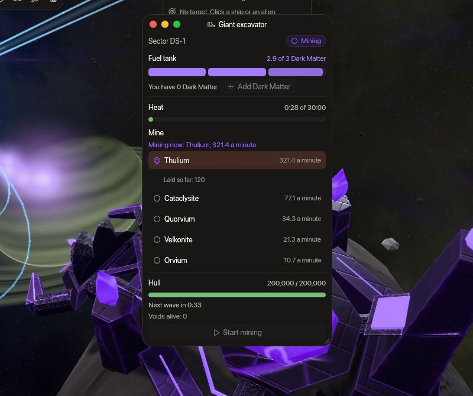

<!-- wiki-i18n source: 8cf3540685bf9b05 -->
<!-- wiki-i18n title: Dev ekskavatör -->
# Dev ekskavatör {#giant-excavator}

<!-- wiki-search: excavator; giant excavator; pulsar; mining; fuel; excavator fuel; control panel; overheat; radiation; slumbering void; voids; wave; ds-1; ds-2; ds-3; ekskavatör; dev ekskavatör; kazı; yakıt; kontrol paneli; aşırı ısınma; radyasyon; dalga -->

`DS-1`, `DS-2` ve `DS-3` Tehlike Sektörleri’nin her birinde sezonun ilk gününden itibaren bir **pulsar** parlar ve sezonun 11. gününden itibaren yanında bir **dev ekskavatör** durur. Ekskavatör pulsardan **Thulium ve nadir cevherler** kazar ve bunun için [Dark Matter](/wiki/03-Mechanics/Dark-Matter.md) yakar. Herkes ona yakıt koyabilir, neyi kazacağını seçebilir ve başlatabilir; kazdığı her şey çevresine, herkesin alabileceği kutular hâlinde dökülür. Ama bir çalışma gürültülüdür: başladığında tüm dünyaya haber verilir, **Slumbering Void** uzaylıları dalgalar hâlinde onun peşine düşer ve çok uzun çalıştırılan bir ekskavatör aşırı ısınıp tüm çevreyi radyasyonla kaplar. Bu sayfa bir çalışmanın nasıl geçtiğini, neyi bıraktığını ve onu nasıl atlatacağını anlatır. Sektörler [Tehlike Sektörleri](/wiki/01-General/Danger-Sectors.md) sayfasındadır; Void uzaylıları [Dormant Swamp](/wiki/03-Mechanics/Dormant-Swamp.md#slumbering-void) sayfasında.

## Bir bakışta {#at-a-glance}

<!-- excavator-glance:begin -->
<!-- Generated from server/Resources/Excavator.json and DormantSwamp.json (and Rockets.json, Values/ranking-config.json) by scripts/dormant-wiki.sh: don't edit by hand. -->

- **Yer**: `DS-1`, `DS-2` ve `DS-3` sektörlerinin her birinde bir pulsar ve bir dev ekskavatör, her dünyada
- **Belirme**: Pulsar sezonun ilk gününden itibaren, ekskavatör sezonun 11. gününden sıfırlamaya kadar
- **Yakıt**: Dark Matter. Biri 10 dk yanar; depo 3 alır, bu da 30 dk kazı süresidir. Herkes kendi kargosundan, tek tek ekleyebilir
- **Panel**: Panel, ekskavatörün 600 birim yakınında çalışır ve etiketi 1.400 birim uzaklıktan görünür. Herkes yakıt ekleyebilir, seçim yapabilir ve başlatabilir; çalışırken kaynağı da değiştirebilir, ancak 10 sn içinde bir kez
- **Kutular**: 20 sn aralıkla bir kutu, ekskavatörden 450 ile 900 birim uzaklıkta, yere düştüğü andan itibaren herkese açık. 5 dk boyunca durur ve bir haritada aynı anda en fazla 24 tane bulunur
- **Isı**: 30 dk kazı, gerektiği kadar çalışmada; ardından ekskavatör 1 sa boyunca aşırı ısınmış kalır. Isı çalışmalar arasında korunur ve bu sürenin ardından sıfırlanır
- **Radyasyon**: Aşırı ısındığında ya da yok edildiğinde ekskavatör (1.100 birim içinde) ve pulsarı (1.300 birim içinde) içerideki her gemiyi yakar: her saniye toplam HP değerinin %10 kadarı
- **Gövde**: Alpha dünyasında 200.000 HP, Beta dünyasında 300.000, Gamma dünyasında 400.000. Ona yalnızca Slumbering Void zarar verebilir, o da yalnızca onu savunacak pilot kalmadığında
- **Slumbering Void**: Kazı sürerken 2 dk aralıkla 3 Slumbering Void; ilki başlangıçtan 1 dk sonra; bir haritada aynı anda en fazla 12 canlı
- **Duyuru**: Tüm dünyadaki pilotlara bir çalışmanın ne zaman başladığı, ekskavatörün ne zaman aşırı ısındığı ve ne zaman yok edildiği bildirilir; geri kalanı sektöründeki pilotlara gider. Bunlar Sistem satırlarıdır: sohbetin **Sistem** sekmesinde ve Oyun Günlüğü’nde görünür; **Genel** ya da **Yerel** sekmesinde görünmez.

<!-- excavator-glance:end -->

## Bir çalışma nasıl geçer {#how-a-run-goes}

1. **Birini bul.** Sezonun 11. gününden itibaren, pulsarı olan üç Tehlike Sektörü’nün her birinde, her dünyada, bir ekskavatör vardır. Yakınındayken üzerinde **Ekskavatör** etiketi asılı durur ve Yıldız Sistemi haritası ekskavatörü olan her Tehlike Sektörü’nü işaretler: işaretin rengi ekskavatörün durumudur ve ipucu bir sonraki değişikliğe kalan süreyi söyler.
2. **Paneli aç.** Etikete tıkla. **Dev ekskavatör** paneli, gemin ekskavatöre panelin menzili içinde olduğu sürece çalışır (menzil *Bir bakışta* listesinde yazar). Gizlenmiş bir gemi kullanabilir ve kullanmak gizlenmeyi bitirmez.
3. **Yakıt koy.** **Dark Matter ekle** kargondan depoya bir Dark Matter koyar. Herkes yapabilir. Depo, ekskavatörün aşırı ısınmadan önce yakabileceğinden fazlasını almaz; bu yüzden hiç yakıt boşa gitmez.
4. **Neyin kazılacağını** listeden seç, sonra **Kazıyı başlat** düğmesine bas. Depoda en az bir Dark Matter ve bir kaynak gerekir. Herkes seçimi başlangıca kadar ve çalışırken de değiştirebilir (aşağıdaki *Kaynağı değiştirmek* bölümüne bak). Başlangıç dünyadaki her pilota duyurulur; seni, sektörü ve kaynağı adıyla söyler.
5. **Ekskavatörü tut.** Kazarken ekskavatörün çevresine birkaç saniyede bir kutu bırakılır ve ilk Slumbering Void uzaylıları başlangıçtan kısa süre sonra gelir. Pulsardan ekskavatörün matkabına bir ışık akışı akar; yıldızın jetlerinden biri geçtiğinde yükselir, aşırı ısınmadan önceki son dakikada titreyip dağılır ve makine dinlendiğinde durur. Ekskavatörü savun ve kutuları topla.
6. **Isıyı izle.** Isı çubuğu ekskavatör kazarken dolar ve beklerken asla boşalmaz. Sınırında ekskavatör aşırı ısınır. Öncesinde ayrıl: oyun haritayı iki kez uyarır.
7. **Dinlenir.** Aşırı ısınmış ya da yok edilmiş ekskavatör ile pulsarı, dinlenme bitene kadar radyasyonla kaplanır; sonra ısısı sıfırlanmış ve gövdesi dolu olarak yeniden hazırdır.

Panel ayrıca sektörü, depoyu (her Dark Matter için bir hücre; yanmakta olan kısmen dolu çizilir), kaç Dark Matter taşıdığını, ekskavatörün gövdesini, her kaynağın senin dünyanda dakikada ne bıraktığını ve kazarken şu an kazılan kaynağı, ekskavatör en son soğuduğundan beri her kaynağın ne bıraktığını, sonraki dalgaya kalan süreyi ve hayattaki Void sayısını gösterir. Bir şey reddedildiğinde nedenini kırmızıyla okursun: panele çok uzaksın, Dark Matter’ın yok, depo dolu, henüz yakıt yok ya da kaynak seçilmedi, ekskavatör zaten çalışıyor, bir geçiş sonuncudan çok kısa süre sonra yapıldı ya da ekskavatör sıcak.

### Kaynağı değiştirmek {#switching-the-resource}

Panelin menzilindeki herkes, ekskavatör kazarken listeden başka bir satır seçebilir. Bununla hiçbir şey kaybolmaz ve hiçbir şey üretilmez:

- **Kutular saatini korur ve süre sayılır.** Bir kutu yine aynı vuruşta bırakılır. Her kaynağın kazıldığı saniyelere göre, o kaynağın hızıyla bölünür: yarısı Thulium, yarısı Velkonite olan bir süre, her birinden yarım kutu olarak bırakılır. Yerdeki kutular olduğu gibi kalır. Yakıt, ısı ve çalışmanın saati değişmez; Void uzaylıları da fark etmez.
- **Her kaynak ayrı sayılır.** Bir kaynağın ekskavatör en son soğuduğundan beri bıraktığı miktar onun için tutulur ve üst sınırı (Skylab cevherlerinde sekiz saat, diğerlerinde tam bir çalışma) yalnızca onu sayar. On beş dakika Thulium ile on beş dakika Velkonite, her birinin bir çalışmasının yarısını bırakır ve bir karışım hiçbir zaman en iyi tek kaynaktan daha fazla etmez.
- **Kısa bir sürede bir geçiş.** Süre *Bir bakışta* listesinde yazar. Aynı kaynağı yeniden seçmek hiçbir şey değildir; başlamadan önceki seçimde bekleme yoktur. Sektördeki pilotlara Sistem sekmesinden haber verilir.
- **Kendi geçişinin** kendine ait kısık bir tıkı vardır, yeni kaynağın perdesinde; oyun evet dediğinde duyulur.

| Durum | Ne olduğu | Ne yapabilirsin |
| :--- | :--- | :--- |
| **Hazır** | Yakıt yok ya da yakıt var ama başlamadı. Şimdiye kadarki ısı korunur. | Dark Matter ekle, seç, başlat. |
| **Kazıyor** | Dark Matter yakar ve ısı biriktirir; kaynak değiştirilebilir. | Kalan yere kadar daha fazla Dark Matter ekle, kaynağı değiştir, Void uzaylılarıyla savaş, kutuları topla. |
| **Aşırı ısındı** | Isı sınırına ulaştı. Depo boşaltılır; bırakılmış kutular kalır. | Hiçbir şey. Bölge radyasyonla kaplı: uzak dur. |
| **Yok edildi** | Void uzaylıları gövdeyi sıfıra indirdi. Yakıt kaybolur, gövde bir anda yeniden dolar. | Hiçbir şey. Bölge radyasyonla kaplı: uzak dur. |

Yakıt sınıra ulaşılmadan biterse ekskavatör ısısı korunarak **Hazır** durumuna döner ve kalan Void uzaylıları, savaşmıyorlarsa, bir süre sonra gider.

## Ne kazar {#what-it-mines}

Dolu bir depo, en iyi Thulium farmında beş pilotun yarım saatte kazanacağı kadarını bırakır. Beta ve Gamma, her öldürme için daha çok ödedikleri için daha fazlasını bırakır. Kaynağı başlamadan önce seçersin ve ekskavatör çalışırken değiştirebilirsin. Bir kutu herkes için aynıdır ve bir Thulium kutusu, asteroitlerin Thulium’u gibi, alındığında ödenen nakittir.

<!-- excavator-resources:begin -->
<!-- Generated from server/Resources/Excavator.json and DormantSwamp.json (and Rockets.json, Values/ranking-config.json) by scripts/dormant-wiki.sh: don't edit by hand. -->

Dolu bir depo (3 Dark Matter, 30 dk kazı) aşağıdaki miktarları 90 kutu içinde bırakır.

| Kaynak | Alpha | Beta | Gamma | Dakika başına (Alpha) | Kutu başına (Alpha) |
| :--- | ---: | ---: | ---: | ---: | ---: |
| [Thulium](/wiki/06-Items/Resources.md#thulium) | 9.643 | 15.429 | 19.286 | 321,4 | 107,1 |
| [Cataclysite](/wiki/06-Items/Resources.md#cataclysite) | 2.314 | 3.703 | 4.629 | 77,1 | 25,7 |
| [Quorvium](/wiki/06-Items/Resources.md#quorvium) | 1.029 | 1.646 | 2.057 | 34,3 | 11,4 |
| [Velkonite](/wiki/06-Items/Resources.md#velkonite) | 640 | 640 | 640 | 21,3 | 7,1 |
| [Orvium](/wiki/06-Items/Resources.md#orvium) | 320 | 320 | 320 | 10,7 | 3,6 |

- Velkonite ya da Orvium için bir çalışma, her dünyada, o cevheri çıkaran 20. seviye bir [Skylab](/wiki/03-Mechanics/Skylab.md) toplayıcısının en fazla 8 saatlik üretimini bırakır (640 Velkonite, 320 Orvium): bunlar Skylab cevherleridir ve bir çalışma temposunu bundan fazla hızlandırmaz.
- Bir kutu, yaklaşık olarak son sütundaki miktarı içerir, %15 fazla ya da eksik. Bir Thulium kutusu nakittir: alınca ödenir. Bir cevher kutusu eşyanın kendisini içerir.

<!-- excavator-resources:end -->

Pilotun kendi boosterları her kargoda olduğu gibi çalışır: Resource Magnet Booster etkisi bir cevher kutusunu artırır. Kutularda günlük sınır yoktur: bir çalışmayı yakıt ve saat sınırlar.

**Cevher ne işe yarar.** Bir kutudaki cevher, her eşya gibi kargona gider. Cataclysite ve Quorvium Montaj’da ve Demirhane’de kullanılır ([Kaynaklar](/wiki/06-Items/Resources.md)). Skylab Dökümhanesi ile Araştırma Merkezi, Velkonite ve Orvium cevherini yalnızca toplayıcıların doldurduğu Kaynak Deposu’ndan alır; bu yüzden bir kutudaki cevher kargonda işe yaramaz: gemini park et, Skylab’ının [Cevher Bölmesi](/wiki/03-Mechanics/Skylab.md#ore-bay) (Çekirdek 10. seviye) onu saatte izin verdiği miktara kadar depoya taşır ve oradan Dökümhane ile [Araştırma Merkezi](/wiki/03-Mechanics/Research.md#fuel) alır.

## Slumbering Void uzaylıları {#the-slumbering-voids}

Bir çalışma, kayıp uygarlığın avcıları **Slumbering Void** uzaylılarını çeker; pulsarı boşaltmak isteyen herkesten korumak için haritanın kenarından uçarak gelirler. Ekskavatörün yakınındaki pilotları avlarlar ve avlayacak kimse kalmadığında ekskavatöre saldırırlar. Void uzaylısının sayıları ve ödemesi [Dormant Swamp](/wiki/03-Mechanics/Dormant-Swamp.md#slumbering-void) sayfasında.

<!-- excavator-voids:begin -->
<!-- Generated from server/Resources/Excavator.json and DormantSwamp.json (and Rockets.json, Values/ranking-config.json) by scripts/dormant-wiki.sh: don't edit by hand. -->

- **Dalgalar.** 2 dk aralıkla 3 Slumbering Void; ilki başlangıçtan 1 dk sonra, bir çalışmanın son 1 dk süresinde hiçbiri yok. Bir haritada aynı anda en fazla 12 canlı olabilir: haritayı dolu bulan bir dalga atlanır.
- **Geliş.** Bir dalga haritanın kenarında, kenardan 900 birim içeride ve her geçit halkasından en az 2.500 birim uzakta belirir ve yaklaşık 20 sn içinde ekskavatöre uçar. Mesaj, dalganın geldiği yönü bildirir.
- **Avlanma.** Bir Void, 2.500 birim içinde görebildiği en yakın pilotu avlar ve ekskavatörün 7.000 birim yakınında kalır.
- **Kuşatma.** Görebildiği hiçbir pilot 15 sn boyunca ekskavatörün 7.000 birim yakınında olmadığında, Void ekskavatöre saldırır ve her lazer olağan hasarının %25 kadarını verir. Sıfıra inince ekskavatör yok edilir: yakıtı kaybolur, gövdesi bir anda yeniden dolar ve 1 sa dinlenir.
- **Ayrılma.** Bir çalışma bittiğinde kalan Void 90 sn daha kalır ve kendisine saldırılırsa savaşmaya devam eder; sonra gider.

<!-- excavator-voids:end -->

- **Bir Void bir “cam top”tur.** Kalkanı büyüktür ama vuruşun %80’ini alır; bu yüzden arkasındaki gövde, kendi büyüklüğünün birkaç katı kadar hasardan sonra düşer, kalkan delmeyle çok daha çabuk. Alpha’da kalkan delmesi olmayan dört pilot ya da iyi bir donanımla iki pilot bir çalışmayı tutar; Beta ve Gamma, her uzaylıda olduğu gibi, daha büyük gruplar ister.
- **Gizlenme alanı savunmaz.** Void uzaylıları gizlenmiş gemileri görmez; bu yüzden saklanan bir pilot onları ekskavatörden uzak tutmaz; bir geçit halkasına sığınan pilota da ulaşılamaz ve o da sayılmaz.
- **Her Void ödeme yapar**, ona verdiğin hasara göre, ve bir kutu düşürür ([bir patron öldürmenin nasıl ödediği](/wiki/05-Swarms/Swarms.md#how-a-boss-kill-pays)). Öldürmeleri, bir sürü gemisininki gibi, PvE sıralama puanına eklenir.

## Isı ve radyasyon {#heat-and-radiation}

Kazı saniye saniye ısı ekler. Isı **birikimlidir ve ekskavatör beklerken asla soğumaz**: erken biten bir çalışma sonraki pilota daha kısa bir çalışma bırakır. Sınıra ulaşınca ekskavatör **aşırı ısınır**, gövdesi sıfıra indiğinde **yok edilir**; her iki durumda da dinlenme bitene kadar ekskavatör ve pulsarı radyasyon yayar.

<!-- excavator-radiation:begin -->
<!-- Generated from server/Resources/Excavator.json and DormantSwamp.json (and Rockets.json, Values/ranking-config.json) by scripts/dormant-wiki.sh: don't edit by hand. -->

| Daire | Yarıçap | Saniyede toplam HP | Dolu bir geminin dayanma süresi |
| :--- | ---: | ---: | ---: |
| Dev ekskavatör | 1.100 | %10 | 10 sn |
| Pulsar | 1.300 | %10 | 10 sn |

- **Doz.** Her saniye geminin toplam maksimum HP değerinin (gövde artı kalkan) %10 kadarı alınır; bu yüzden dolu bir gemi, sınıfı ne olursa olsun 10 sn dayanır. Önce kalkan alır ve soğurması sayılmaz.
- **Kimler.** Dairelerin içindeki her gemi, gizlenenler dahil; uzaylılar hariç. Bu alınan hasardır: Repair Drone durur ve kalkan yeniden dolmaz, kara delikte olduğu gibi.
- **Kime yazılır.** Yanarak ölen bir pilot, öncesindeki 15 sn içinde ona son vuran düşmanın hanesine yazılır.
- **Uyarılar.** Haritaya aşırı ısınmadan 1 dk ve 15 sn önce haber verilir.

<!-- excavator-radiation:end -->

- **Uyarı.** Aşırı ısınmadan önce iki kez (süreler yukarıdaki listede) haritaya haber verilir, dairelerin içindeki bir gemi bir uyarı görür ve daireler uçuşta yere, mini haritaya da çizilir. Radyasyon yaydıklarında daireler kırmızıdır ve Radyasyon göstergesi dozu gösterir.
- **Ayrılmak.** Yavaş olan Ironclad dışında her standart gemi, panelin kenarından ya da hayattaki en uzak kutudan çıkabilir: Ironclad uyarı sırasında çıkar, yoksa çıkamaz. Isı çubuğu dolduğunda bir kutunun üzerinde durma.
- **Dairelerdeki ganimet.** Aşırı ısınmadan önce bırakılan kutular radyasyonun içinde kalır: o başladığında orada yatan bir kutu dozun bedeliyle alınır.
- **Sunucunun yeniden başlaması** bir çalışmayı duraklatır: yakıt ve ısı olduğu gibi geri gelir, dinlenme saatle işler ve yeniden başlamadan sonraki ilk dalga bir dakika sonra gelir.

## Bir çalışma için savaşmak {#fighting-over-a-run}

Ekskavatörün **özel bir halkası yok**: dünyanın olağan kuralları geçerlidir; rakipler gelip sana ateş edebilir ve kutuları alabilir (bir kutu yere düştüğü andan itibaren herkese açıktır). Çalmak ve pusu kurmak etkinliğin parçasıdır. Hesaba katacağın birkaç şey:

- **Yakıt koyan kazanan değildir.** Herkes yakıt koyabilir, seçebilir ve başlatabilir; bir rakip sen **Kazıyı başlat** düğmesine basmadan önce kaynağı, çalışırken de değiştirebilir. Basmadan önce seçimi kontrol et ve listenin üstündeki satırı izle.
- **Yakıt risk altındadır.** Ekskavatör yok edilirse depodaki Dark Matter kaybolur ve kimse onu geri alamaz. Kaybedilebilecek en fazla şey dolu depodur.
- **Bir grupla gel** ve kimin ekskavatörün yanında kalıp kimin kutuları alacağı konusunda grubunla anlaş; ısıyı gözle: son kutuları alan pilotlar radyasyonun yakaladığı pilotlardır.
- **Void uzaylıları ekskavatöre gelir, kutulara değil.** Ekskavatörü tutan bir grup Void uzaylılarını meşgul eder; başıboş dolaşan bir grup onu kuşatmaya bırakır.

## Dünyaya ne haber verilir {#what-the-world-is-told}

Bunlar Sistem satırlarıdır (sohbetin **Sistem** sekmesinde ve Oyun Günlüğü’nde görünür; **Genel** ya da **Yerel** sekmesinde görünmez). İlk üçü tüm dünyaya gider; sonuncusu ekskavatörün sektöründeki pilotlara.

- Etkinlik 2’nin başladığı gün: Tehlike Sektörleri değişti.
- Bir pilot bir ekskavatörü **başlatır**; sektörü, kaynağı ve yakıtın dakikasını söyler.
- Ekskavatör **aşırı ısınır** ya da **yok edilir**.
- Bir pilot kazı yapan bir çalışmanın kaynağını **değiştirir**, yeni kaynağı söyleyerek. Yakıt biter; ekskavatör aşırı ısınmak üzeredir (iki kez); bir Void **dalgası** geliyor, sayısıyla ve haritanın hangi tarafından geldiğiyle; hiçbir pilot kalmadı, bu yüzden Void uzaylıları ekskavatöre saldırıyor.

Panelin her eyleminin ve her uyarının kendine ait kısık bir sesi vardır, Ses efektleri ses düzeyinde.

## Daha fazla okumak için {#where-to-read-more}

- [Tehlike Sektörleri](/wiki/01-General/Danger-Sectors.md): pulsarların nerede durduğu ve başka neyin yeni olduğu.
- [Dormant Swamp](/wiki/03-Mechanics/Dormant-Swamp.md): Slumbering Void, Inert Mass ve The Unwakened.
- [Dark Matter](/wiki/03-Mechanics/Dark-Matter.md) ve [Kara delik](/wiki/03-Mechanics/Black-Hole.md): yakıtın nereden geldiği.
- [Kaynaklar](/wiki/06-Items/Resources.md): ekskavatörün bıraktığı cevherler.
- [Kargo](/wiki/03-Mechanics/Cargo.md): kutular, alma ve Resource Magnet Booster.
- [Rütbeler](/wiki/03-Mechanics/Ranks.md#how-you-earn-pve-points): bir Void uzaylısının PvE puanı.
