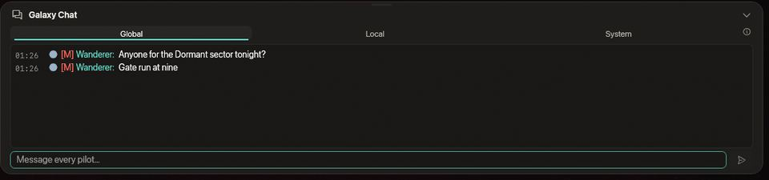
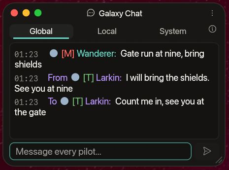
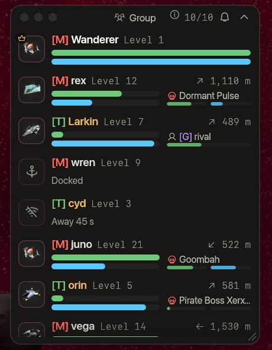

<!-- wiki-i18n source: 3d497b46d280a0c4 -->
<!-- wiki-i18n title: Gruplar -->
# Gruplar {#groups}

Grup, birlikte uçan en fazla **10 pilottan** oluşur; hangi şirketten olurlarsa olsunlar: farklı şirketler için uçan arkadaşlar, hatta PvP sektörlerindeki düşmanlar bile tek bir grup olabilir. Üyeler birbirinin gemisini, gövdesini ve kalkanını görür, yok ettikleri uzaylıların ödüllerini paylaşır ve birbirlerinin öldürmelerini görevleri için sayar. Grubun bir sohbet kanalı da vardır.

## Grup kurma {#forming-a-group}

- Bir pilotu dört yoldan **davet edebilirsin**: pilotu seçip Hedef penceresindeki **Gruba davet et** düğmesine bas; sohbette adına sağ tıklayıp **Gruba davet et** seçeneğini seç; haritandaki pilotların listesi için Grup penceresinin başlık çubuğundaki **+** düğmesine bas (listede düşman bir pilotun adı kehribar renklidir); ya da bütün dünyandaki pilotları listeleyen **Kim çevrimiçi** penceresinde (**H** tuşu) bir adın yanındaki **Davet et** düğmesine bas ([Klanlar](/wiki/03-Mechanics/Clans.md#who-is-online)). Herhangi bir şirketten bir pilotu davet edebilirsin. Pilot başka bir şirketteyse davet kartı senin şirketinin adını yazar, onu **Düşman** olarak işaretler ve kabul etmenin ne anlama geldiği konusunda uyarır (gizlenmiş olsan da olmasan da gemini her haritada görürler ve grup üyeleri birbirine saldıramaz). Böylece kimse yanlışlıkla katılmaz. Ayrıca dakikada başka şirketlerin en fazla **3 pilotunu** davet edebilirsin. Grubundan ayrılan başka bir şirketin pilotunu **bir dakika** boyunca yeniden davet edemezsin.
- Pilot, **Kabul et** ve **Reddet** düğmeleri olan, cevap vermek için sahip olduğu **60 saniyeyi** geri sayan bir kart ve bir bildirim görür. **Y** kabul eder, **Escape** reddeder (kullanımdaki bir metin alanı ya da üstte açık bir pencere tuşları kendine alır). Birkaç davet bekliyorsa kart onları sırayla gösterir. İstasyonda da görünür. Süre dolunca davet geçersiz olur ve hangi davetin süresinin dolduğu sana bildirilir. Zaten bir grupta olan, **Rahatsız etme** açık olan ya da bekleyen çok fazla daveti olan bir pilotu davet edemezsin; dakikada en fazla 10 davet gönderebilirsin (başka şirketlere 3).
- **Rahatsız etme** davetleri kapatır: Grup penceresinin başlık çubuğundaki zil ya da Ayarlar › Genel › Gruplar. Açıkken kimse seni davet edemez ve sana sorulmaz.
- Daveti ilk kabul edilen pilot grubun **lideri** olur. Lider davet eder, üyeleri çıkarır ve başka bir üyeyi lider yapar. Herkes ayrılabilir. Tek pilotluk bir grup kendiliğinden sona erer. Lider ayrılınca gruptaki en eski üye liderlik eder.
- Aynı anda **tek bir grupta** olabilirsin. [Şirket değiştirmek](/wiki/01-General/Getting-Started.md#changing-your-company) seni grubundan çıkarmaz (yeni şirketinin altında görünürsün); sezonun sıfırlaması çıkarır.
- Bağlantın kopsa ya da istasyona kenetlenip yeniden uçuşa çıksan yerin **2 dakika** boyunca korunur. Bundan uzun süre uzakta kalan üye gruptan çıkarılır. Bir sunucu güncellemesi her grubu sona erdirir; gruplar yeniden kurulmalıdır.

## Grubunu görme {#seeing-your-group}

Kabul ettiğinde **Grup penceresi** açılır (**B** tuşu ya da araç çubuğundaki düğmesi onu gösterir ve gizler; tuşu Ayarlar › Kontroller bölümünden değiştirebilirsin). Her üyenin bir satırı vardır: gemisi, adı ve seviyesi; bunların altında **gövde çubuğu** (yeşil) ve onun altında **kalkan çubuğu** (mavi) yer alır (sayılar için üzerine gel). Kalkanı takılı olmayan bir gemi yalnızca gövde çubuğunu gösterir. Haritandaki bir üye, satırın sağ üstünde ne kadar uzakta ve hangi yönde olduğunu gösterir; mini harita nasıl çiziyorsa öyle (yukarı haritanın üst kenarıdır). Başka bir haritadaki üye, orada o haritanın adını gösterir; başka bir dünyadaysa dünyayı da. **Taç** lideri, **hayalet** gizlenmiş bir üyeyi (grup, şirketleri ne olursa olsun gizlenmiş gemilerini paylaşır), **kalkan** güvenli bölgedeki bir üyeyi işaretler. İstasyonda olan, yok edilen ya da bağlantısı kopan bir üye soluklaşır ve bunu yazar. Haritandaysa o gemiyi seçmek için bir satıra tıkla (bir grup arkadaşına ateş edemezsin: oyun ateşi durdurur).
- **Ateş eden** bir üye, çubuklarının **sağında** **hedefini** de gösterir: ne olduğunu gösteren küçük bir işaret (uzaylı için bir kafatası), hedefin adı ve iki ince çubuk, hedefin **gövdesi** ve **kalkanı** (sayılar için üzerine gel). Onun için yer, sen hariç her üyenin satırında, üyenin hedefi olsa da olmasa da ayrılır; bu yüzden üyenin çubukları seninkilerden kısadır ve bir arkadaş hedef seçtiğinde ya da hedefini kaybettiğinde hiçbir satır yer değiştirmez. Bir uzaylıya, başka bir pilota ya da bir şirket pilotuna ateş eden her grup arkadaşının hedefini ve hedefin gövdesiyle kalkanını görürsün. Bir lazer kilidi ya da havadaki güdümlü bir roket sayılır ve hedef sonuncusundan sonra **5 saniye** kalır. Yalnızca haritanda (dünyanda) uçan bir arkadaş için gösterilir ve yalnızca orada senin de görebileceğin bir gemi için: gizlenmiş bir pilotun gövdesi ve kalkanı, o pilotu göremeyen bir arkadaşa asla gösterilmez. Bir istasyon ya da bir geçit hedef sayılmaz. Kendi satırın hedef göstermez (onun için Hedef penceresi vardır), küçültülmüş pencere de göstermez. Pencereyi daraltırsan (her kenardan ya da köşeden yeniden boyutlandırılır) çubukların yanında artık yer kalmaz: hedefin yeri o zaman çubukların **altına** gider (çubuklar yeniden satırın tüm genişliğini alır) ve kendi satırın dışında her satır, hedefli de hedefsiz de, daha yüksek olur.
- **Lider**, bir satıra sağ tıklayarak **Lider yap** ya da **Gruptan çıkar** seçeneğini kullanır. Herkes kendi satırına sağ tıklayarak ya da menüden **Gruptan ayrıl** seçeneğini kullanır.
- Küçültme düğmesi pencereyi her üye için bir çift küçük çubuğa katlar; pencerenin yeri, boyutu ve küçültülmüş durumu hatırlanır. Yeni bir düzen onu **280 nokta** genişlikte açar; böylece bir üyenin çubukların yanındaki hedefi uzun bir adın daha çoğunu gösterir. Daha önce taşıdığın ya da yeniden boyutlandırdığın bir pencere, verdiğin genişliği korur.
- Üyeler birbirinin **gizlenmesini görür** ve onu bozamaz: gizlenmiş bir grup arkadaşının yakınında patlayan bir EMP onun gizlenmesine dokunmaz.
- Haritada grubun pilotları pembedir: mini haritada pembe bir nokta, uçuşta gemilerinin üzerinde pembe bir grup işareti, gövde çubuğu ve kalkan çubuğu. Ad için bir noktanın üzerine gel. Grubun dışındaki şirket arkadaşların yeşil kalır.
- Her üye uçtuğu **şirketi** gösterir: adın önünde şirketin renginde etiketiyle (“[T] rex”), oyunun her yerinde olduğu gibi. Başka bir şirketten bir üyenin, yani grubun dışındaki bir düşmanın, adı kehribar renklidir ve kartında bunu belirtir. Grubunun dışında kimse bunların hiçbirini görmez; sen ayrılınca ya da çıkarılınca da hiçbirini artık görmezsin, hemen.

## Öldürmeleri paylaşma {#sharing-kills}

Bir üye bir uzaylıyı yok ettiğinde (ya da uzaylının [sahiplenmesi](/wiki/03-Mechanics/Combat.md) sayesinde onun için ödeme aldığında), ödüller (kredi, Thulium, deneyim ve onur) şu üyeler arasında paylaşılır:

- **aynı haritada** (aynı dünyada) olanlar,
- **hayatta** olup enkaza **4.000 birim** mesafe içinde bulunanlar ve
- **ateş edenler**: son 15 saniye içinde herhangi bir şeye lazer ya da roket ateşlemiş olanlar.

Herkes, şirketi ne olursa olsun **seviyesiyle** orantılı bir pay alır (krediler ve onur her pilotun kendisinindir; hiçbir şirket pay almaz): 15. seviye bir pilotla 5. seviye bir arkadaşı varsa paylar %75 ve %25 olur. Her kredi dağıtılır: payların aşağı yuvarlanmasından sonra artan, öldürmeyi yapan pilota gider. Ödülün tamamı öldürenin kendi ödülüdür: onun boosterları, dünyasının çarpanı ve Premium durumu uygulanır; bir arkadaşınkiler uygulanmaz. Tek başına ya da menzilde başka kimse yokken bir öldürme her zaman ödediğini öder. Savaşın yakınında ateş etmeden duran pilot pay almaz.

Öldürmenin bildirimi bunu söyler: öldürenin kendi **ÖDÜLLER** satırı payını gösterir, ardından “Ödüller 2 grup üyesiyle paylaşıldı: senin payın %40” gelir; pay alan bir arkadaş ise miktarlarla birlikte “*Uzaylı*, *pilot* tarafından yok edildi; grubunun payı sana ödül kazandırıyor” yazısını okur. Bildirimler Oyun Günlüğü’nde görünür.

Yalnızca öldürene kalanlar: **kargo kutusu** (ganimet ve kaynaklar; bir [Clan Warden](/wiki/03-Mechanics/Clans.md#warden-pay-and-loot) istisnadır, onun ganimeti pay alan her arkadaş için ayrı bir özel kutudur), öldürmenin istatistiklerdeki ve sıralamadaki kaydı, sıfırlama puanı öldürme sayısı ve dronların deneyimi. Başka pilotlara karşı yapılan öldürmeler paylaşılmaz.

## Görevleri paylaşma {#sharing-missions}

Bir öldürme, aynı haritada olan ve **son 15 saniyede herhangi bir şeye lazer ya da roket ateşlemiş** her diğer üyenin **öldürme görevlerine** de sayılır; haritanın neresinde olurlarsa olsunlar, sanki uzaylıyı kendileri yok etmiş gibi. Kararı yine görevin kendi kuralları verir: uzaylı görevin istediği türde olmalı ve sektör görevin belirttiği sektör olmalıdır. Ateş etmeyen ya da başka bir haritada olan bir arkadaş sayım almaz. Görevler kendi şirketinin kurallarını korur: “başka bir şirketin 4. sektöründe” öldürme isteyen bir görev, o sektörün başka bir şirkete ait olduğu üyeye sayılır. Bir arkadaşının öldürmesi görevlerinden birine sayıldığında, bir bildirim hangi göreve sayıldığını söyler. [Meydan okuma hattında](/wiki/03-Mechanics/Quests.md#where-it-counts) bir üyenin sayılması için enkaza **4.000 birim** mesafe içinde de olması gerekir; görev eşyası olan bir göreve sahip her üyenin eşyası ayrı ayrı belirlenir ve yalnızca kendi eşyasını görür: hiç kimse bir eşyayı paylaşamaz.

## Sohbet kanalları {#chat-channels}

Sohbetin üstünde bir sıra sekme vardır: **Genel**, **Yerel**, **Grup** (bir gruptayken) ve en sonda **Sistem**. Yazdığın satır görünen sekmeye gider ve en son kullandığın sekme hatırlanır. Her kanalın kendi rengi ve her satırda kısa bir etiketi vardır (GLB, LOC, GRP), bir sekme okumadığın satırları sayar ve pencere kapalıyken araç çubuğundaki sohbet düğmesi sayıyı taşır. Ya da bir satıra bir komutla başla:

| Kanal | Kimler duyar | Komut |
| :--- | :--- | :--- |
| **Yerel** | haritandaki pilotlar | `/l` veya `/local` |
| **Genel** | çevrimiçi her pilot | `/g` veya `/global` |
| **Grup** | grubun, nerede olurlarsa olsunlar | `/p`, `/party` veya `/group` |
| **Özel** | tek bir pilot, nerede olursa olsun | `/m`, `/msg` veya `/w`, ardından ad ve mesaj ([aşağıda](#private-messages)) |

Bir komut sekmeyi de değiştirir; tek başına yazılırsa (`/g`) yalnızca sekmeyi değiştirir. Grup sohbeti için bir grup gerekir. Kanallardan önceki bir oyun sunucusunda sohbet eskiden olduğu gibi tek bir listedir ve grup kurulamaz.

**Sistem** altın rengidir ve salt okunurdur, kendi listesi vardır: sunucunun kendiliğinden söylediklerini (karşılama, yeniden başlatma, güncelleme ve sıfırlama uyarıları, sürü duyuruları) ve geminin bildirdiklerini (onarımlar, gizlenme, EMP patlamaları, roketler) barındırır. Bu satırlar başka hiçbir sekmede yoktur; bu yüzden kalabalık bir Genel onları dışarı itemez, pilotların sekmeleri de pilotların söylediklerini tutar. Sekmenin sayacı duyurular içindir; yeniden başlatma ya da güncelleme geri sayımı ve sıfırlama uyarıları ayrıca bir bildirim olarak da belirir. [Öldürme akışı](#the-kill-feed) kendi anahtarıyla **Genel** sekmesinde kalır; grubuna giren ya da ayrılan pilotlarla ilgili satırlar **Grup** sekmesindedir.

### Yazma {#typing}

**Enter** sohbeti açar ve klavyeyi ona verir. Bir satırı **Enter** ile gönder; kutu klavyeyi elinde tutar, böylece sonraki satır hemen gelebilir; bu sürede kısayol çubuğu ve yetenek tuşları kapalı kalır. Yazma şu durumlarda biter: **Escape** tuşuna bastığında, hiçbir şey yazmadan **Enter** tuşuna bastığında, haritaya sol tuşla tıkladığında (aynı tıklama gemini yine yönlendirir), kutu boşken 15 saniye hiçbir tuşa basmadığında ya da geminin yok edildiğinde. Yazamadığın Sistem sekmesinde **Enter** seni en son yazdığın kanala geri götürür.

### Özel mesajlar {#private-messages}

Yalnızca tek bir pilota yazmak için `/m`, pilotun adını ve mesajını yaz: `/m nova o7` (`/msg` ve `/w` aynı işi yapar). Pilotun çevrimiçi olması gerekir; hangi dünyada olursa olsun, istasyonda ya da uçuşta. Ad, pilotun sohbette göründüğü addır ve büyük küçük harf fark etmez (`/m NOVA`, `/m @nova` ve `/m nova:` aynı pilotu bulur): adın tamamı yazılmalıdır, yalnızca başlangıcı olmaz; böylece bir mesaj yanlış pilota gidemez. `/r` ve yanıtın (`/r o7`) sana en son yazan pilota gider; kimse sana yazmamışsa en son yazdığın pilota.

Özel bir mesaj, baktığın sekmede satırlarının arasında mor renkte görünür: gönderdiğin için **nova adlı pilota:**, aldığın için **nova adlı pilottan:**; böylece konuşmanın iki tarafı da uçuştaki sohbet penceresinde ve istasyondaki çubukta elindedir. Her sekme onu gösterir; **Sistem** sekmesi ve gizli bir **Genel** sekmesi de dahil. Aldığın bir mesaj, bir sekme açana kadar okunmamış sayılır (araç çubuğundaki düğmede ve istasyondaki çubukta) ve en fazla 2 saniyede bir yumuşak bir çınlama çalar; göndermenin de kendi hafif sesi vardır. Aldığın bir mesaja sağ tıklayarak **Yanıtla**, **Gruba davet et**, **Yoksay** ya da **Bildir…** seçeneklerini kullanabilirsin.

Sohbetin kuralları her satır için aynıdır: 200 karakter (komut ve ad sayılır), Latin, Kiril, Japon, Kore veya Çin harfleri, bağlantı yok, tekrar yok ve gönderme hızı sınırı; özel mesajlar bu sınırı Yerel, Genel ve Grup ile paylaşır, bu yüzden aynı anda çok sayıda pilota yazmak seni herhangi bir spam gibi duraklatır. Bir mesaj gönderilmediğinde giriş kutusunun altında bilgilendirilirsin ve metnin kutuda kalır: **... adlı bir pilot yok** (ad yanlış), **... çevrimdışı** (o hesap bağlı değil), **Kendine özel mesaj gönderemezsin** ve ad ya da mesaj eksik olduğunda kullanım satırı. Hiç kimseyi bulamayan bir ad da yine hakkından bir satır harcar. Özel bir mesajı başka kimse görmez: ne grubun, ne şirketin, ne de haritadaki diğer pilotlar; nerede olduğun hakkında da hiçbir şey söylemez. Sunucu kimin kime yazdığını ve mesajın ne kadar uzun olduğunu kaydeder, sözcüklerini değil. 0.4.22 öncesi bir oyun sunucusu komutu tanımaz: bu durumda oyun metnini kutuda tutar ve bunu söyler, herkese göndermez.

### İstasyondaki sohbet {#chat-at-the-station}

İstasyonda sohbet, **her sayfanın altındaki bir çubuktur**; böylece araştırmana bakarken ya da cephane alırken söylenen hiçbir şey gözden kaçmaz. Küçültülmüşken, başlangıçta böyledir, bir satır yüksekliğindedir: sohbetin adı, okumadığın satırların sayısı (tüm sekmeler birlikte) ve en yeni satır. Sohbeti açmak için ona **tıkla**. Açıkken sohbet penceresinin sekmelerine, geçmişine ve giriş kutusuna sahiptir; giriş kutusunun altında aynı karakter sayacı, duraklatma ve ret bildirimleri bulunur ve üst kenarı sürüklenerek daha uzun ya da kısa yapılabilir. Yeniden küçültmek için başlık çubuğuna tıkla ya da **Escape** tuşuna bas. Çubuk açıkken ve başka hiçbir metin alanı klavyeyi tutmuyorken **Enter** klavyeyi giriş kutusuna verir. Baktığın sekme okunmuş sayılır.

Bu, penceredeki sohbetin aynısıdır. İstasyondayken söylenenler uçuşa çıktıktan sonra pencerede, uçuşta söylenenler ise istasyona kenetlendiğinde çubukta görünür; **Genel sohbeti gizle**, yoksayılan pilotlar ve bildirimler de aynı şekilde çalışır (bir ada sağ tıkla). İstasyonda **Genel** ve **Grup** kanallarına yazabilir ve özel mesaj gönderebilirsin. **Yerel** bir haritanın kanalıdır: sekmesi uçuşta söylenenleri gösterir ve `/l` ile yazılan bir satır gönderilmez. 0.4.21 öncesi bir oyun sunucusu istasyondan satır kabul edemez: çubuk o zaman yalnızca sohbeti gösterir.

Çubuğun açık olup olmadığı ve ne kadar yüksek olduğu bir sonraki oturum için saklanır. **Ayarlar › Arayüz › Sohbet** altındaki **İstasyon sayfalarında sohbet çubuğu** seçeneğiyle kapatabilirsin; uçuştaki sohbet penceresi bundan etkilenmez.

### Sohbet kuralları {#the-chat-rules}

Sunucu her satırı birkaç kurala tabi tutar; kurallar Yerel, Genel, Grup ve özel mesajlarda aynıdır. Reddettiği bir satır gönderilmez ve nedeni birkaç saniye giriş kutusunun altında görünür; metnin kutuya geri konur.

- **Gönderme hızına bir sınır.** Aynı anda **5 satır** gönderebilirsin, sonra **her 2 saniyede bir satır daha**; Yerel, Genel, Grup ve özel mesajlar birlikte sayılır. Hakkın kalmadığında bir satır gönderirsen sohbet senin için **duraklar**: ilk seferde **10 saniye**, son duraklamadan sonraki 10 dakika içindeki her tekrarda sırayla **30**, **120** ve **300 saniye** (10 dakika duraklamasız geçince sayım yeniden başlar). Sürerken Gönder düğmesi gridir ve giriş kutusunun altında “Sohbet duraklatıldı: 7 sn” geri sayar. **Yazdığın metin kutuda kalır** ve kutu klavyeyi tutar: bekle ya da **Escape** tuşuna bas. Normal bir konuşma sınıra asla ulaşmaz. Kuralların reddettiği bir satır hakkından 2 satır sayılır.
- Satır başına **200 karakter**. Bir sayaç (“150/200”) 120 karakterden itibaren görünür ve daha uzun bir satır kesilir.
- **Oyunun dillerinin yazı sistemleri.** Latin alfabelerinin harfleri, aksanlı olanlar dahil (ç, ğ, ı, ş, é, ß, ñ, ø, ő), Kiril (Rusça, Ukraynaca ve diğerleri), Japonca, Korece ve Çince metin, numara işareti №, rakamlar, olağan noktalama ve ¡ ¿ « » ° £ € işaretleri. Emoji, diğer simgeler ve diğer yazı sistemleri (Yunanca, Arapça, İbranice, Tayca) reddedilir; kutu bunları yazarken ya da yapıştırırken düşürür. Çince, Japonca ve Korece metin yapıştırılabilir; bir giriş yöntemiyle yazmak oyunda henüz çalışmaz. Eski bir oyun sunucusu yalnızca Latin harflerini kabul eder.
- **Bağlantı yok.** Bir web adresi, davet bağlantısı ya da e-posta adresi içeren satır, olağan yöntemlerle gizlenmiş olsa bile reddedilir. Yalnızca sözcükler sorun değildir: “join my discord” gider.
- **Tekrar yok.** Son satırınla aynı olan bir satır 10 saniye içinde yeniden gönderilirse reddedilir; aynı karakteri art arda 8 defadan fazla içeren ya da hiç harf veya rakam içermeyen satır da öyle.

Yöneticiler 200 karakter dışında bu kurallara tabi değildir. Kurallar 0.4.9 ve üzeri bir oyun sunucusu gerektirir; daha eski bir sunucu yalnızca Genel kanalını sınırlar: aynı anda 3 satır, sonra 2 saniyede bir satır.

### Öldürme akışı {#the-kill-feed}

**Genel** sekmesi bir öldürme akışı da taşır: bir pilot yok edildiğinde kafatası simgeli soluk bir satır, biraz mizahla yazılmış (“vega, kara delikten yol tarif etmesini istedi”). Kimin öldüğünü ve bunu kimin ya da neyin yaptığını söyler: bir pilotun lazerleri, bir roket (**N.U.K.E.** ve **N.I.K.E.** roketlerinin kendi satırları vardır), adıyla bir uzaylı, kara deliğin olay ufku ya da radyasyonu veya pilotu içeri iten bir düşman. Adlar şirketlerinin etiketini ve rengini taşır. **Nerede** olduğunu asla söylemez: ne harita ne konum, bu yüzden gizlenmiş bir pilotun ölümü hiçbir şey ele vermez. Yalnızca pilotlar bir satır alır: bir uzaylının ya da şirket pilotunun yok edilmesi almaz ve bir savaşta oturumu kapatan pilot yok edilmez, bu yüzden bunun için de satır yoktur.

Saniyeler içinde çok sayıda pilot öldüğünde (bir it dalaşının ortasında patlayan bir N.U.K.E.) ilk birkaç satırı, ardından tek bir satır görürsün: “7 pilot daha yok edildi”. Akışın kaydırma geçmişinde kendi yeri vardır, bu yüzden bir savaş arkadaşlarının mesajlarını asla dışarı itmez.

Sohbet penceresinin başlık çubuğundaki menü düğmesiyle (**Öldürme akışını göster**) ya da **Ayarlar › Arayüz › Sohbet** altından kapatabilirsin. Kapatmak yalnızca satırları gizler; açınca geri gelirler. Akış 0.4.5 ve üzeri bir oyun sunucusu gerektirir: daha eski bir sunucuda Genel sekmesinde yoktur.

### Gizleme, yoksayma ve bildirme {#hiding-ignoring-and-reporting}

Genel, çevrimiçi her pilota ulaşır; bu yüzden sohbeti rahat tutman için üç araç vardır. Bunlar sohbet penceresindedir: başlık çubuğundaki menü düğmesi ve bir pilotun adına sağ tık.

- **Genel sohbeti gizle** (menü ya da Ayarlar › Arayüz › Sohbet): Genel sekmesi Genel kanalının hiçbir satırını göstermez, öldürme akışının satırları dahil (özel mesajların yine de içinde görünür) ve okunmamış satırları saymayı bırakır. Sekme kalır, “Genel gizli” der ve onu yeniden gösteren bir düğmesi vardır; Genel kanalına gönderdiklerin yine gider. Kapattığında bu arada gelen her satır oradadır.
- **Yoksay** (bir ada sağ tıkla, sonra **Yoksay**): o pilotun Genel ve Yerel sohbetteki satırları ile özel mesajları gizlenir (ondan gelen özel mesaj ses çıkarmaz ve okunmamış sayılmaz) ve grup davetleri sana sorulmadan geri çevrilir. Pilota söylenmez. **Grup** sekmesinde görünür kalır: yoksaydığın bir grup arkadaşı yine grubundandır, ondan kurtulmak için gruptan ayrıl. Sunucunun kendi satırları asla gizlenmez. **Yoksaymayı bırak** aynı menüdedir ve **Ayarlar › Arayüz › Sohbet** yoksayılan pilotları (en fazla 200) her biri için bir **Kaldır** düğmesiyle listeler.
- **Bildir** (bir ada sağ tıkla, sonra **Bildir…**): bir neden seç (spam, hakaret veya taciz, hile ya da başka bir şey) ve gönder. Bildirim senin adını, pilotun adını, kanalı (özel mesaj için **Özel**), nedeni ve sohbetinin gösterdiği o pilotun son satırını (en fazla 200 karakter) taşır. Oyunun yöneticileri okur; kimse otomatik olarak cezalandırılmaz ve pilota kimin bildirdiği söylenmez. Saatte 5 bildirim gönderebilirsin.

Yoksayma listen ve Genel sohbeti gizleme anahtarı hesabınla birlikte saklanır, bu yüzden diğer bilgisayarlara da seninle gelir. Oyunda sözcük filtresi yoktur ve kimseyi söylediği şey yüzünden susturmaz: çok hızlı göndermenin duraklaması ([Sohbet kuralları](#the-chat-rules)) tek otomatik durdurmadır, yukarıdaki araçlar ise senin kullanımındadır.

## Çatışma kuralları {#rules-of-engagement}

**Aynı grubun üyeleri birbirine zarar veremez**, şirketleri ne olursa olsun: bir grup arkadaşına kilitlenemezsin (lazerler ya da roketler), atışların ve patlamaların onların içinden geçer ve ona yaptığın hiçbir şey kimse için bir öldürme, bir PvP öldürmesi ya da bir kara delik öldürmesi sayılmaz. Aynı grupta **olmayan** şirket arkadaşları eskisi gibidir: birine vurmak, yok edildiğinde **100 onur** kaybettirir. Gruptan ayrılırsan eski bir arkadaş, düşman olsun olmasın, hemen yeniden hedef olur (sektör ve sezon savaşa izin veriyorsa). Grubunun dışındaki herkese her zamanki gibi davranılır; güvenli bölgeler, Barış Protokolü ve sektörlerin PvP kuralları kimse için değişmez.

## Arkadaş getirme {#bringing-a-friend}

Oyuna yeni başlayan bir arkadaş, kişisel kodunla katılabilir ve bir başlangıç paketi alır; bkz. [Arkadaşları Davet Et](/wiki/03-Mechanics/Invite-Friends.md).
