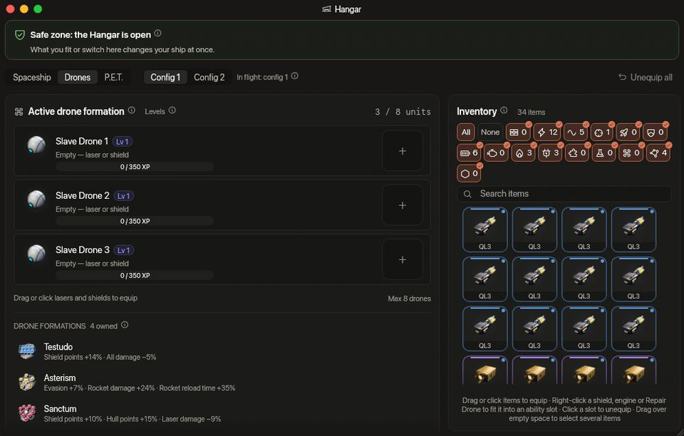

<!-- wiki-i18n source: 968a75aa2c9015c4 -->
<!-- wiki-i18n title: Hangar -->
# Uçuşta Hangar {#the-hangar-in-flight}

Gemini değiştirmek için üsse dönmen gerekmez. Güvenli bir bölgenin içindeyken **Hangar** penceresini (sol üstteki araç çubuğundaki depo düğmesi) açıp takılı olanları değiştirebilir, diğer konfigürasyona geçebilir ya da sahip olduğun başka bir gemiyle uçabilirsin; oyundan çıkman gerekmez. Pencere, istasyondaki Hangar sayfasının aynısıdır: aynı yuvalar, aynı özellikler ve aynı envanter, oyunun üstünde bir pencerede. Eşyaların nasıl takıldığını [Envanter ve ekipman](/wiki/03-Mechanics/Inventory.md) sayfasında bul.

## Ne zaman açık olur {#when-it-is-open}

Değişiklik yalnızca bunların hepsi doğruyken yapılabilir:

- **Bir güvenli bölge seni koruyor.** Her istasyonun ve portalın koruyucu bir halkası vardır ([Savaş](/wiki/03-Mechanics/Combat.md) sayfasına bak). Halkanın içinde, vurulduğundan beri 5 ve ateş ettiğinden beri 15 saniye geçince korunursun.
- **Çatışmanın dışında kalmış olmalısın**: birkaç saniye daha, varsayılan olarak **10**. Bir portaldan sıçrayıp arkanda bir çatışma bırakarak hemen korumalı vardığında bu önemlidir.
- Gizlenmiş değilsin, kendi EMP süren içinde değilsin ve [kara deliğe](/wiki/03-Mechanics/Black-Hole.md) yakın değilsin; havada hâlâ sana ait bir roket de yok.

Süren onarımlar seni durdurmaz. Başka her yerde Hangar penceresi yine açılır, ama salt okunurdur. Kehribar rengi bir uyarı şeridi nedenini söyler ve bir bekleme söz konusuysa saniyeleri geri sayar (“Az önce savaştaydın. Gemini değiştirmek için 6sn bekle.”). Sunucu da bunu uygular; yani açık uzayda gemi hiçbir yolla değiştirilemez.

## Neleri değiştirebilirsin {#what-you-can-change}

- **Her şeyi takıp çıkarabilirsin**, her tür yuvada: lazerler, jeneratörler (kalkanlar, motorlar, Uyarlanabilir Çekirdekler), ekstralar, yetenek yuvaları, dron yuvaları ve gövde plakası yuvaları ile bunlara takılı amfiler, hücreler ve iticiler. Eşyaları yuvalara sürükle ya da üzerlerine tıkla, tıpkı istasyondaki gibi. Gemin değişikliği anında yansıtır: özellikler, lazerler, yetenekler ve kısayol çubuğu.
- **Hepsini çıkar.** Hangarın araç çubuğundaki **Hepsini çıkar** düğmesi, **Uzay gemisi** görünümünde gösterilen konfigürasyonu tek seferde boşaltır: lazerleri, kalkanları, motorları, Uyarlanabilir Çekirdekleri, ekstraları ve yetenek yuvalarını, **ayrıca dronlarının yuvalarındaki lazerleri ve kalkanları**, bunlara takılı amfiler, hücreler ve iticilerle birlikte. Hepsi envanterine döner: ya hepsi ya hiçbiri. **Dronların sende kalır** (bir dron hiçbir zaman gemiye takılmaz, yani üzerinden çıkarılacak bir şey yoktur) ve **aktif dron formasyonun** olduğu gibi kalır. Diğer konfigürasyona dokunulmaz. Uçuşta her değişiklikte olduğu gibi kurallar geçerlidir: güvenli bölgeden, çatışma dışında. **Dronlar** görünümünün yalnızca dron yuvalarını boşaltan kendi düğmesi vardır.
- **İki konfigürasyon da.** Konfig. 1 ile uçarken Konfig. 2’yi hazırlayabilir, sonra “Konfig. değiştir” tuşuyla geçebilirsin. Hangardaki **Konfig. 2 ile uç** gibi bir düğme de aynı geçişi yapar.
- **Herhangi bir gemi.** Başka bir gemiyi aktif yaparsan bulunduğun yerden onunla uçarsın. Geminin modeli, yakındaki herkesin gözü önünde değişir.
- **Yeni bir kalkan, motor veya Uyarlanabilir Çekirdek boş başlar**, istasyondaki gibi: konfigürasyonunun kalkanı yeniden dolana kadar boştur.
- **Dron formasyonları.** Dronlar görünümü, sahip olduğun formasyonları dronlarının altında listeler. Formasyonlar takılmaz: uçuşta birini kısayol çubuğunun Formasyonlar listesinden bir yuvaya sürüklersin; yuvaya tıklayınca ya da tuşuna basınca formasyonu kuşanırsın, her yerde olduğu gibi aynı 2 saniyelik beklemeyle, güvenli bölgede de ([Dron formasyonları](/wiki/03-Mechanics/Formations.md)).
- **Ekstralar.** Dört normal gemi, yani Protos, Kitefin, Ostirion ve Nomad (başladığın ya da satın aldığın gemiler), her konfigürasyonda 2 ekstra yuvaya sahiptir; Montaj’da ürettiğin dört gemi, yani Paragon, Ironclad, Wraith ve Storm, 3 yuvaya sahiptir. Skylab’ının Extra Slots CPU eşyaları bunların üstüne 3, 5 veya 7 yuva ekler: normal gemilerde 5, 7 veya 9, üretilenlerde 6, 8 veya 10 ([Ekstralar](/wiki/06-Items/Extras.md#extra-slots-cpus)). 0.4.10 güncellemesi geldiğinde normal bir gemideki üçüncü ekstra envanterine çıkarıldı: hiçbir şey silinmedi ve sohbette tek bir mesaj aldın.
- **Gövde plakaları.** Ürettiğin dört geminin [Gövde Kaplaması](/wiki/06-Items/Hull-Plating.md#hull-plate-slots) için gövde plakası yuvaları vardır; her biri sen Skylab’da araştırana kadar kilitlidir. Taktığın ya da çıkardığın bir plaka gövdenin dolu oranını korur ve konfigürasyon değiştirsen de yerinde kalır.
- **Görünümler.** Uzay gemisi görünümünde gövde plakalarından sonra gelen **Görünüm** bölümü ile Dronlar görünümündeki **Dron kaplaması** kutusu **Gardırop** penceresini açar; burada skinleri, auraları ve egzozları giymeden önce dönen geminde denersin. Ekipmanın değişebildiği her yerde görünüm de değişebilir ([Kozmetikler](/wiki/06-Items/Cosmetics.md)).
- **P.E.T.’ler.** **P.E.T.** görünümünde Beşik bulunur: bir Cluster Chunk ve bir Orvium Reinforced Plate burada bir P.E.T.’e dönüşür; ayrıca P.E.T. Station (yerleri, nerede takılı olduğu ve AÇIK olup olmadığı) ve melezleme de buradadır. Uçuşta Beşik çalışır (monte etmek, toplamak, melezlemek ve serbest bırakmak), ama yanaştırmak ve ayırmak için geminin bir istasyonda park halinde olması gerekir ([P.E.T.’ler](/wiki/03-Mechanics/Pets.md)).

Satış pencerenin parçası değildir: [Açık Artırma](/wiki/03-Mechanics/Auction.md) sayfasını açan tokmak istasyondaki hangara aittir ve Açık Artırma’nın kendisi istasyonun bir sayfasıdır.

Kütüphane’nin **Build’ler** sayfası, gemilerinden birinde takılı olanları, iki konfigürasyondan hangisinde olursa olsun, düzenleyebileceğin, fiyatlandırabileceğin, hesabına kaydedebileceğin ve paylaşabileceğin bir build olarak içe aktarabilir ([Build’ler](/wiki/01-General/Recipe-Book.md#import)).

## Gemi değiştirme {#changing-ship}

Geçtiğin gemi, onunla en son uçtuğunda sahip olduğu **gövde ve kalkanla** gelir; tıpkı onunla yeni uçuşa çıkmışsın gibi. Halka onarım yapmaz, bu yüzden gemi değiştirmek seni asla iyileştirmez: bıraktığın gemi aldığı hasarı korur ve geri döndüğünde hasarıyla gelir. Yok edilmiş bir gemiyle, canlandırana kadar uçulamaz; canlandırma ücretsizdir ve gemiyi en fazla 10.000 gövde ve kalkansız olarak, yeniden doğmada olduğu gibi geri getirir.

Senin olan senin kalır: cephanen, roketlerin ve zamanlayıcıları, yeteneklerinin bekleme süreleri, boosterların, deneyim puanın ve Slave Drone eşyaların. Gemiye ait olanlar sona erer: çalışan bir Shield Surge ya da Afterburner, onarımlar, hedefe kilitlenmen, saldırın ve izlediğin rota. Takılı eşyalar, takıldıkları gemide kalır.

## Diğer araçlardan gelen istekler {#requests-from-other-tools}

Sunucuda da hangar yalnızca güvenli bölgeden değişir: uçarken eşya takmak, çıkarmak, silmek, bir gemiyi canlandırmak ya da aktif gemiyi ayarlamak isteği şu yanıtla geri çevrilir: “Gemini yalnızca güvenli bölgede değiştirebilirsin.” Konfigürasyon değişimi bunun istisnasıdır ve her yerde çalışır (5 saniyede bir).
