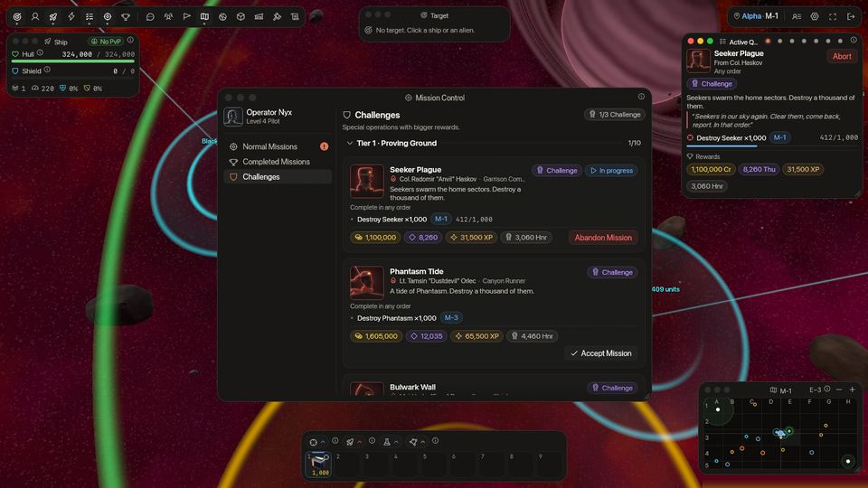
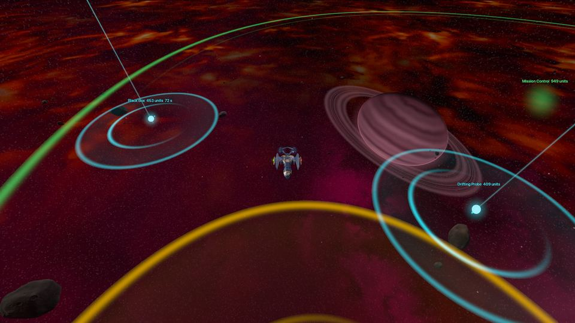

<!-- wiki-i18n source: 2ec356f14ef5095c -->
<!-- wiki-i18n title: Görevler -->
# Görevler {#quests}

Görevler seviye atlamanın ana yoludur. Onları Mission Control verir: her görev kendi şirketinin bir subayından gelir ([şirket değiştirirsen](/wiki/01-General/Getting-Started.md#changing-your-company) subaylar yeni şirketinin subayları olur ve `rival x-4` adımları da onu izler) ve her biri, ödülünü aldığında deneyim, kredi, Thulium ve onur öder. **1. ile 8. seviyeler için 88 görev** vardır, seviye başına on bir tane; birlikte seni yepyeni bir Protos gemisinden PvP merkezinin cephe hattına taşırlar. On **istasyon görevi** sana [Skylab](/wiki/03-Mechanics/Skylab.md) üssünü öğretir ve onu geliştirdiğin için sana öder; 3. pilot seviyesinden itibaren de ayrı bir hat, elli çok zor **meydan okuma görevi**, büyük ödüller verir. İstasyon ve meydan okuma görevleri seviye görevleri gibi öder: tablolardaki sayılar **temeldir** ve dünyan, boosterların ve klan güçlendirmelerin onları çarpar ([Ödüller](#rewards)).

Görevlerin çoğu artık “şundan şu kadar yok et” değildir: kısa **zincirlerdir**. Birkaç uzaylı yok edersin, bir noktaya uçarsın, bir sektörde birkaç dakika kalırsın ya da bir eşya bulup onu Mission Control penceresine götürürsün. Bazıları bir kural ekler: en fazla şu kadar gövde puanı kaybet ya da ölme.

---

## Bir dakikada {#in-one-minute}

- **Onları Mission Control penceresinde al.** Aynı anda 5 seviye görevi, ayrıca 3 istasyon görevi ve 3 meydan okuma görevi yürütebilirsin.
- **Zincirler.** **Sırayla** etiketli bir görevin adımları birbiri ardına açılır ve yalnızca açık olan adım sayılır.
- **Öldürmeler dışında dört tür adım.** Yalnızca senin için düşen ve Mission Control penceresine götürdüğün bir **görev eşyası**, ziyaret edilecek bir **nokta**, bir sektörde birkaç dakikalık bir **kalış** ve sezonun 4. gününden itibaren avlanacak bir **sürü**.
- **Koşullar.** Bir adım ya da bütün bir görev “gövde kaybı en fazla N puan” veya “ölmeden” diyebilir. Bozarsan o adım ya da görev baştan başlar. Kalıcı olarak hiçbir şey kaybolmaz.
- **Meydan okuma hattı.** 3. pilot seviyesinden itibaren, her biri on görevlik beş kademede elli çok zor görev. Emeğe göre öderler: bir öldürme, I. kademenin ona ödediği kadar değerlidir, her üst kademede %10 daha fazla; ve tek bir ödül en fazla 200.000 Thulium öder. I. kademe toplamda, temel değerler olarak, 9.355.000 kredi, 70.125 Thulium ve 2.177.500 XP öder ([meydan okuma hattı](#challenge-line)).
- **0.4.10 güncellemesinde yeniden düzenlendi.** Seviye görevlerinin 64 tanesi yeni sürümlerdir. Birini yaptıysan yeniden sunulur, tam ödülüyle ([ayrıntılar](#reworked-missions)).

## Mission Control

- **Mission Control** penceresini bir istasyonun güvenli bölgesinin içinde araç çubuğundan aç ya da ana sektöründeki istasyonun üzerindeki **Mission Control** balonuna tıkla (haritada istasyonu izler; bu yüzden istasyon görünene kadar uç ya da uzaklaştır). **Normal görevler** sekmesi görevlerini seviyeye göre listeler, **Meydan okumalar** sekmesi [meydan okuma hattını](#challenge-line) tutar ve **Tamamlanan görevler** ödülünü almanı bekleyenleri tutar.
- Bir görevi başlatmak için **Görevi kabul et**. Aynı anda **5 görev** yürütebilirsin; [istasyon görevlerinin](#station-missions) kendi 3 yuvası, [meydan okuma görevlerinin](#challenge-line) de 3 yuvası daha vardır. En son kabul ettiğin görev **takip ettiğin** görevdir (bir istasyon görevi yalnızca hiçbir şeyi takip etmiyorsan ve görevlerinden hiçbiri uçarak ilerletilebilen bir görev değilse): **Aktif Görevler** penceresinde görünür ve öldürmeler ile uçuş önce ona sayılır. Pencerenin başlık çubuğundaki noktalarla başka birini seç.
- Mission Control düğmesinde ve başka bir sekmedeyken **Normal görevler** ile **Meydan okumalar** sekmelerinde, kabul edilebilir bir görev ya da meydan okuma olduğu sürece sayılı bir **rozet** durur. Her yeni görevle birlikte bir bildirim ve sessiz bir ses gelir.
- Bazı görevler **sırayla** yapılmalıdır. **Sırayla** etiketi taşırlar ve adımları numaralıdır: bkz. [Zincirleme görevler](#chained-missions).
- Görev eşyası, kalış ya da koşul içeren bir görev, durumunu Aktif Görevler penceresinde canlı gösterir: **Taşınıyor** ve Mission Control penceresine olan mesafe, kaldığın süre, kaybettiğin gövde puanları (**Gövde hasarı: 1.240 / 3.000**), **Ölme**. Görevin kartında aynı kurallar küçük etiketler olarak görünür: **Gövde sınırı 3.000 HP**, **Ölmeden**, **Sırayla** ve süreli bir görevin saati.
- Bir görevi ve ilerlemesini bırakmak için **Görevi bırak**. Görev hemen listeye geri döner ve yeniden alabilirsin. Onun için taşıdığın eşya gider.
- Biten bir görev, ödülünü **alana** kadar **Tamamlanan görevler** altında bekler. İstediğin zaman al: ödülün süresi dolmaz.
- Her görev **pilot başına bir kez** yapılabilir; 0.4.10 güncellemesinde yeniden düzenlenen seviye görevleri hariç, onlar bir kez daha sunulur ([aşağıya bak](#reworked-missions)). Görevlerin, tamamlananlar da süren de, sezonun sıfırlamasından sağ çıkar.

## Seviyeler {#levels}

- 1’den 8’e her seviyenin **on görevi ve bir Özel görevi** vardır. Bir seviyenin görevleri o seviyeye ulaşınca açılır ve üstündeki her seviyede açık kalır.
- **Hangi sırayla istersen al.** On görevin hiçbiri diğerini beklemez. (Bir görevin içindeki adımların sırası olabilir.)
- Her seviyenin karışımı aynıdır: görev eşyalı **üç** görev, seni haritadaki noktalara gönderen **iki** görev, bir sektörde kalmanı isteyen **iki** görev ve **üç** düz av. Bir görevin bir ile dört arası adımı vardır ve bir av bir tür ya da birkaç tür uzaylı ister.
- Bir seviyenin görevleri bir sonraki seviyeye kadar gereken **deneyimin %85 kadarını** öder. Yok ettirdikleri uzaylılar geri kalanını öder, düşük seviyelerde epeyce fazlasını: genellikle bir set bitmeden bir sonraki seviyeye ulaşırsın.
- **Her seviye için bir Asteroit görevi.** On görevi ve Özel görevinin yanı sıra her seviyede, seviyeler yükseldikçe daha iyi haritalarda yaşayan türden bir miktar [asteroit](/wiki/03-Mechanics/Asteroid-Mining.md) kırmanı isteyen bir görev vardır (ilki 60 Rivet I öder; 7. ve 8. seviyelerinkiler sezonun 4. gününde açılır). Bir kırılış, sana bir pay ödediğinde sayılır (asteroitin aldığı hasarın en az %5 kadarı), roketle de lazerle de. On görevden biri değildir, bu yüzden Özel görev onu beklemez, ama 5 görev yuvandan birini alır. Mission Control onu Özel görevden sonra **Asteroitler** işaretiyle listeler; bu sayfanın sonundaki tablolar listelemez.

## Özel görevler {#special-missions}

- Her seviyenin on birinci görevi **Özel** görevidir. Seviyenin diğer **on** görevi de tamamlanana kadar (ödülü alınmış ya da alınmayı bekliyor) kilitlidir ve kartı kaç tane kaldığını söyler.
- Özel görevler, seviyelerinin diğer her görevinden daha fazla deneyim öder ve ayrıca **eşya** verir: lazerler, kalkan parçaları, jeneratörler, Power Core, Ship Fragment, cephane ve booster süresi.
- 3. ve 4. seviyelerin Özel görevleri, **Kovan Kırıcı** ve **Kovan Temizliği**, [sürü avlarıdır](#swarm-missions): sezonun 4. gününden itibaren açılır.
- 1. seviyenin normal görevleri de her biri küçük bir başlangıç eşyası verir: bir Light Shield Core, bir Repair Drone, bir Damage Amp I, bir Absorption Shield Cell I, biraz cephane ve her türü denemek için bir yığın roket (Lancet I, Rivet I, Ember I ve Scatter I, Özel görevden de Lancet II).

## Zincirleme görevler {#chained-missions}

Bir **zincir**, adımları sabit bir sırayla giden bir görevdir. Kartında ve Aktif Görevler penceresinde **Sırayla** etiketi taşır. Adımları numaralıdır: biten adım işaretlenir, **vurgulanan** adım açık olandır ve ondan sonraki adımlar o bitene kadar kilit gösterir.

- **Yalnızca açık adım sayılır.** Öldürmelerin, uçuşun ve kalış süren ona gider, başkasına gitmez. Bir adım açılmadan önce yaptığın öldürmeler onun için sayılmaz.
- **Neden sırayla?** Bir görev küçük bir hikâye anlatır (“muhafızları temizle, sonra çekirdeği eve götür”) ve kurallar sıraya ihtiyaç duyar: bir görev eşyası ancak adımı açıldıktan sonra düşebilir, bir kalış açıldığı andan itibaren sayılır ve bir adımın koşulları (gövde sınırı, ölmeden) yalnızca o adım açıkken işler.
- **Etiketi olmayan görevler tüm adımlarını aynı anda açar**, herhangi bir sırayla. **Geçidi Tut** görevinde ulaşılacak bir nokta, kesintisiz dört dakikalık bir kalış ve 8 Seeker ile 3 Phantasm öldürmesi vardır; hepsi birlikte açıktır, bu yüzden öldürmeler görev sürdüğü sürece ne zaman yaparsan yap, kalışın içinde de dışında da sayılır.
- Bu sayfanın sonundaki tablolarda bir ok (“→”) sırayla yapılan bir görevin adımlarını, bir noktalı virgül (“;”) birlikte açılan adımları birleştirir.

## Görev eşyaları {#quest-items}

Bir görev eşyası, Mission Control penceresine getirmen gereken bir şeydir. Envanter eşyası değildir: takas edilemez, saklanamaz ya da satılamaz, görevin parçasıdır. **Onu yalnızca sen görebilirsin.** Diğer pilotlar, grup arkadaşların da, hiçbir şey görmez.

| Tür | Nasıl elde edilir | Örnek |
| :--- | :--- | :--- |
| **Düşen eşya** | Adı geçen sektörde adı geçen uzaylının her öldürülmesi onu düşürebilir. Tablo, bir öldürmenin şansını (“her öldürmede %15 şansla”) ve onu kesin düşüren öldürmeyi (“10. öldürmede kesin olarak”) verir. Sayım adım açıldığında başlar. | Birleşik Operasyonlar: `x-1` sektöründeki Seeker uzaylılarından Cargo Pod. |
| **Senaryolu düşüş** | Şans yok: adım açıldığı andan itibaren sayılan belirtilen öldürme onu her zaman taşır. | Yuva Baskını: yuvadaki üçüncü Phantasm, Nest Core eşyasını taşır. |
| **Yerleştirilmiş eşya** | Adım açıldığı andan itibaren sektörün bir noktasında durur. | Sınır Savunması: `x-2` sektöründe 12.500 / 4.800 noktasındaki Relay Part. |

1. **Bul.** Düşen eşya uzaylının öldüğü yerde **120 saniye** boyunca görünür; son 12 saniyede yanıp söner. Kaçırırsan bir sonraki uygun öldürme onu hemen yeniden düşürür. Eşyayı dünyada camgöbeği bir fener (bir halkanın içinde dönen bir veri çekirdeği, üzerinden yükselen bir ışınla) ve mini haritada camgöbeği bir elmas olarak görürsün.
2. **Al.** Ona **200 birim** yaklaş. Bir mesaj eşyanın gemide olduğunu söyler ve Aktif Görevler penceresi **Taşınıyor** ile Mission Control penceresine olan mesafeyi gösterir.
3. **Eve götür.** **Kendi şirketinin** Mission Control istasyonunun güvenli bölgesine uç: ana sektörün `x-1` istasyonu, çevresindeki 1.600 birimlik halka. Ekranda ve mini haritada yeşil bir halka onu gösterir. Eşya hemen teslim edilir ve adım biter.

Taşımayı durduran şeyler:

- **Geminin yok edilmesi**, bir uzaylı ya da bir pilot tarafından: eşya kaybolur ve yeniden alabilirsin (yerleştirilmiş bir eşya noktasına geri döner, düşen eşya bir sonraki uygun öldürmeyle gelir). Kimse onu çalamaz: seni yok eden bir pilot ondan hiçbir şey almaz.
- **Aşılan bir gövde sınırı** ya da bir **ölmeden** kuralı taşımayı aynı şekilde başarısız kılar: bkz. [Koşullar](#conditions).
- **Jump CPU ve Base CPU, bir eşya taşırken çalışmayı reddeder.** Geçitlerden uçarak eve dön. Geçitler, gizlenme ve Shield Surge serbesttir.
- Oyundan çıkarsan geri döndüğünde taşımaya devam edersin. Haritada duran bir düşen eşya kaybolur ve bir sonraki uygun öldürme onu yeniden düşürür.
- Eşyalar yalnızca şirket sektörleri `x-1` ile `x-4` arasında bulunur, **Tehlike Sektörleri’nde asla**, ve yalnızca **kendi şirketinin** sektörlerinde: bir Galactic şirketi pilotunun eşyası `G-2` sektöründe durur, `M-2` ya da `T-2` sektöründe asla. Bir uzaylı eşyanı yalnızca kendi şirketinin sektöründe öldüğünde düşürür.
- Bir [grupta](/wiki/03-Mechanics/Groups.md) öldürme için sayılan (bkz. [Nerede sayılır](#where-it-counts)) ve görevi olan her arkadaş kendi eşyası için zar atar ve onu kendi görür. Kimse bir eşyayı veremez, alamaz ya da paylaşamaz.

> [!TIP]
> Eşyayı almadan önce eve dönüş yolunu planla. `x-3` ya da `x-4` sektöründen `x-1` sektörüne iki geçit sıçraması, `x-2` sektöründen bir sıçrama vardır. Gövden düşükse önce onar (yok edilen gemi eşyayı kaybeder) ve yolda çatışmalardan uzak dur: onarım gövde sınırı puanlarını geri vermez.

## Ziyaret ve kalış {#visit-and-stay}

**Bir noktayı ziyaret et.** Bir ziyaret adımı, bir sektörün bir noktasını “9.000 / 4.500” gibi iki sayıyla adlandırır. Bunlar mini haritanın başlık çubuğunun kendi geminin konumu olarak gösterdiği aynı sayılardır, bu yüzden onlara göre yön alabilirsin. Noktanın **400 birim** yakınına uç, hemen sayılır; durman gerekmez (Mission Control penceresinde biten bir tur istasyonun güvenli bölgesinin içinde biter). Nokta ekranda **altın renkli bir halka**, mini haritada altın renkli bir elmastır. Yalnızca kendi şirketinin haritasında sayılır, başka bir şirketin aynı sektöründe sayılmaz.

**Bir sektörde kal.** Bir kalış adımı bir sektörde birkaç dakika ister. Yalnızca üçü de doğruyken sayılır:

- adımın adını verdiği sektördesin (bir `x-n` için kendi şirketinin haritasında);
- **her güvenli bölgenin dışındasın** (bir istasyonun ya da bir geçidin halkası: halkada geçen süre sayılmaz);
- geminin **aktif**: son 30 saniyede 300 birim uçmuş ya da bir atış yapmış. Park halindeki bir gemi hiçbir şey kazanmaz.

İki tür vardır. **Biriken** bir kalış, sahip olduğunu korur: ayrılırsın, ölürsün, geri dönersin ve dakikalar hâlâ oradadır; ancak kalışın ya da görevinin bir gövde sınırı veya ölmeden kuralı varsa durum değişir: o zaman geminin kaybedilmesi ya da sınırın aşılması kalışı yeniden başlatır (bkz. [Koşullar](#conditions)). **Kesintisiz** bir kalış sen ölünce, sıçrayınca ya da sektörden ayrılınca sıfırdan başlar (bir halkada geçen süre ya da yerinde durmak onu yalnızca duraklatır) ve bir bildirim bunu söyler.

Kalışlar ve ziyaretler yarışmaz: açık olanların hepsi, başka ne yapıyor olursan ol, aynı anda sayılır. Öldürmeler farklıdır: bir öldürme yalnızca bir seviye görevi için sayılır (bkz. [Nerede sayılır](#where-it-counts)).

> [!NOTE]
> Ziyaretler ve kalışlar seni Tehlike Sektörleri’ne götürebilir (Merkez Keşfi, Merkez Nöbeti ve Merkez Savunması götürür); orada başka şirketlerin pilotları sana saldırabilir. Görev eşyaları asla götürmez. `DS-x` sektöründeki bir ziyaret noktası herhangi bir Tehlike Sektörü’nde sayılır: sezonun 11. gününden itibaren `DS-4` sektörünün sol üst köşesine yakın noktaları, örneğin **Dört Köşe** görevinin köşesini, `DS-1`, `DS-2` ya da `DS-3` sektöründe yap; çünkü `DS-4` sektörünün o köşesi [Dormant Swamp](/wiki/03-Mechanics/Dormant-Swamp.md) taretlerinin menzilindedir.

## Sürü görevleri {#swarm-missions}

On üç görev [sürülerin](/wiki/05-Swarms/Swarms.md) gemilerini ister. İkisi seviye Özel görevleridir: **Kovan Kırıcı** (3. seviye: 3 Boss Seeker, 12 Seeker Slave ve 6 Phantasm) ve **Kovan Temizliği** (4. seviye: 3 Boss Seeker, 12 Seeker Slave, 2 Bulwark ve ziyaret edilecek bir nokta). On biri meydan okuma hattındadır: Boss Seeker ve Pirate Scout (**Kovan Ayıklama**, **Gözcü Ayıklama**, **Kovan Ayıklama II**, **Gözcü Ayıklama II**), Pirate Boss (**Korsan Hesaplaşması**, **Korsan Kâbusu**, **Korsan Kıyameti**, **Korsan Tahtı**) ve Dormant Force (**Dormant Şafağı**, **Dormant Alacakaranlığı**, **Dormant Hâkimiyeti**).

- **Sezonun 4. gününde açılırlar**, sürülerin göründüğü gün ([30 günlük takvim](/wiki/03-Mechanics/Wipe-Timeline.md#30-day-season-schedule)). Ondan önce Mission Control onları “Bu görev sezonun 4. gününde açılır” diyerek reddeder.
- Bir sürü gemisi **kendi adıyla** sayılır: bir Boss Seeker ya da bir Seeker Slave bir Seeker değildir, bir Pirate Scout bir Phantasm değildir.
- Adım bir sektör belirtmez, çünkü sürüler dolaşır: [Seeker sürüsü](/wiki/05-Swarms/Seeker-Swarm.md) `x-1` ve `x-2` sektörlerinde, [Pirate sürüsü](/wiki/05-Swarms/Pirate-Swarm.md) `x-2` ve `x-3` sektörlerinde, [Dormant sürüsü](/wiki/05-Swarms/Dormant-Swarm.md) Tehlike Sektörleri’nde. Bir Boss Seeker ya da bir Pirate Boss düştükten 2 dakika sonra geri gelir. Sezonun 11. gününden itibaren Dormant sürüsü [Dormant Swamp](/wiki/03-Mechanics/Dormant-Swamp.md) üssünden başlar.
- Dormant görevleri bir mürettebat içindir: her dünyada bir Dormant sürüsü vardır ve güçlü gemilerden oluşan bir grup onun hakkından gelir ([savaş nasıl geçer](/wiki/05-Swarms/Dormant-Swarm.md#how-the-fight-goes)). Sonraki kademe **Dormant Şafağı** ya da **Dormant Alacakaranlığı** görevini beklemez ([meydan okuma hattı](#challenge-line)).
- Bir Boss Seeker, yeni bir pilotun gemisinin kaldırabileceğinden sert vurur: başlamadan önce [savaş nasıl geçer](/wiki/05-Swarms/Seeker-Swarm.md#how-the-fight-goes) bölümünü oku.

## Koşullar {#conditions}

Bir **koşul**, bir adım ya da bütün bir görev üzerinde ek bir kuraldır. İki tane vardır. Tablolar bunları “(gövde kaybı en fazla 3.000 puan)” ve “(ölmeden)” olarak yazar; bütün görev üzerindeki bir koşul “(tüm görev boyunca…)” diye okunur.

- **Gövde sınırı.** En fazla şu kadar **gövde puanı** kaybet. Sayılan, gerçekten kaybettiğin gövdedir: kalkanın ve soğurman kendi paylarını aldıktan sonra gövde çubuğunun düştüğü puanlar. Kalkana verilen hasar sayılmaz, kara delik radyasyonu sayılır ve onarım hiçbir şey geri vermez. Öldürücü bir vuruş sınırı her zaman aşar.
- **Ölmeden.** Geminin yok edilirse koşul bozulur.

**Sayaç ne zaman işler.** Bütün bir görevdeki sınır, onu kabul ettiğin andan (ve her yeniden başlamadan) görev bitene kadar sayar. Bir adımdaki sınır, adımın açıldığı andan sayar; taşınan bir eşya için eşyanın alınışından teslim edilişine kadar. Bu sürede kaybettiğin her gövde puanını, sana kim vurursa vursun sayar ve adımları birlikte açık olan bir görevde bu, diğer adımlarının çatışmalarını da içerir.

**Bozulan bir koşul ne yapar.** Kalıcı olarak hiçbir şey kaybolmaz, Thulium düşülmez ve görev aktif kalır. Bir mesaj sana söyler (“koşul bozuldu. Deneme baştan başlıyor.”).

| Koşulu neyin taşıdığı | Bozulunca ne olur |
| :--- | :--- |
| Bir öldürme adımı | O adımın öldürmeleri 0’a döner. Diğer adımlar ilerlemesini korur. |
| Taşınan bir eşya | Taşıma başarısız olur ve eşyayı yeniden getirirsin (bkz. [Görev eşyaları](#quest-items)). |
| Bir ziyaret ya da kalış adımı | Adım yeniden başlar. |
| Bütün bir görev | Her adım yeniden başlar, taşınan bir eşya kaybolur ve süreli bir görevin saati işlemeye devam eder. |

Ölmek, işleyen bir gövde sınırını da bir ölmeden kuralını da bozar.

Sınırlar, o seviyede uçtuğun gemi için puan cinsinden belirlenir. Taşınan bir eşyanın sınırı 1. ile 3. seviyelerde 3.000 gövde puanı, 4. ile 6. seviyelerde 17.000, 7. ile 8. seviyelerde 46.000 puandır; daha uzun süren kalışlar ve turlar daha büyük sayılara sahiptir. Her dünyada aynıdırlar; bu yüzden uzaylıların daha sert vurduğu Beta ve Gamma dünyalarında sana daha az alan bırakırlar. Kabul etmeden önce görevin kartına bak. Bir sınır geminin gövdesinin yüzdesi olarak da verilebilir ve ikisi birden verildiğinde daha sıkı olan sayılır; bu sürümdeki her görev puan kullanır.

## Görev örnekleri {#mission-examples}

Gerçek listeden sekiz görev, ilk saatten meydan okuma hattına kadar. Sayıları bu sayfanın sonundaki tablolardadır; burada anılan her ödeme **temeldir** (bkz. [Ödüller](#rewards)).

- **Fener Nöbeti** (1. seviye). `x-1` sektöründeki 9.000 / 4.500 noktasına uç, sonra `x-1` sektöründe 5 dakika kal. Bütün görev **ölmeden** kuralına tabidir: geminin yok edilirse fenerden yeniden başlarsın. Hareket etmeye ya da ateş etmeye devam et, yoksa dakikalar sayılmaz. 700 XP, 3.500 kredi, 5 Thulium, 7 onur ve bir Repair Drone I öder.
- **Birleşik Operasyonlar** (1. seviye). `x-1` sektöründe 8 Seeker yok et, sonra Cargo Pod eşyasını bul: bundan sonra orada yok ettiğin her Seeker onu %15 şansla taşır ve 10. öldürme onu kesin olarak taşır. Onu en fazla 3.000 puanlık gövde kaybıyla Mission Control penceresine getir. 1.550 XP, 8.000 kredi, Advanced Plasma ve Ember I öder.
- **Geçidi Tut** (2. seviye, 15 dakika, ölmeden). Dört adım aynı anda açılır: `x-2` sektöründeki 12.500 / 2.500 noktasına ulaş, orada kesintisiz 4 dakika kal ve 8 Seeker ile 3 Phantasm yok et. Öldürmeler, görev sürdüğü sürece ne zaman yaparsan yap, sayılır. Ölürsen her şey yeniden başlar, ama saat sıfırlanmaz.
- **Yuva Baskını** (3. seviye). `x-3` sektöründe 7 Phantasm yok et, 7.500 / 7.600 noktasındaki yuvaya uç, sonra üçüncüsü Nest Core eşyasını düşürene kadar Phantasm yok et: senaryoludur, üçüncü öldürme onu her zaman taşır. Onu en fazla 3.000 puanlık gövde kaybıyla ve gemini kaybetmeden eve getir. 4.500 XP ve 36.000 kredi öder.
- **Ağır Kurye** (4. seviye, 40 dakika). `x-3` sektöründe 10 Phantasm yok et, 13.400 / 5.000 ve 13.600 / 1.900 noktalarına ulaş, sonra bir Bulwark uzaylısından Manifest eşyasını al (her öldürmede %25, 5. öldürmede kesin) ve onu en fazla 17.000 puanlık gövde kaybıyla ve ölmeden Mission Control penceresine taşı. 10.500 XP, 52.000 kredi ve 315 Thulium öder.
- **Kovan Kırıcı** (3. seviye Özel görevi, sezonun 4. gününden itibaren). Herhangi bir sektörde 3 Boss Seeker ve 12 Seeker Slave, `x-3` sektöründe 6 Phantasm yok et, herhangi bir sırayla. 6.800 XP, 54.500 kredi, 170 Thulium, bir Quantum Laser II, 10 Ship Fragment ve 200 Ultra Core öder.
- **Büyük Tur** (8. seviye, 25 dakika, ölmeden). `x-4` sektöründeki 8.000 / 4.500 noktasına, sonra merkezdeki 6.000 / 4.500 noktasına uç, rakip bir şirketin `x-4` sektöründe 2 Goombah yok et ve onun kalbine, 8.000 / 4.500 noktasına uç. [Halka geçitleri](/wiki/01-General/Spacemap%20Travel.md#jump-links) ve merkez ikisi de oraya çıkar. 66.000 XP, 165.000 kredi ve 1.320 Thulium öder.
- **Çiziksiz** (meydan okuma). `x-3` sektöründe en fazla 39.000 gövde puanı kaybederek üst üste 25 Phantasm yok et. Sınırı aşarsan sayaç 0’a döner. Temelde 220.000 XP, 855.000 kredi, 6.405 Thulium, 2.370 onur, bir Ancient Control Unit ve 5 saatlik Shield Wall Booster II öder.

## İstasyon görevleri {#station-missions}

- [Skylab](/wiki/03-Mechanics/Skylab.md) üssünle ilgili on görev, Görevler sayfasının üstündeki bir **İstasyon** bölümünde. İlki, **İstasyonu Aydınlat**, 1. seviyeden açıktır ve sana Skylab’ın nerede olduğunu söyler: Menü, Ekonomi, Skylab. İstasyon menüsündeki Skylab satırı, görevi alana ya da Güneş Paneli inşa edene kadar nabız gibi atar.
- Her görev gibi alınır, takip edilir, bırakılır ve ödülü alınır, ama 5’e sayılmazlar: diğer 5 görevinin yanında **aynı anda 3 istasyon görevi** yürütebilirsin. Bir İstasyon görevi saatlerce yükseltme sayaçlarını bekleyebilir ve hiçbir savaş görevini geciktirmez.
- Uçarak ilerletilebilen bir görevin varken bir istasyon görevi almak, takip ettiğin görevi değiştirmez: Aktif Görevler penceresi savaş görevini göstermeye devam eder ve istasyon görevi başlık çubuğunda bir noktadır (ilerlemesi için üzerine gel, göstermek için tıkla).
- Her biri kendi **pilot seviyesinde** ve izlediği istasyon görevlerinden sonra açılır (önce ödülü alınır): kilitli bir kart hangisi olduğunu söyler. İlk üçü 1. seviyede açılır. Sonuncusu, **Çekirdek On**, Çekirdek’i 10. seviyeye çıkarır; bu seviye Skylab’ın [Araştırma Merkezi](/wiki/03-Mechanics/Research.md) modülünü açar.
- Adımları Skylab üssünün durumuna bakar: bir modül **inşa et** ya da **onu bir seviyeye çıkar** (modül o seviyede ya da daha yüksekteyken tamamlanır; hiçbir modül Çekirdek’in üstüne çıkmaz, bu yüzden bir Güneş Paneli hedefi önce Çekirdek’in yükseltilmesini gerektirebilir) ve Kredi Çiftliği’nden kredi **topla** (görevi kabul ettiğin andan itibaren sayılır, Kaynakları topla düğmesiyle). Adımlarının hepsi aynı anda doğru olan bir görev tamamlanır: kabul ettiğinde zaten karşıladığın bir görev hemen tamamlanır.
- Kredi Çiftliği’ni inşa etmek hiçbir şeye mal olmaz, bu yüzden **İlk Çiftlik** görevi onu inşa ettiğin için sana 3.000 kredi ve 100 Thulium öder. Toplamak zaman alır: **Maaş Günü** 1.000 kredi ister, 1. seviye bir çiftliğin yaklaşık yarım saati (saatte 2.250), **Elli Bin** ise 50.000 ister, **Büyüme Mevsimi** görevinin sana bıraktığı 3. seviye çiftliğin yaklaşık 7,5 saati (saatte 6.750).
- Güneş Paneli, yükselirken gücünün yalnızca %25 kadarını üretir, bu yüzden Thulium Çiftliği olan bir istasyon yükseltme bitene kadar çiftliklerini durdurur (bkz. [Güneş Paneli modülü](/wiki/03-Mechanics/Skylab.md#solar-module)). **Daha Parlak Paneller** (Güneş Paneli 3. seviyeye: 5 ve 15 dakika; o görevin küçük istasyonu yine de yeter), **Büyüme Mevsimi** (5. seviyeye adım 45 dakika sürer) ve **İkmal Hattını Aç** (Güneş Paneli 6. seviyeye: 60 dakika) bunun ne kadar sürdüğünü söyler.
- **Seviye görevi gibi öderler.** Tablodaki sayılar **temeldir**: dünyanın bonusu, boosterlar, Premium XP ve klanının kredi ile Thulium güçlendirmeleri onları çarpar ([Ödüller](#rewards)). Bir İstasyon görevinin kendi dünyası yoktur, bu yüzden ödülünü aldığında uçtuğun dünyaya göre öder. Eşya vermez. Temel deneyimleri, seviye görevlerinin ödediği deneyimin %85 payına ek olarak gelir (bir seviyenin farkının en çok %5 kadarı).
- İstasyon görevleri, tamamlanan görevler için verilen [sıfırlama puanlarına](/wiki/03-Mechanics/Wipe-Timeline.md) sayılmaz. Her görev gibi sıfırlamadan sağ çıkarlar, inşa ettiğin şey de öyle.

## Meydan okuma hattı {#challenge-line}

**3. pilot seviyesinden** itibaren Mission Control penceresinin **Meydan okumalar** sekmesi ikinci bir hat açar: seviyelerin verdiğinden fazlasını isteyen pilotlar için, **her biri on görevlik beş kademede elli çok zor görev**. Her kademe öncekinden fazlasını ister ve ellisi de oyundadır. Bu sayfanın sonundaki [tablolar](#challenge-missions-table) her görevi ve her sayıyı listeler.

- **On görev, herhangi bir sırayla.** Bir kademenin on görevi birlikte açıktır. **II. kademe**, I. kademenin on görevinin hepsinin ödülünü aldığında, **III. kademe** de II. kademenin on görevinin hepsinin ödülünü aldığında açılır. **IV. ve V. kademeler**, önlerindeki **on görevden dokuzunun** ödülünü aldığında açılır: **Dormant Şafağı** (III. kademe) ve **Dormant Alacakaranlığı** (IV. kademe) bir mürettebat gerektiren [Dormant sürüsünün](/wiki/05-Swarms/Dormant-Swarm.md) görevleridir, bu yüzden isteğe bağlıdır.
- **Aynı anda üç**, 5 seviye görevinin ve 3 istasyon görevinin yanında.
- **Seviye görevi gibi öderler.** Tablolardaki ödül **temeldir** ve bir kez ödenir: dünyanın bonusu, boosterlar, Premium XP ve klanının kredi ile Thulium güçlendirmeleri onu çarpar; [Ödüller](#rewards) bunu bir örnekle açıklar. **Onur yalnızca I. kademede ödenir.** Sıfırlamadan sağ çıkarlar ve görevlerin sıfırlama puanlarına sayılmazlar.
- **Ödül, yapılan işe göre artar.** Bir meydan okumada bir uzaylı türünün bir öldürmesi, I. kademenin ona ödediği kadar değerlidir ve **her üst kademede %10 daha fazla** (II. kademe ×1,10, III. kademe ×1,21, IV. kademe ×1,331, V. kademe ×1,4641). Yani **Bulwark Duvarı** görevindeki 150 Bulwark I. kademede 19.585 Thulium öder, II. kademedeki **Bulwark Fırtınası** görevindeki 400 Bulwark 57.450 öder: orada bir Bulwark %10 daha değerlidir. Kalışlar, turlar ve temiz koşular aynı kurala, bir kademe aşağıdaki kendi türünden göreve göre uyar.
- **IV. kademe iki katını öder.** IV. kademenin, Uçurum’un her görevi, yukarıdaki kuralın verdiğinin iki katını öder: kredi, Thulium, deneyim, eşyalar ve booster saatleri; Orvium ve Velkonite Reinforced Plate ile Ancient Control Unit da dahil. İkiye katlama, aşağıdaki tavandan önce yapılır.
- **V. kademe, IV. kademenin üstüne çıkar.** V. kademenin bir görevi, IV. kademedeki karşılığından asla az ödemez, %10 fazla öder: deneyim, karşılığının ödediği her eşya türü (Ancient Control Unit ve Plate da dahil: IV. kademe 2 öderken 3; V. kademe görevi o türü ödemiyorsa eklenir), booster saatleri ve bir kalışta dakika başına kredi ve Thulium. Bir kalış olan **Son Nöbet** 11.340.000 kredi ve 85.010 Thulium öder. On bin öldürmelik iki görevin karşılığı yoktur ve eskisi gibi öder.
- **Ödül başına 200.000 Thulium tavanı.** En büyük avlar daha fazlasını öderdi. Bir ödülün Thulium miktarı 200.000’i aştığında, tüm ödül, Thulium miktarı tam 200.000 olana kadar birlikte kısılır: kredi, onur ve eşyalar aynı oranda küçülür. Altı görev kısılır: **Goombah Bozgunu**, **Bulwark Denizi**, **Goombah Lejyonu**, **Crystalys Saltanatı**, **Korsan Tahtı** ve **Hattın Muhafızı**. Diğer kırk dördü tam öder.
- **Deneyim: beş kat.** Bir görevin deneyimi, tavan neyi keserse kessin, 0.4.16 öncesinde ödediğinin tam 5 katıdır. İki durumda daha fazla öder: IV. kademede, iki kat ödemesiyle, bu 10 kattır; V. kademede ise IV. kademenin üstüne çıkarılan yedi görev (yukarıya bakın) 5 kattan fazla öder.
- **Eşyalar parayla birlikte büyür.** Power Core, Reinforced Hull Plate ve Cataclysite, ödülün kredi ve Thulium miktarıyla birlikte artar. Orvium ve Velkonite Reinforced Plate ile Ancient Control Unit eski miktarlarında kalır ve booster saatleri aynıdır. IV. kademe bunun dışındadır: bunların hepsini, Plate, Ancient Control Unit ve booster saatleri dahil, iki kat öder. V. kademe, IV. kademenin üstüne çıkar (yukarıda).
- **Öldürmelerin üstüne öder.** Yok ettiğin uzaylılar her zamanki gibi kendi kredi, Thulium ve onurunu öder; ödül buna ek olarak gelir.
- **Öldürmeler iki kez sayılır.** Bir öldürme, onu isteyen her meydan okuma görevi için **ve** sayıldığı tek seviye görevi için sayılır; bu yüzden bin öldürmelik bir görev seviye görevlerini asla aç bırakmaz.
- **Gruplar.** Bir öldürme, ödemeyi alan pilot için ve enkazın **4.000 birim** yakınında son 15 saniyede lazer ya da roket ateşlemiş her grup arkadaşı için sayılır. Her pilot kendi sayacını tutar.
- **Kalışlar atış ister, merkez hariç.** `x-3`, `x-4` ya da rakibin `x-4` sektöründeki bir kalış yalnızca son 60 saniyede bir atış yapmışsan sayılır; bu yüzden park halinde ya da daire çizen bir gemi hiçbir şey kazanmaz. Sıradan hiçbir uzaylının yaşamadığı Tehlike Sektörlerindeki kalışlar (**Merkez Gözcülüğü**, **Kenar Nöbeti**, **Son Nöbet**; sezonun 11. gününden itibaren uyanan uzaylılar, bkz. [Tehlike Sektörleri](/wiki/01-General/Danger-Sectors.md), kuralı değiştirmez), seviye görevlerinin kalışları gibi, son 30 saniyede 300 birim uçmuş ya da ateş etmiş bir gemiyi sayar.

Her kademenin neyi istediği, tablolardaki görevlerle:

- **I. kademe, Sınav Meydanı.** Ana sektörlerin büyük avları ve ilk zor sınavlar: **Seeker Vebası** ve **Phantasm Seli** (her birinden 1.000), **Bulwark Duvarı** (150 Bulwark), **Çiziksiz** (üst üste 25 Phantasm, en fazla 39.000 gövde puanı), sezonun 4. gününden itibaren iki sürü avı (**Kovan Ayıklama**, **Gözcü Ayıklama**), **Demir Nöbet** (`x-3` sektöründe kesintisiz 45 dakika), **Merkez Ateş Hattı** (merkezden altı adım, ölmeden), **Konvoy** ve **Bir Saatte Yüz**.
- **II. kademe, Demir Sınır.** Sınırda daha büyük avlar ve daha uzun nöbetler: 2.500 Seeker (**Seeker Salgını**), 2.500 Phantasm (**Phantasm Tufanı**), 400 Bulwark (**Bulwark Fırtınası**), 100 Goombah (**Goombah Avı**), `x-4` sektöründe 90 dakika (**Demir Nöbet II**) ve ilk Pirate Boss avları.
- **III. kademe, Merkez.** Merkez ve oradaki Goombah uzaylıları: 250 Goombah (**Goombah Belası**), 800 Bulwark (**Bulwark Salgını**), 5.000 Phantasm (**Phantasm Okyanusu**), 10 Crystalys (**Crystalys Sınavı**), Tehlike Sektörlerinde bir saat (**Merkez Gözcülüğü**), merkezin dört köşesinde bir tur (**Dört Köşe**) ve bir Dormant Force avı (**Dormant Şafağı**).
- **IV. kademe, Uçurum.** 50 Crystalys (**Crystalys Temizliği**), 500 Goombah (**Goombah Bozgunu**), 2.000 Bulwark (**Bulwark Denizi**), `DS-4` sektöründe 90 dakika (**Kenar Nöbeti**), rakibin `x-4` sektöründe iki saat (**Rakip Toprak**) ve 10 Dormant Force (**Dormant Alacakaranlığı**).
- **V. kademe, Efsaneler.** Hattın en büyük toplamları: 10.000 Seeker ve 10.000 Phantasm, 1.000 Goombah (**Goombah Lejyonu**), 150 Crystalys (**Crystalys Saltanatı**), merkezde üç saat (**Son Nöbet**) ve **Hattın Muhafızı**: 400 Goombah ve 30 Crystalys yok etmekten başlayıp bir rakibin sınırında ve merkezde bir ture uzanan altı adım.

Bir kademenin on görevi **toplamda, temelde** şunu öder (ödülünü aldığında dünyan, boosterların ve klan güçlendirmelerin bunu çarpar; eşyalar ve booster süresi bunun üstüne gelir ve her dünyada aynıdır):

| Kademe | Kredi | Thulium | XP | Onur |
| :--- | --: | --: | --: | --: |
| 1. kademe · Sınav Meydanı | 9.355.000 | 70.125 | 2.177.500 | 26.140 |
| 2. kademe · Demir Sınır | 26.975.000 | 202.910 | 2.355.000 | 0 |
| 3. kademe · Merkez | 52.640.000 | 383.480 | 4.435.000 | 0 |
| 4. kademe · Uçurum | 126.530.000 | 820.670 | 18.805.000 | 0 |
| 5. kademe · Efsaneler | 212.825.000 | 1.369.900 | 19.607.500 | 0 |

Elli görevin tamamı birlikte temelde 428.325.000 kredi, 2.847.085 Thulium ve 47.380.000 XP öder. [Tablolar](#challenge-missions-table) her görevin her sayısını içerir.

> [!TIP]
> Büyük avları 3. seviyeye ulaşır ulaşmaz kabul et: Seeker Vebası ve Phantasm Seli, kabul ettiğin andan itibaren her öldürmeyi, herhangi bir sektörde, seviye görevlerinin yanında sayar.

## Nerede sayılır {#where-it-counts}

Adımların çoğu saydıkları sektörü adlandırır ve onlara yalnızca **orada** yapılan öldürmeler ve uçulan mesafe sayılır. Bir ziyaret, bir kalış ve bir eşya sektörünü aynı şekilde adlandırır, ama daha katıdırlar: yalnızca **kendi şirketinin** haritasında sayılırlar. Bir görevin `G-2` sektörüne koyduğu eşya `G-2` sektöründe durur, başka hiçbir yerde değil; bir Galactic şirketi pilotu ondan Mars şirketinin `M-2` ya da Terra şirketinin `T-2` sektöründe hiçbir şey bulamaz. Öldürmeler ve uçulan mesafe, o sektörün herhangi bir şirkete ait olanında sayılır. Birkaç öldürme adımı hiçbirini adlandırmaz ve **her** sektörde sayılır: Kovan Kırıcı ve Kovan Temizliği görevlerinin sürü gemileri ve meydan okuma hattının büyük avları (Seeker Vebası, Phantasm Seli, Bulwark Duvarı, Kovan Ayıklama, Gözcü Ayıklama ve I. kademeden sonraki kademelerin büyük avları). İstasyon adımları Skylab üssüne bakar ve onların da sektörü yoktur. Sektör, bir adımın yanında kendi haritalarından biri olarak görünür:

| Tablolarda | Anlamı | Görürsün (bir Mars pilotu) |
| :--- | :--- | :--- |
| `x-1` … `x-4` | öldürmeler ve uçulan mesafe için: herhangi bir şirketin o sektörü, seninki ya da başka bir şirketin; eşya, ziyaret ve kalış için: yalnızca kendi şirketinin sektörü | `M-3` |
| `DS-x` | PvP merkezinin herhangi bir sektörü, Tehlike Sektörleri `DS-1` ile `DS-4` | `DS-x` |
| `rival x-4` | başka bir şirketin sınır sektörü (seninki değil), halka geçitlerinden ya da merkezin üzerinden kısa bir sıçrama | `T-4 · G-4` |

Görevler seviyenle birlikte sektörlerde yükselir:

| Seviye | Nerede savaşırsın | Nereye çıkar |
| --: | :--- | :--- |
| 1 | ana üssün (`x-1`) ve ikinci sektör (`x-2`) | – |
| 2 | ikinci sektör | geçitten `x-3` sektörüne ilk bakış |
| 3 | üçüncü sektör (`x-3`), geçidinin yakınında; `x-2` sektöründe birkaç ısınma | – |
| 4 | üçüncü sektör | sınır geçidinden `x-4` sektörüne bir bakış |
| 5 | üçüncü sektör | sınırın (`x-4`) ilk geçişleri |
| 6 | sınır (`x-4`) | – |
| 7 | sınır | PvP merkezine (`DS-x`) uzanan koşular |
| 8 | sınır | merkez ve diğer şirketlerin sınırları |

- **Bir adımın yanındaki etiket** haritasını adlandırır, örneğin `G-2`. Üzerine gel: bir eşya, ziyaret ya da kalış için “Yalnızca G-2 sektöründe sayılır” der; bir öldürme ya da uçuş için “veya başka bir şirketin `x-2` sektöründe” ekler.
- **Devriyeler yalnızca güvenli bölgelerin dışında sayılır.** Bir geçidin halkasında daire çizmek bir sektörde devriye gezmek sayılmaz.
- **Bir öldürme bir seviye görevi için sayılır**: takip ettiğin görev, kullanabiliyorsa; yoksa aktif görevlerinin kullanabilen ilki. Bunun dışında onu isteyen her meydan okuma görevi için sayılır ve o uzaylıyı bekleyen her görev eşyası adımın düşüş zarını atar.
- Sen onunla savaşırken şirketinin bir [şirket pilotu](/wiki/03-Mechanics/Company-Pilots.md) tarafından bitirilen bir uzaylı, görevlerin için de senin öldürmen sayılır.
- [Grubundaki](/wiki/03-Mechanics/Groups.md) birinin öldürmesi, aynı haritadaysan ve son 15 saniyede herhangi bir şeye lazer ya da roket ateşlediysen seviye görevlerin için de sayılır. Meydan okuma hattı için grup arkadaşın ayrıca öldürme noktasının 4.000 birim içinde olmalıdır.
- **Skylab seferleri bazı adımlar için sayılır.** [Skylab](/wiki/03-Mechanics/Skylab.md#expedition-kills) üssünün bir seferde yaptığı öldürmeler, bir öldürme adımını yalnızca adım **hiçbir sektör adlandırmıyorsa**, günde en fazla **250 öldürmeye** kadar (UTC) ve yalnızca adımın adını verdiği uzaylının öldürmeleri olarak ilerletir. Bir hücre bir sektör değildir, bu yüzden bir sektör adlandıran bir adım (`x-1` ile `x-4`, `DS-x` ya da `rival x-4`) onları asla saymaz, aynı zorluktaki bir hücrede bile. Pratikte bunlar, uzaylıları bir hücrede yaşayan meydan okuma hattının büyük avlarıdır (Seeker Vebası, Phantasm Seli, Bulwark Duvarı ve Seeker, Phantasm, Bulwark, Goombah, Crystalys ya da Dormant Force uzaylılarına karşı diğerleri), 1. ile 8. seviye görevlerinden hiçbiri değil. Süre sınırı ya da gövde sınırı olan bir görev de onları saymaz. Sıfırlama puanı, klan hattı ve sıralama puanı ödemezler.

## Süre sınırları {#time-limits}

- Bazı görevler **süreli** görevlerdir. Mission Control, görevin kartında kabul etmeden önce sınırı gösterir (bir saat simgesi ve “15 dk”) ve kabul ettiğinde kartta ve Aktif Görevler penceresinde bir **geri sayım** işler. Son dakikada kehribar, süre dolunca kırmızı olur.
- Süresi dolan süreli bir görev **başarısız olur**: aktif görevlerinden çıkar ve onu hemen, baştan yeniden kabul edebilirsin.
- Aşağıdaki tablolardaki sınırlar **Alpha Dünyası** içindir. Beta Dünyası’ndaki uzaylılar 1,5 kat, Gamma Dünyası’ndakiler iki kat güçlüdür; bu yüzden oradaki sınırlar 1,5 ve 2 kat daha uzundur. Saat, görevi kabul ettiğin anda, içinde bulunduğun dünya için kurulur.
- Adımların kendi süre sınırı yoktur: görevin sınırı hepsini kapsar. Bozulan bir koşul bir adımı ya da görevi yeniden başlatır, ama saati asla sıfırlamaz.

## Ödüller {#rewards}

- Deneyim, kredi, Thulium ve onur, görevin yapıldığı [dünyayla](/wiki/03-Mechanics/Wipe-Timeline.md#worlds-alpha-beta-and-gamma) çarpılır: Alpha Dünyası’nda x1, Beta Dünyası’nda x2, Gamma Dünyası’nda x3. Boosterların (Experience Booster, Honor Booster) bunlara eklenir ve Premium deneyimi iki katına çıkarır. [Klanının](/wiki/03-Mechanics/Clans.md) Thulium ve kredi güçlendirmeleri, ödülünü aldığın her görevin kredisine ve Thulium miktarına eklenir: seviye, istasyon ve meydan okuma.
- **İstasyon ve meydan okuma görevleri seviye görevleri gibi öder.** Tablolarında yazan sayılar **temeldir**. Bir meydan okuma görevi, tıpkı bir seviye görevi gibi, yapıldığı dünyaya göre ödenir (iki dünyaya yayılırsa en düşük olanı). Bir İstasyon görevinin kendi dünyası yoktur: ödülünü aldığında uçtuğun dünyaya göre öder.
- **Bir örnek.** **Seeker Vebası** (meydan okuma) 1.100.000 kredi, 8.260 Thulium, 157.500 XP ve 3.060 onur temeline sahiptir. Gamma Dünyası’nda hiçbir güçlendirme etkin değilken yapılıp ödülü alınırsa 3.300.000 kredi, 24.780 Thulium, 472.500 XP ve 9.180 onur öder. Klanının kredi ve Thulium güçlendirmeleri en üstteyken (her biri +%10) 3.630.000 kredi ve 27.258 Thulium öder.
- **Klan bankası sınırı.** Bir ödül ne kadar büyük olursa olsun, bir pilot herhangi bir 24 saatte [klanlara](/wiki/03-Mechanics/Clans.md#2-donations) en fazla 1.000.000 kredi gönderebilir.
- **Eşyalar ve booster süresi her dünyada aynıdır.** Eşyalar envanterine gider, booster saatleri boosterda kalan süreye eklenir ve cephane, ödülü uçarken alsan bile ateşe hazırdır.
- **Eşyalar satılabilir.** Bir görevin eşya olarak ödediği şeyler (teçhizat, cephane, roketler, malzemeler, Reinforced Plate) 5. seviyeden itibaren [pazarda](/wiki/03-Mechanics/Auction.md#marketable-items) satılabilir. Meydan okuma görevleri teçhizat ödemez: eşyaları malzemeler ve Reinforced Plate eşyalarıdır.

## Yeniden düzenlenen görevler {#reworked-missions}

0.4.10 güncellemesi seviye görevlerini zincirlere dönüştürdü. **88 görevin 64 tanesi yeni sürümlerdir**; olduğu gibi kalan 24 tanesi düz öldürme görevleri (Temel Eğitim: Savaş gibi) ve 1., 2. ile 5. ila 8. seviyelerin Özel görevleridir.

Bu 64 görevden birini **yaptıysan** yeni sürümünü de yaparsın. Güncellemeden sonraki ilk uçuşunda bir Sistem satırı sana söyler: “Mission Control penceresinde yeni görevler var: seviye görevleri yeniden düzenlendi.”

- **Görev yeniden sunulur.** Mission Control penceresine geri döner ve **tam ödülünü** yeniden öder: deneyim, kredi, Thulium, onur ve eşyalar, yaptığın dünyaya göre.
- **Bir Özel görev yeniden kilitlenir**, seviyenin normal görevleri yeniden yapılana kadar; yani 3. seviyenin on görevi bir kez daha Kovan Kırıcı görevinden önce gelir.
- **Henüz almadığın bir ödül** eskisi gibi ödenir (eski ve yeni ödülün büyüğü) ve ardından yeni sürüm sunulur.
- **Yürüttüğün bir görev**, yaptığın paya göre yeni adımlarına taşınır. Bir ziyaret yalnızca payı tamsa sayılır ve bir görev eşyası bu dönüşümle asla teslim edilmiş olmaz.
- **Hiçbir şey azalmaz.** Seviyen, istatistiklerin ve sıfırlama puanların kalır. Yeniden yaptığın bir görev [sıfırlama puanları](/wiki/03-Mechanics/Wipe-Timeline.md#earning-wipe-points) için ikinci kez sayılmaz: ilk seferinde sayıldı.
- İstasyon görevlerine, meydan okuma hattına ve olduğu gibi kalan 24 göreve dokunulmadı.

## Tehlike {#danger}

Görevlerin ödediği yüksek sektörler, aynı zamanda ölebileceğin yerlerdir. Donanımını onlara göre planla:

- **PvP**: başka şirketlerin pilotları sana her dünyada `x-4` ve merkezde, Beta Dünyası’nda `x-2` ve üstünde, Gamma Dünyası’nda her yerde saldırabilir (güvenli bölgeler ve Barış Protokolü sırasında hariç). Halka geçitleri başka şirketlerin pilotlarını senin `x-3` sektörüne de getirir: Beta ve Gamma dünyalarında onlardan biri, bir eşya taşırken seni orada yok edebilir.
- **Bulwark** (`x-3`, `x-4`) bir Protos gemisinden hızlıdır ve sert vurur. Onlarla bir [Ostirion](/wiki/02-Ships/Ostirion.md) gemisiyle, bir geçidin güvenli bölgesinin yakınında savaş ve onarmak için içine çekil.
- **Goombah** (`x-3`, `x-4`) 800 menzile sahiptir, 3.000 hasar vurur ve asla kavga başlatmaz: birini yalnız bırakırsan seni yalnız bırakır, ona ateş edersen son vuruşundan 10 saniye sonrasına kadar sana döner (ve yalnız bırakıldığında onarılır). Lazerlerinin hepsi [Starfire-III](/wiki/06-Items/Lasers.md) (menzil 850) olan bir gemi, onların ve Bulwark uzaylılarının menzilini aşar: onlardan hızlı bir gemiyle (bir Ostirion ya da üstü; bir Goombah 180, bir Bulwark 175 hızla uçar) vurulmadan ateş edebilirsin. Geminin menzili lazerlerinin menzillerinin ortalamasıdır, bu yüzden iki Quantum Laser II ile birlikteki bir Starfire-III 750’den ateş eder: Bulwark uzaylısının (700) menzilinden uzak kalmaya yeter, Goombah uzaylısının (800) menzilinden yetmez. 5. seviyenin Özel görevi sana bir tane verir; ayrıca Montaj’da, [Skylab](/wiki/03-Mechanics/Skylab.md) üssünün Dökümhane modülünün ürettiği Velkonite Reinforced Plate ile bir tane üretebilirsin.
- **Crystalys** sınırda (`x-4`) dolaşır. 8. seviyenin erişebileceği hiçbir şey birinin menzilini aşmaz ve onu yalnızca hızlı bir gemi geçer: mesafeni koru ve mini haritayı izle.
- Yok edildiğinde nerede geri döneceğini seçersin: üssünde, en yakın portalda ya da öldüğün yerde (bkz. [Ölmek ve geri dönmek](/wiki/01-General/Getting-Started.md)). Bu arada süreli bir görevin saati işlemeye devam eder, taşınan bir eşya kaybolur ve bir ölmeden kuralı bozulur.

## Görev listesi {#the-missions}

Süre sınırları Alpha Dünyası içindir (“–”: yok). “→”, **Sırayla** görevinin o sırayla yapılması gereken adımlarını birleştirir; “;” ile birleştirilen adımlar birlikte açılır ve herhangi bir sırayla yapılabilir. Bir adımdan sonra yazılan koşul o adıma aittir, “(tüm görev boyunca…)” her adıma.

Bir görev eşyası “düşürebilir: her öldürmede %15 şansla, 10. öldürmede kesin olarak” diye okunur: o sektördeki o uzaylının her öldürmesi şansı çeker ve adım açıldığından beri 10. öldürme onu kesin düşürür. “Sezonun 4. gününden itibaren” bir [sürü avıdır](#swarm-missions).

<!-- quests:begin -->
<!-- Generated from server/Resources/quests.json by scripts/quests-wiki.sh: don't edit by hand. -->

### 1. seviye: Uçuş Okulu {#level-1-flight-school}

10 görev ve bir özel görev, toplam 17.000 XP.

| Görev | Görevi veren | Adımlar | Süre sınırı | XP | Kredi | Thulium | Onur | Eşyalar |
| :--- | :--- | :--- | --: | --: | --: | --: | --: | :--- |
| Temel Eğitim: Savaş | Savaş | Seeker yok et ×8 (x-1) | – | 950 | 5.000 | 10 | 10 | Standard Battery ×500, Lancet I ×50 |
| Temel Eğitim: Navigasyon | Keşif | 9.000 / 4.500 noktasına uç (x-1) → 8.000 / 4.500 noktasına uç (x-2) | – | 550 | 3.000 | 5 | 6 | Light Shield Core ×1 |
| Hız Denemesi | Operasyon | Seeker yok et ×8 (x-1) | 8 dk | 1.050 | 5.000 | 10 | 10 | Advanced Plasma ×100, Rivet I ×50 |
| Ana Sektör Savunması | Savaş | Seeker yok et ×12 (x-1) | – | 1.300 | 6.500 | 15 | 13 | Standard Battery ×500 |
| Fener Nöbeti | Keşif | 9.000 / 4.500 noktasına uç (x-1) → 5 dk kal (x-1) (tüm görev boyunca ölmeden) | – | 700 | 3.500 | 5 | 7 | Repair Drone I ×1 |
| Birleşik Operasyonlar | Operasyon | Seeker yok et ×8 (x-1) → Cargo Pod eşyasını Mission Control penceresine getir (x-1 sektöründeki Seeker düşürebilir: her öldürmede %15 şansla, 10. öldürmede kesin olarak) (gövde kaybı en fazla 3.000 puan) | – | 1.550 | 8.000 | 15 | 16 | Advanced Plasma ×100, Ember I ×30 |
| Vur Kaç | Keşif | Seeker yok et ×4 (x-2) → 4.000 / 6.500 noktasına uç (x-2) → 9.500 / 1.800 noktasına uç (x-2) | – | 700 | 3.500 | 5 | 7 | Absorption Shield Cell I ×1 |
| Büyük Av Peşinde | Savaş | Seeker yok et ×10 (x-1) → Trophy Tag eşyasını Mission Control penceresine getir (x-1 sektöründe 10 Seeker yok et: sonuncusu taşır) (gövde kaybı en fazla 3.000 puan) | – | 2.150 | 11.000 | 20 | 22 | Standard Battery ×1.000 |
| Sınır Savunması | Savaş | Seeker yok et ×15 (x-2) → Relay Part eşyasını x-2 sektöründeki 12.500 / 4.800 noktasından Mission Control penceresine getir (gövde kaybı en fazla 3.000 puan) | – | 2.350 | 12.000 | 25 | 24 | Damage Amp I ×1, Scatter I ×30 |
| Ateş Hattı | Operasyon | Seeker yok et ×8 (x-1) → 5 dk kesintisiz kal (x-2) → Seeker yok et ×8 (x-2) | 20 dk | 2.300 | 11.500 | 25 | 23 | Advanced Plasma ×150 |
| **Phantasm Avcısı** (Özel) | Operasyon | Phantasm yok et ×2 (x-2); Seeker yok et ×15 (x-2) | – | 3.400 | 17.000 | 35 | 34 | Quantum Laser I ×1, Engine I ×1, Advanced Plasma ×250, Lancet II ×20 |

### 2. seviye: İlk Temas {#level-2-first-contact}

10 görev ve bir özel görev, toplam 17.000 XP.

| Görev | Görevi veren | Adımlar | Süre sınırı | XP | Kredi | Thulium | Onur | Eşyalar |
| :--- | :--- | :--- | --: | --: | --: | --: | --: | :--- |
| Hayalet Sürüsü | Operasyon | Phantasm yok et ×5 (x-2) | – | 1.100 | 7.500 | 20 | 11 | – |
| Etüt Uçuşu | Keşif | 4.000 / 6.500 noktasına uç (x-2) → Seeker yok et ×6 (x-2) → 9.500 / 1.800 noktasına uç (x-2) → 12.500 / 4.800 noktasına uç (x-2) | – | 650 | 4.500 | 15 | 6 | – |
| Kayıp Paket | Keşif | Seeker yok et ×12 (x-2) → Parcel eşyasını Mission Control penceresine getir (x-2 sektöründeki Seeker düşürebilir: her öldürmede %12 şansla, 18. öldürmede kesin olarak) (gövde kaybı en fazla 3.000 puan) | – | 1.800 | 12.500 | 35 | 18 | – |
| Sektör Taraması | Savaş | Seeker yok et ×25 (x-2) | – | 1.800 | 12.500 | 35 | 18 | – |
| Uzun Nöbet | Keşif | 8 dk kal (x-2); Seeker yok et ×6 (x-2) | – | 600 | 4.000 | 10 | 6 | – |
| Üçlü Tehdit | Savaş | Seeker yok et ×15 (x-2); Phantasm yok et ×4 (x-2) | – | 1.900 | 13.500 | 40 | 19 | – |
| Kurye Uçuşu | Operasyon | Phantasm yok et ×2 (x-2) → Courier Case eşyasını Mission Control penceresine getir (x-2 sektöründe 2 Phantasm yok et: sonuncusu taşır) (gövde kaybı en fazla 3.000 puan) (ölmeden) | – | 1.350 | 9.500 | 25 | 14 | – |
| Röle Getir | Savaş | Seeker yok et ×25 (x-2) → Relay eşyasını x-2 sektöründeki 4.000 / 6.500 noktasından Mission Control penceresine getir (gövde kaybı en fazla 3.000 puan) | – | 2.200 | 15.500 | 45 | 22 | – |
| Geçit Koşusu | Keşif | 12.500 / 4.800 noktasına uç (x-2) → 12.500 / 2.500 noktasına uç (x-2) → 3.500 / 6.200 noktasına uç (x-3) (tüm görev boyunca ölmeden) | 8 dk | 700 | 5.000 | 15 | 7 | – |
| Geçidi Tut | Operasyon | 12.500 / 2.500 noktasına uç (x-2); 4 dk kesintisiz kal (x-2); Seeker yok et ×8 (x-2); Phantasm yok et ×3 (x-2) (tüm görev boyunca ölmeden) | 15 dk | 1.500 | 10.500 | 30 | 15 | – |
| **Phantasm Temizliği** (Özel) | Operasyon | Phantasm yok et ×6 (x-2) → Seeker yok et ×15 (x-2) → 4.000 birim devriye gez (x-3) | 30 dk | 3.400 | 24.000 | 70 | 34 | Capacity Shield Cell I ×1, Crit Amp I ×1, Ship Fragment ×5, Advanced Plasma ×300 |

### 3. seviye: Üçüncü Sektör {#level-3-the-third-sector}

10 görev ve bir özel görev, toplam 34.000 XP.

| Görev | Görevi veren | Adımlar | Süre sınırı | XP | Kredi | Thulium | Onur | Eşyalar |
| :--- | :--- | :--- | --: | --: | --: | --: | --: | :--- |
| Seeker Taraması | Savaş | Seeker yok et ×22 (x-2); Phantasm yok et ×4 (x-2) | – | 1.700 | 13.500 | 40 | 17 | – |
| Etüt Fenerleri | Keşif | 4.000 / 4.800 noktasına uç (x-3) → Phantasm yok et ×3 (x-3) → 13.400 / 5.000 noktasına uç (x-3) (tüm görev boyunca ölmeden) | – | 1.400 | 11.000 | 35 | 14 | – |
| Kara Kutu | Savaş | Phantasm yok et ×6 (x-3) → Black Box eşyasını Mission Control penceresine getir (x-3 sektöründeki Phantasm düşürebilir: her öldürmede %12 şansla, 15. öldürmede kesin olarak) (gövde kaybı en fazla 3.000 puan) | – | 5.200 | 41.500 | 130 | 52 | – |
| Vuruş Paketi | Operasyon | Seeker yok et ×14 (x-2) → Phantasm yok et ×5 (x-2) | 15 dk | 1.800 | 14.500 | 45 | 18 | – |
| Fener Koşusu | Keşif | Phantasm yok et ×3 (x-3) → 8.000 / 1.800 noktasına uç (x-3) → 13.600 / 1.900 noktasına uç (x-3) | – | 1.200 | 9.500 | 30 | 12 | – |
| Yuva Baskını | Savaş | Phantasm yok et ×7 (x-3) → 7.500 / 7.600 noktasına uç (x-3) → Nest Core eşyasını Mission Control penceresine getir (x-3 sektöründe 3 Phantasm yok et: sonuncusu taşır) (gövde kaybı en fazla 3.000 puan) (ölmeden) | – | 4.500 | 36.000 | 110 | 45 | – |
| Hızlı Müdahale | Operasyon | Phantasm yok et ×6 (x-3) | 15 dk | 2.400 | 19.000 | 60 | 24 | – |
| Uzun Nöbet | Keşif | 8.000 / 1.800 noktasına uç (x-3) → 10 dk kal (x-3) → Phantasm yok et ×3 (x-3) | – | 2.300 | 18.500 | 60 | 23 | – |
| Sürüklenen Sonda | Savaş | Phantasm yok et ×6 (x-3) → Probe eşyasını x-3 sektöründeki 11.800 / 3.300 noktasından Mission Control penceresine getir (gövde kaybı en fazla 3.000 puan) | – | 4.000 | 32.000 | 100 | 40 | – |
| Gözcülük | Operasyon | Phantasm yok et ×4 (x-3) → 6 dk kesintisiz kal (x-3) → Phantasm yok et ×4 (x-3) | – | 2.700 | 21.500 | 70 | 27 | – |
| **Kovan Kırıcı** (Özel) | Operasyon | Boss Seeker yok et ×3; Seeker Slave yok et ×12; Phantasm yok et ×6 (x-3) (sezonun 4. gününden itibaren) | – | 6.800 | 54.500 | 170 | 68 | Quantum Laser II ×1, Ship Fragment ×10, Ultra Core ×200 |

### 4. seviye: Ağır İş {#level-4-heavy-work}

10 görev ve bir özel görev, toplam 68.000 XP.

| Görev | Görevi veren | Adımlar | Süre sınırı | XP | Kredi | Thulium | Onur | Eşyalar |
| :--- | :--- | :--- | --: | --: | --: | --: | --: | :--- |
| Ağır Metal | Savaş | Phantasm yok et ×10 (x-3) → Bulwark yok et ×4 (x-3) | – | 7.250 | 36.000 | 220 | 72 | – |
| Dış Etüt | Keşif | 8.000 / 1.800 noktasına uç (x-3) → Phantasm yok et ×4 (x-3) → 13.400 / 5.000 noktasına uç (x-3) → 7.500 / 7.600 noktasına uç (x-3) (tüm görev boyunca gövde kaybı en fazla 24.000 puan) | – | 2.250 | 11.000 | 70 | 22 | – |
| Saat Gibi | Operasyon | Seeker yok et ×28 (x-2) → Phantasm yok et ×8 (x-3) → Bulwark yok et ×1 (x-3) | 25 dk | 6.000 | 30.000 | 180 | 60 | – |
| Sektör Turu | Keşif | 8.000 / 4.500 noktasına uç (x-3) → Bulwark yok et ×1 (x-3) → 8.000 / 4.500 noktasına uç (x-4) (tüm görev boyunca ölmeden) | 15 dk | 3.500 | 18.000 | 105 | 35 | – |
| Ağır Kurye | Savaş | Phantasm yok et ×10 (x-3) → 13.400 / 5.000 noktasına uç (x-3) → 13.600 / 1.900 noktasına uç (x-3) → Manifest eşyasını Mission Control penceresine getir (x-3 sektöründeki Bulwark düşürebilir: her öldürmede %25 şansla, 5. öldürmede kesin olarak) (gövde kaybı en fazla 17.000 puan) (ölmeden) | 40 dk | 10.500 | 52.000 | 315 | 105 | – |
| Yol Bulucu | Keşif | Phantasm yok et ×8 (x-3) → Beacon Core eşyasını x-4 sektöründeki 3.200 / 2.900 noktasından Mission Control penceresine getir (gövde kaybı en fazla 17.000 puan) | – | 5.250 | 26.000 | 160 | 52 | – |
| Karakol Nöbeti | Operasyon | 12 dk kal (x-3); Phantasm yok et ×10 (x-3) | – | 2.750 | 14.000 | 80 | 28 | – |
| Haberci Uçuşu | Keşif | Bulwark yok et ×2 (x-3) → Dispatch eşyasını Mission Control penceresine getir (x-3 sektöründe 6 Phantasm yok et: sonuncusu taşır) (gövde kaybı en fazla 17.000 puan) | – | 6.500 | 32.000 | 195 | 65 | – |
| Temizlik Operasyonu | Savaş | Seeker yok et ×18 (x-2); Bulwark yok et ×3 (x-3) | – | 5.250 | 26.000 | 160 | 52 | – |
| Sınır Nöbeti | Operasyon | Phantasm yok et ×10 (x-3) → 6.500 / 2.200 noktasına uç (x-4) → 6 dk kesintisiz kal (x-4) | 20 dk | 5.250 | 26.000 | 160 | 52 | – |
| **Kovan Temizliği** (Özel) | Operasyon | Boss Seeker yok et ×3; Seeker Slave yok et ×12; Bulwark yok et ×2 (x-3); 11.500 / 6.800 noktasına uç (x-4) (sezonun 4. gününden itibaren) | – | 13.500 | 68.000 | 405 | 135 | Basic Shield Core ×1, Ship Fragment ×10, Reinforced Hull Plate ×2, Shield Regen Booster, 5 sa |

### 5. seviye: Bulwark Hattı {#level-5-the-bulwark-line}

10 görev ve bir özel görev, toplam 136.000 XP.

| Görev | Görevi veren | Adımlar | Süre sınırı | XP | Kredi | Thulium | Onur | Eşyalar |
| :--- | :--- | :--- | --: | --: | --: | --: | --: | :--- |
| Bulwark Kırıcı | Operasyon | Bulwark yok et ×3 (x-3) | – | 9.500 | 38.000 | 285 | 71 | – |
| Kasa Uçuşu | Savaş | Phantasm yok et ×10 (x-3) → Bulwark yok et ×3 (x-3) → 8.000 / 1.800 noktasına uç (x-3) → Vault Key eşyasını Mission Control penceresine getir (x-3 sektöründeki Bulwark düşürebilir: her öldürmede %35 şansla, 4. öldürmede kesin olarak) (gövde kaybı en fazla 17.000 puan) (ölmeden) | – | 15.000 | 60.000 | 450 | 112 | – |
| Nöbetçi | Keşif | 13.400 / 5.000 noktasına uç (x-3) → Bulwark yok et ×2 (x-3) → 6.500 / 2.200 noktasına uç (x-4) (tüm görev boyunca ölmeden) | 20 dk | 6.500 | 26.000 | 195 | 49 | – |
| Demir Duvar | Savaş | Phantasm yok et ×6 (x-3) → Wall Plans eşyasını Mission Control penceresine getir (x-3 sektöründe 6 Bulwark yok et: sonuncusu taşır) (gövde kaybı en fazla 17.000 puan) | – | 15.000 | 60.000 | 450 | 112 | – |
| Hızlı Darbe | Operasyon | Bulwark yok et ×2 (x-3); Phantasm yok et ×8 (x-3) | 15 dk | 11.500 | 46.000 | 345 | 86 | – |
| Röle Ağı | Keşif | 8.000 / 1.800 noktasına uç (x-3) → 7.500 / 7.600 noktasına uç (x-3) → Bulwark yok et ×2 (x-3) → 12.500 / 6.000 noktasına uç (x-4) | – | 6.000 | 24.000 | 180 | 45 | – |
| Ağır Toplar | Savaş | Bulwark yok et ×4 (x-3) → Phantasm yok et ×8 (x-3) → Heavy Core eşyasını x-4 sektöründeki 11.500 / 6.800 noktasından Mission Control penceresine getir (gövde kaybı en fazla 17.000 puan) | – | 14.500 | 58.000 | 435 | 109 | – |
| Gece Vardiyası | Keşif | 15 dk kal (x-3) (gövde kaybı en fazla 40.000 puan); Phantasm yok et ×4 (x-3) | – | 5.000 | 20.000 | 150 | 38 | – |
| Kalkan Kırıcılar | Savaş | Bulwark yok et ×5 (x-3) | – | 15.500 | 62.000 | 465 | 116 | – |
| Çekiç ve Örs | Operasyon | Phantasm yok et ×6 (x-3) → Bulwark yok et ×4 (x-3) → 6 dk kesintisiz kal (x-4) | – | 10.500 | 42.000 | 315 | 79 | – |
| **Demir Dalga** (Özel) | Operasyon | Bulwark yok et ×5 (x-3) → Phantasm yok et ×15 (x-3) → 6.000 birim devriye gez (x-4) | 35 dk | 27.000 | 108.000 | 810 | 202 | Starfire-III ×1, Adaptive Core II ×1, Power Core ×1, Reinforced Hull Plate ×3, Ship Fragment ×15, Experience Booster, 5 sa |

### 6. seviye: Sınır {#level-6-the-border}

10 görev ve bir özel görev, toplam 272.000 XP.

| Görev | Görevi veren | Adımlar | Süre sınırı | XP | Kredi | Thulium | Onur | Eşyalar |
| :--- | :--- | :--- | --: | --: | --: | --: | --: | :--- |
| Bulwark Avı | Savaş | Bulwark yok et ×8 (x-4) | – | 31.000 | 110.000 | 930 | 232 | – |
| Sınır Keşfi | Keşif | 6.500 / 2.200 noktasına uç (x-4) → Bulwark yok et ×2 (x-4) → 8.000 / 4.500 noktasına uç (x-4) → 13.000 / 3.000 noktasına uç (x-4) | – | 8.000 | 30.000 | 240 | 60 | – |
| Titan Katili | Savaş | Goombah yok et ×1 (x-3) | – | 11.000 | 40.000 | 330 | 82 | – |
| Sınır Kuşatması | Operasyon | 12 dk kal (x-4); Bulwark yok et ×4 (x-4); Goombah yok et ×1 (x-4) | 25 dk | 24.000 | 85.000 | 720 | 180 | – |
| Derin Devriye | Keşif | 9.500 / 6.200 noktasına uç (x-4) → Bulwark yok et ×2 (x-4) → 8 dk kesintisiz kal (x-4) | – | 14.000 | 50.000 | 420 | 105 | – |
| Sınır Turu | Keşif | 13.400 / 5.000 noktasına uç (x-3) → Phantasm yok et ×10 (x-3) → 11.500 / 6.800 noktasına uç (x-4) → 12.500 / 6.000 noktasına uç (x-4) (tüm görev boyunca ölmeden) | 15 dk | 10.000 | 35.000 | 300 | 75 | – |
| Sınır Fırtınası | Savaş | Bulwark yok et ×4 (x-4) → Goombah yok et ×1 (x-4) → Storm Key eşyasını Mission Control penceresine getir (x-4 sektöründeki Bulwark düşürebilir: her öldürmede %30 şansla, 5. öldürmede kesin olarak) (gövde kaybı en fazla 17.000 puan) (ölmeden) | – | 36.000 | 125.000 | 1.080 | 270 | – |
| Kuşatma Kırıcı | Operasyon | Bulwark yok et ×4 (x-4) → 13.000 / 3.000 noktasına uç (x-4) → Siege Orders eşyasını Mission Control penceresine getir (x-4 sektöründe 3 Bulwark yok et: sonuncusu taşır) (gövde kaybı en fazla 17.000 puan) | – | 28.000 | 100.000 | 840 | 210 | – |
| Gözetleme Kulesi | Keşif | Bulwark yok et ×2 (x-4) → 6.500 / 2.200 noktasına uç (x-4) → Watch Core eşyasını x-4 sektöründeki 12.500 / 6.000 noktasından Mission Control penceresine getir (gövde kaybı en fazla 17.000 puan) | – | 17.000 | 60.000 | 510 | 128 | – |
| Uzun Ateş Hattı | Operasyon | Bulwark yok et ×5 (x-4) → Goombah yok et ×1 (x-4) | 25 dk | 39.000 | 135.000 | 1.170 | 292 | – |
| **Kolos** (Özel) | Operasyon | Goombah yok et ×2 (x-4); Bulwark yok et ×6 (x-4) | – | 54.000 | 190.000 | 1.620 | 405 | Absorption Shield Cell II ×1, Power Core ×1, Reinforced Hull Plate ×3, Ship Fragment ×15 |

### 7. seviye: Goombah Avı {#level-7-goombah-hunts}

10 görev ve bir özel görev, toplam 544.000 XP.

| Görev | Görevi veren | Adımlar | Süre sınırı | XP | Kredi | Thulium | Onur | Eşyalar |
| :--- | :--- | :--- | --: | --: | --: | --: | --: | :--- |
| Goombah Avı | Savaş | Goombah yok et ×6 (x-4) | – | 46.000 | 140.000 | 1.150 | 230 | – |
| Goombah Çekirdeği | Savaş | Bulwark yok et ×6 (x-4) → Goombah yok et ×2 (x-4) → Goombah Core eşyasını Mission Control penceresine getir (x-4 sektöründeki Goombah düşürebilir: her öldürmede %30 şansla, 5. öldürmede kesin olarak) (gövde kaybı en fazla 46.000 puan) | – | 65.000 | 195.000 | 1.625 | 325 | – |
| Sınır Etüdü | Keşif | 6.500 / 2.200 noktasına uç (x-4) → Bulwark yok et ×2 (x-4) → 11.500 / 6.800 noktasına uç (x-4) → 13.000 / 3.000 noktasına uç (x-4) | – | 9.000 | 25.000 | 225 | 45 | – |
| Vuruş Penceresi | Operasyon | Goombah yok et ×2 (x-4) | 15 dk | 33.000 | 100.000 | 825 | 165 | – |
| Demir Hasat | Savaş | Bulwark yok et ×6 (x-4) → Goombah yok et ×2 (x-4) → Harvest Core eşyasını x-4 sektöründeki 9.500 / 6.200 noktasından Mission Control penceresine getir (gövde kaybı en fazla 46.000 puan) (ölmeden) | – | 44.000 | 130.000 | 1.100 | 220 | – |
| Merkez Keşfi | Keşif | 8.000 / 4.500 noktasına uç (x-4) → 6.000 / 4.500 noktasına uç (DS-x) → 26.000 / 4.500 noktasına uç (DS-x) (tüm görev boyunca gövde kaybı en fazla 52.000 puan) (tüm görev boyunca ölmeden) | – | 13.000 | 40.000 | 325 | 65 | – |
| Çapraz Ateş | Operasyon | Goombah yok et ×2 (x-4); Bulwark yok et ×8 (x-4) | – | 59.000 | 175.000 | 1.475 | 295 | – |
| Sınır Nöbeti III | Keşif | Bulwark yok et ×6 (x-4) → Goombah yok et ×2 (x-4) → 15 dk kal (x-4) (gövde kaybı en fazla 46.000 puan) | – | 47.000 | 140.000 | 1.175 | 235 | – |
| Goombah Emirleri | Savaş | Bulwark yok et ×4 (x-4) → Sealed Orders eşyasını Mission Control penceresine getir (x-4 sektöründe 5 Goombah yok et: sonuncusu taşır) (gövde kaybı en fazla 46.000 puan) (ölmeden) | – | 64.000 | 190.000 | 1.600 | 320 | – |
| Merkez Nöbeti | Operasyon | Bulwark yok et ×6 (x-4) → Goombah yok et ×4 (x-4) → 6 dk kesintisiz kal (DS-x) | – | 55.000 | 165.000 | 1.375 | 275 | – |
| **Goombah Kuşatması** (Özel) | Operasyon | Goombah yok et ×4 (x-4) → Bulwark yok et ×8 (x-4) → 8.000 birim devriye gez (DS-x) | – | 109.000 | 325.000 | 2.725 | 545 | Power Core ×2, Reinforced Hull Plate ×5, Ship Fragment ×20, Experimental Fusion Core ×300 |

### 8. seviye: Cephe Hattı {#level-8-frontline}

10 görev ve bir özel görev, toplam 1.088.000 XP.

| Görev | Görevi veren | Adımlar | Süre sınırı | XP | Kredi | Thulium | Onur | Eşyalar |
| :--- | :--- | :--- | --: | --: | --: | --: | --: | :--- |
| Goombah Ayıklama | Savaş | Goombah yok et ×6 (x-4) | – | 104.000 | 260.000 | 2.080 | 520 | – |
| Cephe Nöbeti | Keşif | Goombah yok et ×3 (x-4) → 20 dk kal (x-4) (gövde kaybı en fazla 46.000 puan) | – | 80.000 | 200.000 | 1.600 | 400 | – |
| Cephe Deposu | Savaş | Bulwark yok et ×14 (x-4) → Frontline Cache eşyasını Mission Control penceresine getir (x-4 sektöründeki Goombah düşürebilir: her öldürmede %40 şansla, 4. öldürmede kesin olarak) (gövde kaybı en fazla 46.000 puan) | – | 96.000 | 240.000 | 1.920 | 480 | – |
| Yıldırım Baskını | Operasyon | Goombah yok et ×4 (x-4) | 20 dk | 82.000 | 205.000 | 1.640 | 410 | – |
| Büyük Tur | Keşif | 8.000 / 4.500 noktasına uç (x-4) → 6.000 / 4.500 noktasına uç (DS-x) → Goombah yok et ×2 (rival x-4) → 8.000 / 4.500 noktasına uç (rival x-4) (tüm görev boyunca ölmeden) | 25 dk | 66.000 | 165.000 | 1.320 | 330 | – |
| Cephe Konvoyu | Savaş | Bulwark yok et ×8 (x-4) → 12.500 / 6.000 noktasına uç (x-4) → Command Seal eşyasını Mission Control penceresine getir (x-4 sektöründe 5 Goombah yok et: sonuncusu taşır) (gövde kaybı en fazla 46.000 puan) (ölmeden) | 45 dk | 124.000 | 310.000 | 2.480 | 620 | – |
| Merkez Etüdü | Keşif | 6.000 / 4.500 noktasına uç (DS-x) → 26.000 / 4.500 noktasına uç (DS-x) → 6.000 / 13.500 noktasına uç (DS-x) (tüm görev boyunca gövde kaybı en fazla 78.000 puan) (tüm görev boyunca ölmeden) | – | 28.000 | 70.000 | 560 | 140 | – |
| Sınırı Tut | Operasyon | Bulwark yok et ×12 (x-4); Goombah yok et ×3 (x-4) | 30 dk | 134.000 | 335.000 | 2.680 | 670 | – |
| Derin Depo | Keşif | Goombah yok et ×3 (x-4) → Deep Cache eşyasını x-4 sektöründeki 9.500 / 6.200 noktasından Mission Control penceresine getir (gövde kaybı en fazla 46.000 puan) | – | 62.000 | 155.000 | 1.240 | 310 | – |
| Merkez Savunması | Operasyon | Bulwark yok et ×8 (x-4) → Goombah yok et ×3 (x-4) → 8 dk kesintisiz kal (DS-x) | 35 dk | 94.000 | 235.000 | 1.880 | 470 | – |
| **Cephe Komutanı** (Özel) | Operasyon | Bulwark yok et ×10 (x-4) → 10.000 birim devriye gez (DS-x) → Goombah yok et ×4 (rival x-4) | – | 218.000 | 545.000 | 4.360 | 1.090 | Ancient Control Unit ×1, Power Core ×1, Ship Fragment ×25, Laser Damage Booster I, 10 sa |

### İstasyon görevleri {#station-missions-table}

Skylab üssünle ilgili 10 görev, toplam 8.300 XP. Sayılar temeldir: bulunduğun dünyanın bonusu, boosterlar, Premium XP ve klan güçlendirmeleri, seviye görevlerinde olduğu gibi bunlara eklenir.

| Görev | Görevi veren | Açılma | Adımlar | XP | Kredi | Thulium | Onur |
| :--- | :--- | :--- | :--- | --: | --: | --: | --: |
| İstasyonu Aydınlat | Operasyon | 1. seviye | Güneş Paneli inşa et | 300 | 1.500 | 100 | 3 |
| İlk Çiftlik | Operasyon | 1. seviye, İstasyonu Aydınlat sonrasında | Kredi Çiftliği inşa et | 350 | 3.000 | 100 | 4 |
| Maaş Günü | Keşif | 1. seviye, İlk Çiftlik sonrasında | Kredi Çiftliği’nden 1.000 kredi topla | 350 | 2.000 | 20 | 4 |
| İstasyonun Kalbi | Operasyon | 2. seviye, İlk Çiftlik sonrasında | Çekirdek modülünü 3. seviyeye çıkar | 400 | 4.000 | 10 | 4 |
| Daha Parlak Paneller | Operasyon | 2. seviye, İstasyonun Kalbi sonrasında | Güneş Paneli modülünü 3. seviyeye çıkar | 600 | 2.000 | 40 | 6 |
| Thulium Hattı | Operasyon | 3. seviye, Daha Parlak Paneller sonrasında | Thulium Çiftliği inşa et; Güneş Paneli modülünü 4. seviyeye çıkar | 1.000 | 5.000 | 100 | 10 |
| Büyüme Mevsimi | Operasyon | 4. seviye, Thulium Hattı sonrasında | Kredi Çiftliği modülünü 3. seviyeye çıkar; Güneş Paneli modülünü 5. seviyeye çıkar | 800 | 4.000 | 80 | 8 |
| Elli Bin | Keşif | 4. seviye, Maaş Günü ve Büyüme Mevsimi sonrasında | Kredi Çiftliği’nden 50.000 kredi topla | 1.500 | 5.000 | 50 | 15 |
| İkmal Hattını Aç | Operasyon | 4. seviye, Büyüme Mevsimi sonrasında | Çekirdek modülünü 6. seviyeye çıkar; Güneş Paneli modülünü 6. seviyeye çıkar | 1.500 | 5.500 | 60 | 15 |
| Çekirdek On | Operasyon | 5. seviye, İkmal Hattını Aç sonrasında | Çekirdek modülünü 10. seviyeye çıkar | 1.500 | 20.000 | 50 | 11 |

### Meydan okuma görevleri {#challenge-missions-table}

Seviye 3 ve üzerindeki pilotlar için 50 görev, toplam 47.380.000 XP. Her biri yalnızca bir kez ödenir. Sayılar temeldir: bulunduğun dünyanın bonusu, boosterlar, Premium XP ve klan güçlendirmeleri, seviye görevlerinde olduğu gibi bunlara eklenir.

#### 1. kademe · Sınav Meydanı {#challenge-tier-1}

On görev, istediğin sırayla. Sonraki kademe, on görevin hepsinin ödülü alınınca açılır.

| Görev | Görevi veren | Adımlar | Süre sınırı | XP | Kredi | Thulium | Onur | Eşyalar |
| :--- | :--- | :--- | --: | --: | --: | --: | --: | :--- |
| Seeker Vebası | Savaş | Seeker yok et ×1.000 | – | 157.500 | 1.100.000 | 8.260 | 3.060 | Power Core ×6, Experience Booster, 5 sa |
| Phantasm Seli | Savaş | Phantasm yok et ×1.000 | – | 327.500 | 1.605.000 | 12.035 | 4.460 | Reinforced Hull Plate ×20, Laser Damage Booster I, 5 sa |
| Bulwark Duvarı | Savaş | Bulwark yok et ×150 | – | 515.000 | 2.610.000 | 19.585 | 7.420 | Ancient Control Unit ×2 |
| Çiziksiz | Operasyon | Phantasm yok et ×25 (x-3) (gövde kaybı en fazla 39.000 puan) | – | 220.000 | 855.000 | 6.405 | 2.370 | Ancient Control Unit ×1, Shield Wall Booster II, 5 sa |
| Kovan Ayıklama | Savaş | Boss Seeker yok et ×40 (sezonun 4. gününden itibaren) | – | 55.000 | 355.000 | 2.660 | 990 | Power Core ×4, Loot Luck Booster, 3 sa |
| Gözcü Ayıklama | Savaş | Pirate Scout yok et ×40 (sezonun 4. gününden itibaren) | – | 137.500 | 425.000 | 3.170 | 1.170 | Power Core ×4, Hull Plating Booster II, 5 sa |
| Demir Nöbet | Keşif | 45 dk kesintisiz kal (x-3) | – | 187.500 | 540.000 | 4.030 | 1.490 | Velkonite Reinforced Plate ×3, Shield Regen Booster, 5 sa |
| Merkez Ateş Hattı | Keşif | 8.000 / 4.500 noktasına uç (x-4) → Bulwark yok et ×4 (x-4) → 6.000 / 4.500 noktasına uç (DS-x) → 26.000 / 4.500 noktasına uç (DS-x) → 6.500 / 2.200 noktasına uç (x-4) → 1.500 / 1.500 noktasına uç (x-1) (tüm görev boyunca ölmeden) | – | 140.000 | 405.000 | 3.025 | 1.120 | Velkonite Reinforced Plate ×3 |
| Konvoy | Operasyon | Bulwark yok et ×5 (x-4) → Convoy Core eşyasını x-4 sektöründeki 9.500 / 6.200 noktasından Mission Control penceresine getir (gövde kaybı en fazla 17.000 puan) (ölmeden) | – | 372.500 | 1.075.000 | 8.065 | 2.990 | Orvium Reinforced Plate ×1 |
| Bir Saatte Yüz | Operasyon | Phantasm yok et ×100 (x-3) | 1 sa | 65.000 | 385.000 | 2.890 | 1.070 | Honor Booster, 5 sa |

#### 2. kademe · Demir Sınır {#challenge-tier-2}

On görev, istediğin sırayla. Sonraki kademe, on görevin hepsinin ödülü alınınca açılır.

| Görev | Görevi veren | Adımlar | Süre sınırı | XP | Kredi | Thulium | Onur | Eşyalar |
| :--- | :--- | :--- | --: | --: | --: | --: | --: | :--- |
| Seeker Salgını | Savaş | Seeker yok et ×2.500 | – | 260.000 | 3.025.000 | 22.715 | 0 | Power Core ×47, Experience Booster, 6 sa |
| Phantasm Tufanı | Savaş | Phantasm yok et ×2.500 | – | 427.500 | 4.415.000 | 33.100 | 0 | Reinforced Hull Plate ×129, Laser Damage Booster I, 6 sa |
| Bulwark Fırtınası | Savaş | Bulwark yok et ×400 | – | 357.500 | 7.660.000 | 57.450 | 0 | Cataclysite ×245 |
| Goombah Avı | Savaş | Goombah yok et ×100 | – | 292.500 | 5.745.000 | 43.090 | 0 | Orvium Reinforced Plate ×4, Loot Luck Booster, 4 sa |
| Kovan Ayıklama II | Savaş | Boss Seeker yok et ×100 (sezonun 4. gününden itibaren) | – | 100.000 | 980.000 | 7.315 | 0 | Power Core ×30, Resource Magnet Booster, 6 sa |
| Gözcü Ayıklama II | Savaş | Pirate Scout yok et ×120 (sezonun 4. gününden itibaren) | – | 127.500 | 1.405.000 | 10.465 | 0 | Velkonite Reinforced Plate ×8, Hull Plating Booster I, 6 sa |
| Korsan Hesaplaşması | Savaş | Pirate Boss yok et ×3 (sezonun 4. gününden itibaren) | – | 55.000 | 425.000 | 3.980 | 0 | Ancient Control Unit ×1, Shield Wall Booster I, 6 sa |
| Demir Nöbet II | Keşif | 90 dk kesintisiz kal (x-4) | – | 287.500 | 1.190.000 | 8.870 | 0 | Velkonite Reinforced Plate ×6, Shield Regen Booster, 6 sa |
| Konvoy II | Operasyon | Bulwark yok et ×8 (x-4) → Iron Core eşyasını x-4 sektöründeki 12.500 / 6.000 noktasından Mission Control penceresine getir (gövde kaybı en fazla 17.000 puan) (ölmeden) | – | 352.500 | 1.185.000 | 8.875 | 0 | Orvium Reinforced Plate ×3, Hull Plating Booster II, 8 sa |
| Çiziksiz II | Operasyon | Bulwark yok et ×15 (x-4) (gövde kaybı en fazla 60.000 puan) | – | 95.000 | 945.000 | 7.050 | 0 | Ancient Control Unit ×1, Laser Damage Booster II, 8 sa |

#### 3. kademe · Merkez {#challenge-tier-3}

On görev, istediğin sırayla. Sonraki kademe dokuzunun ödülü alınınca açılır: Dormant sürüsü görevi ekip gerektirir ve bekleyebilir.

| Görev | Görevi veren | Adımlar | Süre sınırı | XP | Kredi | Thulium | Onur | Eşyalar |
| :--- | :--- | :--- | --: | --: | --: | --: | --: | :--- |
| Goombah Belası | Savaş | Goombah yok et ×250 | – | 672.500 | 15.795.000 | 118.490 | 0 | Cataclysite ×332, Experience Booster, 8 sa |
| Bulwark Salgını | Savaş | Bulwark yok et ×800 | – | 660.000 | 16.845.000 | 126.390 | 0 | Power Core ×81, Laser Damage Booster I, 8 sa |
| Phantasm Okyanusu | Savaş | Phantasm yok et ×5.000 | – | 900.000 | 9.715.000 | 72.815 | 0 | Reinforced Hull Plate ×162, Resource Magnet Booster, 8 sa |
| Crystalys Sınavı | Savaş | Crystalys yok et ×10 | – | 90.000 | 3.160.000 | 12.640 | 0 | Orvium Reinforced Plate ×6, Loot Luck Booster, 5 sa |
| Korsan Kâbusu | Savaş | Pirate Boss yok et ×10 (sezonun 4. gününden itibaren) | – | 145.000 | 1.560.000 | 14.585 | 0 | Ancient Control Unit ×1, Hull Plating Booster I, 8 sa |
| Dormant Şafağı | Savaş | Dormant Force yok et ×3 (sezonun 4. gününden itibaren) | – | 230.000 | 1.260.000 | 6.310 | 0 | Cataclysite ×54, Shield Wall Booster I, 8 sa |
| Merkez Gözcülüğü | Keşif | 60 dk kesintisiz kal (DS-x) | – | 490.000 | 980.000 | 7.365 | 0 | Velkonite Reinforced Plate ×10, Shield Regen Booster, 8 sa |
| Dört Köşe | Keşif | 3.000 / 3.000 noktasına uç (DS-x) → 29.000 / 3.000 noktasına uç (DS-x) → 29.000 / 15.000 noktasına uç (DS-x) → 3.000 / 15.000 noktasına uç (DS-x) → 1.500 / 1.500 noktasına uç (x-1) (tüm görev boyunca gövde kaybı en fazla 104.000 puan) (tüm görev boyunca ölmeden) | – | 490.000 | 980.000 | 7.365 | 0 | Orvium Reinforced Plate ×4, Hull Plating Booster II, 10 sa |
| Konvoy III | Operasyon | Goombah yok et ×4 (x-4) → Centre Core eşyasını x-4 sektöründeki 13.000 / 3.000 noktasından Mission Control penceresine getir (gövde kaybı en fazla 46.000 puan) (ölmeden) | – | 595.000 | 1.305.000 | 9.765 | 0 | Ancient Control Unit ×1, Shield Wall Booster II, 10 sa |
| Çiziksiz III | Operasyon | Goombah yok et ×8 (x-4) (gövde kaybı en fazla 350.000 puan) | – | 162.500 | 1.040.000 | 7.755 | 0 | Power Core ×12, Laser Damage Booster II, 10 sa |

#### 4. kademe · Uçurum {#challenge-tier-4}

On görev, istediğin sırayla. Sonraki kademe dokuzunun ödülü alınınca açılır: Dormant sürüsü görevi ekip gerektirir ve bekleyebilir.

| Görev | Görevi veren | Adımlar | Süre sınırı | XP | Kredi | Thulium | Onur | Eşyalar |
| :--- | :--- | :--- | --: | --: | --: | --: | --: | :--- |
| Crystalys Temizliği | Savaş | Crystalys yok et ×50 | – | 1.220.000 | 34.740.000 | 139.030 | 0 | Cataclysite ×584, Experience Booster, 20 sa |
| Goombah Bozgunu | Savaş | Goombah yok et ×500 | – | 2.335.000 | 26.655.000 | 200.000 | 0 | Power Core ×96, Laser Damage Booster I, 20 sa |
| Korsan Kıyameti | Savaş | Pirate Boss yok et ×25 (sezonun 4. gününden itibaren) | – | 995.000 | 8.570.000 | 80.220 | 0 | Orvium Reinforced Plate ×16, Loot Luck Booster, 12 sa |
| Dormant Alacakaranlığı | Savaş | Dormant Force yok et ×10 (sezonun 4. gününden itibaren) | – | 1.805.000 | 9.220.000 | 46.250 | 0 | Ancient Control Unit ×2, Shield Wall Booster I, 20 sa |
| Kenar Yürüyüşü | Keşif | 16.000 / 5.300 noktasına uç (DS-4) → 19.700 / 9.000 noktasına uç (DS-4) → 16.000 / 12.700 noktasına uç (DS-4) → 12.300 / 9.000 noktasına uç (DS-4) (tüm görev boyunca gövde kaybı en fazla 76.000 puan) (tüm görev boyunca ölmeden) | – | 1.620.000 | 3.240.000 | 24.300 | 0 | Orvium Reinforced Plate ×12, Hull Plating Booster II, 20 sa |
| Kenar Nöbeti | Keşif | 90 dk kesintisiz kal (DS-4) | – | 1.620.000 | 3.240.000 | 24.300 | 0 | Velkonite Reinforced Plate ×24, Shield Regen Booster, 20 sa |
| Rakip Toprak | Keşif | 120 dk kesintisiz kal (rival x-4) | – | 3.435.000 | 6.870.000 | 51.520 | 0 | Cataclysite ×100, Hull Plating Booster I, 20 sa |
| Uçurum Konvoyu | Operasyon | Goombah yok et ×6 (x-4) → Abyss Core eşyasını x-4 sektöründeki 12.800 / 6.800 noktasından Mission Control penceresine getir (gövde kaybı en fazla 46.000 puan) (ölmeden) | – | 1.980.000 | 4.180.000 | 31.320 | 0 | Ancient Control Unit ×2, Shield Wall Booster II, 20 sa |
| Çiziksiz IV | Operasyon | Crystalys yok et ×3 (x-4) (gövde kaybı en fazla 480.000 puan) | – | 610.000 | 3.160.000 | 23.730 | 0 | Orvium Reinforced Plate ×12, Laser Damage Booster II, 20 sa |
| Bulwark Denizi | Savaş | Bulwark yok et ×2.000 | – | 3.185.000 | 26.655.000 | 200.000 | 0 | Reinforced Hull Plate ×226, Resource Magnet Booster, 20 sa |

#### 5. kademe · Efsaneler {#challenge-tier-5}

On görev, istediğin sırayla. Bu son kademe.

| Görev | Görevi veren | Adımlar | Süre sınırı | XP | Kredi | Thulium | Onur | Eşyalar |
| :--- | :--- | :--- | --: | --: | --: | --: | --: | :--- |
| On Bin Seeker | Savaş | Seeker yok et ×10.000 | – | 1.612.500 | 16.110.000 | 120.935 | 0 | Power Core ×43, Experience Booster, 10 sa |
| On Bin Phantasm | Savaş | Phantasm yok et ×10.000 | – | 2.100.000 | 23.500.000 | 176.205 | 0 | Reinforced Hull Plate ×280, Laser Damage Booster I, 10 sa |
| Goombah Lejyonu | Savaş | Goombah yok et ×1.000 | – | 2.570.000 | 26.655.000 | 200.000 | 0 | Cataclysite ×319, Power Core ×106, Resource Magnet Booster, 22 sa |
| Crystalys Saltanatı | Savaş | Crystalys yok et ×150 | – | 1.827.500 | 49.975.000 | 200.000 | 0 | Orvium Reinforced Plate ×12, Cataclysite ×643, Loot Luck Booster, 22 sa |
| Dormant Hâkimiyeti | Savaş | Dormant Force yok et ×25 (sezonun 4. gününden itibaren) | – | 1.987.500 | 25.355.000 | 127.190 | 0 | Ancient Control Unit ×3, Shield Wall Booster I, 22 sa |
| Korsan Tahtı | Savaş | Pirate Boss yok et ×60 (sezonun 4. gününden itibaren) | – | 1.095.000 | 21.370.000 | 200.000 | 0 | Ancient Control Unit ×1, Orvium Reinforced Plate ×18, Hull Plating Booster I, 14 sa |
| Son Nöbet | Keşif | 180 dk kesintisiz kal (DS-x) | – | 3.780.000 | 11.340.000 | 85.010 | 0 | Velkonite Reinforced Plate ×27, Cataclysite ×110, Shield Regen Booster, 22 sa |
| Konvoy Sıfır | Operasyon | Goombah yok et ×8 (x-4) → Crystalys yok et ×1 (x-4) → Zero Core eşyasını x-4 sektöründeki 13.600 / 4.400 noktasından Mission Control penceresine getir (gövde kaybı en fazla 46.000 puan) (ölmeden) | – | 2.180.000 | 4.600.000 | 34.455 | 0 | Ancient Control Unit ×3, Shield Wall Booster II, 22 sa |
| Çiziksiz Sıfır | Operasyon | Goombah yok et ×20 (x-4) (gövde kaybı en fazla 556.000 puan) | – | 672.500 | 3.480.000 | 26.105 | 0 | Orvium Reinforced Plate ×14, Laser Damage Booster II, 22 sa |
| Hattın Muhafızı | Operasyon | Goombah yok et ×400 (x-4) → Crystalys yok et ×30 (x-4) → 60 dk kesintisiz kal (x-4) → 8.000 / 4.500 noktasına uç (rival x-4) → 26.000 / 4.500 noktasına uç (DS-x) → 1.500 / 1.500 noktasına uç (x-1) | – | 1.782.500 | 30.440.000 | 200.000 | 0 | Orvium Reinforced Plate ×20, Cataclysite ×596, Hull Plating Booster II, 22 sa |

<!-- quests:end -->
