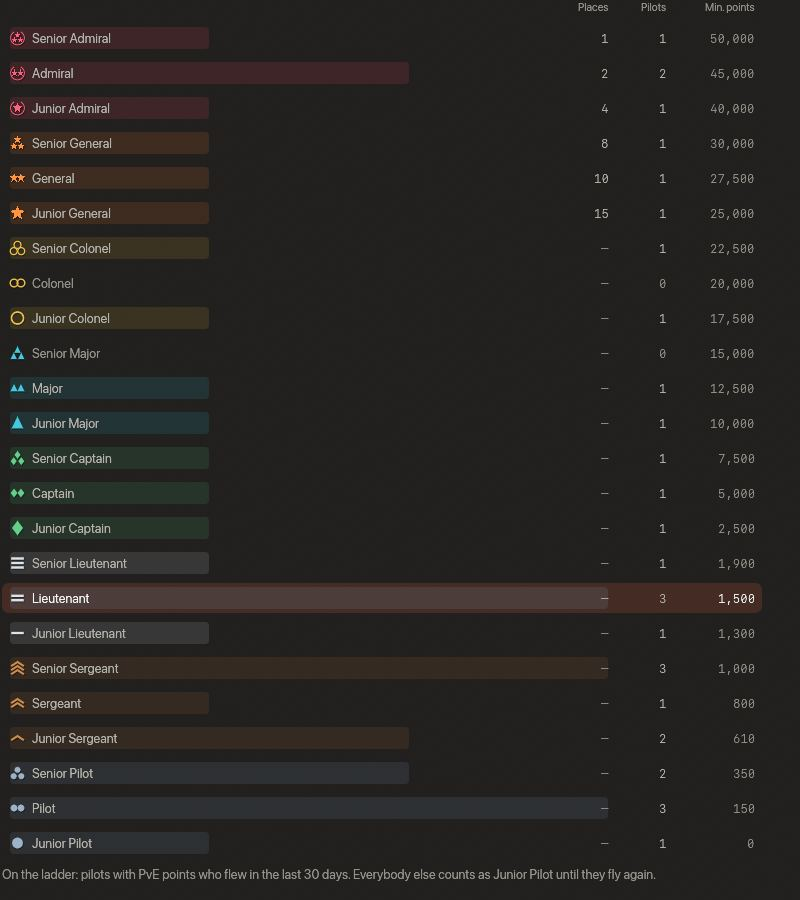
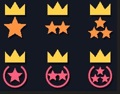
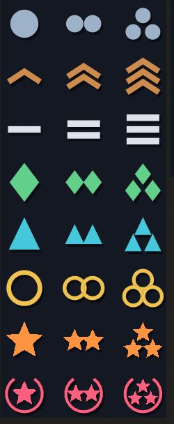

<!-- wiki-i18n source: 73cc670b98038c5d -->
<!-- wiki-i18n title: Rütbeler -->
# Rütbeler {#ranks}

Her pilotun Genç Pilot ile Kıdemli Amiral arasında bir **rütbesi** vardır. Bu, her biri 3 dereceli 8 kademeden oluşan askerî bir rütbe sistemidir; toplam 24 rütbe. Rütben **PvE puanından** gelir: seviyenden, deneyiminden ve yok ettiğin uzaylılardan kazandığın puanlar. Her rütbe belli bir **en düşük puan** ister; en iyi altı rütbenin ayrıca her şirkette sabit sayıda **kontenjanı** vardır. Uçuşta oyun bir pilotun adının önünde yalnızca küçük bir **simge** gösterir; böylece bir şirketin en iyi pilotlarını yeni başlayandan bir bakışta ayırt edebilirsin. Tüm sunucuda tek bir pilot da simgesinin üzerinde altın bir **taç** taşır. Rütbenin adı Şirket sayfasında ve bir simgenin ipucunda yazar.

**Bir dakikada**

- Şirketindeki pilotlar tek bir listede yer alır; en çok PvE puanı olan pilot başta gelir. Her şirketin kendi listesi vardır ve diğer şirketlerin pilotları sana karşı asla sayılmaz.
- Taşıdığın rütbe, **en düşük puanına ulaştığın ve şirketinde hâlâ boş kontenjanı bulunan en yüksek rütbedir**.
- En iyi altı rütbenin şirket başına belli sayıda kontenjanı vardır: **Kıdemli Amiral: 1** (50.000 PvE puanından), **Amiral: 2** (45.000 puandan), **Genç Amiral: 4** (40.000 puandan), **Kıdemli General: 8** (30.000 puandan), **General: 10** (27.500 puandan) ve **Genç General: 15** (25.000 puandan). Daha aşağıdaki rütbelerde pilot sayısı sınırsızdır ve her biri bir üstündeki rütbeden 2.500 puan az ister; bu, Genç Yüzbaşı rütbesinin 2.500 puanına kadar böyle sürer.
- **Eşit puan, eşit rütbe.** Puanı aynı olan iki pilot asla farklı rütbe taşımaz. Bir rütbenin son kontenjanı eşit puanlı pilotların arasına düşerse eşit puanlıların hepsi daha iyi rütbeyi alır; bu, kontenjanı aşsa bile.
- Bir listede yalnızca PvE puanı olan ve son 30 günde uçmuş pilotlar bulunur. Diğer herkes yeniden uçana kadar Genç Pilot rütbesinde sayılır ve hiçbir kontenjan tutmaz.
- Simgenin üzerindeki **altın taç**, tüm sunucuda en çok PvE puanı olan pilotu işaretler: her şirket, üç dünyanın hepsi.
- Rütben değişir. Kıdemli Albay rütbesine kadar yalnızca puanına bağlıdır; bu yüzden asla düşmez, yalnızca yükselir. En iyi altı rütbe şirketindeki diğer pilotlarla da değişir: başkaları senin üstündeki kontenjanları alırsa düşebilirsin. Düşüş asla duyurulmaz; yeni bir en iyi rütbe duyurulur.
- Sıfırlama kimsenin puanını değiştirmez, bu yüzden listeler baştan başlamaz.
- Bir adın önündeki simge rütbedir: kademe için bir şekil, derece için bir ila üç işaret.

## Şirket listesi {#the-company-ladder}

Şirketindeki pilotlar, **üç dünya birlikte**, en çok PvE puanı olan pilot başta olmak üzere tek bir sırada dizilir. Bu sıraya **liste** denir. İki pilotun puanı eşitse seviyesi yüksek olan, sonra daha eski olan pilot önce gelir; ama bu yalnızca listenin sırasını belirler: onlara asla farklı rütbe vermez. Rütben iki şeyden gelir, puanından ve şirketinin kontenjanlarından:

1. **Her rütbe belli bir en düşük PvE puanı ister** ([aşağıdaki tablo](#the-24-ranks)). Bir pilot, en düşük puanına henüz ulaşmadığı bir rütbeyi asla taşımaz.
2. **En iyi altı rütbenin kontenjanı vardır.** Kontenjanlar yukarıdan, en iyi rütbeden başlayarak dolar: 50.000 puana ulaşan en iyi pilotlar tek kontenjana kadar Kıdemli Amiral olur; geriye kalan pilotlardan 45.000 puana ulaşan en iyiler iki kontenjana kadar Amiral olur; Genç General rütbesine kadar böyle sürer.
3. **Diğer herkes, bu altı rütbenin altında puanının ulaştığı en yüksek rütbeyi taşır**; bu en fazla Kıdemli Albay rütbesidir. Bir rütbenin en düşük puanına ulaşıp kontenjanlarının dolu olduğunu gören pilot, kendisine açık olan en iyi rütbeye düşer.
4. **Eşitlik asla bozulmaz.** Puanı aynı olan pilotlar aynı rütbeyi taşır. Bir rütbenin son kontenjanı bir eşitliğin içine düşerse eşitliğin tamamı daha iyi rütbeyi alır; bu yüzden bir rütbede kontenjanından fazla pilot olabilir, olması gerekenden az pilot ise asla olmaz.

**Bir örnek.** Bir şirketin en iyi on iki pilotu ve her birinin taşıdığı rütbe:

| Sıra | PvE puanı | Rütbe |
| :---: | ---: | :--- |
| 1 | 60.000 | Kıdemli Amiral |
| 2 | 52.000 | Amiral |
| 3 | 51.000 | Amiral |
| 4 | 50.500 | Genç Amiral |
| 5 | 44.000 | Genç Amiral |
| 6 | 30.000 | Kıdemli General |
| 7 | 29.000 | General |
| 8 | 28.000 | General |
| 9 | 26.000 | Genç General |
| 10 | 24.999 | Kıdemli Albay |
| 11 | 21.000 | Albay |
| 12 | 1.000 | Kıdemli Çavuş |

Bu örnekte 4. sıradaki pilotun 50.500 puanı var; bu, Kıdemli Amiral rütbesinin en düşük puanına ulaşır, ama Kıdemli Amiral rütbesinin tek kontenjanı ile Amiral rütbesinin iki kontenjanı doludur, bu yüzden pilot Genç Amiral olur. 7. ve 8. sıradaki pilotların puanı 29.000 ve 28.000: ikisi de General rütbesinin 27.500 puanına ulaşır, Kıdemli General rütbesinin 30.000 puanına ulaşamaz; General rütbesinde kontenjan da kalmıştır, bu yüzden ikisi de General olur. 24.999 puanlı pilotun Genç General rütbesine bir puanı eksiktir; kendisine açık olan en iyi rütbe Kıdemli Albay olur. İlk sıralardaki iki pilotun ikisinin de puanı 60.000 olsaydı ikisi de Kıdemli Amiral olurdu; sonraki iki pilot, yani 50.000 ve 45.000 puanı olanlar, iki Amiral olurdu.

> [!NOTE]
> Kontenjanlar yalnızca bir şirkette bir rütbenin en düşük puanına ulaşan pilot sayısı o rütbenin kontenjanından fazlaysa devreye girer. Küçük bir şirkette rütbe yalnızca puana bağlıdır: şirketinde tek başına olan bir pilot 21.000 PvE puanıyla Albay, 50.000 puanla Kıdemli Amiral olur.

## 24 rütbe {#the-24-ranks}

**Kontenjan**, bir şirketten tam olarak bu rütbeyi kaç pilotun taşıyabileceğidir; tire sınır olmadığı anlamına gelir. **En düşük puan**, rütbenin istediği en az PvE puanıdır.

| # | Rütbe | Şirket başına kontenjan | En düşük PvE puanı |
| :---: | :--- | ---: | ---: |
| 1 | Genç Pilot | – | 0 |
| 2 | Pilot | – | 150 |
| 3 | Kıdemli Pilot | – | 350 |
| 4 | Genç Çavuş | – | 610 |
| 5 | Çavuş | – | 800 |
| 6 | Kıdemli Çavuş | – | 1.000 |
| 7 | Asteğmen | – | 1.300 |
| 8 | Teğmen | – | 1.500 |
| 9 | Üsteğmen | – | 1.900 |
| 10 | Genç Yüzbaşı | – | 2.500 |
| 11 | Yüzbaşı | – | 5.000 |
| 12 | Kıdemli Yüzbaşı | – | 7.500 |
| 13 | Genç Binbaşı | – | 10.000 |
| 14 | Binbaşı | – | 12.500 |
| 15 | Kıdemli Binbaşı | – | 15.000 |
| 16 | Genç Albay | – | 17.500 |
| 17 | Albay | – | 20.000 |
| 18 | Kıdemli Albay | – | 22.500 |
| 19 | Genç General | 15 | 25.000 |
| 20 | General | 10 | 27.500 |
| 21 | Kıdemli General | 8 | 30.000 |
| 22 | Genç Amiral | 4 | 40.000 |
| 23 | Amiral | 2 | 45.000 |
| 24 | Kıdemli Amiral | 1 | 50.000 |

## Listede kimler var {#who-is-on-the-ladder}

Bir pilot, şu **üç koşulun hepsi** doğruysa şirketinin listesindedir:

- bir şirkettedir;
- PvE puanı vardır: ilk öldürme yeni bir pilotu listeye sokar;
- son **30 günde** uçmuştur.

Listede olmayan bir pilot, rütbenin gösterildiği her yerde **Genç Pilot** sayılır, kontenjanı yoktur ve şirketin listesinde yer almaz. Bu kural, oyunu bir kez deneyip bırakan pilotun listenin dibinde sonsuza dek kalmaması ve uzakta olan bir pilotun en iyi birkaç kontenjandan birini ya da tacı aylarca elinde tutamaması için vardır.

> [!TIP]
> Uzakta olduğun sürece hiçbir şey kaybolmaz. Puanların korunur; yeniden uçuşa çıktığında ya da yalnızca Şirket sayfasını açtığında, ayrılırkenki puanlarınla yeniden yerleştirilirsin: o puanların ve şirketinin kontenjanlarının sana o anda verdiği rütbeye.

Şirket değiştirirsen puanların seninle gelir ve yeni şirketin listesine girersin; kontenjanlarının sana orada verdiği rütbeyi alırsın.

## Rütben değişir {#your-rank-moves}

- **Kıdemli Albay rütbesine kadar yalnızca puanlarına bağlıdır.** Puanların bir sonraki en düşük puana ulaştığında, öldürmen sayıldığı anda yükselir ve başka hiçbir pilot onu düşüremez.
- **En iyi altı rütbe, şirketindeki diğer pilotlara göre de değişir.** Bir rütbenin en düşük puanına senden önce ulaşan pilot kontenjanlardan birini alır; rütbenin kontenjanları doluysa sana açık olan bir sonraki rütbeye düşersin. Bir pilot listeden ya da şirketten ayrılınca bir kontenjan açılır ve arkasındaki pilotlar oraya yükselebilir.
- Senin puanınla aynı ya da daha az puanı olan bir pilot kontenjanını asla elinden alamaz.
- Kendi rütben sana yalnızca **yükseldiğinde** bildirilir ([Terfiler](#promotions)). Düşüş asla duyurulmaz: simgen yalnızca değişir.

## PvE puanı nasıl kazanılır {#how-you-earn-pve-points}

PvE puanın üç şeyden hesaplanır:

**seviye × 100 + deneyim ÷ 1.000 (aşağı yuvarlanır) + yok ettiğin her uzaylının puanı**

Daha dayanıklı bir uzaylı daha değerlidir: bir öldürme, uzaylıyı yok etmek için ne kadar hasar gerektiğine göre puan ekler. Sürü gemileri ve Clan Warden de aynı kurala göre sayılır, bu yüzden bir Pirate Scout bir Bulwark kadar değerlidir. Her öldürme, öldürme istatistiklerinde uzaylının kendi adı altında sayılır.

| Uzaylı veya gemi | Öldürme başına PvE puanı |
| :--- | ---: |
| Seeker | 1 |
| Phantasm | 2 |
| Bulwark | 4 |
| Goombah | 7 |
| Crystalys | 16 |
| Boss Seeker | 5 |
| Seeker Slave | 1 |
| Pirate Boss | 15 |
| Pirate Scout | 4 |
| Dormant Force | 25 |
| Dormant Pulse | 11 |
| Slumbering Void | 10 |
| Inert Mass | 15 |
| The Unwakened | 112 |
| Davidski | 37 |
| Brood Warden I, II, III | 14, 18, 35 |
| Siege Warden I, II, III | 13, 17, 32 |
| Wrath Warden I, II, III | 14, 18, 34 |
| Brood Drone I, II, III | 1, 1, 2 |
| Siege Escort I, II, III | 2, 3, 6 |
| Wrath Guard I, II, III | 2, 3, 6 |

İlk beş satır normal uzaylılar, sonraki altı satır üç sürünün gemileri, sonraki üç satır ise [Dormant Swamp](/wiki/03-Mechanics/Dormant-Swamp.md) uzaylılarıdır (sezonun 11. gününden itibaren). En sonda, bir Clan Warden savaşının liderleri olan Warden gemileri ve mürettebatları gelir: Brood Drone, Siege Escort ve Wrath Guard. I, II ve III Warden gücünü gösterir; her birinin puanı bu sırayla yazılmıştır.

Örneğin 4. seviyede, 12.500 deneyimi olan ve 300 Seeker, 80 Phantasm ile 10 Bulwark yok etmiş bir pilotun toplam puanı 400 + 12 + 300 + 160 + 40 = **912** olur. Bu onu Çavuş yapar: en düşük puan 800 puandır; bir sonraki rütbe olan Kıdemli Çavuş ise 1.000 puan ister. Kıdemli Albay rütbesine kadar yalnızca puan sayılır.

**Sıralamalar** sayfası (Topluluk › Sıralamalar) puanının nasıl oluştuğunu gösterir; içindeki **Şeref Salonu** en iyi pilotları listeler. Oradaki PvE puanının yanındaki **(i)** beş uzaylıyı, sürülerin ([Sürüler](/wiki/05-Swarms/Swarms.md)) her birinde bir öldürmenin en küçük gemiden patronuna kadar kaç puan ettiğini, [Dormant Swamp](/wiki/03-Mechanics/Dormant-Swamp.md) uzaylıları için aynısını ve [Clan Warden](/wiki/03-Mechanics/Clans.md#clan-wardens) için de aynısını listeler. [Davidski](/wiki/03-Mechanics/Davidski.md#rankings), Şeref Salonu’nda her dünyada kendine ait bir satırla yer alır; puanı 20. seviye bir pilotun puanıdır. Hiçbir şirkette olmadığı için listelerin hiçbirinde yoktur.

## Simgeler {#the-symbols}

Oyun bir rütbeyi küçük bir simge olarak çizer: kademe için kendi renginde bir **şekil** ve derece için **bir, iki ya da üç işaret**. Genç için bir, düz rütbe için iki, Kıdemli için üç işaret vardır. Kademeler yükseldikçe renkler soğuk ve sadeden sıcak ve parlağa doğru ilerler.

| Kademe | Şekil | Renk |
| :--- | :--- | :--- |
| Pilot | noktalar | çelik mavisi |
| Çavuş | üst üste şevronlar | bakır |
| Teğmen | üst üste düz çubuklar | gümüş |
| Yüzbaşı | eşkenar dörtgenler | yeşil |
| Binbaşı | yukarı bakan üçgenler (flamalar) | camgöbeği |
| Albay | içi boş halkalar | altın |
| General | beş köşeli yıldızlar | turuncu |
| Amiral | üstü açık bir defne çelengi, çevresinde bir ila üç yıldız | pembe |

## Taç {#the-crown}

**Tüm sunucuda en çok PvE puanı olan** pilot, rütbesinin simgesinin üzerinde küçük bir **altın taç** taşır. “Tüm sunucu”, yalnızca senin şirketin değil, her şirket ve üç dünyanın hepsi demektir: sunucuda tek bir taç vardır ve her şirketin en iyi pilotu yine kendi rütbesini taşır. Zirvede birkaç pilotun puanı tamı tamına aynıysa hepsi tacı taşır.

Tacı yalnızca bir listede olan pilot taşıyabilir. 30 gündür uzakta olan bir pilot, kaç puanı olursa olsun taşıyamaz: taç, bir listede olan en iyi pilota gider; uzaktaki pilot yeniden uçup öndeyse tacı geri alır. Tacın el değiştirdiği kimseye bildirilmez, görürsün. Taç bir rütbe değildir ve hiçbir şey vermez: imleci tacı olan bir simgenin üzerine getirirsen ipucunda “Sunucunun en iyi PvE pilotu” yazar.

## Rütbeleri nerede görürsün {#where-you-see-them}

Uçuşta **yalnızca simgeyi** görürsün, sözcükleri asla. Simge pilotun adının önünde durur, tacı da üzerinde; şu yerlerin hepsinde:

- geminin üzerinde, ad etiketinde ve Hedef penceresinde;
- sohbette, satırı yazan pilotun adının önünde;
- grubunun listesinde ve mini haritada bir grup üyesinin ipucunda;
- öldürme akışında, adı geçen her pilotun önünde (uzaylıların önünde değil);
- Şeref Salonu’nda, Sıralama penceresinde ve büyük olarak bir pilotun profilinde;
- Şirket sayfasında: kendi rütben, en iyi pilotların listesi ve tüm rütbelerin tablosu.

**Sözcükler** (Genç Çavuş, Yüzbaşı…) Şirket sayfasında ve bir ipucunda yazar: imleci bir simgenin üzerine getir. Bir simge, pilotun **kendi şirketinin** pilotları arasında nerede durduğunu gösterir; yani başka bir şirketin Binbaşı rütbesi o şirketin pilotları arasında geçerlidir, seninkiler arasında değil. [Şirket pilotları](/wiki/03-Mechanics/Company-Pilots.md) oyunun kendi ekipleridir ve rütbeleri yoktur.

## Şirket sıralaması {#the-company-ranking}

**Ekonomi › Şirket** sayfasını aç. **Şirket sıralaması** bölümü yukarıdan aşağıya şunları gösterir:

- **Rütben**: simgesi (taç senindeyse tacıyla birlikte) ve adı, yerin (“31 pilot arasında 16. sıra”) ve yüzdelik dilimini gösteren küçük bir etiket (“İlk %52”).
- **Bir çubuk ve altında bir satır**: sonraki rütbenin ne istediğini söyler. “Genç General rütbesine 2.500 PvE puanı kaldı” gibi bir satır, sonraki rütbenin en düşük puanına kaç PvE puanı kaldığını söyler. Sonraki rütbede boş kontenjan yoksa satır, son kontenjanı tutan pilotun adını verir: “Sable adlı pilotu geçip Genç General rütbesine ulaşmak için 3.100 PvE puanı daha gerek”. Onun puanına eşitlenmek yeter, çünkü eşit puan aynı rütbeyi taşır. Kıdemli Amiral rütbesindeyken satır “En yüksek rütbe.” der.
- Şirketinin **en iyi pilotu** ve puanı.
- **Tüm rütbeler**, sen açana kadar kapalıdır: 24 rütbe, en iyisi başta; şirket başına **Kontenjan** (tire: sınır yok), her rütbeyi şu anda taşıyan **Pilotlar** (en çok pilotu olan rütbe kadar geniş bir çubukla) ve **En az puan**. Kendi rütben işaretlidir ve bir satırın ipucu “Kıdemli Amiral: şirket başına 1 kontenjan, 50.000 PvE puanından itibaren.” der. Tablonun altındaki bir satır listede kimlerin olduğunu söyler.
- **Liste**: şirketinin **üç dünyadaki en iyi 50 pilotu**; sıra, simge, ad ve PvE puanıyla. Kendi satırın işaretlidir.

- Henüz PvE puanı olmayan bir pilot listede yoktur ve en iyi pilotlar listesinde de görünmez: bu listeye girmek için bir uzaylı yok et. 30 gündür uzakta olan bir pilot da, yeniden uçuşa çıkana ya da sayfayı açana kadar listede değildir.
- Yalnızca adlar ve herkese açık sayılar gösterilir.

## Terfiler {#promotions}

- Yeni bir en iyi rütbeye ulaştığında bir bildirim (“Terfi ettin: Kıdemli Çavuş”) ve kısa, hafif bir ses alırsın. “En iyi”, son uçuşa çıktığından beri sana bildirilen en iyi rütbe demektir: bir derece düşüp geri kazanırsan ikinci bir mesaj gelmez. Uzaktayken yükseldiğin bir rütbe, bir sonraki girişinde bir kez bildirilir. Düşüş asla bildirilmez.
- **Genç Binbaşı** rütbesinden itibaren terfi, şirketinin senin dünyanda uçan pilotları için sohbetin **Sistem** sekmesinde de görünür: “Nova adlı pilot Genç Binbaşı rütbesine terfi etti.” Şirket bunu yalnızca seni kendi PvE puanın yükselttiyse duyar; başka pilotlar listeden ayrıldığı için yükseldiysen kendi bildirimini alırsın, başka kimseye bildirilmez.

## Rütbeler ve sıfırlama {#ranks-and-the-wipe}

Bir sıfırlama kimsenin puanını değiştirmez. Seviyeni, deneyimini ve öldürme istatistiklerini korur ([Sıfırlama zaman çizelgesi](/wiki/03-Mechanics/Wipe-Timeline.md#cross-season-progression-permanent-buffs-)); PvE puanların da bunlardan hesaplandığı için şirketinin listesi sıfırlamadan sonra aynı sıradadır, rütbeler ve taç da öyle. Yine de rütben ömür boyu değildir: en iyi altı rütbe şirketindeki diğer pilotlara göre değişir ve 30 gün uzak kalan pilot yeniden uçana kadar listeden çıkar.

## Ne kadar sürer {#how-long-it-takes}

Bunlar ölçüm değil, bir pilotun ne kadar hızlı avlandığına dair bir modelden çıkan **tahminlerdir**. Günde yaklaşık iki saat, yani bir sezonda 58 saat avlanan bir pilotun bir sezon sonunda yaklaşık 21.200 PvE puanı olur: Albay. Av saati olarak: Pilot için ilk saat içinde, Çavuş için 4 saatte, Yüzbaşı için 18, Binbaşı için 38, Albay için 55, Genç General için 67, General için 73, Kıdemli General için 78, Genç Amiral için 101, Amiral için 113 ve Kıdemli Amiral için 124 saatte en düşük puana ulaşılır.

Yani tipik bir aktif pilot, kontenjanlı rütbelere ikinci sezonunda ulaşır. Bir kontenjan alıp almayacağı, onlar da avlanan şirketindeki diğer pilotlara bağlıdır: bir rütbenin kontenjanları, ancak en düşük puanına kontenjanından fazla pilot ulaştığında önem kazanır. O zamana kadar rütben yalnızca puanlarına bağlıdır.
