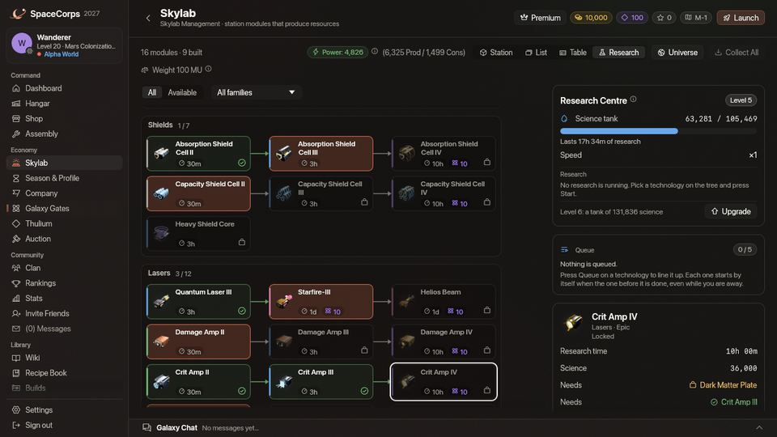
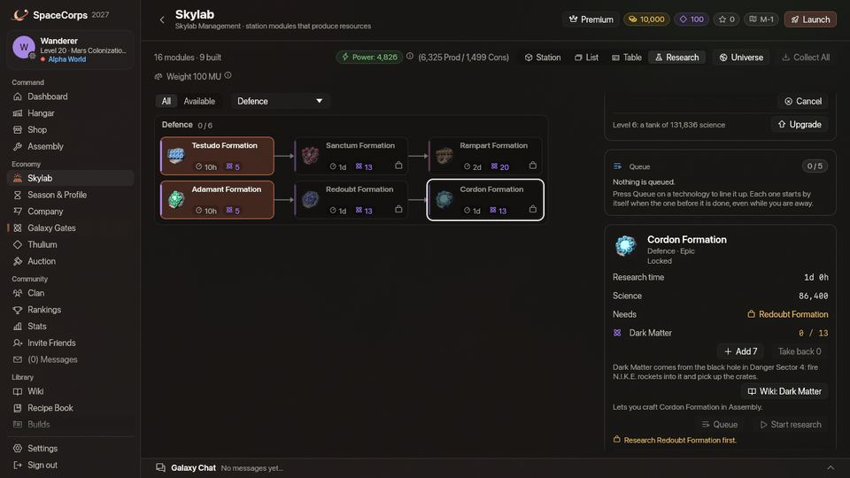
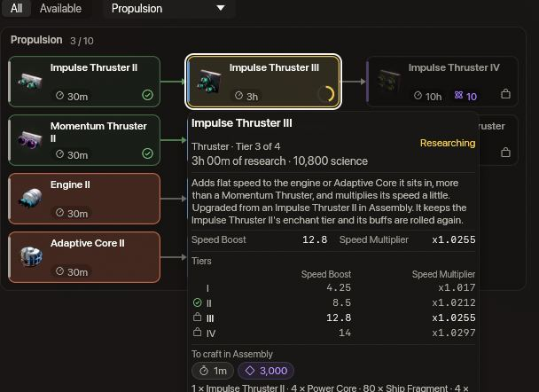
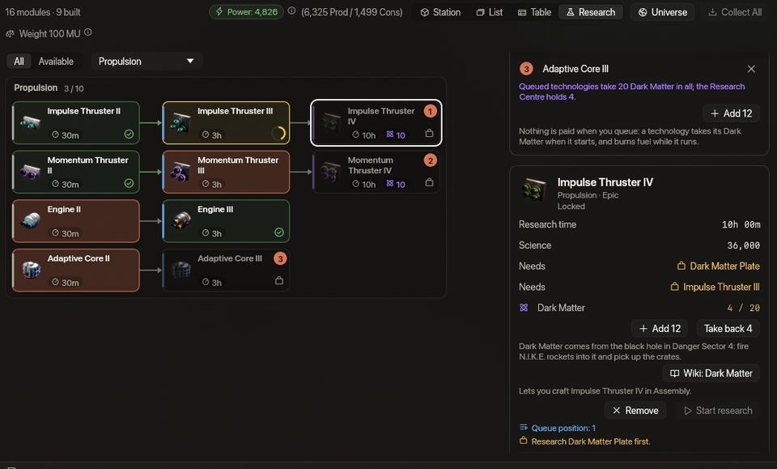

<!-- wiki-i18n source: 353e2a14b241cf5d -->
<!-- wiki-i18n title: Araştırma -->
# Araştırma {#research}

**Araştırma Merkezi**, [Skylab’ın](/wiki/03-Mechanics/Skylab.md) laboratuvarıdır. Onu kaynaklarla beslersin, o da bunları **bilim puanına** çevirir; bilim puanı da **teknolojileri** araştırır. [Montaj’daki](/wiki/06-Items/Overview.md#upgrading-modules) her üretim önce kendi teknolojisini ister: bir gemi, bir lazer, bir itici ya da bir CPU araştırılmadan üretilemez.

Bu sayfada teknoloji ağacının tamamı, her teknolojinin süresi, her kaynağın verdiği bilim puanı, Thulium hızlandırması, Dark Matter kuralı ve yeni CPU’lar bulunur. Sayfadaki sayılar oyunun kendi verisinden okunur, yani her zaman oyundakilerdir. Bir eşyanın toplamda neler istediğini görmek için (önce araştırılacak teknoloji, süresi ve ihtiyaç duyduğu teknolojiler, ardından malzemeler ve üretim) eşyayı [Tarif Kitabı’nda](/wiki/01-General/Recipe-Book.md) aç.






## Araştırma Merkezi {#the-research-centre}

<!-- research-centre:begin -->
<!-- Generated from server/Resources/{Research,CpuConfig,SkylabConfig}.json and Data/Seeds/{items,recipes}.json by scripts/research-wiki.sh: don't edit by hand. -->

- **Çekirdek 10. seviyede açılır.** Araştırma Merkezi, diğerleri gibi inşa edilen [Skylab](/wiki/03-Mechanics/Skylab.md) üssünün bir modülüdür: envanterinden 25 Ship Fragment (gemin park halindeyken), 25.000 kredi ve 500 Thulium. Ekranı, Skylab sayfasındaki **Araştırma** görünümüdür.
- **1–10. seviyeler.** Daha yüksek seviye daha büyük bir depo verir ve daha fazla güç çeker. Araştırmayı hızlandırmaz: bir teknoloji her seviyede aynı sürede biter.
- **Depo.** Merkez, bilim puanını 1. seviyede 12 sa araştırma alan ve her seviyede %25 daha fazlasını alan bir depoda tutar (aşağıdaki tablo).
- **Yakıttan bilime.** Beslediğin bir kaynak, yakıt tablosunun gösterdiği gibi hemen bilim puanına dönüşür. Bir araştırma, araştırma süresinin her saniyesi için 1 bilim puanı yakar; depo boşken bekler ve Araştırma Merkezi’ni beslediğinde devam eder.
- **Ücretsiz ilk saat.** Yeni bir Merkez, deposunda 3.600 bilim puanıyla başlar: 1 sa araştırma.
- **Birer birer.** Merkez aynı anda tek bir teknoloji araştırır, ama Sıraya al düğmesiyle arkasına 5 tane daha ekleyebilirsin. Her biri, öncekinin bittiği anda, sen yokken bile kendiliğinden başlar. Sıraya eklerken hiçbir şey ödenmez: bir teknoloji, başladığı anda kendi Dark Matter miktarını alır ve sıradaki biri ücretsiz olarak geri çıkarılabilir.
- **Sen yokken.** Araştırma sunucunun saatine göre işler, bu yüzden çıkış yaptıktan sonra da, bitene ya da depo boşalana kadar sürer. Bir güç açığı ya da Merkez yükseltmesi onu durdurmaz.
- **Güç.** Merkez 1. seviyede 25 çeker ve her seviyede %15 daha fazlasını; kapatılamaz.
- **Sıfırlama hepsini korur:** teknolojiler, depodaki bilim puanı, Araştırma Merkezi’ndeki Dark Matter, devam eden bir araştırma ve hızlandırma.
- **Sahip olduğun senindir.** Araştırma oyuna geldiğinde, her pilot elindeki her eşyanın teknolojisini ve bunların gerektirdiği teknolojileri aldı. Sonradan sana ulaşan bir eşya (hediye, kod, ödül) teknolojisinin kilidini açmaz; tek istisna: bir kod, bir görev, bir davet ya da bir yönetici tarafından sana verilen bir Engine II, Engine III, Adaptive Core II veya Adaptive Core III kendi teknolojisinin ve gerektirdiği teknolojilerin kilidini hemen açar.
- **Çekirdek 10. seviyenin altında** araştırma yapamazsın, bu yüzden Montaj’da henüz yeni bir şey üretemezsin. İstasyon görevleri seni Çekirdeği adım adım yükseltmeye yönlendirir.

<!-- research-centre:end -->

**Lazer amfileri ve son kademe.** II ile IV arasındaki kademelerin Damage Amp, Crit Amp ve Penetration Amp eşyaları da diğerleri gibi araştırılan üretimlerdir. Amfi serileri oyuna geldiğinde amfilere sahip olan ya da onları kuyruğa almış olan pilotlar, bu amfilerin her birinin ve altındaki kademelerin teknolojisini aldı. On üç teknoloji başka bir ağacın teknolojisini, Kaynaklar ağacındaki Dark Matter Plate teknolojisini gerektirir, çünkü her yükseltme zincirinin son kademesi dört plaka ve bir Ancient Control Unit ister: IV. kademe Damage Amp, Crit Amp ve Penetration Amp, IV. kademe Absorption Shield Cell ve Capacity Shield Cell, IV. kademe Impulse Thruster ve Momentum Thruster, Heavy Shield Core, Engine III, Adaptive Core III, Helios Beam, Extra Slots CPU III ve Base CPU II. Bunlardan birini daha önce araştırmış bir pilot onu korur ve plakalarını üretmek için plakanın teknolojisine ihtiyaç duyar. Aşağıdaki ağaç bunun için ok çizmez, ama tablo onu listeler ve oyundaki kart onu adıyla anar ([Dark Matter ve Dark Matter plakaları](/wiki/03-Mechanics/Dark-Matter.md)).

Skylab’ındaki **Araştırma** görünümünde bir teknoloji, aşağıdaki ağaçlardaki bir kutudan çok daha fazlasını anlatır. Birinin üzerine gel; araştırma süresini ve tükettiği bilim puanını, bunların altında da eşyanın **ne olduğunu ve ne yaptığını** gösteren bir kart açılır: türü ve serisindeki kademesi (örneğin Impulse Thruster serisinin dört kademesinden üçüncüsü), açıklaması, hangarın ve Mağaza’nın gösterdiği haliyle değerleri (bir lazerin hasarı, kritik şansı ve menzili; bir kalkanın kapasitesi, dolumu ve soğurması; bir iticinin hız artışı ve çarpanı; bir roketin hasarı, patlaması ve menzili; bir dron formasyonunun verdikleri ve sana neye mal olduğu), serisinin kademelerinin küçük bir tablosu ve Montaj’ın bunu üretmek için ne istediği: süre, kredi ve Thulium ile malzemeler. Böylece bir kademenin ne verdiğini araştırmadan önce görebilirsin. Seçmek için bir teknolojiye tıkla: ağacın yanındaki kart, **Araştırmayı başlat** düğmesinin altında aynısını eksiksiz gösterir. Bir araştırma sürerken başlat düğmesinin yerini **Sıraya al** alır: kuyruktaki bir teknoloji ağaçta sıra numarasını gösterir ve süren araştırmanın altındaki bir kuyruk kartı hepsini listeler; her birinin çıkarmak için bir çarpısı vardır. Sıradaki başlayamıyorsa (gereken Dark Matter Merkez’de değilse ya da depo boşsa) kuyruk bekler ve nedenini söyler; sen sorunu giderip **Kuyruğu başlat** düğmesine basana kadar böyle kalır.

### Her seviyede bilim deposu {#the-tank-at-every-level}

<!-- research-tank:begin -->
<!-- Generated from server/Resources/{Research,CpuConfig,SkylabConfig}.json and Data/Seeds/{items,recipes}.json by scripts/research-wiki.sh: don't edit by hand. -->

| Seviye | Depo (bilim puanı) | Karşıladığı araştırma süresi | … hızlandırmayla | Güç |
| :--- | ---: | ---: | ---: | ---: |
| 1 | 43.200 | 12 sa | 6 sa | 25 |
| 2 | 54.000 | 15 sa | 7,5 sa | 28,7 |
| 3 | 67.500 | 18,8 sa | 9,4 sa | 33,1 |
| 4 | 84.375 | 23,4 sa | 11,7 sa | 38 |
| 5 | 105.469 | 29,3 sa | 14,6 sa | 43,7 |
| 6 | 131.836 | 36,6 sa | 18,3 sa | 50,3 |
| 7 | 164.795 | 45,8 sa | 22,9 sa | 57,8 |
| 8 | 205.994 | 57,2 sa | 28,6 sa | 66,5 |
| 9 | 257.492 | 71,5 sa | 35,8 sa | 76,5 |
| 10 | 321.865 | 89,4 sa | 44,7 sa | 87,9 |

<!-- research-tank:end -->

## Yakıt {#fuel}

Merkez’i kaynaklarla beslersin ve her birim anında bilim puanına dönüşür. Bir birimi elde etmek ne kadar iş gerektiriyorsa o kadar çok bilim puanı verir: değerler, nadirlik etiketine değil, bir birimin elde edilmesinin ne kadar zor olduğuna bağlıdır. Cevherler bunun istisnasıdır: bir birim, bir toplayıcının onu çıkarmasının sürdüğü saniyelerden daha fazla bilim puanı verir; bu yüzden seviyelerinin ortasındaki bir toplayıcının bir saatlik cevheri yaklaşık iki saatlik araştırmayı besler. Cevherler [Skylab’ın](/wiki/03-Mechanics/Skylab.md#resource-storage) Kaynak Deposu’ndan gelir ve [Cevher Bölmesi](/wiki/03-Mechanics/Skylab.md#ore-bay) envanterindeki Velkonite ve Orvium cevherini (bir dev ekskavatörün kutuları) oraya taşır; diğer tüm kaynaklar envanterinden gelir ve geminin park halinde olması gerekir. Velkonite Reinforced Plate, Orvium Reinforced Plate, Dark Matter Plate, Dark Matter, kredi ve Thulium yakıt olarak kullanılamaz; Reinforced Hull Plate kullanılabilir.

<!-- research-fuel:begin -->
<!-- Generated from server/Resources/{Research,CpuConfig,SkylabConfig}.json and Data/Seeds/{items,recipes}.json by scripts/research-wiki.sh: don't edit by hand. -->

| Kaynak | Nadirlik | Alındığı yer | Birim başına bilim puanı | 1 saat için birim |
| :--- | :--- | :--- | ---: | ---: |
| [Ship Fragment](/wiki/06-Items/Resources.md#ship-fragment) | Sıradan | Envanterin | 5 | 720 |
| [Cataclysite](/wiki/06-Items/Resources.md#cataclysite) | Sıradan | Envanterin | 5 | 720 |
| [Daraxium](/wiki/06-Items/Resources.md#daraxium) | Sıradan | Envanterin | 7 | 515 |
| [Nyxite](/wiki/06-Items/Resources.md#nyxite) | Sıradan | Envanterin | 7 | 515 |
| [Quorvium](/wiki/06-Items/Resources.md#quorvium) | Sıradan | Envanterin | 8 | 450 |
| [Reinforced Hull Plate](/wiki/06-Items/Resources.md#reinforced-hull-plate) | Sıradan | Envanterin | 33 | 110 |
| [Power Core](/wiki/06-Items/Resources.md#power-core) | Seyrek | Envanterin | 100 | 36 |
| [Velkonite](/wiki/06-Items/Resources.md#velkonite) | Seyrek | Kaynak Deposu | 210 | 18 |
| [Orvium](/wiki/06-Items/Resources.md#orvium) | Nadir | Kaynak Deposu | 321 | 12 |
| [Ancient Control Unit](/wiki/06-Items/Resources.md#ancient-control-unit) | Nadir | Envanterin | 650 | 6 |

Son sütun, hızlandırma olmadan bir saatlik araştırmayı yürüten birim sayısıdır, yukarı yuvarlanmıştır; hızlandırmayla bunun 2 katıdır.

<!-- research-fuel:end -->

## Thulium hızlandırması {#the-thulium-boost}

<!-- research-boost:begin -->
<!-- Generated from server/Resources/{Research,CpuConfig,SkylabConfig}.json and Data/Seeds/{items,recipes}.json by scripts/research-wiki.sh: don't edit by hand. -->

- **5.000 Thulium** bir hızlandırma satın alır: Merkez **24 saat boyunca 2 kat daha hızlı** araştırır.
- Ayrıca **bilim puanını 2 kat hızlı yakar**, yani bir hızlandırma zaman satın alır, yakıt satın almaz: bir teknoloji hızlandırılmış da olsa olmasa da aynı bilim puanını yakar.
- Bir hızlandırma satın aldığın anda başlar ve depoda yakıt olsun olmasın saat işler, bu yüzden bir araştırma sürerken satın al. Hiçbir şey araştırılmıyorsa Merkez hızlandırmayı kabul etmez.
- Hızlandırmalar birikir: biri sürerken bir tane daha satın almak bitişine 24 saat ekler, en fazla 72 saat ileriye kadar. Bir hızlandırma tek bir araştırmaya değil, Araştırma Merkezi’ne aittir.

Bir hızlandırmanın, başından itibaren hızlandırılmış bir araştırmanın süresine etkisi:

| Araştırma süresi | Hızlandırmayla | Tamamı için hızlandırma | Thulium |
| :--- | :--- | ---: | ---: |
| 30 dk | 15 dk | 1 | 5.000 |
| 3 sa | 1 sa 30 dk | 1 | 5.000 |
| 6 sa | 3 sa | 1 | 5.000 |
| 10 sa | 5 sa | 1 | 5.000 |
| 1 g | 12 sa | 1 | 5.000 |
| 2 g | 1 g | 1 | 5.000 |

<!-- research-boost:end -->

## Dark Matter

Ağacın tepesindeki teknolojiler ayrıca Dark Matter ister. Dark Matter [kara delikten](/wiki/03-Mechanics/Black-Hole.md#dark-matter) gelir: oraya ulaşan bir N.I.K.E. roketi biraz bırakır. Ara sıra da [Dormant sürüsünün](/wiki/05-Swarms/Dormant-Swarm.md) bir Dormant Pulse gemisi verir.

<!-- research-dark-matter:begin -->
<!-- Generated from server/Resources/{Research,CpuConfig,SkylabConfig}.json and Data/Seeds/{items,recipes}.json by scripts/research-wiki.sh: don't edit by hand. -->

- Aşağıdaki tablodaki 16 teknolojinin her biri için, bilim puanının üstüne **10 Dark Matter**: başlamadan önce Araştırma Merkezi’ne ekle (envanterinden, gemin park halindeyken); araştırma başladığında onu alır.
- **Kural:** nadirliği Destansı ya da daha yüksek olan ve araştırması 10 sa ya da daha uzun süren eşya. Dark Matter üretiminin yolu olan N.I.K.E. buna hiç ihtiyaç duymaz.
- **Dron formasyonları** kuralın dışındadır: her formasyon araştırması, tablonun gösterdiği gibi güce göre 5, 13 ya da 20 Dark Matter ister.
- **Gövde Kaplaması** da kuralın dışındadır: iki araştırması daha fazlasını ister; tablonun gösterdiği gibi bir günlük araştırma için 25, iki gün için 40 Dark Matter.
- **Bir araştırmayı iptal edersen** onun için eklediğin Dark Matter Araştırma Merkezi’ne geri döner. İlerleme ve şimdiye kadar yakılan bilim puanı geri dönmez.
- **Kuyruğun tamamı.** Sıraya alırken bir şey ödenmez ve kuyruktaki her teknoloji kendi Dark Matter’ını başlarken alır; bu yüzden tüm kuyruğun Dark Matter’ını tek seferde ekle. **Ekle** düğmesi Araştırma Merkezi’ni, kuyruktaki teknolojilerin toplamda alacağı miktara (ve henüz kuyrukta değilse seçtiğin teknolojiye) kadar doldurur; ilkinin ne kadar istediği önemli değildir. Kuyruktaki her teknoloji, Merkez’deki Dark Matter’ın ona yetip yetmediğini gösterir. Dark Matter yetmediği için duran bir kuyruk, eksik kalanı eklediğin anda kendiliğinden başlar.
- Hepsi birlikte 414 Dark Matter ister.

| Teknoloji | Nadirlik | Araştırma süresi | Dark Matter |
| :--- | :--- | :--- | ---: |
| [Impulse Thruster IV](/wiki/06-Items/Propulsion.md#thrusters) | Destansı | 10 sa | 10 |
| [Momentum Thruster IV](/wiki/06-Items/Propulsion.md#thrusters) | Destansı | 10 sa | 10 |
| [Absorption Shield Cell IV](/wiki/06-Items/Shields.md#shield-cells) | Destansı | 10 sa | 10 |
| [Capacity Shield Cell IV](/wiki/06-Items/Shields.md#shield-cells) | Destansı | 10 sa | 10 |
| [Starfire-III](/wiki/06-Items/Lasers.md#lasers) | Mitik | 1 g | 10 |
| [Helios Beam](/wiki/06-Items/Lasers.md#lasers) | Mitik | 1 g | 10 |
| [Damage Amp IV](/wiki/06-Items/Lasers.md#laser-amplifiers-amps-) | Destansı | 10 sa | 10 |
| [Crit Amp IV](/wiki/06-Items/Lasers.md#laser-amplifiers-amps-) | Destansı | 10 sa | 10 |
| [Ironclad](/wiki/02-Ships/Ironclad.md) | Destansı | 1 g | 10 |
| [Storm](/wiki/02-Ships/Storm.md) | Destansı | 1 g | 10 |
| [Wraith](/wiki/02-Ships/Wraith.md) | Mitik | 2 g | 10 |
| [Dark Matter Plate](/wiki/06-Items/Resources.md#dark-matter-plate) | Mitik | 1 g | 10 |
| [N.U.K.E.](/wiki/06-Items/Rockets.md#the-craft-only-rockets) | Efsanevi | 1 g | 10 |
| [Extra Slots CPU III](/wiki/06-Items/Extras.md#extra-slots-cpus) | Destansı | 1 g | 10 |
| [Jump CPU](/wiki/06-Items/Extras.md#jump-cpu) | Destansı | 1 g | 10 |
| [Testudo Formation](/wiki/03-Mechanics/Formations.md#the-sixteen-formations) | Destansı | 10 sa | 5 |
| [Bodkin Formation](/wiki/03-Mechanics/Formations.md#the-sixteen-formations) | Destansı | 1 g | 13 |
| [Asterism Formation](/wiki/03-Mechanics/Formations.md#the-sixteen-formations) | Destansı | 10 sa | 5 |
| [Gemini Formation](/wiki/03-Mechanics/Formations.md#the-sixteen-formations) | Mitik | 2 g | 20 |
| [Adamant Formation](/wiki/03-Mechanics/Formations.md#the-sixteen-formations) | Destansı | 10 sa | 5 |
| [Ballista Formation](/wiki/03-Mechanics/Formations.md#the-sixteen-formations) | Destansı | 1 g | 13 |
| [Stiletto Formation](/wiki/03-Mechanics/Formations.md#the-sixteen-formations) | Mitik | 2 g | 20 |
| [Rampart Formation](/wiki/03-Mechanics/Formations.md#the-sixteen-formations) | Mitik | 2 g | 20 |
| [Sanctum Formation](/wiki/03-Mechanics/Formations.md#the-sixteen-formations) | Destansı | 1 g | 13 |
| [Shrike Formation](/wiki/03-Mechanics/Formations.md#the-sixteen-formations) | Destansı | 10 sa | 5 |
| [Culler Formation](/wiki/03-Mechanics/Formations.md#the-sixteen-formations) | Destansı | 1 g | 13 |
| [Redoubt Formation](/wiki/03-Mechanics/Formations.md#the-sixteen-formations) | Destansı | 1 g | 13 |
| [Auger Formation](/wiki/03-Mechanics/Formations.md#the-sixteen-formations) | Destansı | 1 g | 13 |
| [Cordon Formation](/wiki/03-Mechanics/Formations.md#the-sixteen-formations) | Destansı | 1 g | 13 |
| [Centurion Formation](/wiki/03-Mechanics/Formations.md#the-sixteen-formations) | Destansı | 10 sa | 5 |
| [Gyre Formation](/wiki/03-Mechanics/Formations.md#the-sixteen-formations) | Destansı | 1 g | 13 |
| [Penetration Amp IV](/wiki/06-Items/Lasers.md#laser-amplifiers-amps-) | Destansı | 10 sa | 10 |
| [Hull Plating II](/wiki/06-Items/Hull-Plating.md#the-three-platings) | Nadir | 1 g | 25 |
| [Hull Plating III](/wiki/06-Items/Hull-Plating.md#the-three-platings) | Destansı | 2 g | 40 |

<!-- research-dark-matter:end -->

## Teknoloji ağacı {#the-technology-tree}

Her kutu bir teknolojidir: yapmanı sağladığı eşya; adının altında araştırma süresi (saat) ve Dark Matter gerekiyorsa Dark Matter rozeti. Bir teknolojiden, onu gerektiren teknolojiye bir ok uzanır; ok çıkan teknolojiyi önce araştırırsın. Oku olmayan bir kutu hemen araştırılabilir. Araştırma süresini, tükettiği bilim puanını ve Montaj’ın eşya için sonra ne istediğini görmek için bir kutunun üzerine gel; eşyanın sayfasını açmak için tıkla. Ağaçlar oyunun kendi verisinden çizilir. Ağaçlardan ikisi, **Savunma** ve **Saldırı ve Hareketlilik**, on altı [dron formasyonunu](/wiki/03-Mechanics/Formations.md) barındırır.

<!-- research-tree:begin -->
<!-- Generated from server/Resources/{Research,CpuConfig,SkylabConfig}.json and Data/Seeds/{items,recipes}.json by scripts/research-wiki.sh: don't edit by hand. -->

### Tahrik ve hız {#tree-propulsion}

```tree research
Impulse Thruster II | thruster, common | craft 2000 Thulium, 60 s | research 1800 s, 1800 science | 1 Impulse Thruster I, 60 Ship Fragment, 1 Power Core, 4 Velkonite Reinforced Plate | /wiki/06-Items/Propulsion.md#thrusters
Impulse Thruster III | thruster, rare | craft 3000 Thulium, 60 s | research 10800 s, 10800 science | 1 Impulse Thruster II, 80 Ship Fragment, 4 Power Core, 4 Velkonite Reinforced Plate | /wiki/06-Items/Propulsion.md#thrusters
Impulse Thruster IV | thruster, epic | craft 4000 Thulium, 90 s | research 36000 s, 36000 science, 10 Dark Matter | 1 Impulse Thruster III, 110 Ship Fragment, 5 Power Core, 1 Ancient Control Unit, 4 Dark Matter Plate | /wiki/06-Items/Propulsion.md#thrusters
Momentum Thruster II | thruster, common | craft 2000 Thulium, 60 s | research 1800 s, 1800 science | 1 Momentum Thruster I, 60 Ship Fragment, 1 Power Core, 4 Velkonite Reinforced Plate | /wiki/06-Items/Propulsion.md#thrusters
Momentum Thruster III | thruster, rare | craft 3000 Thulium, 60 s | research 10800 s, 10800 science | 1 Momentum Thruster II, 80 Ship Fragment, 4 Power Core, 4 Velkonite Reinforced Plate | /wiki/06-Items/Propulsion.md#thrusters
Momentum Thruster IV | thruster, epic | craft 4000 Thulium, 90 s | research 36000 s, 36000 science, 10 Dark Matter | 1 Momentum Thruster III, 110 Ship Fragment, 5 Power Core, 1 Ancient Control Unit, 4 Dark Matter Plate | /wiki/06-Items/Propulsion.md#thrusters
Engine III | engine, rare | craft 4000 Thulium, 90 s | research 10800 s, 10800 science | 1 Engine II, 110 Ship Fragment, 5 Power Core, 1 Ancient Control Unit, 4 Dark Matter Plate | /wiki/06-Items/Propulsion.md#engines
Engine II | engine, common | craft 2000 Thulium, 60 s | research 1800 s, 1800 science | 1 Engine I, 60 Ship Fragment, 1 Power Core, 4 Velkonite Reinforced Plate | /wiki/06-Items/Propulsion.md#engines
Adaptive Core II | hybrid-generator, common | craft 2000 Thulium, 60 s | research 1800 s, 1800 science | 1 Adaptive Core I, 60 Ship Fragment, 1 Power Core, 4 Velkonite Reinforced Plate | /wiki/06-Items/Shields.md#hybrid-generators-adaptive-cores-
Adaptive Core III | hybrid-generator, rare | craft 4000 Thulium, 90 s | research 10800 s, 10800 science | 1 Adaptive Core II, 110 Ship Fragment, 5 Power Core, 1 Ancient Control Unit, 4 Dark Matter Plate | /wiki/06-Items/Shields.md#hybrid-generators-adaptive-cores-

Impulse Thruster II => Impulse Thruster III => Impulse Thruster IV
Momentum Thruster II => Momentum Thruster III => Momentum Thruster IV
Engine II => Engine III
Adaptive Core II => Adaptive Core III
```

### Kalkanlar ve savunma {#tree-shields}

```tree research
Absorption Shield Cell II | shield-cell, common | craft 2000 Thulium, 60 s | research 1800 s, 1800 science | 1 Absorption Shield Cell I, 50 Ship Fragment, 8 Reinforced Hull Plate, 20 Cataclysite, 4 Velkonite Reinforced Plate | /wiki/06-Items/Shields.md#shield-cells
Absorption Shield Cell III | shield-cell, rare | craft 3000 Thulium, 60 s | research 10800 s, 10800 science | 1 Absorption Shield Cell II, 50 Ship Fragment, 10 Reinforced Hull Plate, 2 Power Core, 25 Cataclysite, 4 Velkonite Reinforced Plate | /wiki/06-Items/Shields.md#shield-cells
Absorption Shield Cell IV | shield-cell, epic | craft 5000 Thulium, 90 s | research 36000 s, 36000 science, 10 Dark Matter | 1 Absorption Shield Cell III, 12 Reinforced Hull Plate, 2 Power Core, 1 Ancient Control Unit, 30 Cataclysite, 4 Dark Matter Plate | /wiki/06-Items/Shields.md#shield-cells
Capacity Shield Cell II | shield-cell, common | craft 2000 Thulium, 60 s | research 1800 s, 1800 science | 1 Capacity Shield Cell I, 50 Ship Fragment, 8 Reinforced Hull Plate, 20 Cataclysite, 4 Velkonite Reinforced Plate | /wiki/06-Items/Shields.md#shield-cells
Capacity Shield Cell III | shield-cell, rare | craft 3000 Thulium, 60 s | research 10800 s, 10800 science | 1 Capacity Shield Cell II, 50 Ship Fragment, 10 Reinforced Hull Plate, 2 Power Core, 25 Cataclysite, 4 Velkonite Reinforced Plate | /wiki/06-Items/Shields.md#shield-cells
Capacity Shield Cell IV | shield-cell, epic | craft 5000 Thulium, 90 s | research 36000 s, 36000 science, 10 Dark Matter | 1 Capacity Shield Cell III, 12 Reinforced Hull Plate, 2 Power Core, 1 Ancient Control Unit, 30 Cataclysite, 4 Dark Matter Plate | /wiki/06-Items/Shields.md#shield-cells
Heavy Shield Core | shield, rare | craft 4000 Thulium, 90 s | research 10800 s, 10800 science | 1 Basic Shield Core, 12 Reinforced Hull Plate, 2 Power Core, 1 Ancient Control Unit, 30 Cataclysite, 4 Dark Matter Plate | /wiki/06-Items/Shields.md#shield-cores

Absorption Shield Cell II => Absorption Shield Cell III => Absorption Shield Cell IV
Capacity Shield Cell II => Capacity Shield Cell III => Capacity Shield Cell IV
```

### Lazerler ve cephane {#tree-lasers}

```tree research
Quantum Laser III | laser, rare | craft 1500 Thulium, 60 s | research 10800 s, 10800 science | 1 Quantum Laser II, 10 Ship Fragment, 3 Velkonite Reinforced Plate | /wiki/06-Items/Lasers.md#lasers
Starfire-III | laser, mythical | craft 100000 Credits, 1500 Thulium, 60 s | research 86400 s, 86400 science, 10 Dark Matter | 1 Quantum Laser III, 15 Ship Fragment, 1 Reinforced Hull Plate, 8 Velkonite Reinforced Plate | /wiki/06-Items/Lasers.md#lasers
Helios Beam | laser, mythical | craft 2000 Thulium, 180 s | research 86400 s, 86400 science, 10 Dark Matter | 1 Starfire-III, 4 Reinforced Hull Plate, 2 Power Core, 1 Ancient Control Unit, 50 Cataclysite, 18 Orvium Reinforced Plate, 4 Dark Matter Plate | /wiki/06-Items/Lasers.md#lasers
Damage Amp IV | laser-amp, epic | craft 2400 Thulium, 60 s | research 36000 s, 36000 science, 10 Dark Matter | 1 Damage Amp III, 1 Power Core, 1 Ancient Control Unit, 30 Cataclysite, 4 Dark Matter Plate | /wiki/06-Items/Lasers.md#laser-amplifiers-amps-
Crit Amp IV | laser-amp, epic | craft 2400 Thulium, 60 s | research 36000 s, 36000 science, 10 Dark Matter | 1 Crit Amp III, 1 Power Core, 1 Ancient Control Unit, 30 Cataclysite, 4 Dark Matter Plate | /wiki/06-Items/Lasers.md#laser-amplifiers-amps-
Damage Amp II | laser-amp, uncommon | craft 500 Thulium, 60 s | research 1800 s, 1800 science | 1 Damage Amp I, 50 Ship Fragment, 20 Cataclysite, 2 Velkonite Reinforced Plate | /wiki/06-Items/Lasers.md#laser-amplifiers-amps-
Damage Amp III | laser-amp, rare | craft 2000 Thulium, 60 s | research 10800 s, 10800 science | 1 Damage Amp II, 50 Ship Fragment, 2 Power Core, 20 Cataclysite, 2 Velkonite Reinforced Plate | /wiki/06-Items/Lasers.md#laser-amplifiers-amps-
Crit Amp II | laser-amp, uncommon | craft 500 Thulium, 60 s | research 1800 s, 1800 science | 1 Crit Amp I, 50 Ship Fragment, 20 Cataclysite, 2 Velkonite Reinforced Plate | /wiki/06-Items/Lasers.md#laser-amplifiers-amps-
Crit Amp III | laser-amp, rare | craft 2000 Thulium, 60 s | research 10800 s, 10800 science | 1 Crit Amp II, 50 Ship Fragment, 2 Power Core, 20 Cataclysite, 2 Velkonite Reinforced Plate | /wiki/06-Items/Lasers.md#laser-amplifiers-amps-
Penetration Amp II | laser-amp, uncommon | craft 500 Thulium, 60 s | research 1800 s, 1800 science | 1 Penetration Amp I, 50 Ship Fragment, 20 Daraxium, 20 Cataclysite, 2 Velkonite Reinforced Plate | /wiki/06-Items/Lasers.md#laser-amplifiers-amps-
Penetration Amp III | laser-amp, rare | craft 2000 Thulium, 60 s | research 10800 s, 10800 science | 1 Penetration Amp II, 50 Ship Fragment, 2 Power Core, 30 Nyxite, 20 Cataclysite, 2 Velkonite Reinforced Plate | /wiki/06-Items/Lasers.md#laser-amplifiers-amps-
Penetration Amp IV | laser-amp, epic | craft 2400 Thulium, 90 s | research 36000 s, 36000 science, 10 Dark Matter | 1 Penetration Amp III, 1 Power Core, 1 Ancient Control Unit, 30 Cataclysite, 40 Quorvium, 4 Dark Matter Plate | /wiki/06-Items/Lasers.md#laser-amplifiers-amps-

Quantum Laser III => Starfire-III => Helios Beam
Damage Amp II => Damage Amp III => Damage Amp IV
Crit Amp II => Crit Amp III => Crit Amp IV
Penetration Amp II => Penetration Amp III => Penetration Amp IV
```

### Boosterlar {#tree-boosters}

```tree research
Laser Damage Booster II | booster, rare | craft 20000 Thulium, 60 s | research 10800 s, 10800 science | 5 Ship Fragment | /wiki/06-Items/Boosters.md#active-boosters
Shield Wall Booster II | booster, rare | craft 15000 Thulium, 60 s | research 10800 s, 10800 science | 5 Ship Fragment | /wiki/06-Items/Boosters.md#active-boosters
Hull Plating Booster II | booster, rare | craft 15000 Thulium, 60 s | research 10800 s, 10800 science | 5 Ship Fragment | /wiki/06-Items/Boosters.md#active-boosters
```

### Dronlar {#tree-drones}

```tree research
Master Drone | drone, rare | craft 50000 Thulium, 60 s | research 36000 s, 36000 science | 1 Slave Drone, 250 Ship Fragment, 20 Dark Matter Plate | /wiki/06-Items/Drones.md#available-drones
```

### Gemiler {#tree-ships}

```tree research
Paragon | ship, rare | craft 1500 Thulium, 900 s | research 21600 s, 21600 science | 120 Ship Fragment, 20 Reinforced Hull Plate, 5 Power Core | /wiki/02-Ships/Paragon.md
Ironclad | ship, epic | craft 10500 Thulium, 900 s | research 86400 s, 86400 science, 10 Dark Matter | 500 Ship Fragment, 200 Reinforced Hull Plate, 10 Power Core, 3 Ancient Control Unit | /wiki/02-Ships/Ironclad.md
Storm | ship, epic | craft 15000 Thulium, 900 s | research 86400 s, 86400 science, 10 Dark Matter | 200 Ship Fragment, 35 Reinforced Hull Plate, 20 Power Core, 3 Ancient Control Unit | /wiki/02-Ships/Storm.md
Wraith | ship, mythical | craft 20000 Thulium, 900 s | research 172800 s, 172800 science, 10 Dark Matter | 500 Ship Fragment, 200 Reinforced Hull Plate, 20 Power Core, 3 Ancient Control Unit | /wiki/02-Ships/Wraith.md
```

### Kaynaklar {#tree-resources}

```tree research
Dark Matter Plate | resource, mythical | craft 250 Thulium, 120 s | research 86400 s, 86400 science, 10 Dark Matter | 1 Velkonite Reinforced Plate, 1 Orvium Reinforced Plate, 5 Dark Matter | /wiki/06-Items/Resources.md#dark-matter-plate
```

### Roketler {#tree-rockets}

```tree research
N.I.K.E. | rocket, mythical | craft 100000 Credits, 1500 Thulium, 300 s, x5 | research 10800 s, 10800 science | 20 Ship Fragment, 4 Reinforced Hull Plate, 40 Cataclysite | /wiki/06-Items/Rockets.md#the-craft-only-rockets
N.U.K.E. | rocket, legendary | craft 150000 Credits, 3000 Thulium, 900 s | research 86400 s, 86400 science, 10 Dark Matter | 6 Scatter III, 40 Ship Fragment, 10 Reinforced Hull Plate, 4 Power Core, 80 Cataclysite | /wiki/06-Items/Rockets.md#the-craft-only-rockets
```

### CPU {#tree-cpus}

```tree research
Extra Slots CPU I | extra, uncommon | craft 12000 Thulium, 300 s | research 1800 s, 1800 science | 60 Ship Fragment, 3 Power Core, 6 Velkonite Reinforced Plate | /wiki/06-Items/Extras.md#extra-slots-cpus
Extra Slots CPU II | extra, rare | craft 30000 Thulium, 600 s | research 36000 s, 36000 science | 120 Ship Fragment, 10 Reinforced Hull Plate, 6 Power Core, 12 Velkonite Reinforced Plate, 2 Orvium Reinforced Plate | /wiki/06-Items/Extras.md#extra-slots-cpus
Extra Slots CPU III | extra, epic | craft 75000 Thulium, 900 s | research 86400 s, 86400 science, 10 Dark Matter | 240 Ship Fragment, 25 Reinforced Hull Plate, 12 Power Core, 2 Ancient Control Unit, 6 Orvium Reinforced Plate, 4 Dark Matter Plate | /wiki/06-Items/Extras.md#extra-slots-cpus
Base CPU I | extra, uncommon | craft 8000 Thulium, 300 s | research 10800 s, 10800 science | 40 Ship Fragment, 2 Power Core, 4 Velkonite Reinforced Plate | /wiki/06-Items/Extras.md#base-cpus
Base CPU II | extra, rare | craft 20000 Thulium, 600 s | research 36000 s, 36000 science | 100 Ship Fragment, 5 Power Core, 1 Ancient Control Unit, 2 Orvium Reinforced Plate, 4 Dark Matter Plate | /wiki/06-Items/Extras.md#base-cpus
Jump CPU | extra, epic | craft 40000 Thulium, 900 s | research 86400 s, 86400 science, 10 Dark Matter | 200 Ship Fragment, 20 Reinforced Hull Plate, 10 Power Core, 3 Ancient Control Unit, 15 Velkonite Reinforced Plate, 10 Orvium Reinforced Plate | /wiki/06-Items/Extras.md#jump-cpu
Auto-Repair CPU | extra, rare | craft 15000 Thulium, 600 s | research 21600 s, 21600 science | 80 Ship Fragment, 8 Reinforced Hull Plate, 4 Power Core, 6 Velkonite Reinforced Plate | /wiki/06-Items/Extras.md#auto-repair-cpu
Energetic Wall II | consumable, rare | craft 600 Thulium, 120 s | research 21600 s, 21600 science | 5 Ship Fragment, 1 Power Core | /wiki/06-Items/Extras.md#energetic-wall

Extra Slots CPU I => Extra Slots CPU II => Extra Slots CPU III
Base CPU I => Base CPU II => Jump CPU
```

### Savunma {#tree-defence}

```tree research
Testudo Formation | formation, epic | craft 15000 Thulium, 300 s | research 36000 s, 36000 science, 5 Dark Matter | 100 Ship Fragment, 10 Reinforced Hull Plate, 5 Power Core, 4 Velkonite Reinforced Plate | /wiki/03-Mechanics/Formations.md#the-sixteen-formations
Adamant Formation | formation, epic | craft 18000 Thulium, 300 s | research 36000 s, 36000 science, 5 Dark Matter | 100 Ship Fragment, 10 Reinforced Hull Plate, 5 Power Core, 4 Velkonite Reinforced Plate | /wiki/03-Mechanics/Formations.md#the-sixteen-formations
Rampart Formation | formation, mythical | craft 77000 Thulium, 900 s | research 172800 s, 172800 science, 20 Dark Matter | 260 Ship Fragment, 26 Reinforced Hull Plate, 13 Power Core, 2 Ancient Control Unit, 14 Velkonite Reinforced Plate, 30 Orvium Reinforced Plate | /wiki/03-Mechanics/Formations.md#the-sixteen-formations
Sanctum Formation | formation, epic | craft 40000 Thulium, 600 s | research 86400 s, 86400 science, 13 Dark Matter | 180 Ship Fragment, 18 Reinforced Hull Plate, 9 Power Core, 8 Velkonite Reinforced Plate, 15 Orvium Reinforced Plate | /wiki/03-Mechanics/Formations.md#the-sixteen-formations
Redoubt Formation | formation, epic | craft 42000 Thulium, 600 s | research 86400 s, 86400 science, 13 Dark Matter | 180 Ship Fragment, 18 Reinforced Hull Plate, 9 Power Core, 8 Velkonite Reinforced Plate, 15 Orvium Reinforced Plate | /wiki/03-Mechanics/Formations.md#the-sixteen-formations
Cordon Formation | formation, epic | craft 43000 Thulium, 600 s | research 86400 s, 86400 science, 13 Dark Matter | 180 Ship Fragment, 18 Reinforced Hull Plate, 9 Power Core, 8 Velkonite Reinforced Plate, 15 Orvium Reinforced Plate | /wiki/03-Mechanics/Formations.md#the-sixteen-formations

Testudo Formation => Sanctum Formation => Rampart Formation
Adamant Formation => Redoubt Formation => Cordon Formation
```

### Saldırı ve Hareketlilik {#tree-strike-mobility}

```tree research
Bodkin Formation | formation, epic | craft 42000 Thulium, 600 s | research 86400 s, 86400 science, 13 Dark Matter | 180 Ship Fragment, 18 Reinforced Hull Plate, 9 Power Core, 8 Velkonite Reinforced Plate, 15 Orvium Reinforced Plate | /wiki/03-Mechanics/Formations.md#the-sixteen-formations
Asterism Formation | formation, epic | craft 14000 Thulium, 300 s | research 36000 s, 36000 science, 5 Dark Matter | 100 Ship Fragment, 10 Reinforced Hull Plate, 5 Power Core, 4 Velkonite Reinforced Plate | /wiki/03-Mechanics/Formations.md#the-sixteen-formations
Gemini Formation | formation, mythical | craft 76000 Thulium, 900 s | research 172800 s, 172800 science, 20 Dark Matter | 260 Ship Fragment, 26 Reinforced Hull Plate, 13 Power Core, 2 Ancient Control Unit, 14 Velkonite Reinforced Plate, 30 Orvium Reinforced Plate | /wiki/03-Mechanics/Formations.md#the-sixteen-formations
Ballista Formation | formation, epic | craft 48000 Thulium, 600 s | research 86400 s, 86400 science, 13 Dark Matter | 180 Ship Fragment, 18 Reinforced Hull Plate, 9 Power Core, 8 Velkonite Reinforced Plate, 15 Orvium Reinforced Plate | /wiki/03-Mechanics/Formations.md#the-sixteen-formations
Stiletto Formation | formation, mythical | craft 92000 Thulium, 900 s | research 172800 s, 172800 science, 20 Dark Matter | 260 Ship Fragment, 26 Reinforced Hull Plate, 13 Power Core, 2 Ancient Control Unit, 14 Velkonite Reinforced Plate, 30 Orvium Reinforced Plate | /wiki/03-Mechanics/Formations.md#the-sixteen-formations
Shrike Formation | formation, epic | craft 17000 Thulium, 300 s | research 36000 s, 36000 science, 5 Dark Matter | 100 Ship Fragment, 10 Reinforced Hull Plate, 5 Power Core, 4 Velkonite Reinforced Plate | /wiki/03-Mechanics/Formations.md#the-sixteen-formations
Culler Formation | formation, epic | craft 40000 Thulium, 600 s | research 86400 s, 86400 science, 13 Dark Matter | 180 Ship Fragment, 18 Reinforced Hull Plate, 9 Power Core, 8 Velkonite Reinforced Plate, 15 Orvium Reinforced Plate | /wiki/03-Mechanics/Formations.md#the-sixteen-formations
Auger Formation | formation, epic | craft 41000 Thulium, 600 s | research 86400 s, 86400 science, 13 Dark Matter | 180 Ship Fragment, 18 Reinforced Hull Plate, 9 Power Core, 8 Velkonite Reinforced Plate, 15 Orvium Reinforced Plate | /wiki/03-Mechanics/Formations.md#the-sixteen-formations
Centurion Formation | formation, epic | craft 16000 Thulium, 300 s | research 36000 s, 36000 science, 5 Dark Matter | 100 Ship Fragment, 10 Reinforced Hull Plate, 5 Power Core, 4 Velkonite Reinforced Plate | /wiki/03-Mechanics/Formations.md#the-sixteen-formations
Gyre Formation | formation, epic | craft 40000 Thulium, 600 s | research 86400 s, 86400 science, 13 Dark Matter | 180 Ship Fragment, 18 Reinforced Hull Plate, 9 Power Core, 8 Velkonite Reinforced Plate, 15 Orvium Reinforced Plate | /wiki/03-Mechanics/Formations.md#the-sixteen-formations

Asterism Formation => Bodkin Formation => Ballista Formation
Gemini Formation => Stiletto Formation
Centurion Formation => Shrike Formation => Culler Formation
Gyre Formation => Auger Formation
```

### Gövde Kaplaması {#tree-hull-plating}

```tree research
Hull Plating II | hull-plating, rare | craft 2500 Thulium, 300 s | research 86400 s, 86400 science, 25 Dark Matter | 1 Hull Plating I, 150 Ship Fragment, 20 Reinforced Hull Plate, 6 Power Core, 5 Dark Matter Plate | /wiki/06-Items/Hull-Plating.md#the-three-platings
Hull Plating III | hull-plating, epic | craft 4000 Thulium, 600 s | research 172800 s, 172800 science, 40 Dark Matter | 1 Hull Plating II, 300 Ship Fragment, 40 Reinforced Hull Plate, 12 Power Core, 1 Ancient Control Unit, 8 Dark Matter Plate | /wiki/06-Items/Hull-Plating.md#the-three-platings

Hull Plating II => Hull Plating III
```

### P.E.T. {#tree-p-e-t}

```tree research
P.E.T. Station I | extra, common | craft 100000 Credits, 2000 Thulium, 300 s | research 10800 s, 10800 science | 25 Ship Fragment, 2 Power Core, 4 Velkonite Reinforced Plate | /wiki/06-Items/Extras.md
P.E.T. Station II | extra, uncommon | craft 400000 Credits, 6000 Thulium, 600 s | research 36000 s, 36000 science | 60 Ship Fragment, 6 Reinforced Hull Plate, 4 Power Core, 8 Velkonite Reinforced Plate, 2 Orvium Reinforced Plate | /wiki/06-Items/Extras.md
P.E.T. Station III | extra, rare | craft 1500000 Credits, 18000 Thulium, 900 s | research 86400 s, 86400 science | 120 Ship Fragment, 12 Reinforced Hull Plate, 8 Power Core, 2 Ancient Control Unit, 12 Velkonite Reinforced Plate, 4 Orvium Reinforced Plate | /wiki/06-Items/Extras.md

P.E.T. Station I => P.E.T. Station II => P.E.T. Station III
```


<!-- research-tree:end -->

## Gemi tasarımları ve gövde plakası yuvaları {#ship-technologies}

Skylab’ındaki Araştırma görünümünün Gemiler grubunda, üretim olmayan iki tür teknoloji bulunur. Yukarıdaki ağaç bunları dışarıda bırakır, çünkü açtıkları şey bir eşya değil, bir yuva ya da bir dönüşümdür.

- **Gövde plakası yuvaları.** Ürettiğin dört geminin her [gövde plakası yuvası](/wiki/06-Items/Hull-Plating.md#hull-plate-slots) için bir teknoloji. Her biri bir öncekinden sonra gelir; ilki geminin kendi teknolojisinden sonra. Oyunda bir geminin yuvaları, her biri için bir nokta bulunan tek bir karttır.
- **Gemi tasarımları.** Her [tasarım](/wiki/03-Mechanics/Ship-Designs.md) için bir teknoloji. Her biri kendi gemisinin teknolojisini ve Dark Matter Plate teknolojisini ister.

Süreleri, Dark Matter miktarları ve toplamlar [Gemi tasarımları](/wiki/03-Mechanics/Ship-Designs.md#the-technologies) sayfasındadır.

## Skylab modülleri {#module-technologies}

Araştırma görünümünün Skylab grubunda, üretim olmayan bir tür teknoloji daha vardır: 15. seviye Çekirdek’in açtığı **Motor Modülü**, **Savunma Modülü** ve **Radar Modülü** seviyeleri. Her seviyenin kendi teknolojisi vardır ve ancak ondan sonra inşa edilir; her modülün ilk seviyesi Dark Matter istemez, sonrakiler her seviyede daha fazlasını ister. Yukarıdaki ağaç bunları dışarıda bırakır, çünkü açtıkları şey bir eşya değil, bir modülün bir seviyesidir. Bunların Dark Matter miktarı yukarıdaki toplamların üstüne eklenir ve [Dark Matter](/wiki/03-Mechanics/Dark-Matter.md) sayfası onu toplar. Süreleri ve her modülün ne yaptığı [Skylab](/wiki/03-Mechanics/Skylab.md) makalesindedir.

## Tüm teknolojiler {#all-the-technologies}

<!-- research-technologies:begin -->
<!-- Generated from server/Resources/{Research,CpuConfig,SkylabConfig}.json and Data/Seeds/{items,recipes}.json by scripts/research-wiki.sh: don't edit by hand. -->

| Teknoloji | Önce gerekir | Sınıf | Araştırma süresi | Bilim puanı | Dark Matter |
| :--- | :--- | :--- | ---: | ---: | ---: |
| [Impulse Thruster II](/wiki/06-Items/Propulsion.md#thrusters) | – | A | 30 dk | 1.800 | – |
| [Impulse Thruster III](/wiki/06-Items/Propulsion.md#thrusters) | [Impulse Thruster II](/wiki/06-Items/Propulsion.md#thrusters) | B | 3 sa | 10.800 | – |
| [Impulse Thruster IV](/wiki/06-Items/Propulsion.md#thrusters) | [Dark Matter Plate](/wiki/06-Items/Resources.md#dark-matter-plate), [Impulse Thruster III](/wiki/06-Items/Propulsion.md#thrusters) | C | 10 sa | 36.000 | 10 |
| [Momentum Thruster II](/wiki/06-Items/Propulsion.md#thrusters) | – | A | 30 dk | 1.800 | – |
| [Momentum Thruster III](/wiki/06-Items/Propulsion.md#thrusters) | [Momentum Thruster II](/wiki/06-Items/Propulsion.md#thrusters) | B | 3 sa | 10.800 | – |
| [Momentum Thruster IV](/wiki/06-Items/Propulsion.md#thrusters) | [Dark Matter Plate](/wiki/06-Items/Resources.md#dark-matter-plate), [Momentum Thruster III](/wiki/06-Items/Propulsion.md#thrusters) | C | 10 sa | 36.000 | 10 |
| [Engine III](/wiki/06-Items/Propulsion.md#engines) | [Dark Matter Plate](/wiki/06-Items/Resources.md#dark-matter-plate), [Engine II](/wiki/06-Items/Propulsion.md#engines) | B | 3 sa | 10.800 | – |
| [Absorption Shield Cell II](/wiki/06-Items/Shields.md#shield-cells) | – | A | 30 dk | 1.800 | – |
| [Absorption Shield Cell III](/wiki/06-Items/Shields.md#shield-cells) | [Absorption Shield Cell II](/wiki/06-Items/Shields.md#shield-cells) | B | 3 sa | 10.800 | – |
| [Absorption Shield Cell IV](/wiki/06-Items/Shields.md#shield-cells) | [Absorption Shield Cell III](/wiki/06-Items/Shields.md#shield-cells), [Dark Matter Plate](/wiki/06-Items/Resources.md#dark-matter-plate) | C | 10 sa | 36.000 | 10 |
| [Capacity Shield Cell II](/wiki/06-Items/Shields.md#shield-cells) | – | A | 30 dk | 1.800 | – |
| [Capacity Shield Cell III](/wiki/06-Items/Shields.md#shield-cells) | [Capacity Shield Cell II](/wiki/06-Items/Shields.md#shield-cells) | B | 3 sa | 10.800 | – |
| [Capacity Shield Cell IV](/wiki/06-Items/Shields.md#shield-cells) | [Capacity Shield Cell III](/wiki/06-Items/Shields.md#shield-cells), [Dark Matter Plate](/wiki/06-Items/Resources.md#dark-matter-plate) | C | 10 sa | 36.000 | 10 |
| [Heavy Shield Core](/wiki/06-Items/Shields.md#shield-cores) | [Dark Matter Plate](/wiki/06-Items/Resources.md#dark-matter-plate) | B | 3 sa | 10.800 | – |
| [Quantum Laser III](/wiki/06-Items/Lasers.md#lasers) | – | B | 3 sa | 10.800 | – |
| [Starfire-III](/wiki/06-Items/Lasers.md#lasers) | [Quantum Laser III](/wiki/06-Items/Lasers.md#lasers) | D | 1 g | 86.400 | 10 |
| [Helios Beam](/wiki/06-Items/Lasers.md#lasers) | [Dark Matter Plate](/wiki/06-Items/Resources.md#dark-matter-plate), [Starfire-III](/wiki/06-Items/Lasers.md#lasers) | D | 1 g | 86.400 | 10 |
| [Damage Amp IV](/wiki/06-Items/Lasers.md#laser-amplifiers-amps-) | [Dark Matter Plate](/wiki/06-Items/Resources.md#dark-matter-plate), [Damage Amp III](/wiki/06-Items/Lasers.md#laser-amplifiers-amps-) | C | 10 sa | 36.000 | 10 |
| [Crit Amp IV](/wiki/06-Items/Lasers.md#laser-amplifiers-amps-) | [Dark Matter Plate](/wiki/06-Items/Resources.md#dark-matter-plate), [Crit Amp III](/wiki/06-Items/Lasers.md#laser-amplifiers-amps-) | C | 10 sa | 36.000 | 10 |
| [Laser Damage Booster II](/wiki/06-Items/Boosters.md#active-boosters) | – | B | 3 sa | 10.800 | – |
| [Shield Wall Booster II](/wiki/06-Items/Boosters.md#active-boosters) | – | B | 3 sa | 10.800 | – |
| [Hull Plating Booster II](/wiki/06-Items/Boosters.md#active-boosters) | – | B | 3 sa | 10.800 | – |
| [Master Drone](/wiki/06-Items/Drones.md#available-drones) | [Dark Matter Plate](/wiki/06-Items/Resources.md#dark-matter-plate) | C | 10 sa | 36.000 | – |
| [Paragon](/wiki/02-Ships/Paragon.md) | – | B | 6 sa | 21.600 | – |
| [Ironclad](/wiki/02-Ships/Ironclad.md) | – | D | 1 g | 86.400 | 10 |
| [Storm](/wiki/02-Ships/Storm.md) | – | D | 1 g | 86.400 | 10 |
| [Wraith](/wiki/02-Ships/Wraith.md) | – | D | 2 g | 172.800 | 10 |
| [Dark Matter Plate](/wiki/06-Items/Resources.md#dark-matter-plate) | – | D | 1 g | 86.400 | 10 |
| [N.I.K.E.](/wiki/06-Items/Rockets.md#the-craft-only-rockets) | – | B | 3 sa | 10.800 | – |
| [N.U.K.E.](/wiki/06-Items/Rockets.md#the-craft-only-rockets) | – | D | 1 g | 86.400 | 10 |
| [Extra Slots CPU I](/wiki/06-Items/Extras.md#extra-slots-cpus) | – | A | 30 dk | 1.800 | – |
| [Extra Slots CPU II](/wiki/06-Items/Extras.md#extra-slots-cpus) | [Extra Slots CPU I](/wiki/06-Items/Extras.md#extra-slots-cpus) | C | 10 sa | 36.000 | – |
| [Extra Slots CPU III](/wiki/06-Items/Extras.md#extra-slots-cpus) | [Dark Matter Plate](/wiki/06-Items/Resources.md#dark-matter-plate), [Extra Slots CPU II](/wiki/06-Items/Extras.md#extra-slots-cpus) | D | 1 g | 86.400 | 10 |
| [Base CPU I](/wiki/06-Items/Extras.md#base-cpus) | – | B | 3 sa | 10.800 | – |
| [Base CPU II](/wiki/06-Items/Extras.md#base-cpus) | [Base CPU I](/wiki/06-Items/Extras.md#base-cpus), [Dark Matter Plate](/wiki/06-Items/Resources.md#dark-matter-plate) | C | 10 sa | 36.000 | – |
| [Jump CPU](/wiki/06-Items/Extras.md#jump-cpu) | [Base CPU II](/wiki/06-Items/Extras.md#base-cpus) | D | 1 g | 86.400 | 10 |
| [Auto-Repair CPU](/wiki/06-Items/Extras.md#auto-repair-cpu) | – | B | 6 sa | 21.600 | – |
| [Testudo Formation](/wiki/03-Mechanics/Formations.md#the-sixteen-formations) | – | C | 10 sa | 36.000 | 5 |
| [Bodkin Formation](/wiki/03-Mechanics/Formations.md#the-sixteen-formations) | [Asterism Formation](/wiki/03-Mechanics/Formations.md#the-sixteen-formations) | D | 1 g | 86.400 | 13 |
| [Asterism Formation](/wiki/03-Mechanics/Formations.md#the-sixteen-formations) | – | C | 10 sa | 36.000 | 5 |
| [Gemini Formation](/wiki/03-Mechanics/Formations.md#the-sixteen-formations) | – | D | 2 g | 172.800 | 20 |
| [Adamant Formation](/wiki/03-Mechanics/Formations.md#the-sixteen-formations) | – | C | 10 sa | 36.000 | 5 |
| [Ballista Formation](/wiki/03-Mechanics/Formations.md#the-sixteen-formations) | [Bodkin Formation](/wiki/03-Mechanics/Formations.md#the-sixteen-formations) | D | 1 g | 86.400 | 13 |
| [Stiletto Formation](/wiki/03-Mechanics/Formations.md#the-sixteen-formations) | [Gemini Formation](/wiki/03-Mechanics/Formations.md#the-sixteen-formations) | D | 2 g | 172.800 | 20 |
| [Rampart Formation](/wiki/03-Mechanics/Formations.md#the-sixteen-formations) | [Sanctum Formation](/wiki/03-Mechanics/Formations.md#the-sixteen-formations) | D | 2 g | 172.800 | 20 |
| [Sanctum Formation](/wiki/03-Mechanics/Formations.md#the-sixteen-formations) | [Testudo Formation](/wiki/03-Mechanics/Formations.md#the-sixteen-formations) | D | 1 g | 86.400 | 13 |
| [Shrike Formation](/wiki/03-Mechanics/Formations.md#the-sixteen-formations) | [Centurion Formation](/wiki/03-Mechanics/Formations.md#the-sixteen-formations) | C | 10 sa | 36.000 | 5 |
| [Culler Formation](/wiki/03-Mechanics/Formations.md#the-sixteen-formations) | [Shrike Formation](/wiki/03-Mechanics/Formations.md#the-sixteen-formations) | D | 1 g | 86.400 | 13 |
| [Redoubt Formation](/wiki/03-Mechanics/Formations.md#the-sixteen-formations) | [Adamant Formation](/wiki/03-Mechanics/Formations.md#the-sixteen-formations) | D | 1 g | 86.400 | 13 |
| [Auger Formation](/wiki/03-Mechanics/Formations.md#the-sixteen-formations) | [Gyre Formation](/wiki/03-Mechanics/Formations.md#the-sixteen-formations) | D | 1 g | 86.400 | 13 |
| [Cordon Formation](/wiki/03-Mechanics/Formations.md#the-sixteen-formations) | [Redoubt Formation](/wiki/03-Mechanics/Formations.md#the-sixteen-formations) | D | 1 g | 86.400 | 13 |
| [Centurion Formation](/wiki/03-Mechanics/Formations.md#the-sixteen-formations) | – | C | 10 sa | 36.000 | 5 |
| [Gyre Formation](/wiki/03-Mechanics/Formations.md#the-sixteen-formations) | – | D | 1 g | 86.400 | 13 |
| [Damage Amp II](/wiki/06-Items/Lasers.md#laser-amplifiers-amps-) | – | A | 30 dk | 1.800 | – |
| [Damage Amp III](/wiki/06-Items/Lasers.md#laser-amplifiers-amps-) | [Damage Amp II](/wiki/06-Items/Lasers.md#laser-amplifiers-amps-) | B | 3 sa | 10.800 | – |
| [Crit Amp II](/wiki/06-Items/Lasers.md#laser-amplifiers-amps-) | – | A | 30 dk | 1.800 | – |
| [Crit Amp III](/wiki/06-Items/Lasers.md#laser-amplifiers-amps-) | [Crit Amp II](/wiki/06-Items/Lasers.md#laser-amplifiers-amps-) | B | 3 sa | 10.800 | – |
| [Penetration Amp II](/wiki/06-Items/Lasers.md#laser-amplifiers-amps-) | – | A | 30 dk | 1.800 | – |
| [Penetration Amp III](/wiki/06-Items/Lasers.md#laser-amplifiers-amps-) | [Penetration Amp II](/wiki/06-Items/Lasers.md#laser-amplifiers-amps-) | B | 3 sa | 10.800 | – |
| [Penetration Amp IV](/wiki/06-Items/Lasers.md#laser-amplifiers-amps-) | [Dark Matter Plate](/wiki/06-Items/Resources.md#dark-matter-plate), [Penetration Amp III](/wiki/06-Items/Lasers.md#laser-amplifiers-amps-) | C | 10 sa | 36.000 | 10 |
| [Hull Plating II](/wiki/06-Items/Hull-Plating.md#the-three-platings) | [Dark Matter Plate](/wiki/06-Items/Resources.md#dark-matter-plate) | D | 1 g | 86.400 | 25 |
| [Hull Plating III](/wiki/06-Items/Hull-Plating.md#the-three-platings) | [Dark Matter Plate](/wiki/06-Items/Resources.md#dark-matter-plate), [Hull Plating II](/wiki/06-Items/Hull-Plating.md#the-three-platings) | D | 2 g | 172.800 | 40 |
| [Engine II](/wiki/06-Items/Propulsion.md#engines) | – | A | 30 dk | 1.800 | – |
| [Adaptive Core II](/wiki/06-Items/Shields.md#hybrid-generators-adaptive-cores-) | – | A | 30 dk | 1.800 | – |
| [Adaptive Core III](/wiki/06-Items/Shields.md#hybrid-generators-adaptive-cores-) | [Adaptive Core II](/wiki/06-Items/Shields.md#hybrid-generators-adaptive-cores-), [Dark Matter Plate](/wiki/06-Items/Resources.md#dark-matter-plate) | B | 3 sa | 10.800 | – |
| [Energetic Wall II](/wiki/06-Items/Extras.md#energetic-wall) | – | B | 6 sa | 21.600 | – |
| [P.E.T. Station I](/wiki/06-Items/Extras.md) | – | B | 3 sa | 10.800 | – |
| [P.E.T. Station II](/wiki/06-Items/Extras.md) | [P.E.T. Station I](/wiki/06-Items/Extras.md) | C | 10 sa | 36.000 | – |
| [P.E.T. Station III](/wiki/06-Items/Extras.md) | [P.E.T. Station II](/wiki/06-Items/Extras.md) | D | 1 g | 86.400 | – |

Sınıflar, araştırma süresine göre:

| Sınıf | Araştırma süresi | Teknolojiler | Art arda | Bilim puanı | Dark Matter |
| :--- | :--- | ---: | ---: | ---: | ---: |
| A | 30 dk | 10 | 5 sa | 18.000 | 0 |
| B | 3 sa – 6 sa | 20 | 2 g 21 sa | 248.400 | 0 |
| C | 10 sa | 16 | 6 g 16 sa | 576.000 | 95 |
| D | 1 g – 2 g | 23 | 28 g | 2.419.200 | 319 |
| Tümü |  | 69 | 37 g 18 sa | 3.261.600 | 414 |

Art arda araştırılırsa tüm ağaç 37 g 18 sa sürer. Hızlandırma her zaman açıkken 18 g 21 sa sürer, bu da 19 hızlandırma ve 95.000 Thulium eder; bilim puanı aynıdır.

<!-- research-technologies:end -->

## CPU’lar {#the-cpus}

Yeni CPU’lar da burada araştırılır, sonra Montaj’da üretilir. Aynı tablo ve notlar [Ekstralar](/wiki/06-Items/Extras.md#research-cpus) sayfasındadır.

<!-- research-cpus:begin -->
<!-- Generated from server/Resources/{Research,CpuConfig,SkylabConfig}.json and Data/Seeds/{items,recipes}.json by scripts/research-wiki.sh: don't edit by hand. -->

| CPU | Araştırma süresi | Önce gerekir | Üretim için Thulium | Üretim süresi |
| :--- | :--- | :--- | ---: | ---: |
| [Extra Slots CPU I](/wiki/06-Items/Extras.md#extra-slots-cpus) | 30 dk | – | 12.000 | 5 dk |
| [Extra Slots CPU II](/wiki/06-Items/Extras.md#extra-slots-cpus) | 10 sa | [Extra Slots CPU I](/wiki/06-Items/Extras.md#extra-slots-cpus) | 30.000 | 10 dk |
| [Extra Slots CPU III](/wiki/06-Items/Extras.md#extra-slots-cpus) | 1 g | [Dark Matter Plate](/wiki/06-Items/Resources.md#dark-matter-plate), [Extra Slots CPU II](/wiki/06-Items/Extras.md#extra-slots-cpus) | 75.000 | 15 dk |
| [Base CPU I](/wiki/06-Items/Extras.md#base-cpus) | 3 sa | – | 8.000 | 5 dk |
| [Base CPU II](/wiki/06-Items/Extras.md#base-cpus) | 10 sa | [Base CPU I](/wiki/06-Items/Extras.md#base-cpus), [Dark Matter Plate](/wiki/06-Items/Resources.md#dark-matter-plate) | 20.000 | 10 dk |
| [Jump CPU](/wiki/06-Items/Extras.md#jump-cpu) | 1 g | [Base CPU II](/wiki/06-Items/Extras.md#base-cpus) | 40.000 | 15 dk |
| [Auto-Repair CPU](/wiki/06-Items/Extras.md#auto-repair-cpu) | 6 sa | – | 15.000 | 10 dk |
| [Energetic Wall II](/wiki/06-Items/Extras.md#energetic-wall) | 6 sa | – | 600 | 2 dk |

Hiçbiri Mağaza’da satılmaz: önce teknolojiyi araştır, sonra Montaj’da CPU üret. Montaj’ın istediği malzemeleri görmek üzere ağaçtaki CPU simgesinin üzerine gel.

### Extra Slots CPUs

- **Ne yaparlar.** Extra Slots CPU I, II ve III her gemiye 3, 5 ve 7 ekstra yuva daha verir; böylece kendi 3 yuvası olan bir gemide toplam 6, 8 ve 10, 2 yuvası olan bir gemide ise 5, 7 ve 9 olur. Daha yüksek bir CPU öncekinin yerini alır: II, I ile toplanmaz.
- **Kurulur, taşınmaz.** Extra Slots CPU bir eşya değildir: Montaj’da topladığında kendini Skylab üssüne kurar, iki konfigürasyondaki her gemi için geçerlidir ve hiçbir yuva kaplamaz. Sıfırlamadan sonra da kalır.
- **Sırayla.** Onları art arda üret: II yalnızca I kuruluyken, III yalnızca II kuruluyken; o zamana kadar Montaj hangisini önce kurman gerektiğini söyler. Üçü toplam 117.000 Thulium tutar: 12.000, 30.000 ve 75.000.

### Jump CPU

- **Ne yapar.** Gemini dünyandaki herhangi bir şirket sektörüne, kendi şirketininki de diğer şirketlerinki de, ana sektörleri dahil (`M`, `T` ve `G`, 1–4. sektörler), sıçrama başına **500 Thulium** karşılığında götürür. Kullanım sınırı yoktur: yalnızca Thulium ödersin. Hiçbir zaman bir Tehlike Sektörü’ne (`DS`) ya da tarafsız bir sektöre (`N`) gitmez.
- **Sıçrama.** JMP yuvasına bas, Yıldız Sistemi haritasında sektörü seç ve onayla: gemi 5 saniye şarj olur, sonra o sektörün bir geçidinde belirir, herhangi bir geçit sıçramasından sonraki gibi korunur. Vardıktan sonra CPU 30 saniye soğur.
- **Savaşta olmaz.** Ateş etmenin ya da vurulmanın üzerinden 10 saniye geçmeden başlayamaz ve şarj olurken yapılan bir atış ya da alınan bir vuruş sıçramayı iptal eder; o zaman hiçbir şey ödenmez. Gizlenmişken sıçrayamazsın.
- **Tarafsız sektörden olmaz:** tarafsız bir sektördeki ya da şirketi olmayan bir pilot bunu kullanamaz.
- Savaşta değilsen bir Tehlike Sektörü’nden ayrılabilir.

### Base CPUs

- **Ne yaparlar.** Gemini şirketinin üssüne, istasyonunun çevresindeki güvenli bölgeye ışınlarlar (`M-1`, `T-1` veya `G-1`, Mission Control bulunan sektör), Thulium harcamadan. Onları kısayol çubuğunun BSE yuvasından başlatırsın.
- **Savaşta olmaz.** 10 saniyelik şarj, ikisi için de aynı. Ateş etmenin ya da vurulmanın üzerinden 10 saniye geçmeden, gizlenmişken ya da zaten üssünün güvenli bölgesindeyken başlayamaz; şarj olurken yapılan bir atış ya da alınan bir vuruş onu iptal eder.

| CPU | Kullanım | Bekleme süresi |
| :--- | ---: | ---: |
| [Base CPU I](/wiki/06-Items/Extras.md#base-cpus) | 10 | 10 dk |
| [Base CPU II](/wiki/06-Items/Extras.md#base-cpus) | 25 | 5 dk |

- **Tükenir, şarj olmaz.** Her kullanım bir kullanım hakkı götürür ve hakkı kalmayan CPU yok olur: yenisini üret. İkisi de kuruluysa, daha iyi olan (II) önce kullanılır.

### Auto-Repair CPU

- **Ne yapar.** Ekstra yuvalarındaki Repair Drone, elle gönderebileceğin her an kendiliğinden dışarı gönderilir: gövden dolu değildir, dron zaten dışarıda değildir ve son vuruştan beri 10 saniye geçmiştir. Ayarlanacak bir gövde seviyesi yoktur.
- Kendine ait bir ekstra yuva kaplar ve aynı konfigürasyondaki bir ekstra yuvada Repair Drone yoksa hiçbir şey yapmaz. Yetenek yuvasındaki Repair Drone hiçbir zaman gönderilmez (o, Emergency Repair düğmesidir).
- **Dronu elle durdurursan,** CPU, gövden yeniden dolana ya da dronu kendin gönderene kadar ona dokunmaz.


<!-- research-cpus:end -->
