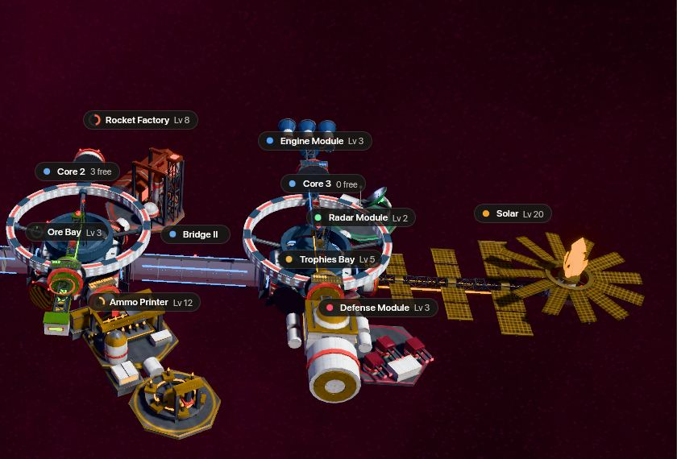
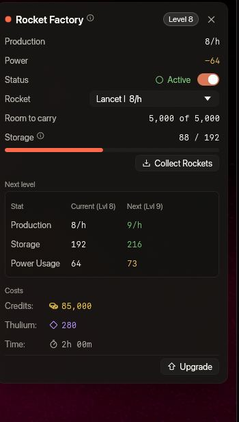
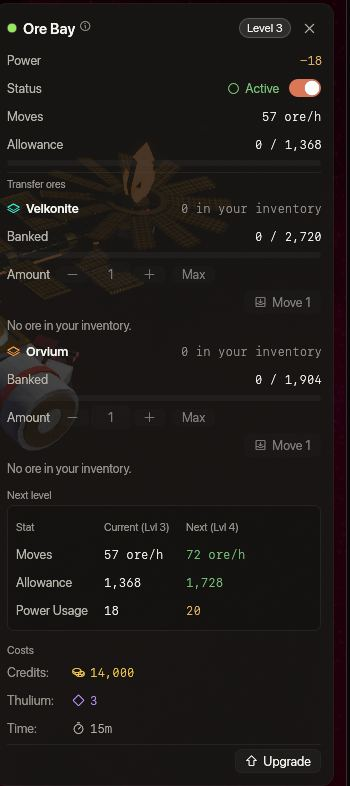
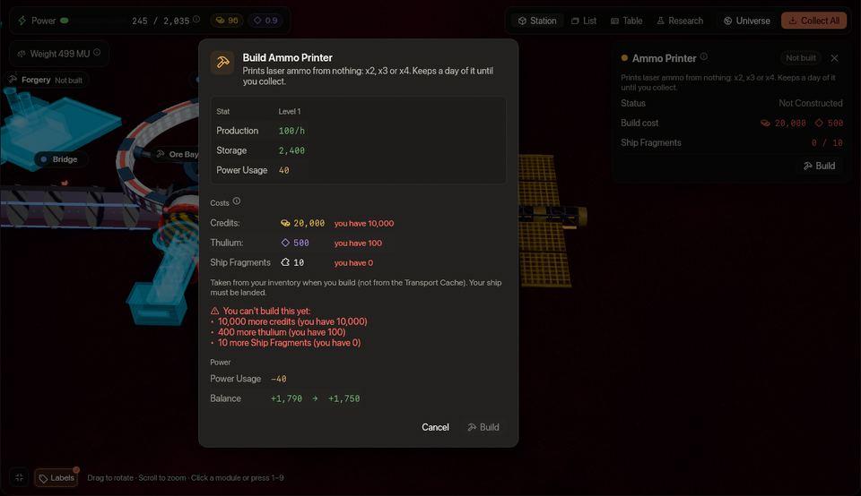
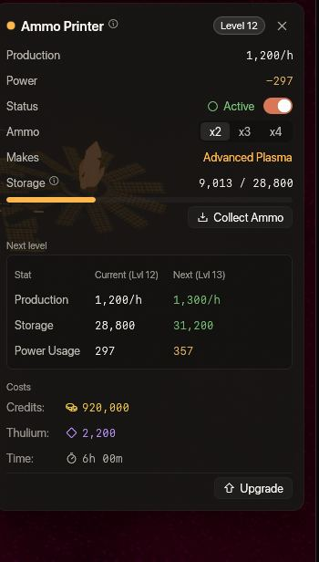
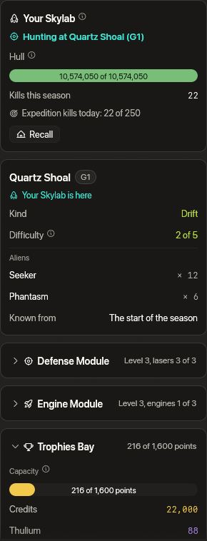
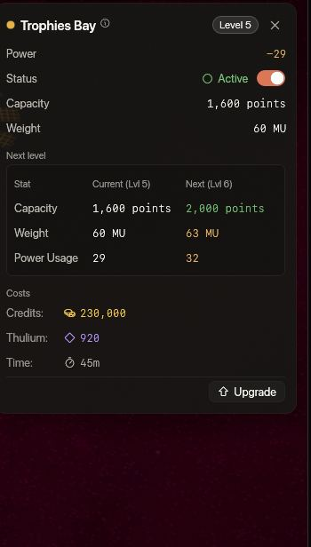
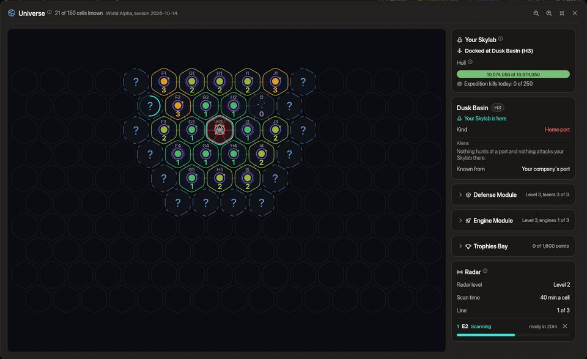

<!-- wiki-i18n source: 2cd682ac21559e5f -->
<!-- wiki-i18n title: Skylab -->
# Skylab

Skylab, sana ait yörünge tesisidir. Kredi ve Thulium üreten, cevher çıkaran, Montaj’ın en iyi lazerlere çevirdiği plakaları döken ve Çekirdek 10. seviyeden itibaren Montaj’ın ihtiyaç duyduğu teknolojileri araştıran modülleri burada inşa edip yükseltirsin. Sen çevrimdışıyken de senin için çalışır.

Çekirdek 10. seviyede Skylab ayrıca büyür: bir **köprü**, Çekirdeği altı modül yuvası daha olan ikinci bir Çekirdeğe bağlar ve ona üç modül daha eklenir: yoktan cephane ve roket üreten **Cephane Yazıcısı** ile **Roket Fabrikası** ve taşıdığın cevheri Kaynak Deposu’na aktaran **Cevher Bölmesi** (bkz. [Köprü ve Çekirdek 2](#the-bridge-and-core-2) ve [Cevher Bölmesi](#ore-bay)).

Çekirdek 15. seviyede bir kez daha büyür ve uçmayı öğrenir: **ikinci bir köprü**, Çekirdeği dört yuvalı üçüncü bir Çekirdeğe, **Çekirdek 3**’e bağlar ve **Sefer**’in dört modülü bu yuvaları alır: **Motor Modülü**, **Savunma Modülü**, **Radar Modülü** ve **Trofe Bölmesi**. Motorlar, lazerler ve Cephane Yazıcısı’ndan gelen cephaneyle Skylab kendine ait bir **evren haritası** üzerinde yol alır, sen yokken eriştiği hücrelerin uzaylılarını avlar ve ganimeti eve getirir (bkz. [İkinci köprü ve Çekirdek 3](#the-second-bridge-and-core-3) ve [Seferler](#expeditions)).

> [!NOTE]
> **0.4.10’da neler değişti.** Artık her Skylab modülünün seviye seviye kendi üretim, fiyat ve süre tablosu var. Seviyelerin korundu: fark için ne bir ücret alındı ne de bir iade yapıldı. Güncelleme geldiğinde çiftliklerinin ve toplayıcılarının haznelerinde bekleyenler **bir kereliğine, eski oranla** ödendi: kredi ve Thulium hesabına, cevher Kaynak Deposu’na gitti ve hazneler boş olarak yeniden dolmaya başladı.
>
> İki kural yeni. **Güneş Paneli yükseltilirken gücünün yalnızca %25 kadarını üretir**; bu yüzden çoğu istasyonda yükseltme bitene kadar her çiftlik ve toplayıcı durur (bkz. [Güneş Paneli modülü](#solar-module) ve [Güneş Paneli yükseltmesini zamanlama](#timing-a-solar-upgrade)). **Kaynak Deposu’nun her cevher için kendi üst sınırı var**: 1. seviyede toplayıcının bir günlük üretimi, 20. seviyede dört günlük.

> [!NOTE]
> **0.4.15’te neler değişti.** Çekirdeğin 9. seviyeden 10. seviyeye adımı artık **2.000 Thulium** daha pahalı; adım bittiğinde bir **köprü** ve ikinci bir Çekirdek, **Çekirdek 2**, altı yeni modül yuvasıyla ortaya çıkar. Güneş Paneli Çekirdek 2’ye taşınır. İki yeni modül ona bağlanır: **Cephane Yazıcısı** ve **Roket Fabrikası**. Güneş Paneli 7. seviyeden itibaren daha fazla güç de üretir, böylece dolu bir istasyon yine karşılanır. İnşa ettiğin hiçbir şey kaybolmaz: zaten 10. seviyede veya üstünde olan bir Çekirdeğin köprüsü hemen gelir ve hiçbir şey ödemez.

> [!NOTE]
> **0.4.21’de neler değişti.** Çekirdeğin 14. seviyeden 15. seviyeye adımı artık **4.000 Thulium** daha pahalı; adım bittiğinde ikinci bir **köprü** ve **Çekirdek 3** dört yeni yuvayla ortaya çıkar. Güneş Paneli Çekirdek 3’e taşınır ve 15. seviyeden itibaren daha fazla güç üretir, böylece dolu bir istasyon yine karşılanır. Yuvaları dört yeni modül alır: **Motor Modülü**, **Savunma Modülü**, **Radar Modülü** ve **Trofe Bölmesi**; bunlarla Skylab **evren haritasında** uçar, kendi başına avlanır ve ganimetini eve getirir (bkz. [Seferler](#expeditions)). Her modülün artık bir **ağırlığı** var; istasyonun ve motorlarının ağırlığı ne kadar hızlı uçacağını belirler (bkz. [Ağırlık ve hız](#weight-and-speed)). **Cevher Bölmesi** saatte üç kat daha fazla cevher taşır ve üç kat daha fazla kota tutar. İnşa ettiğin hiçbir şey kaybolmaz: zaten 15. seviyede veya üstünde olan bir Çekirdekte Çekirdek 3 hemen gelir ve hiçbir şey ödemez.

## Bir dakikada {#in-one-minute}

- Önce **Güneş Paneli** modülünü inşa et: Skylab’da onun gücü olmadan hiçbir şey çalışmaz. Kredi Çiftliği’ni inşa etmek bedavadır; Thulium Çiftliği 5.000 kredi ve 500 Thulium tutar.
- Çiftlikler ve toplayıcılar sen yokken bir **hazne** doldurur (72 saatlik üretim). **Topla**, haznedekini hesabına (kredi, Thulium) veya Kaynak Deposu’na (cevher) aktarır.
- **Thulium Çiftliği** ana Thulium kaynağındır: 1. seviyede saatte 40, 20. seviyede 1.280. Kredi Çiftliği 1. seviyede saatte 2.250, 20. seviyede 225.000 kredi üretir.
- **Çekirdek** tempoyu belirler: hiçbir modül onun seviyesini aşamaz ve kendi yükselişi yaklaşık 16 buçuk gün sürer.
- **Çekirdek 10. seviyede** bir **köprü**, altı modül yuvası daha olan **Çekirdek 2**’yi kurar; **Cephane Yazıcısı**, **Roket Fabrikası** ve **Cevher Bölmesi** ona bağlanır. 10. seviyeye geçiş 2.000 Thulium daha pahalıdır.
- **Çekirdek 15. seviyede** ikinci bir köprü **Çekirdek 3**’ü kurar; **Motor Modülü**, **Savunma Modülü**, **Radar Modülü** ve **Trofe Bölmesi** onun yuvalarını alır: bunlarla Skylab evren haritasında uçar ve kendi başına avlanır. 15. seviyeye geçiş 4.000 Thulium daha pahalıdır. [Seferlere bak](#expeditions).
- **Güneş Paneli yükseltilirken gücünün yalnızca %25 kadarını üretir**; bu yüzden çiftliklerin ve toplayıcıların yükseltme bitene kadar durur. [Planla](#timing-a-solar-upgrade).

## Genel bakış {#overview}

Skylab geminden bağımsız, kendi saatiyle işler: modüller sen yokken de üretir ve döker. Senin işin inşa etmek, yükseltmek, gücü dengede tutmak ve toplamaktır. Sayfada aynı istasyonun dört görünümü var: **İstasyon** (3D istasyon, her modülün üstünde bir etiket; birine tıkla ya da **1** ile **9** arasındaki bir tuşa bas, modülün sayfası açılır), **Liste** (her modül için bir kart), **Tablo** (tüm modüllerin sayıları tek tabloda) ve **Araştırma** (Araştırma Merkezi’nin kendi ekranı, bkz. [Araştırma](/wiki/03-Mechanics/Research.md)). **İnşa et** veya **Yükselt** düğmesinin üzerine gelince sonraki seviyenin neyi değiştirdiği, neye mal olduğu ve ne kadar sürdüğü görünür. Sayfanın başlığındaki **Evren** düğmesi Sefer haritasını açar (bkz. [Seferler](#expeditions)).

İstasyon on altı modülden oluşur:

| Modül | Ne üretir veya ne yapar | Şu seviyeden itibaren inşa edilir |
| :--- | :--- | :--- |
| **Çekirdek** | Diğer her modülün en yüksek seviyesini belirler | Hep var |
| **Güneş Paneli** | Güç üretir | Her Çekirdek seviyesi |
| **Kredi Çiftliği** | [Kredi](/wiki/01-General/Getting-Started.md) üretir | Her Çekirdek seviyesi |
| **Thulium Çiftliği** | [Thulium](/wiki/01-General/Getting-Started.md) üretir | Her Çekirdek seviyesi |
| **Velkonite Toplayıcı** | Velkonite cevheri çıkarır | Çekirdek 5. seviye |
| **Orvium Toplayıcı** | Orvium cevheri çıkarır | Çekirdek 5. seviye |
| **Kaynak Deposu** | Cevheri saklar | Çekirdek 5. seviye |
| **Dökümhane** | Cevheri plakalara döker | Çekirdek 5. seviye |
| **Araştırma Merkezi** | Kaynakları bilim puanına çevirir ve [teknolojileri](/wiki/03-Mechanics/Research.md) araştırır | Çekirdek 10. seviye |
| **Cephane Yazıcısı** | Yoktan x2, x3 veya x4 cephane basar | Çekirdek 10. seviye, Çekirdek 2’de |
| **Roket Fabrikası** | Yoktan Mağaza roketleri üretir | Çekirdek 10. seviye, Çekirdek 2’de |
| **Cevher Bölmesi** | Taşıdığın Velkonite ve Orvium cevherini Kaynak Deposu’na aktarır | Çekirdek 10. seviye, Çekirdek 2’de |
| **Motor Modülü** | Skylab’ı uçuran motorları taşır | Çekirdek 15. seviye, Çekirdek 3’te |
| **Savunma Modülü** | Bir seferde savaşan lazerleri ve şarjörü taşır | Çekirdek 15. seviye, Çekirdek 3’te |
| **Radar Modülü** | Evren haritasının sisini tarar | Çekirdek 15. seviye, Çekirdek 3’te |
| **Trofe Bölmesi** | Seferlerin getirdiklerini saklar | Çekirdek 15. seviye, Çekirdek 3’te |

İki **köprü**, **Çekirdek 2** ve **Çekirdek 3** modül değildir: ilk köprü ve Çekirdek 2 Çekirdek 10. seviyeye ulaşınca, ikinci köprü ve Çekirdek 3 ise 15. seviyede ortaya çıkar; iki Çekirdeğin de kendi seviyesi yoktur (bkz. [Köprü ve Çekirdek 2](#the-bridge-and-core-2) ve [İkinci köprü ve Çekirdek 3](#the-second-bridge-and-core-3)).

**Skylab için görevler.** Mission Control penceresindeki on [istasyon görevi](/wiki/03-Mechanics/Quests.md#station-missions) seni Skylab’da adım adım yürütür: Güneş Paneli, Kredi Çiftliği ve Thulium Çiftliği inşa etmek, Çekirdeği ve Güneş Paneli modülünü yükseltmek, ilk 50.000 kredini toplamak ve tedarik zincirini açmak; her adım biraz ödül verir. İlki 1. seviyeden itibaren açıktır.

## Her seviyede istasyon {#the-station-at-every-level}

Aşağıda Skylab’ın İstasyon görünümü 1’den 20’ye her seviyede gösteriliyor: hepsi aynı açıdan, her modül aynı seviyede. Görünüm istasyonun tamamını kareye sığdırır, bu yüzden ölçek hepsinde aynı değildir: şekil büyüyünce sıçrar. İstasyon basamaklarla büyür: şekli **1., 5., 10., 15. ve 20. seviyelerde** değişir; aralardaki her seviye her modülün kuşağında **bir lamba daha** yakar (yanan lamba sayısı seviyedir ve Çekirdeğin yirmi lambalık halkası da aynı şekilde dolar).

Bu resimler **ilk Çekirdeği** ve ona bağlı olanları, yanında Güneş Paneli ile, istasyonun köprülerden önceki halini gösterir. İstasyon bunun ötesinde de sürer ve resimler o kısmı göstermez: 10. seviyeden itibaren ötesinde bir köprü, Çekirdek 2 ile Cephane Yazıcısı, Roket Fabrikası ve Cevher Bölmesi durur, Güneş Paneli de en uca taşınır (bkz. [Köprü ve Çekirdek 2](#the-bridge-and-core-2)); 15. seviyeden itibaren bunun da ötesinde ikinci bir köprü, Çekirdek 3 ve Sefer’in dört modülü durur (bkz. [İkinci köprü ve Çekirdek 3](#the-second-bridge-and-core-3)). Sayfanın İstasyon görünümü istasyonun tamamını gösterir.

**1. ila 4. seviyeler.** Çekirdeğin çevresindeki ilk dört modül: Güneş Paneli, Kredi Çiftliği, Thulium Çiftliği ve geminin park halinde durduğu Kenetlenme Bölmesi. Tedarik zinciri henüz kurulamaz.

**5. ila 9. seviyeler.** Çekirdek 5. seviyeye ulaşınca tedarik zinciri kurulabilir: istasyonun üstündeki iskelelerde iki toplayıcı, Çekirdeğin kuzeydoğu bağlantı noktasında Kaynak Deposu ve kuzeybatı bağlantı noktasında Dökümhane (burada inşa edilmiş halleriyle görünüyorlar).

**10. ila 14. seviyeler.** Çekirdek halkasını takar, çiftlikler ve toplayıcılar daha büyük hallerini alır ve Thulium Çiftliği kendi halkasına kavuşur.

**15. ila 19. seviyeler.** Çiftlikler sandık ve kristallerle dolar, Kenetlenme Bölmesi yaklaşma yolunu aydınlatır ve Güneş Paneli dizisi tepesini büyütür. 15. seviyede istasyon ayrıca resmin dışına da taşar: ikinci bir köprü ve Çekirdek 3 gelir.

**20. seviye.** Merdivenin tepesi: Çekirdeğin üstündeki taç ile çiftliklerin ve tedarik zincirinin tam büyümüş kuleleri.

**Dokuz modülün kartları.** Aynı istasyonun 20. seviyedeki Liste görünümü: ilk sürümdeki dört modül, tedarik zinciriyle gelen Velkonite Toplayıcı, Orvium Toplayıcı, Kaynak Deposu ve Dökümhane ile Araştırma Merkezi. Her kart modülün seviyesini, üretimini, gücünü ve anahtarını gösterir. Araştırma Merkezi dışında her kart 20. seviyeyi gösterir: Merkezin seviyeleri 1’den 10’a kadardır, bu yüzden kartı en üst seviyesi olan 10. seviyeyi gösterir. Cephane Yazıcısı, Roket Fabrikası ve Cevher Bölmesi kartları aynı görünümdedir ve [aşağıda](#the-bridge-and-core-2) anlatılır; Sefer modüllerinin dört kartı da [İkinci köprü ve Çekirdek 3](#the-second-bridge-and-core-3) bölümündedir.

## İlk dört modül {#the-first-four-modules}

### Çekirdek modülü {#core-module}

Skylab’ının kalbi. Çekirdeğin seviyesi diğer her modülün en yüksek seviyesini belirler: hiçbir modülü Çekirdeğinden daha yükseğe yükseltemezsin. Çekirdek 20. seviyeye kadar çıkar ve **5. seviyeden** itibaren aşağıdaki tedarik zincirini açar. Yükseltmeleri kredi tutar; **10. seviyeye** geçiş **2.000 Thulium** daha pahalıdır ve köprü ile Çekirdek 2’yi kurar (bkz. [Köprü ve Çekirdek 2](#the-bridge-and-core-2)), **15. seviyeye** geçiş ise **4.000 Thulium** daha pahalıdır ve ikinci bir köprü ile Çekirdek 3’ü kurar (bkz. [İkinci köprü ve Çekirdek 3](#the-second-bridge-and-core-3)). Toplamda 10. seviyeye kadar 112.326 kredi, 20. seviyeye kadar 6.647.504 kredi, ayrıca o 6.000 Thulium ve yaklaşık 16 buçuk gün gerekir (bkz. [Yükseltme süreleri](#upgrade-times)).

### Güneş Paneli modülü {#solar-module}

Güç, Skylab’ın can damarıdır. Güneş Paneli modülü, diğer her modülün kullandığı gücü üretir.

- **Önemi**: güç kullanımın ürettiğin gücü aşarsa çiftliklerin ve toplayıcıların kapanır.
- **Üretilen güç**: N. seviye bir Güneş Paneli, **N. seviyedeki her modüle** yetecek gücü ve yaklaşık onda bir fazlasını üretir: 1. seviyede 255, 7. seviyede 965, 20. seviyede 18.575. 7. seviye Güneş Paneli, 7. seviyedeki bütün bir istasyonu besler (her seviye için bkz. Güç yönetimi).
- **Fiyat**: Güneş Paneli modülünü inşa etmek **500 kredi ve 50 Thulium** tutar. Yükseltmeleri Dökümhane’ninkilerle aynı fiyatta ve aynı sürededir: 2. seviye için 8.000 kredi + 25 Thulium (5 dakika) ile 20. seviye için 9.000.000 kredi + 10.000 Thulium (24 saat) arasında.
- **Yükseltme**: Güneş Paneli yükseltilirken mevcut seviyesindeki gücün yalnızca **%25 kadarını** üretir; yeni seviyenin gücü yükseltmenin bittiği andan itibaren gelir. Bundan fazlasını kullanan bir istasyon durur: yükseltme bitene kadar her çiftlik ve toplayıcı üretimi bırakır ve Dökümhane yeni parti başlatmaz. Neredeyse her istasyon için durum budur: istasyon yükseltme boyunca ancak diğer tüm modüller Güneş Paneli’nden en az beş seviye düşükse (Güneş Paneli 10. seviyeden itibaren altı seviye) çalışmaya devam eder. Güneş Paneli yükseltmesini çiftliklerinde bir güç kesintisi gibi planla (bkz. İnşa etme ve yükseltme).
- **Yeri**: Güneş Paneli istasyonun en ucunda durur: Çekirdek 10. seviyeden itibaren Çekirdek 2’de, 15. seviyeden itibaren Çekirdek 3’te (bkz. [Köprü ve Çekirdek 2](#the-bridge-and-core-2) ve [İkinci köprü ve Çekirdek 3](#the-second-bridge-and-core-3)).

### Kredi Çiftliği ve Thulium Çiftliği {#credit-farm-and-thulium-farm}

- **Kredi Çiftliği**: zamanla kredi üretir: **1. seviyede saatte 2.250, 20. seviyede 225.000** (5. seviye: 11.250; 10. seviye: 33.750; 15. seviye: 76.500). İnşa etmek bedavadır.
- **Thulium Çiftliği**: zamanla Thulium üretir: **1. seviyede saatte 40, 20. seviyede 1.280** (5. seviye: 144; 10. seviye: 360; 15. seviye: 760). İnşa etmek 5.000 kredi ve 500 Thulium tutar.
- İkisi de güç ister ve her biri, sen toplayana kadar ürettiğinin 72 saatlik kısmını tutar.

## Tedarik zinciri {#the-supply-chain}

Dört modül, klavyeden uzakta geçirdiğin zamanı en iyi lazerlerinin plakalarına çevirir. Cevher **yalnızca** toplayıcılardan gelir (tüm malzemeler ve para birimleri [Kaynaklar](/wiki/06-Items/Resources.md) sayfasındadır): uzaylılar düşürmez, Mağaza’da satılmaz. ([Dev ekskavatör](/wiki/03-Mechanics/Giant-Excavator.md) de kutular içinde biraz Velkonite ve Orvium cevheri bırakır; ama o cevher kargona gider ve onu Kaynak Deposu’na yalnızca [Cevher Bölmesi](#ore-bay) taşır; Dökümhane ve Araştırma Merkezi cevheri oradan alır.)

1. Bir **toplayıcı** saatte belirli bir miktar cevher çıkarır ve kendi haznesine koyar (72 saatlik üretim).
2. **Topla**, cevheri haznesinden **Kaynak Deposu**’na, yani depoya aktarır; orada her cevher ayrı tutulur.
3. **Dökümhane**, bir parti başlarken ihtiyacı olan cevheri depodan alır ve plaka üretir: plaka başına 10 saniye, aynı anda tek parti.
4. **Plakaları topla**, biten plakaları envanterine aktarır (geminin park halinde olmalı). [Montaj](/wiki/06-Items/Lasers.md) bu plakalardan Quantum Laser III, Starfire-III veya Helios Beam üretir; her iki plakadan birer tane ve 5 Dark Matter ile de bir Dark Matter Plate üretir. [Demirhane](/wiki/06-Items/Forge.md) ile her yükseltme zincirinin son kademesi o plakayı ister.

### Velkonite Toplayıcı ve Orvium Toplayıcı {#velkonite-collector-and-orvium-collector}

- **Cevher**: Velkonite Toplayıcı 1. seviyede **saatte 10 Velkonite**, Orvium Toplayıcı **saatte 10 Orvium** çıkarır; her seviyenin kendi hızı vardır: 20. seviyede saatte en fazla 80 Velkonite ve 40 Orvium (5. seviye: saatte 18 ve 14; 10. seviye: 32 ve 24).
- **Hazne**: her biri kendi cevherinin 72 saatini tutar ve dolunca çıkarmayı bırakır.
- **Topla**: cevheri yeri olduğu kadarıyla Kaynak Deposu’na aktarır. Depo hiç kurulmamışsa ya da o cevherin deposu doluysa koyacak yer yoktur ve düğme nedenini söyler. Kalanı haznede kalır.
- **Güç**: 1. seviyede 20 (Velkonite) ve 30 (Orvium), seviye başına %15 artar.

### Kaynak Deposu {#resource-storage}

- **Depo**: Velkonite ve Orvium cevherini ayrı tutar ve her birinden farklı miktar alır: **1. seviyede her birinden 240**, 20. seviyede en fazla 7.680 Velkonite ve 3.840 Orvium (5. seviye: 720 ve 560; 10. seviye: 1.920 ve 1.440).
- **Üst sınır**: 1. seviyede toplayıcısının bir günlük üretimi, 20. seviyede dört güne kadar büyür. Bir toplayıcının haznesi üç günlük tutar; bu yüzden 13. seviyeden itibaren depo en az dolu bir hazne kadar alır.
- **Sınırın üstü**: bir depo üst sınırından fazlasını tutuyorsa (0.4.10 güncellemesinin ödemesi böyle bir durum bırakabilirdi) hiçbir şey alınmaz; ama sen o cevherden biraz kullanana kadar Topla ona daha fazla ekleme yapmaz.
- Cevher içeri bir toplayıcıdan toplayarak ya da envanterinden [Cevher Bölmesi](#ore-bay) aracılığıyla girer; dışarı yalnızca Dökümhane’ye ve Araştırma Merkezi’ne çıkar. Envanterine asla geri dönmez.
- **Depodaki cevher sezon sıfırlamasından sonra da kalır.**
- **Güç**: 1. seviyede 10, seviye başına %10 artar. Kapatılamaz.

### Dökümhane {#forgery}

- **Plakalar**: Dökümhane, Velkonite cevherinden bir **Velkonite Reinforced Plate**, Orvium cevherinden bir **Orvium Reinforced Plate** üretir: 1. seviyede plaka başına **40 Velkonite** veya **80 Orvium**; her seviyede düşerek 20. seviyede 30 ve 60 olur (asla %75’in altına inmez).
- **Partiler**: aynı anda tek türden tek parti; **1. seviyede 10 plaka**, üstündeki her seviye için 5 plaka daha. Cevher, parti başladığı anda Kaynak Deposu’ndan çıkar ve her plaka **10 saniye** sürer. Plakalar sen yokken de art arda üretilir.
- **Plakaları topla**: **geminin park halindeyken** biten plakaları envanterine aktarır; partinin kalanı çalışmaya devam eder. Dökümhane boşalınca yeni bir parti başlatılabilir.
- Çalışan bir parti, Dökümhane’yi kapatsan ya da yükseltsen bile biter. **Yeni** bir parti için Dökümhane’nin açık olması, yükseltilmemesi ve Skylab’ın gücünün dengede olması gerekir.
- **Güç**: 1. seviyede 30, seviye başına %15 artar.
- **Satılabilir değil**: Dökümhane’nin ürettiği plakalar [pazarda](/wiki/03-Mechanics/Auction.md#marketable-items) satılamaz; yoksa pazarın en büyük kalemi olurlardı. Yine de Montaj ve Demirhane için malzemedir.

### İnşa etme {#building-them}

İki toplayıcının her biri **10 Ship Fragment, 20.000 kredi ve 500 Thulium**, Kaynak Deposu **10 Ship Fragment, 5.000 kredi ve 250 Thulium**, Dökümhane **10 Ship Fragment, 5.000 kredi ve 500 Thulium** tutar; dördü de Çekirdek 5. seviye ister.

- Ship Fragment eşyaları envanterinden alınır (Nakliye Deposu’ndan değil) ve geminin park halinde olması gerekir. İnşa sayfası sende olanı gerekenle karşılaştırır ve neyin eksik olduğunu gösterir.
- Dördü de güç çeker. İnşa etmeden önce sayfa güç dengeni şimdi ve sonra gösterir: Güneş Paneli diğer modüllerin gerisindeyse **inşa etmek istasyonu güç açığına sokabilir** ve tek bir güç açığı her çiftliği ve toplayıcıyı durdurur. Bir modülü kapat ya da önce Güneş Paneli modülünü yükselt.
- İki toplayıcı istasyonun üstündeki iskelelere asılıdır, Kaynak Deposu Çekirdeğin kuzeydoğu bağlantı noktasında, Dökümhane kuzeybatı bağlantı noktasında durur.

## Araştırma Merkezi {#the-research-centre}

Dokuzuncu modül kaynakları bilim puanına çevirir ve Montaj’ın yeni bir şey üretmeden önce istediği teknolojileri araştırır. Çekirdek 10. seviyeden itibaren inşa edilir, 1’den 10’a kadar seviyeleri vardır, güç çeker ve kapatılamaz. Sayıları, yakıt olarak neyi yaktığı, hızlandırma ve teknoloji ağacının tamamı [Araştırma](/wiki/03-Mechanics/Research.md) sayfasındadır. En yüksek teknolojiler ayrıca Merkeze eklediğin Dark Matter ister: nasıl elde edileceğini [Dark Matter ve Dark Matter Plate](/wiki/03-Mechanics/Dark-Matter.md) anlatır. Motor, Savunma ve Radar Modüllerinin seviyeleri de burada araştırılan teknolojilerdir (bkz. [Araştırma](/wiki/03-Mechanics/Research.md#module-technologies)).

## Köprü ve Çekirdek 2 {#the-bridge-and-core-2}

Çekirdeğin **10. seviyeye** yükseltmesi bir **köprü** ve ikinci bir Çekirdek kurar. Köprü, Güneş Paneli’nin durduğu yer olan Çekirdeğin kuzey bağlantı noktasına oturur ve onu uçtaki **Çekirdek 2**’ye bağlar.

- **Maliyet**: 9. seviyeden 10. seviyeye adım, 38.443 kredisinin üstüne **2.000 Thulium** tutar ve eskisi gibi 1 sa 20 dk sürer. Köprü ve Çekirdek 2 ayrıca bir şeye mal olmaz ve kendi başlarına süre almaz. Zaten çalışan bir yükseltme başlatıldığı fiyatı korur; 10. seviyede veya üstünde olan bir Çekirdek hiçbir şey ödemez.
- **Çekirdek 2’nin seviyesi yoktur**: yükseltilecek ya da ödenecek bir şey yok. İstasyonuna **altı modül yuvası daha** verir; kaç tanesinin boş olduğunu Çekirdeğin kartı gösterir.
- **Güneş Paneli taşınır**: Güneş Paneli, artık köprünün aldığı Çekirdeğin kuzey bağlantı noktasından ayrılıp istasyonun ucundaki Çekirdek 2’nin kuzey bağlantı noktasına geçer. Seviyesi, gücü ve sürmekte olan yükseltmesi olduğu gibi kalır.
- **Bir kural, bir inşa değil**: her modülün nerede durduğu yalnızca Çekirdeğin seviyesinden çıkar. Köprü, Çekirdeğin 10. seviyeye yükseltmesi biter bitmez belirir (hafif bir ses ve bir mesaj haber verir); Çekirdeği zaten 10. seviyede veya üstünde olan bir Skylab’da ise o, sen bir sonraki baktığında zaten yerindedir. Hiçbir modül kaybolmaz ya da silinmez, yalnızca Güneş Paneli yer değiştirir.
- **Yuvalar**: **Cephane Yazıcısı** Çekirdek 2’nin kuzeydoğu yuvasını, **Roket Fabrikası** kuzeybatı yuvasını, **Cevher Bölmesi** doğu iskelesini alır; diğer üçü gelecek modüller için boş kalır. Üçü de ancak Çekirdek 2 kurulduktan sonra inşa edilebilir: ondan önce İnşa et düğmesi “Çekirdek 2 gerekli” der.
- **Seviyeler**: Çekirdek 2 üzerindeki bir modül de diğerleri gibi Çekirdeğin seviyesini izler: hiçbiri Çekirdeği geçemez; yani Çekirdek 2 yuva ekler, seviye eklemez.

### Cephane Yazıcısı {#ammo-printer}

Cephane Yazıcısı yoktan lazer cephanesi basar, aynı anda tek türden: cevher yok, kredi yok, yalnızca güç. 1’den 20’ye kadar seviyeleri vardır.

- **Üretim**: **x2** (Advanced Plasma) **1. seviyede saatte 100, 20. seviyede 2.000** (her seviyede 100 daha); **x3** (Ultra Core) bunun yarısı, 50’den 1.000’e; **x4** (Experimental Fusion Core) dörtte biri, 25’ten 500’e.
- **Mod**: x2, x3 veya x4 modunu kartında ya da sayfasında seçersin. Mod değiştirmek depolanmış saatleri korur ve bundan sonra onları yeni modun hızıyla sayar.
- **Depo**: bir gün, yani kullanımdaki seviye ve türle 24 saatlik üretim (1. seviyede 2.400 x2, 20. seviyede 48.000). Çevrimdışı süre de sayılır ve dolu bir depo yalnızca durur.
- **Topla**: tam birimleri **geminin park halindeyken** envanterine aktarır. Cephanenin taşıma sınırı yoktur; bir birimin kesri kalır ve sayılmaya devam eder.
- **Güç**: 1. seviyede 40, seviye başına %20 artar. Güç kesintisinde çiftlikler ve toplayıcılar gibi durur; tuttukları kalır ve toplanabilir.
- **İnşa**: 20.000 kredi, 500 Thulium ve 10 Ship Fragment (envanterinden, geminin park halindeyken), yalnızca Çekirdek 2’de. Yükseltmeleri 21.000 kredi + 140 Thulium ile 5.600.000 kredi + 11.000 Thulium arasında tutar ve Dökümhane’ninki kadar sürer: 5 dakikadan 24 saate, toplamda 5 g 13 sa (bkz. aşağıdaki tablolar).
- **Satılabilir değil**: bastıkları [pazarda](/wiki/03-Mechanics/Auction.md#marketable-items) satılamaz.

### Roket Fabrikası {#rocket-factory}

Roket Fabrikası yoktan Mağaza roketleri üretir, aynı anda tek türden. 1’den 20’ye kadar seviyeleri vardır.

- **Ne üretir**: seçtiğin, on iki Mağaza roketinden herhangi biri: Lancet, Rivet, Scatter veya Ember; I, II ve III kademeleri. N.U.K.E. ve N.I.K.E. roketleri asla üretilmez.
- **Üretim**: III. kademe **1. seviyede saatte 0,5, 20. seviyede 10** (her seviyede 0,5 daha), II. kademe bunun 1,25 katı, I. kademe iki katı. Yalnızca tam roketler sayılır: bir roketin kesri kalır ve sayılmaya devam eder.
- **Depo**: bir gün, yani kullanımdaki seviye ve roketle 24 saatlik üretim (20. seviyede 240 III. kademe). Çevrimdışı süre de sayılır, dolu depo yalnızca durur ve roket değiştirmek depolanmış saatleri korur.
- **Topla**: roketleri **geminin park halindeyken** taşıyabildiğin kadarıyla envanterine aktarır: Mağaza’nın kendi sınırı olarak en fazla 5.000 I. kademe, 2.000 II. kademe ve 500 III. kademe roket. Sığmayanlar Roket Fabrikası’nda kalır.
- **Güç**: 1. seviyede 24, seviye başına %15 artar. Güç kesintisinde Yazıcı gibi durur.
- **İnşa**: 20.000 kredi, 500 Thulium ve 15 Ship Fragment (envanterinden, geminin park halindeyken), yalnızca Çekirdek 2’de. Yükseltmeleri Yazıcı’nınkinin dörtte birine mal olur: 5.300 kredi + 35 Thulium ile 1.400.000 kredi + 2.800 Thulium arasında; aynı sürede biter: toplamda 5 g 13 sa.
- **Satılabilir değil**: ürettikleri [pazarda](/wiki/03-Mechanics/Auction.md#marketable-items) satılamaz.

### Cevher Bölmesi {#ore-bay}

Cevher Bölmesi taşıdığın cevheri Kaynak Deposu’na aktarır. [Dev ekskavatör](/wiki/03-Mechanics/Giant-Excavator.md) Velkonite ve Orvium cevherini kargona giden kutulara bırakır; orada hiçbir modül onları kullanmaz. Cevher Bölmesi oradan depoya giden yoldur; Dökümhane ve Araştırma Merkezi cevheri depodan alır. 1’den 20’ye kadar seviyeleri vardır.

- **Ne taşır**: Kaynak Deposu’nun sakladığı iki cevher olan **Velkonite ve Orvium**. Cataclysite ve Quorvium, Araştırma Merkezi ile [Demirhane](/wiki/06-Items/Forge.md) tarafından doğrudan envanterinden alınan yakıttır; Thulium ise aldığın anda cüzdanına gider.
- **Tek yön**: envanterinden Kaynak Deposu’na, asla geri çıkmaz. Yalnızca envanterinde boşta duran cevher taşınır, Nakliye Deposu’ndakiler asla.
- **Nasıl**: **geminin park halinde olması** gerekir. Aktarım anlıktır: Cevher Bölmesi’nin sayfasında cevheri seç, bir miktar yaz ya da Maks. düğmesine bas, sonra **Taşı** düğmesine bas. Sayfa neyi taşıdığını ve deponun kapasitesine göre ne tuttuğunu gösterir.
- **Kota**: seviye, saatte ne kadar cevher taşıyacağını belirler, **1. seviyede 30, 20. seviyede 960**; bir günlük miktarına kadarını saklar (1. seviyede 720, 20. seviyede 23.040). Yeni bir Cevher Bölmesi tam bir günlük kotayla başlar ve yükseltme depolananı korur. Bir aktarım, taşıdığın cevhere, Kaynak Deposu’nda kalan yere ve kotaya göre kesilir ve hangisi olduğunu söyler. Bir günlük kota, aynı seviyede Kaynak Deposu’nun bir cevherden tuttuğunun yaklaşık üç katıdır; bu yüzden bir aktarımı çoğunlukla yer yetersizliği durdurur; kota yalnızca cevheri bir gün içinde depoya defalarca aktarırsan önem taşır.
- **Güç**: 1. seviyede 15, seviye başına %10 artar (20. seviyede 92). Kapatılabilir. Güç kesintisinde, kapalıyken ve yükseltilirken hiçbir şey taşımaz.
- **İnşa**: 5.000 kredi, 250 Thulium ve 10 Ship Fragment (envanterinden, geminin park halindeyken), yalnızca Çekirdek 2’de. Yükseltmeleri Kaynak Deposu’nunkiyle aynı fiyatta ve aynı sürededir (bkz. aşağıdaki tablolar).
- **Daha fazla cevhere giden bir yol değil**: zaten elinde olan cevheri taşır. Ekskavatörün bir çalışması kaynağında sınırlıdır ve deponun kendi kapasitesi de depoyu sınırlar.

## İkinci köprü ve Çekirdek 3 {#the-second-bridge-and-core-3}

Çekirdeğin **15. seviyeye** yükseltmesi **ikinci bir köprü** ve üçüncü bir Çekirdek kurar; Sefer’in dört modülü yuvalarını orada alır. Köprü II, Güneş Paneli’nin durduğu yer olan Çekirdek 2’nin kuzey bağlantı noktasına oturur ve onu istasyonun ucundaki **Çekirdek 3**’e bağlar: 10. seviyenin düzeni bir kez daha.

- **Maliyet**: 14. seviyeden 15. seviyeye adım, kredisinin üstüne **4.000 Thulium** tutar ve eskisi gibi 14 sa sürer. Köprü II ve Çekirdek 3 ayrıca bir şeye mal olmaz ve kendi başlarına süre almaz. Zaten çalışan bir yükseltme başlatıldığı fiyatı korur; 15. seviyede veya üstünde olan bir Çekirdek hiçbir şey ödemez.
- **Çekirdek 3’ün seviyesi yoktur**: yükseltilecek ya da ödenecek bir şey yok. İstasyonuna **dört modül yuvası daha** verir; kaç tanesinin boş olduğunu Çekirdeğin kartı gösterir.
- **Güneş Paneli yine taşınır**: Güneş Paneli, artık Köprü II’nin aldığı Çekirdek 2’nin kuzey bağlantı noktasından ayrılıp istasyonun ucundaki Çekirdek 3’ün kuzey bağlantı noktasına geçer. Seviyesi, gücü ve sürmekte olan yükseltmesi olduğu gibi kalır.
- **Bir kural, bir inşa değil**: her modülün nerede durduğu yalnızca Çekirdeğin seviyesinden çıkar. Çekirdek 3, Çekirdeğin 15. seviyeye yükseltmesi biter bitmez belirir; Çekirdeği zaten 15. seviyede veya üstünde olan bir Skylab’da ise o, sen bir sonraki baktığında zaten yerindedir. Hiçbir modül kaybolmaz, yalnızca Güneş Paneli yer değiştirir.
- **Yuvalar**: **Savunma Modülü** Çekirdek 3’ün kuzeydoğu yuvasını, **Radar Modülü** kuzeybatı yuvasını, **Trofe Bölmesi** doğu iskelesini, **Motor Modülü** batı iskelesini alır. İki güney bağlantı noktası Çekirdek 2’nin modüllerine bakar ve boş kalır. Dördü de ancak Çekirdek 3 kurulduktan sonra inşa edilebilir: ondan önce İnşa et düğmesi kilitlidir ve Çekirdek 15. seviye gerektiğini söyler.
- **Seviyeler**: Çekirdek 3 üzerindeki bir modül de diğerleri gibi Çekirdeğin seviyesini izler: hiçbiri Çekirdeği geçemez. Motor ve Savunma Modülleri 5. seviyede, Radar Modülü 3. seviyede, Trofe Bölmesi 20. seviyede durur.
- **Bir inşa ne ister**: kredi ve Thulium dışında **Ship Fragment**, Motor, Savunma ve Radar Modülleri için de envanterinden (Nakliye Deposu’ndan değil) **Dark Matter Plate**; bunlar geminin park halindeyken alınır. Ayrıca Araştırma Merkezi’nde araştırılmış o seviyenin **teknolojisi** gerekir. Plaka isteyen bir adım onları aynı şekilde ister.

**Teknolojiler.** Motor, Savunma ve Radar Modüllerinin her seviyesi, Araştırma görünümünde Skylab ailesinden bir teknolojidir; sırayla araştırılır ve o seviye inşa edilmeden ya da o seviyeye yükseltilmeden önce gerekir. Üç modül süreleri paylaşır (Radar Modülü 3. seviyede durur):

| Seviye | Araştırma süresi | Dark Matter |
| :--- | ---: | ---: |
| 1 | 3 sa | 0 |
| 2 | 10 sa | 5 |
| 3 | 1 g | 10 |
| 4 | 2 g | 15 |
| 5 | 3 g | 20 |

Üç modülün teknolojileri normal hızda 115 Dark Matter ve 14 g 15 sa araştırma ister (bkz. [Araştırma](/wiki/03-Mechanics/Research.md#module-technologies)).

### Motor Modülü {#engine-module}

Motor Modülü, Skylab’ını uçuran motorları taşır. 1’den 5’e kadar seviyeleri vardır ve her seviye bir motor daha alır. Taktığın motorlar ve tüm istasyonun ağırlığı ne kadar hızlı uçacağını belirler (bkz. [Ağırlık ve hız](#weight-and-speed)).

- **Ne takılır**: envanterinden, iticileri içinde olan [Motor](/wiki/06-Items/Propulsion.md) eşyaları: Engine I, II veya III. Uyarlanabilir Çekirdek takılmaz: hız bonusu geminin işidir. Bir motor, onu tekrar çıkardığında iticilerini ve Demirhane bonuslarını korur.
- **Nasıl**: **geminin park halinde olması** ve Skylab’ın yolda olmaması gerekir. Evren penceresinin Motor kartı boşta duran motorlarını listeler: birini boş bir yuvaya sürükle ya da tıkla; takılı bir motoru çıkarmak için ona tıkla. Kart ayrıca itkiyi, ağırlığı, hızı ve bir sıçramanın ne kadar sürdüğünü gösterir.
- **Sefer için gerekenler**: modülün inşa edilmiş, açık, yükseltilmiyor olması ve en az bir motor taşıması.
- **Araştırma**: her seviye kendi teknolojisini ister: Engine Module I ile V arası (bkz. yukarıdaki tablo).
- **Güç**: 1. seviyede 60, seviye başına %25 artar. Kapatılabilir, ama Skylab yoldayken değil.
- **İnşa**: 375.000 kredi, 1.500 Thulium, 20 Ship Fragment ve 1 Dark Matter Plate, yalnızca Çekirdek 3’te.
- **Yükseltme**: modül yükseltilirken çevrimdışıdır. Motor Modülü’nün yükseltmesi bir seferin bitmesini bekler, çünkü bir seferin hızı yola çıkarken sabitlenir.

| Seviye | Motor | Kredi | Thulium | Plaka | Süre |
| :--- | ---: | ---: | ---: | ---: | ---: |
| 1 (inşa) | 1 | 375.000 | 1.500 | 1 | – |
| 2 | 2 | 825.000 | 3.300 | 2 | 2 sa |
| 3 | 3 | 1.825.000 | 7.300 | 3 | 6 sa |
| 4 | 4 | 4.000.000 | 16.000 | 5 | 1 g |
| 5 | 5 | 8.750.000 | 35.000 | 8 | 2 g |

Plaka sütunu Dark Matter Plate sayısıdır, süre ise o seviyeye yükseltmenin süresidir. Beş seviye toplamda 15.775.000 kredi, 63.100 Thulium, 19 plaka ve 3 g 8 sa yükseltme tutar.

### Savunma Modülü {#defense-module}

Savunma Modülü Skylab’ın için savaşır. Skylab’ının uçtuğu hücrelerdeki uzaylıları vuran lazerleri ve onların ateş ettiği şarjörü taşır. 1’den 5’e kadar seviyeleri vardır ve seviyesi kaç lazer ve kaç mermi taşıyacağını, saatte ne kazanabileceğini ve ne kadar tehlikeli bir hücreye girebileceğini belirler.

- **Ne takılır**: envanterinden, amfileri içinde olan [Lazer](/wiki/06-Items/Lasers.md) eşyaları: Quantum Laser I, II veya III, Starfire-III ya da Helios Beam. Tüm lazerler birlikte ateş eder, her biri saniyede bir mermi. Amfiler gemideki gibi sayılır (hasar, kritik şans ve kritik hasar); Penetration Amp burada hiçbir şey eklemez.
- **Şarjör**, Cephane Yazıcısı’nın bastığı türden mermileri tutar ve **yalnızca Cephane Yazıcısı’ndan** dolar, envanterinden asla (bkz. [Takılanlar ve cephane](#fits-and-ammunition)).
- **Kapı**: örneğin zorluğu 3 olan bir hücreye yalnızca Savunma Modülü 3. seviyede veya üstünde olan bir Skylab girebilir. Savunma Modülü olmayan bir Skylab yalnızca boş uzaya ve limanına girebilir.
- **Öldürme bütçesi**, Skylab’ın saatte kazanabileceği en fazla miktardır: 1. seviyede 108, 5. seviyede 630 ödül puanı (bkz. [Bir seferin ödemesi](#what-a-trip-pays)).
- **Gövde** seviyeyle büyür (bkz. [Gövde, yok oluş ve onarım](#the-hull-and-repair)).
- **Araştırma**: her seviye kendi teknolojisini ister: Defense Module I ile V arası (bkz. yukarıdaki tablo).
- **Güç**: 1. seviyede 80, seviye başına %25 artar. Kapatılabilir, ama Skylab yoldayken değil. Kapalı, yükseltilen veya gücü olmayan bir modül devre dışıdır: Skylab hiçbir şeyle savaşmaz ve hücreleri savaşmadan geçer.
- **İnşa**: 500.000 kredi, 2.000 Thulium, 25 Ship Fragment ve 1 Dark Matter Plate, yalnızca Çekirdek 3’te.

| Seviye | Lazer | Şarjör (mermi) | Öldürme bütçesi (saatte puan) | En yüksek zorluk |
| :--- | ---: | ---: | ---: | ---: |
| 1 | 1 | 1.300 | 108 | 1 |
| 2 | 2 | 3.600 | 293 | 2 |
| 3 | 3 | 14.000 | 476 | 3 |
| 4 | 4 | 23.000 | 548 | 4 |
| 5 | 5 | 35.000 | 630 | 5 |

| Seviye | Kredi | Thulium | Plaka | Süre |
| :--- | ---: | ---: | ---: | ---: |
| 1 (inşa) | 500.000 | 2.000 | 1 | – |
| 2 | 1.150.000 | 4.600 | 2 | 3 sa |
| 3 | 2.750.000 | 11.000 | 4 | 9 sa |
| 4 | 6.000.000 | 24.000 | 7 | 1 g 12 sa |
| 5 | 14.000.000 | 56.000 | 12 | 3 g |

Beş seviye toplamda 24.400.000 kredi, 97.600 Thulium, 26 plaka ve 5 g yükseltme tutar.

### Radar Modülü {#radar-module}

Radar Modülü evren haritasının sisini kaldırır (bkz. [Sis ve tarama](#fog-and-scanning)). 1’den 3’e kadar seviyeleri vardır ve yüksek seviye bir hücreyi daha hızlı tarar.

- **Ne yapar**: bildiğin bir hücrenin yanındaki hücreler arasından **aynı anda tek hücre** tarar ve **üçlük bir kuyruk** tutar: ilki taranır, diğerleri bekler. Bir tarama bitince o hücreyi bilirsin ve Skylab’ın oraya uçabilir.
- **Süre**: hücre başına 1. seviyede 90 dakika, 2. seviyede 40, 3. seviyede 15. Tarama sunucunun saatiyle işler: sen yokken ve Skylab uçarken de. Modül kapalıyken, yükseltilirken ya da gücü yokken ve Skylab yok edilmişken durur ve geçen süre telafi edilmez. Bir tarama zamandan başka bir şeye mal olmaz.
- **Hepsini haritaya işlemek**: başlangıçta bilmediğin 131 hücreyi art arda haritaya işlemek 1. seviyede 8 g 4 sa, 2. seviyede 3 g 15 sa, 3. seviyede 1 g 9 sa sürer.
- **Araştırma**: her seviye kendi teknolojisini ister: Radar Module I ile III arası (bkz. yukarıdaki tablo).
- **Güç**: 1. seviyede 40, seviye başına %30 artar. Kapatılabilir, ama Skylab yoldayken değil.
- **İnşa**: 250.000 kredi, 1.000 Thulium ve 15 Ship Fragment, yalnızca Çekirdek 3’te.

| Seviye | Tarama süresi | Kredi | Thulium | Plaka | Süre |
| :--- | ---: | ---: | ---: | ---: | ---: |
| 1 (inşa) | 90 dk | 250.000 | 1.000 | 0 | – |
| 2 | 40 dk | 750.000 | 3.000 | 1 | 4 sa |
| 3 | 15 dk | 2.250.000 | 9.000 | 3 | 1 g |

Üç seviye toplamda 3.250.000 kredi, 13.000 Thulium, 4 plaka ve 1 g 4 sa yükseltme tutar.

### Trofe Bölmesi {#trophies-bay}

Trofe Bölmesi, Skylab’ının öldürmelerinin getirdiklerini sen toplayana kadar saklar. 1’den 20’ye kadar seviyeleri vardır ve teknoloji gerektirmez.

- **Ne tutar**: kredi, Thulium, deneyim, onur ve öldürmelerin ganimeti.
- **Kapasite**, **ödül puanı** cinsinden sayılır: bir öldürme uzaylısının ödülünü ekler; kredi bölü 200 artı Thulium, ne düşürdüğüne bakılmaksızın (her dünyada Alpha Dünyası’nın rakamları). 1. seviyede 650, 20. seviyede 45.000 puan tutar.
- **Dolu**: dolu bir Bölme Skylab’ın **ateşi kesmesine** yol açar: sen toplayana kadar hiçbir şey öldürülmez, ödenmez ya da sayılmaz ve hiç cephane harcanmaz (gövde yine de onarılır). Bir mesaj ve kenar çubuğundaki Skylab satırının ipucu bunu söyler.
- **Topla** Evren penceresinde, geminin park halindeyken yapılır: kredi ve Thulium hesabına, deneyim ve onur pilotuna, ganimet envanterine gider. Aynı anda iki toplama bir kez öder.
- **Ganimet** her öldürme için uzaylının düşürdüklerinden çekilir; asla Dark Matter, Ancient Control Unit, N.I.K.E. veya N.U.K.E. çıkmaz. **Satılabilir değil**: [pazarda](/wiki/03-Mechanics/Auction.md#marketable-items) satılamaz.
- **Güç**: 1. seviyede 20, seviye başına %10 artar. Kapatılabilir, ama Skylab yoldayken değil.
- **İnşa**: 100.000 kredi, 400 Thulium ve 10 Ship Fragment, yalnızca Çekirdek 3’te. Yükseltmeleri 117.500 kredi + 470 Thulium (15 dakika) ile 2.325.000 kredi + 9.300 Thulium (1 g 13 sa) arasında tutar: toplamda 14.722.500 kredi ve 58.890 Thulium, 6 g 8 sa.

| Seviye | Kapasite (puan) | Kredi | Thulium | Süre |
| :--- | ---: | ---: | ---: | ---: |
| 1 (inşa) | 650 | 100.000 | 400 | – |
| 2 | 810 | 117.500 | 470 | 15 dk |
| 5 | 1.600 | 195.000 | 780 | 34 dk |
| 10 | 4.800 | 450.000 | 1.800 | 2 sa 18 dk |
| 15 | 15.000 | 1.025.000 | 4.100 | 9 sa 14 dk |
| 20 | 45.000 | 2.325.000 | 9.300 | 1 g 13 sa |

Skylab, Savunma seviyesinin öldürme bütçesinin tamamını kazanırken bir Bölmenin dolması ne kadar sürer (daha küçük bir Bölme daha hızlı, daha küçük bir bütçe daha yavaş dolar):

| Savunma seviyesi | Bölme 1. seviye | Bölme 5. seviye | Bölme 10. seviye | Bölme 15. seviye | Bölme 20. seviye |
| :--- | ---: | ---: | ---: | ---: | ---: |
| 1 | 6 sa 1 dk | 14 sa 49 dk | 1 g 20 sa | 5 g 19 sa | 17 g 9 sa |
| 2 | 2 sa 13 dk | 5 sa 28 dk | 16 sa 23 dk | 2 g 3 sa | 6 g 10 sa |
| 3 | 1 sa 22 dk | 3 sa 22 dk | 10 sa 5 dk | 1 g 8 sa | 3 g 22 sa |
| 4 | 1 sa 11 dk | 2 sa 55 dk | 8 sa 46 dk | 1 g 3 sa | 3 g 10 sa |
| 5 | 1 sa 2 dk | 2 sa 32 dk | 7 sa 37 dk | 23 sa 49 dk | 2 g 23 sa |

## Ağırlık ve hız {#weight-and-speed}

Her modülün bir ağırlığı vardır, **kütle birimi (MU)** cinsinden, ve daha ağır bir istasyon daha yavaş uçar. Bir modül her seviyede daha ağırlaşır, inşa edilmemiş bir modül hiçbir şey çekmez ve yükseltilen bir modül sahip olduğu seviyenin ağırlığını çeker. Taktığın motorlar ve lazerler sayılmaz: modülün ağırlığı onları kapsar.

| Modül | 1. seviye | 5. seviye | 10. seviye | 15. seviye | En üst seviye |
| :--- | ---: | ---: | ---: | ---: | ---: |
| Çekirdek | 100 | 148 | 208 | 268 | 328 |
| Güneş Paneli | 60 | 84 | 114 | 144 | 174 |
| Kredi Çiftliği | 60 | 84 | 114 | 144 | 174 |
| Thulium Çiftliği | 80 | 118 | 166 | 214 | 262 |
| Velkonite Toplayıcı | 70 | 92 | 120 | 148 | 176 |
| Orvium Toplayıcı | 70 | 92 | 120 | 148 | 176 |
| Kaynak Deposu | 70 | 92 | 120 | 148 | 176 |
| Dökümhane | 80 | 112 | 152 | 192 | 232 |
| Araştırma Merkezi | 60 | 89 | 125 | – | 125 |
| Cephane Yazıcısı | 60 | 84 | 114 | 144 | 174 |
| Roket Fabrikası | 60 | 84 | 114 | 144 | 174 |
| Cevher Bölmesi | 40 | 53 | 69 | 85 | 101 |
| Motor Modülü | 80 | 144 | – | – | 144 |
| Savunma Modülü | 100 | 180 | – | – | 180 |
| Radar Modülü | 30 | – | – | – | 39 |
| Trofe Bölmesi | 50 | 60 | 73 | 85 | 98 |
| **Tüm istasyon: o Çekirdek seviyesinde duran her modül, o seviyede** | 300 | 824 | 1.537 | 2.353 | 2.734 |

En üst seviye 20’dir; yalnızca Araştırma Merkezi (10), Motor ve Savunma Modülleri (5) ve Radar Modülü (3) farklıdır. Tüm istasyon Çekirdek 15. seviyede 2.353 MU, 20. seviyede 2.734 MU çeker.

- **İtki**, gemilerin motor hesabıdır, temel hız olmadan: bir motor temel hızını ve iticilerinin sabit hızını, çarpanlarıyla çarparak ekler; motorlar en iyiden başlayarak sıralanır ve ilk dördü %100, beşincisi %85 sayılır (modül en fazla beş tane taşır); en iyi dört hız bonusu da üstüne eklenir. Motoru olmayan bir istasyonun itkisi yoktur.
- **Hız**, itkinin istasyonun ağırlığına oranının 60 katıdır, saniyede birim cinsinden; iki komşu hücre arasındaki bir sıçrama 15.000 birimdir. Skylab sayfası, gücün altında “Ağırlık 2.353 MU, hız 7,8 birim/sn, bir sıçrama 32dk sürer” satırını gösterir.
- **Kalkışta sabitlenir**: bir seferin hızı yola çıkarken, o andaki ağırlık ve itkiden hesaplanır. Yolda biten bir yükseltme ya da Skylab konuşluyken değiştirdiğin bir motor bir sonraki sefer için geçerlidir.

Her modülü 15. seviyede olan bir istasyon için motorların yaptığı (Motor Modülü motorları taşıyan seviyede):

| Takılı motorlar | Ağırlık (MU) | İtki | Hız (saniyede birim) | Bir sıçrama | Haritayı geçmek (14 sıçrama) |
| :--- | ---: | ---: | ---: | ---: | ---: |
| 1 Engine I (Motor Modülü 1. seviye) | 2.289 | 2,0 | 0,05 | 3 g 6 sa | 45 g 11 sa |
| 3 Engine II, her biri 2 Impulse Thruster II ile (3. seviye) | 2.321 | 73,6 | 1,90 | 2 sa 11 dk | 1 g 7 sa |
| 5 Engine III, her biri 3 Impulse Thruster IV ile (5. seviye) | 2.353 | 305,5 | 7,79 | 32 dk | 7 sa 29 dk |

Çekirdek 20. seviyede istasyon %16 daha ağırdır ve en iyi motorlarla bir sıçrama 37 dakika, haritayı geçmek 8 sa 42 dk sürer.

## Seferler {#expeditions}

**Sefer**, Skylab’ının **evren haritası** üzerindeki yolculuğudur. Bir hücreye uçar, orada Savunma Modülü’nün lazerleriyle uzaylıları avlar ve öldürmelerin getirdikleriyle Trofe Bölmesi’ni doldurur. Hepsi sunucunun saatiyle işler, bu yüzden sen çıkış yapmışken de sürer ve hiçbir oyuncu Skylab’a saldıramaz: ona zarar veren yalnızca hücrenin tehlikesidir (bkz. [Gövde, yok oluş ve onarım](#the-hull-and-repair)). Seferi, Skylab sayfasının başlığındaki Evren düğmesinin açtığı **Evren** penceresinde planlarsın.

Gerekenler: 15. seviyede bir Çekirdek, bir şirket (şirketinin limanı Skylab’ının ana limanıdır) ve bir dünya; bir sefer için motor takılı bir Motor Modülü; bir şey kazanmak için lazer takılı bir Savunma Modülü ve Cephane Yazıcısı’ndan gelen cephane, bir de kazandıklarını saklayacak bir Trofe Bölmesi. Geri kalan her şey Skylab yokken de sürer: çiftlikler, toplayıcılar, Dökümhane, Yazıcı, Fabrika, Cevher Bölmesi ve Araştırma Merkezi kendi saatleriyle çalışır ve gemini her zamanki gibi uçurabilirsin.

### Evren haritası {#the-universe-map}

Harita Skylab’ın **kendi katmanıdır**: oyunun sektörleri değil, onların bir görünümü de değil. Hücreleri oyun haritaları değildir, geçitler üzerinde yoktur, üzerinde hiçbir şey gerçek zamanlı uçulmaz ve uzaylıları yalnızca bir sayı ve bir tehlikedir. Oyunun geri kalanına ödediği şeyler aracılığıyla bağlanır: kredi, Thulium, deneyim, onur, ganimet ve görev öldürmeleri.

- **Saha**: altıgen hücrelerden 15 sütun ve 10 satır, **toplam 150**. Bir hücrenin bir kodu vardır, sütunun harfi ve satırın numarası (A1’den O10’a), bildikten sonra da bir adı ve bir türü.
- **Limanlar**: her şirketin bir **limanı** vardır; zorluğu 0 olan bir hücredir: Mars için H3, Terra için D8, Galactic için L8. Skylab’ın şirketinin limanında başlar ve sıfırlamadan sonra oraya döner. Limanda avlanılmaz ve içinde hiçbir şey Skylab’a saldırmaz.
- **Zorluk** 1’den 5’e kadardır ve en yakın limana uzaklıkla artar: bir limanın yanındaki altı hücre her zaman zorluk 1’dir ve limandan her sıçrama uzaklaştıkça zorluk bir artar, 5’e kadar. Hücrelerin yaklaşık beşte biri uzaklığının söylediğinden bir basamak daha kolay, dörtte biri bir basamak daha zordur; birkaçı da zorluğu 0 olan **boş uzaydır**.
- **Türler**: bir **yuva** kendi zorluğunun tüm uzaylılarını, hücrelerin çoğu olan bir **sürüklenme** ise bunların beşte üçünü barındırır. Boş uzayda hiçbir şey ve hiç kimse yoktur; Skylab oradan hiç Savunma Modülü olmadan da uçabilir.
- **Dünya başına bir harita**: bir dünyanın her pilotu aynı haritayı görür, her dünyanın kendi haritası vardır ve her sezon (sıfırlama) yeni bir harita yapar.

Bir yuvanın uzaylıları, zorluğa göre (bir sürüklenme bunların beşte üçünü barındırır, yuvarlanarak):

| Zorluk | Uzaylılar |
| :--- | :--- |
| 1 | 30 [Seeker](/wiki/04-Aliens/Seeker.md) |
| 2 | 20 Seeker ve 10 [Phantasm](/wiki/04-Aliens/Phantasm.md) |
| 3 | 20 Phantasm, 10 [Bulwark](/wiki/04-Aliens/Bulwark.md) ve 5 [Goombah](/wiki/04-Aliens/Goombah.md) |
| 4 | 20 Bulwark, 10 Goombah ve 5 [Crystalys](/wiki/04-Aliens/Crystalys.md) |
| 5 | 6 [Slumbering Void](/wiki/03-Mechanics/Dormant-Swamp.md), 3 [Dormant Pulse](/wiki/05-Swarms/Dormant-Swarm.md) ve 1 Dormant Force |

### Sis ve tarama {#fog-and-scanning}

Yalnızca bildiğin hücreleri görürsün.

- **Bir sezonun başında** limanını ve çevresindeki iki hücre halkasını bilirsin: **19 hücre**, her şirket için aynı.
- **Bir hücre bilinir hale gelir**: Skylab’ın içinden uçtuğunda ya da içinde durduğunda ve Radar taramayı bitirdiğinde.
- **Bilmediğin bir hücre** kendisi hakkında hiçbir şey göstermez: ne türünü, ne zorluğunu, ne adını ne de uzaylılarını. Bilinen bir hücrenin yanındaki hücre **?** ile işaretlenir ve taranabilir; bilinmeyen diğer her hücre karanlıktır.
- **Bilinen bir hücre** kodunu, türünü, zorluğunu, adını ve uzaylılarını panelinde gösterir.
- **Uçuş** yalnızca bilinen hücrelere yapılır.
- **Tarama**: **?** işaretli bir hücre seç ve **Bu hücreyi tara** düğmesine bas. Radar aynı anda tek hücre tarar ve üçlük bir kuyruk tutar; bir hücre kuyruktan yeniden çıkarılabilir ve **Tümünü iptal et** kuyruğu boşaltır. Bir taramanın süresi [Radar Modülü](#radar-module) bölümündedir.

### Sefer {#the-trip}

Haritada bilinen bir hücreye tıkla: hücrenin paneli, sunucunun Skylab’ının şu anki haliyle planladığı seferin **önizlemesini** gösterir ve **Yola çık** Skylab’ı oraya gönderir. Motorlarının hızıyla her defasında bir sıçrama uçar, hücreye varır ve **sen başka bir emir verene kadar orada avlanır**. **Geri çağır** onu bilinen en kısa yoldan eve, limanına gönderir.

- **Rota**, Savunma Modülü’nün seviyesinin izin verdiği zorlukta, bildiğin hücreler üzerinden en az sıçramalı yoldur. Aynı uzunluktaki rotalar arasından hep aynısı seçilir.
- **Saat** sunucununkidir: varış, Skylab yola çıkarken sabitlenir ve sefer sen çıkış yapmışken de sürer. Yolda verilen yeni bir emir bir sonraki hücrede geçerli olur: içinde bulunduğu sıçrama tamamlanır.
- **Bir emri ne engeller**: Motor Modülü’nün olmaması ya da kapalı veya yükseltiliyor olması; takılı motor olmaması; yetersiz güç; yok edilmiş bir Skylab; zaten içinde bulunduğu hücre; bilmediğin bir hücre; Savunma Modülü için fazla zor bir hücre; bilinen bir rota olmaması.
- **Yoldayken** Sefer’in dört modülü açılıp kapatılamaz, Motor Modülü yükseltilemez ve hiçbir şey takılamaz veya çıkarılamaz. Yolda, geçtiği hücrelerin uzaylılarıyla, orada kalsa karşılaşacağı oranın yarısında karşılaşır.
- **Haber verilir**: Skylab vardığında, yok edildiğinde veya onarıldığında ve Bölmesi dolduğunda bir mesaj seni bilgilendirir; ilk üçüne kendi hafif sesleri de eşlik eder.

Önizlemenin söylediği, satırlarının sırasıyla (her rakam sunucunundur ve Skylab’ının şu anki donanımı içindir):

| Satır | Ne söyler |
| :--- | :--- |
| **Uzunluk** | seferin sıçrama sayısı ve süresi |
| **Varış** | varacağı an, kendi saatine göre |
| **Yolda** | geçtiği hücrelerde yaklaşık kaç uzaylıyla karşılaşacağı |
| **Saatlik öldürme** | kalışın saatte ne kadar öldürdüğü ve hangi sınırın geçerli olduğu: uğrayan uzaylılar, öldürme bütçesi, lazerlerinin hasarı veya cephanen |
| **Saatlik ödül** | bu öldürmelerin ödül puanı cinsinden değeri |
| **Hasarın** | lazerlerinin şarjördeki en iyi cephaneyle saniyede verdiği hasar |
| **Hücrenin istediği** | gövdenin yenilenmesinin, hücrenin ödediği hızda tam olarak yettiği hasar: bundan azıyla gövde tükenir |
| **Gövde** | Dayanır ya da bir süre sonra yok edilir |
| **Cephane** | şarjörün ne kadar yettiği ya da tüm kalış için yeterli olduğu |
| **Trofe Bölmesi** | ne kadar sonra dolacağı ya da bu hızda dolmadığı |

Satırların üstünde bir **uyarı**, seferin ne zaman hiçbir şey kazandırmayacağını söyler: hücrede savaşılacak bir şey olmaması, takılı lazer olmaması, boş ve onu besleyen hiçbir şeyi olmayan bir şarjör, Trofe Bölmesi olmaması ya da devre dışı bir Savunma Modülü.

### Bir seferin ödemesi {#what-a-trip-pays}

Bir öldürme, uzaylısının senin dünyanda ödediğini öder: kredi, Thulium, deneyim ve onur, dünyanın çarpanıyla çarpılmış olarak (Alpha, Beta ve Gamma dünyalarında sırasıyla 1, 2 ve 3), bir de ganimeti. Hiçbir şey eklenmez: booster yok, premium yok, formasyon bonusu yok, klan güçlendirmesi yok ve dronların için deneyim yok.

Saatlik öldürme, üç sınırın en düşüğüdür: uğrayan uzaylılar, Savunma Modülü’nün seviyesinin **öldürme bütçesi** ve lazerlerinle cephanenin yapabildiği. Bütçe, sen yokken çalışan bir Skylab’ı çiftliklere ek bir gelir olarak tutan ve ikinci bir işe dönüşmesini engelleyen şeydir: Savunma seviyeleri 1 ila 5’te saatte 108, 293, 476, 548 ve 630 ödül puanı; bir puan 1 Thulium ya da 200 kredidir. **Bir hücre zorluğuna göre öder**: Skylab, Savunma seviyesinin bütçesi ile hücrenin zorluğunun bütçesinden düşük olanı alır; yani zorluğu 1 olan bir hücredeki Savunma 5 Skylab, orada Savunma 1 bir Skylab’ın kazandığını kazanır.

Bir hücrede bir günün en fazla ne ödediği (Alpha Dünyası; Beta ve Gamma dünyaları 1,6 ve 2 kat öder):

| Zorluk | Saatlik ödül puanı | Günlük öldürme | Günlük Thulium | Günlük kredi |
| :--- | ---: | ---: | ---: | ---: |
| 1 | 108 | 288 | 1.152 | 288.000 |
| 2 | 293 | 469 | 3.124 | 780.911 |
| 3 | 476 | 224 | 5.524 | 1.181.375 |
| 4 | 548 | 86 | 5.503 | 1.528.510 |
| 5 | 630 | 32 | 5.255 | 1.972.329 |

Bir hücrede bir gün, o hücreyi elle avlamanın yaklaşık iki saatine değer (zorluk 4’te 3,4 saat). Zorluk 3’ten itibaren bu, Çekirdek 15. seviyedeki bir Thulium Çiftliği’nin ürettiği Thulium miktarının (günde 18.240) yaklaşık %30’udur ve o seviyedeki bir Kredi Çiftliği’nin ürettiği kredinin (günde 1.836.000) 0,6 ila 1,1 katıdır. Zorluk 2 olan bir sürüklenme, bütçesinin ödeyeceğinden az uzaylı barındırır ve biraz daha az kazandırır.

Bir öldürmenin **ganimeti**, uzaylısının düşürdüklerinden çekilir: Ship Fragment, cevherler, Reinforced Hull Plate ve Power Core; zorluk 5’ten itibaren de Ultra Core ve Experimental Fusion Core cephanesi.

### Gövde, yok oluş ve onarım {#the-hull-and-repair}

Skylab’ın bir **gövdesi**, yani bir gövde puanı havuzu vardır; gövde, ateş altındayken de **saatte kendisinin %5’ini onarır**. Savaştığı uzaylılar ona, kaç tanesiyle savaştığına, ne kadar güçlü olduklarına ve savaşın ne kadar sürdüğüne orantılı olarak zarar verir: önizleme gövdenin dayanıp dayanmadığını, dayanmıyorsa Skylab’ın ne kadar sonra yok edileceğini söyler. Gövde Çekirdek 15. seviyede, Savunma Modülü 1. seviyedeyken 4.000.000’dur; 15’in üstündeki her Çekirdek seviyesiyle %12 daha, daha yüksek bir Savunma seviyesiyle de daha fazladır. Savunma Modülü olmayan bir Skylab’ın gövdesi 1. seviyenin gövdesidir ve hiçbir şeyle savaşmaz.

| Savunma seviyesi | Çekirdek 15. seviye | Çekirdek 20. seviye |
| :--- | ---: | ---: |
| 1 | 4.000.000 | 7.049.367 |
| 2 | 4.800.000 | 8.459.240 |
| 3 | 6.000.000 | 10.574.050 |
| 4 | 8.800.000 | 15.508.607 |
| 5 | 11.200.000 | 19.738.227 |

- **Yok edilme**: gövde tükenince Skylab durduğu yerde, o anda yok edilir ve sefer biter. Trofe Bölmesi’nin tuttukları içinde kalır. İstasyonun her üreticisi o andan itibaren durur: çiftlikler, toplayıcılar, Yazıcı, Fabrika ve Cevher Bölmesi hiçbir şey üretmez, Dökümhane yeni parti başlatmaz ve Araştırma Merkezi yeni araştırma başlatmaz (zaten çalışan bir parti veya araştırma sürer); Radar’ın taramaları da durur.
- **Onarım**: Evren penceresinde **Onar** düğmesine bas. Ücretsizdir ve **60 saniye** sürer; sonra gövde tamamdır ve Skylab seferinin başladığı hücreye geri döner. Üretim onarımın bitişinden itibaren yeniden başlar. Süreden başka hiçbir şey kaybolmaz.
- **Haber verilir**: Skylab yok edilmişken veya onarılırken Skylab sayfası bir bildirim ve istasyonun çubuğunda bir etiket gösterir; kenar çubuğundaki Skylab satırının ipucu da bunu söyler.

### Takılanlar ve cephane {#fits-and-ammunition}

**Takma.** Motorlar Motor Modülü’ne, lazerler Savunma Modülü’ne, yuva başına birer tane girer ve envanterindeki boşta eşyalardan alınır: bir gemide ya da Nakliye Deposu’nda olanlardan değil. Takmak ve çıkarmak için **geminin park halinde** ve Skylab’ın **yolda olmaması** gerekir; konuşlu bir Skylab’ın donanımı değiştirilebilir ve yeni hızlar o andan itibaren sayılır. Takılı bir eşya Demirhane bonuslarını ve içine takılanları (iticiler, amfiler) korur ve **ayrılmıştır**: sen çıkarana kadar bir gemiye konamaz, silinemez, pazarda ilana konamaz, Nakliye Deposu’na konamaz ve Demirhane ile Montaj tarafından kullanılamaz; Hangar, Açık Artırma’nın satış sayfası ve Montaj onu soluk gösterir.

**Cephane.** Şarjör, Cephane Yazıcısı’nın bastığı türden mermileri tutar ve **önce en yüksek çarpanlı olanı** ateşler, lazer başına saniyede bir mermi. **Yalnızca Cephane Yazıcısı’ndan** dolar, envanterinden asla:

- **Cephane Yazıcısı’ndan besle** açıkken: Yazıcı’nın bastığı önce şarjöre gider, yer olduğu kadarıyla; yalnızca kalanı sen toplayana kadar Yazıcı’nın haznesinde bekler.
- **Besleme kapalıyken**: Yazıcı’nın bastığı haznesinde bekler ve **Yükle**, haznedekini geminin park halindeyken, yer olduğu kadarıyla şarjöre aktarır.
- Boşaltma yoktur: mermiler ya ateşlenir ya saklanır.

Lazeri, cephanesi ya da Trofe Bölmesi olmayan bir Skylab hiçbir şeyle savaşmaz ve ona da hiçbir şey zarar vermez.

### Öldürmeler ve görevler {#expedition-kills}

Bir seferin öldürmeleri, **görevlerinin bir öldürme adımını** yalnızca adım **hiçbir sektör belirtmiyorsa**, günde en fazla **250 öldürmeye** (UTC) kadar ve yalnızca adımın adını verdiği uzaylının öldürmeleriyle ilerletir. Bir hücre sektör değildir; bu yüzden bir sektör belirten adım (`x-1` ile `x-4` arası, `DS-x` ya da başka bir şirketin `x-4` sektörü) onları asla saymaz, aynı zorluktaki bir hücrede bile. Uygulamada bunlar, uzaylıları bir hücrede yaşayan meydan okuma görevlerinin büyük avlarıdır; 1’den 8’e kadar seviyelerin görevlerinden hiçbiri değildir. Süre sınırlı bir görev ya da gövde sınırlı bir adım da onları asla saymaz. Yalnızca öldürme adımları sayılır: eşya, ziyaret ve kalma adımları senin orada olmanı ister. Evren penceresindeki Skylab kartı “Bugünkü sefer öldürmeleri: N / 250” der.

Öldürmeler sıfırlama puanı ödemez ve hiçbir klan hattı, öldürme istatistiği ya da sıralama puanı için sayılmaz (bkz. [Görevler](/wiki/03-Mechanics/Quests.md#where-it-counts)).

### Klanın bunu görür {#clan-skylabs}

Klanındaki pilotlar birbirlerinin Skylab’larının nerede olduğunu görür: Üyeler listesinin **Skylab** sütunu hücreyi verir (“H3 hücresinde kenetli”, “H3 → K7, 3sa 12dk sonra”, “K7 hücresinde konuşlu”, “H3 hücresinde yok edildi”) ve Evren penceresi onları küçük altın elmaslar olarak çizer; birinin üstüne gelince pilotun adı görünür. Yalnızca klan görür, gizlenme bir Skylab’ı saklamaz ve gizlemek için bir anahtar yoktur. Bir yok oluş klana ancak pilotu Skylab’a yeniden baktığında ya da ona bir emir verdiğinde görünür (bkz. [Klanlar](/wiki/03-Mechanics/Clans.md#where-your-clan-mates-are)).

## Mekanikler {#mechanics}

### İnşa etme ve yükseltme {#building-and-upgrading}

- **İnşa**: her modül tek tek inşa edilir. Bir modül inşa edildiği anda 1. seviyededir; yükseltmek üretimini (ya da ürettiği gücü) ve deposunu, bir de güç maliyetini artırır.
- **Süre ve maliyet**: yükseltmeler kredi ve Thulium tutar ve zaman alır; her modülün her seviye için kendi fiyatı ve süresi vardır (sonrakini görmek için **Yükselt** düğmesinin üzerine gel; toplamlar aşağıdadır). Fiyat, yükseltmeyi başlattığında ödenir. Maliyet süreye bağlı değildir. Motor, Savunma ve Radar Modülleri ayrıca Dark Matter Plate ister ve seviyenin teknolojisini gerektirir (bkz. [İkinci köprü ve Çekirdek 3](#the-second-bridge-and-core-3)).
- **Sayaçlar**: bir yükseltme sunucunun saatiyle işler; bu yüzden sen yokken biter, gerekirse günler sonra. Başlat, çıkış yap, geri gel: Skylab sayfasını açtığında modül yeni seviyesindedir.
- **Yükseltme süreleri**: ilk seviyeler hızlıdır, sonuncular 37 saate kadar sürer, Çekirdeğinki 6 güne kadar (bkz. aşağıdaki tablolar). Her modülün kendi sayacı vardır, bu yüzden birkaçını aynı anda yükseltebilirsin.
- **Üretim duraklaması**: bir modül yükseltilirken çevrimdışıdır: hiçbir şey üretmez ve güç kullanmaz. Güneş Paneli istisnadır: gücünün dörtte birini üretmeye devam eder (aşağıya bak).
- **Güneş Paneli yükseltilirken gücünün yalnızca %25 kadarını üretir**: Skylab’ın tüm gücünü Güneş Paneli üretir ve yükseltilirken (son seviye için 24 saat) **mevcut** seviyesindeki gücün dörtte birini üretir; yeni seviyenin gücü yükseltmenin bittiği anda devralır. Dolu bir istasyon, Güneş Paneli’nin kendi seviyesinde ürettiğinin yaklaşık %90’ını kullanır; bu yüzden onun dörtte biri yalnızca Güneş Paneli’nden beş ila altı seviye düşük bir istasyonu taşır. Aksi halde her çiftlik ve toplayıcı tüm yükseltme boyunca durur, depoladıkların kalır ve toplanabilir, Dökümhane de yeni parti başlatmaz. Yükseltilen veya kapalı bir modül güç kullanmaz; bu yüzden çiftlikleri Güneş Paneli ile birlikte yükseltmek fazladan bir şeye mal olmaz ve modülleri kapatmak diğerlerine yer açar; Thulium Çiftliği açık arayla en çok gücü kullanır.

### Ne kadar tutar {#what-it-costs}

Tüm tırmanışın fiyatı, inşa artı her yükseltme, 10. seviyeye ve 20. seviyeye kadar. Çekirdek her zaman vardır ve adımları kredi tutar; 10. seviyeye adımda 2.000, 15. seviyeye adımda 4.000 Thulium daha; Araştırma Merkezi’nin seviyeleri 1’den 10’a kadardır ve sayıları [Araştırma](/wiki/03-Mechanics/Research.md) sayfasındadır. Cephane Yazıcısı, Roket Fabrikası ve Cevher Bölmesi Çekirdek 2’de inşa edilir, yani yalnızca Çekirdek 10. seviyedeyken ve 1. seviyeleri inşadır. Sefer’in dört modülü Çekirdek 3’te inşa edilir, yani yalnızca Çekirdek 15. seviyedeyken; Motor, Savunma ve Radar Modülleri 5, 5 ve 3. seviyede durur; bu yüzden iki sütundaki rakam da tüm tırmanışı verir.

| Modül | 10. seviyeye kredi | 10. seviyeye Thulium | 20. seviyeye kredi | 20. seviyeye Thulium |
| :--- | ---: | ---: | ---: | ---: |
| Çekirdek | 112.326 | 2.000 | 6.647.504 | 6.000 |
| Güneş Paneli | 1.219.500 | 1.600 | 35.039.500 | 36.850 |
| Kredi Çiftliği | 840.000 | 109 | 26.240.000 | 2.399 |
| Thulium Çiftliği | 1.154.000 | 4.190 | 32.254.000 | 67.890 |
| Velkonite Toplayıcı | 696.000 | 6.950 | 20.996.000 | 78.950 |
| Orvium Toplayıcı | 696.000 | 6.950 | 20.996.000 | 78.950 |
| Kaynak Deposu | 619.500 | 359 | 18.169.500 | 2.649 |
| Dökümhane | 1.224.000 | 2.050 | 35.044.000 | 37.300 |
| Cephane Yazıcısı | 1.411.000 | 5.140 | 22.031.000 | 47.940 |
| Roket Fabrikası | 377.300 | 1.674 | 5.547.300 | 12.494 |
| Cevher Bölmesi | 619.500 | 359 | 18.169.500 | 2.649 |
| Motor Modülü | 15.775.000 | 63.100 | 15.775.000 | 63.100 |
| Savunma Modülü | 24.400.000 | 97.600 | 24.400.000 | 97.600 |
| Radar Modülü | 3.250.000 | 13.000 | 3.250.000 | 13.000 |
| Trofe Bölmesi | 2.372.500 | 9.490 | 14.722.500 | 58.890 |

İlk adımlar ucuz, son adımlar pahalıdır: Kredi Çiftliği’nin 1. seviyeden 2. seviyeye adımı 5.000 kredi ve 1 Thulium, 19’dan 20’ye adımı 7.000.000 kredi ve 550 Thulium tutar. Thulium Çiftliği’nin adımları 7.000 kredi ve 45 Thulium, sonra 8.500.000 kredi ve 16.000 Thulium tutar. Güneş Paneli’nin yükseltmeleri her seviyede Dökümhane’ninkiyle aynı fiyattadır ve iki toplayıcı birbirinin aynı fiyattadır.

Sefer’in dört modülü yalnızca kredi ve Thulium istemez: inşa için Ship Fragment, ilk üçünün her seviyesi için de Dark Matter Plate ve bir teknoloji gerekir:

| Modül | İnşa için Ship Fragment | Toplam plaka | Araştırma: Dark Matter | Araştırma: süre |
| :--- | ---: | ---: | ---: | ---: |
| Motor Modülü | 20 | 19 | 50 | 6 g 13 sa |
| Savunma Modülü | 25 | 26 | 50 | 6 g 13 sa |
| Radar Modülü | 15 | 4 | 15 | 1 g 13 sa |
| Trofe Bölmesi | 10 | 0 | 0 | – |

Dördü birlikte: 232.590 Thulium, 58.147.500 kredi, 49 plaka, 115 Dark Matter ve 14 g 15 sa araştırma. Plakalar Dark Matter Plate eşyalarıdır; bir plakanın neye mal olduğu [Dark Matter ve Dark Matter Plate](/wiki/03-Mechanics/Dark-Matter.md#how-to-get-a-plate) sayfasındadır.

### Yükseltme süreleri {#upgrade-times}

<!-- upgrade-times:start -->
<!-- Generated from server/Resources/SkylabConfig.json by the test skylab::duration_tests::the_wiki_page_is_the_config (run it with SKYLAB_WIKI_WRITE=1 to rewrite this part). -->

**Yükseltme süreleri**, modül başına (ilk sütundaki seviyeden yükseltme):

| Seviye | Çekirdek | Güneş Paneli | Kredi Çiftliği | Thulium Çiftliği | Kaynak Deposu | Velkonite Toplayıcı | Orvium Toplayıcı | Dökümhane | Araştırma Merkezi |
| :--- | ---: | ---: | ---: | ---: | ---: | ---: | ---: | ---: | ---: |
| 1 → 2 | 72 sn | 5 dk | 5 dk | 5 dk | 5 dk | 5 dk | 5 dk | 5 dk | 78 sn |
| 2 → 3 | 86 sn | 15 dk | 10 dk | 15 dk | 10 dk | 15 dk | 15 dk | 15 dk | 101 sn |
| 3 → 4 | 104 sn | 30 dk | 15 dk | 30 dk | 15 dk | 20 dk | 20 dk | 30 dk | 132 sn |
| 4 → 5 | 124 sn | 45 dk | 20 dk | 45 dk | 20 dk | 30 dk | 30 dk | 45 dk | 171 sn |
| 5 → 6 | 149 sn | 1 sa | 30 dk | 1 sa | 30 dk | 45 dk | 45 dk | 1 sa | 223 sn |
| 6 → 7 | 20 dk | 1 sa 15 dk | 45 dk | 1 sa 30 dk | 45 dk | 50 dk | 50 dk | 1 sa 15 dk | 20 dk |
| 7 → 8 | 30 dk | 1 sa 30 dk | 1 sa | 2 sa | 1 sa | 1 sa | 1 sa | 1 sa 30 dk | 30 dk |
| 8 → 9 | 50 dk | 2 sa | 1 sa 20 dk | 3 sa | 1 sa 20 dk | 1 sa 15 dk | 1 sa 15 dk | 2 sa | 50 dk |
| 9 → 10 | 1 sa 20 dk | 3 sa | 1 sa 40 dk | 4 sa | 1 sa 40 dk | 1 sa 30 dk | 1 sa 30 dk | 3 sa | 1 sa 20 dk |
| 10 → 11 | 2 sa 15 dk | 4 sa | 2 sa | 5 sa | 2 sa | 2 sa | 2 sa | 4 sa | – |
| 11 → 12 | 3 sa 30 dk | 5 sa | 2 sa 30 dk | 6 sa | 2 sa 30 dk | 3 sa | 3 sa | 5 sa | – |
| 12 → 13 | 5 sa 30 dk | 6 sa | 3 sa | 8 sa | 3 sa | 4 sa | 4 sa | 6 sa | – |
| 13 → 14 | 9 sa | 8 sa | 3 sa 30 dk | 10 sa | 3 sa 30 dk | 6 sa | 6 sa | 8 sa | – |
| 14 → 15 | 14 sa | 10 sa | 4 sa | 11 sa | 4 sa | 8 sa | 8 sa | 10 sa | – |
| 15 → 16 | 1 g | 12 sa | 5 sa | 12 sa | 5 sa | 10 sa | 10 sa | 12 sa | – |
| 16 → 17 | 1 g 12 sa | 16 sa | 6 sa | 14 sa | 6 sa | 12 sa | 12 sa | 16 sa | – |
| 17 → 18 | 2 g 12 sa | 18 sa | 8 sa | 18 sa | 8 sa | 16 sa | 18 sa | 18 sa | – |
| 18 → 19 | 4 g | 20 sa | 10 sa | 1 g | 10 sa | 20 sa | 1 g | 20 sa | – |
| 19 → 20 | 6 g | 1 g | 12 sa | 1 g 12 sa | 12 sa | 1 g | 1 g 12 sa | 1 g | – |
| **Toplam** | 16 g 13 sa | 5 g 13 sa | 2 g 14 sa | 6 g 13 sa | 2 g 14 sa | 4 g 16 sa | 5 g 10 sa | 5 g 13 sa | 3 sa 12 dk |
<!-- upgrade-times:end -->

<!-- upgrade-times-expedition:start -->
<!-- Generated from server/Resources/SkylabConfig.json by the test skylab::duration_tests::the_wiki_page_is_the_config (run it with SKYLAB_WIKI_WRITE=1 to rewrite this part). -->

**Yükseltme süreleri**, Sefer’in dört modülü için (ilk sütundaki seviyeden yükseltme; tire, modülün en yüksek seviyesinin ötesi demektir):

| Seviye | Motor Modülü | Savunma Modülü | Radar Modülü | Trofe Bölmesi |
| :--- | ---: | ---: | ---: | ---: |
| 1 → 2 | 2 sa | 3 sa | 4 sa | 15 dk |
| 2 → 3 | 6 sa | 9 sa | 1 g | 19 dk |
| 3 → 4 | 1 g | 1 g 12 sa | – | 26 dk |
| 4 → 5 | 2 g | 3 g | – | 34 dk |
| 5 → 6 | – | – | – | 45 dk |
| 6 → 7 | – | – | – | 1 sa |
| 7 → 8 | – | – | – | 1 sa 19 dk |
| 8 → 9 | – | – | – | 1 sa 44 dk |
| 9 → 10 | – | – | – | 2 sa 18 dk |
| 10 → 11 | – | – | – | 3 sa 2 dk |
| 11 → 12 | – | – | – | 4 sa |
| 12 → 13 | – | – | – | 5 sa 17 dk |
| 13 → 14 | – | – | – | 6 sa 59 dk |
| 14 → 15 | – | – | – | 9 sa 14 dk |
| 15 → 16 | – | – | – | 12 sa 11 dk |
| 16 → 17 | – | – | – | 16 sa 5 dk |
| 17 → 18 | – | – | – | 21 sa 14 dk |
| 18 → 19 | – | – | – | 1 g 4 sa |
| 19 → 20 | – | – | – | 1 g 13 sa |
| **Toplam** | 3 g 8 sa | 5 g | 1 g 4 sa | 6 g 8 sa |
<!-- upgrade-times-expedition:end -->

Süreler değiştiğinde zaten çalışan bir yükseltme, kendisine verilen bitiş zamanını korur. Çekirdeğin tek başına 1. seviyeden 20. seviyeye çıkması art arda yaklaşık **16 buçuk gün** yükseltme alır. Hiçbir modül Çekirdeğin seviyesini geçemez; bu yüzden diğer her modülün son adımı (12 ila 37 saat) ancak Çekirdek 20. seviyeye ulaştığında başlayabilir: her sayaç meşgul tutulursa ve kredi ile Thulium yerindeyse tüm istasyon yaklaşık **18 gün** alır.

### Güç yönetimi {#power-management}

Skylab’ının sınırlı bir güç bütçesi vardır.

- **Denge**: Güneş Paneli üretimini diğer tüm modüllerin kullandığı gücün üstünde tut. Skylab sayfası dengeyi gösterir ve bir inşa onu sıfırın altına itecekse önceden uyarır.
- **Güneş Paneli ayak uydurur**: N. seviye bir Güneş Paneli **N. seviyedeki tüm diğer modüllerin** gücünü (Çekirdek, iki çiftlik, Kaynak Deposu, iki toplayıcı ve Dökümhane; 10. seviyeden itibaren Araştırma Merkezi ve Cevher Bölmesi) ve yaklaşık onda bir fazlasını üretir; bu yüzden modülleri hep 7. seviyede olan bir istasyon 7. seviye Güneş Paneli ister ve onunla karşılanır. Bir seviye düşük Güneş Paneli dolu bir istasyon için yetmez (son sütun); yani Güneş Paneli yine de diğerlerinin ardından yükseltilmek zorundadır. Çekirdek az güç çeker, bu yüzden öne geçebilir: 5. seviye ve üstü Güneş Paneli, Çekirdek hangi seviyede olursa olsun dolu bir istasyonu kendi seviyesinde karşılar. Aşağıdaki tablo ayrıca Cephane Yazıcısı’nı 7. seviyeden, Roket Fabrikası ve Cevher Bölmesi’ni 10. seviyeden, Motor, Savunma ve Radar Modüllerini ve Trofe Bölmesi’ni 11. seviyeden itibaren sayar (bunlar Çekirdek 15. seviyeden itibaren inşa edilir ve Çekirdek Güneş Paneli’nin önüne geçebildiği için dört seviye erken sayılır), her biri en çok kendi en yüksek seviyesinde.
- **Aktif durum**: gücü yönetmek için çiftlikleri, toplayıcıları ve Dökümhane’yi açıp kapatabilirsin. Çekirdek, Güneş Paneli, Kaynak Deposu ve Araştırma Merkezi her zaman çalışır. Cephane Yazıcısı, Roket Fabrikası ve Cevher Bölmesi de açılıp kapatılabilir; Sefer’in dört modülü de (bir sefer sürerken değil).
- **Güç kesintisi**: güç kullanımı üretilen gücü aşarsa denge geri gelene kadar tüm çiftlikler ve toplayıcılar üretimi bırakır. Zaten tuttukları kalır ve yine toplayabilirsin. Dökümhane yeni parti başlatmaz, Araştırma Merkezi de yeni araştırma başlatmaz (zaten çalışan bir araştırma sürer). Cephane Yazıcısı, Roket Fabrikası ve Cevher Bölmesi çiftlikler ve toplayıcılar gibi durur. Savunma Modülü hiçbir şeyle savaşmaz, Radar’ın taramaları durur ve hiçbir sefer başlayamaz (yolda olan bir sefer sürer).
- **Güneş Paneli yükseltmeleri**: Güneş Paneli yükseltilirken gücünün yalnızca dörtte birini üretir; bu yüzden diğer modüller ondan çok aşağıda olmadıkça istasyon güç açığına düşer ve çiftlikler ile toplayıcılar yükseltme bitene kadar durur (bkz. [Güneş Paneli modülü](#solar-module)).

Her seviyede Güneş Paneli’nin gücü, aynı seviyede diğer modüllerin kullandığına karşı (o seviyedeki her modül, Çekirdek dahil; 10. seviyeden itibaren Araştırma Merkezi ve Cevher Bölmesi; 11. seviyeden itibaren Sefer’in dört modülü):

<!-- skylab-power:start -->
<!-- Generated from server/Resources/SkylabConfig.json by docs/design/skylab-power-model.py --doc (--check fails while this part is behind). -->

| Seviye | Güneş Paneli üretir | Diğer modüller kullanır | Artan | Güneş Paneli bir seviye düşükken |
| :--- | ---: | ---: | ---: | :--- |
| 1 | 255 | 230 | 25 | – |
| 2 | 310 | 278 | 32 | 255: 23 eksik |
| 3 | 375 | 337 | 38 | 310: 27 eksik |
| 4 | 455 | 410 | 45 | 375: 35 eksik |
| 5 | 555 | 501 | 54 | 455: 46 eksik |
| 6 | 680 | 615 | 65 | 555: 60 eksik |
| 7 | 965 | 875 | 90 | 680: 195 eksik |
| 8 | 1.185 | 1.076 | 109 | 965: 111 eksik |
| 9 | 1.460 | 1.327 | 133 | 1.185: 142 eksik |
| 10 | 2.035 | 1.849 | 186 | 1.460: 389 eksik |
| 11 | 2.995 | 2.721 | 274 | 2.035: 686 eksik |
| 12 | 3.565 | 3.241 | 324 | 2.995: 246 eksik |
| 13 | 4.285 | 3.893 | 392 | 3.565: 328 eksik |
| 14 | 5.185 | 4.713 | 472 | 4.285: 428 eksik |
| 15 | 6.325 | 5.748 | 577 | 5.185: 563 eksik |
| 16 | 7.765 | 7.055 | 710 | 6.325: 730 eksik |
| 17 | 9.585 | 8.711 | 874 | 7.765: 946 eksik |
| 18 | 11.895 | 10.812 | 1.083 | 9.585: 1.227 eksik |
| 19 | 14.835 | 13.483 | 1.352 | 11.895: 1.588 eksik |
| 20 | 18.575 | 16.885 | 1.690 | 14.835: 2.050 eksik |
<!-- skylab-power:end -->

Tablo her modülü aynı seviyede sayar. Thulium Çiftliği en üstte bunun üçte ikisinden fazlasını çeker (20. seviyede 11.695; on beşinin hepsi için 16.885), bu yüzden bu çiftliği diğerlerinin çok önüne geçmiş bir istasyon, Çekirdeğinin düşündürdüğünden daha fazla Güneş Paneli ister.

### Toplama {#collecting}

Her çiftlik ve toplayıcının ürettiğinin yaklaşık 72 saati için bir haznesi vardır. Elle toplarsın.

- **Kapasite**: bir hazne dolunca sen toplayana kadar üretim durur.
- **Çiftlikler**: toplanan kredi ve Thulium doğrudan hesabına gider.
- **Toplayıcılar**: cevher, yeri olduğu kadarıyla Kaynak Deposu’na gider.
- **Dökümhane**: plakalar, geminin park halindeyken envanterine gider.
- **Cephane Yazıcısı ve Roket Fabrikası**: cephane ve roketler, geminin park halindeyken envanterine gider. Her biri yalnızca 24 saatlik üretim saklar (bkz. [Cephane Yazıcısı](#ammo-printer) ve [Roket Fabrikası](#rocket-factory)).
- **Cevher Bölmesi**: toplanacak bir şey yok. Taşı düğmesine bastığında, geminin park halindeyken, envanterindeki cevheri kotası kadarıyla Kaynak Deposu’na taşır (bkz. [Cevher Bölmesi](#ore-bay)).
- **Trofe Bölmesi**: Evren penceresinde, geminin park halindeyken toplanır: kredi ve Thulium hesabına, deneyim ve onur pilotuna, ganimet envanterine gider. Tuttuklarını sen toplayana kadar saklar, ama dolu bir Bölme Skylab’ın ateşi kesmesine yol açar (bkz. [Trofe Bölmesi](#trophies-bay)).
- **Hepsini topla** her şeyi tek seferde alır, kapalı ve yükseltilen modüller dahil; ama Evren penceresinde topladığın Trofe Bölmesi’ni almaz.
- Bir **(!)** rozeti, Skylab sayfasında ve kenar çubuğundaki Skylab satırında, boşaltabileceğin dolu bir hazneyi ve Dökümhane’de bekleyen plakaları gösterir.

### Sıfırlama {#the-wipe}

Skylab asla sıfırlanmaz: modüller seviyelerini korur, Kaynak Deposu cevherini korur ve Araştırma Merkezi teknolojilerini, bilim deposunu, tuttuğu Dark Matter miktarını ve süren bir araştırmayı korur. Envanterindeki plakalar diğer her eşya gibidir, bu yüzden [sıfırlama kurallarına](/wiki/03-Mechanics/Wipe-Timeline.md) tabidir. Cephane Yazıcısı ve Roket Fabrikası seviyelerini, neyi üretmeye ayarlı olduklarını ve tuttuklarını korur; Cevher Bölmesi seviyesini ve kotasını korur. Sefer’in dört modülü de teknolojileriyle birlikte seviyelerini korur; şarjör ve besleme anahtarı da öyle. Envanterindeki cevher her eşya gibi sıfırlanır: önce onu Kaynak Deposu’na taşı.

Bir **sefer** sıfırlama anında kapatılır ve hesabı görülür: süren bir sefer biter, Trofe Bölmesi kredi, Thulium, deneyim ve onurunu öder ve boşaltılır (ganimeti, diğer her boşta eşya gibi silinir) ve Skylab yeni sezona evde, şirketinin limanında, yeni bir evren haritasıyla, bilinen 19 başlangıç hücresiyle ve boş Radar kuyruğuyla başlar. Motor ve Savunma Modüllerine takılı motorlar ve lazerler diğerleri gibi boşta eşyalardır: korumak için onları çıkar ve Nakliye Deposu’na koy.

## Skylab’ını planlama {#planning-your-skylab}

Skylab’ın büyümesi haftalar alır, bu yüzden biraz planlama karşılığını verir. Rakamlar yukarıdaki tablolardadır.

### Önce neyi yükseltmeli {#what-to-upgrade-first}

1. **Güneş Paneli, sonra Kredi Çiftliği.** Güneş Paneli 500 kredi ve 50 Thulium tutar ve onsuz hiçbir şey çalışmaz; Kredi Çiftliği bedavadır. On [istasyon görevi](/wiki/03-Mechanics/Quests.md#station-missions) seni bu ilk adımlardan geçirir ve bunun için sana temel değer olarak 52.000 kredi ve 610 Thulium öder: dünyan, boosterlar ve klan güçlendirmeleri bunu çarpar.
2. **Sonra Thulium Çiftliği: ana Thulium kaynağındır.** 10. seviyede saatte 360 Thulium, günde 8.640 üretir; bu, Alpha Dünyası’nda 43 [Crystalys](/wiki/04-Aliens/Crystalys.md) öldürmenin ödediği kadardır (her biri 200). 10. seviyeye tırmanış, inşa dahil 1.154.000 kredi ve 4.190 Thulium tutar. 15. seviyede çiftlik günde 18.240, 20. seviyede 30.720 üretir. Haznesi 72 saat tutar, bu yüzden en geç üç günde bir uğra. Thulium ile neler alınabileceği [Kaynaklar](/wiki/06-Items/Resources.md#thulium) sayfasındadır.
3. **Kredi Çiftliği düzenli yan gelirdir.** 10. seviyede saatte 33.750, günde 810.000 kredi üretir; maliyeti 840.000 kredi ve 109 Thulium tutar. Yüksek seviyeler günler içinde amorti olur: 9. seviyeden 10. seviyeye adım, saatte 4.500 fazlası için 300.000 kredi tutar; bu 67 saattir. Elinde artan kredi olduğunda yükselt.
4. **Çekirdeği meşgul tut.** Hiçbir şey Çekirdeğin üstüne çıkamaz ve Çekirdek tek başına 20. seviyeye ulaşmak için yaklaşık 16 buçuk gün alır. Kuyruk yoktur, bu yüzden her dönüşünde bir sonraki adımını başlat.
5. **Tedarik zincirini bir set olarak kur.** Toplayıcılar, Kaynak Deposu ve Dökümhane Çekirdek 5. seviyede açılır. Bir toplayıcı cevheri yalnızca bir Kaynak Deposu’na aktarabilir ve depo 1. seviyede toplayıcısının bir günlük, 20. seviyede dört günlük üretimini tutar; bu yüzden Depoyu toplayıcılarla birlikte yükselt, yoksa cevher haznelerinde bekler.
6. **Çekirdek 10. seviye için 2.000 Thulium hazır tut.** Çekirdeğin 9. seviyeden 10. seviyeye adımı bunu ister ve köprü ile Çekirdek 2’yi kurar; [Cephane Yazıcısı](#ammo-printer), [Roket Fabrikası](#rocket-factory) ve [Cevher Bölmesi](#ore-bay) orada inşa edilir.
7. **Çekirdek 15. seviye için 4.000 Thulium hazır tut.** Çekirdeğin 14. seviyeden 15. seviyeye adımı bunu ister ve ikinci köprü ile Sefer’in dört modülünün inşa edildiği Çekirdek 3’ü kurar. Modüllerin kendileri çok daha fazlasını ister: toplamda 232.590 Thulium ve 49 Dark Matter Plate (bkz. [Ne kadar tutar](#what-it-costs)): Motor Modülü ve Savunma Modülü ile 1. seviyeden başla.
8. **Seferi şu sırayla kur.** Motor Modülü’nde bir motor, Savunma Modülü’nde onu besleyecek bir Cephane Yazıcısı ile bir lazer ve öldürmelerin getirdiklerini saklayacak Trofe Bölmesi: üçü de yerinde olana kadar sefer hiçbir şey kazandırmaz. Radar Modülü bekleyebilir: Savunma 1. seviyedeyken Skylab’ın en azından limanının yanındaki altı hücreye ulaşır ve başlangıçta bildiğin 19 hücre zorluğu 3’e kadar hücreler içerir.

### Güneş Paneli yükseltmesini zamanlama {#timing-a-solar-upgrade}

Güneş Paneli yükseltilirken gücünün dörtte birini üretir ve bir istasyon hemen her zaman bundan fazlasını kullanır. Çiftlikler ve toplayıcılar o zaman tüm yükseltme boyunca durur: tuttukları kalır ama üretecekleri kaybolur. Tablo, her Güneş Paneli adımı için süresini, onun içinden çalışmaya devam eden en büyük istasyonu (her modül aynı seviyede, Çekirdek ve tedarik zinciri dahil; daha küçük bir istasyon biraz daha fazlasına sığar) ve o seviyedeki bir Kredi Çiftliği ile bir Thulium Çiftliği’nin o sürede üreteceğini verir. Örneğin Güneş Paneli 10. seviyeden 11. seviyeye 4 saat sürer ve 10. seviyedeki çiftlikler bu sürede 135.000 kredi ve 1.440 Thulium üretirdi. Tablo ayrıca Cephane Yazıcısı’nı 7. seviyeden, Roket Fabrikası ve Cevher Bölmesi’ni 10. seviyeden, Sefer’in dört modülünü de 15. seviyeden itibaren sayar.

| Güneş Paneli yükseltmesi | Süre | Çalışmaya devam eden istasyon, en çok seviye | Bu sürede Kredi Çiftliği üretir | Bu sürede Thulium Çiftliği üretir |
| :--- | ---: | ---: | ---: | ---: |
| 1 → 2 | 5 dk | yok | 188 | 3 |
| 2 → 3 | 15 dk | yok | 1.125 | 16 |
| 3 → 4 | 30 dk | yok | 3.375 | 44 |
| 4 → 5 | 45 dk | yok | 6.750 | 84 |
| 5 → 6 | 1 sa | yok | 11.250 | 144 |
| 6 → 7 | 1 sa 15 dk | yok | 19.688 | 230 |
| 7 → 8 | 1 sa 30 dk | 1 | 30.375 | 336 |
| 8 → 9 | 2 sa | 2 | 49.500 | 528 |
| 9 → 10 | 3 sa | 3 | 87.750 | 912 |
| 10 → 11 | 4 sa | 5 | 135.000 | 1.440 |
| 11 → 12 | 5 sa | 6 | 202.500 | 2.200 |
| 12 → 13 | 6 sa | 7 | 297.000 | 3.120 |
| 13 → 14 | 8 sa | 7 | 468.000 | 4.800 |
| 14 → 15 | 10 sa | 8 | 675.000 | 6.800 |
| 15 → 16 | 12 sa | 9 | 918.000 | 9.120 |
| 16 → 17 | 16 sa | 10 | 1.440.000 | 14.080 |
| 17 → 18 | 18 sa | 11 | 1.944.000 | 18.000 |
| 18 → 19 | 20 sa | 12 | 2.610.000 | 22.400 |
| 19 → 20 | 1 g | 13 | 3.780.000 | 28.800 |

- **Çiftlikleri Güneş Paneli ile birlikte yükselt.** Yükseltilen bir modül zaten hiçbir şey üretmez ve güç kullanmaz; bu yüzden bir çiftliğin duraklama sırasında yükseltmede geçirdiği süre fazladan bir şeye mal olmaz.
- **Duraklamayı göze alamıyorsan diğer modülleri düşük tut.** Bir istasyon, Güneş Paneli yükseltmesi boyunca ancak diğer tüm modülleri Güneş Paneli’nden en az beş seviye düşükse çalışmaya devam eder (Güneş Paneli 10. seviyeden itibaren altı) ve dolu bir istasyon tablonun gösterdiği gibi biraz daha fazlasını ister.
- **Onsuz idare edebileceğini kapat.** Kapalı bir modül güç kullanmaz; bu yüzden en büyük tüketici olan Thulium Çiftliği’ni (1. seviyede 80, her seviyede %30 daha fazla) kapatmak diğerlerine yer açar.
