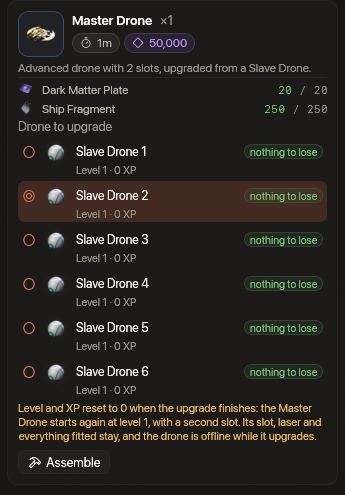

<!-- wiki-i18n source: 7c6fecaba019f9b7 -->
<!-- wiki-i18n title: Dronlar -->
# Dronlar {#drones}

Dronlar satın alınabilen ya da üretilebilen destek birimleridir. Aynı anda en fazla **8 dron** aktif olabilir; Slave Drone ve Master Drone birlikte sayılır. Aşağıdaki ağaçta yer alan on altı **dron formasyonu** dron değildir: onları araştırır ve üretirsin, kısayol çubuğundan her seferinde birini kuşanırsın ve yalnızca en az bir dronun olduğu sürece çalışırlar (bkz. [Dron formasyonları](/wiki/03-Mechanics/Formations.md)).




<!-- item-tree:begin -->
<!-- Generated from server/Data/Seeds/{items,recipes}.json and Resources/Rockets.json by scripts/trees-wiki.sh: don't edit by hand. -->

## Eşya ağacı {#item-tree}

Her Montaj ürünü önce kendi teknolojisini ister; araştırmanın ne kadar sürdüğünü görmek için bir eşyanın üzerine gel. Teknoloji ağacı, yakıt ve hızlandırma: [Araştırma](/wiki/03-Mechanics/Research.md).

```tree
Slave Drone | drone, common | buy 100000 Credits | /wiki/06-Items/Drones.md#available-drones
Master Drone | drone, rare | craft 50000 Thulium, 60 s | research 36000 s, 36000 science | 1 Slave Drone, 250 Ship Fragment, 20 Dark Matter Plate | /wiki/06-Items/Drones.md#available-drones
Testudo Formation | formation, epic | craft 15000 Thulium, 300 s | research 36000 s, 36000 science, 5 Dark Matter | 100 Ship Fragment, 10 Reinforced Hull Plate, 5 Power Core, 4 Velkonite Reinforced Plate | /wiki/03-Mechanics/Formations.md#the-sixteen-formations
Bodkin Formation | formation, epic | craft 42000 Thulium, 600 s | research 86400 s, 86400 science, 13 Dark Matter | 180 Ship Fragment, 18 Reinforced Hull Plate, 9 Power Core, 8 Velkonite Reinforced Plate, 15 Orvium Reinforced Plate | /wiki/03-Mechanics/Formations.md#the-sixteen-formations
Asterism Formation | formation, epic | craft 14000 Thulium, 300 s | research 36000 s, 36000 science, 5 Dark Matter | 100 Ship Fragment, 10 Reinforced Hull Plate, 5 Power Core, 4 Velkonite Reinforced Plate | /wiki/03-Mechanics/Formations.md#the-sixteen-formations
Adamant Formation | formation, epic | craft 18000 Thulium, 300 s | research 36000 s, 36000 science, 5 Dark Matter | 100 Ship Fragment, 10 Reinforced Hull Plate, 5 Power Core, 4 Velkonite Reinforced Plate | /wiki/03-Mechanics/Formations.md#the-sixteen-formations
Ballista Formation | formation, epic | craft 48000 Thulium, 600 s | research 86400 s, 86400 science, 13 Dark Matter | 180 Ship Fragment, 18 Reinforced Hull Plate, 9 Power Core, 8 Velkonite Reinforced Plate, 15 Orvium Reinforced Plate | /wiki/03-Mechanics/Formations.md#the-sixteen-formations
Sanctum Formation | formation, epic | craft 40000 Thulium, 600 s | research 86400 s, 86400 science, 13 Dark Matter | 180 Ship Fragment, 18 Reinforced Hull Plate, 9 Power Core, 8 Velkonite Reinforced Plate, 15 Orvium Reinforced Plate | /wiki/03-Mechanics/Formations.md#the-sixteen-formations
Shrike Formation | formation, epic | craft 17000 Thulium, 300 s | research 36000 s, 36000 science, 5 Dark Matter | 100 Ship Fragment, 10 Reinforced Hull Plate, 5 Power Core, 4 Velkonite Reinforced Plate | /wiki/03-Mechanics/Formations.md#the-sixteen-formations
Culler Formation | formation, epic | craft 40000 Thulium, 600 s | research 86400 s, 86400 science, 13 Dark Matter | 180 Ship Fragment, 18 Reinforced Hull Plate, 9 Power Core, 8 Velkonite Reinforced Plate, 15 Orvium Reinforced Plate | /wiki/03-Mechanics/Formations.md#the-sixteen-formations
Redoubt Formation | formation, epic | craft 42000 Thulium, 600 s | research 86400 s, 86400 science, 13 Dark Matter | 180 Ship Fragment, 18 Reinforced Hull Plate, 9 Power Core, 8 Velkonite Reinforced Plate, 15 Orvium Reinforced Plate | /wiki/03-Mechanics/Formations.md#the-sixteen-formations
Auger Formation | formation, epic | craft 41000 Thulium, 600 s | research 86400 s, 86400 science, 13 Dark Matter | 180 Ship Fragment, 18 Reinforced Hull Plate, 9 Power Core, 8 Velkonite Reinforced Plate, 15 Orvium Reinforced Plate | /wiki/03-Mechanics/Formations.md#the-sixteen-formations
Cordon Formation | formation, epic | craft 43000 Thulium, 600 s | research 86400 s, 86400 science, 13 Dark Matter | 180 Ship Fragment, 18 Reinforced Hull Plate, 9 Power Core, 8 Velkonite Reinforced Plate, 15 Orvium Reinforced Plate | /wiki/03-Mechanics/Formations.md#the-sixteen-formations
Centurion Formation | formation, epic | craft 16000 Thulium, 300 s | research 36000 s, 36000 science, 5 Dark Matter | 100 Ship Fragment, 10 Reinforced Hull Plate, 5 Power Core, 4 Velkonite Reinforced Plate | /wiki/03-Mechanics/Formations.md#the-sixteen-formations
Gyre Formation | formation, epic | craft 40000 Thulium, 600 s | research 86400 s, 86400 science, 13 Dark Matter | 180 Ship Fragment, 18 Reinforced Hull Plate, 9 Power Core, 8 Velkonite Reinforced Plate, 15 Orvium Reinforced Plate | /wiki/03-Mechanics/Formations.md#the-sixteen-formations
Gemini Formation | formation, mythical | craft 76000 Thulium, 900 s | research 172800 s, 172800 science, 20 Dark Matter | 260 Ship Fragment, 26 Reinforced Hull Plate, 13 Power Core, 2 Ancient Control Unit, 14 Velkonite Reinforced Plate, 30 Orvium Reinforced Plate | /wiki/03-Mechanics/Formations.md#the-sixteen-formations
Stiletto Formation | formation, mythical | craft 92000 Thulium, 900 s | research 172800 s, 172800 science, 20 Dark Matter | 260 Ship Fragment, 26 Reinforced Hull Plate, 13 Power Core, 2 Ancient Control Unit, 14 Velkonite Reinforced Plate, 30 Orvium Reinforced Plate | /wiki/03-Mechanics/Formations.md#the-sixteen-formations
Rampart Formation | formation, mythical | craft 77000 Thulium, 900 s | research 172800 s, 172800 science, 20 Dark Matter | 260 Ship Fragment, 26 Reinforced Hull Plate, 13 Power Core, 2 Ancient Control Unit, 14 Velkonite Reinforced Plate, 30 Orvium Reinforced Plate | /wiki/03-Mechanics/Formations.md#the-sixteen-formations

Slave Drone => Master Drone
```
<!-- item-tree:end -->

## Alınabilir dronlar {#available-drones}

| Ad | Nadirlik | Yuvalar | Açıklama | Maliyet |
| :--------------- | :----- | :---- | :------------------------------------------------------------------------------------------- | :------------------------------- |
| **Slave Drone**  | Sıradan | 1     | Tek bir ekipman yuvası olan temel bir dron. Uzaylıları yok ettikçe 8 seviye boyunca gelişir. | 100.000 krediden başlar (aşağıya bak) |
| **Master Drone** | Nadir   | 2     | Montaj’da yükseltilmiş bir Slave Drone. Altın renkte uçar, numarasını ve taşıdıklarını korur, ikinci bir ekipman yuvası kazanır ve yeniden 1. seviyeden başlar. | Slave Drone yükseltmesi: 50.000 Thulium, 250 Ship Fragment ve 20 Dark Matter Plate |

Slave Drone küçük bir küre olarak başlar ve 8. seviyede zırhlı bir savaş gemisine dönüşür. Bir uzaylıyı her yok edişinde sahip olduğun her dron aynı deneyimi kazanır; daha yüksek bir seviye, yuvasındaki lazere biraz hasar ekler (8. seviyede en fazla +%7). Seviyeler ve her birinin ne istediği Dron mekaniği sayfasında (Mekanikler altında) yer alır. Master Drone üretmek bir dronu harcamaz: seçtiğin dronu yerinde yükseltir ve yükseltme bittiğinde **seviyesi ve deneyimi 0’a sıfırlanır** (Montaj bunu söyler ve onay ister). Karşılığında dronun, bir yerine **iki ekipman yuvası** olur: taşıdığı birinci yuvada kalır, ikincisi boştur. Dronların, seviyeleri ve deneyimleriyle birlikte sezon sıfırlamasında korunur.

## Slave Drone fiyatları {#slave-drone-prices}

Satın aldığın her Slave Drone bir öncekinden pahalıdır. Fiyat, satın alırken kaç dronun olduğuna bağlıdır (bir Master Drone da bir dron sayılır) ve Mağaza her zaman bir sonrakinin fiyatını gösterir. İlk üçünün bedeli yalnızca kredidir; dördüncüden itibaren Thulium da eklenir.

| Dron | Kredi    | Thulium |
| :---- | :--------- | :------ |
| 1.   | 100.000    | –       |
| 2.   | 200.000    | –       |
| 3.   | 400.000    | –       |
| 4.   | 800.000    | 10.000  |
| 5.   | 1.600.000  | 20.000  |
| 6.   | 3.200.000  | 30.000  |
| 7.   | 6.400.000  | 40.000  |
| 8.   | 12.800.000 | 50.000  |

Sekiz dronun hepsi birlikte 25.500.000 kredi ve 150.000 Thulium tutar. Dronların sezon sıfırlamasından sonra da kaldığı için fiyat, elindeki sayıdan devam eder: üç dronun varsa bir sonrakin her zaman 4. dron olur, sekizin varsa satın alınacak dron kalmaz.

## Kullanım {#usage}

1. Mağaza’dan Slave Drone **satın al**. Altın renkli olanı istediğinde Montaj’da bir dronu Master Drone haline **yükselt** (seviyesi ve XP’si yeniden başlar).
2. Dronları hangarda “Dronlar” sekmesinden **tak**.
3. Gücünü artırmak için dronlara lazer veya kalkan **yükle**: Slave Drone bir, Master Drone iki yuvalıdır. Lazer geminle birlikte ateş eder; kalkan, tüm özellikleriyle birlikte çekirdek yuvasındaki bir kalkan gibi sayılır.
4. Uzaylıları yok ederek dronların **seviyesini yükselt**: hangarda her dronun seviyesi ve bir sonraki seviyenin ne kadar deneyim istediği görünür.
5. Ürettiysen bir dron formasyonunu **kuşan**: Formasyonlar listesinden kısayol çubuğuna sürükle ve yuvasının tuşuna bas ([Dron formasyonları](/wiki/03-Mechanics/Formations.md)).

**Repair Drone** bu dronlardan biri sayılmaz: bir [ekstra](/wiki/06-Items/Extras.md#repair-drones) eşyadır. Biri gövdeni onardığında gemiden küçük onarım dronları çıkar ve ona ışın gönderir; yakınındaki pilotlar onları görür.
