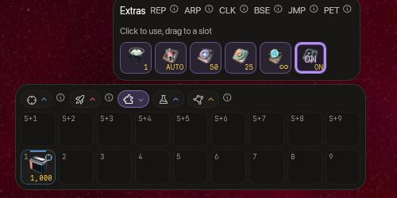
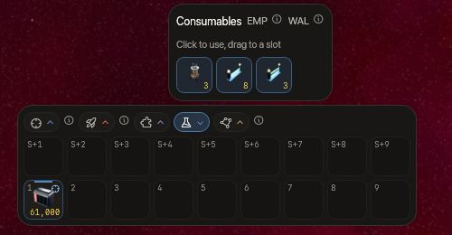
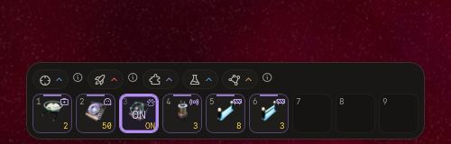
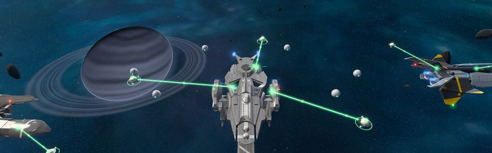
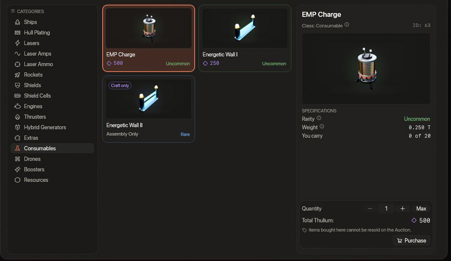

<!-- wiki-i18n source: c05d07129937fdd5 -->
<!-- wiki-i18n title: Ekstralar -->
# Ekstralar {#extras}

Ekstralar, geminin **ekstra yuvalarındaki** aletlerdir (başladığın ya da satın aldığın Protos, Kitefin, Ostirion ve Nomad gemilerinde iki; ürettiğin Paragon, Ironclad, Wraith ve Storm gemilerinde konfigürasyon başına üç; Extra Slots CPU ile 3, 5 ya da 7 tane daha). Birini kısayol çubuğunun Ekstralar bölümünden ya da ona verdiğin bir kısayol yuvasından açarsın. Yalnızca uçtuğun konfigürasyondan çalışırlar: birini diğer konfigürasyona takarsan, sen konfigürasyonu değiştirene kadar bekler.

| Ekstra | Ne yapar | Kullanım | Fiyat |
| :---- | :----------- | :--- | :---- |
| **Repair Drone I–IV** | Gövdeni onarır: saniyede maksimum gövdenin %2, %3, %4 ve %5 kadarı | sınırsız | 5.000 / 15.000 / 35.000 kredi, 2.000 Thulium |
| **Cloaking CPU S** | Gemini gizler | 10 | 5.000 Thulium |
| **Cloaking CPU M** | Gemini gizler | 25 | 11.250 Thulium |
| **Cloaking CPU L** | Gemini gizler | 50 | 20.000 Thulium |
| **P.E.T. Station I–III** | **AÇIK** iken yanaştırılmış 2, 3 ya da 5 [P.E.T.](/wiki/03-Mechanics/Pets.md#the-station) gemiye bonus verir, deneyim kazanır ve çalışır; **KAPALI** iken hiçbiri yapmaz | AÇIK / KAPALI | Montaj, araştırmasından sonra (aşağıdaki eşya ağacı) |
| **Auto-Rocket CPU** | AÇIK iken aktif roketini bir çatışmanın hedefine kendisi fırlatır | AÇIK / KAPALI | Montaj, araştırmasından sonra (aşağıdaki eşya ağacı) |
| **Laser Optics I–V** | Takılınca lazer salvolarının isabet şansına 2, 4, 6, 8 veya 10 puan ekler (yalnızca takılı olan en iyisi sayılır) | takılı, açılıp kapanmaz | Montaj, araştırmasından sonra (aşağıdaki eşya ağacı) |

Cloaking CPU paketleri yalnızca Mağaza’da satılır. Birleştirilemezler ve hiçbir şey onları ödül olarak vermez. **EMP Charge** artık bir ekstra değildir: 0.4.21 sürümünden beri bir sarf malzemesidir; roket gibi bir yığın olarak taşınır ve hiçbir yuvaya takılmaz, bu yüzden ekstra yuvalarından hiçbirini kaplamaz (bkz. [Roketler](/wiki/06-Items/Rockets.md#emp-charge)). İki **Energetic Wall** da artık ekstra değildir: 0.4.22 sürümünden beri onlar da sarf malzemesidir; bir yığın olarak taşınır ve hiçbir yuvaya takılmaz (bkz. [Energetic Wall](#energetic-wall)).

Yeni bir pilotun **başlangıç paketi**, Protos gemisinin iki ekstra yuvasına iki ekstrayı hazır takılı getirir: bir **Base CPU I** (10 kullanım, şirketinin üssüne ışınlanma) ve bir **Repair Drone I**. Repair Drone I için **REP** düğmesi kısayol çubuğunda zaten hazırdır, 2. yuvada (`2` tuşu), 1. yuvadaki cephanenin yanında; Base CPU I için ise onu kısayol çubuğunun Ekstralar bölümünden kendin bir yuvaya sürüklemen gerekir. Paketi yalnızca yeni pilotlar alır: 0.4.10 öncesinde katılmış bir pilotta yoktur, 0.4.27 öncesinde kayıt olmuş bir pilot da elindeki kısayol çubuğunu korur.

Sekiz CPU daha satılmaz: Skylab’ın Araştırma Merkezi bunları araştırdıktan sonra Montaj üretir (bkz. [Araştırma](/wiki/03-Mechanics/Research.md)). Bunlar: Extra Slots CPU I, II ve III, Jump CPU, Base CPU I ve II, Auto-Repair CPU ile Auto-Rocket CPU; [son bölüm](#research-cpus) her birinin ne yaptığını anlatır. Cloaking CPU gibi, Jump CPU ve Base CPU da sakin bir an içindir: üçü de attığın bir atıştan ya da aldığın bir vuruştan sonraki 10 saniye içinde başlamaz. İki warp CPU, yani Jump CPU ve Base CPU, bir görev eşyası taşırken de reddedilir (“Görev eşyası taşırken warp CPU kullanamazsın.”): bkz. [Görev eşyaları](/wiki/03-Mechanics/Quests.md#quest-items).

Her ekstranın kısayol yuvasında kısa bir etiket vardır: Repair Drone için **REP**, Cloaking CPU için **CLK**, Auto-Repair, Auto-Rocket, Base ve Jump CPU için de sırasıyla **ARP**, **ARL**, **BSE** ve **JMP** (sarf malzemelerinin kendi etiketleri vardır: **EMP** ve Energetic Wall için **WAL**). Extra Slots CPU için yuva yoktur: Skylab’ına kurulur. Üç **P.E.T. Station** eşyası diğerleri gibi birer ekstradır ve etiketi **PET**’tir: birini tak, yuvası Station’ı **AÇIK** ya da **KAPALI** konuma getirir (iki basış arasında bir saniye) ve hangisi olduğunu gösterir. **AÇIK** iken yanaştırılmış [P.E.T. birimleri](/wiki/03-Mechanics/Pets.md) sayılır, **KAPALI** iken sayılmaz. **Auto-Rocket CPU** da aynı şekilde **AÇIK** ya da **KAPALI** konuma getirilir. Bir yuvanın üstüne gelirsen, basmanın şu an ne yapacağını ya da neden yapamayacağını okursun.







<!-- item-tree:begin -->
<!-- Generated from server/Data/Seeds/{items,recipes}.json and Resources/Rockets.json by scripts/trees-wiki.sh: don't edit by hand. -->

## Eşya ağacı {#item-tree}

Her Montaj ürünü önce kendi teknolojisini ister; araştırmanın ne kadar sürdüğünü görmek için bir eşyanın üzerine gel. Teknoloji ağacı, yakıt ve hızlandırma: [Araştırma](/wiki/03-Mechanics/Research.md).

```tree
P.E.T. Station I | extra, common | craft 100000 Credits, 2000 Thulium, 300 s | research 10800 s, 10800 science | 25 Ship Fragment, 2 Power Core, 4 Velkonite Reinforced Plate | /wiki/06-Items/Extras.md
Cloaking CPU S | extra, common | buy 5000 Thulium | /wiki/06-Items/Extras.md#cloaking-cpu
Repair Drone I | extra, common | buy 5000 Credits | /wiki/06-Items/Extras.md#repair-drones
Repair Drone II | extra, common | buy 15000 Credits | /wiki/06-Items/Extras.md#repair-drones
Repair Drone III | extra, common | buy 35000 Credits | /wiki/06-Items/Extras.md#repair-drones
Extra Slots CPU I | extra, uncommon | craft 12000 Thulium, 300 s | research 1800 s, 1800 science | 60 Ship Fragment, 3 Power Core, 6 Velkonite Reinforced Plate | /wiki/06-Items/Extras.md#extra-slots-cpus
Base CPU I | extra, uncommon | craft 8000 Thulium, 300 s | research 10800 s, 10800 science | 40 Ship Fragment, 2 Power Core, 4 Velkonite Reinforced Plate | /wiki/06-Items/Extras.md#base-cpus
P.E.T. Station II | extra, uncommon | craft 300000 Credits, 4000 Thulium, 600 s | research 36000 s, 36000 science | 1 P.E.T. Station I, 35 Ship Fragment, 6 Reinforced Hull Plate, 2 Power Core, 4 Velkonite Reinforced Plate, 2 Orvium Reinforced Plate | /wiki/06-Items/Extras.md
Laser Optics I | extra, uncommon | craft 8000 Thulium, 300 s | research 10800 s, 10800 science | 40 Ship Fragment, 2 Power Core, 4 Velkonite Reinforced Plate | /wiki/06-Items/Extras.md#laser-optics
Laser Optics II | extra, uncommon | craft 15000 Thulium, 450 s | research 21600 s, 21600 science | 80 Ship Fragment, 8 Reinforced Hull Plate, 4 Power Core, 6 Velkonite Reinforced Plate | /wiki/06-Items/Extras.md#laser-optics
Cloaking CPU M | extra, uncommon | buy 11250 Thulium | /wiki/06-Items/Extras.md#cloaking-cpu
Extra Slots CPU II | extra, rare | craft 30000 Thulium, 600 s | research 36000 s, 36000 science | 120 Ship Fragment, 10 Reinforced Hull Plate, 6 Power Core, 12 Velkonite Reinforced Plate, 2 Orvium Reinforced Plate | /wiki/06-Items/Extras.md#extra-slots-cpus
Base CPU II | extra, rare | craft 20000 Thulium, 600 s | research 36000 s, 36000 science | 100 Ship Fragment, 5 Power Core, 1 Ancient Control Unit, 2 Orvium Reinforced Plate, 4 Dark Matter Plate | /wiki/06-Items/Extras.md#base-cpus
Auto-Repair CPU | extra, rare | craft 15000 Thulium, 600 s | research 21600 s, 21600 science | 80 Ship Fragment, 8 Reinforced Hull Plate, 4 Power Core, 6 Velkonite Reinforced Plate | /wiki/06-Items/Extras.md#auto-repair-cpu
P.E.T. Station III | extra, rare | craft 1100000 Credits, 12000 Thulium, 900 s | research 86400 s, 86400 science | 1 P.E.T. Station II, 60 Ship Fragment, 6 Reinforced Hull Plate, 4 Power Core, 2 Ancient Control Unit, 4 Velkonite Reinforced Plate, 2 Orvium Reinforced Plate | /wiki/06-Items/Extras.md
Auto-Rocket CPU | extra, rare | craft 20000 Thulium, 900 s | research 36000 s, 36000 science | 100 Ship Fragment, 10 Reinforced Hull Plate, 5 Power Core, 1 Ancient Control Unit, 8 Velkonite Reinforced Plate | /wiki/06-Items/Extras.md#auto-rocket-cpu
Rocket Launcher II | extra, rare | craft 150000 Thulium, 28800 s | research 172800 s, 172800 science | 300 Ship Fragment, 50 Reinforced Hull Plate, 30 Power Core, 5 Ancient Control Unit | /wiki/06-Items/Extras.md
Rocket Launcher III | extra, rare | craft 400000 Thulium, 43200 s | research 345600 s, 345600 science | 800 Ship Fragment, 120 Reinforced Hull Plate, 80 Power Core, 15 Ancient Control Unit | /wiki/06-Items/Extras.md
Rocket Launcher IV | extra, rare | craft 900000 Thulium, 57600 s | research 604800 s, 604800 science | 1800 Ship Fragment, 250 Reinforced Hull Plate, 160 Power Core, 30 Ancient Control Unit | /wiki/06-Items/Extras.md
Rocket Launcher V | extra, rare | craft 2000000 Thulium, 86400 s | research 864000 s, 864000 science | 4000 Ship Fragment, 500 Reinforced Hull Plate, 300 Power Core, 60 Ancient Control Unit | /wiki/06-Items/Extras.md
Laser Optics III | extra, rare | craft 30000 Thulium, 600 s | research 36000 s, 36000 science | 120 Ship Fragment, 10 Reinforced Hull Plate, 6 Power Core, 12 Velkonite Reinforced Plate, 2 Orvium Reinforced Plate | /wiki/06-Items/Extras.md#laser-optics
Laser Optics IV | extra, rare | craft 50000 Thulium, 750 s | research 57600 s, 57600 science | 180 Ship Fragment, 18 Reinforced Hull Plate, 9 Power Core, 2 Ancient Control Unit, 14 Velkonite Reinforced Plate, 6 Orvium Reinforced Plate | /wiki/06-Items/Extras.md#laser-optics
Laser Optics V | extra, rare | craft 75000 Thulium, 900 s | research 86400 s, 86400 science | 240 Ship Fragment, 25 Reinforced Hull Plate, 12 Power Core, 3 Ancient Control Unit, 15 Velkonite Reinforced Plate, 10 Orvium Reinforced Plate | /wiki/06-Items/Extras.md#laser-optics
Repair Drone IV | extra, rare | buy 2000 Thulium | /wiki/06-Items/Extras.md#repair-drones
Cloaking CPU L | extra, rare | buy 20000 Thulium | /wiki/06-Items/Extras.md#cloaking-cpu
Extra Slots CPU III | extra, epic | craft 75000 Thulium, 900 s | research 86400 s, 86400 science, 10 Dark Matter | 240 Ship Fragment, 25 Reinforced Hull Plate, 12 Power Core, 2 Ancient Control Unit, 6 Orvium Reinforced Plate, 4 Dark Matter Plate | /wiki/06-Items/Extras.md#extra-slots-cpus
Jump CPU | extra, epic | craft 40000 Thulium, 900 s | research 86400 s, 86400 science, 10 Dark Matter | 200 Ship Fragment, 20 Reinforced Hull Plate, 10 Power Core, 3 Ancient Control Unit, 15 Velkonite Reinforced Plate, 10 Orvium Reinforced Plate | /wiki/06-Items/Extras.md#jump-cpu

P.E.T. Station I => P.E.T. Station II => P.E.T. Station III
Cloaking CPU S -> Cloaking CPU M -> Cloaking CPU L
Repair Drone I -> Repair Drone II -> Repair Drone III -> Repair Drone IV
Extra Slots CPU I -> Extra Slots CPU II -> Extra Slots CPU III
Base CPU I -> Base CPU II
Laser Optics I -> Laser Optics II -> Laser Optics III -> Laser Optics IV -> Laser Optics V
Rocket Launcher II -> Rocket Launcher III -> Rocket Launcher IV -> Rocket Launcher V
```
<!-- item-tree:end -->

## Repair Drone {#repair-drones}

REP yuvasına bas: Repair Drone gövdeyi dolana kadar onarır. Yalnızca 10 saniye boyunca vuruş almazsan başlar ve her vuruş onu kapatır. Birkaçı takılıysa en iyisi çalışır. Bir [Auto-Repair CPU](#auto-repair-cpu) onu senin için yeniden açar. Onarım hızları [Savaş](/wiki/03-Mechanics/Combat.md) sayfasında. Onarırken gemiden küçük onarım dronları çıkar, geminin etrafında döner ve gövdeye ışın tutar: Repair Drone I için bir, II için iki, III veya IV için üç; yakınındaki pilotlar onları görür. Onarım durunca gemiye geri kenetlenirler. REP ile açtığında yumuşak bir onarım darbesi de çalar; Emergency Repair darbesinden biraz daha kalın ve daha kısıktır. Onarırken de yaklaşık saniyede bir, az önce iyileştirdiği gövde puanını gösteren küçük yeşil bir sayı (+N) kendi geminin üzerinde yükselir; bir Auto-Repair CPU açmış olsa bile.

## Cloaking CPU

Gizlenmek için CLK yuvasına bas. **Bir basış bir kullanımdır**, paket ne olursa olsun; kalan kullanımları yuvada ve hangarda görebilirsin. Bir gizlenmenin **süre sınırı yoktur**: sen kapatana ya da bir şey bozana kadar açık kalır.

- **Seni kim göremez.** Diğer şirketlerin pilotları ve uzaylılar gemini hiç görmez: ne ekranlarında ne de hedef listelerinde yer alır ve kimse ona kilitlenemez. Diğer şirketlerin şirket pilotları da onu yok sayar.
- **Radar noktası.** Haritadaki diğer her pilot, kendi şirketin hariç, mini haritada olduğun yerde sade bir **kırmızı nokta** görür; böylece gizlenmiş birinin etrafta olduğunu bilir. Noktanın adı, gemisi, şirketi ya da kimliği yoktur; tıklanamaz ve hedef alınamaz; üstüne gelince yalnızca “Burada gizlenmiş bir şey var” yazar. Yuvarlaktır ve bir çemberin içindedir (mini haritada gemiler karedir); çember yavaşça nefes alır, “Hareketi azalt” açıksa durur. Sunucu onu saniyede yaklaşık iki kez yeniler; arada senin oyunun onu akıcı biçimde hareket ettirir. Orada birinin olduğunu ve nerede olduğunu söyler, kim olduğunu değil: gizlendiğini gören bir pilot noktayı izleyebilir ve ona doğrultulmuş bir **roket patlaması** yine de seni bulur.
- **Kim görebilir.** Kendi gemini soluk ve çerçeveli görürsün. Şirketinin pilotları seni soluk bir hayalet olarak görür; diğer şirketlerdeki klan üyeleri görmez, çünkü bir klan başvuran herkesi alır. Hayalet hedef alınamaz, şirketin bile alamaz.
- **Gizlenemezsin**: güvenli bölgede, CPU yeniden dolarken ya da bir vuruş aldıktan veya bir atış yaptıktan sonraki **10 saniye** içinde.
- **Neyi bitirir.** Yuvaya yeniden basmak, ilk salvon ya da roketin (isabet eder ve görülürsün), güvenli bölgeye girmek, CPU’nun uçtuğun konfigürasyondan ayrılması, kim ateşlemiş olursa olsun sana **1.500 birim içinde patlayan bir EMP** (şirketinden biri ateşlediyse de, ama bir grup üyesi ateşlediyse değil) ve sana isabet eden bir roketin alan patlaması. Zaman bitirmez, kargo toplamak bitirmez (aldığın kutu herkes için ortadan kalkar, bu yüzden diğerleri o noktanın yakınında bir şey olduğunu öğrenir, kimin olduğunu değil), yetenekler bitirmez ve kara deliğin radyasyonu gizlenmiş gemiye zarar verir ama gizlenmesini bitirmez. Oturumu kapatmak ya da ölmek bitirir, çünkü uçulmayan bir gemi gizlenmiş olamaz.
- **Yeniden dolum.** Bir gizlenme nasıl biterse bitsin, CPU **60 saniye** yeniden dolar. Dolum gemiye değil sana aittir: bir portaldan sıçrarsan, oturumu kapatırsan ya da ölürsen devam eder. Her basış yine de bir kullanım harcar.
- Peşindeki **uzaylılar** seni kaybeder. Gizlendiğinde öldürme sahiplenmelerin bırakılır.
- **Roketler.** Hiç kimse sana güdümlü bir roket kilitleyemez ve düz, tek hedefli bir roket içinden geçer. Bir **alan patlaması** kapsadığı gemiye yine zarar verir ve gizlenmesini bitirir; geminin yerini görebilen pilotlara hasar sayısı belirmeden önce orası gösterilir. Roket fırlatmak bir atıştır: salvo gibi kendi gizlenmeni bitirir (CPU yukarıdaki 60 saniye boyunca yeniden dolar) ve, gizli olsan da olmasan da, ardından 10 saniye boyunca gizlenmeni engeller.
- **Kara delik**, gizlenmiş gemiyi de diğerleri gibi yutar ve haritadaki herkes bunu duyar.
- **Ne görürsün.** Gemin şeffaflaşır ve mor kesikli bir çerçeve alır, dronları da onunla birlikte solar; ekranın üstündeki küçük bir etiket kalan kullanımla birlikte “Gizli” yazar (saniye yok: sayaç yoktur). CLK yuvası kalan kullanımı gösterir; gizliyken mor parlar ve AÇIK yazar, gizlenme nasıl biterse bitsin bittiğinde kararır ve 60 saniyelik yeniden dolumu sayar. Sunucunun reddettiği bir basış (yeniden dolum, güvenli bölge, son 10 saniyede bir vuruş ya da atış) yuvayı kırmızı yakıp söndürür ve bir mesaj nedenini söyler. Bir müttefik, adının önünde bir hayalet işaretiyle soluk bir hayalet olarak görünür; yakınında gizlenen bir pilot dalgalanarak kaybolur. Kullanmak için onu kısayol çubuğunun Ekstralar bölümünden bir yuvaya sürükle, REP için olduğu gibi.
- **Kullanımlar** CPU ile birlikte kaydedilir. Oturumu kapatmak, ölmek ya da oyunu yeniden başlatmak hiçbirini geri vermez ve iptal ettiğin bir etkinleştirme de yine harcanır. Bir paketin son kullanımı bittiğinde paket tükenir ve yuvası, envanterinde aynı CPU’dan bir yedek varsa onunla doldurulur.
- Aynı konfigürasyondaki **birkaç CPU** toplanmaz. Kalan kullanımı en az olan önce kullanılır.

S, M ve L aynı davranır: büyük paketler yalnızca kullanım başına daha ucuzdur (500, 450 ve 400 Thulium).

## Energetic Wall

WAL yuvasına bas; **imlecinin olduğu yerde**, geminden ona uzanan hattı dik keserek bir **plazma duvarı** belirir: 360 birim uzunluğunda (yaklaşık üç buçuk gemi boyunda) ve 10 birim genişliğinde bir şerit. Ortası geminin ortasından en fazla **450 birim** uzaktadır: daha uzaktaki bir imleç onu hat boyunca 450 birim uzağa koyar, 120 birimden yakın bir imleç de onu 120 birime iter. Yuva hazırken soluk bir noktalı çizgi ve bir hayalet çerçeve nerede duracağını gösterir. Oyun imlecinin nerede olduğunu bilmiyorsa, geminin ortasının 220 birim önünde, yönüne dik durur. Energetic Wall bir **sarf malzemesidir**, [EMP Charge](/wiki/06-Items/Rockets.md#emp-charge) gibi: envanterindeki bir yığındır ve hiçbir gemide **yuva kaplamaz** (0.4.22 sürümüne kadar bir ekstraydı). Kullanmak için onu kısayol çubuğunun **Sarf Malzemeleri** bölümünden bir yuvaya sürükle; iki seviye iki ayrı kalemdir, bu yüzden bir yuva tek bir seviyeyi taşır. Arkasına saklanmak ve bir atış hattını kesmek içindir, içinde durmak için değil.

- **Neyi durdurur.** Onu geçen her atış, kim ateşlemiş olursa olsun ve hangi yönden gelirse gelsin, duvara çarpar: bir lazer salvosu, bir roket, bir uzaylının salvosu. Arkasında duran hiçbir şey hasar almaz; hasarı duvar alır. Duvarda patlayan bir roketin patlaması yakın tarafındaki gemilere zarar verir, arkasındakilere vermez. Seninkiler de: kendi duvarının içinden dışarı ateş edemezsin. N.I.K.E. roketi ile Dormant Swamp taretleri, asteroitlerin üzerinden uçtukları gibi, onun üzerinden uçar.
- **Neyi yakar.** Gövdesi şeride değen her gemi, önce kalkanından olmak üzere, saniyede **2.500 hasar** alır: seninki de, uzaylılar ve şirket pilotları da. Güvenli bölgedeki ya da doğma korumasındaki bir gemi yanmaz ve bir gemide iki şerit toplanmaz.
- **Ne kadar dayanır.** 1. seviye bir duvar **100.000 HP**, 2. seviye bir duvar **250.000 HP** taşır. Duvar kendiliğinden her saniye bunların altmışta birini kaybeder; yani kimsenin ateş etmediği bir duvar **60 saniye** sonra yok olur. Atışlar bunu kısaltır: x4 cephaneyle on üç Helios Beam taşıyan bir Wraith, 1. seviye bir duvarı yaklaşık 11 saniyede, 2. seviye bir duvarı yaklaşık 22 saniyede yıkar.
- **Aynı anda tek, basış başına bir duvar.** Yeni bir duvar eskisinin yerini alır. Bir basıştan sonra eşya **90 saniye** yeniden dolar; bu bekleme gemiye değil sana aittir, bu yüzden ölmek ya da oturumu kapatmak onu kısaltmaz. Bir basış, yuvasının taşıdığı seviyeden **bir duvar** harcar ve yalnızca duvar kurulduğunda: oyunun reddettiği bir basış (aşağıda) hiçbir şey harcamaz ve bekleme başlatmaz. O seviyeden hiç kalmadıysa “Energetic Wall kalmadı.” der ve onun yerine diğer seviye asla kullanılmaz.
- **Nerede olmaz.** Bir güvenli bölge ya da doğma koruması seni korurken olmaz, şeridin bir güvenli bölgeye ya da geçide değeceği yerde olmaz, gizliyken olmaz ve şeridin ortasının haritadan taşacağı yerde olmaz. Hangisi olduğunu oyun söyler.
- **Öldürmeler.** Duvarın yok ettiği bir gemi radyasyondan ölür ve öldürme, varsa, ona 15 saniye içinde vuran son düşman pilota yazılır. Duvarı kurana, kendisinin ateş etmediği hiçbir şey yazılmaz. Duvarın yok ettiği bir uzaylı hiçbir şey ödemez: ne ödül ne ganimet.
- **Uzaylılar etrafından dolanmaz.** İçinden uçup yanarlar ya da kendi tarafında durup duvara ateş ederler.
- **Ne görürsün.** Boyunca parlak çizgilerin aktığı, iki ucunda birer ışık direği olan mavi-beyaz bir ışık şeridi; atış isabet ettiği yerde parlar, tükenmeye yakınken titrer. 2. seviye bir duvar bunun yerine sarı parlar; çekirdeği daha kalın ve parlak, ışıltısı daha güçlüdür, ama şeridi 1. seviye duvarınki kadar, yani 10 birim genişliğindedir. Yanındaki ince bir can çubuğu kısalır, kehribar rengine sonra kırmızıya döner; yuvan duvarın kalan canını yay olarak, beklemeyi gölge olarak, o seviyeden kalan duvar sayısını da bir sayı olarak gösterir. Kurulan bir duvar parlayarak belirir, vurulup yıkılan bir duvar kıvılcımlar içinde çöker, süresi dolan ise solar.
- **Nasıl edinilir ve taşınır.** Energetic Wall I, Mağaza’da duvar başına **10.000 kredi** karşılığında satılır ve bir yığında en fazla **20** tane taşırsın ([Açık Artırma](/wiki/03-Mechanics/Auction.md)’da listelediklerin de sayılır). Energetic Wall II, Araştırma Merkezi onu araştırdıktan sonra (normal hızda 6 saat: [Araştırma](/wiki/03-Mechanics/Research.md)) Montaj’da, **üretim başına bir duvar** olarak, **600 Thulium**, 5 Ship Fragment ve bir Power Core ile üretilir; en fazla **10** tane taşırsın. Kendiliğinden aktarılan on iki roketin (her birinden 1.000) aksine, taşıdığın duvarlar Nakliye Deposu’na koymazsan sezonla birlikte kaybolur ve depodaki duvarlar kullanılamaz. Yaptığın bir Energetic Wall II Açık Artırma’da satılabilir; Mağaza’nın sattığı Energetic Wall I asla.

## Mine

**Mine**, attığın bir tuzaktır. Kürsörü bir noktaya getirip yuvasına bas; geminin Mine’ı oraya atar, **lazerlerinin yettiği yere kadar**: daha uzaktaki bir kürsör onu çizgi boyunca o menzile koyar, kürsör noktası yoksa gemiden hemen altına düşer. Kısa bir süre uçar, iner ve **3 saniye sonra silahlanır**. Bundan sonra **üzerinden geçen ilk geminin altında, tüm hasarıyla bir kez** patlar ve ortadan kalkar: zamana yayılan hasar da patlama dalgası da yoktur. Mine, [Energetic Wall](#energetic-wall) gibi bir **sarf malzemesidir**: envanterindeki bir yığındır ve hiçbir gemide **yuva kaplamaz**. Kullanmak için onu kısayol çubuğunun **Sarf Malzemeleri** bölümünden bir yuvaya sürükle; üç seviye üç ayrı kalemdir, bu yüzden bir yuva tek bir seviyeyi taşır.

- **Kime çarpar.** Üzerinden geçen her gemiye: düşman pilota, uzaylıya, şirket pilotuna, şirket arkadaşlarına, grubuna ve **sana**. Mine’ın dostu yoktur. Bir gemiyi koruyan şey onu her silahtan koruyan şeydir: güvenli bölge, doğma koruması, gizlenme ya da EMP penceresi.
- **Uzaklaşmak.** Mine indiği anda menzilinin içinde olan gemi, o menzilden bir kez çıkana kadar korunur ve onun ilk koruduğu sensin: gemin altına bir Mine bırakıp uzaklaşabilirsin. Sonrasında Mine, o geminin altında da diğer her geminin altında olduğu gibi patlar; sonradan geri gelse bile.
- **Ne kadar.** Hasar seviyeyle artar: **8.000, 20.000 ve 50.000**. Sabotaj becerin ona yüzde 30’a kadar ekler, Nişancılık becerin de Mine’ın daha hızlı ve daha uzağa uçmasını sağlar.
- **Sınırlar.** Bir Mine’ın **kendi bir sonu yoktur**: indiği yerde, bir gemi onu patlatana ya da sunucu yeniden başlayana kadar durur; oyundan çıksan, ölsen ya da haritadan ayrılsan da kalır. **Sana özgü bir sınır yoktur**, yalnızca iki atış arasındaki **8 saniyelik** bekleme vardır (bekleme geminin değil senindir). Haritayı iki kural korur: onları kim attıysa atsın, iki Mine arasında **365 birimden** az mesafe olamaz (en büyük geminin boyunun iki katından biraz fazla) ve bir haritada en fazla **150** Mine bulunabilir. Bu kurallardan birini çiğneyecek bir atış reddedilir, hiçbir şey harcamaz ve bekleme başlatmaz; nişan alırken kürsörün halkası reddedileceği yerde kırmızıya döner.
- **Nerede olmaz.** Pilotların birbiriyle savaşamadığı yerlerde olmaz (Barış Protokolü sırasında ya da kuralları bunu yasaklayan bir sektörde veya geçitte), bir güvenli bölge ya da doğma koruması seni korurken olmaz, Mine’ın bir güvenli bölgeye ya da geçide değeceği yerde olmaz ve gizliyken olmaz. Hangisi olduğunu oyun söyler; reddedilen bir atış hiçbir şey harcamaz ve bekleme başlatmaz.
- **Nasıl edinilir ve taşınır.** Mine I, Mağaza’da **100 Thulium** karşılığında satılır ve bir yığında en fazla **20** tane taşırsın. Mine II, Montaj’da, **üretim başına bir Mine** olarak, iki Mine I, 3 Ship Fragment ve bir Power Core ile **200 Thulium** karşılığında üretilir (yığında en fazla **10**); Mine III, iki Mine II, 8 Ship Fragment, 2 Power Core ve bir Reinforced Hull Plate ile **400 Thulium** karşılığında (en fazla **5**). İkisi de Araştırma Merkezi araştırdıktan sonra üretilir: normal hızda II için 3 saat, III için 6 saat ([Araştırma](/wiki/03-Mechanics/Research.md)). Taşıdığın Mine’lar Nakliye Deposu’na koymazsan sezonla birlikte kaybolur ve depodaki Mine’lar kullanılamaz. Mine’lar [Açık Artırma](/wiki/03-Mechanics/Auction.md)’da satılamaz.

## Laser Optics

Liderlerinin daha sık isabet etmesini sağlayan beş eşya. Satılmazlar: Skylab’ın Araştırma Merkezi onları araştırınca Montaj üretir, birbiri ardına (Lasers ailesi, bkz. [Araştırma](/wiki/03-Mechanics/Research.md)).

- **Ne yaparlar.** Birini ekstra yuvaya tak; [Lazer teknolojisi](/wiki/03-Mechanics/Combat.md#laser-tech)nin verdiğine ek olarak lazer salvolarının isabet etme şansına puan ekler, hiçbir zaman %100’ü geçmez. Laser Optics I 2 puan, II 4, III 6, IV 8, V ise 10 puan ekler. Iskalayan bir salvo yine de mermisini harcar; yani her puan artık boşa harcamadığın hasardır.
- **Yalnızca en iyisi sayılır.** İki Laser Optics toplanmaz: taktığın en iyisi sayılır. Sadece yanında taşıdığın ya da diğer konfigürasyona taktığın, o konfigürasyonla uçana kadar hiçbir şey yapmaz.
- **Basacak bir şey yok.** Kısayol çubuğunda yuvaları ve anahtarları yoktur: takılı oldukları sürece çalışır ve diğer Ekstralar gibi ekstra yuvalarından birini kullanır.
- **Nerede görürsün.** Bir lazerin kartı ve Hangar’ındaki Hasar karosu, Lazer teknolojinin ve Optics’in birlikte verdiği toplam şansı gösterir.

| Eşya | Ekler | Araştırma süresi | Üretim için Thulium | Üretim süresi |
| :--- | ---: | :--- | ---: | ---: |
| Laser Optics I | +2 puan | 3 sa | 8.000 | 5 dk |
| Laser Optics II | +4 puan | 6 sa | 15.000 | 7,5 dk |
| Laser Optics III | +6 puan | 10 sa | 30.000 | 10 dk |
| Laser Optics IV | +8 puan | 16 sa | 50.000 | 12,5 dk |
| Laser Optics V | +10 puan | 24 sa | 75.000 | 15 dk |

## Araştırma Merkezi CPU’ları {#research-cpus}

CPU’lardan ikisi, her yükseltme zincirinin son kademesi gibi, Dark Matter Plate ister: **Extra Slots CPU III** 4 tane (ayrıca 2 Ancient Control Unit ve 6 Orvium Reinforced Plate), **Base CPU II** de 4 tane (ayrıca bir Ancient Control Unit ve 2 Orvium Reinforced Plate) ister; bu yüzden önce Dark Matter Plate teknolojisini araştır ([Dark Matter ve Dark Matter plakaları](/wiki/03-Mechanics/Dark-Matter.md)).

<!-- research-cpus:begin -->
<!-- Generated from server/Resources/{Research,CpuConfig,SkylabConfig}.json and Data/Seeds/{items,recipes}.json by scripts/research-wiki.sh: don't edit by hand. -->

| CPU | Araştırma süresi | Önce gerekir | Üretim için Thulium | Üretim süresi |
| :--- | :--- | :--- | ---: | ---: |
| [Extra Slots CPU I](/wiki/06-Items/Extras.md#extra-slots-cpus) | 30 dk | – | 12.000 | 5 dk |
| [Extra Slots CPU II](/wiki/06-Items/Extras.md#extra-slots-cpus) | 10 sa | [Extra Slots CPU I](/wiki/06-Items/Extras.md#extra-slots-cpus) | 30.000 | 10 dk |
| [Extra Slots CPU III](/wiki/06-Items/Extras.md#extra-slots-cpus) | 1 g | [Dark Matter Plate](/wiki/06-Items/Resources.md#dark-matter-plate), [Extra Slots CPU II](/wiki/06-Items/Extras.md#extra-slots-cpus) | 75.000 | 15 dk |
| [Base CPU I](/wiki/06-Items/Extras.md#base-cpus) | 3 sa | – | 8.000 | 5 dk |
| [Base CPU II](/wiki/06-Items/Extras.md#base-cpus) | 10 sa | [Base CPU I](/wiki/06-Items/Extras.md#base-cpus), [Dark Matter Plate](/wiki/06-Items/Resources.md#dark-matter-plate) | 20.000 | 10 dk |
| [Jump CPU](/wiki/06-Items/Extras.md#jump-cpu) | 1 g | [Base CPU II](/wiki/06-Items/Extras.md#base-cpus) | 40.000 | 15 dk |
| [Auto-Repair CPU](/wiki/06-Items/Extras.md#auto-repair-cpu) | 6 sa | – | 15.000 | 10 dk |
| [Energetic Wall II](/wiki/06-Items/Extras.md#energetic-wall) | 6 sa | – | 600 | 2 dk |
| [Auto-Rocket CPU](/wiki/06-Items/Extras.md#auto-rocket-cpu) | 10 sa | – | 20.000 | 15 dk |
| [Mine II](/wiki/06-Items/Extras.md#mine) | 3 sa | – | 200 | 2 dk |
| [Mine III](/wiki/06-Items/Extras.md#mine) | 6 sa | [Mine II](/wiki/06-Items/Extras.md#mine) | 400 | 5 dk |

Hiçbiri Mağaza’da satılmaz: önce teknolojiyi araştır, sonra Montaj’da CPU üret. Montaj’ın istediği malzemeleri görmek üzere ağaçtaki CPU simgesinin üzerine gel.

### Extra Slots CPUs

- **Ne yaparlar.** Extra Slots CPU I, II ve III her gemiye 3, 5 ve 7 ekstra yuva daha verir; böylece kendi 3 yuvası olan bir gemide toplam 6, 8 ve 10, 2 yuvası olan bir gemide ise 5, 7 ve 9 olur. Daha yüksek bir CPU öncekinin yerini alır: II, I ile toplanmaz.
- **Kurulur, taşınmaz.** Extra Slots CPU bir eşya değildir: Montaj’da topladığında kendini Skylab üssüne kurar, iki konfigürasyondaki her gemi için geçerlidir ve hiçbir yuva kaplamaz. Sıfırlamadan sonra da kalır.
- **Sırayla.** Onları art arda üret: II yalnızca I kuruluyken, III yalnızca II kuruluyken; o zamana kadar Montaj hangisini önce kurman gerektiğini söyler. Üçü toplam 117.000 Thulium tutar: 12.000, 30.000 ve 75.000.

### Jump CPU

- **Ne yapar.** Gemini dünyandaki herhangi bir şirket sektörüne, kendi şirketininki de diğer şirketlerinki de, ana sektörleri dahil (`M`, `T` ve `G`, 1–4. sektörler), sıçrama başına **500 Thulium** karşılığında götürür. Kullanım sınırı yoktur: yalnızca Thulium ödersin. Hiçbir zaman bir Tehlike Sektörü’ne (`DS`) ya da tarafsız bir sektöre (`N`) gitmez.
- **Sıçrama.** JMP yuvasına bas, Yıldız Sistemi haritasında sektörü seç ve onayla: gemi 5 saniye şarj olur, sonra o sektörün bir geçidinde belirir, herhangi bir geçit sıçramasından sonraki gibi korunur. Vardıktan sonra CPU 30 saniye soğur.
- **Savaşta olmaz.** Ateş etmenin ya da vurulmanın üzerinden 10 saniye geçmeden başlayamaz ve şarj olurken yapılan bir atış ya da alınan bir vuruş sıçramayı iptal eder; o zaman hiçbir şey ödenmez. Gizlenmişken sıçrayamazsın.
- **Tarafsız sektörden olmaz:** tarafsız bir sektördeki ya da şirketi olmayan bir pilot bunu kullanamaz.
- Savaşta değilsen bir Tehlike Sektörü’nden ayrılabilir.

### Base CPUs

- **Ne yaparlar.** Gemini şirketinin üssüne, istasyonunun çevresindeki güvenli bölgeye ışınlarlar (`M-1`, `T-1` veya `G-1`, Mission Control bulunan sektör), Thulium harcamadan. Onları kısayol çubuğunun BSE yuvasından başlatırsın.
- **Savaşta olmaz.** 10 saniyelik şarj, ikisi için de aynı. Ateş etmenin ya da vurulmanın üzerinden 10 saniye geçmeden, gizlenmişken ya da zaten üssünün güvenli bölgesindeyken başlayamaz; şarj olurken yapılan bir atış ya da alınan bir vuruş onu iptal eder.

| CPU | Kullanım | Bekleme süresi |
| :--- | ---: | ---: |
| [Base CPU I](/wiki/06-Items/Extras.md#base-cpus) | 10 | 10 dk |
| [Base CPU II](/wiki/06-Items/Extras.md#base-cpus) | 25 | 5 dk |

- **Tükenir, şarj olmaz.** Her kullanım bir kullanım hakkı götürür ve hakkı kalmayan CPU yok olur: yenisini üret. İkisi de kuruluysa, daha iyi olan (II) önce kullanılır.

### Auto-Repair CPU

- **Ne yapar.** Ekstra yuvalarındaki Repair Drone, elle gönderebileceğin her an kendiliğinden dışarı gönderilir: gövden dolu değildir, dron zaten dışarıda değildir ve son vuruştan beri 10 saniye geçmiştir. Ayarlanacak bir gövde seviyesi yoktur.
- Kendine ait bir ekstra yuva kaplar ve aynı konfigürasyondaki bir ekstra yuvada Repair Drone yoksa hiçbir şey yapmaz. Yetenek yuvasındaki Repair Drone hiçbir zaman gönderilmez (o, Emergency Repair düğmesidir).
- **Dronu elle durdurursan,** CPU, gövden yeniden dolana ya da dronu kendin gönderene kadar ona dokunmaz.

### Auto-Rocket CPU

- **Ne yapar.** AÇIK olduğu sürece ve bir çatışmadayken (lazerlerin bir uzaylıya, düşman bir pilota ya da bir asteroite ateş ederken), Roket fırlat tuşuna basmak işe yarayacağı her an en son fırlattığın aktif roketi o hedefe kendisi fırlatır: roketlerin sayacı hazırdır ve elinde bir tane kalmıştır. Sunucu her fırlatmayı seninkileri denetlediği gibi denetler. Bir asteroite karşı da bir gemiye karşı olduğu gibi roket harcar, bu yüzden yalnızca madencilik yaparken onu KAPALI tut.
- **Anahtar.** Bir Ekstra yuvasına tak ve ARL yuvasına basarak AÇIK ya da KAPALI yap. KAPALI başlar ve bıraktığın gibi kalır, yeniden giriş yaptığında da. Yuva AÇIK ya da KAPALI yazar ve CPU ateş ettiğinde parlar.
- **Asla yapmadığı şeyler.** Asla hedef seçmez, güvenli bölgeden ya da gizliyken ateş etmez, N.U.K.E. ya da N.I.K.E. fırlatmaz. Kendi fırlattığın roket her zaman çalışır. 3 dakika boyunca tuşa basmazsan, tıklamazsan ve fareyi oynatmazsan sen bir şey yapana kadar bekler.
- **Roket kalmadı.** Bir kez söyler ve elinde yenisi olunca yeniden fırlatır.


<!-- research-cpus:end -->
