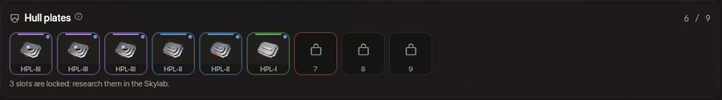

<!-- wiki-i18n source: df5b37694d9bfff2 -->
<!-- wiki-i18n title: Gövde Kaplaması -->
# Gövde Kaplaması {#hull-plating}

<!-- wiki-search: hull plate; hull plate slot; hull plate slots; plate slot; plate; armour; armor; hpl; gövde kaplaması; kaplama; gövde plakası; gövde plakası yuvası; plaka; zırh -->

Dormant sürüsünün incelenmesi zırh teknolojisinde ilerlemeleri ortaya koydu. Bu teknolojiyle gemiler gövdelerini geliştirebilir: **gövde kaplaması** (Hull Plating), üretilmiş bir geminin gövde plakası yuvasına takılan ve ona gövde puanı ekleyen zırhtır. [Boosterlar](/wiki/06-Items/Boosters.md) sayfasındaki zamanlı bir bonus olan Hull Plating **Booster** ile aynı şey değildir.



<!-- item-tree:begin -->
<!-- Generated from server/Data/Seeds/{items,recipes}.json and Resources/Rockets.json by scripts/trees-wiki.sh: don't edit by hand. -->

## Eşya ağacı {#item-tree}

Her Montaj ürünü önce kendi teknolojisini ister; araştırmanın ne kadar sürdüğünü görmek için bir eşyanın üzerine gel. Teknoloji ağacı, yakıt ve hızlandırma: [Araştırma](/wiki/03-Mechanics/Research.md).

```tree
Hull Plating I | hull-plating, uncommon | buy 5000 Thulium | /wiki/06-Items/Hull-Plating.md#the-three-platings
Hull Plating II | hull-plating, rare | craft 2500 Thulium, 300 s | research 86400 s, 86400 science, 25 Dark Matter | 1 Hull Plating I, 150 Ship Fragment, 20 Reinforced Hull Plate, 6 Power Core, 5 Dark Matter Plate | /wiki/06-Items/Hull-Plating.md#the-three-platings
Hull Plating III | hull-plating, epic | craft 4000 Thulium, 600 s | research 172800 s, 172800 science, 40 Dark Matter | 1 Hull Plating II, 300 Ship Fragment, 40 Reinforced Hull Plate, 12 Power Core, 1 Ancient Control Unit, 8 Dark Matter Plate | /wiki/06-Items/Hull-Plating.md#the-three-platings

Hull Plating I => Hull Plating II => Hull Plating III
```
<!-- item-tree:end -->

## Üç kaplama {#the-three-platings}

| Eşya | Eklediği gövde | Nereden gelir |
| :--- | ---: | :--- |
| **Hull Plating I** | 5.000 | Mağaza, 5.000 Thulium |
| **Hull Plating II** | 10.000 | Montaj, bir Hull Plating I kullanılarak |
| **Hull Plating III** | 15.000 | Montaj, bir Hull Plating II kullanılarak |

Hull Plating I satın alınır. **II ve III yükseltmedir**: Montaj bir alt kademeden bir kaplamayı harcar (envanterinde boşta olan) ve Thulium, malzeme ve **Dark Matter Plate** ister: II için 5, III için 8; başka her ekipman parçasının son kademesi ise 4 tane ve bir Ancient Control Unit ister. Her birinin önce teknolojisi gerekir; bu teknoloji [Araştırma](/wiki/03-Mechanics/Research.md#tree-hull-plating) sayfasındaki Gövde Kaplaması ağacındadır: II için 1 gün ve 25 Dark Matter, III için 2 gün ve 40, Dark Matter Plate teknolojisine ek olarak. Yukarıdaki ağaç fiyatları, malzemeleri ve süreleri gösterir.

[Demirhane](/wiki/06-Items/Forge.md) her kaplamayı kabul eder; bir yükseltme, harcadığı kaplamanın Demirhane kademesini korur ve bonusu yeniden rastgele belirlenir. Bir kaplamanın tek bir özelliği vardır, gövdesi; bu yüzden tek bir bonus taşır, kademeye göre +%2 ile +%15 arası: Ebedi kademedeki bir Hull Plating III en fazla 17.250 gövde puanı ekler. [Açık Artırma](/wiki/03-Mechanics/Auction.md) yalnızca Hull Plating II ve Hull Plating III eşyalarını listeler; Mağaza’nın sattığı Hull Plating I eşyasını asla.

## Gövde plakası yuvaları {#hull-plate-slots}

Gövde kaplaması yalnızca **gövde plakası yuvalarına** takılır; Montaj’da ürettiğin dört geminin lazer, jeneratör, ekstra, yetenek ve dron yuvalarının yanında bir de bu kendine özgü yuva türü vardır:

| Gemi | Gövde plakası yuvaları | Tam bir Hull Plating III seti şunu ekler |
| :--- | ---: | ---: |
| **Paragon** | 5 | 75.000 |
| **Storm** | 7 | 105.000 |
| **Ironclad** | 15 | 225.000 |
| **Wraith** | 9 | 135.000 |

- **Başta hepsi kilitli.** Bir yuva, Skylab’da araştırdığında açılır: her yuva için bir teknoloji, 1 saat ve 10 Dark Matter, ilkinden başlayarak sırayla. [Araştırma](/wiki/03-Mechanics/Research.md#ship-technologies) görünümü bir geminin yuvalarını, her biri için bir nokta bulunan tek bir kart olarak gösterir.
- **Tek bir gemi değil, bir gemi türü.** Paragon için açtığın yuvalar her Paragon tasarımında da açıktır ([Gemi tasarımları](/wiki/03-Mechanics/Ship-Designs.md)). Bir teknoloji kalıcı olarak senindir: sıfırlama onu korur.
- **İki konfigürasyon da bunları paylaşır.** Plakalar gemiye aittir: konfigürasyon değiştirmek onları takılı bırakır ve ikisinde de hangarda aynı plakalar görünür.
- **Karışık olabilir.** Bir yuva herhangi bir gövde kaplamasını alır, aynı türden iki tane de olabilir.
- **Gövde oranın korunur.** Bir plakayı takmak ya da çıkarmak sahip olduğun gövde oranını korur; yani bir plaka seni ne iyileştirir ne de zarar verir.
- **Her ekipman gibi**, plakaları hangarda ya da bir güvenli bölgeden hangar penceresinde takar ve çıkarırsın, sahada asla. Araştırmadığın bir yuva plaka kabul etmez.

Hangarda **Gövde plakaları** kartı yuvaları gösterir. Açık bir yuva, her yuva gibi, sürükle bırak ile plaka alır; kilitli bir yuva kilit simgesi gösterir ve tıklamak Skylab’ın araştırmasını açar. Diğer özelliklerin yanındaki bir kutucuk takılı plakaların verdiğini toplar.

## Gövde nasıl toplanır {#how-the-hull-adds-up}

Bir plaka gövdesini geminin kendi gövdesine ekler; hangar ve Gemi penceresi büyük sayıyı gösterir. Geminin gövdesi artı plakaları, sonra her zaman geçtiği çarpanlardan geçer: bir [Hull Plating Booster](/wiki/06-Items/Boosters.md) ve kuşandığın [dron formasyonu](/wiki/03-Mechanics/Formations.md). Gövdeyi değiştiren bir tasarım (BUCKY tasarımında %25 fazladır) geminin kendi gövdesini değiştirir, plakalar bunun üstüne gelir.

## Gövde kaplaması mı, Hull Plating Booster mı? {#hull-plating-or-booster}

İki şey aynı adı paylaşır. **Hull Plating** (bu sayfa) zırhtır: üretilmiş bir geminin gövde plakası yuvasında duran ve takılı olduğu sürece gövdesini ekleyen bir plakadır. **Hull Plating Booster** ise [Boosterlar](/wiki/06-Items/Boosters.md) sayfasındaki zamanlı bir bonustur: uçtuğun her gemide 10 saat boyunca +%10 maksimum gövde puanı verir ve takılacak bir şeyi yoktur. İkisi toplanır: önce plakalar gelir, bonusun %10’u toplam üzerinden alınır.
