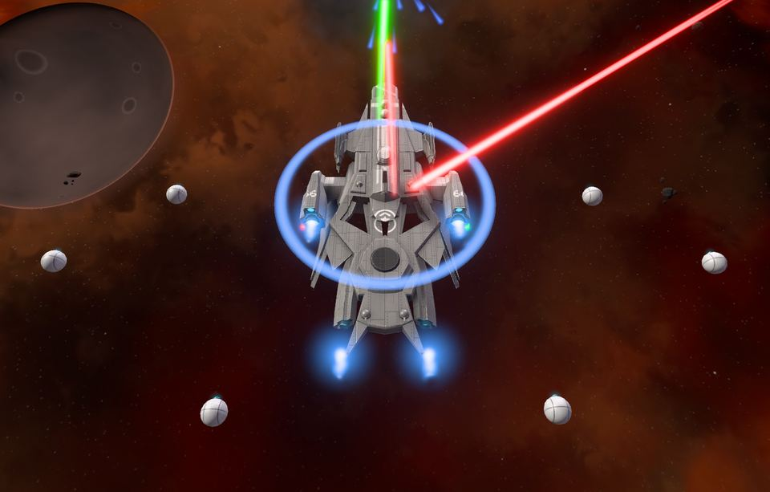
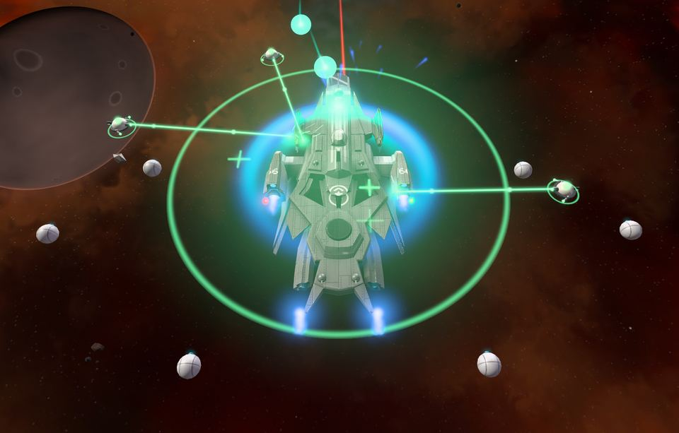
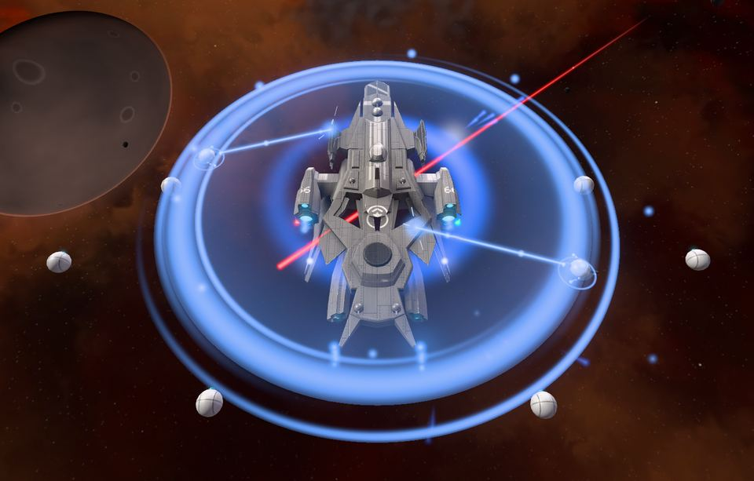

<!-- wiki-i18n source: 7a295e69dd1155fd -->
<!-- wiki-i18n title: 技能 -->
# 舰船主动技能 {#active-ship-abilities}

技能是你在激战中按下的按钮：失而复得的护盾、用来脱离射程的一阵加速、船体将毁时的一次修理。它们来自你装入舰船**技能槽位**的**护盾、引擎或 Repair Drone**，物品越好，技能越强。它们是为你最需要的那一刻准备的，而不是每次冷却一好就按：每个技能持续十到十五秒，然后要冷却一分半到两分钟。一些[舰船设计](/wiki/03-Mechanics/Ship-Designs.md)还多一个自己专属的技能：见[舰船技能](#ship-abilities)。

新飞行员一开始就拥有一个技能：初始装备中的 **Repair Drone I** 已经装在 Protos 的技能槽位里，所以 Emergency Repair 按钮（`E`）从第一分钟起就在那里。套装里的第二个 Repair Drone I 放在附加槽位里：它会自行缓慢修复船体，不属于技能（见[附加装置](/wiki/06-Items/Extras.md#repair-drones)）。

## 技能槽位 {#ability-slots}

每艘舰船在机库中都有固定数量的技能槽位：

- **Protos**（初始舰船）：1 个槽位
- **Kitefin**：1 个槽位
- **Ostirion**：2 个槽位
- **Nomad**：2 个槽位
- **Paragon**：3 个槽位
- **Storm**：3 个槽位
- **Ironclad**：4 个槽位
- **Wraith**：3 个槽位

技能槽位可以装入一个**护盾核心**、一台**引擎**或一个 **Repair Drone**，每一种各自产生自己的技能。把物品拖到槽位上即可。配置 1 和配置 2 各有自己的槽位。 在机库里点击护盾、引擎或 Repair Drone，会把它装进平常的槽位；如果它平常的槽位（发生器槽位，Repair Drone 则是附加装置槽位）都满了，就装进第一个空闲的技能槽位。

- **护盾电池和推进器无法装入技能槽位。**它们是护盾、引擎和自适应核心的模块。
- **装在技能槽位里的物品不会再提供其他任何东西。**它不提供护盾容量、充能、吸收率或速度，也不带来护盾的任何减速。同一个 Heavy Shield Core，要么放在发生器槽位里，随时提供它的护盾；要么放在技能槽位里，为的是它的 Shield Surge。由你选择。
- 装有电池或推进器的护盾或引擎，在你把它拖到技能槽位上时，会把它们退回你的物品栏。
- 技能槽位中的 Repair Drone 产生 Emergency Repair，本身不会修理船体。缓慢的修理无人机（**REP**）需要把 Repair Drone 装在附加槽位里。

## 同类多个模块 {#several-modules-of-one-kind}

你可以在同一套配置的技能槽位里装入**多个护盾、引擎或 Repair Drone**。它们仍然是一个技能、一个按钮、一个冷却，但会更强：

- **等级最低的模块决定基础值。**它的等级决定强度和冷却。Heavy Shield Core 与 Light Shield Core 放在一起，相当于两个 I 级模块：更好的第二个模块只会带来加成，而不会带来更高的强度或更短的冷却。
- **其余每个模块会增加基础值的 50%**，是相加，而不是相乘。引擎让 Afterburner **持续更久**：一台是 15 秒，两台是 22.5 秒，三台是 30 秒，四台是 37.5 秒（速度加成和冷却不变）。护盾让 Shield Surge **恢复更多**，Repair Drone 让 Emergency Repair **修复更多**，仍在同样的十秒内：一个、两个、三个、四个模块分别是总量的 100%、150%、200% 和 250%。
- **额外的模块要占用槽位。**有三个技能槽位的舰船，可以装三个同类模块，或每类各一个，或两个加一个；有四个槽位的 Ironclad 可以装四个同类模块，或两个同类模块加其余两类各一个。Protos 或 Kitefin 只有一个槽位，无法叠加；Ostirion 和 Nomad 可以装两个同类模块。
- 等级相同时，就是那个等级。两个同等级模块中，附魔较弱的那个决定基础值。

## 三种技能 {#the-three-abilities}

### Shield Surge（护盾），按键 `Q` {#shield-surge-shields-key-q}

在十秒内，你舰船的护盾会得到**恢复**：Surge 会均匀地恢复最大护盾的一部分，最多恢复到上限，绝不会超过。它不是屏障，也不会改变攻击伤害在护盾与船体之间的分摊方式；它只是把护盾补回来，而补回来的部分会保留。受到攻击时它不会中断（普通充能在受击后要等 15 秒；Surge 不用）。护盾已满的舰船从中获益很少，所以请在护盾告急时再按。总量不会低于核心自身容量的 60%，因此护盾很少的舰船也能得到一次实实在在的修复（最高恢复到上限）。

- 在安全区保护期间，以及在完全没有护盾的舰船上，会被拒绝使用，以免误点白白消耗掉它。
- 穿透型火箭仍会部分绕过护盾，这一点和以前一样。

### Afterburner（引擎），按键 `W` {#afterburner-engines-key-w}

在持续时间内，你的最终速度会乘以该等级的加成。它不会改变转向、瞄准或所受伤害：它把时间换成距离。用它来脱离战斗、赶到空间站或传送门的保护环，或者追上正在逃跑的目标。它在任何地方都能使用，包括安全区。更多的引擎只会让它持续更久，而不会更快。

### Emergency Repair（Repair Drone），按键 `E` {#emergency-repair-repair-drones-key-e}

在**十秒内均匀修复你最大船体**的一部分，最高不超过上限。受击不会打断它：这是应急技能，在炮火下、在黑洞的辐射中、在隐形状态下以及在 EMP 生效期内都能生效。时间一到，或你的舰船被摧毁时，它就会结束。它不影响你的护盾，不算作一次受击，也不改变缓慢的 REP 修理的状态。船体已满时会被拒绝使用。

## 舰船技能 {#ship-abilities}

十四种[舰船设计](/wiki/03-Mechanics/Ship-Designs.md)中有十种带有一个技能，它属于设计，而不属于某件物品。它**不占技能槽位**，也不需要装任何东西：只要你驾驶这种设计，它就在。它有自己的按钮，是快捷栏那一列里的第四个，按键是 `F`（可以在设置中更改）。它有自己的冷却，和其他技能一样会被保留：切换配置、跃迁和下线都不会重置它，被击毁的舰船会带着所有技能就绪开始下一次飞行。

| 技能 | 设计 | 作用 | 持续 | 冷却 |
| :--- | :--- | :--- | ---: | ---: |
| **Blink** | Storm NOTSUM、Ironclad TITANIC、Protosaur | 朝你的移动指令方向以 2,500 的速度前进 | 1 秒 | 120 秒 |
| **Chameleon** | Storm RECON、Protosaur | 对其他所有飞行员隐形，小地图上也看不到 | 直到被打破 | 60 秒 |
| **Target** | Storm RECON | 你选中的激光射程内的敌方舰船受到的伤害增加 20% | 5 秒 | 60 秒 |
| **Slow** | Storm RECON | 你选中的激光射程内的敌方舰船飞行速度降低 60% | 4 秒 | 60 秒 |
| **Focus Fire** | Ironclad DUMA | 1,000 单位内的敌方舰船被迫攻击你 | 5 秒 | 60 秒 |
| **Venom** | Wraith RAPTOR | 对目标的船体直接造成 125,000 点伤害 | 30 秒 | 120 秒 |
| **Diminisher** | Wraith BILLY | 你受到的伤害减少 75%，造成的伤害减少 25% | 25 秒 | 120 秒 |
| **Heal Pod** | Storm BRATAN、Wraith MENATI | 一个舱体每秒为 600 单位内的友方舰船治疗 20,000 + 其最大船体的 2% | 5 秒 | 120 秒 |
| **Shield Buff** | Wraith ATARAXIS | 你的护盾容量翻倍，并每秒回复其最大值的 2% | 10 秒 | 120 秒 |
| **Heal Pod** | Miyuki（I–V） | 同一个治疗舱，但停留更久；从 Miyuki III 起每秒治疗 30,000 + 其最大船体的 3% | 7.5 秒 | 120 秒 |
| **Channel Heal** | Miyuki（II–V） | 与你选中的 1,200 单位内的舰船建立连接：对方每秒获得 50,000 船体，你获得 10,000（从 Miyuki IV 起对方获得 75,000） | 5 秒 | 120 秒（从 Miyuki IV 起 100 秒） |
| **Channel Shield** | Miyuki（III-V） | 与你选中的 1,200 单位内的舰船建立连接：对方每秒获得 150,000 护盾，你获得 30,000，另外双方每秒还各恢复自身最大护盾的 3%（Miyuki III）、4%（IV）或 5%（V） | 5 秒 | 120 秒（从 Miyuki V 起 80 秒） |

- **Blink。** 1 秒内，你的速度为 2,500，朝你的移动指令方向前进。你会在指令结束的地方停下，地图边缘也会让你停下。之后它冷却 120 秒。
- **Chameleon。** 你消失了：其他任何飞行员都看不到你，无论在地图上还是小地图上，也没有人能锁定你。你自己的企业仍然能看到你，像一个幽灵。EMP 打不破它。你受到任何伤害、发射激光齐射、发射火箭、使用 Target 或 Slow、拾取箱子，或者再次按下按钮时，它就会结束；它的 60 秒冷却从结束时开始计算，无论怎样结束。在一次射击或被击中后的 10 秒内不能启动它，在安全区的圈内不能，Cloaking CPU 开着时也不能。安全区不会让它结束，传送门跳跃也不会：隐形会与你一起穿过传送门。当你自己的攻击使它结束时，你会获得 3 秒的 **Ambush**：伤害增加 25%，速度增加 25%。飞行员专长“潜行”同样会缩短它的等待时间，与 Cloaking CPU 一样。
- **Target。** 锁定或选中激光射程内的一艘敌方舰船并按下：5 秒内它受到所有人的伤害增加 20%（Marking Rocket 的效果），周围的舰船都能看到标记。它对其他企业的飞行员和外星人有效，对你的小队或企业、安全区保护的舰船，以及拒绝激光锁定的地方（Peace Protocol、没有 PvP 的星区）无效；在安全区内会被拒绝。它算作一次攻击：会打断你的隐形，所以使用 Target 的 Chameleon 会获得 Ambush。之后它冷却 60 秒。
- **Slow。** 同样持续 4 秒：该舰船的速度降低 60%（Freeze Rocket 的效果），并冷却 60 秒。
- **Focus Fire。** 5 秒内，1,000 单位内的每个敌方飞行员和外星人都被迫攻击你：飞行员的锁定被设在你身上且无法更改，外星人则转向你。你小队和企业的飞行员、受安全区保护的舰船以及隐形的舰船不受影响；在安全区内，或射程内没有敌人时，它会被拒绝。被迫的飞行员仍然可以飞往他们想去的地方。
- **Venom。** 锁定你激光射程内的一个目标并按下：在 30 秒内，125,000 点伤害会均匀地直接打在它的船体上，它的护盾不分担任何一部分。它对其他企业的飞行员和外星人同样有效，对你的小队或企业无效，对受安全区保护的舰船无效，在激光锁定被拒绝的地方（和平协议、没有 PvP 的星区）也无效。一艘舰船同一时间只能承受一个 Venom。每一跳都算一次命中，所以目标到结束为止都无法躲进安全区。修理、Heal Pod 和目标上的 Diminisher 都会削弱它；目标或你死亡时它就结束，击杀及其积分归你。
- **Diminisher。** 25 秒内，你受到的每一次命中在护盾分担之前被削减到四分之一，所以护盾和船体各损失四分之一；你造成的每一次命中被削减到四分之三：激光、直射火箭和爆炸都是如此。它运行期间再按一次不会有任何作用。
- **Heal Pod。** 一个舱体落在你所在的位置，停留 5 秒。每秒它为 600 单位内的每艘友方舰船治疗 20,000 再加上该舰船最大船体的 2%：你、你的小队和你的企业，别人不行，也永远不会超过最大值。没有东西能锁定这个舱体或向它射击，你死亡后它也会继续治疗。Miyuki 的治疗舱停留 7.5 秒，最后的半秒治疗半个脉冲；从 Miyuki III 起治疗 30,000 加 3%。
- **Shield Buff。** 10 秒内，你的护盾容量翻倍，你现有的护盾也随之翻倍，并且护盾每秒回复翻倍后最大值的 2%。结束时容量恢复原状，护盾按比例随之回落，所以它不会治疗你：它是多出来的承受打击的空间。没有护盾的舰船上它会被拒绝。
- **Channel Heal。** 选中 1,200 单位内的一艘舰船并按下（可以是友方，也可以是敌方飞行员或外星人：连接会治疗它所连接的对象，所以请慎重选择；副本或单人传送门的首领无法被连接）：一条连接会把你与它连在一起 5 秒。每秒它为那艘舰船治疗 50,000 船体，为你治疗 10,000，两者同时发生，且不会超过最大值。从 Miyuki IV 起，另一艘舰船获得 75,000，冷却为 100 秒；你自己的 10,000 不变。你的治疗技能会让两次治疗都更强，但治疗敌人不会给你带来治疗经验值。连接在时间用完、任一舰船被摧毁或离开地图、双方相距超过 1,200 单位，或 EMP 命中任一舰船时结束；已经治疗的部分保留。
- **Channel Shield。** 同样的连接，作用于护盾：5 秒内每秒为另一艘舰船提供 150,000 护盾，为你提供 30,000，另外每秒双方各恢复自身最大护盾的一部分：Miyuki III 为 3%，IV 为 4%，V 为 5%，因此 Miyuki V 的一次连接在点数之外共恢复每艘舰船最大护盾的 25%。不会超过最大护盾。Miyuki V 的冷却是 80 秒，而不是 120 秒。治疗技能会同时增强它的点数和占最大护盾的比例，它也以同样的方式结束。

**Miyuki** 是支援舰，不是设计型号，最多带有其中三个：`F` 键的 Heal Pod、II 级起 `D` 键的 Channel Heal，以及 III 级起 `S` 键的 Channel Shield。第二个和第三个的按钮位于第一个左侧的单独一列，各有自己的冷却。连接需要你按下时已选中舰船；游戏不会替你选择。**Storm RECON** 带有三个：`F` 键的 Chameleon，以及单独一列中的 Target 和 Slow，它们需要选中或锁定一艘敌方舰船。

在你附近引爆的 **EMP** 会让这个按钮锁定 5 秒：按下会被拒绝，冷却也不会开始。已经在运行的技能会继续，Chameleon 也依然保持隐藏。其他飞行员同样能看到这些技能：Blink 身后的一道轨迹，Focus Fire 所迫舰船的红色圆环和连线，而 Chameleon 只会作为幽灵出现在它自己的企业眼中。命中你或你所连接舰船的 EMP 也会中断连接。

## 等级 {#ranks}

技能的强度是**你自己舰船数值的一个比例**（最大护盾、速度、最大船体），所以它会随舰船一同成长。等级来自物品：更好的型号带来更好的技能。附魔过的物品会把它的附魔加成加到强度上，最多 15%。表格针对单个模块；叠加的情况在表格下方。

<!-- abilities:begin -->
<!-- Generated from server/Resources/AbilityConfig.json and the items' stats by scripts/abilities-wiki.sh: don't edit by hand. -->

| 技能 | 等级 | 物品 | 强度（单个模块） | 持续时间 | 冷却 | 生效占比 |
| :--- | :---: | :--- | :--- | --: | --: | --: |
| **Shield Surge** | I | Light Shield Core | 恢复你最大护盾的 18% | 10 秒 | 120 秒 | 8.3% |
| **Shield Surge** | II | Basic Shield Core | 恢复你最大护盾的 36% | 10 秒 | 105 秒 | 9.5% |
| **Shield Surge** | III | Heavy Shield Core | 恢复你最大护盾的 60% | 10 秒 | 90 秒 | 11.1% |
| **Afterburner** | I | Engine I | 速度 +20% | 15 秒 | 120 秒 | 12.5% |
| **Afterburner** | II | Engine II | 速度 +30% | 15 秒 | 105 秒 | 14.3% |
| **Afterburner** | III | Engine III | 速度 +40% | 15 秒 | 90 秒 | 16.7% |
| **Emergency Repair** | I | Repair Drone I | 修复你最大船体的 12% | 10 秒 | 120 秒 | 8.3% |
| **Emergency Repair** | II | Repair Drone II | 修复你最大船体的 15% | 10 秒 | 105 秒 | 9.5% |
| **Emergency Repair** | III | Repair Drone III | 修复你最大船体的 19.2% | 10 秒 | 90 秒 | 11.1% |
| **Emergency Repair** | IV | Repair Drone IV | 修复你最大船体的 24% | 10 秒 | 75 秒 | 13.3% |

同一套配置中的多个同类模块：等级最低的模块决定上面的强度和冷却，其余每个模块再增加其 50%。

| 同类模块数量 | Afterburner 持续 | Shield Surge 恢复 | Emergency Repair 修复 |
| :---: | --: | --: | --: |
| 1 | 15 秒 | 100% | 100% |
| 2 | 22.5 秒 | 150% | 150% |
| 3 | 30 秒 | 200% | 200% |
| 4 | 37.5 秒 | 250% | 250% |

<!-- abilities:end -->

Engine II 以及 III 级的护盾和引擎（Heavy Shield Core、Engine III）不出售：你要在[装配站](/wiki/06-Items/Overview.md#upgrading-modules)中，分别用一个 Engine I、Basic Shield Core 和 Engine II 来制造，并消耗 Thulium、掉落物和板（Engine II 用 4 块 Velkonite Reinforced Plate，其余用 4 块 Dark Matter Plate 和 1 个 Ancient Control Unit：[Dark Matter 与 Dark Matter Plate](/wiki/03-Mechanics/Dark-Matter.md)）。Emergency Repair 还有第四个等级，即 Repair Drone IV。

## 冷却与限制 {#cooldowns-and-limits}

- **冷却从你按下技能时开始计算**，并且包含技能的持续时间。所以，一个 10 秒的 Surge 配 90 秒冷却，最多只有 11% 的时间处于生效状态，结束后的 80 秒内无法使用。多个模块并不会缩短冷却（冷却取决于等级最低的那个模块）；即使装三个 Afterburner，也最多只有 33% 的时间处于生效状态。
- **冷却属于你，而不属于物品。**切换配置、更换物品、跃迁到另一个星区以及下线，都不会重置冷却。舰船被摧毁后，下一次飞行开始时所有技能都处于就绪状态。
- **每个技能都有自己的冷却。**使用其中一个，不会锁定其他技能。
- **正在运行的效果保持它开始时的数值。**卸下物品或切换配置，不会改变或结束它。跃迁或重新连接同样不会结束它；下线则会结束它，而它的冷却会保留。
- 其他飞行员能在地图上看到你技能的计时器，一直都是如此：用掉的 Surge 会告诉他们，接下来的几分钟是可乘之机。

## 飞行员专长 {#pilot-skills}

你的[飞行员专长](/wiki/03-Mechanics/Pilot-Skills.md)中有四项会改变技能的运作方式，包括你的舰船设计所带的 `F` 技能：

- **反射**让冷却更早结束，每升一级就多快一点。冷却仍然从你按下时开始，并包含该技能的持续时间。
- **战术**让技能持续更久。Shield Surge 或 Emergency Repair 在更长的时间里每秒给出同样的点数，所以总共恢复得更多；Afterburner 则运行更久。冷却不会随之变长，所以技能结束后的等待会变短。
- **破坏**会强化毒素，例如 Wraith RAPTOR 的 Venom，在战术之外提高伤害和持续时间。
- **治疗**会让你自己装备的治疗更强：Emergency Repair、额外槽位里的 Repair Drone（REP），以及你投放的 Heal Pod 的每一次治疗（Heal Pod 会保留你投放时的治疗等级）。它与战术相乘，战术会让 Emergency Repair 和 Heal Pod 持续更久（在较高等级，Heal Pod 多停留一秒，多治疗一次）：两者都是 100 级时，Emergency Repair 或 Heal Pod 总共多治疗 56%。Support Rocket 始终治疗固定的相同数量。你开启的 Channel Heal 或 Channel Shield 会以该系数对两艘舰船产生更强的效果（Channel Shield 的最大护盾比例部分也一样）。在 Miyuki 上，治疗还会缩短 Heal Pod、Channel Heal 和 Channel Shield 的等待时间：100 级时缩短 10%，从 1 级起按直线变化。其他舰船的 Heal Pod 等待时间保持不变。

每一级的数值见[飞行员专长](/wiki/03-Mechanics/Pilot-Skills.md#the-stats)的表格。

## 按键与按钮 {#keys-and-buttons}

`Q` 为 Shield Surge，`W` 为 Afterburner，`E` 为 Emergency Repair，`F` 为舰船设计的技能，Miyuki 另有 `D` 为 Channel Heal、`S` 为 Channel Shield（都可以在设置中更改）。只有当你的配置拥有对应技能时（`F`、`D`、`S` 按钮则是在你驾驶的舰船有这些技能时），按钮才会出现在快捷栏旁边，所以新飞行员的 `E` 从第一分钟起就在那里。图标周围的圆环显示技能的状态：就绪时以技能的颜色保持完整，运行时随剩余秒数逐渐耗尽（Emergency Repair 现在也是如此，因为它是在十秒内逐步修复的），冷却时则重新逐渐填满，圆环中央显示剩余秒数。叠加了多个模块时，按钮角上会带有叠加标记（`x2`、`x3`）。你的船体已满时，Emergency Repair 按钮会变暗；在完全没有护盾的舰船上，Shield Surge 按钮也会变暗。将指针悬停在按钮上，可以看到针对你舰船、已计入叠加的数值（例如 *Afterburner II x2：速度 +30%，持续 22.5 秒*），以及在 Surge 或修理运行期间，它每秒提供多少、还剩多少尚未到来。

## 在机库中 {#in-the-hangar}

把护盾、引擎或 Repair Drone 拖到技能槽位上，或在物品栏中右键点击它，把它放进第一个空闲的槽位。同类的第二个和第三个会进入接下来的空闲槽位并叠加。每个已装槽位下方会显示技能的名称和等级，以及叠加标记和它所有模块合计的数值（*Afterburner II x2*、*x2 · 22.5 秒*；Wraith 上装一个 Repair Drone II 则显示*船体 +81,000*），悬停在槽位上，则会显示它在你舰船上价值多少（已计入叠加），以及叠加中由哪个模块决定等级。同类的每个模块显示的都是同一个技能，因为它们是一个整体。在其他任何地方悬停该物品，会显示按你自己舰船比例计算的技能，以及一句说明再多一个模块会增加什么的话。

## 所有人都能看到什么 {#what-everyone-sees}

Shield Surge 在运行期间会在舰船周围形成一个气泡，最后两秒会闪烁，结束时向内收拢。随着 Surge 把护盾补回来，护盾条（你自己的在舰船窗口中，目标的在目标窗口中）会直接填满，在还有空间可补时，护盾条会轻轻脉动。Afterburner 在运行期间会让引擎燃烧得更炽热，持续 15、22.5、30 或 37.5 秒，并在启动时从舰船向外发出一圈光环，叠加时光环更宽。Emergency Repair 启动时会发出一道绿色脉冲，然后在它的十秒内用柔和的绿色光芒包裹船体，并有几个加号从船体上升起，每秒把它修复的船体量浮现在你自己的舰船上方，最后以一次闪光结束。它运行时，小型修理无人机会环绕舰船并为其修补：Repair Drone I 配一架，II 配两架，III 或 IV 配三架，叠加中每多一个 Repair Drone 再多一架（最多不超过三架）。它们离开船体，把柔和的绿色光束对准船体的装甲板，从 II 级起沿光束发出脉冲，并在十秒结束时飞回对接；Shield Surge 的气泡里最多有两架蓝色的无人机。地图上的每名飞行员都能看到这三种技能，包括那些无人机（在别人的舰船上更小，在较低的画质设置下数量更少，其中“低”画质只显示光束和光芒而没有无人机模型，而无人机的等级每高一级，光束就稍宽一点），因此用掉的 Surge 对敌人来说和对你来说一样是个信号。无人机会发出三种它们自己的轻声音效，远低于修理的铃声：离开船体时一声轻轻的哔声，对接时一声，工作时光束下方一道微弱的音调（Surge 的无人机音调稍高）；你能从屏幕上的舰船听到它们，同时最多听到几个，而且音效音量可以把它们调低。开启*减弱动态效果*后，光芒保持稳定，加号被省略，最后的闪光变成渐隐，无人机停在舰船旁边，光束保持稳定（音效依旧）。附加槽位里的 Repair Drone（REP）在修复船体期间也会画出它的无人机：Repair Drone I 一台，II 两台，III 或 IV 三台，它们环绕舰船并照射光束，地图上的每位飞行员都能看到。修复停止后，它们会飞回对接。用 REP 启动它时，还会响起一声柔和的修复脉冲，比 Emergency Repair 的脉冲略低沉、略轻，并且和 Emergency Repair 一样，每秒把它修复的船体量浮现在你自己的舰船上方。

## 有哪些变化 {#what-changed}

在 0.4.3 更新之前，技能槽位装的是护盾电池（护盾再生）和推进器（加速）。原本放在技能槽位里的护盾电池和推进器，在游戏更新时已退回你的物品栏，你依然拥有它们：它们仍然是护盾、引擎和自适应核心的模块。从那时起，Shield Surge 不再提供超额护盾屏障，而是在十秒内修复你的护盾；Emergency Repair 改为在十秒内逐步修复，而不是一次性修复；而且你可以装入多个同类模块，来获得更长的 Afterburner、更大的 Surge 或更大的修复量。自 0.5.0 更新起，Afterburner 在 I、II、III 等级分别提供 +20%、+30%、+40% 的速度，持续 15 秒（此前为 +30%、+45%、+60%，持续 10 秒）：获得的距离不变，只是分摊到更长的时间里。冷却时间不变，叠加两个引擎时持续 22.5 秒，三个引擎时持续 30 秒。
