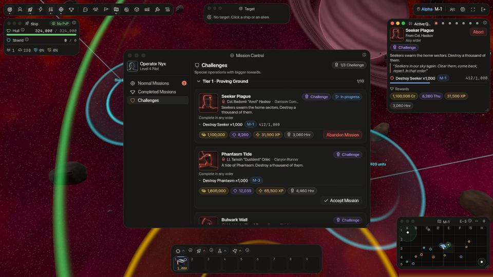
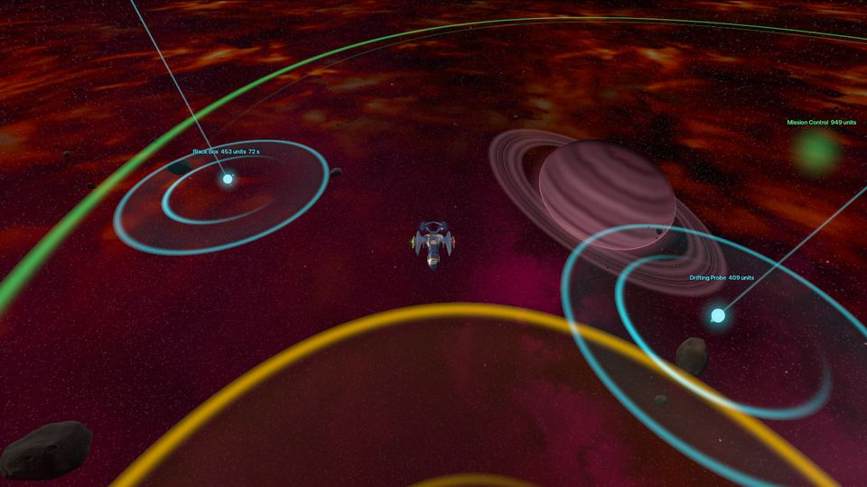

<!-- wiki-i18n source: 1e5ddad2b64f5e8a -->
<!-- wiki-i18n title: 任务 -->
# 任务 {#quests}

<!-- wiki-search: 星门任务线; 星门任务线任务; 等级 11 至 14; 等级 11; 等级 12; 等级 13; 等级 14; boss season; the breach; the foundry; omega; 裂隙行者; 地下城常客; 无伤裂隙; 无伤破口; 铸造厂冲刺; 无伤铸造厂; 围城冲刺; 守护者的恩典; gate line; 任务; mission control -->

任务是提升等级的主要途径。任务由 Mission Control 发放：每个任务都来自你自己企业的一名军官（如果你[更换企业](/wiki/01-General/Getting-Started.md#changing-your-company)，军官就换成新企业的，`rival x-4` 任务也跟着新企业走），领取奖励时会发放经验值、信用点、Thulium 和荣誉。**132 个任务，对应等级 1 至 8 和 11 至 14**，每级十一个，它们合起来能带你从一艘全新的 Protos 一路走到 PvP 中央星区的最前线。十个**空间站任务**会教你认识 [Skylab](/wiki/03-Mechanics/Skylab.md)，并奖励你把它建设起来；从飞行员等级 3 起，另有一条包含五十个难度极高的**挑战**任务的任务线，奖励丰厚。空间站任务和挑战任务的发放方式与等级任务相同：表中的数字是**基础值**，你的世界、增益和战队加成会把它们乘上去（[奖励](#rewards)）。 从飞行员等级 12 起，**星门任务线**的八个任务会带你穿过[单人星门](/wiki/03-Mechanics/Solo-Gates.md)和[战队地下城](/wiki/03-Mechanics/Dungeons.md)（见[星门任务线](#gate-line)）。

大多数任务不再是“击杀多少个这种敌人”这么简单：它们是简短的**任务链**。你要击毁几只外星人，飞到某个坐标点，在星区里停留几分钟，或者找到一件物品并把它运回 Mission Control。有些任务还附加规则：船体损失不能超过多少点，或者不能被击毁。

---

## 一分钟了解 {#in-one-minute}

- **在 Mission Control 接任务。** 你可以同时进行 5 个等级任务，另外还能进行 3 个空间站任务和 3 个挑战。 星门任务线另有 3 个专属名额。
- **任务链。** 带有**按顺序**标记的任务，其步骤会一个接一个地开放，只有当前开放的步骤才会计数。停留是唯一的例外：它不会卡住后面的步骤，后面的步骤会与它同时开放。
- **除击杀外还有四种步骤。** 只为你掉落、需要运到 Mission Control 的**任务物品**，**要到访的坐标点**，在星区里停留几分钟的**停留**，以及从赛季第 4 天起要猎杀的**虫群**。
- **星门与地下城。** 从等级 11 起，步骤可能要求你通关一道单人星门，或通关战队地下城的一个阶段；星门任务线的八个任务就由这样的步骤组成（见[星门与地下城](#gates-and-dungeons)）。
- **条件。** 一个步骤或整个任务可以要求“船体损失最多 N 点”或“不得被击毁”。违反条件，该步骤（或整个任务）就会重新开始。不会永久损失任何东西。
- **挑战任务线。** 从飞行员等级 3 起可以接取的五阶共五十个难度极高的任务，每阶十个。奖励按工作量计算：击杀的价值等于第一阶为它支付的数额，每高一阶再多 10%，单个任务最多支付 200,000 Thulium。第一阶合计发放 9,355,000 信用点、70,125 Thulium 和 2,177,500 经验值，均为基础值（[挑战任务线](#challenge-line)）。
- **0.4.10 中重做。** 等级任务中有 64 个是新版本。如果你完成过其中某个，它会重新提供给你，并给予全额奖励（[详情](#reworked-missions)）。
- **重置后的重复。** 赛季重置后，你可以重做已完成的任务，每个都会再次发放全额奖励（[详情](#repeating-missions)）。

## Mission Control

- 在距离 Mission Control 空间站 1,600 单位以内时，从工具栏打开 **Mission Control**，或者点击空间站上方的 **Mission Control** 气泡（它在地图上跟随空间站，所以请飞行或缩小视图，直到空间站进入视野）。每家企业的基地星区 `x-1` 里有一座空间站，位于它的安全区内；每家企业的边境星区 `x-4` 的正中央也有一座，但**没有安全区**：在那里的飞行员仍然可能遭到攻击。边境空间站只是一座只有一格的小型哨站，不是基地那样的城市。**接受任务和领取奖励只能在那里进行。**飞得更远时，打开着的窗口什么也做不了，服务器会拒绝，并提示“请飞往 Mission Control 空间站，以接受任务或领取奖励。”**放弃**和**追踪**任务在任何地方都可以，而在空间站菜单里（你的舰船没有在飞行），Mission Control 和以前一样可以打开。**普通任务**标签页按等级列出你的任务，**挑战**标签页里是[挑战任务线](#challenge-line)，**已完成任务**则存放着等待你领取奖励的任务。
- 点击**接受任务**来开始一个任务。你最多可以**同时进行 5 个任务**；[空间站任务](#station-missions)另有自己的 3 个名额，[挑战](#challenge-line)再有 3 个。你最后接受的任务就是你正在**追踪**的任务（空间站任务只有在你没有追踪任何任务、且你的任务中没有一个可以靠飞行推进时，才会被追踪）：它会显示在**进行中的任务**窗口中，击杀和飞行距离会优先计入它。可以用窗口标题栏中的圆点切换到另一个。
- 只要有任务或挑战可以接取，Mission Control 按钮以及它的**普通任务**和**挑战**标签页（当你在另一个标签页时）上就会出现带数字的**角标**。每出现一个新的，都会弹出一次提示并响起一声轻柔的音效。
- **星门任务线**有自己的标签页，在你的 5 个等级任务、3 个空间站任务和 3 个挑战任务之外另有 3 个名额。它会显示有几个正在进行（“1 / 3 进行中”），并列出全部八个任务；还不能接的任务显示为锁定的预览，并写明它们开放的等级。等级 11 至 14 的任务和星门任务线需要本次更新的游戏：旧版游戏会提示“请更新游戏以使用此功能。”
- 有些任务必须**按顺序**完成。它们带有**按顺序**标记，步骤会编号：见[任务链](#chained-missions)。
- 带有任务物品、停留或条件的任务，会在进行中的任务里实时显示状态：**运送中**以及到 Mission Control 的距离、你已停留的时间、你已损失的船体点数（**船体损伤 1,240 / 3,000**）、**不要死亡**。在任务卡片上，同样的规则以小标签显示：**船体上限 3,000 HP**、**不可死亡**、**按顺序**，以及限时任务的计时器。
- **放弃**任务会丢弃它和它的进度。它会立刻回到列表里，你可以再次接取。你为它运送的物品会丢失。
- 完成的任务会留在**已完成任务**下，直到你点击**领取奖励**。想什么时候领都可以：奖励不会过期。
- 每个任务每名飞行员只能完成**一次**，但在 0.4.10 中重做的等级任务会再提供一次（[见下文](#reworked-missions)）。你的任务，无论已完成还是进行中，都会保留到赛季重置（wipe）之后，并且你可以[重复](#repeating-missions)已完成的任务。

## 等级 {#levels}

- 1 到 8 级的每个等级都有**十个任务和一个特别任务**。一个等级的任务在你达到该等级时开放，并且在更高的每个等级中都保持开放。
- **等级 11 至 14** 同样各有十个任务和一个特别任务；等级 9 和 10 没有。从飞行员等级 10 起，Mission Control 就会以锁定状态显示等级 11 的任务。
- **可以按任意顺序接取**。十个任务之间没有任何一个需要等待另一个。（单个任务内部的步骤可以有顺序。）
- 每个等级的构成都一样：**三个**带任务物品的任务，**两个**让你前往地图坐标点的任务，**两个**要你在星区里停留的任务，以及**三个**单纯的猎杀任务。一个任务有一到四个步骤，一个猎杀任务要求一种外星人，或者多种外星人。
- **等级 11 至 14 的任务是长链条。** 每个都按顺序进行，有 3 至 23 个步骤（步骤最多的是**大勘察**）：按名称击杀、到访、停留、通关单人星门或战队地下城的阶段，以及任务物品；有的还带时限或不死亡规则。Mission Control 会把你已完成的步骤折叠成一行“已完成 7 个步骤”，点击即可展开。它们的击杀步骤约有四分之一不指定星区，你在单人星门和 Skylab 远征中的击杀会计入这些步骤，详见[计入范围](#where-it-counts)。其余的击杀步骤会指明星区（`x-3`、`x-4`、危险星区或敌对企业的 `x-4`），只在那里计数。它们没有小行星任务。
- 一个等级的任务会发放升到下一级所需经验值的 **85%**。任务要求你摧毁的外星人会发放其余部分，在低等级时甚至多得多：你通常在一整组任务完成之前就已经升到下一级了。
- **每个等级各有一个小行星任务。** 在十个任务和特别任务之外，每个等级还有一个任务，要求你击碎一定数量的[小行星](/wiki/03-Mechanics/Asteroid-Mining.md)，这些小行星的种类生活在随等级升高而越来越好的地图上（第一个奖励 60 枚 Rivet I；7 级和 8 级的在赛季第 4 天开放）。当击碎能让你分到一份（至少对小行星造成其所受伤害的 5%）时才计数，火箭和激光都可以。它不属于那十个，所以特别任务不会等它，但它会占用你 5 个任务栏位中的一个。Mission Control 把它列在特别任务之后，带有**小行星**标记；本页末尾的表格里没有它。在 Beta 和 Gamma，危险星区的小行星从第一天起就有，需要它们的那两个任务也随之开放。

## 特别任务 {#special-missions}

- 每个等级的第十一个任务是它的**特别任务**。在该等级的其他**全部十个**任务完成之前（已领取，或在等待领取），它都处于锁定状态，它的卡片上会写明你还差几个。
- 特别任务发放的经验值比同等级的任何其他任务都多，此外还有**物品**：激光、护盾部件、发生器、Power Core、Ship Fragment、弹药和增益时间。
- 3 级和 4 级的特别任务**破巢者**和**清剿虫巢**是[虫群猎杀](#swarm-missions)：它们从赛季第 4 天起开放。在 Beta 和 Gamma，它们随虫群一起，在赛季第一天开放。
- 1 级的普通任务也各自给予一件小小的新手物品：一个 Light Shield Core、一台 Repair Drone、一个 Damage Amp I、一个 Absorption Shield Cell I、一些弹药，以及几组火箭，让你把每种火箭都试一遍（Lancet I、Rivet I、Ember I 和 Scatter I，以及特别任务给的 Lancet II）。

## 任务链 {#chained-missions}

**任务链**是步骤按固定顺序进行的任务。它的卡片和进行中的任务里都带有**按顺序**标记。步骤会编号：完成的步骤会打勾，**高亮**的步骤就是当前开放的步骤（遇到停留时，它后面的一步也会开放：见下文），其余靠后的步骤会显示一把锁，直到轮到它们。

- **只有开放的步骤才会计数。** 你的击杀、飞行和停留时间都计入它，不会计入别的步骤（停留是唯一的例外：见下一条）。在某个步骤开放之前完成的击杀，不会计入它。
- **停留与其后的一步同时进行。** 只要你尚未完成的第一个步骤是停留，紧随其后的步骤也会开放，两者同时计数：你不必等停留结束才去战斗或继续飞行。那一步完成后，下一步会顶替它开放，所以停留始终只与一个步骤同时进行；其余步骤都要等停留完成后才开放。两个停留绝不会同时进行，而停留本身交给你的任务物品，也要等停留完成后才开放。任务在所有步骤完成时完成，不论它们以什么顺序结束。
- **为什么要按顺序？** 一个任务讲的是一个小故事（“先清掉守卫，再把核心运回家”），规则也需要顺序：任务物品只有在它的步骤开放时才会掉落，停留从步骤开放的那一刻起计时，步骤的条件（船体上限、不可死亡）只在该步骤开放期间生效。
- **没有标记的任务会同时开放所有步骤**，可以按任意顺序完成。**死守星门**有一个要到达的坐标点、一段四分钟的星区停留，以及击毁 8 只 Seeker 和 3 只 Phantasm，这些步骤同时开放，所以只要任务在进行，击杀随时都会计数，无论在停留期间还是之外。
- 在本页末尾的表格里，箭头（“→”）连接**按顺序**任务的步骤，分号（“;”）连接同时开放的步骤。

## 任务物品 {#quest-items}

任务物品是你必须运到 Mission Control 的东西。它不是物品栏里的物品：不能交易、存放或出售，它是任务的一部分。**只有你能看到它。** 其他飞行员，包括你的队友，什么也看不到。

| 种类 | 如何获得 | 示例 |
| :--- | :--- | :--- |
| **掉落** | 在指定星区击毁指定的外星人，每次都可能掉落。表格会给出每次击毁的概率（“每次击毁 15%”）和必定掉落的那次击毁（“第 10 次击毁必定掉落”）。计数从步骤开放时开始。 | 联合行动：`x-1` 的 Seeker 掉落的 Cargo Pod。 |
| **固定掉落** | 没有概率：从步骤开放起计数的指定那次击毁，必定带着它。 | 突袭巢穴：巢穴的第三只 Phantasm 带着 Nest Core。 |
| **放置的物品** | 从步骤开放起，它就放在星区的某个坐标点上。 | 边疆防御：`x-2` 中 12,500 / 4,800 处的 Relay Part。 |

1. **找到它。** 掉落物会出现在外星人被击毁的地方，持续 **120 秒**；最后 12 秒会闪烁。如果错过了，下一次符合条件的击毁会立刻让它再次掉落。你会在世界中看到物品是一座青色信标（环中旋转的数据核心，上方射出一道光束），在小地图上则是一个青色菱形。
2. **拾取它。** 飞到离它 **200 单位**以内。一条消息会告诉你它已在船上，进行中的任务会显示**运送中**和到 Mission Control 的距离。
3. **运回家。** 飞到**你自己企业的** Mission Control 周围 1,600 单位以内：你基地星区 `x-1` 的空间站（在它的安全区内），或你边境星区 `x-4` 的空间站（距离相同，但那里没有安全区）。屏幕上和小地图上的绿色环会标出它。物品会立刻交付，步骤随即完成。

会中断运送的情况：

- **你的飞船被摧毁**，无论是被外星人还是被飞行员：物品丢失，但你可以再次获得（放置的物品回到它的坐标点，掉落物随下一次符合条件的击毁出现）。没人能偷走它：摧毁你的飞行员从中什么也得不到。
- **超过船体上限**或违反**不可死亡**规则，会以同样方式让运送失败：见[条件](#conditions)。
- **运送物品期间，跳跃 CPU 和基地 CPU 无法使用。** 请通过星门飞回家。星门、隐形和 Shield Surge 都可以正常使用。
- 如果你退出游戏，回来后仍然在运送该物品。原本在地图上的掉落物会消失，下一次符合条件的击毁会让它再次掉落。
- 物品只会出现在企业星区 `x-1` 至 `x-4`，**绝不会出现在危险星区**，而且只在**你自己企业**的星区：Galactic 飞行员的物品在 `G-2`，绝不在 `M-2` 或 `T-2`。外星人只有在你自己企业的星区被击杀时，才会掉落你的物品。
- 在[小队](/wiki/03-Mechanics/Groups.md)中，每个这次击杀对其计数（见[计数范围](#where-it-counts)）且拥有该任务的成员都各自抽取，并看到自己的物品。没人能给出、拿走或共享物品。

> [!TIP]
> 拾取物品之前先规划好回家的路。从 `x-3` 或 `x-4` 回到 `x-1` 要跳两次星门，从 `x-2` 跳一次。如果船体血量低，先修好（被摧毁的飞船会丢失物品），途中避开战斗：修理不会归还船体上限的点数。

## 到访坐标点与停留 {#visit-and-stay}

**到访坐标点。** 到访步骤用两个数字标明星区中的一个点，例如“9,000 / 4,500”。它们与小地图标题栏为你自己的飞船显示的数字相同，所以你可以按它们导航。飞到离该点 **400 单位**以内就会立刻计数；不需要停下（在 Mission Control 结束的路线，会在空间站的安全区内结束）。该点在屏幕上是一个**金色环**，在小地图上是一个金色菱形。它只在你自己企业的地图上计数，别家企业的同一星区不算。

**在星区停留。** 停留步骤要求你在某个星区里待上几分钟。只有同时满足以下三点时才会计数：

- 你在该步骤指定的星区里（`x-n` 指你自己企业的地图）；
- 你在**所有安全区之外**（空间站或星门的环：在环内的时间不计）；
- 你的飞船处于**活跃**状态：最近 30 秒内飞行了 300 单位或开过火。停着不动的飞船什么也赚不到。

**累计**的停留会保留你已计的时间：离开星区、跳跃、被击毁、下线或被踢出，再回来，分钟数仍然在。时间只在你处于星区内且保持活跃时才计数，所以你不在时不会流逝（在环内或静止不动只会暂停）。唯一的例外是所属任务或步骤带有船体上限或不得被击毁规则的停留：那样的话，失去飞船或超过上限就会让停留重新开始（见[条件](#conditions)）。任务的时间限制在你不在时仍会继续走。

停留和到访互不竞争：每个开放的步骤，无论你同时在做什么，都会同时计数。击杀则不同：一次击杀只计入一个等级任务（见[计数范围](#where-it-counts)）。

> [!NOTE]
> 到访和停留可以通往危险星区（中央侦察、中央守夜和固守中央都会），那里其他企业的飞行员可以攻击你。任务物品则绝不会出现在那里。`DS-x` 中的到访点在任何危险星区都算数：从赛季第 11 天起，靠近 `DS-4` 左上角的点，例如**四个角落**的那个角，请到 `DS-1`、`DS-2` 或 `DS-3` 去完成，因为 `DS-4` 的这个角落处在 [Dormant Swamp](/wiki/03-Mechanics/Dormant-Swamp.md) 炮台的火力之下。

## 星门与地下城 {#gates-and-dungeons}

从等级 11 起，步骤可能要求你通关一道[单人星门](/wiki/03-Mechanics/Solo-Gates.md)，或通关[战队地下城](/wiki/03-Mechanics/Dungeons.md)的一个阶段。表格里写作“通关 Alpha Rift”和“完成战队地下城阶段 3（有报酬的通关）”。

- **通关星门。** 步骤开启期间你通关该星门（Alpha Rift、Beta Breach、Gamma Foundry、Delta Siege 或 Omega Vault），就会计入。步骤开启之前的通关不计入。通关照常发放通关的报酬，步骤则额外完成。
- **附带本次挑战的规则。** “不死亡”要求一次没有损失任何生命的挑战，“在 25 分钟内”要求竞技场用时在该星门的竞速时间之内。违反规则的挑战仍会发放通关报酬，但步骤保持开启，你需要再飞一次该星门。
- **完成地下城阶段。** “有报酬的通关”指该阶段的通关给你发放了报酬时才计入。一个阶段每名飞行员每天发放一次，每周最多为 10 次阶段通关发放报酬（见[报酬](/wiki/03-Mechanics/Dungeons.md#pay)），所以没有给你发放任何报酬的通关不计入。“3 次”要求三次有报酬的通关。
- **会送给你的任务物品。** 有些任务物品既不用击杀也不用寻找：**Omega 指挥部**在你通关 Omega Vault 时送给你 Omega Seal，它的最后一步是把它送到 Mission Control。飞船被毁不会让你失去它。
- **在主服务器。** 星门和战队地下城在你的主服务器上运行，所以这些步骤只在那里推进。在区域服务器上它们会等待：请回主服务器进行。

## 虫群任务 {#swarm-missions}

有十三个任务要求击毁[虫群](/wiki/05-Swarms/Swarms.md)的飞船。其中两个是等级特别任务：**破巢者**（3 级：3 只 Boss Seeker、12 只 Seeker Slave 和 6 只 Phantasm）和 **清剿虫巢**（4 级：3 只 Boss Seeker、12 只 Seeker Slave、2 只 Bulwark 和一个要到访的坐标点）。其余十一个在挑战任务线中：Boss Seeker 和 Pirate Scout（**清巢行动**、**斥候清剿**、**清巢行动 II**、**斥候清剿 II**）、Pirate Boss（**海盗清算**、**海盗克星**、**海盗末日**、**海盗王座**）以及 Dormant Force（**Dormant 黎明**、**Dormant 黄昏**、**Dormant 统治**）。

- **它们从赛季第 4 天起开放**，也就是虫群出现的那一天（[30 天赛季日程](/wiki/03-Mechanics/Wipe-Timeline.md#30-day-season-schedule)）。在那之前，Mission Control 会拒绝：“此任务在赛季第 4 天开放。”在 Beta 和 Gamma，虫群在第一天出现，这些任务也随之开放；本页表格中的天数是 Alpha 的天数。
- 虫群飞船按**它们自己的名字**计数：Boss Seeker 或 Seeker Slave 不算 Seeker，Pirate Scout 也不算 Phantasm。
- 该步骤不指定星区，因为虫群四处游荡：[Seeker 虫群](/wiki/05-Swarms/Seeker-Swarm.md)在 `x-1` 和 `x-2`，[Pirate 虫群](/wiki/05-Swarms/Pirate-Swarm.md)在 `x-2` 和 `x-3`，[Dormant 虫群](/wiki/05-Swarms/Dormant-Swarm.md)在危险星区。Boss Seeker 或 Pirate Boss 在被击毁 2 分钟后回来。从赛季第 11 天起，Dormant 虫群从 [Dormant Swamp](/wiki/03-Mechanics/Dormant-Swamp.md) 开始。
- Dormant 任务是为一个小队准备的：每个世界有一支 Dormant 虫群，需要一群强力飞船才能击败它（[战斗过程](/wiki/05-Swarms/Dormant-Swarm.md#how-the-fight-goes)）。下一阶不需要等 **Dormant 黎明** 或 **Dormant 黄昏**（[挑战任务线](#challenge-line)）。
- Boss Seeker 的攻击比新手飞行员的飞船能承受的更狠：开始之前，请先读一读[战斗是怎么进行的](/wiki/05-Swarms/Seeker-Swarm.md#how-the-fight-goes)。

## 条件 {#conditions}

**条件**是加在一个步骤或整个任务上的额外规则。共有两种。表格里把它们写成“（船体损失最多 3,000 点）”和“（不得被击毁）”；整个任务的条件写作“（整个任务期间：...）”。

- **船体上限。** 损失的**船体点数**不得超过规定数目。计入的是你真正损失的船体：护盾和吸收率分担了它们那一份之后，船体条下降的点数。护盾受到的伤害不计入，黑洞的辐射会计入，修理不会归还任何东西。致命一击总是会超过上限。
- **不得被击毁。** 如果你的飞船被摧毁，条件即告破坏。

**计时何时运行。** 整个任务的上限，从你接受它的那一刻起（以及每次重新开始时）计算，直到任务完成。步骤的上限，从该步骤开放的那一刻起计算；对运送中的物品，则是从拾取到交付。在这段时间里你损失的每一点船体都会计入，不论是谁击中你；在各步骤同时开放的任务里，其他步骤的战斗也包括在内。

**条件被破坏会怎样。** 不会永久损失任何东西，不会扣除 Thulium，任务仍保持进行中。会有一条消息告知你（“未满足条件。本次尝试将重新开始。”）。

| 条件加在什么上 | 被破坏时会发生什么 |
| :--- | :--- |
| 击杀步骤 | 该步骤的击杀数回到 0。其他步骤保留进度。 |
| 运送中的物品 | 运送失败，你需要重新获取该物品（见[任务物品](#quest-items)）。 |
| 到访或停留步骤 | 该步骤重新开始。 |
| 整个任务 | 所有步骤重新开始，运送中的物品丢失，限时任务的计时器继续走。 |

被击毁同样会破坏正在运行的船体上限，就像破坏不可死亡规则一样。

上限以点数给出，针对你在该等级驾驶的飞船。运送物品的上限在 1 至 3 级是 3,000 点船体，4 至 6 级是 17,000，7 和 8 级是 46,000；持续更久的停留和路线数字更大。这些是 **Alpha** 的数字，和表格里的时限一样。Beta 的外星人打得重 1.5 倍，Gamma 的重 2 倍，所以在 Beta 和 Gamma，上限分别是 Alpha 的 1.5 倍和 2 倍，和[时限](#time-limits)一样：3,000 点在 Beta 是 4,500，在 Gamma 是 6,000，你能承受的命中次数与 Alpha 相同。任务卡片和进行中的任务会显示你所在世界的数字（任务简介里写的是 Alpha 的数字）。接受任务之前请先看一看。 上限也可以用你飞船船体的百分比来表示，两者都给出时以更严格的为准；本次更新的所有任务都使用点数。

## 任务示例 {#mission-examples}

来自真实任务列表的八个任务，从第一个小时到挑战任务线。它们的数字在本页末尾的表格中；这里提到的每一项奖励都是**基础值**（见[奖励](#rewards)）。

- **信标值守**（1 级）。飞到 `x-1` 的 9,000 / 4,500 点，然后在 `x-1` 停留 5 分钟。整个任务**不可死亡**：如果你的飞船被摧毁，就从信标处重新开始。保持移动或开火，否则分钟数不会计入。奖励 700 经验值、3,500 信用点、5 Thulium、7 荣誉和一个 Repair Drone I。
- **联合行动**（1 级）。在 `x-1` 击毁 8 只 Seeker，然后找到 Cargo Pod：之后你在那里击毁的每只 Seeker 都有 15% 的概率带着它，第 10 只必定带着。把它运到 Mission Control，船体损失最多 3,000 点。奖励 1,550 经验值、8,000 信用点、Advanced Plasma 和 Ember I。
- **死守星门**（2 级，15 分钟，不可死亡）。四个步骤同时开放：到达 `x-2` 的 12,500 / 2,500 点，在那里停留 4 分钟，并击毁 8 只 Seeker 和 3 只 Phantasm。只要任务在进行，击杀随时都会计入。如果你被击毁，一切都会重新开始，但计时器不会。
- **突袭巢穴**（3 级）。在 `x-3` 击毁 7 只 Phantasm，飞到 7,500 / 7,600 的巢穴，然后继续击毁 Phantasm，直到第三只掉落 Nest Core：这是固定掉落，第三次击毁必定带着它。船体损失最多 3,000 点，并且不失去飞船，把它运回家。奖励 4,500 经验值和 36,000 信用点。
- **重型信使**（4 级，40 分钟）。在 `x-3` 击毁 10 只 Phantasm，到达 13,400 / 5,000 和 13,600 / 1,900 两个点，然后从一只 Bulwark 那里拿到 Manifest（每次击毁 25%，第 5 次必定掉落），在船体损失最多 17,000 点、不可死亡的条件下运到 Mission Control。奖励 10,500 经验值、52,000 信用点和 315 Thulium。
- **破巢者**（3 级特别任务，从赛季第 4 天起）。在任意星区击毁 3 只 Boss Seeker 和 12 只 Seeker Slave，并在 `x-3` 击毁 6 只 Phantasm，顺序不限。奖励 6,800 经验值、54,500 信用点、170 Thulium、一个 Quantum Laser II、10 个 Ship Fragment、200 个 Ultra Core 和一个 Regular Cluster Chunk（[P.E.T.](/wiki/03-Mechanics/Pets.md) 的原料）。每次领取都会给这个 Chunk，任务的[重复](#repeating-missions)也一样。
- **大巡游**（8 级，25 分钟，不可死亡）。飞到 `x-4` 的 8,000 / 4,500，再飞到中央星区的 6,000 / 4,500，在对手企业的 `x-4` 击毁 2 只 Goombah，然后飞到它的中心 8,000 / 4,500。[星环传送门](/wiki/01-General/Spacemap%20Travel.md#jump-links)和中央星区都能到达那里。奖励 66,000 经验值、165,000 信用点和 1,320 Thulium。
- **毫发无伤**（挑战）。在 `x-3` 连续击毁 25 只 Phantasm，同时船体损失不超过 39,000 点。超过限制，计数就回到 0。按基础值发放 220,000 经验值、855,000 信用点、6,405 Thulium、2,370 荣誉、一个 Ancient Control Unit 和 5 小时的 Shield Wall Booster II。

## 空间站任务 {#station-missions}

- 十个与你的 [Skylab](/wiki/03-Mechanics/Skylab.md) 有关的任务，位于任务页面顶部的**空间站**区域。第一个任务**点亮空间站**从 1 级起开放，并会告诉你 Skylab 在哪里：菜单 › 经济 › Skylab。空间站菜单里的 Skylab 一行会不断闪动，直到你接取了这个任务或建造了太阳能。
- 它们的接取、追踪、放弃和领取方式与其他任务一样，但不计入那 5 个名额：除了你的其他 5 个任务，你还可以**同时进行 3 个空间站任务**。空间站任务可能要等上几个小时的升级计时，却从不会拖住战斗任务。
- 当你有一个可以靠飞行推进的任务时，接取空间站任务不会改变你正在追踪的任务：进行中的任务窗口仍然显示你的战斗任务，而这个空间站任务则是它标题栏中的一个圆点（悬停可查看进度，点击可切换显示）。
- 每个空间站任务都有自己的**飞行员等级**要求，并且要在它所承接的那些空间站任务之后才开放（须先领取它们）：锁定的卡片会写明具体是哪些。前三个在 1 级开放。最后一个 **Core Ten** 要把核心升到 10 级，这一级会开启 Skylab 的[研究中心](/wiki/03-Mechanics/Research.md)。
- 它们的任务目标读取你的 Skylab：**建造**一个模块，或**把它升到某个等级**（模块处于该等级或更高时即算完成；任何模块都不能超过核心，所以太阳能的目标可能需要先升级核心），以及从信用点农场**收取**信用点（从你接取任务的那一刻起累计，用“收取资源”按钮收取）。所有任务目标同时成立的任务即为完成：接取时就已经满足条件的任务会立即完成。
- 信用点农场不花钱建造，所以**第一座农场**会为建好它支付 3,000 信用点和 100 Thulium。收取要花时间：**发薪日**要 1,000 信用点，大约是 1 级农场（每小时 2,250）半小时的产量；**五万信用点**要 50,000，大约是**成长季**之后留给你的 3 级农场（每小时 6,750）7.5 小时的产量。
- 太阳能在升级期间仍然产生当前等级的全部电力，所以每一步太阳能升级期间你的空间站里都没有任何东西会停（见[太阳能模块](/wiki/03-Mechanics/Skylab.md#solar-module)）。**更亮的面板**（太阳能升到 3 级：5 分钟和 15 分钟）、**成长季**（升到 5 级的那一步要 45 分钟）和**打通补给线**（太阳能升到 6 级：60 分钟）会告诉你要等多久。
- **它们的发放方式与等级任务相同。** 表中的数字是**基础值**：你所在世界的加成、增益和战队的信用点与 Thulium 加成会把它们乘上去（[奖励](#rewards)）。空间站任务没有自己的世界，所以按你领取时所在的世界发放。它不发放物品。它们的基础经验值是在各等级任务所发的 85% 之外额外增加的（最多是一个等级升级所需经验值的 5%）。
- 空间站任务不计入[重置点数](/wiki/03-Mechanics/Wipe-Timeline.md)中“完成任务”的部分。它们和其他任务一样会保留过重置，你建造的东西也是。

## 挑战任务线 {#challenge-line}

从**飞行员等级 3** 起，Mission Control 的**挑战**标签页会开放第二条任务线：**五十个难度极高的任务，分成五阶，每阶十个**，给那些想要比等级任务更多的飞行员。每一阶要求的都比前一阶多，五十个任务都已在游戏中。本页末尾的[表格](#challenge-missions-table)列出了每个任务和每个数字。

- **十个任务任意顺序。** 一阶的十个任务同时开放。**第二阶**在你领取了第一阶全部十个任务的奖励后开放，**第三阶**在你领取了第二阶全部十个任务的奖励后开放。**第四阶和第五阶**在你领取了前一阶**十个中的九个**后开放：**Dormant 黎明**（第三阶）和 **Dormant 黄昏**（第四阶）是 [Dormant 虫群](/wiki/05-Swarms/Dormant-Swarm.md)的任务，需要一个小队，所以是可选的。
- **同时进行三个**，与你的 5 个等级任务和 3 个空间站任务分开计算。
- **它们的发放方式与等级任务相同。** 表中的奖励是**基础值**，只发一次：你所在世界的加成、增益和战队的信用点与 Thulium 加成会把它乘上去，[奖励](#rewards)里有一个例子。**荣誉只有第一阶发放。** 它们会保留到赛季重置之后，并且不计入任务的重置点数。重置后，你可以[重复](#repeating-missions)已完成的任务，发放全额奖励。
- **奖励随工作量而定。** 在挑战任务里，击杀某一种外星人的价值等于第一阶为它支付的数额，**每高一阶多 10%**（第二阶 ×1.10、第三阶 ×1.21、第四阶 ×1.331、第五阶 ×1.4641）。所以第一阶**Bulwark 之墙**里的 150 只 Bulwark 付 19,585 Thulium，第二阶**Bulwark 风暴**里的 400 只付 57,450：Bulwark 在那里贵 10%。停留、巡游和零失误通关也按同一规则，以低一阶、同类的任务为基准。
- **第四阶付双倍。** 第四阶“深渊”的每个任务，都付上面规则所得数额的两倍：信用点、Thulium、经验值、物品和增益道具时长，Orvium 和 Velkonite Reinforced Plate 以及 Ancient Control Unit 也不例外。翻倍发生在下面的上限之前。
- **第五阶高于第四阶。** 第五阶的任务绝不会比第四阶对应的任务付得少，而是多付 10%：经验值、对应任务付出的每一种物品（Ancient Control Unit 和 Plate 也包括：第四阶付 2 个的地方，这里付 3 个；对应任务有而第五阶任务原先没有的种类，会被加上）、增益道具时长，以及停留任务每分钟的信用点和 Thulium。停留任务**最后的守夜**付 11,340,000 信用点和 85,010 Thulium。两个一万次击杀的任务没有对应任务，付得和以前一样。
- **每个任务最多 200,000 Thulium。** 最大的几场狩猎本来会付得更多。当一份奖励超过 200,000 Thulium 时，整份奖励会一起按比例缩减，直到它的 Thulium 恰好是 200,000：信用点、荣誉和物品按相同比例减少。被缩减的有六个任务：**Goombah 溃败**、**Bulwark 之海**、**Goombah 军团**、**Crystalys 王朝**、**海盗王座** 和 **防线守护者**。其余四十四个全额发放。
- **经验值：五倍。** 每个任务的经验值恰好是 0.4.16 之前的 5 倍，上限不会削减它。有两种情况付得更多：在第四阶，加上双倍奖励，是 10 倍；在第五阶，被提到第四阶之上的七个任务（见上）付出的经验值超过 5 倍。
- **物品随金额增长。** Power Core、Reinforced Hull Plate 和 Cataclysite 会随奖励的信用点和 Thulium 一起增长。Orvium 和 Velkonite Reinforced Plate 以及 Ancient Control Unit 保持原来的数量，增益道具的时长也相同。第四阶是例外：这些全部付两倍，包括 Plate、Ancient Control Unit 和增益道具时长。第五阶高于第四阶（见上）。
- **你的击杀另外计酬。** 你击毁的外星人仍照常支付它们自己的信用点、Thulium 和荣誉；任务奖励是在这些之外另给的。
- **击杀会计两次。** 一次击杀会计入每个要求它的挑战任务，**同时**也计入它所计入的那一个等级任务，所以一个千次击杀的任务绝不会饿着你的等级任务。
- **小队。** 一次击杀会计入获得该击杀奖励的飞行员，以及残骸 **8,000 单位**范围内、最近 15 秒内用激光或火箭开过火的每名小队成员。每名飞行员各自计数。
- **停留在飞行中也计数。** 在 `x-3`、`x-4` 或对手企业的 `x-4` 中的停留与其他停留一样，最近 30 秒内飞行了 300 单位或开过火的飞船就计数。不必开火，所以你可以在星区里到处飞；停着的飞船什么也赚不到，只在宽度不足 300 单位的范围内绕圈的飞船也算停着。危险星区中的停留（**中央值守**、**边缘守夜**、**最后的守夜**）适用同一条规则（从赛季第 11 天起苏醒的外星人见[危险星区](/wiki/01-General/Danger-Sectors.md)，不改变这条规则）。

每一阶的要求，附表格中的任务示例：

- **第一阶，试炼场。** 母星区的大型猎杀和第一批硬仗：**Seeker 瘟疫**和 **Phantasm 浪潮**（各 1,000 只）、**Bulwark 之墙**（150 只 Bulwark）、**毫发无伤**（连续 25 只 Phantasm，船体损失最多 39,000 点）、从赛季第 4 天开始的两项虫群猎杀（**清巢行动**、**斥候清剿**）、**钢铁守夜**（在 `x-3` 停留 45 分钟）、**中央闯关**（穿过中央的六个步骤，不能被击毁）、**护送**和 **一小时百架**。
- **第二阶，钢铁边境。** 边境上更大的猎杀和更长的值守：2,500 只 Seeker（**Seeker 疫病**）、2,500 只 Phantasm（**Phantasm 洪流**）、400 只 Bulwark（**Bulwark 风暴**）、100 只 Goombah（**Goombah 猎杀**）、在 `x-4` 停留 90 分钟（**钢铁守夜 II**），以及最初的几只 Pirate Boss。
- **第三阶，中心区。** 中央与它的 Goombah：250 只 Goombah（**Goombah 天灾**）、800 只 Bulwark（**Bulwark 疫祸**）、5,000 只 Phantasm（**Phantasm 汪洋**）、10 只 Crystalys（**Crystalys 试炼**）、在危险星区停留一小时（**中央值守**）、绕中央四个角一圈（**四角巡行**），以及一次 Dormant Force 猎杀（**Dormant 黎明**）。
- **第四阶，深渊。** 50 只 Crystalys（**Crystalys 肃清**）、500 只 Goombah（**Goombah 溃败**）、2,000 只 Bulwark（**Bulwark 之海**）、在 `DS-4` 停留 90 分钟（**边缘守夜**）、在对手企业的 `x-4` 停留两小时（**敌境**），以及 10 只 Dormant Force（**Dormant 黄昏**）。
- **第五阶，传奇。** 任务线上最大的总数：10,000 只 Seeker 和 10,000 只 Phantasm、1,000 只 Goombah（**Goombah 军团**）、150 只 Crystalys（**Crystalys 王朝**）、在中央停留三小时（**最后的守夜**），以及 **防线守护者**：六个步骤，从 400 只 Goombah 和 30 只 Crystalys 到绕对手企业的边境和中央一圈。

一阶的十个任务**合计**按**基础值**发放如下（你领取时，你的世界、增益和战队加成会把它们乘上去；物品和增益时间另外追加，在每个世界都一样）：

| 阶 | 信用点 | Thulium | 经验值 | 荣誉 |
| :--- | --: | --: | --: | --: |
| 第 1 阶 · 试炼场 | 9,355,000 | 70,125 | 2,177,500 | 26,140 |
| 第 2 阶 · 钢铁边境 | 26,975,000 | 202,910 | 2,355,000 | 0 |
| 第 3 阶 · 中心区 | 52,640,000 | 383,480 | 4,435,000 | 0 |
| 第 4 阶 · 深渊 | 126,530,000 | 820,670 | 18,805,000 | 0 |
| 第 5 阶 · 传奇 | 212,825,000 | 1,369,900 | 19,607,500 | 0 |

全部五十个合计基础值为 428,325,000 信用点、2,847,085 Thulium 和 47,380,000 经验值。每个任务的每个数字都在[表格](#challenge-missions-table)里。

> [!TIP]
> 一到 3 级就接下大型猎杀任务：Seeker 瘟疫和 Phantasm 浪潮会从你接受它们的那一刻起，在任何星区计入每一次击杀，与你的等级任务并行。

## 星门任务线 {#gate-line}

Mission Control 的**星门任务线**标签页会列出八个关于[单人星门](/wiki/03-Mechanics/Solo-Gates.md)和[战队地下城](/wiki/03-Mechanics/Dungeons.md)的任务，它们不在任何等级的那十个之中。它们在飞行员等级 12 至 14 开放，在此之前显示为锁定的预览，所有数字都在本页末尾的[表格](#gate-line-missions-table)里。

- **通关的六个变体。** **无伤裂隙**、**无伤破口**、**无伤铸造厂**和**守护者的恩典**要求不死亡通关（Alpha Rift、Beta Breach、Gamma Foundry、Omega Vault）。**铸造厂冲刺**和**围城冲刺**要求在 25 分钟内通关 Gamma Foundry、在 35 分钟内通关 Delta Siege（见[星门与地下城](#gates-and-dungeons)）。
- **两个限一个赛季。** **裂隙行者**要求通关全部五道星门，**地下城常客**要求三次有报酬的阶段 3 通关，顺序不限。两者都只计一个赛季：重置会丢弃仍在进行中的那个。
- **同时三个。** 星门任务线在你的等级、空间站和挑战任务之外另有 3 个名额。标签页显示有几个正在进行（“1 / 3 进行中”），还不能接的任务显示为锁定的预览，并写明开放的等级。
- **挑战发放多少就发放多少。** 任务发放它所要求通关的经验、信用点和荣誉。六个变体不发放 Thulium，游戏自己的挑战也不发放；裂隙行者发放它所要求的五次挑战的 Thulium 的四分之一，地下城常客发放一次阶段 3 通关的 Thulium 的四分之一，而不是三次的。表格里的数字是**基础值**：你的世界、加成和战队加成按[奖励](#rewards)所述生效。
- **可以重复。** 重置后你可以按全额[重复](#repeating-missions)它们。它们既不计入统计页面，也不计入任务的重置点数。

## 计入范围 {#where-it-counts}

大多数步骤都会指明它在哪个星区计数，只有**在那里**的击杀和飞行距离才会计入。到访、停留和物品也以同样的方式指明星区，但要求更严：它们只在**你自己企业的地图**上计数。任务放在 `G-2` 的物品只在 `G-2` 里，Galactic 的飞行员在 Mars 的 `M-2` 或 Terra 的 `T-2` 上找不到它。击杀和飞行距离则在任何企业的该星区都计数。有一个任务的前两个步骤更严格：**彻底清扫**写的是 `own x-4`，击杀只在**你自己企业**的边境星区计数，在其他企业的 `x-4` 上不计数。部分击杀步骤不指明星区，在**任何**星区都计数：破巢者和清剿虫巢中的虫群飞船，以及挑战任务线中的大型猎杀（Seeker 瘟疫、Phantasm 浪潮、Bulwark 之墙、清巢行动、斥候清剿，以及第一阶之后各阶的大型猎杀）。等级 11 至 14 的任务中，约四分之一的击杀步骤也是如此。空间站任务的步骤读取你的 Skylab，同样没有星区。星区会作为你自己的地图之一，显示在步骤旁边：

| 表中写法 | 含义 | 你看到的（Mars 企业的飞行员） |
| :--- | :--- | :--- |
| `x-1` … `x-4` | 击杀和飞行距离：任意企业的该星区，你自己的或其他企业的；物品、到访和停留：只限你自己企业的星区 | `M-3` |
| `own x-4` | 击杀和飞行距离：只限你自己企业的星区，不含其他企业的（彻底清扫的前两个步骤）；物品、到访和停留：与 `x-4` 相同，只限你自己企业的星区 | `M-4` |
| `DS-x` | PvP 中央星区的任意星区，即危险星区 `DS-1` 至 `DS-4` | `DS-x` |
| `rival x-4` | 其他企业的边境星区（不是你自己的），经星环传送门短短一跳，或穿过中央星区 | `T-4 · G-4` |

任务会随着你的等级逐步推进到更高的星区：

| 等级 | 战斗地点 | 通向何处 |
| --: | :--- | :--- |
| 1 | 你的基地（`x-1`）和第二个星区（`x-2`） | – |
| 2 | 第二个星区 | 穿过传送门初探 `x-3` |
| 3 | 第三个星区（`x-3`），靠近它的传送门；在 `x-2` 有几个热身任务 | – |
| 4 | 第三个星区 | 穿过边境传送门探访 `x-4` |
| 5 | 第三个星区 | 首次穿越边境（`x-4`） |
| 6 | 边境（`x-4`） | – |
| 7 | 边境 | 深入 PvP 中央星区（`DS-x`） |
| 8 | 边境 | 中央星区，以及其他企业的边境 |
| 11 至 14 | 第三星区和边境，中心和其他公司的边境，然后是单人星门和战队地下城 | – |

- **步骤旁的标签**写着它的地图，例如 `G-2`。将指针悬停在上面：物品、到访和停留会显示“仅在 G-2 计入”；击杀和飞行则会显示“仅在 G-2 或其他企业的 `x-2` 计入”；但 `own x-4` 步骤（彻底清扫）例外，同样显示“仅在 G-4 计入”。
- **巡逻只在安全区之外计入**。绕着传送门的保护环转圈不算巡逻星区。
- **一次击杀只计入一个等级任务**：你追踪的那个（如果它能用上），否则是你进行中的任务里第一个能用上的。除此之外，它还计入每个要求它的挑战任务，而你每个正在等这种外星人的任务物品步骤都会为掉落抽取一次。
- 你在与外星人交战时，由你的[企业飞行员](/wiki/03-Mechanics/Company-Pilots.md)补刀击杀的外星人，算作你的击杀，对你的任务也同样如此。
- 你[小队](/wiki/03-Mechanics/Groups.md)成员的击杀，在你与他在同一张地图上、且最近 15 秒内对任何目标用激光或火箭开过火时，也会计入你的等级任务。对于挑战任务线，队友还必须在击杀地点 8,000 单位以内。
- **Skylab 的远征对部分步骤计数。** 你的 [Skylab](/wiki/03-Mechanics/Skylab.md#expedition-kills) 在远征中打出的击杀，只会推进**没有指明星区**的击杀步骤，每天最多 **250 次**（UTC），而且只计该步骤所指明的外星人的击杀。单元格不是星区，所以指明了星区的步骤（`x-1` 到 `x-4`、`DS-x` 或 `rival x-4`）从不计入它们，即使在同样难度的单元格里也一样。实际上，这指的是挑战任务线中外星人栖息在单元格里的大型猎杀（Seeker 瘟疫、Phantasm 浪潮、Bulwark 之墙，以及其余针对 Seeker、Phantasm、Bulwark、Goombah、Crystalys 或 Dormant Force 的猎杀），1 到 8 级的任务一个也不算。有时间限制或船体限制的任务也不计入。它们不会带来重置点数、战队战线或排名积分。
- **单人星门对部分步骤计数。** 你在[单人星门](/wiki/03-Mechanics/Solo-Gates.md#the-aliens)中击杀的外星人，只会推进**没有指明星区**的击杀步骤，而且只计该步骤所指明的外星人的击杀。星门的竞技场不是星区，所以指明了星区的步骤（`x-1` 到 `x-4`、`DS-x` 或 `rival x-4`）从不计入它们，尽管星门的外星人就是那些星区里的外星人。实际上，这指的是针对 Seeker、Phantasm、Bulwark、Goombah 或 Crystalys 的挑战任务线大型猎杀（Seeker 瘟疫、Phantasm 浪潮、Bulwark 之墙等），1 到 8 级的任务一个也不算。它们在你击杀的当下计入，有时间限制或船体限制的任务也和其他地方一样计入它们，但**一波每局只计一次**：在一波中途离开、回来后再次击杀同样的外星人，不会计两次。唯一的例外是你在星门内时服务器重启：当时进行中的那一波会重新开始，并再次计入。首领召唤的援军不计入任何东西，星门的首领则按它所仿的外星人计入。它们不会带来重置点数、战队战线、击杀统计或排名积分。

## 时间限制 {#time-limits}

- 部分任务是**限时**的。Mission Control 会在你接受任务之前，于任务卡片上显示时限（一个时钟图标和“15 分钟”），接受之后，卡片上和进行中的任务窗口里会开始**倒计时**。最后一分钟倒计时会变成琥珀色，时间耗尽时变成红色。
- 时间耗尽的限时任务会**失败**：它会离开你进行中的任务，你可以立即从头重新接取。
- 下方表格中的时限是 **Alpha 的**。Beta 的外星人强度是 1.5 倍，Gamma 的是 2 倍，所以它们的时限分别是 1.5 倍和 2 倍长。计时在你接受任务时按你所在的世界设定。
- 任务的**船体上限**也以同样的方式随世界变化：Beta 是 Alpha 的 1.5 倍，Gamma 是 2 倍（见[条件](#conditions)）。
- 步骤没有自己的限时：任务的限时覆盖所有步骤。被破坏的条件会让一个步骤或整个任务重新开始，但绝不会重置计时器。

## 奖励 {#rewards}

- 经验值、信用点、Thulium 和荣誉会乘以你领取任务时所在的[世界](/wiki/03-Mechanics/Wipe-Timeline.md#worlds-alpha-beta-and-gamma)的倍数：Alpha 为 1 倍，Beta 为 2 倍，Gamma 为 3 倍。你的增益（Experience Booster、Honor Booster）会在此基础上追加。你[战队](/wiki/03-Mechanics/Clans.md)的 Thulium 和信用点加成，会加到你领取的每个任务（等级任务、空间站任务和挑战任务）的信用点和 Thulium 上。
- **空间站任务和挑战任务的发放方式与等级任务相同。** 它们表格中印出的数字是**基础值**，你领取时所在世界的倍数会像等级任务一样乘在它们上面。 星门任务线的任务也是如此。
- **重置之前的任务。** 任务按你领取时所在的世界发放。重置前已完成但尚未领取的任务，或重置前就开始的任务，因此按你重置后所在的世界发放：在 Alpha 完成、在 Gamma 领取，就发放 3 倍，无论你立刻领取还是以后再领取。在比你现在所在世界更高的世界完成的任务，保留较高的倍数（在 Gamma 完成、在 Alpha 领取：3 倍）。在较高的世界开始、在较低的世界完成的任务，算作在较低的世界完成。
- **一个例子。** **Seeker 瘟疫**（挑战）的基础值是 1,100,000 信用点、8,260 Thulium、157,500 经验值和 3,060 荣誉。在 Gamma 完成并领取，什么都没有开启时，它发放 3,300,000 信用点、24,780 Thulium、472,500 经验值和 9,180 荣誉。战队的信用点与 Thulium 加成都满级（各 +10%）时，它发放 3,630,000 信用点和 27,258 Thulium。
- **战队银行的上限。** 无论一笔奖励有多大，一名飞行员在任意 24 小时内最多只能向[战队](/wiki/03-Mechanics/Clans.md#2-donations)转入 1,000,000 信用点。
- **物品和增益时间在每个世界都一样**。物品会进入你的物品栏，增益小时数会加到该增益的剩余时间上，即使你在飞行中领取，弹药也可以立即发射。
- **物品是可交易的。**任务以物品形式发放的奖励（装备、弹药、火箭、材料、Reinforced Plate）从 5 级起可以在[拍卖行](/wiki/03-Mechanics/Auction.md#marketable-items)出售。挑战任务不发放装备：它们的物品是材料和 Reinforced Plate。[重复](#repeating-missions)的物品不是可交易的。

## 重复任务 {#repeating-missions}

赛季重置后，你可以重做已完成的任务，重复会**全额**发放该任务的奖励：第一次发放的一切。

- **哪些。** 你已完成的等级任务（包括等级 11 至 14 的）、特别任务、小行星任务、挑战任务和星门任务线任务。空间站任务不能重复。
- **每个任务每赛季一次。** 重置后，你完成过的每个任务都会再次开放，每个可以重复一次。Mission Control 会用“重复：全额奖励”这一行标出它。打开重复的是重置：自上次重置以来你完成或重复过的任务会一直关闭到下一次重置，0.5.0 更新之后的第一次重置会打开你此前完成过的所有任务。
- **玩法与原任务相同。** 步骤、时间限制和条件都一样。你像接其他任务一样在 Mission Control 接取它，进行期间它占用你 5 个名额中的 1 个。挑战的重复改为占用挑战的 3 个名额中的 1 个。
- **奖励。** 该任务发放的一切：经验值、荣誉、信用点、Thulium、物品和增益时间。发放方式与第一次领取相同：你所在世界的加成、增益和战队的信用点与 Thulium 加成都会生效，[奖励](#rewards)里有说明。Mission Control 里的卡片显示的奖励与第一次相同。重复的物品不能在[拍卖行](/wiki/03-Mechanics/Auction.md#marketable-items)出售：它们不是可交易的。
- **一个赛季值多少。** 以基础值计，在乘以你的世界和加成之前：等级 1 至 8 的 88 个等级任务和 8 个小行星任务合计发放 6,828,000 信用点和 52,265 Thulium，等级 11 至 14 的 44 个等级任务发放 326,400,000 信用点和 1,305,600 Thulium，50 个挑战任务发放 428,325,000 信用点和 2,847,085 Thulium。星门任务线的 8 个任务另加 79,400,000 信用点和 43,000 Thulium。全部重复的飞行员共得 840,953,000 信用点和 4,247,950 Thulium。
- **重置点数。** **等级任务**的重复会像第一次完成一样计入任务的[重置点数](/wiki/03-Mechanics/Wipe-Timeline.md#earning-wipe-points)，每个任务每赛季一次。连同你第一次完成的任务，它最多计到 100 个任务，也就是任务的重置点数最多能发放的 105 重置点数，所以已经完成全部 88 个等级任务（90 重置点数）的人通过重复它们可以多得 15 重置点数。小行星任务和挑战任务的重复不计入。 等级 11 至 14 的 44 个等级任务也和其他任务一样计入重置点数和统计页面，上限同样是 100 个任务；星门任务线的任务两者都不计入。
- **它不做什么。** 重复不是新任务：它不计入成就及其头衔和统计页面，不会在日志里添加一行，也不解锁任何东西。该任务仍然是已完成状态。
- **失败时。** 超时或放弃后，该任务重新开放，可再次重复。什么都不会损失。
- **跨过下一次重置。** 你已完成但尚未领取的重复会等着你，领取时发放全额奖励。重置时仍在进行的重复会被丢弃。领取它算作该任务在新赛季的重复：领取之后任务再次关闭。

## 重做的任务 {#reworked-missions}

0.4.10 更新把等级任务重做成了任务链。**88 个任务中有 64 个是新版本**；保持原样的 24 个是单纯的击杀任务（如基础训练：战斗）以及 1、2 和 5 至 8 级的特别任务。

如果你**完成**过这 64 个中的某一个，你也要完成它的新版本。更新后你第一次飞行时，一行系统消息会告诉你：“Mission Control 有新任务：等级任务已重做。”

- **任务会重新提供给你。** 它回到了 Mission Control，并再次发放**全额奖励**：经验值、信用点、Thulium、荣誉和物品，按你完成它时所在的世界计算。
- **特别任务会再次锁定**，直到该等级的普通任务重新做完，所以 3 级的十个任务又要排在破巢者之前了。
- **你还没领取的奖励**照旧发放（旧奖励和新奖励中较大的那个），之后再提供新版本。
- **正在进行的任务**会按你已完成的比例转移到它的新步骤上。到访只有在它的比例已满时才计数，任务物品则绝不会通过这种转移被交付。
- **没有任何东西会减少。** 你的等级、统计和重置点数都保留。你重做的任务不会第二次计入[重置点数](/wiki/03-Mechanics/Wipe-Timeline.md#earning-wipe-points)：第一次已经计过了。
- 空间站任务、挑战任务线和保持原样的 24 个任务都不受影响。

## 危险 {#danger}

越高的星区，任务的回报越丰厚，你也越容易丧命。请为它们规划好你的装备：

- **PvP**：其他企业的飞行员可以在每个世界的 `x-4` 和中央星区攻击你，在 Beta 世界从 `x-2` 起即可，在 Gamma 世界则是任何地方（安全区内和和平协议期间除外）。星环传送门也会把其他企业的飞行员带进你的 `x-3`：在 Beta 和 Gamma，你运送物品时，其中一人可能在那里摧毁你。Beta 和 Gamma 没有和平协议，PvP 从第 1 天起就开启。
- **Bulwark**（`x-3`、`x-4`）几乎和 Protos 一样快，而且打击很重。请驾驶 [Ostirion](/wiki/02-Ships/Ostirion.md)，在传送门的安全区附近与它们作战，并退回安全区内进行修理。
- **Goombah**（`x-3`、`x-4`）射程为 800，单次攻击造成 3,000 伤害，而且从不主动挑起战斗：你不去招惹它，它就不会来招惹你；你一旦向它开火，它就会转而攻击你，直到你最后一次命中后的 10 秒为止（无人打扰时它还会修复船体）。所有激光都是 [Starfire-III](/wiki/06-Items/Lasers.md)（射程 850）的舰船，射程胜过它们，也胜过 Bulwark：只要舰船比它们更快（Ostirion 或更高级；Goombah 的速度是 180，Bulwark 是 175），你就可以在不挨打的情况下开火。你舰船的射程是其各激光射程的平均值，所以一门 Starfire-III 加两门 Quantum Laser II 是从 750 开火：这个距离足以让你待在 Bulwark（700）的攻击范围之外，却躲不开 Goombah（800）。5 级的特别任务会送你一门；你也可以在装配站制造，所需的 Velkonite Reinforced Plate 由你的 [Skylab](/wiki/03-Mechanics/Skylab.md) 的锻造厂制造。
- **Crystalys** 在边境（`x-4`）游荡。8 级玩家所能拿到的任何装备，射程都压不过它，只有快速的舰船才能甩掉它：保持距离，并留意小地图。
- 你被摧毁后可以选择在哪里回来：在你的基地、在最近的传送门，或就地重生（危险星区不提供就地重生；见[被摧毁与重生](/wiki/01-General/Getting-Started.md)）。限时任务的计时在此期间仍在继续，运送中的物品会丢失，不可死亡规则会被破坏。

## 任务列表 {#the-missions}

时限和船体上限以 Alpha 为准（“–”：无）。“→”连接**按顺序**任务的步骤，这些步骤一个接一个地开放（停留与其后的一步同时进行）；用“;”连接的步骤同时开放，可以按任意顺序完成。写在步骤之后的条件属于该步骤，“（整个任务期间：...）”属于每一个步骤。

任务物品写作“可能掉落：每次击毁 15%，第 10 次击毁必定掉落”：每次在该星区击毁这种外星人都会抽取一次概率，而自步骤开放起的第 10 次击毁必定让它掉落。“从赛季第 4 天起”指的是一次[虫群猎杀](#swarm-missions)。

<!-- quests:begin -->
<!-- Generated from server/Resources/quests.json by scripts/quests-wiki.sh: don't edit by hand. -->

### 1 级：飞行学校 {#level-1-flight-school}

10 个普通任务和 1 个特别任务，共计 17,000 经验值。

| 任务 | 军官 | 任务目标 | 时限 | 经验值 | 信用点 | Thulium | 荣誉 | 物品 |
| :--- | :--- | :--- | --: | --: | --: | --: | --: | :--- |
| 基础训练：战斗 | 战斗 | x-1：摧毁 8 架 Seeker | – | 950 | 5,000 | 10 | 10 | Standard Battery ×500, Lancet I ×50 |
| 基础训练：导航 | 侦察 | x-1：飞往坐标点 9,000 / 4,500 → x-2：飞往坐标点 8,000 / 4,500 | – | 550 | 3,000 | 5 | 6 | Light Shield Core ×1 |
| 速度考验 | 行动 | x-1：摧毁 8 架 Seeker | 8 分钟 | 1,050 | 5,000 | 10 | 10 | Advanced Plasma ×100, Rivet I ×50 |
| 母星区防御 | 战斗 | x-1：摧毁 12 架 Seeker | – | 1,300 | 6,500 | 15 | 13 | Standard Battery ×500 |
| 信标值守 | 侦察 | x-1：飞往坐标点 9,000 / 4,500 → x-1：停留 5 分钟（整个任务期间：不得被击毁） | – | 700 | 3,500 | 5 | 7 | Repair Drone I ×1 |
| 联合行动 | 行动 | x-1：摧毁 8 架 Seeker → 把 Cargo Pod 送到 Mission Control（x-1 的 Seeker 可能掉落：每次击毁 15%，第 10 次击毁必定掉落）（船体损失最多 3,000 点） | – | 1,550 | 8,000 | 15 | 16 | Advanced Plasma ×100, Ember I ×30 |
| 打了就跑 | 侦察 | x-2：摧毁 4 架 Seeker → x-2：飞往坐标点 4,000 / 6,500 → x-2：飞往坐标点 9,500 / 1,800 | – | 700 | 3,500 | 5 | 7 | Absorption Shield Cell I ×1 |
| 大型猎物猎手 | 战斗 | x-1：摧毁 10 架 Seeker → 把 Trophy Tag 送到 Mission Control（在 x-1 击毁 10 架 Seeker：最后一架带有它）（船体损失最多 3,000 点） | – | 2,150 | 11,000 | 20 | 22 | Standard Battery ×1,000 |
| 边疆防御 | 战斗 | x-2：摧毁 15 架 Seeker → 把 Relay Part 从 x-2 的坐标点 12,500 / 4,800 送到 Mission Control（船体损失最多 3,000 点） | – | 2,350 | 12,000 | 25 | 24 | Damage Amp I ×1, Scatter I ×30 |
| 严峻考验 | 行动 | x-1：摧毁 8 架 Seeker → x-2：停留 5 分钟 → x-2：摧毁 8 架 Seeker | 20 分钟 | 2,300 | 11,500 | 25 | 23 | Advanced Plasma ×150 |
| **Phantasm 猎手**（特别任务） | 行动 | x-2：摧毁 2 架 Phantasm; x-2：摧毁 15 架 Seeker | – | 3,400 | 17,000 | 35 | 34 | Quantum Laser I ×1, Engine I ×1, Advanced Plasma ×250, Lancet II ×20 |

### 2 级：初次接触 {#level-2-first-contact}

10 个普通任务和 1 个特别任务，共计 17,000 经验值。

| 任务 | 军官 | 任务目标 | 时限 | 经验值 | 信用点 | Thulium | 荣誉 | 物品 |
| :--- | :--- | :--- | --: | --: | --: | --: | --: | :--- |
| 幻影群 | 行动 | x-2：摧毁 5 架 Phantasm | – | 1,100 | 7,500 | 20 | 11 | – |
| 勘测飞行 | 侦察 | x-2：飞往坐标点 4,000 / 6,500 → x-2：摧毁 6 架 Seeker → x-2：飞往坐标点 9,500 / 1,800 → x-2：飞往坐标点 12,500 / 4,800 | – | 650 | 4,500 | 15 | 6 | – |
| 遗失的包裹 | 侦察 | x-2：摧毁 12 架 Seeker → 把 Parcel 送到 Mission Control（x-2 的 Seeker 可能掉落：每次击毁 12%，第 18 次击毁必定掉落）（船体损失最多 3,000 点） | – | 1,800 | 12,500 | 35 | 18 | – |
| 星区扫荡 | 战斗 | x-2：摧毁 25 架 Seeker | – | 1,800 | 12,500 | 35 | 18 | – |
| 长时值守 | 侦察 | x-2：停留 8 分钟; x-2：摧毁 6 架 Seeker | – | 600 | 4,000 | 10 | 6 | – |
| 三重威胁 | 战斗 | x-2：摧毁 15 架 Seeker; x-2：摧毁 4 架 Phantasm | – | 1,900 | 13,500 | 40 | 19 | – |
| 信使飞行 | 行动 | x-2：摧毁 2 架 Phantasm → 把 Courier Case 送到 Mission Control（在 x-2 击毁 2 架 Phantasm：最后一架带有它）（船体损失最多 3,000 点）（不得被击毁） | – | 1,350 | 9,500 | 25 | 14 | – |
| 中继器回收 | 战斗 | x-2：摧毁 25 架 Seeker → 把 Relay 从 x-2 的坐标点 4,000 / 6,500 送到 Mission Control（船体损失最多 3,000 点） | – | 2,200 | 15,500 | 45 | 22 | – |
| 传送门急行 | 侦察 | x-2：飞往坐标点 12,500 / 4,800 → x-2：飞往坐标点 12,500 / 2,500 → x-3：飞往坐标点 3,500 / 6,200（整个任务期间：不得被击毁） | 8 分钟 | 700 | 5,000 | 15 | 7 | – |
| 死守星门 | 行动 | x-2：飞往坐标点 12,500 / 2,500; x-2：停留 4 分钟; x-2：摧毁 8 架 Seeker; x-2：摧毁 3 架 Phantasm（整个任务期间：不得被击毁） | 15 分钟 | 1,500 | 10,500 | 30 | 15 | – |
| **Phantasm 肃清**（特别任务） | 行动 | x-2：摧毁 6 架 Phantasm → x-2：摧毁 15 架 Seeker → x-3：巡逻 4,000 单位 | 30 分钟 | 3,400 | 24,000 | 70 | 34 | Capacity Shield Cell I ×1, Crit Amp I ×1, Ship Fragment ×5, Advanced Plasma ×300 |

### 3 级：第三星区 {#level-3-the-third-sector}

10 个普通任务和 1 个特别任务，共计 34,000 经验值。

| 任务 | 军官 | 任务目标 | 时限 | 经验值 | 信用点 | Thulium | 荣誉 | 物品 |
| :--- | :--- | :--- | --: | --: | --: | --: | --: | :--- |
| Seeker 扫荡 | 战斗 | x-2：摧毁 22 架 Seeker; x-2：摧毁 4 架 Phantasm | – | 1,700 | 13,500 | 40 | 17 | – |
| 勘测信标 | 侦察 | x-3：飞往坐标点 4,000 / 4,800 → x-3：摧毁 3 架 Phantasm → x-3：飞往坐标点 13,400 / 5,000（整个任务期间：不得被击毁） | – | 1,400 | 11,000 | 35 | 14 | – |
| 黑匣子 | 战斗 | x-3：摧毁 6 架 Phantasm → 把 Black Box 送到 Mission Control（x-3 的 Phantasm 可能掉落：每次击毁 12%，第 15 次击毁必定掉落）（船体损失最多 3,000 点） | – | 5,200 | 41,500 | 130 | 52 | – |
| 打击编队 | 行动 | x-2：摧毁 14 架 Seeker → x-2：摧毁 5 架 Phantasm | 15 分钟 | 1,800 | 14,500 | 45 | 18 | – |
| 信标航线 | 侦察 | x-3：摧毁 3 架 Phantasm → x-3：飞往坐标点 8,000 / 1,800 → x-3：飞往坐标点 13,600 / 1,900 | – | 1,200 | 9,500 | 30 | 12 | – |
| 突袭巢穴 | 战斗 | x-3：摧毁 7 架 Phantasm → x-3：飞往坐标点 7,500 / 7,600 → 把 Nest Core 送到 Mission Control（在 x-3 击毁 3 架 Phantasm：最后一架带有它）（船体损失最多 3,000 点）（不得被击毁） | – | 4,500 | 36,000 | 110 | 45 | – |
| 快速反应 | 行动 | x-3：摧毁 6 架 Phantasm | 15 分钟 | 2,400 | 19,000 | 60 | 24 | – |
| 长时值守 | 侦察 | x-3：飞往坐标点 8,000 / 1,800 → x-3：停留 10 分钟 → x-3：摧毁 3 架 Phantasm | – | 2,300 | 18,500 | 60 | 23 | – |
| 漂流探测器 | 战斗 | x-3：摧毁 6 架 Phantasm → 把 Probe 从 x-3 的坐标点 11,800 / 3,300 送到 Mission Control（船体损失最多 3,000 点） | – | 4,000 | 32,000 | 100 | 40 | – |
| 监视哨 | 行动 | x-3：摧毁 4 架 Phantasm → x-3：停留 6 分钟 → x-3：摧毁 4 架 Phantasm | – | 2,700 | 21,500 | 70 | 27 | – |
| **破巢者**（特别任务） | 行动 | 摧毁 3 架 Boss Seeker; 摧毁 12 架 Seeker Slave; x-3：摧毁 6 架 Phantasm（从赛季第 4 天起） | – | 6,800 | 54,500 | 170 | 68 | Quantum Laser II ×1, Ship Fragment ×10, Ultra Core ×200, Regular Cluster Chunk ×1 |

### 4 级：艰苦作业 {#level-4-heavy-work}

10 个普通任务和 1 个特别任务，共计 68,000 经验值。

| 任务 | 军官 | 任务目标 | 时限 | 经验值 | 信用点 | Thulium | 荣誉 | 物品 |
| :--- | :--- | :--- | --: | --: | --: | --: | --: | :--- |
| 重金属 | 战斗 | x-3：摧毁 10 架 Phantasm → x-3：摧毁 4 架 Bulwark | – | 7,250 | 36,000 | 220 | 72 | – |
| 外围勘测 | 侦察 | x-3：飞往坐标点 8,000 / 1,800 → x-3：摧毁 4 架 Phantasm → x-3：飞往坐标点 13,400 / 5,000 → x-3：飞往坐标点 7,500 / 7,600（整个任务期间：船体损失最多 24,000 点） | – | 2,250 | 11,000 | 70 | 22 | – |
| 精准如钟 | 行动 | x-2：摧毁 28 架 Seeker → x-3：摧毁 8 架 Phantasm → x-3：摧毁 1 架 Bulwark | 25 分钟 | 6,000 | 30,000 | 180 | 60 | – |
| 星区巡游 | 侦察 | x-3：飞往坐标点 8,000 / 4,500 → x-3：摧毁 1 架 Bulwark → x-4：飞往坐标点 8,000 / 4,500（整个任务期间：不得被击毁） | 15 分钟 | 3,500 | 18,000 | 105 | 35 | – |
| 重型信使 | 战斗 | x-3：摧毁 10 架 Phantasm → x-3：飞往坐标点 13,400 / 5,000 → x-3：飞往坐标点 13,600 / 1,900 → 把 Manifest 送到 Mission Control（x-3 的 Bulwark 可能掉落：每次击毁 25%，第 5 次击毁必定掉落）（船体损失最多 17,000 点）（不得被击毁） | 40 分钟 | 10,500 | 52,000 | 315 | 105 | – |
| 探路者 | 侦察 | x-3：摧毁 8 架 Phantasm → 把 Beacon Core 从 x-4 的坐标点 3,200 / 2,900 送到 Mission Control（船体损失最多 17,000 点） | – | 5,250 | 26,000 | 160 | 52 | – |
| 哨位勤务 | 行动 | x-3：停留 12 分钟; x-3：摧毁 10 架 Phantasm | – | 2,750 | 14,000 | 80 | 28 | – |
| 急电投递 | 侦察 | x-3：摧毁 2 架 Bulwark → 把 Dispatch 送到 Mission Control（在 x-3 击毁 6 架 Phantasm：最后一架带有它）（船体损失最多 17,000 点） | – | 6,500 | 32,000 | 195 | 65 | – |
| 扫尾行动 | 战斗 | x-2：摧毁 18 架 Seeker; x-3：摧毁 3 架 Bulwark | – | 5,250 | 26,000 | 160 | 52 | – |
| 边境值守 | 行动 | x-3：摧毁 10 架 Phantasm → x-4：飞往坐标点 6,500 / 2,200 → x-4：停留 6 分钟 | 20 分钟 | 5,250 | 26,000 | 160 | 52 | – |
| **清剿虫巢**（特别任务） | 行动 | 摧毁 3 架 Boss Seeker; 摧毁 12 架 Seeker Slave; x-3：摧毁 2 架 Bulwark; x-4：飞往坐标点 11,500 / 6,800（从赛季第 4 天起） | – | 13,500 | 68,000 | 405 | 135 | Basic Shield Core ×1, Ship Fragment ×10, Reinforced Hull Plate ×2, Shield Regen Booster，5 小时 |

### 5 级：Bulwark 防线 {#level-5-the-bulwark-line}

10 个普通任务和 1 个特别任务，共计 136,000 经验值。

| 任务 | 军官 | 任务目标 | 时限 | 经验值 | 信用点 | Thulium | 荣誉 | 物品 |
| :--- | :--- | :--- | --: | --: | --: | --: | --: | :--- |
| Bulwark 克星 | 行动 | x-3：摧毁 3 架 Bulwark | – | 9,500 | 38,000 | 285 | 71 | – |
| 金库突击 | 战斗 | x-3：摧毁 10 架 Phantasm → x-3：摧毁 3 架 Bulwark → x-3：飞往坐标点 8,000 / 1,800 → 把 Vault Key 送到 Mission Control（x-3 的 Bulwark 可能掉落：每次击毁 35%，第 4 次击毁必定掉落）（船体损失最多 17,000 点）（不得被击毁） | – | 15,000 | 60,000 | 450 | 112 | – |
| 守望者 | 侦察 | x-3：飞往坐标点 13,400 / 5,000 → x-3：摧毁 2 架 Bulwark → x-4：飞往坐标点 6,500 / 2,200（整个任务期间：不得被击毁） | 20 分钟 | 6,500 | 26,000 | 195 | 49 | – |
| 铁壁 | 战斗 | x-3：摧毁 6 架 Phantasm → 把 Wall Plans 送到 Mission Control（在 x-3 击毁 6 架 Bulwark：最后一架带有它）（船体损失最多 17,000 点） | – | 15,000 | 60,000 | 450 | 112 | – |
| 快速打击 | 行动 | x-3：摧毁 2 架 Bulwark; x-3：摧毁 8 架 Phantasm | 15 分钟 | 11,500 | 46,000 | 345 | 86 | – |
| 中继网络 | 侦察 | x-3：飞往坐标点 8,000 / 1,800 → x-3：飞往坐标点 7,500 / 7,600 → x-3：摧毁 2 架 Bulwark → x-4：飞往坐标点 12,500 / 6,000 | – | 6,000 | 24,000 | 180 | 45 | – |
| 重量级 | 战斗 | x-3：摧毁 4 架 Bulwark → x-3：摧毁 8 架 Phantasm → 把 Heavy Core 从 x-4 的坐标点 11,500 / 6,800 送到 Mission Control（船体损失最多 17,000 点） | – | 14,500 | 58,000 | 435 | 109 | – |
| 夜班 | 侦察 | x-3：停留 15 分钟（船体损失最多 40,000 点）; x-3：摧毁 4 架 Phantasm | – | 5,000 | 20,000 | 150 | 38 | – |
| 破盾者 | 战斗 | x-3：摧毁 5 架 Bulwark | – | 15,500 | 62,000 | 465 | 116 | – |
| 锤与砧 | 行动 | x-3：摧毁 6 架 Phantasm → x-3：摧毁 4 架 Bulwark → x-4：停留 6 分钟 | – | 10,500 | 42,000 | 315 | 79 | – |
| **钢铁狂潮**（特别任务） | 行动 | x-3：摧毁 5 架 Bulwark → x-3：摧毁 15 架 Phantasm → x-4：巡逻 6,000 单位 | 35 分钟 | 27,000 | 108,000 | 810 | 202 | Starfire-III ×1, Adaptive Core II ×1, Power Core ×1, Reinforced Hull Plate ×3, Ship Fragment ×15, Mythical Cluster Chunk ×1, Experience Booster，5 小时 |

### 6 级：边境 {#level-6-the-border}

10 个普通任务和 1 个特别任务，共计 272,000 经验值。

| 任务 | 军官 | 任务目标 | 时限 | 经验值 | 信用点 | Thulium | 荣誉 | 物品 |
| :--- | :--- | :--- | --: | --: | --: | --: | --: | :--- |
| Bulwark 猎杀 | 战斗 | x-4：摧毁 8 架 Bulwark | – | 31,000 | 110,000 | 930 | 232 | – |
| 边境侦察 | 侦察 | x-4：飞往坐标点 6,500 / 2,200 → x-4：摧毁 2 架 Bulwark → x-4：飞往坐标点 8,000 / 4,500 → x-4：飞往坐标点 13,000 / 3,000 | – | 8,000 | 30,000 | 240 | 60 | – |
| 泰坦杀手 | 战斗 | x-3：摧毁 1 架 Goombah | – | 11,000 | 40,000 | 330 | 82 | – |
| 边境围攻 | 行动 | x-4：停留 12 分钟; x-4：摧毁 4 架 Bulwark; x-4：摧毁 1 架 Goombah | 25 分钟 | 24,000 | 85,000 | 720 | 180 | – |
| 纵深巡逻 | 侦察 | x-4：飞往坐标点 9,500 / 6,200 → x-4：摧毁 2 架 Bulwark → x-4：停留 8 分钟 | – | 14,000 | 50,000 | 420 | 105 | – |
| 边疆环线 | 侦察 | x-3：飞往坐标点 13,400 / 5,000 → x-3：摧毁 10 架 Phantasm → x-4：飞往坐标点 11,500 / 6,800 → x-4：飞往坐标点 12,500 / 6,000（整个任务期间：不得被击毁） | 15 分钟 | 10,000 | 35,000 | 300 | 75 | – |
| 边境风暴 | 战斗 | x-4：摧毁 4 架 Bulwark → x-4：摧毁 1 架 Goombah → 把 Storm Key 送到 Mission Control（x-4 的 Bulwark 可能掉落：每次击毁 30%，第 5 次击毁必定掉落）（船体损失最多 17,000 点）（不得被击毁） | – | 36,000 | 125,000 | 1,080 | 270 | – |
| 突破重围 | 行动 | x-4：摧毁 4 架 Bulwark → x-4：飞往坐标点 13,000 / 3,000 → 把 Siege Orders 送到 Mission Control（在 x-4 击毁 3 架 Bulwark：最后一架带有它）（船体损失最多 17,000 点） | – | 28,000 | 100,000 | 840 | 210 | – |
| 瞭望塔 | 侦察 | x-4：摧毁 2 架 Bulwark → x-4：飞往坐标点 6,500 / 2,200 → 把 Watch Core 从 x-4 的坐标点 12,500 / 6,000 送到 Mission Control（船体损失最多 17,000 点） | – | 17,000 | 60,000 | 510 | 128 | – |
| 漫长考验 | 行动 | x-4：摧毁 5 架 Bulwark → x-4：摧毁 1 架 Goombah | 25 分钟 | 39,000 | 135,000 | 1,170 | 292 | – |
| **巨像**（特别任务） | 行动 | x-4：摧毁 2 架 Goombah; x-4：摧毁 6 架 Bulwark | – | 54,000 | 190,000 | 1,620 | 405 | Absorption Shield Cell II ×1, Power Core ×1, Reinforced Hull Plate ×3, Ship Fragment ×15 |

### 7 级：Goombah 猎杀 {#level-7-goombah-hunts}

10 个普通任务和 1 个特别任务，共计 544,000 经验值。

| 任务 | 军官 | 任务目标 | 时限 | 经验值 | 信用点 | Thulium | 荣誉 | 物品 |
| :--- | :--- | :--- | --: | --: | --: | --: | --: | :--- |
| Goombah 猎杀 | 战斗 | x-4：摧毁 6 架 Goombah | – | 46,000 | 140,000 | 1,150 | 230 | – |
| Goombah 核心 | 战斗 | x-4：摧毁 6 架 Bulwark → x-4：摧毁 2 架 Goombah → 把 Goombah Core 送到 Mission Control（x-4 的 Goombah 可能掉落：每次击毁 30%，第 5 次击毁必定掉落）（船体损失最多 46,000 点） | – | 65,000 | 195,000 | 1,625 | 325 | – |
| 边境勘测 | 侦察 | x-4：飞往坐标点 6,500 / 2,200 → x-4：摧毁 2 架 Bulwark → x-4：飞往坐标点 11,500 / 6,800 → x-4：飞往坐标点 13,000 / 3,000 | – | 9,000 | 25,000 | 225 | 45 | – |
| 打击窗口 | 行动 | x-4：摧毁 2 架 Goombah | 15 分钟 | 33,000 | 100,000 | 825 | 165 | – |
| 钢铁收割 | 战斗 | x-4：摧毁 6 架 Bulwark → x-4：摧毁 2 架 Goombah → 把 Harvest Core 从 x-4 的坐标点 9,500 / 6,200 送到 Mission Control（船体损失最多 46,000 点）（不得被击毁） | – | 44,000 | 130,000 | 1,100 | 220 | – |
| 中央侦察 | 侦察 | x-4：飞往坐标点 8,000 / 4,500 → DS-x：飞往坐标点 6,000 / 4,500 → DS-x：飞往坐标点 26,000 / 4,500（整个任务期间：船体损失最多 52,000 点）（整个任务期间：不得被击毁） | – | 13,000 | 40,000 | 325 | 65 | – |
| 交叉火力 | 行动 | x-4：摧毁 2 架 Goombah; x-4：摧毁 8 架 Bulwark | – | 59,000 | 175,000 | 1,475 | 295 | – |
| 边境值守 III | 侦察 | x-4：摧毁 6 架 Bulwark → x-4：摧毁 2 架 Goombah → x-4：停留 15 分钟（船体损失最多 46,000 点） | – | 47,000 | 140,000 | 1,175 | 235 | – |
| Goombah 命令 | 战斗 | x-4：摧毁 4 架 Bulwark → 把 Sealed Orders 送到 Mission Control（在 x-4 击毁 5 架 Goombah：最后一架带有它）（船体损失最多 46,000 点）（不得被击毁） | – | 64,000 | 190,000 | 1,600 | 320 | – |
| 中央守夜 | 行动 | x-4：摧毁 6 架 Bulwark → x-4：摧毁 4 架 Goombah → DS-x：停留 6 分钟 | – | 55,000 | 165,000 | 1,375 | 275 | – |
| **Goombah 围攻战**（特别任务） | 行动 | x-4：摧毁 4 架 Goombah → x-4：摧毁 8 架 Bulwark → DS-x：巡逻 8,000 单位 | – | 109,000 | 325,000 | 2,725 | 545 | Power Core ×2, Reinforced Hull Plate ×5, Ship Fragment ×20, Experimental Fusion Core ×300 |

### 8 级：前线 {#level-8-frontline}

10 个普通任务和 1 个特别任务，共计 1,088,000 经验值。

| 任务 | 军官 | 任务目标 | 时限 | 经验值 | 信用点 | Thulium | 荣誉 | 物品 |
| :--- | :--- | :--- | --: | --: | --: | --: | --: | :--- |
| Goombah 清剿 | 战斗 | x-4：摧毁 6 架 Goombah | – | 104,000 | 260,000 | 2,080 | 520 | – |
| 前线值守 | 侦察 | x-4：摧毁 3 架 Goombah → x-4：停留 20 分钟（船体损失最多 46,000 点） | – | 80,000 | 200,000 | 1,600 | 400 | – |
| 前线补给库 | 战斗 | x-4：摧毁 14 架 Bulwark → 把 Frontline Cache 送到 Mission Control（x-4 的 Goombah 可能掉落：每次击毁 40%，第 4 次击毁必定掉落）（船体损失最多 46,000 点） | – | 96,000 | 240,000 | 1,920 | 480 | – |
| 闪电突袭 | 行动 | x-4：摧毁 4 架 Goombah | 20 分钟 | 82,000 | 205,000 | 1,640 | 410 | – |
| 大巡游 | 侦察 | x-4：飞往坐标点 8,000 / 4,500 → DS-x：飞往坐标点 6,000 / 4,500 → rival x-4：摧毁 2 架 Goombah → rival x-4：飞往坐标点 8,000 / 4,500（整个任务期间：不得被击毁） | 25 分钟 | 66,000 | 165,000 | 1,320 | 330 | – |
| 前线护送 | 战斗 | x-4：摧毁 8 架 Bulwark → x-4：飞往坐标点 12,500 / 6,000 → 把 Command Seal 送到 Mission Control（在 x-4 击毁 5 架 Goombah：最后一架带有它）（船体损失最多 46,000 点）（不得被击毁） | 45 分钟 | 124,000 | 310,000 | 2,480 | 620 | – |
| 中央勘测 | 侦察 | DS-x：飞往坐标点 6,000 / 4,500 → DS-x：飞往坐标点 26,000 / 4,500 → DS-x：飞往坐标点 6,000 / 13,500（整个任务期间：船体损失最多 78,000 点）（整个任务期间：不得被击毁） | – | 28,000 | 70,000 | 560 | 140 | – |
| 死守边境 | 行动 | x-4：摧毁 12 架 Bulwark; x-4：摧毁 3 架 Goombah | 30 分钟 | 134,000 | 335,000 | 2,680 | 670 | – |
| 深处藏匿点 | 侦察 | x-4：摧毁 3 架 Goombah → 把 Deep Cache 从 x-4 的坐标点 9,500 / 6,200 送到 Mission Control（船体损失最多 46,000 点） | – | 62,000 | 155,000 | 1,240 | 310 | – |
| 固守中央 | 行动 | x-4：摧毁 8 架 Bulwark → x-4：摧毁 3 架 Goombah → DS-x：停留 8 分钟 | 35 分钟 | 94,000 | 235,000 | 1,880 | 470 | – |
| **前线指挥**（特别任务） | 行动 | x-4：摧毁 10 架 Bulwark → DS-x：巡逻 10,000 单位 → rival x-4：摧毁 4 架 Goombah | – | 218,000 | 545,000 | 4,360 | 1,090 | Ancient Control Unit ×1, Power Core ×1, Ship Fragment ×25, Laser Damage Booster I，10 小时 |

### 11 级：首领赛季 {#level-11-boss-season}

10 个普通任务和 1 个特别任务，共计 8,704,000 经验值。

| 任务 | 军官 | 任务目标 | 时限 | 经验值 | 信用点 | Thulium | 荣誉 | 物品 |
| :--- | :--- | :--- | --: | --: | --: | --: | --: | :--- |
| Boss Goombah 悬赏 | 战斗 | x-3：摧毁 60 架 Goombah → x-3：摧毁 1 架 Boss Goombah → x-4：摧毁 60 架 Goombah → x-4：摧毁 1 架 Boss Goombah → x-3：摧毁 2 架 Boss Goombah（从赛季第 4 天起） | – | 760,000 | 1,900,000 | 7,600 | 3,800 | – |
| 海盗宫廷 | 战斗 | x-2：摧毁 3 架 Pirate Boss → x-3：飞往坐标点 3,500 / 6,200 → x-3：飞往坐标点 4,000 / 4,800 → x-3：飞往坐标点 13,400 / 5,000 → x-3：摧毁 6 架 Pirate Boss → rival x-3：摧毁 3 架 Pirate Boss → x-4：摧毁 1 架 Boss Phantasm（从赛季第 4 天起） | – | 560,000 | 1,400,000 | 5,600 | 2,800 | – |
| 裂隙炮灰 | 战斗 | 摧毁 400 架 Phantasm → 摧毁 150 架 Bulwark → 摧毁 60 架 Goombah → x-4：摧毁 1 架 Boss Goombah（从赛季第 4 天起） | – | 760,000 | 1,900,000 | 7,600 | 3,800 | – |
| 打开裂隙 | 战斗 | 摧毁 100 架 Seeker → x-1：飞往坐标点 1,500 / 3,900 → 通关 Alpha Rift → x-3：摧毁 1 架 Boss Phantasm（从赛季第 4 天起） | – | 760,000 | 1,900,000 | 7,600 | 3,800 | – |
| Tesseract 勘察 | 侦察 | DS-4：飞往坐标点 28,400 / 6,100 → DS-4：飞往坐标点 25,900 / 8,600 → DS-4：飞往坐标点 23,400 / 6,100 → DS-4：停留 5 分钟 → DS-4：摧毁 40 架 Facet → DS-4：飞往坐标点 25,900 / 3,600 → DS-4：飞往坐标点 27,668 / 7,868 → DS-4：飞往坐标点 24,132 / 4,332 → DS-4：停留 5 分钟（整个任务期间：不得被击毁）（从赛季第 4 天起） | – | 754,000 | 1,875,000 | 7,540 | 3,770 | – |
| 漫长的绕行 | 侦察 | x-3：巡逻 20,000 单位 → x-3：摧毁 1 架 Boss Phantasm → x-4：巡逻 20,000 单位 → x-4：摧毁 1 架 Boss Phantasm → rival x-4：巡逻 20,000 单位 → rival x-4：摧毁 1 架 Boss Phantasm → DS-x：飞往坐标点 26,000 / 4,500（从赛季第 4 天起） | – | 750,000 | 1,875,000 | 7,500 | 3,750 | – |
| 边境信标 | 侦察 | x-4：飞往坐标点 6,500 / 2,200 → x-4：飞往坐标点 11,500 / 6,800 → x-4：飞往坐标点 12,500 / 6,000 → x-4：飞往坐标点 13,000 / 3,000 → x-4：摧毁 20 架 Goombah → rival x-4：飞往坐标点 6,500 / 2,200 → rival x-4：飞往坐标点 11,500 / 6,800 → rival x-4：飞往坐标点 12,500 / 6,000 → rival x-4：飞往坐标点 13,000 / 3,000 → rival x-4：摧毁 20 架 Goombah → x-4：停留 10 分钟（整个任务期间：不得被击毁） | 1 小时 30 分钟 | 560,000 | 1,400,000 | 5,600 | 2,800 | – |
| Facet 风暴 | 行动 | DS-4：摧毁 40 架 Facet → DS-4：停留 5 分钟 → DS-4：摧毁 40 架 Facet → DS-x：摧毁 1 架 Boss Crystalys（从赛季第 4 天起） | 1 小时 30 分钟 | 750,000 | 1,875,000 | 7,500 | 3,750 | – |
| 首领的印章 | 行动 | x-4：摧毁 40 架 Goombah → 将 Goombah Seal 送到 Mission Control（x-4 的 Boss Goombah 携带） → 将 Second Seal 送到 Mission Control（x-3 的 Boss Goombah 携带）（整个任务期间：不得被击毁）（从赛季第 4 天起） | – | 750,000 | 1,875,000 | 7,500 | 3,750 | – |
| 与时间赛跑的海盗 | 行动 | x-2：摧毁 3 架 Pirate Boss → x-3：摧毁 3 架 Pirate Boss → rival x-2：摧毁 3 架 Pirate Boss → x-3：摧毁 1 架 Boss Phantasm → x-4：摧毁 1 架 Boss Goombah（从赛季第 4 天起） | 1 小时 15 分钟 | 560,000 | 1,400,000 | 5,600 | 2,800 | – |
| **裂隙钥匙**（特别任务） | 行动 | x-3：摧毁 2 架 Boss Goombah → x-4：摧毁 2 架 Boss Phantasm → rival x-3：摧毁 2 架 Boss Goombah → x-3：摧毁 6 架 Pirate Boss → 将 Rift Key 送到 Mission Control（x-2 的 Boss Seeker 携带）（整个任务期间：不得被击毁）（从赛季第 4 天起） | – | 1,740,000 | 4,350,000 | 17,400 | 8,700 | – |

### 12 级：破口 {#level-12-the-breach}

10 个普通任务和 1 个特别任务，共计 17,408,000 经验值。

| 任务 | 军官 | 任务目标 | 时限 | 经验值 | 信用点 | Thulium | 荣誉 | 物品 |
| :--- | :--- | :--- | --: | --: | --: | --: | --: | :--- |
| Goombah 大清洗 | 战斗 | x-3：摧毁 80 架 Goombah → x-3：摧毁 3 架 Boss Goombah → x-4：摧毁 80 架 Goombah → x-4：摧毁 3 架 Boss Goombah → rival x-3：摧毁 3 架 Boss Goombah → DS-x：摧毁 1 架 Boss Crystalys（从赛季第 4 天起） | – | 1,525,000 | 3,800,000 | 15,250 | 7,625 | – |
| Crystalys 贡赋 | 战斗 | 摧毁 20 架 Crystalys → DS-1：摧毁 1 架 Boss Crystalys → DS-2：飞往坐标点 16,000 / 9,000 → DS-2：摧毁 1 架 Boss Crystalys → DS-2：停留 5 分钟（整个任务期间：不得被击毁）（从赛季第 4 天起） | – | 1,525,000 | 3,800,000 | 15,250 | 7,625 | – |
| 破口开启者 | 战斗 | 摧毁 60 架 Bulwark → rival x-3：摧毁 4 架 Pirate Boss → 通关 Beta Breach → DS-x：摧毁 1 架 Boss Crystalys（从赛季第 4 天起） | – | 1,533,000 | 3,850,000 | 15,330 | 7,665 | – |
| Breach Core | 侦察 | x-4：飞往坐标点 6,500 / 2,200 → x-4：飞往坐标点 11,500 / 6,800 → x-4：飞往坐标点 12,500 / 6,000 → 将 Breach Core 送到 Mission Control（x-4 的 Boss Goombah 携带） → rival x-4：飞往坐标点 6,500 / 2,200 → rival x-4：飞往坐标点 11,500 / 6,800 → rival x-4：飞往坐标点 12,500 / 6,000 → 将 Breach Core II 送到 Mission Control（rival x-4 的 Boss Goombah 携带）（从赛季第 4 天起） | 1 小时 | 1,250,000 | 3,100,000 | 12,500 | 6,250 | – |
| Davidski 的债 | 侦察 | DS-1：飞往坐标点 16,000 / 9,000 → DS-2：飞往坐标点 16,000 / 9,000 → DS-3：飞往坐标点 16,000 / 9,000 → DS-x：摧毁 1 架 Davidski → DS-x：停留 5 分钟 → DS-x：摧毁 1 架 Boss Crystalys（从赛季第 4 天起） | – | 1,550,000 | 3,900,000 | 15,500 | 7,750 | – |
| 边境制图师 | 侦察 | x-4：飞往坐标点 6,500 / 2,200 → x-4：飞往坐标点 13,000 / 3,000 → rival x-4：飞往坐标点 6,500 / 2,200 → rival x-4：飞往坐标点 13,000 / 3,000 → DS-x：飞往坐标点 26,000 / 4,500 → DS-x：飞往坐标点 6,000 / 13,500 → x-4：摧毁 2 架 Boss Phantasm → rival x-4：摧毁 2 架 Boss Phantasm → DS-x：飞往坐标点 6,000 / 13,500 → DS-x：飞往坐标点 26,000 / 4,500 → rival x-4：飞往坐标点 13,000 / 3,000 → rival x-4：飞往坐标点 6,500 / 2,200 → x-4：飞往坐标点 13,000 / 3,000 → x-4：飞往坐标点 6,500 / 2,200 → DS-x：停留 10 分钟（整个任务期间：不得被击毁）（从赛季第 4 天起） | 1 小时 30 分钟 | 1,250,000 | 3,100,000 | 12,500 | 6,250 | – |
| 沼泽守夜 | 侦察 | DS-x：停留 15 分钟 → DS-x：摧毁 1 架 Boss Crystalys → DS-x：停留 15 分钟 → DS-x：摧毁 1 架 Boss Crystalys → DS-x：停留 15 分钟（从赛季第 4 天起） | – | 1,250,000 | 3,100,000 | 12,500 | 6,250 | – |
| Gamma 废铁 | 行动 | 摧毁 20 架 Bulwark → rival x-4：摧毁 10 架 Goombah → 摧毁 4 架 Crystalys → 摧毁 1 架 Boss Crystalys（从赛季第 4 天起） | 2 小时 | 1,250,000 | 3,100,000 | 12,500 | 6,250 | – |
| 三重王冠 | 行动 | DS-x：摧毁 1 架 Boss Crystalys → x-3：摧毁 1 架 Boss Goombah → x-4：摧毁 1 架 Boss Phantasm → x-3：摧毁 1 架 Pirate Boss → rival x-4：摧毁 1 架 Boss Goombah（从赛季第 4 天起） | 1 小时 15 分钟 | 1,250,000 | 3,100,000 | 12,500 | 6,250 | – |
| 第一座地下城 | 行动 | 摧毁 60 架 Goombah → 完成战队地下城阶段 1（有报酬的通关） → x-3：摧毁 3 架 Boss Goombah（从赛季第 4 天起） | – | 1,550,000 | 3,900,000 | 15,500 | 7,750 | – |
| **破口指挥部**（特别任务） | 行动 | x-4：摧毁 3 架 Boss Goombah → rival x-4：摧毁 3 架 Boss Goombah → DS-x：摧毁 3 架 Boss Crystalys → x-3：摧毁 3 架 Pirate Boss → 把 Breach Seal 送到 Mission Control（在 x-4 击毁 3 架 Boss Goombah：最后一架带有它）（整个任务期间：不得被击毁）（从赛季第 4 天起） | – | 3,475,000 | 8,700,000 | 34,750 | 17,375 | – |

### 13 级：铸造厂 {#level-13-the-foundry}

10 个普通任务和 1 个特别任务，共计 34,816,000 经验值。

| 任务 | 军官 | 任务目标 | 时限 | 经验值 | 信用点 | Thulium | 荣誉 | 物品 |
| :--- | :--- | :--- | --: | --: | --: | --: | --: | :--- |
| Crystalys 王冠 | 战斗 | DS-1：摧毁 1 架 Boss Crystalys → DS-2：摧毁 1 架 Boss Crystalys → DS-3：摧毁 1 架 Boss Crystalys → 摧毁 20 架 Crystalys → DS-1：摧毁 1 架 Boss Crystalys（从赛季第 4 天起） | – | 3,000,000 | 7,500,000 | 30,000 | 15,000 | – |
| 击倒 Tesseract | 战斗 | DS-4：飞往坐标点 28,400 / 6,100 → DS-4：摧毁 100 架 Facet → DS-4：摧毁 1 架 Tesseract → DS-3：摧毁 1 架 Boss Crystalys → DS-4：停留 10 分钟（从赛季第 4 天起） | – | 3,000,000 | 7,500,000 | 30,000 | 15,000 | – |
| 铸造厂之火 | 战斗 | 摧毁 150 架 Goombah → 摧毁 8 架 Crystalys → 通关 Gamma Foundry → DS-x：摧毁 2 架 Boss Crystalys（从赛季第 4 天起） | – | 3,000,000 | 7,500,000 | 30,000 | 15,000 | – |
| Crystalys 清场 | 战斗 | 摧毁 40 架 Crystalys → DS-x：摧毁 1 架 Boss Crystalys → 摧毁 40 架 Crystalys → DS-x：摧毁 2 架 Boss Crystalys（从赛季第 4 天起） | – | 2,966,000 | 7,400,000 | 29,660 | 14,830 | – |
| 围城冲刺 | 侦察 | x-4：飞往坐标点 6,500 / 2,200 → x-4：飞往坐标点 13,000 / 3,000 → rival x-1：飞往坐标点 9,000 / 4,500 → rival x-4：飞往坐标点 12,500 / 6,000 → DS-x：飞往坐标点 26,000 / 4,500 → DS-x：飞往坐标点 6,000 / 13,500 → DS-x：摧毁 1 架 Boss Crystalys → DS-x：飞往坐标点 6,000 / 13,500 → DS-x：飞往坐标点 26,000 / 4,500 → rival x-4：飞往坐标点 12,500 / 6,000 → rival x-1：飞往坐标点 9,000 / 4,500 → x-4：飞往坐标点 13,000 / 3,000 → x-4：飞往坐标点 6,500 / 2,200 → rival x-4：摧毁 1 架 Boss Goombah → rival x-3：摧毁 1 架 Boss Phantasm（整个任务期间：不得被击毁）（从赛季第 4 天起） | 1 小时 50 分钟 | 2,350,000 | 5,900,000 | 23,500 | 11,750 | – |
| 圆盘边缘 | 侦察 | DS-4：停留 10 分钟 → DS-4：摧毁 60 架 Facet → DS-4：停留 10 分钟 → DS-4：飞往坐标点 25,900 / 3,600 → DS-4：飞往坐标点 28,400 / 6,100 → DS-4：飞往坐标点 25,900 / 8,600 → DS-4：飞往坐标点 23,400 / 6,100 → DS-4：停留 10 分钟（整个任务期间：不得被击毁）（从赛季第 4 天起） | – | 2,350,000 | 5,900,000 | 23,500 | 11,750 | – |
| 三次目击 | 侦察 | DS-1：飞往坐标点 16,000 / 9,000 → DS-1：摧毁 1 架 Boss Crystalys → DS-2：飞往坐标点 16,000 / 9,000 → DS-2：摧毁 1 架 Boss Crystalys → DS-3：飞往坐标点 16,000 / 9,000 → DS-3：摧毁 1 架 Boss Crystalys（从赛季第 4 天起） | 2 小时 30 分钟 | 2,950,000 | 7,400,000 | 29,500 | 14,750 | – |
| Siege Core | 行动 | 摧毁 20 架 Crystalys → 将 Siege Core 送到 Mission Control（x-4 的 Boss Phantasm 携带） → 将 Core II 送到 Mission Control（x-4 的 Boss Goombah 携带）（整个任务期间：不得被击毁）（从赛季第 4 天起） | – | 2,950,000 | 7,400,000 | 29,500 | 14,750 | – |
| 第二座地下城 | 行动 | rival x-4：摧毁 100 架 Goombah → 完成战队地下城阶段 2（有报酬的通关） → 摧毁 2 架 Boss Crystalys（从赛季第 4 天起） | – | 2,950,000 | 7,400,000 | 29,500 | 14,750 | – |
| 彻底清扫 | 行动 | own x-4：摧毁 20 架 Goombah → own x-4：摧毁 8 架 Crystalys → 摧毁 1 架 Boss Goombah → rival x-4：摧毁 20 架 Goombah → rival x-4：摧毁 8 架 Crystalys（整个任务期间：不得被击毁）（从赛季第 4 天起） | – | 2,350,000 | 5,900,000 | 23,500 | 11,750 | – |
| **铸造厂指挥部**（特别任务） | 行动 | DS-1：摧毁 1 架 Boss Crystalys → DS-2：摧毁 1 架 Boss Crystalys → DS-3：摧毁 1 架 Boss Crystalys → rival x-3：摧毁 2 架 Boss Phantasm → DS-4：摧毁 100 架 Facet → DS-4：摧毁 1 架 Tesseract → x-4：摧毁 19 架 Crystalys → 将 Foundry Key 送到 Mission Control（x-4 的 Crystalys 携带）（整个任务期间：不得被击毁）（从赛季第 4 天起） | – | 6,950,000 | 17,400,000 | 69,500 | 34,750 | – |

### 14 级：Omega {#level-14-omega}

10 个普通任务和 1 个特别任务，共计 69,632,000 经验值。

| 任务 | 军官 | 任务目标 | 时限 | 经验值 | 信用点 | Thulium | 荣誉 | 物品 |
| :--- | :--- | :--- | --: | --: | --: | --: | --: | :--- |
| Boss Crystalys 百牲祭 | 战斗 | DS-1：摧毁 1 架 Boss Crystalys → DS-2：摧毁 1 架 Boss Crystalys → DS-3：摧毁 1 架 Boss Crystalys → DS-1：摧毁 1 架 Boss Crystalys → DS-2：摧毁 1 架 Boss Crystalys → DS-3：摧毁 1 架 Boss Crystalys → 摧毁 40 架 Crystalys → DS-4：摧毁 1 架 Tesseract → 摧毁 1 架 Boss Crystalys（从赛季第 4 天起） | – | 5,800,000 | 14,500,000 | 58,000 | 29,000 | – |
| 围城大师 | 战斗 | 摧毁 200 架 Goombah → 摧毁 15 架 Crystalys → 通关 Delta Siege → rival x-4：摧毁 40 架 Goombah → 摧毁 3 架 Boss Crystalys（从赛季第 4 天起） | – | 5,800,000 | 14,500,000 | 58,000 | 29,000 | – |
| Dormant 的统治 | 战斗 | 摧毁 2 架 Dormant Force → 摧毁 3 架 Boss Crystalys → 摧毁 2 架 Dormant Force（从赛季第 4 天起） | – | 5,832,000 | 14,500,000 | 58,320 | 29,160 | – |
| 大勘察 | 侦察 | x-1：飞往坐标点 9,000 / 4,500 → x-2：飞往坐标点 4,000 / 6,500 → x-3：飞往坐标点 3,500 / 6,200 → x-4：飞往坐标点 6,500 / 2,200 → rival x-1：飞往坐标点 9,000 / 4,500 → rival x-2：飞往坐标点 4,000 / 6,500 → rival x-3：飞往坐标点 3,500 / 6,200 → rival x-4：飞往坐标点 6,500 / 2,200 → DS-x：飞往坐标点 26,000 / 4,500 → DS-x：飞往坐标点 6,000 / 13,500 → rival x-3：摧毁 1 架 Boss Goombah → 摧毁 2 架 Boss Crystalys → DS-x：飞往坐标点 6,000 / 13,500 → DS-x：飞往坐标点 26,000 / 4,500 → rival x-4：飞往坐标点 6,500 / 2,200 → rival x-3：飞往坐标点 3,500 / 6,200 → rival x-2：飞往坐标点 4,000 / 6,500 → rival x-1：飞往坐标点 9,000 / 4,500 → x-4：飞往坐标点 6,500 / 2,200 → x-3：飞往坐标点 3,500 / 6,200 → x-2：飞往坐标点 4,000 / 6,500 → x-1：飞往坐标点 9,000 / 4,500 → DS-x：停留 15 分钟（整个任务期间：不得被击毁）（从赛季第 4 天起） | – | 4,900,000 | 12,250,000 | 49,000 | 24,500 | – |
| 守住黑暗 | 侦察 | DS-x：停留 60 分钟 → 摧毁 2 架 Boss Crystalys → DS-x：停留 60 分钟（从赛季第 4 天起） | – | 5,900,000 | 14,750,000 | 59,000 | 29,500 | – |
| 信标线 II | 侦察 | x-3：巡逻 60,000 单位 → x-3：摧毁 1 架 Boss Goombah → x-4：巡逻 60,000 单位 → rival x-4：巡逻 60,000 单位 → DS-x：巡逻 60,000 单位 → 摧毁 1 架 Boss Crystalys（从赛季第 4 天起） | – | 4,900,000 | 12,250,000 | 49,000 | 24,500 | – |
| 两次四角 | 侦察 | DS-x：飞往坐标点 3,000 / 3,000 → DS-x：飞往坐标点 29,000 / 3,000 → DS-x：飞往坐标点 29,000 / 15,000 → DS-x：飞往坐标点 3,000 / 15,000 → 摧毁 8 架 Crystalys → DS-x：飞往坐标点 3,000 / 15,000 → DS-x：飞往坐标点 29,000 / 15,000 → DS-x：飞往坐标点 29,000 / 3,000 → DS-x：飞往坐标点 3,000 / 3,000 → DS-x：停留 15 分钟（整个任务期间：不得被击毁） | 2 小时 | 4,900,000 | 12,250,000 | 49,000 | 24,500 | – |
| Crystalys 闯关 | 行动 | 摧毁 10 架 Crystalys → 摧毁 1 架 Boss Crystalys → rival x-4：摧毁 10 架 Crystalys → 摧毁 1 架 Boss Crystalys（整个任务期间：不得被击毁）（从赛季第 4 天起） | – | 5,900,000 | 14,750,000 | 59,000 | 29,500 | – |
| Omega 护送 | 行动 | rival x-4：摧毁 10 架 Crystalys → 将 Omega Core 送到 Mission Control（rival x-4 的 Boss Goombah 携带） → 将 Core II 送到 Mission Control（x-4 的 Boss Phantasm 携带）（整个任务期间：不得被击毁）（从赛季第 4 天起） | 2 小时 | 5,900,000 | 14,750,000 | 59,000 | 29,500 | – |
| 战争领主倒下 | 行动 | 摧毁 200 架 Goombah → 完成战队地下城阶段 3（有报酬的通关） → 摧毁 3 架 Boss Crystalys（从赛季第 4 天起） | – | 5,900,000 | 14,750,000 | 59,000 | 29,500 | – |
| **Omega 指挥部**（特别任务） | 行动 | DS-x：摧毁 6 架 Boss Crystalys → rival x-3：摧毁 6 架 Boss Goombah → DS-4：摧毁 1 架 Tesseract → 通关 Omega Vault → 将 Omega Seal 送到 Mission Control（上一步会送给你）（整个任务期间：不得被击毁）（从赛季第 4 天起） | – | 13,900,000 | 34,750,000 | 139,000 | 69,500 | – |

### 空间站任务 {#station-missions-table}

10 个与你的 Skylab 有关的任务，共计 8,300 经验值。表中的数字是基础值，世界加成、增益和战队加成会像等级任务一样叠加。

| 任务 | 军官 | 开放条件 | 任务目标 | 经验值 | 信用点 | Thulium | 荣誉 |
| :--- | :--- | :--- | :--- | --: | --: | --: | --: |
| 点亮空间站 | 行动 | 1 级 | 建造 太阳能 | 300 | 1,500 | 100 | 3 |
| 第一座农场 | 行动 | 1 级，先领取：点亮空间站 | 建造 信用点农场 | 350 | 3,000 | 100 | 4 |
| 发薪日 | 侦察 | 1 级，先领取：第一座农场 | 从信用点农场收取 1,000 信用点 | 350 | 2,000 | 20 | 4 |
| 空间站之心 | 行动 | 2 级，先领取：第一座农场 | 把 核心 升到 3 级 | 400 | 4,000 | 10 | 4 |
| 更亮的面板 | 行动 | 2 级，先领取：空间站之心 | 把 太阳能 升到 3 级 | 600 | 2,000 | 40 | 6 |
| Thulium 生产线 | 行动 | 3 级，先领取：更亮的面板 | 建造 Thulium 农场; 把 太阳能 升到 4 级 | 1,000 | 5,000 | 100 | 10 |
| 成长季 | 行动 | 4 级，先领取：Thulium 生产线 | 把 信用点农场 升到 3 级; 把 太阳能 升到 5 级 | 800 | 4,000 | 80 | 8 |
| 五万信用点 | 侦察 | 4 级，先领取：发薪日和成长季 | 从信用点农场收取 50,000 信用点 | 1,500 | 5,000 | 50 | 15 |
| 打通补给线 | 行动 | 4 级，先领取：成长季 | 把 核心 升到 6 级; 把 太阳能 升到 6 级 | 1,500 | 5,500 | 60 | 15 |
| 核心十级 | 行动 | 5 级，先领取：打通补给线 | 把 核心 升到 10 级 | 1,500 | 20,000 | 50 | 11 |

### 挑战 {#challenge-missions-table}

50 个面向 3 级及以上飞行员的任务，共计 47,380,000 经验值。每个任务只发一次奖励。表中的数字是基础值，世界加成、增益和战队加成会像等级任务一样叠加。

#### 第 1 阶 · 试炼场 {#challenge-tier-1}

十个任务，可按任意顺序完成。十个全部领取后，下一阶开启。

| 任务 | 军官 | 任务目标 | 时限 | 经验值 | 信用点 | Thulium | 荣誉 | 物品 |
| :--- | :--- | :--- | --: | --: | --: | --: | --: | :--- |
| Seeker 瘟疫 | 战斗 | 摧毁 1,000 架 Seeker | – | 157,500 | 1,100,000 | 8,260 | 3,060 | Power Core ×6, Experience Booster，5 小时 |
| Phantasm 浪潮 | 战斗 | 摧毁 1,000 架 Phantasm | – | 327,500 | 1,605,000 | 12,035 | 4,460 | Reinforced Hull Plate ×20, Laser Damage Booster I，5 小时 |
| Bulwark 之墙 | 战斗 | 摧毁 150 架 Bulwark | – | 515,000 | 2,610,000 | 19,585 | 7,420 | Ancient Control Unit ×2 |
| 毫发无伤 | 行动 | x-3：摧毁 25 架 Phantasm（船体损失最多 39,000 点） | – | 220,000 | 855,000 | 6,405 | 2,370 | Ancient Control Unit ×1, Shield Wall Booster II，5 小时 |
| 清巢行动 | 战斗 | 摧毁 40 架 Boss Seeker（从赛季第 4 天起） | – | 55,000 | 355,000 | 2,660 | 990 | Power Core ×4, Loot Luck Booster，3 小时 |
| 斥候清剿 | 战斗 | 摧毁 40 架 Pirate Scout（从赛季第 4 天起） | – | 137,500 | 425,000 | 3,170 | 1,170 | Power Core ×4, Hull Plating Booster II，5 小时 |
| 钢铁守夜 | 侦察 | x-3：停留 45 分钟 | – | 187,500 | 540,000 | 4,030 | 1,490 | Velkonite Reinforced Plate ×3, Shield Regen Booster，5 小时 |
| 中央闯关 | 侦察 | x-4：飞往坐标点 8,000 / 4,500 → x-4：摧毁 4 架 Bulwark → DS-x：飞往坐标点 6,000 / 4,500 → DS-x：飞往坐标点 26,000 / 4,500 → x-4：飞往坐标点 6,500 / 2,200 → x-1：飞往坐标点 1,500 / 1,500（整个任务期间：不得被击毁） | – | 140,000 | 405,000 | 3,025 | 1,120 | Velkonite Reinforced Plate ×3 |
| 护送 | 行动 | x-4：摧毁 5 架 Bulwark → 把 Convoy Core 从 x-4 的坐标点 9,500 / 6,200 送到 Mission Control（船体损失最多 17,000 点）（不得被击毁） | – | 372,500 | 1,075,000 | 8,065 | 2,990 | Orvium Reinforced Plate ×1 |
| 一小时百架 | 行动 | x-3：摧毁 100 架 Phantasm | 1 小时 | 65,000 | 385,000 | 2,890 | 1,070 | Honor Booster，5 小时 |

#### 第 2 阶 · 钢铁边境 {#challenge-tier-2}

十个任务，可按任意顺序完成。十个全部领取后，下一阶开启。

| 任务 | 军官 | 任务目标 | 时限 | 经验值 | 信用点 | Thulium | 荣誉 | 物品 |
| :--- | :--- | :--- | --: | --: | --: | --: | --: | :--- |
| Seeker 疫病 | 战斗 | 摧毁 2,500 架 Seeker | – | 260,000 | 3,025,000 | 22,715 | 0 | Power Core ×47, Experience Booster，6 小时 |
| Phantasm 洪流 | 战斗 | 摧毁 2,500 架 Phantasm | – | 427,500 | 4,415,000 | 33,100 | 0 | Reinforced Hull Plate ×129, Laser Damage Booster I，6 小时 |
| Bulwark 风暴 | 战斗 | 摧毁 400 架 Bulwark | – | 357,500 | 7,660,000 | 57,450 | 0 | Cataclysite ×245 |
| Goombah 猎杀 | 战斗 | 摧毁 100 架 Goombah | – | 292,500 | 5,745,000 | 43,090 | 0 | Orvium Reinforced Plate ×4, Loot Luck Booster，4 小时 |
| 清巢行动 II | 战斗 | 摧毁 100 架 Boss Seeker（从赛季第 4 天起） | – | 100,000 | 980,000 | 7,315 | 0 | Power Core ×30, Resource Magnet Booster，6 小时 |
| 斥候清剿 II | 战斗 | 摧毁 120 架 Pirate Scout（从赛季第 4 天起） | – | 127,500 | 1,405,000 | 10,465 | 0 | Velkonite Reinforced Plate ×8, Hull Plating Booster I，6 小时 |
| 海盗清算 | 战斗 | 摧毁 3 架 Pirate Boss（从赛季第 4 天起） | – | 55,000 | 425,000 | 3,980 | 0 | Ancient Control Unit ×1, Shield Wall Booster I，6 小时 |
| 钢铁守夜 II | 侦察 | x-4：停留 90 分钟 | – | 287,500 | 1,190,000 | 8,870 | 0 | Velkonite Reinforced Plate ×6, Shield Regen Booster，6 小时 |
| 护送 II | 行动 | x-4：摧毁 8 架 Bulwark → 把 Iron Core 从 x-4 的坐标点 12,500 / 6,000 送到 Mission Control（船体损失最多 17,000 点）（不得被击毁） | – | 352,500 | 1,185,000 | 8,875 | 0 | Orvium Reinforced Plate ×3, Hull Plating Booster II，8 小时 |
| 毫发无伤 II | 行动 | x-4：摧毁 15 架 Bulwark（船体损失最多 60,000 点） | – | 95,000 | 945,000 | 7,050 | 0 | Ancient Control Unit ×1, Laser Damage Booster II，8 小时 |

#### 第 3 阶 · 中心区 {#challenge-tier-3}

十个任务，可按任意顺序完成。领取其中九个后，下一阶开启：Dormant 虫群任务需要队友，可以先放一放。

| 任务 | 军官 | 任务目标 | 时限 | 经验值 | 信用点 | Thulium | 荣誉 | 物品 |
| :--- | :--- | :--- | --: | --: | --: | --: | --: | :--- |
| Goombah 天灾 | 战斗 | 摧毁 250 架 Goombah | – | 672,500 | 15,795,000 | 118,490 | 0 | Cataclysite ×332, Experience Booster，8 小时 |
| Bulwark 疫祸 | 战斗 | 摧毁 800 架 Bulwark | – | 660,000 | 16,845,000 | 126,390 | 0 | Power Core ×81, Laser Damage Booster I，8 小时 |
| Phantasm 汪洋 | 战斗 | 摧毁 5,000 架 Phantasm | – | 900,000 | 9,715,000 | 72,815 | 0 | Reinforced Hull Plate ×162, Resource Magnet Booster，8 小时 |
| Crystalys 试炼 | 战斗 | 摧毁 10 架 Crystalys | – | 90,000 | 3,160,000 | 12,640 | 0 | Orvium Reinforced Plate ×6, Loot Luck Booster，5 小时 |
| 海盗克星 | 战斗 | 摧毁 10 架 Pirate Boss（从赛季第 4 天起） | – | 145,000 | 1,560,000 | 14,585 | 0 | Ancient Control Unit ×1, Hull Plating Booster I，8 小时 |
| Dormant 黎明 | 战斗 | 摧毁 3 架 Dormant Force（从赛季第 4 天起） | – | 230,000 | 1,260,000 | 6,310 | 0 | Cataclysite ×54, Shield Wall Booster I，8 小时 |
| 中央值守 | 侦察 | DS-x：停留 60 分钟 | – | 490,000 | 980,000 | 7,365 | 0 | Velkonite Reinforced Plate ×10, Shield Regen Booster，8 小时 |
| 四角巡行 | 侦察 | DS-x：飞往坐标点 3,000 / 3,000 → DS-x：飞往坐标点 29,000 / 3,000 → DS-x：飞往坐标点 29,000 / 15,000 → DS-x：飞往坐标点 3,000 / 15,000 → x-1：飞往坐标点 1,500 / 1,500（整个任务期间：船体损失最多 104,000 点）（整个任务期间：不得被击毁） | – | 490,000 | 980,000 | 7,365 | 0 | Orvium Reinforced Plate ×4, Hull Plating Booster II，10 小时 |
| 护送 III | 行动 | x-4：摧毁 4 架 Goombah → 把 Centre Core 从 x-4 的坐标点 13,000 / 3,000 送到 Mission Control（船体损失最多 46,000 点）（不得被击毁） | – | 595,000 | 1,305,000 | 9,765 | 0 | Ancient Control Unit ×1, Shield Wall Booster II，10 小时 |
| 毫发无伤 III | 行动 | x-4：摧毁 8 架 Goombah（船体损失最多 350,000 点） | – | 162,500 | 1,040,000 | 7,755 | 0 | Power Core ×12, Laser Damage Booster II，10 小时 |

#### 第 4 阶 · 深渊 {#challenge-tier-4}

十个任务，可按任意顺序完成。领取其中九个后，下一阶开启：Dormant 虫群任务需要队友，可以先放一放。

| 任务 | 军官 | 任务目标 | 时限 | 经验值 | 信用点 | Thulium | 荣誉 | 物品 |
| :--- | :--- | :--- | --: | --: | --: | --: | --: | :--- |
| Crystalys 肃清 | 战斗 | 摧毁 50 架 Crystalys | – | 1,220,000 | 34,740,000 | 139,030 | 0 | Cataclysite ×584, Experience Booster，20 小时 |
| Goombah 溃败 | 战斗 | 摧毁 500 架 Goombah | – | 2,335,000 | 26,655,000 | 200,000 | 0 | Power Core ×96, Laser Damage Booster I，20 小时 |
| 海盗末日 | 战斗 | 摧毁 25 架 Pirate Boss（从赛季第 4 天起） | – | 995,000 | 8,570,000 | 80,220 | 0 | Orvium Reinforced Plate ×16, Loot Luck Booster，12 小时 |
| Dormant 黄昏 | 战斗 | 摧毁 10 架 Dormant Force（从赛季第 4 天起） | – | 1,805,000 | 9,220,000 | 46,250 | 0 | Ancient Control Unit ×2, Shield Wall Booster I，20 小时 |
| 边缘环行 | 侦察 | DS-4：飞往坐标点 16,000 / 5,300 → DS-4：飞往坐标点 19,700 / 9,000 → DS-4：飞往坐标点 16,000 / 12,700 → DS-4：飞往坐标点 12,300 / 9,000（整个任务期间：船体损失最多 76,000 点）（整个任务期间：不得被击毁） | – | 1,620,000 | 3,240,000 | 24,300 | 0 | Orvium Reinforced Plate ×12, Hull Plating Booster II，20 小时 |
| 边缘守夜 | 侦察 | DS-4：停留 90 分钟 | – | 1,620,000 | 3,240,000 | 24,300 | 0 | Velkonite Reinforced Plate ×24, Shield Regen Booster，20 小时 |
| 敌境 | 侦察 | rival x-4：停留 120 分钟 | – | 3,435,000 | 6,870,000 | 51,520 | 0 | Cataclysite ×100, Hull Plating Booster I，20 小时 |
| 深渊护送 | 行动 | x-4：摧毁 6 架 Goombah → 把 Abyss Core 从 x-4 的坐标点 12,800 / 6,800 送到 Mission Control（船体损失最多 46,000 点）（不得被击毁） | – | 1,980,000 | 4,180,000 | 31,320 | 0 | Ancient Control Unit ×2, Shield Wall Booster II，20 小时 |
| 毫发无伤 IV | 行动 | x-4：摧毁 3 架 Crystalys（船体损失最多 480,000 点） | – | 610,000 | 3,160,000 | 23,730 | 0 | Orvium Reinforced Plate ×12, Laser Damage Booster II，20 小时 |
| Bulwark 之海 | 战斗 | 摧毁 2,000 架 Bulwark | – | 3,185,000 | 26,655,000 | 200,000 | 0 | Reinforced Hull Plate ×226, Resource Magnet Booster，20 小时 |

#### 第 5 阶 · 传奇 {#challenge-tier-5}

十个任务，可按任意顺序完成。这是最后一阶。

| 任务 | 军官 | 任务目标 | 时限 | 经验值 | 信用点 | Thulium | 荣誉 | 物品 |
| :--- | :--- | :--- | --: | --: | --: | --: | --: | :--- |
| 一万只 Seeker | 战斗 | 摧毁 10,000 架 Seeker | – | 1,612,500 | 16,110,000 | 120,935 | 0 | Power Core ×43, Experience Booster，10 小时 |
| 一万架 Phantasm | 战斗 | 摧毁 10,000 架 Phantasm | – | 2,100,000 | 23,500,000 | 176,205 | 0 | Reinforced Hull Plate ×280, Laser Damage Booster I，10 小时 |
| Goombah 军团 | 战斗 | 摧毁 1,000 架 Goombah | – | 2,570,000 | 26,655,000 | 200,000 | 0 | Cataclysite ×319, Power Core ×106, Resource Magnet Booster，22 小时 |
| Crystalys 王朝 | 战斗 | 摧毁 150 架 Crystalys | – | 1,827,500 | 49,975,000 | 200,000 | 0 | Orvium Reinforced Plate ×12, Cataclysite ×643, Loot Luck Booster，22 小时 |
| Dormant 统治 | 战斗 | 摧毁 25 架 Dormant Force（从赛季第 4 天起） | – | 1,987,500 | 25,355,000 | 127,190 | 0 | Ancient Control Unit ×3, Shield Wall Booster I，22 小时 |
| 海盗王座 | 战斗 | 摧毁 60 架 Pirate Boss（从赛季第 4 天起） | – | 1,095,000 | 21,370,000 | 200,000 | 0 | Ancient Control Unit ×1, Orvium Reinforced Plate ×18, Hull Plating Booster I，14 小时 |
| 最后的守夜 | 侦察 | DS-x：停留 180 分钟 | – | 3,780,000 | 11,340,000 | 85,010 | 0 | Velkonite Reinforced Plate ×27, Cataclysite ×110, Shield Regen Booster，22 小时 |
| 护送零号 | 行动 | x-4：摧毁 8 架 Goombah → x-4：摧毁 1 架 Crystalys → 把 Zero Core 从 x-4 的坐标点 13,600 / 4,400 送到 Mission Control（船体损失最多 46,000 点）（不得被击毁） | – | 2,180,000 | 4,600,000 | 34,455 | 0 | Ancient Control Unit ×3, Shield Wall Booster II，22 小时 |
| 毫发无伤零 | 行动 | x-4：摧毁 20 架 Goombah（船体损失最多 556,000 点） | – | 672,500 | 3,480,000 | 26,105 | 0 | Orvium Reinforced Plate ×14, Laser Damage Booster II，22 小时 |
| 防线守护者 | 行动 | x-4：摧毁 400 架 Goombah → x-4：摧毁 30 架 Crystalys → x-4：停留 60 分钟 → rival x-4：飞往坐标点 8,000 / 4,500 → DS-x：飞往坐标点 26,000 / 4,500 → x-1：飞往坐标点 1,500 / 1,500 | – | 1,782,500 | 30,440,000 | 200,000 | 0 | Orvium Reinforced Plate ×20, Cataclysite ×596, Hull Plating Booster II，22 小时 |

### 星门任务线任务 {#gate-line-missions-table}

关于单人星门和战队地下城的 8 个任务，合计经验 8,700,000。每个任务发放它所要求挑战所发放的奖励。表中数字为基础值：你所在世界的加成、增益道具和战队加成会像等级任务一样叠加在上面。

| 任务 | 军官 | 开放条件 | 任务目标 | 经验值 | 信用点 | Thulium | 荣誉 |
| :--- | :--- | :--- | :--- | --: | --: | --: | --: |
| 无伤裂隙 | 行动 | 12 级 | 不死亡通关 Alpha Rift | 70,000 | 450,000 | 0 | 1,000 |
| 无伤破口 | 行动 | 12 级 | 不死亡通关 Beta Breach | 180,000 | 1,500,000 | 0 | 2,500 |
| 铸造厂冲刺 | 行动 | 13 级 | 在 25 分钟内通关 Gamma Foundry | 400,000 | 4,000,000 | 0 | 5,500 |
| 无伤铸造厂 | 行动 | 13 级 | 不死亡通关 Gamma Foundry | 400,000 | 4,000,000 | 0 | 5,500 |
| 围城冲刺 | 行动 | 14 级 | 在 35 分钟内通关 Delta Siege | 800,000 | 8,000,000 | 0 | 10,000 |
| 守护者的恩典 | 行动 | 14 级 | 不死亡通关 Omega Vault | 1,500,000 | 15,000,000 | 0 | 20,000 |
| 裂隙行者 | 行动 | 14 级 | 通关 Alpha Rift; 通关 Beta Breach; 通关 Gamma Foundry; 通关 Delta Siege; 通关 Omega Vault（限一个赛季内） | 2,950,000 | 28,950,000 | 35,500 | 39,000 |
| 地下城常客 | 行动 | 14 级 | 完成战队地下城阶段 3（有报酬的通关）3 次（限一个赛季内） | 2,400,000 | 17,500,000 | 7,500 | 100,000 |

<!-- quests:end -->
